# 【全集 2025】多伦多大学 系统软件设计与编程 中英字幕 1080P p14 Lecture 14 - 更多锁与信号量 -BV1YrkYBQEeL_p14-

All right， welcome back to。3，53。 There we go。 I got out。 Sorry， I got。

 I got harassed by a bunch of first years。 We went over strings for the first time and buffer overflows and all that fun stuff。

So， yeah， lots of questions。 Allright， speaking， lots of questions。 Let's explore more locks。😊。

So where did we leave off last time？We were trying to implement a lock and we were failing at it quite spectacularly so you can implement locks in software with actual minimum hardware requirements so the minimum hardware requirements you actually need to ensure is loads and stores are atomic and instructions execute in order。

 which doesn't sound that hard， but for modern CPUs executes never execute in order。

 which at least one of you knows， so there's two main algorithms you could use if your computer has these two requirements Peterson's algorithm in lamppart's bakery algorithm。

 which is basically like taking a number at a bakery store which a lot of you probably have never done so we will just skip them。

 they don't really scare well and processors execute out of order anyways。

 so we need some help from the hardware we need some more fun atomic instructions。

That we actually use to implement a lock。Let's assume a magical atomic function called compare and swap。

 and it looks its function arguments look like this。

 So first argument is a pointer to an int that it's trying to modify the value of and it's trying to modify the old value to that new value。

 So this function will always return the original value pointed to and it will only swap if the original value that it reads is equal to old and it will change it to new。

 and it will always return the current value of it。

 So this function is atomic So it will either happen all at once or not at all。

 So if we give our luck another shot， we could do something like this， so。😊，Again， our NP。

 we assume we're just going to use an integer to signify whether or not some thread has acquired the lock or not the value of 0 means it is unlocked。

 the value of one means some thread should have had that lock and we want it to work in such a way that only one thread can call lock and make it through the lock call at one time。

 So this is our。

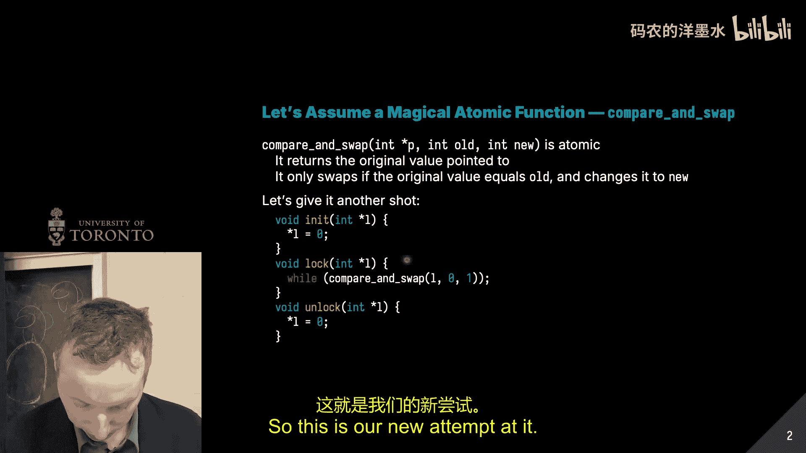

New attempt at it。And the problem we had before， right。

 we could come up with a way two threads could call this lock function。

 and both threads could make it through。 And that was because while they both originally read the initial value of 0。

 and then they operated locally on that old stale value and they both passed this lock function。

 So now what happens， if initially， the lock value is equal to。Zero， and I have two threads。

 let's call them thread1。And I have thread too。If they both call this lock function。

 only one can run first， we're just assuming concurrency here。

And we could get interrupted after any single atomic construction。This wild compare and swap， again。

 with this semicolon at the end， means that if it's false， it's basically an infinite loop， so。

Let's say thread one executes first。 So if thread1 executes first。

 then it will just immediately run this compare and swap function。

So it will take this pointer we're assuming that L is a pointer to this lock and try to atomically swap the value from 0 to 1 and it will always return the original value pointed to by that pointer L so in this case the compare and swap function will return0 so this is the original value again this is atomic so it's atomically going to return that value 0 and in this case because the old value is 0 and the current value is 0 it's going to atomically change that value from a0 to a1 so。

This thread1 will compare and swap。Set that value from a 0 to a 1。

 and compare swap is going to return 0。 So while 0 means while false means it will break out of the while loop and then pass by that lock call。

So now if Tread2 executes next， right， it only did one atomic instruction。

 it could have been interrupted before after because it's atomic。Now， if。

Thread2 calls compare and swap function。 Well， again， since this is atomic。

 it's going to look at the value pointed to by P， which in this case is one and。

The result of this compare swap is going to be one。

 and it will only change that value pointed to if the current value is 0 and the current and it will change it from a0 to a1。

 So currently the value is one。 So compare swap is going to return one。

 and it's not going to do a single thing。 So this will just return one and then it will just continue looping。

 So while true， it would just continue looping continue looping， continue looping。

 there's no way it could ever pass by this lock call until eventually thread one that has the lock right now has the lock。

 because it was a thread that went ahead and change the value of the lock from a0 to a1。

Thread 2 will not be able to make progress till eventually threadread 1 calls unlocked function again。

It is the only thread that change it from a0 to a1。

 It's the only thing that could be running this unlock if we properly have our critical section sandwiched by a lock and unlock。

 So eventually it's going to change that value to a0。

 And then when thread 2 now eventually gets to run again。 it will be able to。

Passed by this compare swap because now the value pointed at is 0 and it will go ahead and atomically swap it from a0 to a1。

Thread 1 has released the lock， and now thread 2 could go ahead， and it now has that lock。

 has the lock。 So it would be able to pass by the lock function。No problem whatsoever。

Does this seem like a good implementation of a mutex？Any issues with it？Or is it？Perfectly good and。

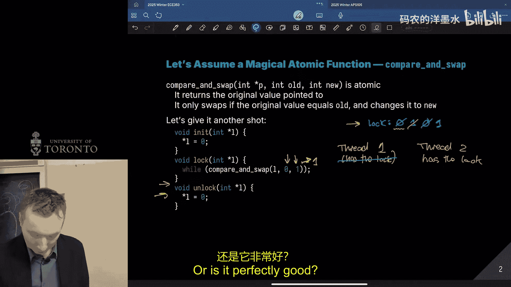

Yeah， we're great。Yeah。Yeah， there's a bit of an infinite loop problem where， hey。

If some thread is trying to get it and the current value is one。

 why bother trying to get it again and again and again and again？So。It's。It works。

 It's an implementation that works， but it's not the greatest。

 So what we implemented is essentially something called a spin lock。

 So that compareance swap is an atomic hardware instruction on pretty much every single modern CPU on X 86。

 It's called comp exchangege。Why short for compare and exchange， again。

 they have to make things short to be cool， I guess， so it can be called compare exchange。

 compare and swap， basically synyms。So this implementation works in that it is safe。

 ifs not super fair， and it has that busy weight problem where we have an infinite loop。

 so if we have a unit processor system， so something with only one physical core。

Then if we can't get the lock， one thing we should obviously do is if you can't get it and。

There's no point just trying again and again and again， I should just yield。

 I should just give up my CPU time， let another thread make progress。

 and hopefully that's the thread that has the lock and it is something that the kernel can schedule and then it eventually calls that unlock。

On a multiproces machine where I have multiple cores。

 it's not as easy a spinlock may be okay if that critical section is very short。

 maybe retrying a few times isn't that big of a deal again。It would。Now it just kind of depends。

So if I wanted to improve my lock a little bit， I could just simply add a yield right so in the body of the loop I would do while comparing swap and if it returns one which means some other thread has that lock。

 I can just be like thread yield I can give up my CPU time but this actually introduces another problem that is related to fairness。

 we have a problem called a thundering herd problem oops。😡，I sh。Apparently。

 that's the link I can click oh。So it has a thundering herd problem。

 So what that means is that if I have8 threads all trying to do the lock。Conceptually。

 I know that if I have eight threads， I'll try to get the lock。

And I unlock only one of those eight threads is's actually going to be able to acquire that lock。

 So there's no use to have7 other threads even attempt to get it。

 if we know that it's not even going to be possible for them to get it and。

Even if that wasn't the biggest problem we have， we have no control over who gets the lock next。

 so thundering herd， it is a good boxing day sale which hasn't happened for years。

You just open the doors and you just let all hell rain loose， which you probably do not want to do。

 So you want to have control over who gets the lock next。 You。

 you need to be able to reason about it。 So having something like fiIO or just a is perfectly acceptable。

So maybe I add a weight queue to the lock。 So here。Again， my core logic kind of stays the same。

 In my log function， I have wall compare and swap。If I do not acquire that loop， maybe in this。

 I add myself to a weight queue， some type of queue。😡，That I didn't implement myself。

 And then I just put myself to sleep。 So I sleep that essentially blocks this current thread until another thread wakes you up。

 So this is block until someone else nudges you back awake。 And then in the unlocked function。Well。

 it has to do a bit more work， so it has to set the value of that lock equal to0。

 so another thread could go ahead and acquire it。 but now it will also check if there's any threads in that wake queue。

 it will wake up only a single thread。 So the idea here is that instead of just letting all hell rate。

Rain loose。Threads， if they don't acquire it， kind of nicely put themselves in line。

 And then whoever unlocks some new text just wakes up the first thread in line。

 So there is two actual issues with this implementation。

 and we should be able to reason about them or。In this course， it's just assuming a single thread。

 what is an interleaving of two or more threads that causes an output that is undesirable。

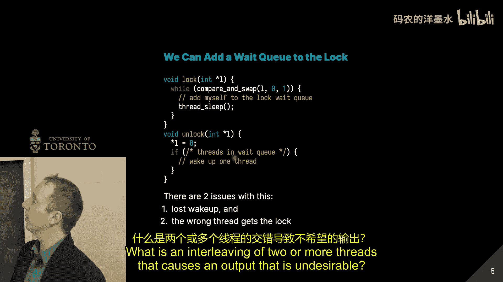

In this case there is two issues， one is called a lost wake up and what that basically means is is there a way that a thread essentially puts itself to sleep and then never gets woken up again so that would be an example of a lost wake up if that situation is possible and then the other one is the wrong thread gets locked so if thread2 is currently at the head of the line。

There should be no way that any other thread can acquire the Mutex next， except thread2。

 because it is at the beginning of the line。 So the first issue I will have you think about a little bit about how to get is the lost wake up case。

 So I'll give you a hint to For， the lost wake up case。

Assume that the current value of the lock is one and it was set by thread 1。

 So threadread 1 currently has the muex。 So we have thread 1 has the mutex。

 and then we are going to come up with an inner leaving of calls such that thread。

Another thread puts itself to sleep and doesn't get woken up。 So thread  one that has that lock。

 I'll give you hint that it is running this unlock。Function， so thread 1 has a lock。

 It's running the unlock function， and thread2 currently does not have that lock。

 but it is currently running the unlock function。 So I will give you a minute or two to think of an inter leavingaving of these threads。

 thread1 that is calling unlock currently has that lock。

 and thread2 that is currently calling lock that does not have that lock。

 So is there a possible inter leavingaving of these threads。

 such that thread 2 puts itself to sleep and never wakes up Aka。

 I like saying it just goes into a coma。So I will give you， let's say。

 I'll give you like a minute and a half to think about it。Alrighty， can anyone guide me to a？

Bad or horrific outcome here。So which thread should start running first for something bad to happen？

50，50， yeah。That once a one in the unlocker。Thread one is doing the unlock。Yeah， that too。So， true。

Okay， so thread2 executes first， so it would do this compare and swap。

 so compare and swap right now the value of that lock is one。

 so compare and swap is going to return one， so the next thing it would execute is this line All right。

 who should go。So now it switches to thread1。But then the way he was that。So thread one。Execcuts。

 it changes that value from a1 to a 0。 So now the current value is 0。And now what？ある造。

So thread1 continues。 So thread one would check。 Let's draw our weight queue。 So wait。Q。😔，Currently。

 our weight queue is empty。So it would check if there's threads in the W queue。

 currently there is no thread， so this will be false， so it will just finish。

 finish the en law call it's done。Now thread 2 will execute right， if thread 2 executes next。

 it will add itself to the weight queue， will just be nice and assume that that's atomic。

 so thread2 would add itself to the weight queue。And then put itself to sleep。 So now it's blocked。

 Now， thread2 is asleep。And。Now， if that's the last time we call unlock inner our function。

 it's asleep forever， right， it was put to sleep and now it's gone， it's a a coma。Everyone get that。

So。Let us rewind a bit and go to the next bad one。 So next bad case。Oops。

So next bad case is the wrong thread gets that lock。 So I will rewind a bit。

And create a new situation with you， so this will be slightly easier than exam because I'm giving you a good situation。

But let's assume we are in the current state of something like we had before。

 So we had the lock value was one， and thread 1 was the one that locked it。So thread1 has the luck。

And。It's calling this unlock function。Let's assume that we already have thread2。And thread2。

 tried to get that lock， right， It did the compare swap。 It got one。

 It added itself to the weight queue。So it adds itself to the W queue。

And since it's added itself to the weight queue， it should be the next thread that acquires the lock when thread1 eventually unlocks it。

 right？So let's also assume we have this pesky。Thread 3。So。

Let's assume we have thread3 and thread3 is the one calling this lock function。

 So in order for the wrong thread to get the lock， there has to be some interleaving of threads such that when thread 1 unlocks that lock。

 thread3 actually gets it instead of thread 2 because thread2 is politely standing at the front of the line。

 there should be no way that thread3 kind of swoops in buts ahead in line and acquires that lock。

 So I'll give you another minute to think about what inter leaving of in this case since thread2 is blocked。

Because it is currently asleep。So interleaving between thread 1 and thread 3。

 such that thread 3 acquires that lock instead of thread 2。So again。

 I'll give you another minute to think about that。Alrighty， who can save me？有。Alright， so yeah。

 first one。 let's assume thread1 runs first。 So it changes that value of the lock from a。One oops。

 a 12 a0。So it has essentially given up that lock。一。Checks the lock。 Yeah。

 and then we immediately start executing thread 3， right， So if thread 3 executes next now。

 So it would check that value of the lock currently， it is a0。

 so it will happily change the value from a0 to a1 atomically right， And now thread3 has that lock。

So。Thread 3， this would return 0。 It would pass by， and it's done already。

 So it just immediately swooped the lock by the head in line。 and that was it。That was pretty quick。

 right？So what's going to happen now if we assume that， hey。Thread3 is now done。

 threadhread3 has that lock。 Well we can play this out just to see what would happen。

 Nothing bad is going to happen other than the wrong order of threads is going to happen so what's going to happen if we continued on with this thread1 is going to if it's picked to run again check for threads in the wake queue Currently thread2 is in the wake queue so it's going to wake up one thread so it would remove this from the wake queue it essentially would get unblocked。

And it essentially would return from this thread sleep function。

 So since it returned from thread sleep， it looks like it returned from thread sleep。

 So it's in a wallop。 So it'll go back up， check this condition again。 So compare and swap in this。

Instance， they'll do something that it didn't expect， but not wrong。 Check the current value。

 The current value is one because thread3 has it。 Soll just re itself safely to that weight queue and then just go back to sleep again because someone else has stolen its's lock。

 So nothing bad happened other than the wrong order threads occur。 So now it's back sleep again。

 So any questions about that。All right。

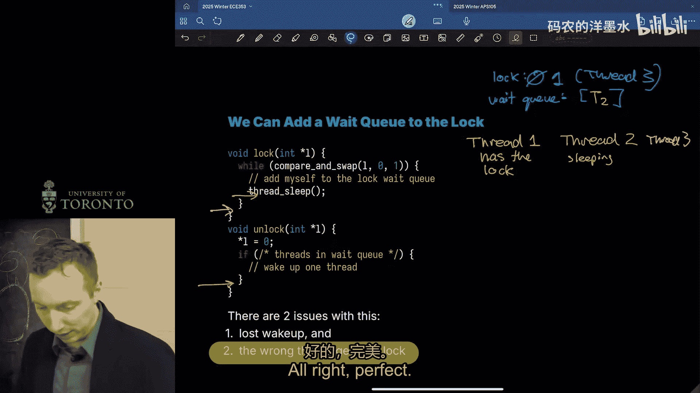

Perfect， so those were two issues that we need to fix。

 We need to fix that last wake up in the wrong thread getting the lock。

 So here is an error leaving for the last wake up。 Just so you have it on the slides。 And again。

 here's an narrow leaving for the wrong thread getting the lock。So。

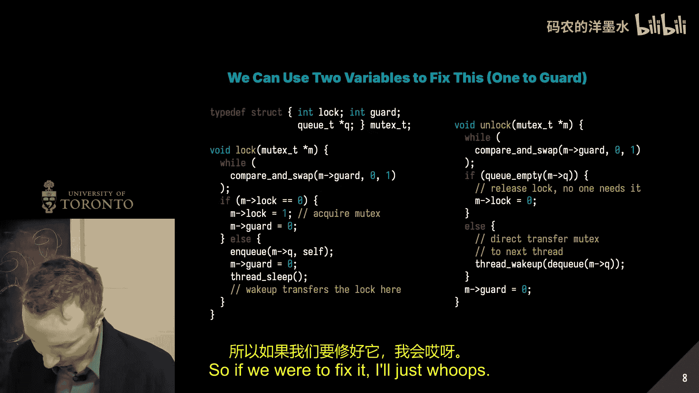

If we were to fix it， I'll just whoops。Skip ahead。 So this is how we would have to fix it。

 So this is our implementation that could fix it， so。This。Has a few things going on。

So like we had before where there was an integer keeping track of the current value of this muex。

 whether it is locked or not， we still have that。 It is called int lock and it is in this muttex struck。

 So we're going to need some other things to keep track of in this mutex rather than just the variable。

 So we're going to have this int guard。 So this will be used。Used。Internally。As a spin lock。

So we essentially had a data race before， so in order to fix that。

We're going to use a spin lock internally because it worked。

 It had some problems where it has a busy weight problem。 but in this case。

 we're assuming we're using a multi core machine and。These functions are pretty small。

 so we're going to use it internally as a spin lock。

 and then I'm also going to represent this weight Q as just a Q underscore T。

 So our implementation in order to read it，What I'm going to do is this wall compare and swap of the guard。

 That essentially is just a lock of the spin lock。 So in order to make this a bit more readable。

 I could just go ahead and replace this whoops。Replace this compare and swap of the guard。

Just get rid of it。And in order to read this， I can assume it's pretty much the equivalent as like a spin lock。

Lock call for the guard。Or to shorten it is's just a lock of the guard。

 And then whenever I set the guard equal to 0， that's the same as unlocking it。 So I can change this。

 if I want。Gd of  zero。And go of zero。So these two things are essentially the equivalent of unlock。

Gird。And unlock。Gard。So now the idea is in the lock， I acquire that so that only one thread can。

 like it essentially makes the whole thing a critical section。

 So only one thread can make progress in this lock function at once。 So because of that。

 I can go ahead and oh， God， that's not going work， is it。So because of that。

I can just immediately check the value of the lock and I don't have to protect that because now I know I'm operating under mutual exclusion。

 I don't have to use compare and swap in this case because I'm the only thread that can be doing this so there's two cases if the lock is currently unlocked I just acquire it I change that value from a0 to a1 and then I just unlock that guard that's the only thing I have to do in the case that no one else is waiting for it or sorry in the case that is not locked already。

Otherwise， if it's already locked。This line is， essentially。Add。Self。To Q。

And then it unlocks that guard so that another thread can actually make progress and either do the unlock or the lock call。

 So then it puts itself to sleep。 And in both cases， the if right， we unlock thate that guard。

Then in the unlocked call， again， we can go ahead and make this a little bit more readable where this compare swap of the guard that is essentially the exact same as a lock。

To guard。And。This， at the end， whenever we are changing the value of the guard from。A12 a0。

That is the same as， let me get rid of it。That is exactly the same as unlocking the guard。

 so the rest of it is a critical section。So， now。If we have a thread that is unlocking。

 locks the guard， make sure no one else can go ahead and add themselves in the queue。

 check if the queue is empty， if it is empty， then just release the lock。

 no one needs it so it would change that value from a1 to a0。 and then otherwise we can。甚次是。

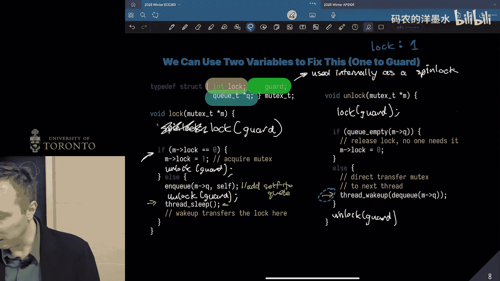

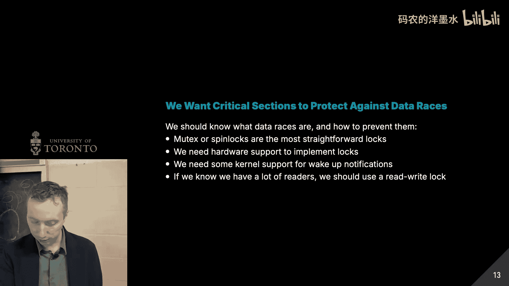

。Just test test。Whooped。

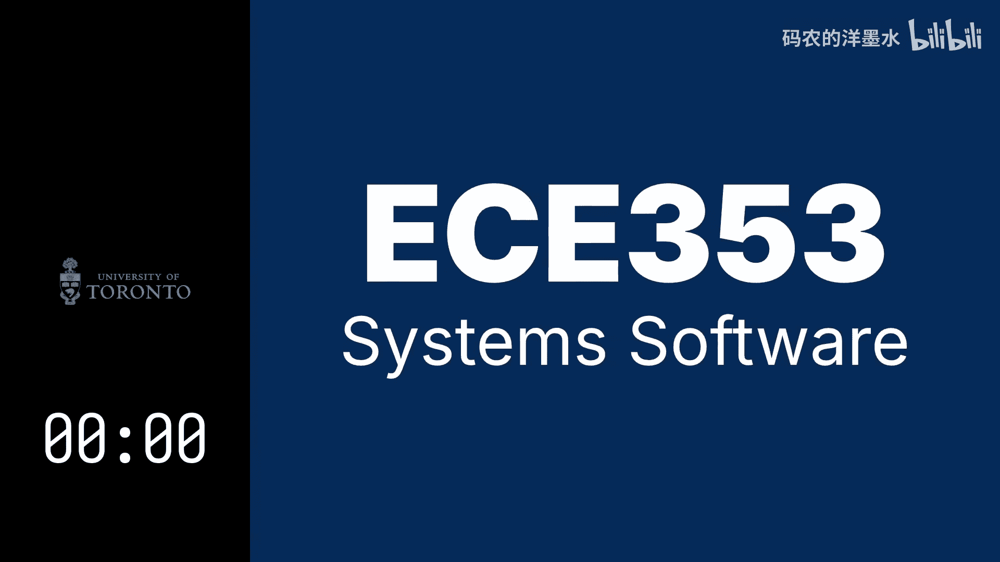

Alrighty， so back on track。So we have locks now in our toolbox， they ensure mutual exclusion。

 only one thread at a time can execute between the lock and unlock calls。

Doesn't really help us if we need to ensure ordering between threads。

 So that's going to be our next thing。 So how do we ensure order between two threads's。

Have this problem where we have two threads， threadread1 is executing this function called print first。

 and it prints off， this is first threadread2 prints off or runs this function called print second。

 where it prints off， I'm going to second。And we want threadread one to always go before threadread2。

Also， recall here that now if we have two threads all executing at the same time。

 we have to make sure that the functions we use are called are something called threada。

 which you would need to in。 So if I look at the documentation for print F。

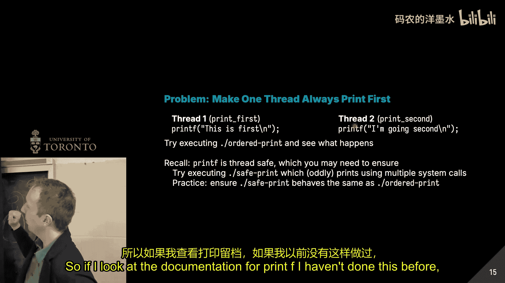

I haven't done this before， but if I look at the documentation for print F， whoops， I do man print F。

And I go all the way to， oh， that's not the right one， if I do man3 print F。Yeah。

 that's the C standard library one。And if I go to attributes。

I can see that it says like gives me all the interfaces。 So it gives me all these function calls。

 And then they it's so important that they have this separate little attribute here called thread safety。

 And the value is empty safe。 That's multi threaded safe。 So this function is thread safe。

 You are allowed to call it with multiple threads。😊，As just a little。Issue， so if you didn't。

If it wasn't threada， one implementation of print F for that whole string could be like this。

 It could be three separate right system calls that we can assume are atomic。

 but it could be like this is first， I'm going second。

 So if I use this and execute this program where。I'm assuming print F is not thread safe。

 and I run this， was it safe print？I should see something weird like I'm this。

 I'm going second is first。Because I don't know what the order between the two threads are。

 I only know that between one thread it will go in order， so thread1 printed this。

 then thread2 executed， printed I'm then going， then second and then the first thread came in and printed this is first and again when I execute this。

 I would see might get lucky， this is first， I'm going second in which case I have no bugs。

Still have no bugs。 still have no bugs。 still have no bugs。 Wow， what the hell。 Oh， I'm。

 this is first going second。 This I'm is going first second。

 So this is what would happen if print F was not thread safe。 So how would I make。This thread safe。

 if I， you know， if I want to make sure this is thread safe， what would I need to do。Yeah。Yeah。

 create a mut text and then just have a lock and unlock around the three rights from both of them so that I'm guaranteed that I see a single line at a time。

 So thankfully for us， print F is thread safe， so。😊，Because it's threads safefe。

 I will see the whole line all at once， so now if I have this program called Order print。

What I want is to make sure。I always see this is first， and I'm going second。

 If I run it a few times， I can see that， hey， it works right now， no bugs whatsoever。

If I run it a few more times， this is first， oh， there we go， unlucky。

So anyone have any ideas how we could guarantee that this is first print all the time and I'm going second print next。

Yeah。said。Yeah， so we can like。Basically create a variable like， oh no。

 like a flag or something like that。And then like。Have this thread， I dont know。

 set flag is equal to1。Oops。And this thread wait until thread is equal to one or flag is equal to one before progressing something like that。

 right？So yeah， we could do that。In general， we'd probably have to protect against data races and things like this。

 but probably fine in this case is we only change that value once。So。

What we are going to use is something more general， but that same idea of a flag。

 So we are going to use something called a cent for。

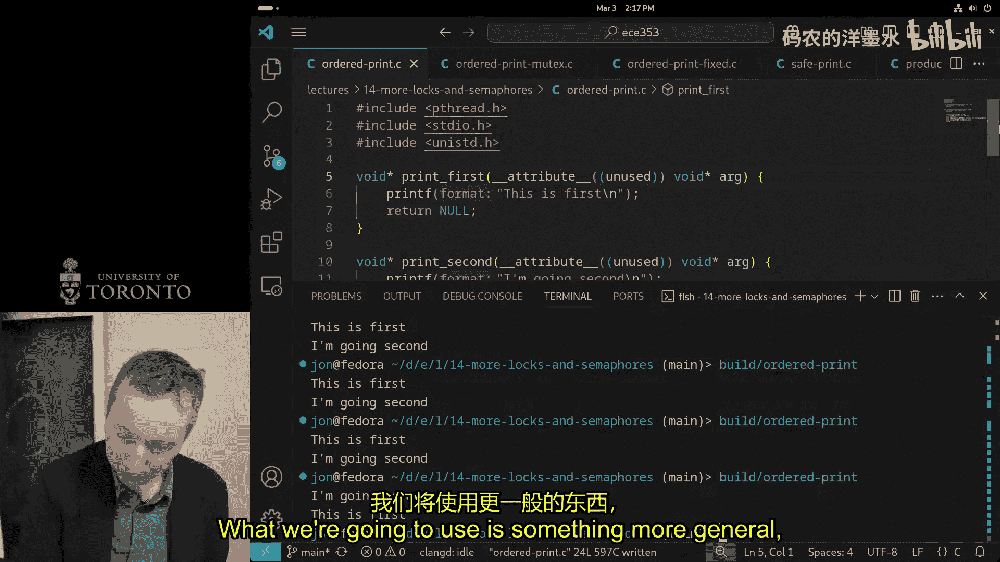

So a74， anyone know what that word actually means in。

Normal English has anyone ever heard of this word before？Any maritime people？Anyone like big boats。

 no， so yeah。Yeah， that's this thing where you hold flags。 So for shipping or ships， I don't know。

 I'm not a boat super boat person。In order to synchronize or in ordering between boats。

 like if you have huge shipping ships， probably important to make sure little actual wave in the air flags that have different symbols on them that you wave to other ships to signify your intent and then they reply with another flag and they mean something is basically making sure you two are synchronizing yourselves and going in some order。

 So we stole that word in computer science and we use it for signaling between threads and our signaling between threads is just what order things happen in。

 So centaphores， unlike ships are a lot simpler for us they just have a value and that value is just an integer value。

 In fact， a integer value greater or equal to zero that's shared between threads so it could actually be shared between processes if you want to ensure ordering between two processes。

 but for this course， we're just going to care about threads。

And the way that a74 works for us is it thankfully only has two fundamental operations。

 they are atomic and they are quite easy to reason about。

 so a74 just think about as just an integer and the weight function will decrement that value atomically and the post operation will increment that value atomically and that's basically all there is to it except for one simple rule。

 so weight blocks until that value is greater than0。

 so weight will guarantee that it actually decrements that value and that value will never be negative。

 so if the current value is0 and some thread calls weight while the current value is 0 and it's not allowed to go negative。

 it will not decrement0 to negative1 it's going to wait for another thread to increment it from0 to1 before it is allowed to decrement it probably from1 to0。

 So how they work。😊，Initially， I can set that value to whatever you want。

 The way to think about it and we'll get some practice as well is that that is the number of weight calls that can occur without any。

Without blocking， without any post calls being required。So。74 API is similar to P thread locks。

 I include 74 dot H and to initialize it。 again， I have to give it the pointer to the sum underscore T in order to initialize it and it has a few other variables。

 So this int P shared。That signifies whether or not this should be74 should be shared between processes。

 so that controls what happens when you fork。 so if I fork and p shared is1 then my new child process will have the same set4。

 Any changes that happen to it will be reflected in both processes so I can use it for inter processcesed communication or ordering between processes so for this course we're just going to set it to be0。

 so that is independent within a process and then the next value is unsigned value so that is the initial value of the se4 and then since we have an init we have a destroy and then we have the weight function so again weight will decrement it。

And it will only decrement it。 The special rule is if that value is going to be greater than0。

 so it's not allowed to be negative at any point。And weight will block until it can decrement it like we had a trilock before there is a try weight so that is a non- blocking version that will tell you whether or not it was able to decrement it yes or no。

 then we have post which is just a fancy fun word for incrementmenting so all these functions will return zero on success。

Minus try weight， we will probably just ignore their return value and assume they always return true。

 or return no errors。So。If we want to make sure one thread always prints first。

 we can use a center4 which just kind of takes that flag idea。

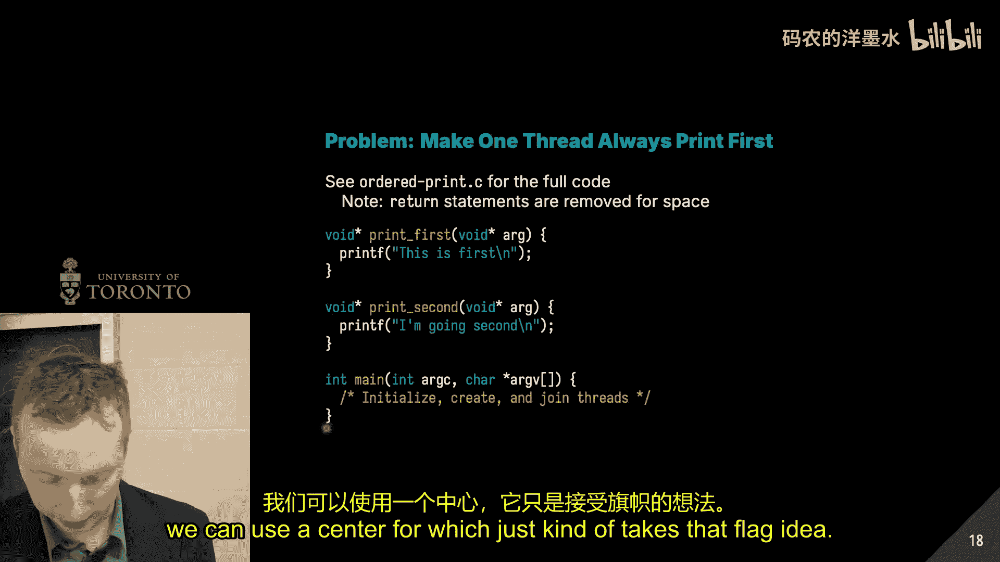

So if we want to do this using a senophore。How I like to do it is well for this we need to ensure some type of ordering between these threads。

 so I need to create a semapho， I'll call it just S because I am very creative we have to include the library so include semapho。

 H。So I create a sepho called Sma because again I'm creative so the first thing I find the easiest if we want to ensure order is first you want to place the weight call so if I want to place the weight call I have to think about well what do I want not to happen and in this case what I want not to happen is I don't want the second thread if it gets picked to execute to print I'm going second until the first thread is done so what I could do is first thing I can do is place my weight call here so I want to wait on the semapho。

Until something happens o。So。After I wait， the next thing I like to think about is what the initial value should be。

 So here I have to initialize my S before so I could do sum and knit。

Give it the address of Sam P shirt to 0。 And then I can think about what the initial value should be。

 So the initial value should be。The way to think about is how many threads can actually pass by weight without a single thread calling post。

 So in this case， what probably do I want the initial value to be。0， right。

 So if the initial value is 0 right now。How we have it set up is。We create two threads。

They could execute。 We don't know which one is going to execute first。 So right now， if print second。

 we're to execute first and now。We added the same weight and the initial value is 0。

 so if the current value is0， then this weight will block until it can actually decrement that value so that it will wait until it's greater than zero so this will wait it will block until in this case someone actually post to it so now the next thing to do is to place my post。

 where should I place post。Yeah。Yeah， after I print， this is first， right， whoops？

So after I print first， I can post that semapho。So this will be blocked。

 it will be waiting and then the only way now for the second thread to print I'm going second is the first thread has to print。

 I'm going first， then post， which would increment the value that set it for from a0 to a1 and now the second thread if it get picks to execute。

 it could be unblocked and then decrement that value from a1 to a0 print I'm going second and now I'm guaranteed that that order happens。

So I can compile this now。And then check that indeed， no matter how many times I run it。

 I will always get this is first and then I'm going second。

And I also have the added benefit that if I had some more code here， so more code。

More code in these threads。That。Aside from the ordering， so this is first and this is second。

 the more code in both the threads could run in parallel as well， which would be nice and good。

 I only want a bit of ordering just ordering between those two print statements。

So any questions about that？Alright， so I will give you this brain teaser then。

 So I argue to you that I do not need a center 4。 So I already have these mutex things。

 So why don't I just create a muttex and I use it like this。So。Initially。

 that mutex is going to be unlocked。 So what I'm going to do is in my second call。

 I'm just going to call lock twice。 So I'll call lock twice。 So if I get it and I。

If thread2 executes first， it locks the muttex， so it acquires that mutex。

 and then it locks it again， which I mean， would be blocked because some thread already has acquired the mutex。

 it's me。And then the other thread runs print first， Princessses first， then unlocks that mutt。

 So now this lock would be able to pass and then print， I'm going second。Yeah。H。So the question is。

 what if entire print first happens before print second even runs， So what would happen in that case。

 So if print first runs first。We do print F like this is first， then do the unlocked call。

K of looks okay。 This is first happened first。 That's good。 That's our order。 But now， yeah。

 we call unlock The current Muex is unlocked， right， So we unlocked and already unlocked Muex。

You might imagine that does nothing。Then thread2 executes， it locks， so it acquires that mutex。

 and that unlocks again。And now it's kind of screwed because no one's going to unlock it， right？

So if I run this， turns out that that is- well， it turns out this is a terrible idea for more than one reason。

 but if I run it， hey， it worked。Hey， it worked。Oh no。

 this is a case you said where now blocked the second thread is blocked forever。

 so the first thread ran， the unlock essentially did nothing， and then it locked。

 acquired the muttex and then locked again， but no one else is going to unlock it。

 so thread2 gets blocked forever。So this doesn't quite work。 It kind of had that same idea， but。

You should use Mu Texas for mutual exclusion。 In fact， if you read the documentation。

This is full of undefined behavior，It is technically undefined behavior to unlock a。Unlocked mutex。

 So technically， if the first thread executes and hits this unlocked where。It's。Already unlocked。

 that is undefined behavior， and it is also undefined behavior to have an unlocked call happen from a different thread that did not initiate the initial lock call。

 So in this case， it kind of works， but technically it has two instances of undefined behavior。

 and it doesn't work all the time。 So the two are not equivalent。So everyone get that。

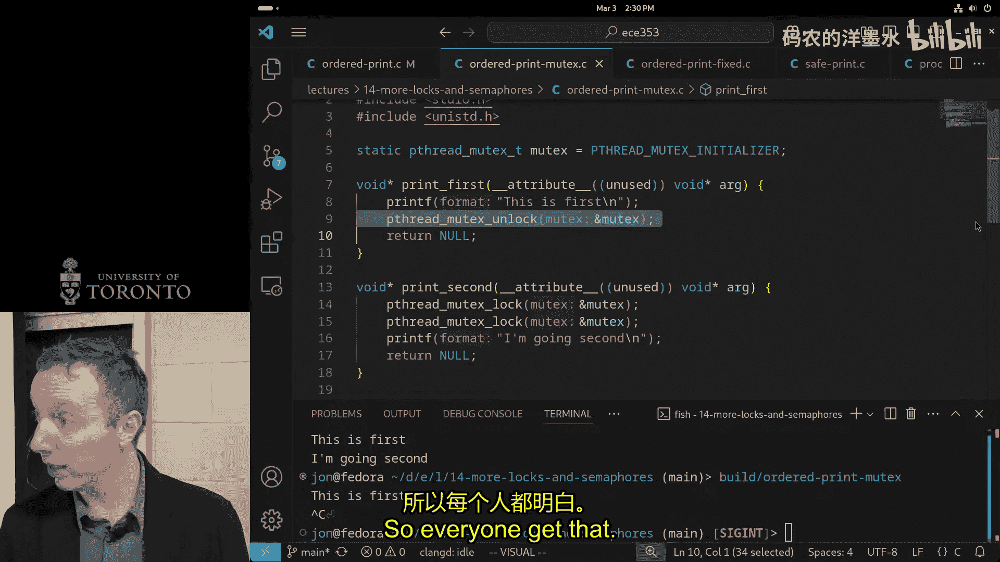

All right， do not use a muttex for that。But。Well， it kind of looked similar。

 so can we use a centenophore as a mutex， if so， how would we do it？So what would we replace lock by。

 what would we replace unlocked by， and what should our initial value be because they kind of look similar。

 right？Yeah。In。Yeah， so they look exactly equivalent right so if the initial value is0 weights the same as lock and post is the same as unlock。

 oh wait initial value0。Not quite。 So if the initial value is 0 and lock is replaced by weight， then。

Everyone will just block immediately， right？ So what should the initial value be 1， right？

 So if the initial value is one and we replace lock by weight and unlock by post。

 it's essentially is mutex。So if I wanted to， I could do that。

And replace a mutex by a sephore if I want， a mutex is basically a special case of a cent for。

 So in that case where we had a data race with counter， instead of using a mutex。

 what I could do is create a new centnopho。 And then instead of luck， I do wait， which would。

Derement that value from1 to a0 if another thread tried to wait。

 then it would block because the current value is 0 and it will wait until I post it back from a0 to a1 and then one thread can go ahead and make progress so works the exact same if I use you know weight for lock。

 post for unlocklock and the initial value is1 behaves exactly like a muex。So。

It does behave exactly like a muttex， however。It kind of depends on the initial value。

 So if I change that initial value to 2， does it work as a mut now。No。

 that means two threads could be doing that counter at the same time， which case I have a data race。

 so if I want mutual exclusion， it's easier just to use a Mu textex because that's what you actually want。

In order for a se forward to be correct， you have to make sure the initial value is correct and typically that's further away from the weight and the post call。

 so it's a bit harder to argue about it， so even though you could use it for mutual exclusion。

 I would highly recommend you do not do that。All right。

 so next problem is let's do this classical problem that is lots of fun。

 so let's see if we can come up with a solution to the producer consumer problem。

So assume we have a circular buffer。 So it is just a of elements where each slot is either empty with some data or filled with some data。

 So we have an array。 the indices are 01 all the way up to size or n-1 where n is our size and it's circular because if we make it to the end we just wrap around to the beginning。

 So what we're going to do is we'll have a whole bunch of producer threads that should write to the buffer and the rule rule is。

 they should write to that buffer if it's not full。

 because otherwise it would be overr data that hasn't been read by a consumer and the consumer all it does is read data。

 So it should not read empty spots in the buffer。 it should only read filled slots and take the data out of it。

 So the rule is。Which I'm going to implement for you to ensure we don't have all data races or anything like that。

 All consumers are going to share an index and all producers are going to share an index and in both cases initial index is going to be zero and increase sequentially so we're going to have lots of producer threads。

 lots of consumer threads， but all the threads will share a common index with their kind so we don't have any data races or anything like that。

 So the producers are going to fill up this buffer and the consumers are going to read data from this buffer and we'll assume it is initially empty。

So。

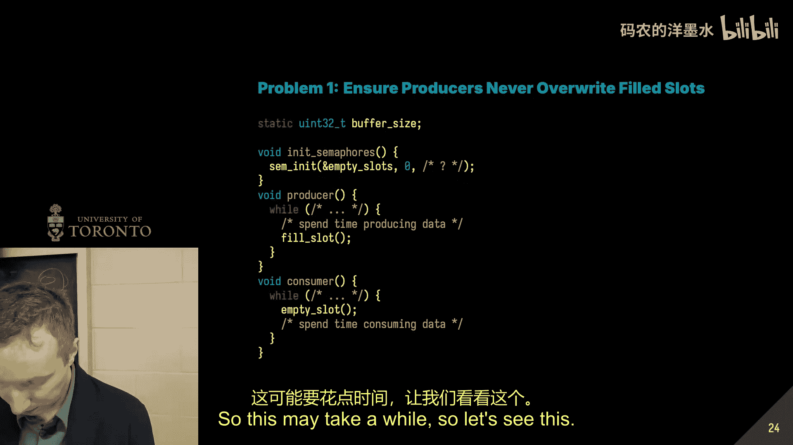

This may take a while， so let's see this。So VM。So。In this。

 I have we're going to need some centaphores to produce some ordering。

 so I have some boilerplate function here called initialized senophores that were going to use。

And then in my producer code。This while try weight thing here。

 just ignore this because I'm going to use a center4 to keep track of how many elements I'm producing and consuming if this was a real producer consumer question。

 this essentially would be an infinite loop。Imagine this is just an infinite loop。

 Just ignore this right now。 These are all this is a code。 All my producer threads are going to run。

 and what they're going to do is we'll just simulate doing some work。

 So we need to do something to actually create some data and then we are going to fill a slot。

 So this fill slot function is going to write data into that array。

 and that's all the producers are going to do is just filling data into that array。

 and then we have consumers that again ignore this line。

 This if it was a real program would be an infinite loop of just going ahead and reading data or empty slot。

 So what empty slot will do is go ahead and read some information from that array。

 and then after it reads it we can go ahead and reuse that slot。

 So it would have a sleep after it that I simulate， it would doing some work。 So it reads some data。

 it does some work that we assume that can be done in parallel so。If we run this as it sins。

I wrote a bunch of other code。And it also has a bunch of parameters that you can play with。

 so it will numb producers， how many producer threads there are， N consumer is， how many consumers。

Threads there are none to produces how many elements we're going to produce in total and then buffer size is going to be the size of that array so by default we're going to produce 15 things and the buffer size is 10 and then I also had it for fun we can adjust how long it takes to produce something and how long it takes to consume something so if we run this right now I also have a whole bunch of messages that will。

Show me in red letters， whether or not I did something bad。

 So if I tried to fill a slot that was already filled， like I'm overr data， It displays in red。

 Or if I empty a slot that is already empty， it also gives me some red。

Display where it shows me I did something bad。 So let's assume we have just， I don't know。

 say we have 10 producers and five consumers。 If I run that， I saw that， I have some red text。

 So if we go up to the beginning。We'll see that it looks like my consumer threads ran first。

 where it emptied slot1， or was zero， sorry， but was already empty。

 Then another thread emptied slot 1。 It was already empty， empty slot 2。 It was already empty。

Slot3 empty， slot4 empty and that were my five threads。

 then my producer threads filled slots9 through 10 or sorry，0 through9， which is1 through 10。

And then， well， oh， the next time the consumers ran， that was okay because they read valid data。

 They missed a few the first ones， but it seemed to be okay。

 And then my producer threads now have overwritten that data。

 so they have overwritten the data in slot 0。 So no one was able to read from it until it overrode it。

 So that slot is already filled。 I shouldn't have filled it and then same with the rest of these threads。

 And then at this point。I've already produced 15 elements， so all of my producer threads are done。

 and then my consumer threads just finished by reading that data that has been overwritten。

 so we missed out on five things。So。That kind of clear what we're working with right now。All right。

Fix it。So。Any guesses as how as to how we would fix this to make sure that we do not。Overwrite any。

Like we don't fill any slots that already have data in them and we don't empty any slots that are already emptied。

So I'll give you hit， we have to use Center4s， this is the Center4 lecture。

 and we can use multiple of them。Yeah。So。we kind of need like a queue to make sure that they wait in line if there's nothing to do。

Semaphorees will be implemented using a queuee， so we're going to use semaphorees to do thequeuing thing。

Okay。Oh， so you can't think of the numbering scheme。 All right， so let's go over so。

Even these complicated questions， whenever we need to place a sephore。

 we need some ordering between threads。 So first thing I always recommend doing。

I always do things in this order， so I think about what I need to wait for first so where do I need to place a weight call and then after I know where to place a weight call probably gives you a good indication of what I'm waiting for so then you can come up with a good name for it and then come up with an initial value so what is one thing I need to wait for in this case。

Yeah。Prods。Yeah， wait for。Well， I need to do some waiting in a producer right。

 so I need to wait for a producer to do something。 So where do I need to add a weight call then。

So if I'm waiting for yeah。Before the empty slot。 So yeah， here if I。

Want my producer to wait for some or wait until the producer does something。 Well。

 I have to add some weight here in my consumer So now。

This is a good indication I need to wait on something in order to empty a slot。

What am I waiting on if I'm trying to give a name to that， So conceptually， I'm waiting for what。

 yeah。Yeah， I'm waiting for like some element to be filled。 or in this case。

 I'll just give you an name。 I'm waiting for a filled slot in this case， right。

 so I can only empty a slot that is filled。 So that gives me a good idea that the name for the same for should be something like filled slots or something like that。

😊，So that is。Whoops， did I mess up， oh vim disabled， let's not do that， all right， let's enable。

I want to wait for some sample4 called filled slots。

 So now that gives me a good opportunity that I can create it now。 so I'll create it。

 It's called filled slots。😊，Filled slots。And now the second thing I like to do is come up with an initial value。

 let me get rid of that compiler warning。So oops， I should look at my laptop。

 not the leg with that screen， so I want to initialize filled slots value and then initialize it with an initial value。

 so that is how many threads can make it by the weight call without a single post happening。

 so in this case if I leave it blank and I look here。How many threads do I。

 how many consumer threads should immediately pass by this weight call？Zero， right？

Everyone agree with zero。 So if it's zero， that means if a consumer thread gets scheduled to run first。

 then it will wait。 It will block until that we have actually filled a slot right and it kind of makes sense that hey。

We named it filled slots， and the value is referring to how many slots that are filled kind of makes sense。

 So the initial value of that is0。All right， well， now we place our post。

 so where should I place a post， so what indicates that I have filled a slot？Yeah。Yeah。

 right after this fill slot function right， So after that， if I do S post。Fillled slots。

Then that should be it， right？So。Now， if my consumer thread。Get scheduled to run first。

 even if I have 10 of them， they will all wait here and then say I only have a single producer thread。

 Well then it will fill a slot。 It will post。 So increase that value from a initial value of 0 to a one。

 and then only one of the 10 consumer threads will get unblocked， run empty a slot。 All good。

 nothing bad should happen， right So let's try that。

 I shouldn't get the message anymore that I am emptying a already empty slot right。So。If I compile。

 make sure I compile。And then I run it again， let's do the extreme case where let's say we have。

One producer and 10 consumers。 So we can see that， hey， that seems to work， right。

 So we see all the time that even though we have a bunch。

 we wait in order for our producer to fill a slot。 And even though we have a ton of consumers。

In this case， it gets filled immediately emptied， filled immediately emptied。

 filled immediately emptied。 So it works all good。 We have fixed that issue。

 We can test the other extreme where we have 10 producers and only one consumer。 Oh。

 in which case we get both errors again。 But with this。

The only error that's actually important is the first error that happens。 After that。

 things go off the rails。 So if we scroll up， the first error that happened was not that we emptied a slot that was already empty。

 The first error was that the slot we filled the slot that was already filled so。

Now we have to fix that。 So how would we fix that problem where we want to make sure we don't fill a slot that is already filled。

 So again， loops。Again， easiest thing to do is to figure out where we need to place our post call。

So any guesses as to where we need to。Create a post or sorry， a wait call， wait wait。Yeah。Yeah。

 before this fill slot function， right，I need to have a wait call right here。

 So what am I waiting on。Yeah， waiting for consumers to buy us。

Yeah I'm waiting for the consumer to actually consume something so there's actually a empty slot right so if I were to give it a name Im basically you can give it all sorts of names。

 the name I like to give it is just emptied slots right the number of emptied slots so I'm waiting for an emptied slot。

Okay， I can't spell。Alright， so I should name my 74 emptied slots。 So now I'll go ahead， create it。

Empied slots， and now I have to worry about the initial value， right？I thought。So。

What should the initial value be？Yeah。Yeah， the number of slots or in general the size of the buffer。

 which。Thankfully I have here as a global variable called buffer size。

 so the initial value should be buffer size so I could fill up the entire buffer before you know any consumer threads run。

 which kind of makes sense right so the initial value of empty slots also it makes sense conceptually that。

😊，If initially everything， all the slots are emptied， then I have buffer size of empty sloths。

 So are we done yet。Or did I forget something？Yeah， I forgot the post， right。

 where do I put the post？Yeah。Yeah， after I empty the slot。 So now here I could do sim。E post。

Empptied slots， so each time I empty a slot boom。I just signified I have emptied it。

 so now I can go ahead， compile this。And the problem the situation that gave us a problem before was we had we had 10 producers and one consumer。

 So now if I run it， boom， no red text whatsoever。 I can see that kind of ran as I would expect。

 So I filled slot 1。 all of my producer threads immediately filled all the slots。

 but I only had one consumer thread。 So it was slow it only emptied slot 0。 soon as it emptied slot0。

Then we filled slot 0。 and then while we have lots of producer threads。

 there I'll essentially be chomping at the bit to insert the next one。 So as soon as I emptied it。

They immediately filled it， empty， filled， empty filled， empty filled。

 And then eventually we're done filling all of the elements。

 And then we just wait for the consumer thread to finally finish everything。 And now。

 no matter what kind of random interleaving of different threads we do， we can see that again。

We'll have no red text。 Everything is now properly synchronized， and we have the benefit that。Again。

 this。Thing where we simulate doing work and simulate doing some work in both cases that could be done in parallel between the threads and I have。

They're all properly synchronized。 They're all running an order。

 We're making sure that we don't break our buffer or anything。 Everything works great。

 So any questions about that。So took something very complicated。

 and then we just broke it down so again。For set4 is anything you want to ensure the order between two different threads。

 easiest thing to do， create a set of4 I。You'll have to create a seform。

 but the easiest thing to do is first place the weight， then give a name to it。

 then determine the initial value， then figure out where to post。Oh， yeah。

 so the question is what the hell of the triweightte call is doing。

In order to make sure that I produce exactly 15 things。

 I just cheat a little bit and I use a center for。Since I'm producing 15 things。

 I create this producer remaining therefo that's initial value is 15 and then try weight just dec it every time so I'm guaranteed I create like this runs 15 times。

三啊。Yeah， I'm just using a sefo just as a way to kind of cheat and just like atomically make sure that I don't have any data races。

 I produce exactly 15 things。 So that's why I said。

 kind of ignore that because I'm kind of cheating a little bit in a real program。

 that would just be like an infinite loop。 you'd have all your consumers just。

Pro consuming data and all your producers just。Producing data until you reach the end of whatever file you're producing them from or whatever。

All right， any other questions about that， fairly complicated example。

 but yes break it down one step at a time。You'll see in past exams and whatever if you want ordering between multiple threads。

 then you're going to have to create a center4 for each ordering between threads。

 so there's lots of practice questions for that and we'll probably go over them again soon。

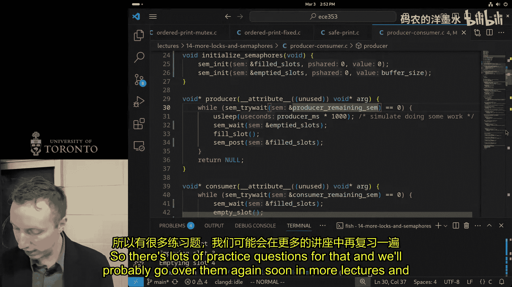

More lectures。That's some more practice。But。As a summary。

 we use set force to ensure ordering between threads。SoPrevious， we ensured mutual exclusion。

 now we can ensure some type of order， so how 74s work？They contain an initial value that you choose。

You increment that value using the post， it's guaranteed to be atomics so you don't have to worry about data races。

 then you can decrement atomically using that weight function and the only special thing about it is it will block if that current value is0 because the value of the cent4 is not allowed to go negative so data races could still happen with ordering so you still need to prevent them。

That's generally the hardest part of programming we again will have more examples with that。

 but for now that is the end of today's lecture so just remember pulling for you。

 we're on this together and watch out because you might have a data race in lab4 so some of you have been working on that。

Everyone mallocing and fun things like that。Everyone using Riloc arrayray。

Make sure you don't have a data race because you cant have a data race and it tripped me up before。

 so a data race is basically using a still value， so make sure that when you come back from a swap context。

Alloc array could move your array， make sure you reread it because it might be stale by the time you swap context back to that location。

 so that is a major hint and probably the hardest thing you'll have to debug because。Aside from that。

 that's the only thing that tripped me up and my code actually had a bug on for my first solution。

 yikes。

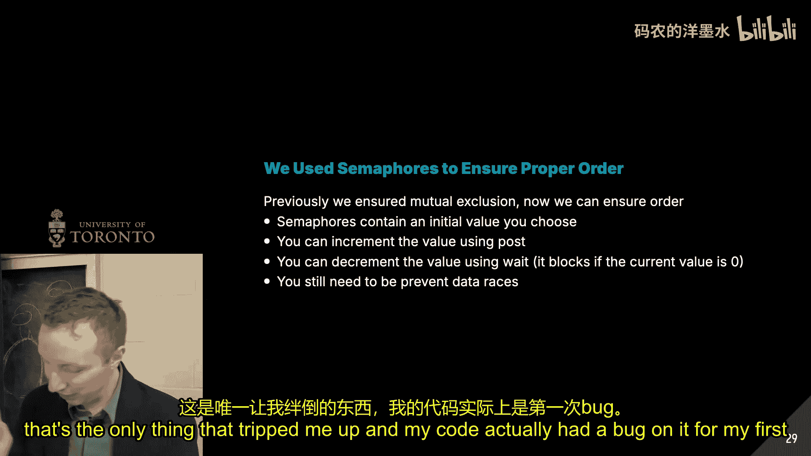

Take that word of advice and with that good luck。