# 系统软件设计与编程：14：更多锁与信号量


在本节课中，我们将继续探讨并发编程中的核心同步原语。我们将深入理解如何利用硬件原子指令实现更高效的锁，并学习如何使用信号量来解决线程间的顺序协调问题，例如经典的“生产者-消费者”问题。


---

## 锁的硬件实现

上一节我们尝试用纯软件实现锁，但遇到了困难。本节中我们来看看如何借助硬件提供的原子指令来构建一个可用的锁。

实现锁所需的最低硬件要求是：**加载（load）和存储（store）操作必须是原子的**，并且**指令必须按顺序执行**。然而，现代CPU的指令经常乱序执行，因此我们需要硬件提供更多帮助。


我们需要一些有趣的原子指令。让我们假设一个名为 `compare_and_swap` 的原子函数，其参数如下：
```c
int compare_and_swap(int *ptr, int old, int new);
```
这个函数总是返回 `*ptr` 的原始值。它会原子性地检查 `*ptr` 的当前值是否等于 `old`。如果相等，则将 `*ptr` 的值设置为 `new`。这个操作要么全部完成，要么完全不发生。

基于此，我们可以重新尝试实现锁。我们假设用一个整数来表示锁的状态：`0` 表示未锁定，`1` 表示已锁定。目标是确保同一时间只有一个线程能成功获取锁。

以下是我们的新尝试：
```c
void lock(int *lock) {
    while (compare_and_swap(lock, 0, 1) != 0) {
        // 忙等待
    }
}
void unlock(int *lock) {
    *lock = 0;
}
```

让我们分析两个线程（线程1和线程2）调用此锁函数时的情况。

*   假设锁的初始值为 `0`。
*   线程1先执行 `compare_and_swap(lock, 0, 1)`。由于当前值为 `0`，函数原子性地将其改为 `1` 并返回 `0`。循环条件为假，线程1成功通过锁。
*   现在线程2执行 `compare_and_swap(lock, 0, 1)`。由于当前值已是 `1`，函数返回 `1`，循环条件为真，线程2进入忙等待。
*   最终，线程1执行 `unlock`，将锁的值设回 `0`。
*   此时，线程2的 `compare_and_swap` 可以成功执行，将值从 `0` 改为 `1`，线程2成功获取锁。

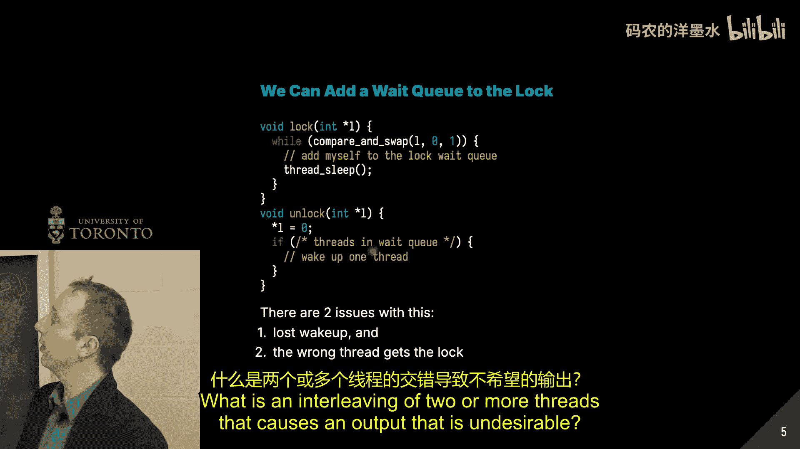

这个实现是安全的，但存在一个问题：**忙等待（Busy Waiting）**。如果线程无法立即获得锁，它会持续循环检查，浪费CPU资源。

---

## 自旋锁与改进

我们刚才实现的本质上是一个**自旋锁（Spin Lock）**。`compare_and_swap` 指令在几乎所有现代CPU（如x86上的 `cmpxchg`）上都存在。

自旋锁在临界区非常短，且运行在多核处理器上时可能是可以接受的。但在单核系统上，忙等待毫无意义，因为持有锁的线程无法运行。

一个简单的改进是在循环中添加 `yield` 调用，让出CPU时间：
```c
while (compare_and_swap(lock, 0, 1) != 0) {
    thread_yield(); // 让出CPU
}
```
但这引入了**公平性**问题。当锁被释放时，所有等待的线程都会被唤醒并竞争（“惊群效应”），我们无法控制下一个获得锁的线程是谁。

更好的解决方案是为锁添加一个**等待队列**。

以下是改进思路：
*   在 `lock` 函数中，如果线程无法立即获得锁，则将自己加入等待队列，然后阻塞（睡眠）。
*   在 `unlock` 函数中，持有锁的线程释放锁后，检查等待队列，并只唤醒队列中的第一个线程。

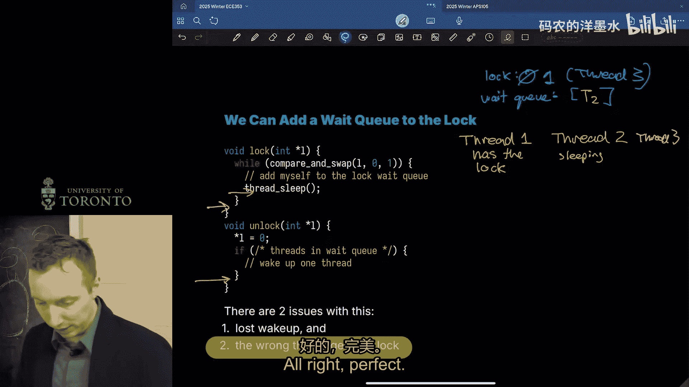

然而，这个朴素的实现存在两个关键问题：

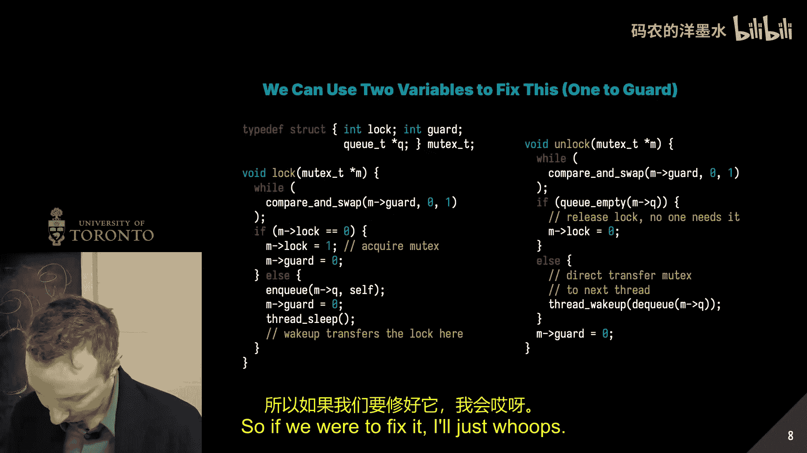

1.  **丢失唤醒（Lost Wake-up）**：一个线程可能将自己放入等待队列并进入睡眠后，却再也没有被唤醒。
2.  **错误线程获得锁（Wrong Thread Gets Lock）**：即使有线程在队列中等待，新来的线程也可能“插队”获得锁。

让我们思考一下导致“丢失唤醒”的线程交错执行顺序。

假设线程1持有锁（锁值为1），正在执行 `unlock`。线程2没有锁，正在执行 `lock`。
*   线程2先执行：`compare_and_swap` 返回1（因为锁值为1），于是它**即将**执行“加入等待队列”的操作。
*   此时切换到线程1：线程1执行 `unlock`，将锁值从1改为0。然后它检查等待队列（目前为空），于是结束。
*   切换回线程2：线程2现在执行“加入等待队列”并阻塞。
*   结果：线程2永远睡眠，因为唯一能唤醒它的 `unlock` 操作已经发生过了。

接下来，思考导致“错误线程获得锁”的线程交错。

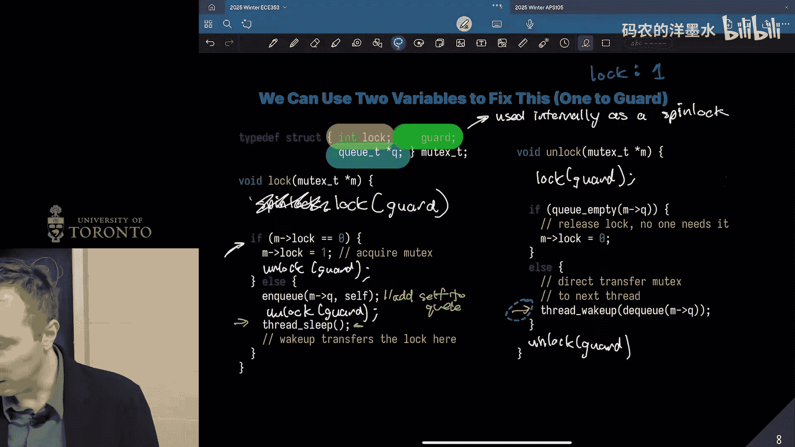


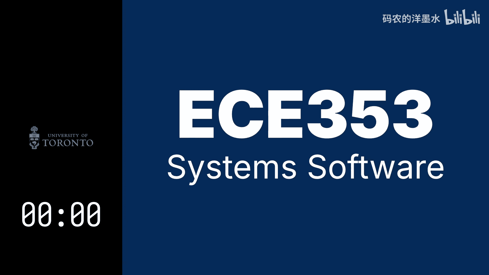

假设线程1持有锁，线程2已在等待队列中，线程3也来尝试获取锁。
*   线程1先执行 `unlock`：将锁值从1改为0。检查队列，发现线程2，于是唤醒线程2。
*   但在线程2被调度运行之前，线程3执行了：`compare_and_swap(lock, 0, 1)` 成功，因为锁值为0。线程3立即获得了锁。
*   线程2被唤醒后，重新检查锁，发现锁值又为1（被线程3持有），只好再次将自己加入队列并睡眠。
*   结果：虽然顺序错误，但程序没有崩溃，只是线程2被“插队”了。

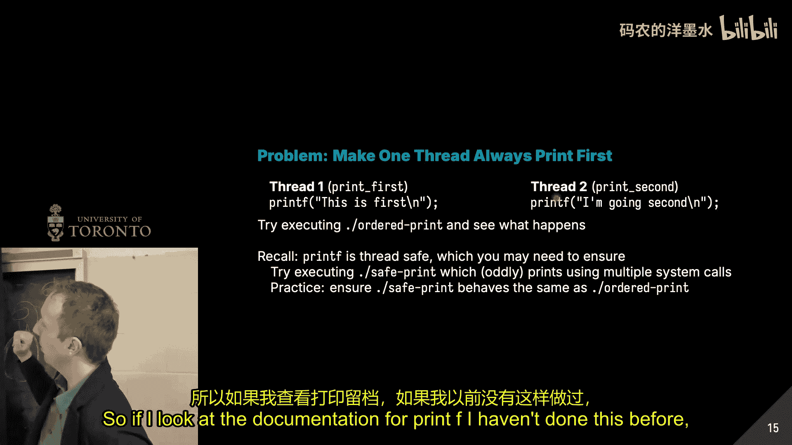

---

## 正确的锁实现

为了解决上述问题，我们需要在锁内部使用一个**自旋锁（作为保护锁）** 来保护对锁状态和等待队列的修改操作，确保这些操作是原子的。

以下是修正后的锁数据结构示意：
```c
typedef struct {
    int lock;       // 锁状态：0=空闲，1=占用
    int guard;      // 保护内部状态的自旋锁
    queue_t wait_q; // 等待队列
} mutex_t;
```

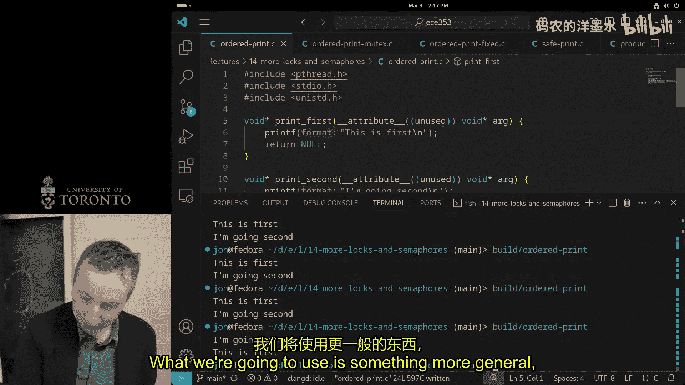

对应的 `lock` 和 `unlock` 操作逻辑如下：

**lock函数:**
1.  获取内部保护锁 `guard`（自旋锁）。
2.  检查 `lock` 状态。
    *   如果 `lock` 为0（空闲），则将其设为1（占用），然后释放 `guard`，成功返回。
    *   如果 `lock` 为1（占用），则将当前线程加入 `wait_q`，释放 `guard`，然后阻塞（睡眠）。
3.  当线程从睡眠中被唤醒后，它已经获得了锁（由唤醒者设置），直接返回。

**unlock函数:**
1.  获取内部保护锁 `guard`。
2.  检查 `wait_q` 是否为空。
    *   如果队列为空，则将 `lock` 设为0（空闲）。
    *   如果队列不为空，则从队列中取出一个线程并唤醒它（注意：此时 `lock` 状态仍为1，因为锁被转移给了被唤醒的线程）。
3.  释放内部保护锁 `guard`。

这个实现解决了丢失唤醒和错误线程获得锁的问题，因为它将“检查状态/队列”和“修改状态/队列”的操作在 `guard` 的保护下原子地完成了。

---

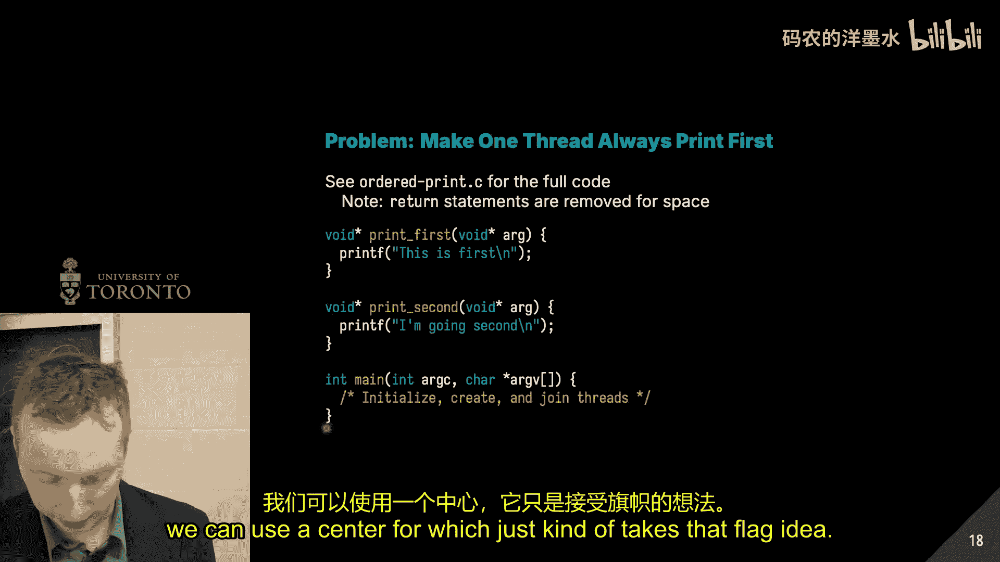

## 信号量：协调线程顺序

锁确保了**互斥访问**，但不帮助协调线程间的**执行顺序**。接下来我们看看如何使用**信号量（Semaphore）** 来解决顺序问题。

考虑一个场景：我们有两个线程，线程1执行 `print_first` 函数打印“this is first”，线程2执行 `print_second` 函数打印“I‘m going second”。我们必须确保线程1的打印总是发生在线程2之前。

信号量是一个整数值（>=0），它提供两个原子操作：
*   `wait()` (或 `P()`): 将信号量的值减1。如果值将变为负数，则调用线程**阻塞**，直到值大于0。
*   `post()` (或 `V()`): 将信号量的值加1，并可能唤醒一个等待的线程。

如何使用信号量来保证顺序呢？

1.  创建一个信号量 `sem`，并将其**初始值设为0**。
2.  在线程2 (`print_second`) 的一开始，调用 `wait(sem)`。
3.  在线程1 (`print_first`) 打印完成后，调用 `post(sem)`。

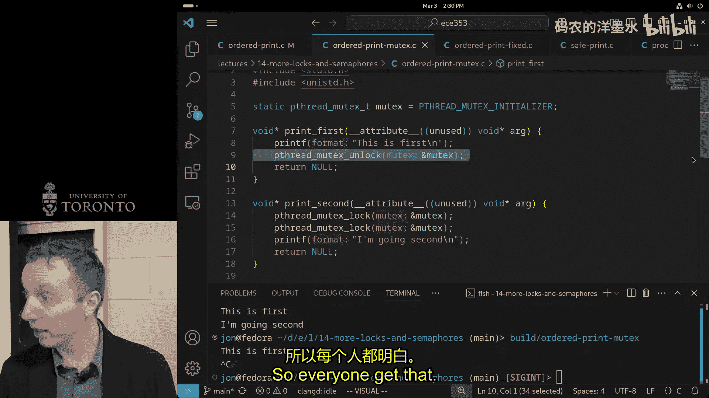

执行流程：
*   如果线程2先运行，它在 `wait(sem)` 处阻塞，因为初始值为0。
*   线程1运行，打印“this is first”，然后调用 `post(sem)`，将值从0增加到1。
*   这唤醒了线程2（或允许其通过 `wait`），线程2然后打印“I‘m going second”。
*   如果线程1先运行，它直接打印并 `post`，线程2随后运行时 `wait` 会立即通过（因为值已为1）。

这样，顺序就得到了保证。

**注意**：不能简单地用互斥锁（mutex）来实现这种顺序。例如，让线程2连续调用两次 `lock()` 是不可靠且可能导致未定义行为的。互斥锁应用于互斥，信号量应用于同步。

---

## 信号量与互斥锁的关系

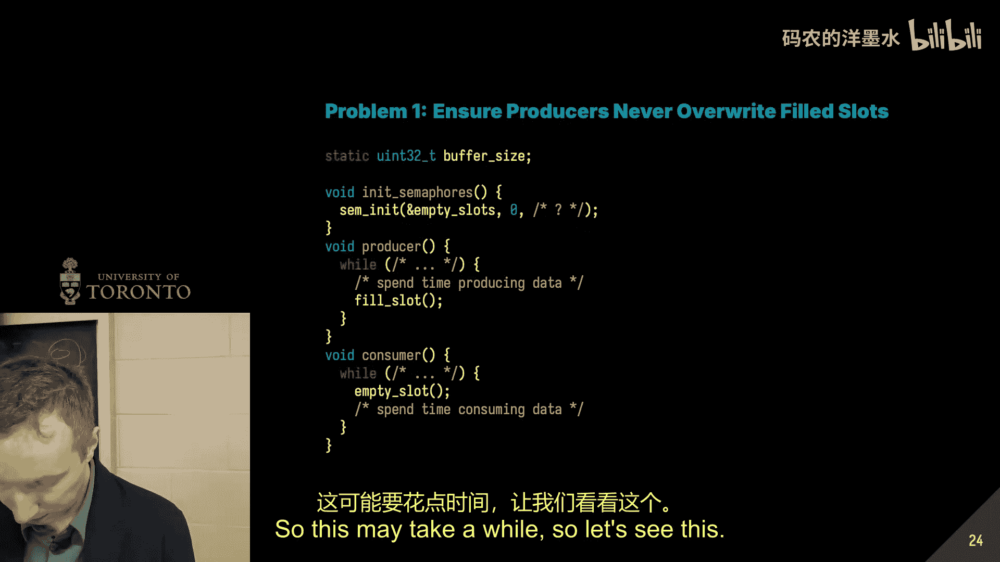

有趣的是，**互斥锁可以被看作信号量的一种特例**。

一个初始值为 **1** 的信号量，可以模拟一个互斥锁：
*   `wait()` 对应 `lock()`。
*   `post()` 对应 `unlock()`。

初始值1表示一开始有一个“通行证”。`wait()` 获取通行证，`post()` 归还通行证。这实现了互斥。

然而，尽管可以这样做，但为了代码清晰和意图明确，**应该使用互斥锁来实现互斥，使用信号量来实现线程间同步**。

---

## 经典问题：生产者-消费者

现在，让我们应用信号量来解决一个经典的并发问题：**生产者-消费者**。

问题描述：
*   有一个固定大小的**环形缓冲区**。
*   **生产者线程**向缓冲区写入数据。它只能在缓冲区有**空槽**时写入。
*   **消费者线程**从缓冲区读取数据。它只能在缓冲区有**已填充槽**时读取。
*   必须防止对缓冲区的并发访问导致数据不一致。

我们需要用信号量来协调生产者和消费者。

我们需要两个信号量：
1.  `empty_slots`: 表示缓冲区中空槽的数量。**初始值 = 缓冲区总大小**。
2.  `filled_slots`: 表示缓冲区中已填充槽的数量。**初始值 = 0**。

生产者逻辑：
```c
while (有数据要生产) {
    // 等待有空槽
    wait(empty_slots);
    // 向缓冲区写入数据
    fill_slot(data);
    // 通知消费者已填充一个槽
    post(filled_slots);
}
```

消费者逻辑：
```c
while (要继续消费) {
    // 等待有已填充的槽
    wait(filled_slots);
    // 从缓冲区读取数据
    data = empty_slot();
    // 通知生产者空出一个槽
    post(empty_slots);
    // 处理数据
    process(data);
}
```

**为什么这样可行？**
*   `empty_slots` 和 `filled_slots` 的和始终等于缓冲区大小。
*   生产者通过 `wait(empty_slots)` 确保不会在满缓冲区上写。
*   消费者通过 `wait(filled_slots)` 确保不会在空缓冲区上读。
*   `post` 操作配对地通知另一方。
*   **注意**：对缓冲区本身的读写（`fill_slot` 和 `empty_slot`）可能仍需要额外的互斥锁来保护，如果它们涉及多个内存操作。但在这个简化模型中，我们假设每个槽的读写是原子的。

通过这个设计，生产者和消费者可以高效、安全地并行工作。

---

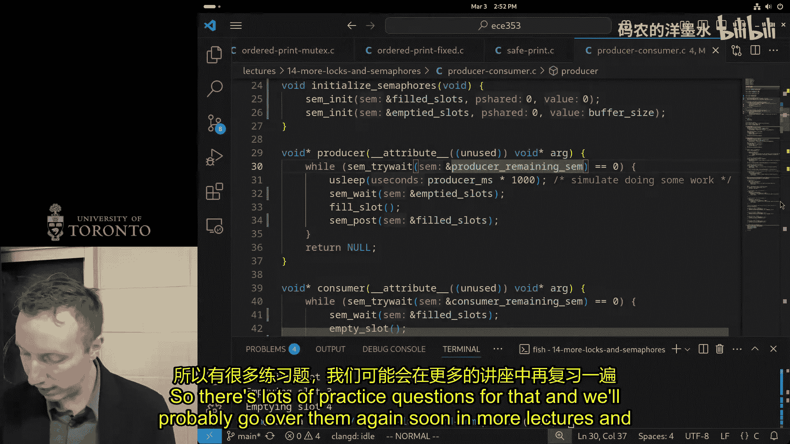

## 总结

本节课中我们一起学习了：
1.  **锁的硬件实现基础**：利用如 `compare_and_swap` 的原子指令可以实现基本的自旋锁。
2.  **锁的改进**：通过添加等待队列和睡眠/唤醒机制，可以构建更高效、更公平的锁，但需小心处理“丢失唤醒”和“错误获取”问题。
3.  **信号量**：一个用于线程间同步的强大工具，通过 `wait()` 和 `post()` 操作协调线程执行顺序。
4.  **信号量的应用**：
    *   可以用于保证特定执行顺序（如先打印A后打印B）。
    *   初始值为1的信号量可模拟互斥锁，但建议各司其职。
    *   完美解决了**生产者-消费者**这一经典并发问题，通过 `empty_slots` 和 `filled_slots` 两个信号量优雅地控制流程。


记住解决同步问题的通用思路：明确需要保证的约束（互斥或顺序），选择正确的工具（锁或信号量），然后仔细分析所有可能的线程交错执行情况以确保正确性。