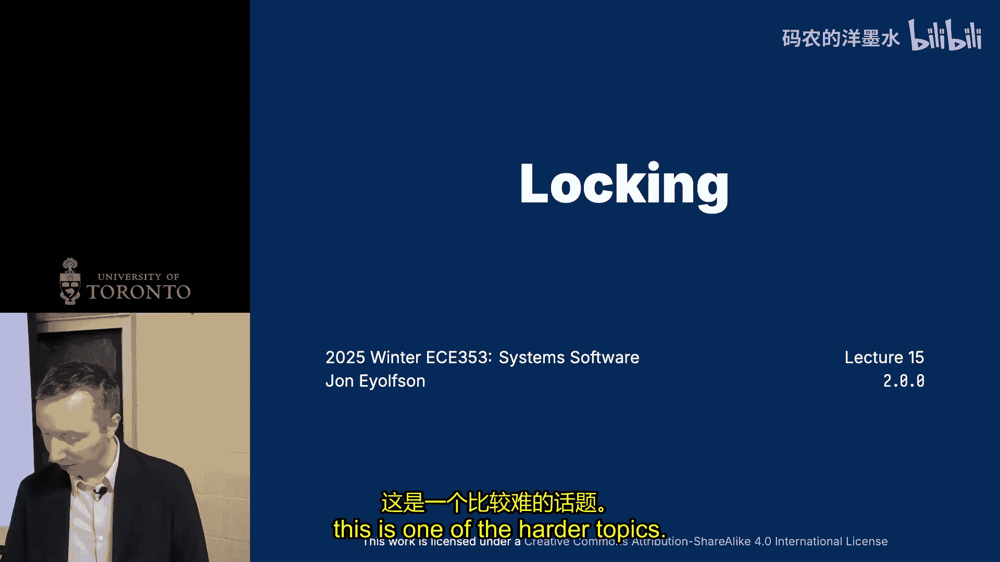
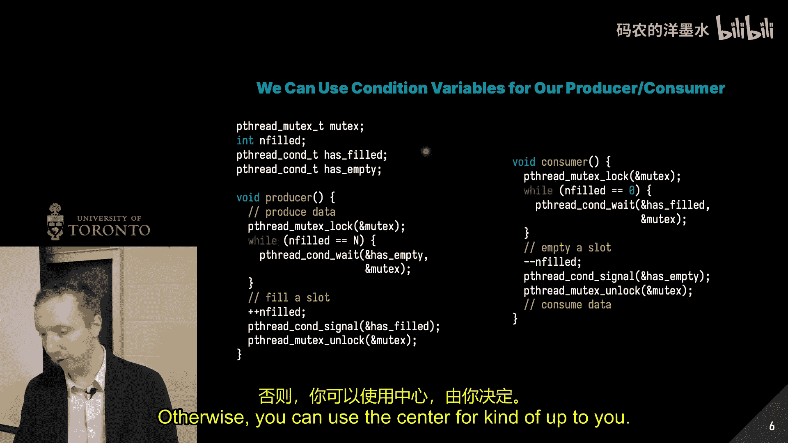
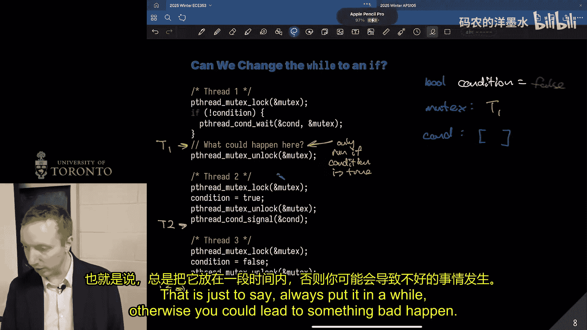

# 【全集 2025】多伦多大学 系统软件设计与编程 中英字幕 1080P p15 Lecture 15 - 加锁机制 -BV1YrkYBQEeL_p15-

🎼Yeah。Alrighty， welcome back to 35，3 light again， I guess still midterms fun。

 so we get to talk about locking， which is unfortunate that no one else is here today because again。

 this is one of the harder topics。

So。Let's start by ridiculing Java。There are some things called monitors that are built into some languages。

 So back， when someone come come up with Java and object oriented languages and object oriented programming。

 developers wanted something easier to use in a Muex。

 So what they thought to implement is they're like， oh， okay， well。

 let's just let the developer mark a method as monitor and then let the compiler handle the locking for us。

So this means that an object can only have one thread active among all of its monitored methods。

Basically， what this does is the compiler will create a muttex for you one per object。

 and in every method the compiler will insert a call to lock at the beginning and unlock right before it actually returns。

So in Java， this is how we could do it， we could create a class to model our account。

 our account has a balance， and then we write two methods to deposit and withdraw and because we don't want any database races or anything like that。

 assuming that multiple threads can be using this account。Well。

 we might have a data race on balance because bounce plus equals amount or bounce minus equals amount means we are。

Reading and writing to that variable balance for this object。 So if multiple threads are doing this。

 we may have a data race in which case to prevent it。

 we have to use mut text or make sure this mutual exclusion。

 So in order to do it in Java I can just slap on the synchronized keyword。

On both of these methods and I have to make sure that it's every method that may have a data race in them and the compiler will transform it to this so it will create a monitor which is basically a mutex and insert the calls to lock and unlock for us so we can't be a more fine grain than that every object will have exactly one lock so if you had multiple fields you want to protect too bad it's just serializing accesses to an individual object so。

Yeah， and also back when I was learning threads， they just said， hey， you can use threads。

 And if things start to go weird， just slap synchronized methods onto your code and just wait for it to work properly。

 So that was great。 I had no idea what the hell was going on。

 So now you know that it's basically a mutex。So our last synchronization primitives is something called a condition variable。

That behaves a lot like a cent for， so the way I like to think about it is a condition variable is kind of poorly named。

 it's meant to help you implement a condition variable， I like thinking of it as just a Q。

 so it's a queuing system。So the type is called P thread underscore con。

 short for condition variable， underscore T， and it has ait and a destroy。

 as we saw with Mutexes and all of that fun stuff。The only difference is it has a few different methods。

 So it has a signal。 So signal will wake up a single thread on this Q。 again。

 I like to think of this con as just a Q。 So signal will wake up a single thread。

 whatever is at the front of the queue broadcast will wake up every thread and unblock every thread that is currently sitting in the queue and then wait is how we put ourselves in the Q。

 So we wait， we would add ourselves to the Q given by the first variable here and then。

To pair with this condition variable， we also need to pair it with a muex。For several reasons， one。

 you have to call this weight function while you have already acquired that lock。

Because while you probably want to protect whatever condition you're waiting on。

 so that will be some condition you write in your code that is going to be changing some variable。

 so you're going to have to access it with a mut text to make sure there's no data races and also it will need a mutex to add itself safely to the queue and also it needs a mutex to reacquire it when it wakes back up so when it goes to sleep in the queue it will unlock the mutex and before it returns from weight when it's woken up it will reacquire the mutex and then if we want a version of weight that will just wake itself up。

 we can use time weight so if the timeout happens if it doesn't get woken up by a signal or group broadcast before then it will just wake itself up so。

The main point is the weight adds this thread to the Q signal wakes up one thread。

 which is whatever is at the beginning of the queue and broadcast wakes up every single thread in the queue。

So like I said they have to be paired with a mutex any calls to wait must already hold the mutex。

 you don't need to do it for you don't have to have the mutex acquired for signal and broadcast。

 they just unblock a thread and then they can go ahead and reacquire that Muex so again， like I said。

 why well。Just remember that weight needs to add itself to the queue safely， have no data races。

 It needs that mutex as an argument to unlock itself before going to sleep。

 Otherwise no other thread could make progress and it will also have the rule that the thread will hold the lock muttex after the call completes as well so after it gets waken up it will reacquire it so in both cases you can assume before and after the call to wait。

 you have the muttex acquired。So when you write this you can also have it that one mutex can protect multiple condition variables。

 generally your mutex is protecting data racists to some variable and you're checking some value of that variable。

So for this， we'll just consider calls to wait and signal。

 you could imagine broadcasts at when we're done。So the weight call again does not contain any data races。

 so you need to understand what weight does for condition variables。Again， the thread calling weight。

Does three things before it gets blocked， it adds itself to the Q for that condition variable。

 it unlocks a mutex and then it blocks itself so it's no longer able to run then the thread calling weight needs another thread to return from weight to either call signal or broadcast then if it gets unblock it selected to run well it gets unblocked so it can now scheduled to run and then before it returns from that weight it will reacquire that mutex again and weight will only return once we have acquired that mutex。

So if we were to change our producer consumer example to use a muttex instead of a center for。

 we could create two cus like before we had two set of fours we had one that was counting the number of filled slots。

 one that was counting the number of empty slots so we could do the same thing with condition variables but our condition is going to be kind of shared between both of them。

 we're going to have a single condition that is keeping track of how many filled slots we have so if we have nfil slots so like the size of the buffer filled slots it means we have to wait until there is at least one empty slot and then similarly if the number of slots filled is zero。

 then we have to wait until there is a filled slot so。In the producer。

 instead of having the cent for weight and。Weight and post and knowing the initial condition or sorry knowing the initial value。

 I can instead change my code to this。 I can lock that mu text because I'm going to be。

Reading the N filled field so I can put it in a while loop so while the number of filled slots is full。

 I would put myself to sleep and this has empty cu。

 so this is every thread that is currently waiting for an empty slot。

If I were to break it out of this loop， either by returning from weight or the fact that all the slots are not filled。

 I can fill the slot， increment the number of filled slots。

 which is safe because I have still have that mut text， and then I can signal the。

A single thread in the has filled queue if there is one。

 so if there's nothing in the Q signal will do nothing。

 otherwise it will wake up a single thread which is good because I just filled a single slot。

 then we can unlock the muttex and then similarly in the consumer lock the muttex have a while loop while the number of filled slots is zero。

 we're waiting for a filled slot if we break out of that we have the mutt acquired。

 we can empty slot decrement the number of filled slots and then signal exactly one thread that is waiting for an empty slot and then unlock the muttex。

 consume the data。So on and so forth， so。Do we like this better than the Mutex version or sorry the Center4 version？

Up up to you， their equivalent， I would argue that this is a bit clear of what the condition is。

 like I'm waiting for all the slots to be filled and then none of the slots to be filled。

While for our set of4， it really depends on the initial value in order to be correct。

 So their equivalent。 you can write one in terms of the other。

 You should just write whatever is more clear generally， if it is something that is changing。

Some more complicated variable than an int， you definitely want to use a condition variable。

 otherwise you can use the center for kind of up to you。

All right， so now we get to have issues。So。Let's say， oops。

 let's say we had this as our implementation。 We have two threads running。And。

We want thread one to acquire the muttex， and it is going to。Run wild knot conditions。

 so let's assume we have a global variable。Called bull condition。Which is currently equal to false。

And then the way we've written threadread1 is we have written thread1 that if it reaches this line here after the while loop。

Then the can。Addition。Ohoops。Then the condition must be true。And then in thread 2。

 all it will simply do is modify the condition and then signal that hey。Another thread can run。

We need to identify the issue for this。 This is。you know， kind of the problem we always have。

 so how I like to do this is to find the issue， we have to come up with some interleaving between thread1 and thread2。

 such that in this case thread1 executes this line when the condition is equal to false。So。

How I like to model it。Again， we start off， say we have two threads， thread one and thread two。

 each set up to execute。These little snippets of code。 And then I have the global condition。

 which I assume is initially false。 And then for this， I also like here， let's move this。

So we'll move it to the side。 So we have our global variable condition that is equal to false。

 I also like seeing。As I'm going through it， which thread currently has the mutex and then what my state of the condition variable is which I like to model as just a queue of threads。

 and initially it is empty。So。I'll leave you to fix the issue with the following code。

 I'll show you what should happen， So what should happen。Is。Or。

In one case where something good happens is threadread1 executes。 it acquires that mutex。

 so it has acquired that muttex。So now we have thread one with the Mutex， whoops。

 let's change the color。So we have thread one with the Muex。And it keeps on executing。

 It checks the condition。 Currently， it is false， so it goes into here。

And it calls P thread column weight。 So as part of weight。

 that will go ahead and add itself to the Q。 So it will be on the Q。 and then。Also。

 atomically unlock the mutex when it's blocked。 So now it unlocks the muttex and has went to sleep。

Now， since it's blocked， only thread2 can execute， threadread2 would go ahead change that condition。

True or from false to true。Then it's the only thing that can run， so it will run P thread con signal。

 which what signal will do is go ahead and wake up thread1 in the queue。So it can execute。 Now。

 if thread 1 is picked to execute before returning from weight。

 it has to reacquire that mutex right now， no one else has that mutex。

 So thread one can go ahead and reacquire that mutex。 So now it's acquired by thread1。

Thread1 in this case would go back up to the wall loopop。 check the condition again。 Oh， okay。

 now it's true。 So not condition is false。 So it would run this line with the condition equal to be true like we wanted。

 and then unlock that mutex。 and we are good。 So that is the happy case。So。

Take a minute and think about a sad case。 So we execute that line in thread 1。

 such that the condition is equal to false。😔，Or。Or。Or thread one just never wakes up again。

Which I think is the issue。 I don't think it can actually run that while the condition is true in this example。

I should left that up to you， I should have given you any hints。

So give you a minute to think about that。All right。

 I have one response from Discord already that says。

Maybe if T2 modifies the condition to true beforehand， so we start off。

 T2 executes condition equal to true。So changes condition equal to true。

And then it continues or not or we switch to a different one， if it does signal it would do nothing。

 and then we switch to thread1， so thread one would acquire the mutex， which is fine。

 check the condition well it's true and it would just skip here and run this line while that condition is true。

 which is great that's what we want。Rewind again to the beginning。Yeah。

Anyone else with an interleaving between these two threads where something poor happens？Yeah。

So that was what we just went over thread2 runs first and changes the variable。

 the condition from false to true， and then signals and nothing's in the queue just does nothing that's fine。

Yeah。So signal will wake up at most one thread if there's nothing there， that's fine。Ws。

So if T2 makes the condition equal to true。And then。T1 immediately locks it。So it acquire that mutex。

And now what？Theition is now false。Yeah， which is fine。 so if T1 executes。This is false。

 And then we're executing this line with the condition being true， which is exactly what we wanted。

 right， So that's not bad。And then T2， if it executes。It can call signal。That's fine。

 it would just do nothing。So that's fine。Rewind again。Any other interleaving of this that causes bad？

Maybe this。So T1 goes first。 So always with this， we like to say which thread executes first。

 So T1 executes first。It grabs the mutix。So T1 has it yep。So do you want T1 to go again？

So T1 would check the condition， It's false， and then it would go into the while loop。Now what？

This is close， we're about to have badness happen。Anyone else see it？Alright。

 I guess we don't have the power of numbers。 Allright， So this is good where we are right now。

 So currently T1 has that muex， right， the condition is false and it's about to call weight。

 So it's about to add itself to the Q。 So a bad thing that could happen is right now， T 2 executes。

 So T 2 executes changes that condition from false to true。

So now it's changed that condition from false to true。 It was allowed to do that。

 didn't need to acquire the mutex or anything like that。 And then it could continue。

 It could call signal。 That's fine。 There's nothing to wake up right now。 There's nothing in the Q。

 So T 2 is done。 Now， if we switch back to threadread 1。 Tread1 is about to call weight。

 And remember what weight will do。 Waitight will atomically give up the Muex or unlock it。

And then add this thread to the Q。So T1 is now in the Q。It is in the middle of this weight call。

 is anyone going to wake up T1？No， it is now comatot right。

 so this is something bad that could happen in this case because essentially we had a data race on that condition。

 so how would we fix it so that this does not happen。Yeah， so if T gets， how can T2 execute？

So the question is if。T1 gets some muttex， how T1， how can T2 execute？Then that。Whats the true break。

Calls weight， but if2 hasn't called the way you get this。So。

Where in threadh2 does it try and lock the Mutex？Well。

 isn't it when you block with the the text that nothing else can？No。Yeah， so the question is。

 isn't the case where if you lock a mut text， nothing else can execute except for that thread。

 and so that is no， only one thread can execute the critical section between the lock and the unlock。

 but other threads can still run whenever。Yeah。T to load the same UK。Yeah， so。To fix this。

 we had a data race on condition， right， So two threads werere modifying were。

Two threads were accessing the same location condition， the value of condition。

 and at least one was a right， So thread2 had a right。 so that means we had a data race。

 it means to prevent that， we need to make sure that all of the accesses to that value are protected。

 so to fix it， we would need to essentially put a lock。So the muttex here。

Whatever it's an amperserson。And then what about the unlock， Where should I place the unlock call。

Should I do it at the end or right after I change the condition？Before。So we could do it before。

Turns out it doesn't really matter， but now。If we do something like that。

Let's rewind again and see what would happen。So if we do something like that。Rewinding。And yeah。

 the discord comment is correct because， well， we weren't protecting it with the mutex before。

 so we could swap over while right after we check the condition in thread1。

 So let's see what would happen now。So with our lock and unlock now。

 what happened that was bad before was T1 started executing， in this case it would call lock。

So it would call lock。 No thread has a mutex。 So it would acquire it。 and then。Pass through。

 So now T1， the way to think about Muex is it is the only thread that can execute。

Any critical section involving Mutex right now is a good way to think about it。So now T1。Well now T1。

 what we had before is they continued it to check that condition。 it was equal to false。

 so it went into the while loop right here。 and then what happened bad before was we context switched at that point。

 So the context switch can still happen， but the Mutex should save us right So if we context switch to thread2。

 it tries to call lock on Muex。 Well thread1 already has acquired that mutex so it would get blocked there it would wait and only unblock when it could actually acquire that mutex。

 So we can't switch to it right now while we can switch to it。

 but it'll get immediately blocked because the first thing it's doing is trying to lock that mutex。

 which is already held by thread1。So now we have no other choice but to execute thread1。Thread one。

 which we didn't have before。 we could have executed T2， but now we can't。Because of the lock。

 now T1 executes。And it hits weight。 so that atomically gives up the mutex。 so it unlocks the mutex。

And then it also adds itself to the Q。So now it is blocked， nothing else can run except T2。

 first thing T2 is going to do is acquire that muttex。

 so it would hit that lock it's still doing that lock mutex call。

 now it can actually pass it because thread1 has given up that mutex so it can acquire that mutex。

Set the condition variable or set the variable we're using as a condition variable。 again。

 this names kind of bad。 We can go ahead。It would go ahead， set it equal to true。

 and then it would unlock that muex。 So the next line is unlocking that mutex。So unlock some mutex。

 and then it would wake up。It would signal， which would wake up thread1。Thread1 wakes up。

 it would reacquire that muttex。Before it returns from the weight。And then it would go back。

 check the condition again。 Oh， now it's true。 Now it can execute this line code when the condition is true。

So everyone okay with that， and also it would work if we put our unlock here as well。Right。

So the weight function should automatically released。Yes。Yeah。

 so the weight function will atically release the mutex add itself to the Q and block。

All in three steps。 and when it's unblocked again， before it returns from weight。

 it will reacquire that mutex。 So that's why it's safe。

 also safe to put the unlock here after the signal， because if we rewind a little bit， let's rewind。

To when it actually。呃。So when it was in Q and T 2 had the Muex， if we instead changed。

This unlocked to happen after the signal。 Well， what's going to happen is。

It will call a signal which unblocks thread1。So it is now in the queue， it could be scheduled to run。

 but now if we scheduled to run as part of returning from weight， it has to reacquire that mutex。

 so it can't return right now because thread2 has that muex。It's slightly better for performance。

 It doesnn't really matter if you have the unlock call before the signal。

 but it's not going to heard anything。 So in this case， even though thread 1 is unblocked。

 it's returning from weight and it will only do that when it can reacquire that muttex。

 So it can't make any progress now until thread1 gives up that muttex。

 So only choice is to have thread2。 go ahead， unlock that mutex。

And then threadread one can now reacquire that mutech。

And then it returns from weight We check the condition again。 It's true。

 So would execute this line with it true， yay。Bob's your uncle。So everyone good with that。

 Yeah can we weight without。M Mutex has to be locked to call weight。Yeah。All right。So。What about。

 I will pose this to you。What about if I'm trying to be clever？And optimize my code。

You'll notice that in this case， right， when I came back after waking up from weight。

 the condition was true， so。Am I allowed to do something like this？Instead of well， let's write if。

And yeah， the Discord comment unlock。After the signal is slightly more performant。

 no unlocked before the signal is slightly more performant。All right，I it if okay？In this case。Yeah。

 in this case， it actually is right， because I only change the condition from false to true。

 But what if we have something more complicated in the general case。

 you probably have something like this。 The condition probably bounces back and forth between thread one or between true and false。

 So we could have the case where we have more threads now。 So we have thread1。We have threadread two。

And then we have thread3。So， if we change that。Well to an if。

Is there anything bad that can happen here？ And remember， this line of queued code should only run。

If condition。Is true。So initially， we can have bull。Condition。Eal the fourth。We have a muttex。

Wch is currently not held by anyone， then we have our condition variable again。

 which I like modeling as a Q。Yeah。D one。I did wait。Yeah， okay， so first， we can have T1 run。

 So T1 runs。 it would acquire that muex。So if we were to argue about anything else right now。

 T1' is the only thing that can even continue executing because first thing T 2 would do is's called lock on the Muex Can't get it。

 Same with T 3。 So T 1 executes。It goes ahead and checks the condition。 It's currently false。

 so it calls weight， which would atomically put itself in the queue。Let's just move it。

Put itself in the queue and also give up that muttex。All right， now what？

So T2 runs except for the last line。So T 2 runs。 It would acquire that muex。

So T2 has acquired the mutex。It changes the condition from。False。To true。

And then it unlocks the muttex。So now it doesn't hold them mut text。那我。Now T3 executes。

 so it acquires that muex。So T3 acquires a mutex。Changes the condition。To to do。Equal to false。

And then it unlocks the muttex。 So it unlocks the mutex。

So now we have no choice but to continue thread2 because thread1 is blocked and thread2 is going to call signal。

 So signal will unblock thread1， so it will remove it from the Q。

 Now there's nothing else to execute except thread1。

 So thread1 will reacquire that mutex in order to return from the weight。

And then it goes ahead and because it's an if it drops out， starts running this line， oh no。

 it's running it when the condition is equal to false， we have royally screwed up。So。In general。

 do not try to be cute。 Sometimes you are allowed to get away with if。But typically。

 your program will change and you probably won't be able to get away with it forever。

 So don't try and micro optimizeize your program。 Just put a whileow when you are checking the condition。

 There's also a few other things where。It's actually not guaranteed that when you call weight。

 you only get wakingn up from signal， you could get woken up at any time for any reason， technically。

 if you read the documentation。That is just to say， always put it in a while。

 Otherwise you could lead to something bad happened。

All right， cool。Like I said， condition variables serve a very similar purpose tos。

 center4s are basically a special case of condition variables。

You can just create your own unsigned integer， go to sleep or wait when the value is0。

 and then when it's greater than zero， you can wake up and actually decrement it。

 you can also implement one using the other， however， it can get very messy。

 very quick that is meant for theory， not for writing clear and concise program so for complicated conditions basically just use condition variables to make your program a lot more readable。

So next thing we have to talk about is locking granularity which gets into performance a bits so that is the extent of your lock or how big your critical section is because the bigger it is essentially you're serializing that part of your code so it will be slow so you need locks to prevent data races if you lock large sections of your program。

That's something you can do or it will be it'll just be slower。

 Another thing you can do in order to make it more performant is divide the locks。

 create more locks and make your critical sections as small as possible。 So for example。

 you might be thinking， oh， what if I want to paralyze a hash table Well。

 probably has some data races in it， I could just lock the entire thing。

 Probably not that good or I can make it more fine grained。

 And guess what you're doing that for lab 5。 Joy。 So you're just basically it will be like five lines of code for that part of lab 5 you're just paralyze a hash table。

 You're just adding muttex calls and seeing what their performance is like。

And making sure it actually works， so things to consider about locks is the overhead of the locks because while even if you create them。

 they take up some memory， calling lock and unlock is not instantaneous so there'll be some overhead there。

 you've contention so that is the amount of threads all fighting over the lock at once。

 the more contention， the more serialized your program will be。

 and then deadlocks is a condition where we have to think about if we have more than one lock。

So again， for locking overheads， they take memory， they take time to create， destroy。

Aquire them or lock them or unlock and release them and the more locks you have the greater each cost is going to be if you optimize your program and you have a trillion locks。

 well even if they only took up the size of an integer， you're wasting a lot of memory just for that。

Not to say any performance overhead of that as well。

So the main thing we're concerned about is deadlocks。 So you do not want deadlocks。

 the more locks you have， the more you have to worry about deadlocks so。For a deadlock to occur。

 it needs four conditions。 They all have to hold。 The first is mutual exclusion， which of course。

 we have。 We're only going to worry about deadlocks for things like Mu Texas that， of course。

 have mutual exclusion。 So we can't do anything about that condition。2 is hold in weight。

 So I have to have a lock and then try to acquire a different lock。 Then three is no preemption。

 You can't just。For someone to unlock their mutex， you can't just take it away so we will consider all of our locks are not preemptible so this condition we will not be able to do anything about and then the fourth is circular weight so you're waiting for a lock held by another thread or process so all of these conditions have to hold we can't really do anything about condition one and three and。

So we can really only do anything about condition two and four and all of these conditions have to hold so if we break just one of these。

 we can prevent a deadlock and again we'll have more fun with this when we do some examples and run a successful bank。

So here is a simple deadlock example considering two processors or two processor trying to get two locks or two threads。

 doesn't really matter if in thread1 I have two locks and then I try and get lock1 and get lock2 and then in thread2 I try to get lock2 and then get lock1 well what could happen is thread1 acquires lock1 and then we context switch over to thread2 it acquires lock2 and now we can't make any progress so thread2 the next thing it wants to do is lock lock1。

 it can't get it because thread one is holding it and then thread2 can't make any progress because well it' trying to get lock2 and thread2 has it so neither can make progress anymore Delock is just another word for saying no threads can make progress anymore they are now stuck。

So one way we can do that is ensure order to prevent deadlocks。

 so if this was our code and we always locked lock1 before lock 2。

 then this would never ever deadlock because well whoever gets lock1 is now pretty much is now guaranteed to get locked2 because they always acquire it in the same order so this will prevent that circular weight so there's no circular weight here as soon as I have any circular weights where I can form you know any type of cycle。

In the graph， if I was to draw out the dependencies， then you could have a deadlock。

 So this well not deadlock。 I'm using multiple locks。 If I always acquire them in the same order。

 I am good。The other way is to break hold in weight so we can do that using like a trilock so for P threads there's trilock which we haven't used that's the non blocking version that tells you whether or not you have acquired that lock so what I can do is if I can't guarantee an order between threads for whatever reason I can break hold and weight so what this code will do is this protected code needs to have both locks acquired so what my code's going to do is lock a single lock so lock lock1 and then trylock on lock2 so if it return zero that means it's successful。

 it would go ahead break out here run the protected code I would have both the locks that's all good and then if I don't acquire lock2 to break hold and lock I have to give up the original lock I acquired so I have to give up lock1 and then I can do something here like weight yield hopefully make something else make progress because at that line I now acquired。

No locks， something else can make progress and then before trying to get lock2 I reacquire lock1 that will make me wait until I actually get lock1 then after I get it I try to get lock2 again and if I don't same thing happens if I do I run the protected code with both locks so this is another way I can go ahead and break the deadlock so questions about that。

Guo。All right。So we explored some more advanced locking， we have another fun tool to ensure order。

 they are called condition variables， they kind of have a crappy name， basically a queue。

 you're supposed to use them in order to express complicated conditions with your variables。

 they are not themselves a complicated condition with your variables again just think of them as a Q。

So。They're a lot clearer for more complex condition signaling。 and when we actually go ahead and use。

Locks， your locking granularity matters for performance reasons。

 so how big is are your critical sections， which is。

One reason if you're using Python or historically why Python has been so slow is because they just have one big lock around the entire interpreter。

 so the entire Python interpreter doesn't have any data races， but it is essentially serial。

 so using threads in Python is。Generally will not give you any performance because they have the gill。

 which stands for the global interpreter Lock， which。

 as you might think is a big lock around the entire Python interpreter。If they break it up。

 they currently， I think the current latest like Python 3。13 has finally broken that。

 so they have different a whole bunch of different locks now with smaller granularity than just a big lock and the Linux kernel back in the day before multiprocessing systems had something called I forget what they called it just the one big lock that they locked everything with but now since we have multiple cores on our machine we want things to run in parallel so our locking granularity actually matters and if we introduce multiple locks。

 we now have to prevent dead locks。So with that， we are done for the day。

 I will stick around for a few minutes just in case there's any questions， but just remember。

 going for you。

