# 【全集 2025】多伦多大学 系统软件设计与编程 中英字幕 1080P p16 Lecture 16 - 磁盘与并行化实践 -BV1YrkYBQEeL_p16-

ピて。Alrighty， welcome back to 353， did I do something wrong where the hell is everyone？What。

Might be up。We'll have four。 that's still fun。 All right， so today， I guess I'm lucky for them。

 I ammer for Britain and then we have fun parallellyization practice。😊。

So we are going to go into our last topic of the course， which is persistence。

 which we will talk briefly about hardware and disks。 So let's start off that so。

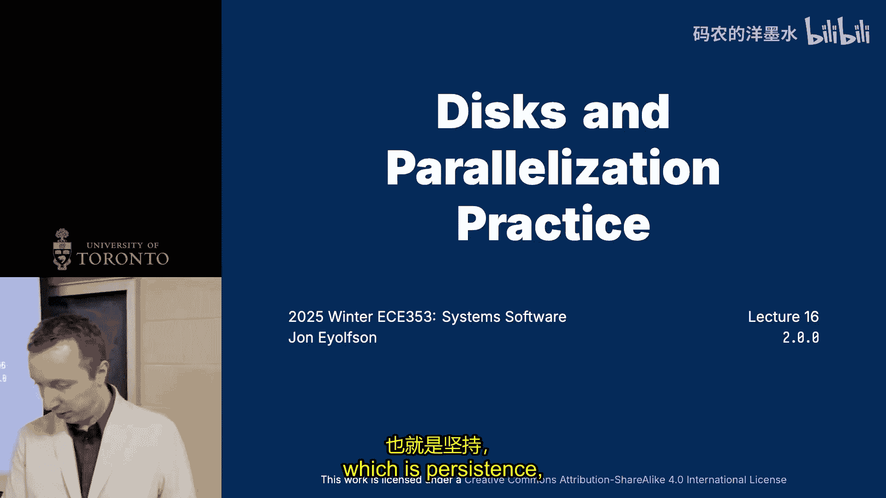

Previous operating system courses talk about hard disk drives with which no one probably uses at all slash no one has probably really seen。

 So I will talk about SSDs or solid state drives。 They're the more modern thing they use those fancy D transistors rather than magnetic disks。

 So if you don't know a hard disk drive is。It is。Storing data on a magnetic platter using magnet somehow to read information from them instead。

 And it has to physically spin under a head like a record， which。I guess you probably。

Are more likely to see a record than HD now， but some pros to SSDs is that they have no moving parts or physical limitations。

 just like RAM except that the information persists even if the power goes out。

 they higher throughput， good random access， more energy efficient than spinning a hunk of metal and better space density so there is a lot。

ALot smaller spaces store the same amount of data， the cons are they are more expensive if you are a data hoarder like myself。

 I have now run out of storage after storing 30 terabytes， so I'm now out of information。

But luckily I bought 120 terabytes worth of this， so I should be okay for another like two months。

Cons are there more expensive。 They are， you know， you can buy 8 TB SDs， but they're like 1000。

 They have lower endurance， so。Any SSDs on your machines。

 there is actually a limited number of rights， less of a problem now they're pretty endured。

 but at some point in time they will just essentially wear out。

And they are actually more complicated to write drivers for， which we will touch on briefly。So。

How an SSD is laid out in hardware is its kind of here kind of divided into these parts so all the storage lives on a die and then within a die。

 a die is split into multiple planes， we don't really care about that what we start carrying about is within a plane there are multiple blocks which does not correspond to I't know an actual block it's just a bunch of data usually a block is just you know like one fixed size array like a page could technically be a block。

 but in this case they call them different things so a block consist of multiple pages and then a page is kind of close to like we have with virtual memory it's just probably four kilobytes but in hardware it could also be 8 kilobytes。

So。SSDs using typically Nanflash are much faster than hard disk drive。

 Pages are typically matched up with the virtual memory page size they don't have to be and。

The performance characteristics or something like this， reading a page is quite fast。

 like 10 microseconds， writing a page is a bit slower， like 100 microseconds。

 and then erasing a block which sounds a bit weird。

 like actually deleting information is one millisecond which is quite a lot slower than the other one and you might be like what the heck。

Why can't I just erase a page， why do I have to erase a block and that's the complication for SSDs to write drivers for I don't know why this is the case。

 probably something to do with physics and transistors and things I don't know I'm not a hardware expert so you can ask someone else that is not me。

 but all I know is that this is the constraint we have for writing software。🤢，So。

For programming and flashlash， we use pages and blocks。

 so the rules are quite simply you can only read complete pages and write two freshly erased pages so after you write to a page you can't overwrite that data until it is erased and you can only erase blocks at a time so each block typically has 128 or 256 pages and again that entire block needs to be erased before you are allowed to write to it and again。

This is why writing in general is slow because I might need to create a new block。

 I might have to erase a new block in order to actually do a right operation。

 so it might be actually a lot slower than just the time it takes to do the right。

So if youre the operating system and you're array drivers for this。

 you have to take that particularity into account。So SSDs need to garbage collect their blocks。

 so that would be you know you use it after a certain amount of time。

 some of the pages on your blocks are probably not used anymore and then if your SSD is otherwise idle。

 it can go ahead and be like oh okay well I should probably move those few pages off of this block and just erase this block so that I can actually use it again when the user tries to write more data so what it would do again is just move any pages that are still being used by the operating system to a new block。

There may be overhead because I'm just moving information that I don't really have to。

 the idea is that the SSD will do this when it is otherwise idle so you won't really notice any performance issues。

And the problem is the diskcontroller doesn't know what blocks are still alive being used by the operating system。

 so if you just delete a file， the operating system knows what pages are no longer being used the hardware itself has no idea。

 so there has to be some coordination between the operating system and the hardware itself if there's not the SSD might think that disk is full when a file could be deleted so it might be the case that every single page on a block is now just not being used and if you don't tell the disk drive。

 you're going to have to issue the erase command yourself instead of it just doing it in the background。

🤢，So。The OS can use something called a trim command to inform the SSDs what blocks are actually unused and then the SSD can freely erase that block without them moving overhead use kind say hey。

 okay， just go ahead and erase this whenever you are free because I don't want to just explicitly wait for you to actually finish that very slow operation。

 so most operating systems by default have this enabled for you。

 it's probably called trim as a generic name or the discard option in the Linux kernel。

 but it should be there if it's not there， your SSD is not going to be used to its full potential。

 it might be you know slow because it has to actually explicitly erase blocks when it's actually trying to do an operation。

Alright so that is a little bit about the hardware。

 this is the more fun thing so so far we've been talking about single devices。

 so jokingly sometimes they are called a single large expensive disk so it's just one large disk for data and a single point for failure So if you have all your work on your hard drive and your hard drive dies which they are known to do what do you do？

😊，Cry， I guess。So some people do not like the option of crying。

 so in data centers or some people will do something called raid or redundant array of independent disk。

 so this is the idea of buying multiple disk， distributing the data across multiple physical disk and we can use it one of two ways so we can use redundancy which is just having multiple copies of something to prevent data loss。

 so if I have two copies of the data， then one dies， it's fine， I don't have to cry。That is。One case。

 and then the other case is I can actually use redundancy to increase throughput。

 So kind of like the idea of threads。 I can spread up my work across multiple devices to go faster。

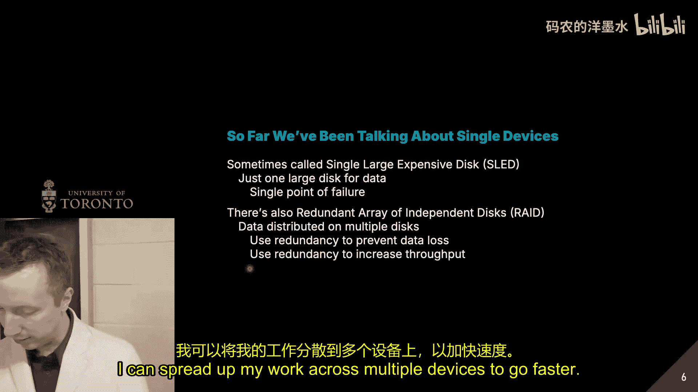

So。The two extremes are called raid， so all the raid configurations are just called raid and then a number and it's up to you to figure out what it is。

 Ra0 is commonly called a stripe volume and the whole idea behind this is to just go fast so if we just take our file called a and split it up into eight different parts so the size of these parts doesn't really matter。

 it'll be typically like 128 k but it doesn't really matter so let's say we take a big file called a split up into eight parts and then we can put the odd parts on one disk so each of these are。

Differentffer pieces of hardware， so this is one physical disk。

 an SSD and another physical disk an SSD or an HD， so you put half the information on one half the information on the other so why would we do this well。

We would do this purely for performance， so let's say we can you know instead of reading the entire file a and all eight parts of it from a single disk。

 we can read four parts from one disk and four parts from another disk so it would in this case speed it up by two times right same for writing instead of writing all of the eight chunks of the file to a single disk I can instead write four to one four to the other and if I do it in parallel it is two times faster than it was before。

If I had three disks， I could divide it into thirds。

 and then I would go three times faster than before。

 four times I could go four times faster for both reads and write。Allright。

 what is the problem with this， so let's say I split half my file up or split my file up。

 so half is on One driverive， half is on the other。

 how many points of failure do I have now in order to lose my data？2， right。

 because if I lose one of these two disks， I've now lost half of my file。

 halflf of my file is not terribly useful。 I can't actually do anything with it。

 So the whole idea of this is purely performance。But I'm actually adding more points of failure so typically people will do this if they just want something to run as fast as possible。

 so like high end I don't know machine learning or gaming computers。

 people will do this and do raid zero with their disk and then if I drive dies whatever at least I went fast。

 I will just go ahead and reinstall everything from scratch you wouldn't put anything important on this。

 this would just be for performance so questions about raid zero。All right， other extreme。

Oh， and here's everything I said， so performance only data striped across all diskcon ray again。

 you can add more than two。Fast parallel access， end time speed in both reads and writes。

 but the con is any dis failureilure result in data loss。

 we are actually introducing more points of failure。

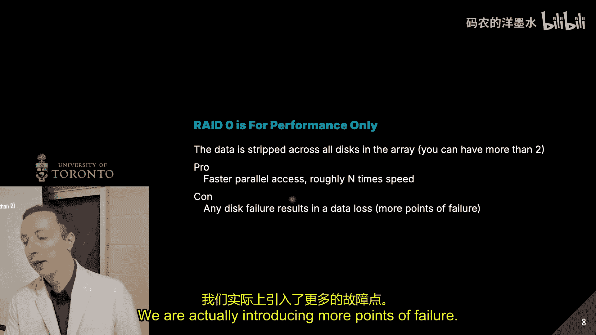

The other extreme。Is called a mirror， so raid1 mirrors data across all this。

 so all this are exact clones of each other， so if file A now had four parts。

All four parts would be on both thiss， so now。If I lose a single disc， have I lost any data？No。

 right？What about my read performance？Is it better than a single disk？The same。Or worse。

Same as a single disk。Everyone agree with that？Why would it be the same as a single disc？Yeah。Don do。

Different by。Yeah， so in this case you could actually still do the reads in parallel so I could just because the data is there doesn't mean I have to read all of it from the disk so I can have the same idea before for reads I could read you know the odd half of the file from this disk and even have from this disk and if I do that in parallel then my read speed would go up by a factor of two or however my disk I have here。

Right？W performance on the other hand is going to be the same as a single disk。

 so assuming I can do things in parallel， if I have to update this file and add I don't know。

 a5 or something like that I make the file bigger， I have to write a5 to every single disk。

 assuming I can do that in parallel my right performance is going to be the same as a single disk。

But we can do this for as many drives as we want， so if I have four drives that are all exact copies of each other。

How many drives can I lose and still not lose data？3， right。

 So as long as I have one drive still alive， I have still my data。 I am still fine。 I do not cry。

So it's simple but wasteful because every disc in the array has a mirrored copy of all the data。

The pro is it has good reliability as long as one dis remainsins， you did not lose any data。

The reperformance is good because it can paralyze it。

 but the con is it's a very high cost for redundancy we can do better。If I have。

4our disks then let's say I have 420 teryte disk。 The amount of space I can actually use for my file is just the size of a single disk。

 right， they off to be copies of each other， so I could only use 20 terabytes for my file and the right performance is the same as a single disk。

 which isn't the greatest so。Rade0 and raid1 are kind of the two extreme。

 so generally when you do this， you want to aim somewhere more in the middle。

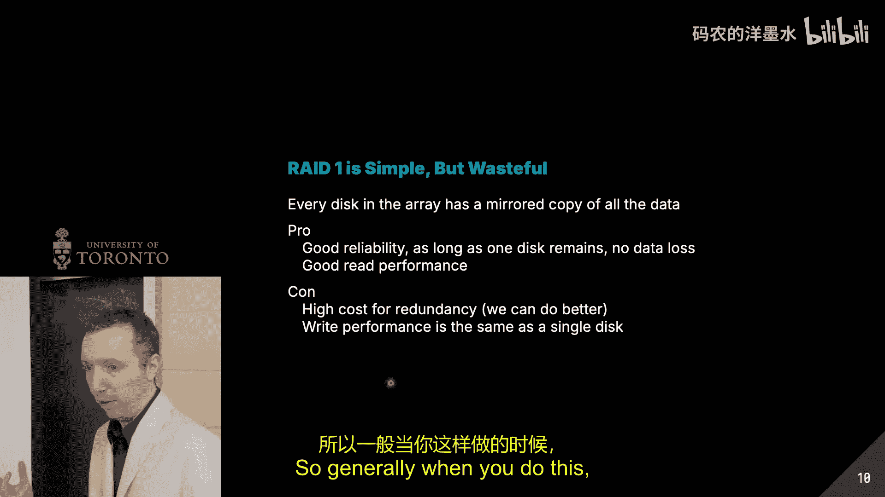

So there is raid 4 you might ask what the hell happened to raid2 and raid3 and they were bad ideas so we just don't use the name or and we skip over them。

 in fact raid 4 is a bad idea too， we'll improve it a little bit but this is just to illustrate。

So to illustrate。What we are going to do is we are going to use one disk to store information such that we can go ahead and recover information if any disc。

Ds， so in this case， we have four disks and for rate 4。Across three of them。

 we do striping like in raid zero， so it would go three times faster in this case for both reads and writes。

 and then we are using this3 as something called a parody。

 which is just some extra information we can use to recompute if any of those gets lost。

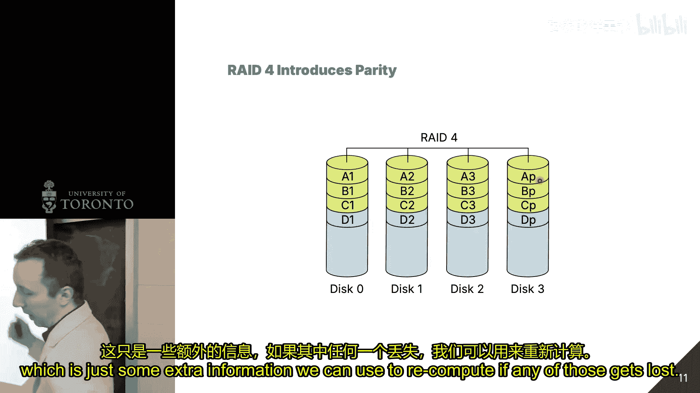

So one common way to。Compute parity is just by using an XO operation， so if we use an Xor。

 we can use that for parity。Is typically what we do。Let's say we have。Let's say we have a one。A2， A3。

 and a oops。An a parody。So for this， I'll just consider single bits at a time， but for bytes。

 you just do it for as many bits as you have。For my information on my disk， I have the value 0 in A1。

 1 and A2 and 0 and A3。So what I can do for a parody is I can x or all three of them。

Can anyone explain to me hopefully in more plain English。

 what does it mean when you X or more than two things together？Yeah。Yeah， so it's basically。

If you exor multiple things together， it will tell you whether that result of adding them all together is even or odd。

 So if it's0， it means adding them all together was even。 if it's one。

 it means adding them all together was odd。 is like the quick way to think about that。

 So if we exor all of these three things together。 our result should be one， right。

So a result is one indicating that it is an odd number。So now knowing this bit of information。

 if I lose any of these disks， I can actually reason about what I lost， so let's say I lose。DisC 2。

 so if I lose disk 2。Oh， no， have I lost information。 Well， no， I can actually get it back。

 So what I could do， go to the store， get another disk。

 replace it and have it recompute that information。 So I replace it with a disk。

 And now I have to figure out what the value is I just lost。 So knowing this parity。

 I can actually figure it out。 So it's 0 plus0 plus something I lost is equal to an odd。

 That's what this is telling me。 So。Since I'm considering only bits， it's either a。0 or a1。

 so it can't be a0 because if it was a0， then if I add 0 plus 0 plus 0。

 that's even so that doesn't mesh with my parodity bit。

 so the information I lost had to be a one so I can always recover it and I can recover any one disk。

Everyone get that。All right， what if？All right， let's say we have the same parity。

 but we lost two disk。What can I do now？Cry。So yeah， in this case。

 I'm pretty much screwed because there's two solutions for this， right。

 so if I don't know two things。So I know some unknown plus a different unknown plus a0 is odd。

There's actually two solutions for that， this or this。And having a 50，50 dice roll is not great。

 so I might lose information but。This。Yeah， this is like 50， 50。

If you do list lose two disk in this configuration。

 you can pay someone a lot of money to recover your data because essentially。With the coin flip。

 there's certain ways files have to be structured so you can essentially try all the different combinations until you get an uncorrupted file。

 and that's probably what you lost。 But you're going to have to pay someone thousands and thousands and thousands of dollars to do that。

 and it will probably take them weeks to do that。 But there are some tricks you can do to actually recover from this。

But it's not guaranteed。So any questions about that？All right， what about？Oh。

 read and write performance。Read and write performance， like we argued， this is basically read。

Zero across this， so our performance is going to be basically however weve made this we have minus1 for both reads and writes。

But there's going to be some overhead here because we' going if we update the information on any disk。

 we're going to have to recompute this information and write it to the disk。

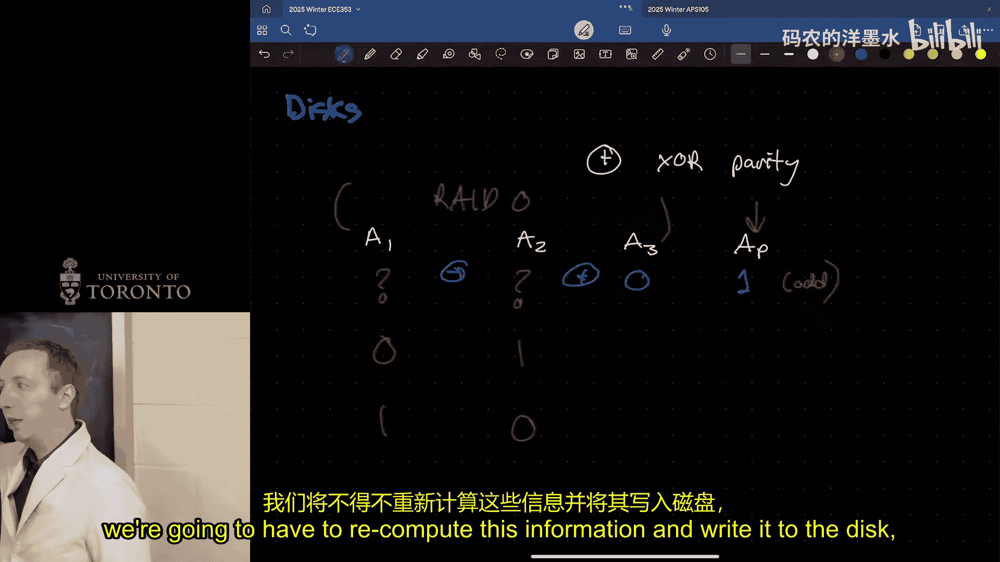

So。In read 4。We can use that parodity drive to recover information so we can use basically all of our space minus one disks。

 so if we had four disks that were each 20 terabytes。

And we use this to store our files we could actually use 60 terabytes of space and in this case we require at least three drives to be able to do this so the pro is that you get n minus1 times performance basically it's just raid zero minus the parity disk and then the nice thing about this is if I lose a single disk I can just replace the fill disk and rebuild it the con is that performance can suffer because every right。

No matter to which drive causes a right to the parody disk。Pformances。In this。

 it would be both read and write performance。Yeah， so this is like the n minus1 times read and write performance would be。

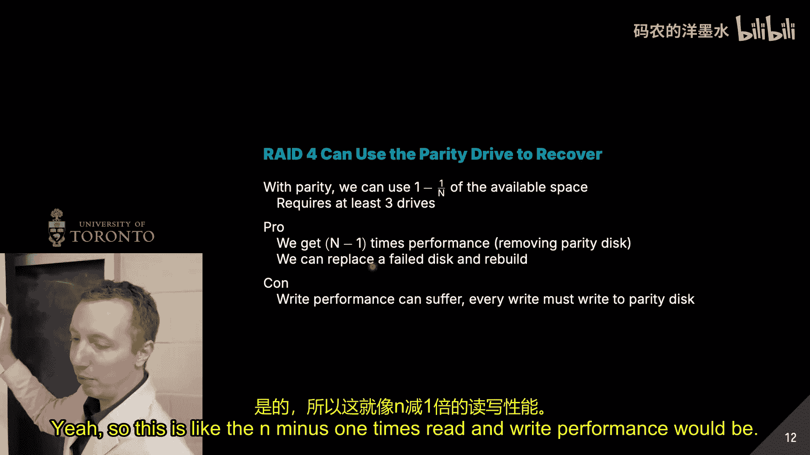

In general， just because this part acts as a rate 0， right。

 but it's going to be slightly worse because we're also have to write to this， no matter what。 So。

 for instance， let's say。I'm writing A1， B2， and C3。So if I write that， you know。

 I could do those rights in parallel， but I'll be a bit stuck because that will cause an update to A B off to recompute the parity for A。

 B and C。 So itll kind of cause more rights on this drive。

 So there'll be slightly less performance than just。

Straight up n minus1 grade0 because of the parody disk。

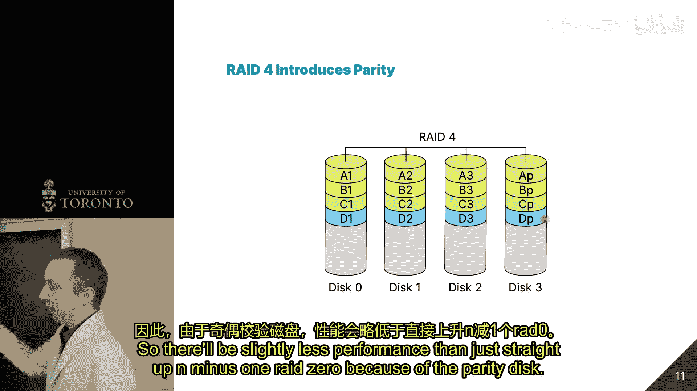

All right。So questions about that before we get into the next raid。

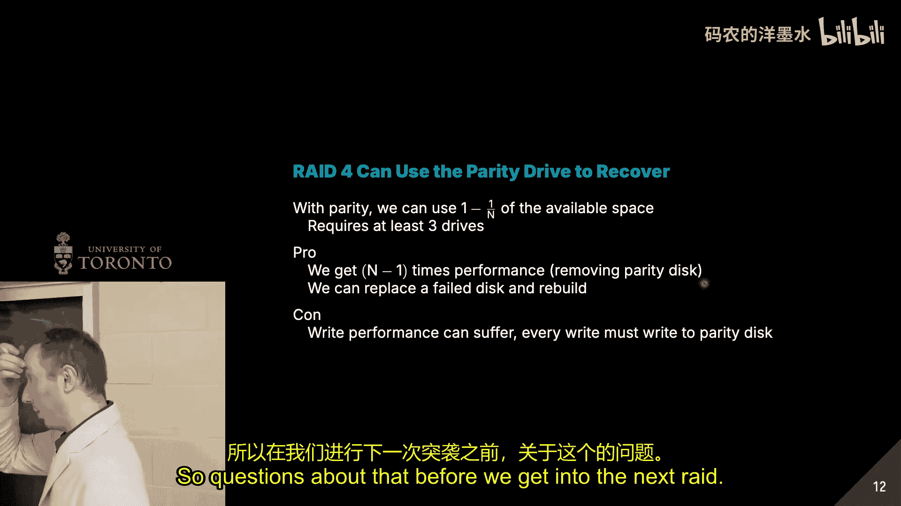

Next raid is the one that's actually going to be used， so Ra 5 is the exact same idea as Ra 4。

 except this parity information instead of being concentrated on the single disk is distributed across all of the disks。

Same idea， we basically have one disk worth of parity。

 but instead of everything being concentrated on the same physical disk。

We kind of spread it out over all the disk and the whole idea is that you spread out all those rights。

 and then hopefully you get better performance， but the same idea is the same。All right。

 so funny story， I had this for， I had my thesis stored on a Ra 5 array。I was working on it。

 Onerive died。 did I lose data。No。Was I a poor student and was I close to the deadline， Yes。

 did I replace that field drive， no。Typically hard drives die， typically know close to each other。

 so a few days go around， another drive dies， Do I lose data？Yeah。I did， did I cry？A little bit。

It died， but I actually recovered most of it and I had stuff。 I only lost a few files。

 so it wasn't that bad。

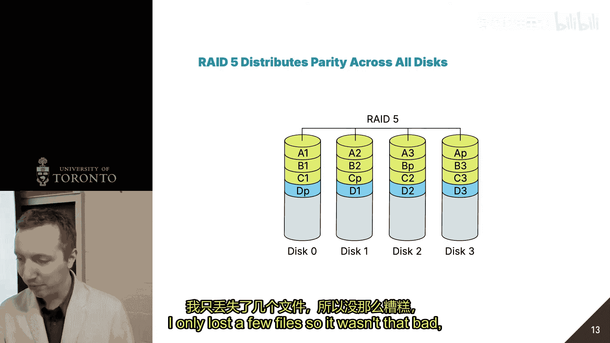

Moreral the story is， if a drive dies， you should probably go out and replace it。

Especially if you're teetering on the edge， so Ra 5 is basically just an improved rate 4。

 all the same pros as Ra 4， but the right performances proved because we're no longer bottlenecked on a single parodity drive。

 all the information is distributed instead of concentrated。

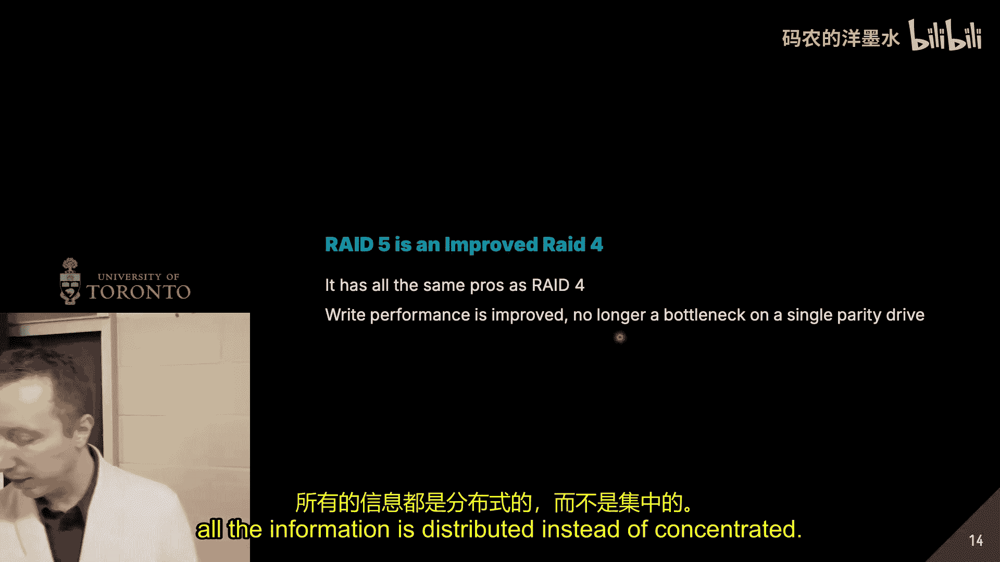

Alright， so next fun rate level is raid6， which just adds another parodity block per stripe so before we had one disk worth of parodity called P I distribute it across all disk Now I have another block or another bit of parody information called Q which I also distribute among all the disk so you might be thinking oh how do I compute Q that is different than P which is just an Xor and to explain that that is beyond my reasoning because it has to do with math galwa fields and a whole bunch of things it's like a linear combination of X ors or something like that I don't know you can figure it out if you like math I don't all I know is that it kind of works so。

In this scenario， kind of like raid 5， except now I have two bits of parody so I can lose up to two disks at a time without losing data。

Where you been。Decrease like the overnight because that's your mindful。

So you're still writing to the same number of parody bits。

 but you're distributing it instead of concentrating it on a single drive。

 so like for this one before if I updated A1， B2 and C3。

All those rights were concentrated on the same drive right。

 but now updating to A just causes of right here， updating B causes of right here and updating to C causes of right here。

 so I'm more likely instead of doing 1，1，1，3， it's more likely 2，2，2，2。Yeah。

 1113 is bad because you'd have to wait for that operation to complete。

 you have to wait for three rights to happen all on a single disk， right？Yeah。

 so it's going to be as slow as the slowest one， so we don't want to concentrate them。

 We'd be better to have2，2，2，2 or get some twos in there。

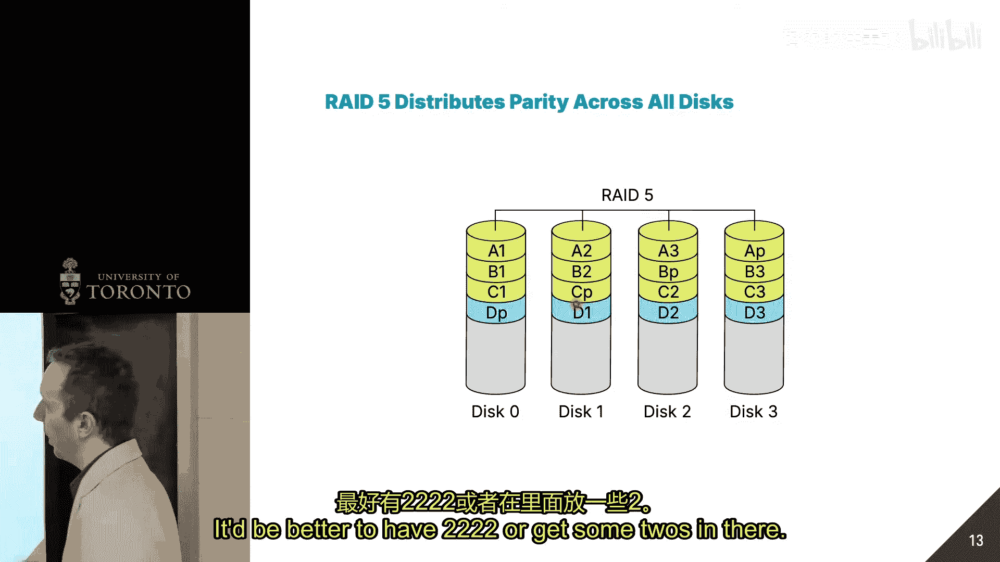

All right。

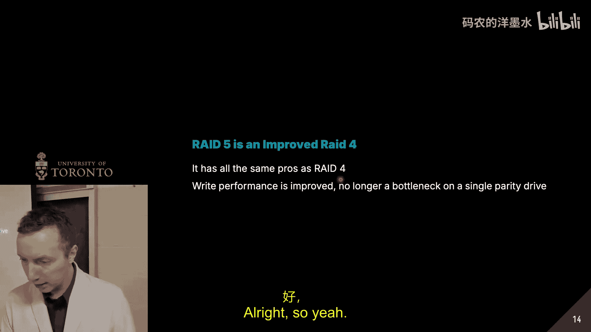

Yeah。Going back to age6， I should have probably had my thesis on this because if I lose two drives here。

 I can actually recover， but if I lose three， then I'm probably screwed。

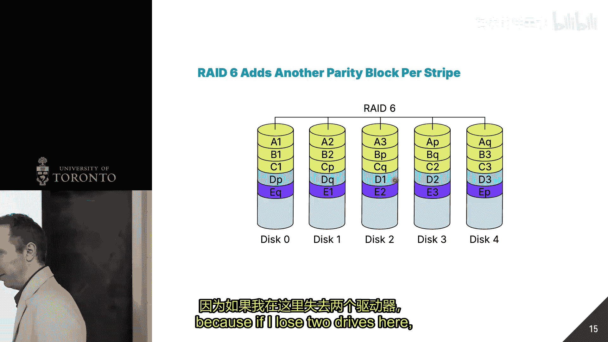

R 6 can recover from two simultaneous drive failures because it has an extra discopparity。

 so because of that。I have worse space utilization。

 so I'm essentially now using two disk worth of parodity information。

 so if I have only four disk in this case and there are 20 terabytes each I can only use 40 terabytes to store my data because of those two two parodity drives and to do this I need at least four hard drives。

The right performance is going to be slightly less than rate5 due to another parity calculation and more rights happening just due to more parity information。

So。There's some other fun raid arrays。

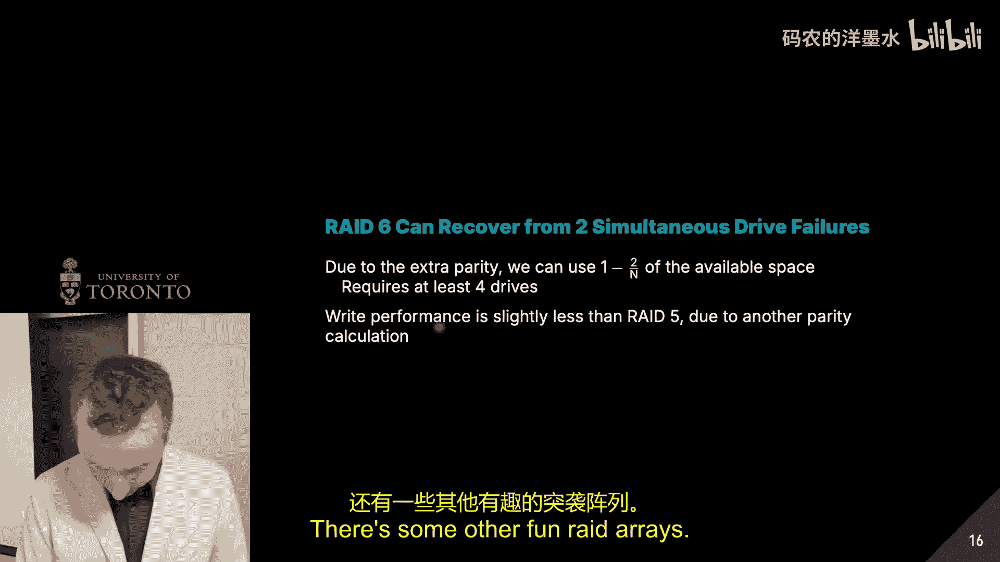

I will save you the hassle if you read the textbook。For some reason。

 they redefined what the hell Ra1 is， so if you read the textbook。They say whenever we say raid 1。

 we mean raid 10 or raid 1 plus 0。 so what those are are something called nested raid levels。

 so just raid0，1，5 and6 are not the only other options， I can combine raid levels if I want。

 so a typical one is called raid。1en or raid。One plus zero。It's called a nested rate level。

 so you can idea it's in this case， like a stripe of a whole bunch of parody disk。

 So there's two ways to nest them。 I can either， let's assume we have six drives。

If I have six drives， raid 10， which is raid 1 plus0。Typically how you read this is。

The number at the end is what the highest level is。 So I would have a rate0 array at the top。

 So I'm striping a whole bunch of pairs of discs。 So every。Pair of disc would be a Ra1 array。

I could do something like this。So I have a raid one。And there were raid one。

We have a mirror of two disk， so then I would just have three pairs of two disc。So this is disk 1。

 disk2。😔，Disk  three。Disk four， just five。And this6。So now if I did something like this。

 how many drives could I lose before I lose data？And to put numbers on them。 So whoops。

If I have a bit of information， let's say I have。You know。

A1 well these two are mirrors of each other so they would both have a1 on them and then my outer level is striped at the top so that big a file would be split over a whole bunch of different pairs of raid1s。

 so this would be like A2， A2 and this would be A3 and A3。

So how many disks can I lose without losing data。Yeah。One or more。Yeah。

 so there's kind of like a max of min， right， so the worst case is。Something like this。

 So let's say I'm。No matter what I should be able to survive a single disc failure， right。

 so let's just say I knock out this one。So if I knock out this one， I have not lost any data。

 I still have a copy of A3 somewhere， right， if I get unlucky。And I take out this one。

 I have lost data， right？I'm guaranteed I can survive one disc failure。

 but I'm not guaranteed I can survive two， right， So if I take out the partner， I'm now screwed。

Okay well that's the worst case， what's the best case Well if I just take out another one of a different pair right。

 so I could take out this one and I don't lose data anymore， I still have a copy of a3。

And I could take out this one。 Don't lose data anymore。 I can take out a copy of a1。 so I can。

In the best case， I can lose three disk without losing data， but that's not guaranteed。Worst case。

 I can only lose a single disc without losing data if I'm unlucky。

 but if you want to play the lottery， you can do something like this。If I have more pairs。

I'm more likely that I won't take out a partner so it gets better and better and better。And。Also。

 sometimes typically you would prefer this over。Rade five or six， typically because。Also。

 when you're recovering data for practical reasons。

 that causes a lot of reads and write to happen to the disk that you are recovering from。

 also it takes a long time because it has to read all the parity information or read the content from the data to either recompute the parodity or use the parodity to recompute the data was lost。

 which stresses out the drives which causes。Which makes them more likely to fail as well。

 In this case， in order to just do a replacement。 So let's say。Rewind a bit and say disk 5 dies。

 So if disk 5 dies。Well it's easy to replace it， I just get rid of the disk。I replace it。

With a shiny new hoops， with a shiny new disk 5。And then。To recover。

 I don't have to recompute the parity information at all。 I just have to make a copy of disk6。

 so it just has to copy information from disk6 over。

Not involve any of the other drives so we can just recover， we don't have to recompute anything。

 It's just a straight copy， which is usually a lot faster than having to read every single drive in my array。

 so you might prefer something like this。In terms of space utilization， let's say。

Each of these drives again， was like 20 terabytes。If each of these drives were 20 terabytes。How much。

Storage can I use for my actual files？Anyone？Yeah。60 right。

 so because these are copies of that in total， I have 120 terabytes。But in this case。

These two are mirrors of each other， right， so I have the same data on both。

 so I can only use half of the data to actually store something useful so。

I would only have 60 terabytes usable。And in general， it would only be 50% of my space。

And as you might imagine， there is also something called， you do not need to know this difference。

 I don't really care about this difference， but you might also see something called raid0，1。

Same idea just flips it on his head， so we have a raid one array at the top。And then at the bottom。

 we have。A mirrored copy of two raid zero arrays。And then these rate zero rays would each have。

 in this case， if we had six disc， would have three discs in them。

 so it would look something like this。So。We won't get into like the very subtle differences between these two。

 just know that there's two different ways to do it。But typically。

 you would always prefer this one for reasons we shall not get into。

 But I can combine different rate levels。 if I want。 You could have， you know， a raid。50。

You could have a raid 60， so a raid 50。Oops。Wow， I can't type。

So raid 50 would be the same as 5 plus0， so same idea here， but instead of raid zeros here。

 I would have raid 5s。Wwhich I would need a hell of a lot of disk to do。

 but again it's something you can do if you are a Google or something like that that is to deal with vast。

 vast， vast， vast， vast quantities of data again， for this we don't really care about nested grade levels all that much。

Yeah， so A1， A2， A3 would just be。Three pieces all mutually exclusive of the same file。All right。

 any other questions with that fun stuff？Probably care about that if you're running a server。

 things like that， so you don't actually lose data or if you actually care about。

You might have your data backed up on the cloud。 So the cloud。

 just another word for someone else's computer， and you're just paying someone else to do this for you。

 So they'll be using something like this to actually store your data so they don't actually lose it。

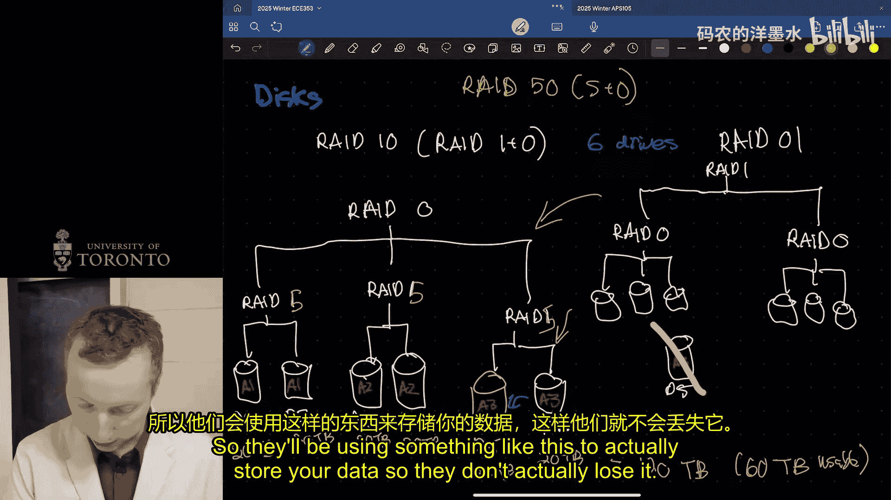

Because hard drives die all the time。If you're thinking about job prospects。

 someone's job at like Google and Amazon data centers is to just go around on a scooter with a card of hard drives and just keep replacing hard drives as they die so they die quite often so that's a fulltime job if you're interested in that fun stuff。

So thiss are the important thing they enable persistence。

 so storing data and actually retrieving data as well。

 so we explored two topics in the first half of this lecture。

 SSDs and RA SSDs are more like RA except well one。

 we don't lose data when the power goes off and we have to access them in pages and blocks instead of just pages。

Like we have with RA， how we use virtual memory， and then SSDs need to work with the operating system for best performance。

 so we need something like trim in order to tell the SSD that， hey。

 these are the pages on the block we are no longer using。

If we want to tolerate failures of disk because they do die all the time。

 having your important information just on a single hard drive is a very， very bad idea。

 So you can use something like raid to tolerate failures and improve performance using multiple disks at a time。

So with that， we shall take our break and then come back for our fun performance example。

 which will help a ton for lab five。

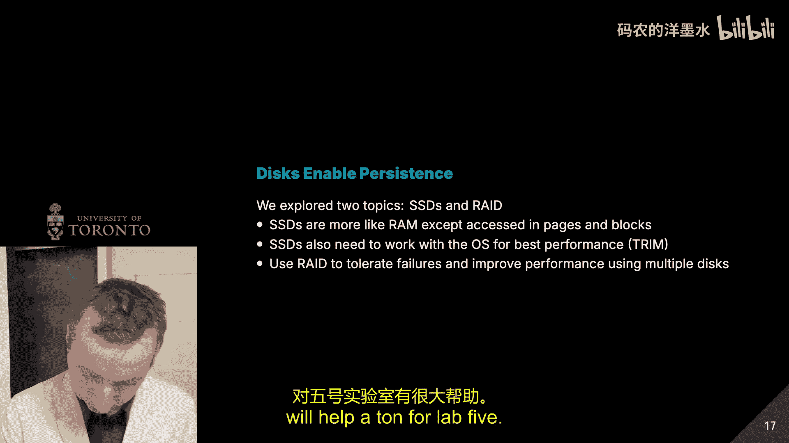

🎼。わ。

Alrighty， so let's do the fun thing， so this will help you for lab5 and it's more of a realistic way of like。

 hey， let's use threads to make our program better and let's screw it up lots of times。😊。

Like I alluded to in the last lecture， banking time， so。We're running a bank。

 we're going to simulate doing 10 million transfers。

 so we have a simulation that creates a varying number of accounts。The rules are quite simple。

 Each account has any unique I and a balance。 We'll just assume everyone starts with $8000。

 and we are going to generate random transfers between random accounts for a 10% of their current balance。

 So it's a zero sum game。 If we are the bank we are just facilitating doing the transfers between accounts。

 So we're just sitting there doing money or transferring money nothing bad should happen right So we're going to assume in our code。

 we have to call the securely connect to bank function before doing the transfer。

 We'll assume that it is very slow and that's something we want to do in parallel。

 So we are going to use threads to make things a lot faster。So the rest is。

Done live we' have if we're lucky， well， we will， because I'll ask you to program this。

 So of course we'll have lots of errors。 So we're going to have data races。

 We're going have deadlocks。 We're going to laugh。 We're going to cry。 We're going have a good time。

 So our goal is to be faster than 11 seconds。 So you can find this in the examples repository or the examples directory as well。

😊，In the lectures， it's here， it's this lecture setup build and it's just Bankim that takes a single argument。

 the number of accounts。🤢。

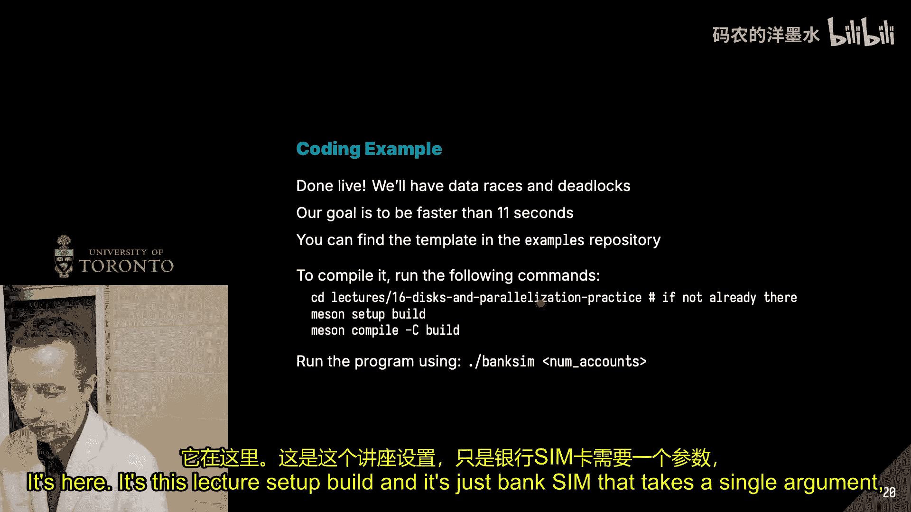

So。Let's just run our code， so just to see how it works and we'll start going over the code， okay。

 I need to compile it。So if I compile it， I get some errors or some warnings I'm going to ignore。

 and then let's just assume that I am simulating， creating 10 transfers。10 accounts， if they're 1。

000 each， my bank should have $10，000 in it， take some times to simulate the transfers at the end of doing all of the 10 million transfers as a sandy check。

 I'm a bank I want to count my money， the money I have across all the accounts。

Before should be the same as after doing all the transfers， right， I don't want to lose。

 make money or otherwise do anything that might get me put in jail。

 So if I run this and I use user bin time， we should see that on the system。 it should， yeah。

 take about。11 seconds。Let's see。So whole bunch of information so total time took about 10 seconds。

 ish10。8， pretty much 11。Let's look through the code。

 So I have a few defines at the top just to make sure things are， you know， usable。

 So we have a starting balance of 1000。 We're going to have numb transfers as 10 million， and then。

I know how many threads will parallelze well on this machine， so it's eight。

 so I'll define numb threads Currently the solution does not use threads at all。

 so our job is going to be able to create eight threads that all operate in parallel。

Now I have thisstruct called account and this is all the information I need for a single account。

 so right now I just keep track of its current ID and then its current balance so I'm going to since I don't know how many accounts I need at run time I'm going to allocate them when I run main so I'm going to need all my accounts accessible in my thread function So just lazily create a global variable called accounts which is a pointer tostruct array this will be an array that I'm going to allocate once I know how many accounts to create and then I'll initialize the number of accounts and the pointer to the accounts array as zero and null。

Then I have the securely connect a bank， doesn't matter， it just wastes a bit of time。

Then I have my transfer function。 So it takes by pointer an account from an account to。

 So I need to send the money from the from account to the two account。

 So I'm going to call securely connect the bank。Right now simulates just wasting some time。

 so I calculate the amount I want to transfer， which is from I'm just going to use Enteger division。

 I don't really care， so I'm still going to get the。Like it's not going to be exact。

 I'm not going to keep track of sense， but all of the math should works just fine。

 And integer division is a lot easier to reason about。

 So I'll just do integerge division with 10 and then take that amount。

 subtract it from the froms balance。 Add it to the two's balance。

 So I'm transferring money between accounts。 from the bank's point of view， I'm not losing anything。

 doesn't matter to me right so。This is a run function。 So we're going to use it with P thread crate。

 So takes as arguments， you know。I have it setting up that it passes a thread I D at Malocs。

 It does all that fun stuff so we can get a unique thread I for each thread。

 which we will go ahead and use at some point。 and then I can free it。 So that has nothing。

 We are going to fill that in。 I have check error， which just does the normal thing of check for an error。

 kill the process。 If there is an error。 Then in main。

I'm going to make sure there's exactly two arguments of the program name， number of accounts。

 the set local is just so I can see it adds commas for me and then I'll get the number of accounts to simulate so this is actually how you have to use this account to actually error check so you set errorode to zero。

 call it and then。If that number is zero， it will set error no。

 so this is just how I check for errors for it， don't worry these asserts won't happen as long as we write a valid number。

Then I allocate the account， so it's number of accounts times the size of astruct account。

Moc that memory， so it's enough for a big array， make sure that it actually worked， it's not null。

 then I just print how many megabytes we used just in case VS code crashes or something like that and I don't push up against memory on my virtual machine。

Then here。This is just initializing the balance of the account， so everyone has a unique number。

Start that one goes up to however many accounts we have， everyone gets $1，000。

 so my initial funds should be just starting balance times the number of accounts I have right。

 that's how much money I have。So this is just so I can copy and paste it once we create thread。

 So I'll skip over that now。 So this is the this is the main part of the code that we're going to try and parallel。

 So this is doing the transfers between two accounts。

 So this just loops over I as is may transfers as we're going to do。

 We'll see that we're not using the value of I。 We don't really care。

 It's just keeping track that we're actually doing 10 million transfers。

 So it generates a random random from index。 So it just does random mod number of accounts to index R mod number of accounts and then just does a transfer between them。

 So it does the。Aray subscript from from index to index does normal see things， get the address of。

 so that it's a pointer to an actual account and then calls that transfer function we saw before。

 which actually subtracts and adds money to the account。So this is the only loop we want to paralyze。

 then here is just the sanity check， so this is the total balance。

We're going to calculate what the total balance is across all the accounts。

Whatever we're done doing all the transfers， it should add up to be the same as what we've started with。

 So this just loops through all the accounts， adds their balances altogether together。

 and then make sure that the bank's file funds just print out what the file funds are。

 which should match and then freeze， you know， we free， getri allocated memory so。

We're going to start by paralyzing， we're going to make things go fast。

Here is the boilerplate code that I already wrote for you。So we want to paralyze that stuff。

We're going to make threads so we're going to make an array of called threads up to numb threads so there's going to be eight of them and then we're going to malloc space for thread ID。

 which is just an int， write the value to that and then pass it to the thread function just so that each thread gets its own unique thread ID。

 and then we do what we did before P thread create the current thread in the array。

 default attribute， so their joinable threads。Start routine is just run the run function and then give it that pointer to that thread ID there。

 and then hopefully that works。 So after this loop oops。

We create 8 threads that are all running that run function， hopefully in parallel。

 if my offering system is good and actually use using all my hardware， so。😊。

After I create all eight threads， the main thread just joins them all。

 so I won't be able to pass through this loop until all my threads are done。

 So after all my threads are done。I'm done all of my 10 million transfers so I can go ahead。

In the main thread， do the sandy check， make sure my money is still there。What we are going to do is。

 yeah， I'm going to need help， so we are going to paralyze this loop。So let's start it。

 so this is my run function。Should I just？Copy and paste this into my run function。 Well， is this it。

 I've now sped up my program by eight times。No， what is my first thing I need to do to make this fast？

Yeah， if I have eight threads each should do an eighth of the transfers right。

 So right now each thread is doing numb transfers， so each thread would be doing 100 million。

Which I don't want， I want to do 100 million in total， that would be8。80 million， which is bad。

I'm trying to divide up the work among all the threads so I can just do numb transfers divided by numb threads。

 so each thread would get an eighth of the work in this case。The number cleanly divides。

 I won't worry about any leftover， whatever doesn't really matter。

 so I'll just do something like this。All right， so are we good now？I''m now。

I am now the greatest 10X programmer in the world while 8X programmer I've now made my program eight times faster。

 no bugs， no problems at all， all right？Yeah。Won't the threads interfere with each other with what？

The lot。It is like thing。没什么。Oh， so。Anyone help with the term。

 What is a bad thing that might happen with threads that causes weird issues。

 Anyone remember the term， yeah。Yeah， a race condition or a data race。

What's the definition of a data race？Anyone？Yeah， very close， anyone help her， yeah。T to。W very warm。

Writing distill data， you could define as that。Technically。

Two or more concurrent accesses to the same memory location with at least one being a right。

So for this mod one。This numb accounts is shared between all threads， right？Are we writing to it？

In this mod。No， we are not writing to it right， so there's no data race at no point。

Are any thread so？Each thread runs this run function， which reads number accounts here。

 then calls transfer。And then transfer， assume I assume this is thread safefe。

 no data races or anything like that。 And then here it doesn't use nu accounts at all right。

 so number accounts is only red between all the threads it's shared。

 but it's only red so we don't have a data race with nu accounts。

So I like what you're thinking about something with the mod， what about RAand。

 so RAand's called with multiple threads， right？So did we write RAand No。

 so we're going to have to check if that's threads safe right so we can go ahead if it's not threads safe。

 bad things are going to happen， although you could argue if RA's not threads safe。

 you just get a random number and that's really good so it's even more random， but we can check。

So in the man pages for RAand， I can search for attributes。After， is this the right page？

Man three ran。Rand three。Yeah， this is R。There we go all right so I don't know what the hell I pulled out before。

 so if you look at the documentation for RAand it says RAand Rand underscore R and S RAand thread safety M threads safe so that's good right it's safe。

So。Yeah， we're getting confident now that our code is great， right。

 So this should go eight times faster， right？😊，All right。Let's assume。

 let's see if we get fired today， so let's compile it。And run it。

And we can time it too just to make sure that it goes fast。

 I'll make it if I do dash P time will give me a something a bit nicer。

 so I'll do it with 10 accounts。So managing $10，000。One Mississippi，2 Mississippi， oh there we go。

So it took 11 seconds， which wasn't any faster。I just made。$94，000。So we're fired。So。Help。Okay。

 number one。Took 11 seconds before， it took like 10 seconds before。

I have eight threads each showing an eighth of the work。INot synchronizing I not making anything ce。

 So why the hell isn't this eight times faster？And guesses this one you probably won't be able to get but。

You could make an educated guess yet。エスト。Yeah， but it spread out over eight threads， so it should be。

Eight times faster， right， we're doing it in parallel。Nope。

 my processor has multi have more than eight cores on this。Yeah。Not necessarily tudah。

It's not necessarily true that each thread just does one， each ch does one thread at time。

So if my operating system was complete garbage， that might happen， I have a good operating system。

 though， So it will run things in parallel。All right， so this one。Is a bit more subtle。

 So this RA function， we saw that with thread safe。Does that mean it is fast？No。

 you can imagine that Rand probably modify some global state， so if it's modifying some global state。

🤢，It would probably need to use a mut text and locket， which would make it serial。 So if I do this。

 all my threads are calling Rand and。In this case， RAD seems to take most of the time so they're all blocked waiting for RAN to be thread safe。

 so they're all just wasting their time waiting for RAandD so if I read the documentation first step again that you outside the scope of this course more of a performance thing but they're all using some global state and RAand which is really really slow so instead I can create a local variable in each thread called seed。

 I can initialize it to the thread ID and then there's a version of RAand that's called RAN underscore R where I can give it the state。

So I can give it the pointer to the seed， and then it will use that。To actually go ahead。

Modify its own state。 And then each thread will be modify its own state so that it can all be done in parallel。

 So if I do that all in parallel， compile that。 So this will make R actually。

Independent in each thread because they're all modifying their own state。

 So each R R should be a lot faster。 So if I do this now。And I read it， boom。

It is now eight times faster， right， it makes more sense now holy Jesus， right。

We have more money than the planet。If we are called on to actually provide that money。

 we are 100% going to jail。But it's fast at least now， right。

 So took about 10 seconds before8 threads。 Now it takes about the8 of the time。 Make sense， right so。

My operating system is not complete garbage。 It will run in parallel。

All the threads are fighting over that one。All the global state in that RAN function because it's marked as thread safe。

Yda， yada， yada。 All right， So that result， obviously bad。Fix， please， what happened？Yeah。

Because we're modifying the accounts。That's true。So yeah， lets make it so what are we modifying。

 which may have a data race？Accounts what specifically about the accounts？Yeah， balance。

Is it possible that we have a data race for an account balance。

 so is it possible that we have two concurrent accesses？So two concurrent excesses between threads。

 such that there is the possibility of a data race， well， yes indeed， there is。

Could happen that one thread is transferring from thread A to thread B。

 and another thread is transferring from thread B to thread A or thread A to B， in this case。

 it doesn't matter， in which case they'd be both modifying A's balance and B's balance。

 so there could be a data race between any of those balances， right？So。That's bad， well。Let's see。

 so this is also a case of why。You know。Programming with threads is hard。 So let's say we were。

 you know， a large， successful bank。That you are gainfully employed that and you don't only have 10 accounts。

 you implement this as is and you have like a million accounts。

 so if we run that we were managing a billion dollars and yeah that's pretty decent right we only made up $164。

 let's say we were running a bigger bank so we're managing $10 billion。No bugs。Right， we're all good。

 so this is the weird case where the larger your program or the larger your problem is。

The less likely you are going to encounter an error。 Anyone want to explain why。

It was worse with more accounts。sorry， why it was better with more accounts and worth with few yeah。

M be。Yeah， I'm randomly transferring between accounts。

If I my problem was a data race here right two concurrent accesses to the same account。

 so one thread was trying to do something with account A and another thread was also trying to do something with account A。

 Well， if I have whatever that number is like a million accounts。

 the likelihood of picking the same account that two threads are actually using at the same time is fairly low。

 so I might not actually see the error。Well， if I only have。1en accounts。

 the likelihood of eight threads each pick in the same account is quite high， so again， rent run it。

 boom。I am now richer than anyone on the planet。Or if I'm。OrIf I have to service that debt。

 then I am completely screwed。Yeah。Just by a line。Yeah。

 so that would be caused by overflow so as soon as I overflow one boom。

 the number just gets super screwed， I might get super unlucky where I don't overflow and it just no just some giant number。

 let's see。Hundred。Yeah， I still have a lot of money。Sometimes， we can。Yeah，Go her。No。

 we're still screwed。All right。How to fix。How do we prevent a data raise？Yeah。

Use a mutex or you're set for。 So typically with data races， two concurrent accesses。

 we want to use a mutex。 Muex is the right tool for the job。 Alright， so I need to use a mutex。

 How tell me what I should do with this Muex， yeah。Yeah， so the idea there is。Hm， well。

 should I create a mut text for each account？Probably a good idea。 Well。

 because this is where I have my data race with the balance， right？

 So we all agree we have a data race with balance。 So one solution I could do。

That would be safe is I can go ahead， I can just create a mut textex， and then I can just do a lock。

 Actually， we can just do that。 So let's say I create a mu textex。😊，Equal to P。

And then I do something like P thread， Mutex， Locke。I can just lock all of the problem code right。

 so I'll lock the muttex。Oops， will I close？Yeah， probably doesn't matter。

So I can lock the mutex and then unlock， so I make this a critical section so only one thread can do this at a time。

Will this have a data race？L have more money than anyone on the planet。Oh。

 it shouldn't have a data race in this case， right？So I'm essentially using one lock， locking the。

Locking just the problematic code， I could， of course， also do this。🤢，And walk this lock make。

Add the securely connected bank into the critical section。

 but that will make sure that no threads can act do this in parallel with one another。

 And I said it is safe to do in parallel。 So we should move it out。

 Let other threads do it in parallel。 So this will just prevent。

These three lines of code from running in parallel or concurrently with any other thread。

 so if I run， if I compile that and run it now， one， Mississippi2 Mississippi，3 Mississippi， oh。

 it took a lot longer in total， it took 12 seconds， didn't lose any money。But yeah。Bit slower。

 not eight times as fast。So。We want to do better than this。 so as we discussed before。

 one thing is like finer grain locking， so I could create a mu text for every account， right。So。

Let's do that。Let's go up。Thankly enough in thisstruct account， I can just add a mutex here right。

 so just add a muttex for every thread。So with that， I'm going to have to initialize it too。

I'm going to have to come down to where I initialize it。

 and I'll just initialize every single accounts mut text。 So that would be accounts I dot。Mut。

 so we have to do P thread， Mue text， and knit oops。And then。And then address of that oops。Oh。

 too few a。That， and then all default attributes， we don't care。

So that creates our mut text for every single account。Great。😊，Now what。So now。So。

I don't need to use the muttex for this part， right， we already fix this part。

 no data race with this part of the code， the problem was in transfer right， so this is all good。

 no data races。We're concentrating on this。 So now we have a muttex for each individual account。

 So what code should I add to make this now thread safe。Yeah。So yeah， I want to P thread， Muex lock。

 so first one you said I should lock。The mutex from the from account。

So from Muex and then the two account。Right。Is that all I need？Yeah， unlock。After right。

 so unlock where。After the two bounds， so here， and we can go ahead and just do。Oops， unlock。

All right。So is that good？Yeah。A guard for what？さ。だて。Some database race between the two locks。嗯。

So what's our primary concern if we have more than two locks？Yeah， somehow one locking permit。Yeah。

 what's the name of that？哦哦。Deadlock， right？So deadlock。Is you have a lock。

 you're trying to acquire a different one and you are not able to。

What used to prevent it are I either acquire locks。All the time in the same order。

Or I get rid of hold and weight right， so in this case looks like I'm acquiring them in the same order。

 right， all the threads are doing from and then to。All right。So does this look good to everyone。

 this is a perfectly。Crome me an example with no bugs。Perfect， all right。Let's compile it。

Do we want to assume we are a big bank or a small bank？Yeah。Which one small， All right。

 let's assume we're a small bank。So let's just1 count， all right， so time to beat。

So let's see up scroll up， so real time is like real clock time， user time is time across all cores。

🤢，So we're doing about 12 seconds of work。In that case。

 we didn't exactly do it eight times faster because we were blocked。

 we just had a single mut text before， so that's why we got that so real is the time we actually care about it's like how many real seconds pass。

We just added these locks around here and we argue that it's all good。Time to beat five seconds。

One Mississippi， two Mississippi，3 Mississippi，4 Mississippi， five Mississippi， six Mississippi。

7even Mississippi。Eight Mississippiisspi。N Mississippi。10 Mississippi， 11 Mississippi。

We're worse than not using threads and we are definitely fired。So。

Anyone want to explain what happened what was going on？So one thing I can look at。

Is if I go open a different shell and type H top， I can see what my threads are doing。

I have 10 threads on this。 I can see that， you know， they're not really doing anything so。

That's kind of telling me something。Does that give me evidence that I have deadlocked myself， yeah。

Ah， yes， perfect。

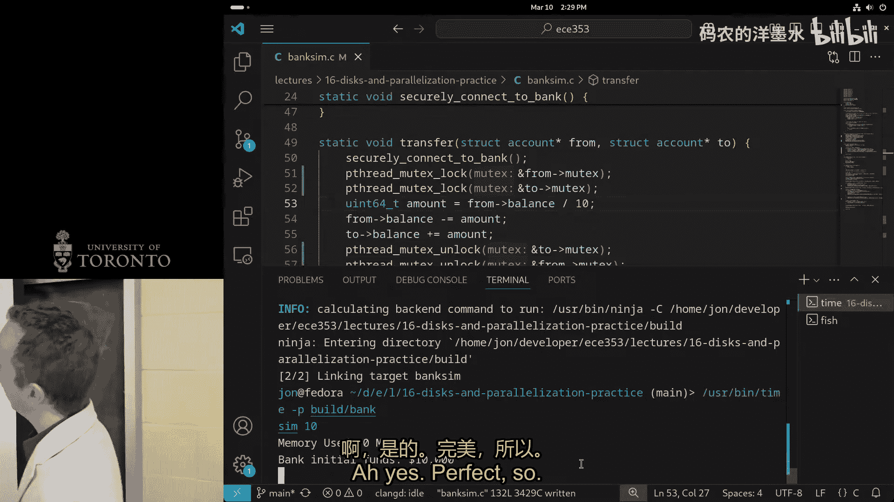

We are accidentally deadlocking。 So how we could deadlock。

 And this is a skill you need for the exams and figuring out。What could deadlock， right。

 so in transfer。We did lock from。And then lock。2。And we took them by a pointer from。And two。Well。

 there's no reason that thread1。Can't do transfer。Let's just say A to B。And then thread2。

Couldn't do something like transfer。B to A。So in that case， in the implementation or well。

 when we run transfer A to B， that would be the same as lock。A locke。B。In thread A。

The from account is now B， so that would be lock B， lock A。🤢，That looks bad。

So could be the case where threadread1 runs first locks。Account A's Muex。

 then we contact switch over to thread2， it locks。Bes account bees mutex。

 and now we are at a deadlock， right， so this one can't progress because it's waiting for that one to unlock。

 The other one can't progress because it's waiting for the other one to unlock so。

We are now in the deadlock scenario， so this is still running because it's deadlock。

 So I have to control C killll it。 And then yeah， so real  hundred and yeah。

 it definitely is deadlock。 So how fix。

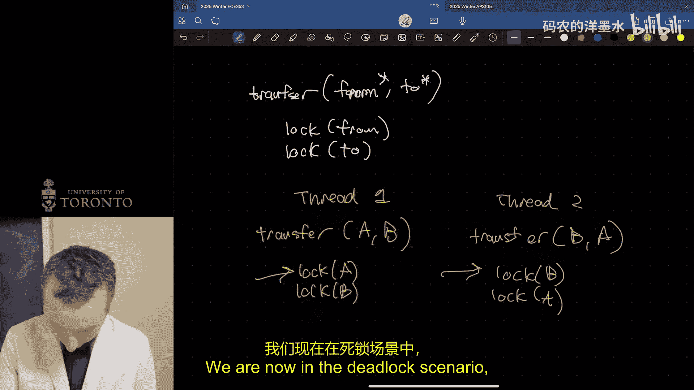

Yeah。lot of one friend of us。Oh， it's what。What。あさい。Yeah。

 so there's one suggestion of like only lock one mutex at a time， so we don't have that。That will。

So that will be thread safe from the point of view of the bank， but。

The transactions won't be like the transaction itself won't be atomic。

Each account would have a slightly different balance than if it just went serially。

 which is generally what we don't want， so without that subtle bug。

Assume that we have to have both muttex locked yet。Yeah， so to prevent a deadlock。

 two different ways to do it right， we can either break， we only have to break one condition。

 we can either break a circular weight or we can just go ahead and break hold and weight so the suggestion was well in order to break circular weight we need to order them somehow luckily each account has an ID which is unique and we can just always lock the account with the lowest ID first so that would give us some type of order so。

To implement that， I could just do something like this so I could do P thread， Mutex。TM1， oh。

 I could do a pointer to M1。Yeah， let's just create two variables。M1 and M2。

 and then we can just check their accounts IDs to see who is smallest so we can check froms ID so if Fs ID is less than2's ID。

Then we'll say M1 is equal to。From Muex and M2 is equal to2's muex。And then otherwise。

 we'll just flip them around。So we'll do something like this。

The2 ID is or from ID is greater than2 ID willll make M1 equal to2 I because it's smaller and make M2 equal to from ID because it is larger so now。

In this case I can go ahead and change this to lock M1， the smallest one first。

 and then M2 which is the bigger one， then I should change these two as well。Oops。N two。All right。

So is that better？No deadlock， we're keeping our job。Yeah。

So three threads call it possible to have a big circular。it shouldn't be， right？

If we always acquire the lowest account ID first， there's no circular weight。

 it's not a circle right， we're always doing it in the exact same order， so this shouldn't deadlock。

 right。All right， well， we're confident we don't have anyone objecting at least。So compile it。

One Mississippi， two Mississippi，3 Mississippi，4 Mississippi， five Mississippi， oh oh6， Mississippi。

 7 Mississippi，8 Mississippi， nine Mississippi， today， we're fired。So。Any ideas？You still have a bug。

This one's。Fit harder to reason about。Anyone help it。 it's five minutes before the lab deadline。

And I left my debugging to the end， yeah。It。The same account I。one。The maximum and the minimum。

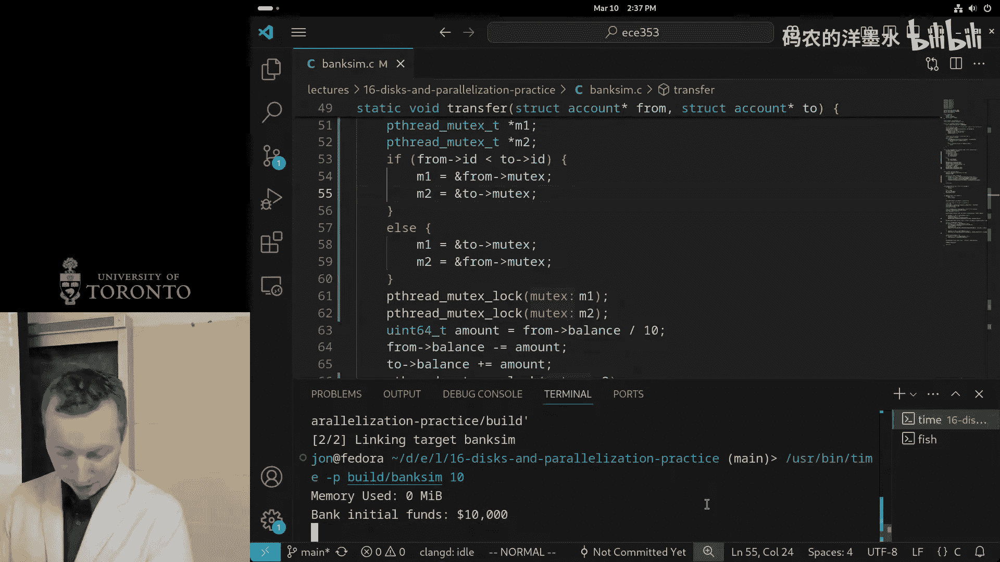

对。So。You're saying we have two threads。Doing transfer。

 so which accounts do you want to transfer between？Ohoops to it。Two and six or other way around。

I think you said the answer right at the beginning you were so close。Yeah。

 I think you it's a valid transferred of protein two accounts。It's two the same。Yes。

 you said at the beginning the same accounts。 So what about if I was transferring here between？

Account two to two， whoops。Well， that's probably bad， right， So fromm transferring between。

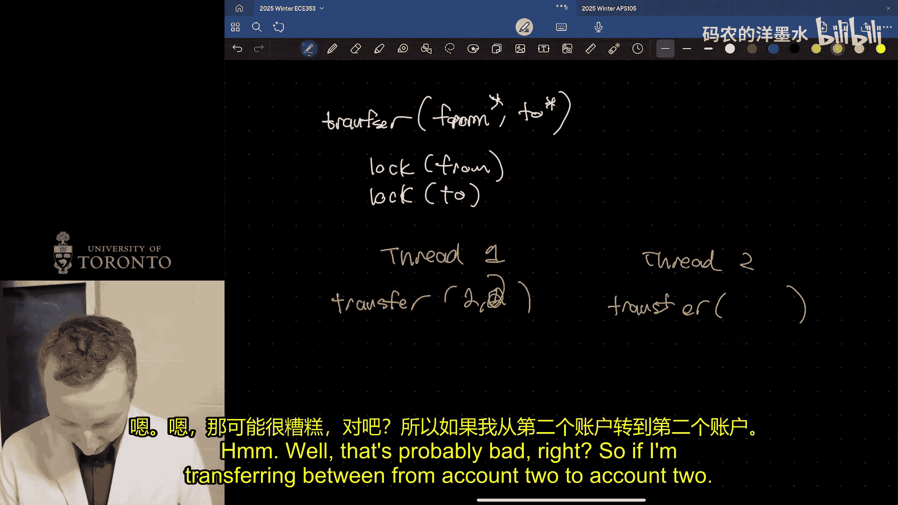

From account2 to account2。Then。Their mutt are the same， right， so I lock it。

And then M1 and M2 would be the exact same utex so I lock it， and then I try and lock it again。

 which I didlock myself。So luckily in this scenario， we can actually kind of make this。

A lot easier so we could just check if the from is equal to two so if both the pointers are equal。

 it means this is a shortcut， theyre definitely the same account so this transferring to and from the same account even do anything No right so I'll just skip it I'll return I don't have to do anything because it won't do anything so why even bother。

All right， are we good now？So what we screwed up how many times， like five times， six times。

 seven times。Well， we keep our job now， let's see。So。

Main problems we have to always think about is possibility for a data race。Well， originally。Yes。

 there's a data race to account balance。 It could either be from or two。

 but now we've protected against the data race because now we make sure that。

This code can only run from one thread at a time that has a lock for both of the accounts。

 so we can't have concurrent accesses to balance for more than one thread with at least one being a right。

 So we're good for data race， and then the other condition is deadlock so。To prevent deadlocks。

 we can either eliminate hold and weight。Or we could always make sure things are totally ordered and there's no circular dependencies at all。

Time， we were like， okay， let's just go ahead and always acquire the lowest account ID first。

And then the highest next， so they're always in the same order。Then we add that subtle bug where。

 hey， we don't want the mux to be the same。 So it seems like we have all of our bases covered， right。

So let's see moment of truth， let's compile。And run one Mississippi， two Mississippi。

 three Mississippi。For oh， yay。So。Did about as good as a single lock before。

 but we didn't lose any money， which is great。So let's see if it works if I do。

What would we expect if we have way more accounts now？

A lot of memory yet through what about runtime performance， yeah。That's错。

So better run time because it has less locking。我ing。Yeah， less， what's the word contention， right。

 less contention。 So we have the same amount of locking。

 but it's more likely that the threads can run in parallel because they're all accessing different accounts。

 If they happen to access the same account， then it will go as slow as the serial version。

But if they don't。If they don't overlap， then we can run。All in parallel， if we have more accounts。

 it's likely that we run more in parallel。 So yay， look。

 we didn't lose any money and it went a lot faster。 So the more accounts we have。

 the less contention we have and the more worthwhile it was to actually write this in threads so we can go ahead。

 test it extremely。 so if we only have two accounts and we have eight threads。Oh， well。

 that one runs faster anyone because it's very likely that it's going to be the same account， right。

 So minus that kind of optimization。 It falls off after a while。 So let's say 20。So if we have 20。

 we can see that， yeah， it's quite likely that they'll interfere with each other， actually。

 that was slightly better than 10。But whatever。The more accounts we have， less like。

 less contention we have， and the faster it will likely be， be。 So we have created。

The world's greatest bank of all time， just like I promised。Any questions about this？All right。

 I will show you a cool little tool then。So， let's。Say。Okay， so。Let's say。

 let's rewind and let's say。Let's say we still had the deadlock issue。

So I'll just always acquire from Mutics and to Mutics。

 so let's say we rewind and still have the deadlock issue compile。So debugging this。

 you might be like， oh okay， well， maybe it just will take a long time。

 probably hard to debug this so。Velgrind won't help me right， some of you probably use velgrind。

 so it won't help you here。But there is a cool suite of tools called the sanitizer tools。

 So there is a tool called a thread sanitizer， which will add a whole bunch of runtime checks to your program to check if there is a data race or if there is a deadlock condition。

 So how you do it is to do。😊，So。On this， we have to make sure we use the clang compiler。

 you can use it with GCC， the default compiler， but you have to install some other packages。

 but how you do it is we use Mein， you can set it up and then add this flag so this is a slash D that's a defined flag so there's something called desanitize equal thread so that will add all of the compiler flags and linking flags it needs to add all of these runtime checks to your program so that when you compile it and run it。

It will tell you at runtime if there is some type of threading problem with your program so if we do that sets it up and then it says user defined options。

 we're sanitizing the thread so we can go ahead， compile as normally should all work and now if we run our banksim so let's run our banksim with 10 accounts now it should make things very angry so we do that and it gives us a whole bunch of output I'll just stop it so。

This actually tells you what happened。It says warning， thread sanitizer， lock order inversion。

 potential deadlock， Another way of saying lock order inversion is just it is a circular dependency。

 So it actually tells you what the cycle is。 So it's showing here that。Mutex 0 is trying to。

Is held and it's trying to acquire M1。 M1 is held and is's trying to acquire M0。

 So it's telling you the cycle。 So here it even says M1 acquired here while holding M0 potential deadlock。

 and then it you know throws up on you over and over and over again and if we get lucky。

 we even get cooler cycles。 So there's a cooler cycle here involving three threads。 So M。

0 M1 to M3 all the way back to M0。 And if we get super， super， super unlucky， Oh， this one looks。 No。

 that's not that much fun。We don't have any fun deadlocks。

It actually will tell us if there's a potential deadlocking or cold。

 so it might be nice to help you debug。Another problem we had that was hard to solve is our data race problem right。

 so whenever we deleted this， we didn't have a muttex at all。Let's just keep that optimization。

 So this is the case where we actually had a data race before， right。

 where we just got some giant number at the end。 Well， if we run this with thread sanitizer now。

 it will also throw up on me。And say that， hey， there's a data race that will cause your program to go a lot slower。

 but if it gives you any output， then it's probably a bad idea。So what this will do is if we go up。

So it's thread sanitizer right of size8 at whatever in threads3。

 so it tells you exactly what line number had the problem to help you narrow it down so it's saying that。

There's a problem here。 The only right that happens is to the variable balance。

 and it's telling me that thread zero is。Accessing that memory location at this line and this is just the stack of that thread。

 so this is where thread0 is and then it's showing me the previous call the right by another thread in this case thread2。

From transfer happened to be at the same line， so they were both accessing the two account。

 which is what caused a data raise。Gave us all this。Lump of information。Yeah。So a。Yeah。

 so the question is how do we associate them with names of actual threads so I believe there's a call where you can actually name your thread if you want in this case all my threads are doing the same thing so the name doesn't really help me that much anyways。

 but yeah if you had threads doing different things you can name them。

I think they might show up here， I haven't had to do that though。All right。

 and just to verify that it indeed does work so we can go back。OhWhere were we？

So we can undo everything all the bad things we did。

So this was our fixed code that had no data races and no deadlocks。

 so if we compile it now with thread sanitizer and run it， we'll see that hey。

 it's not throwing up on me， that's probably a good sign so with all these tools。

If they give you an error， there's definitely an error， if they do not give you an error。

 it does not mean there is a bug in your program because it only detects it when your program is running。

🤢，But you can at least have more confidence that you are correct， so if it shows you an error。

 there's definitely an error， if it doesn't show you an error， doesn't mean you are 100% safe。

 but you at least have some confidence so。We run it。

 It takes a lot longer because it's doing a lot of checking。

 but it did tell us that we didn't have any data It didn't detect any data races on that program run or deadlocks so we can be more confident。

And I have the server set up that it actually runs this for you so part of it is in Lab 5。

 you're paralyzing a hash table yay as one of the tasks so it will run thread sanitizer on the server to make sure you also do not have any data races or do not have any deadlocks so any questions about anything about our sweet bank。

Eight times faster as long as we have another more accounts， but took us a while to get there right。

 so we started naively doing it。We had two options。

 we could go slower than a single thread and be safe or go a lot faster than a single thread and be wrong。

Neither initial op or neither initial solution were great。

And it took us a bit of doing from everything we've learned in this course to actually make this work and make it run。

Approximately eight times faster。So this is what you have to look forward to。

 This is generally what programming will look like from now on。 You will have to argue about threads。

 argue about data races， argue about deadlocks。Otherwise。

 you are using a single thread and you are leaving a lot of performance on the table。

So you probably shouldn't use things like jascript or。

 Python or a that for anything that where performance actually matters。 So with that。

 I'll stick around for a few more minutes in case there's any other question。

 but that was a successful bank。 So just remember， oh boy， we're all in this together and this is。

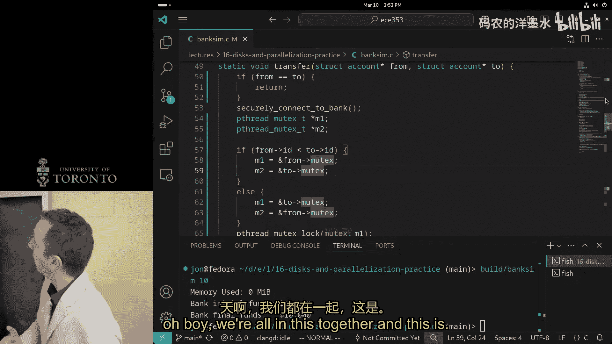