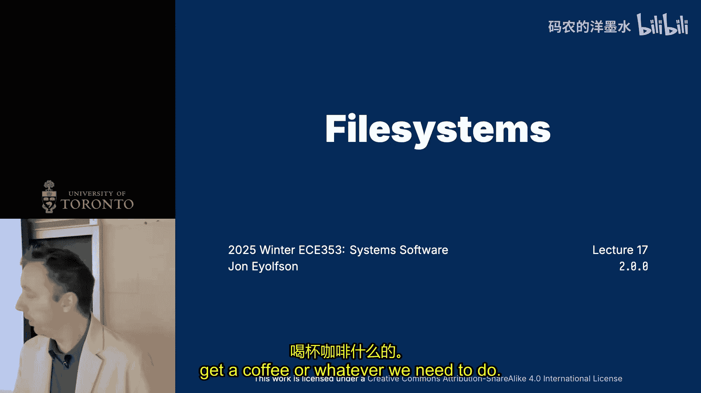
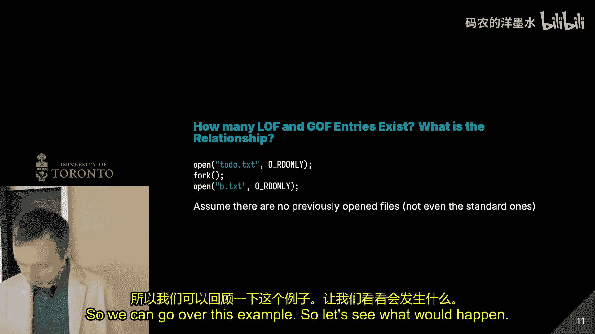
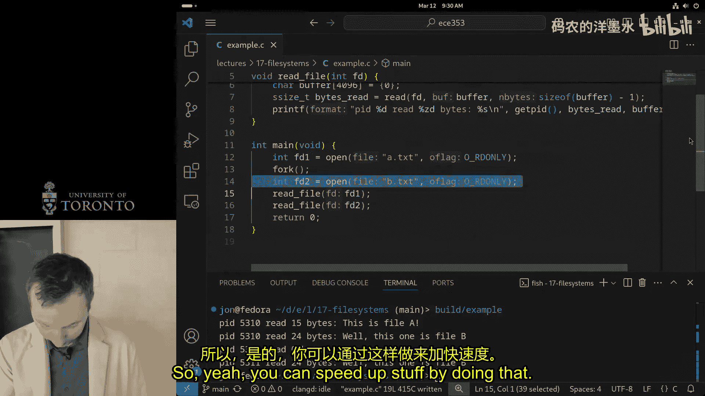
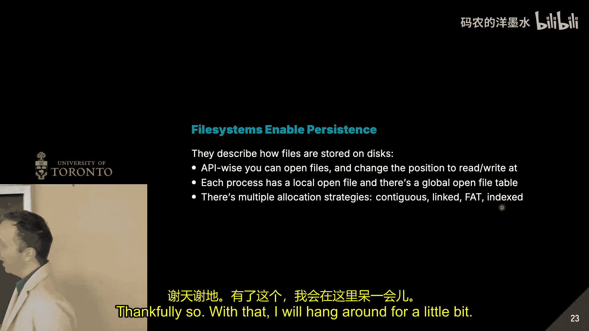

# 【全集 2025】多伦多大学 系统软件设计与编程 中英字幕 1080P p17 Lecture 17 - 文件系统 -BV1YrkYBQEeL_p17-

🎼Yeah。Alrighty， welcome back to 353， it said early morning lecture。

 at least it's better than a term test。We get to talk about file systems today， lucky for us。

 it probably will not take the whole time so we can go back to sleep or get a coffee or whatever we need to do。

So。File systems。 So the usual layout of any Uni style file system or Pos file systems。So here。

 it's actually defined what some directories should be part of this standard called F H S。

 which is the。Creatively called the file system hierarchy standard， very creative names。

 so every UniX file system， so Linux or MacOS at the very top there's a special directory called the root directory which every directory is eliminatelimd by a slash so just a slash at the top just means the root directory and it forms a directed acyclic graph so within the root directory there's a whole bunch of directories that are defined that have to exist like slash bin which should have all your executable files dev。

 which should be all the devices the kernel presents to you ETC， which is like configuration files。

 home folders generally one for each user。On MacOS， they do not follow the standard。

 They call it capital U users。But same idea， your user。

 each user will have a folder in it with the name of their user name。

 And then they might have their own files。 like if I have a to do dot T X T folder。

 that's probably where it would live on my file system。

 Then there is this M and T short for mount directory。

 That is where things should go when you plug in like a USB device or something like that。

 And it should present as a folder and inside that directory should have all the files on that USB device。

So。With using file systems generally， when you're running it on a terminal or running any program。

 you have a working directory。 So the working directory is the directory you are currently in。

 So if my current working directory is slash home slash John。

 Well there's going to be two ways to get to the file to do dot TXT。

 which we should probably know by now， it's kind of review， there's absolute and relative path。

 So absolute path will always begin with the root directory and show you how you get to do。

 So the absolute path would be slash home slash John slash to do dot T XT。

 and the relative path is relative to the current directory I'm in， which is just John。

 So since it is in the directory I'm currently in。 I can use the shortcut。

 I can use like dot slash to do dot T XT or just simply to do dot T X T。Then to the USB， well。

 this USB directory in absolute path is just slash mount slash USB and relative we know probably that if I'm here to go up a directory。

 it's dot dot so I could go dot dot brings me to home， then slash dot dot brings me to root。

 then mount slash USB， and then that's the relative directory。Relative path。

Based off my working directory to this USB directory。 So just so we have it on the slide。

 here's the relative absolute for both of them。All right， so now it's fun story times。

 So there's these special symbols。 So they're defined in the directory。There are actually。

Kind of present as file names。So we know dot is current directory and dot dot is the parent directory。

So if I was a very smart programmer， like in LS， you don't see dot or dot dot， right？

So you might think just to hide them both， I could just be like， hey， if the name is dot or dot dot。

 then just skip it。If you are very， very， very。Very。

Particular developer that believes in premature optimization。

 How could I cover both these cases in a single if statement。Yeah。Yeah， if it begins with thought。

 skip it。So someone implemented that。 So if it begins with thought， skip it。

 what is the unintended side effect of that。Well， is a valid file name like a dot to do dot TXT？Sure。

 that's a valid file name， but it would now be hidden by default when you do LS。

 so that is why all hidden folders on UniX file systems begin with a dot because it was a bug that became a feature。

 If you happen to name it with a dot， it would get hidden whenever you do LS。

 So that is why hidden files on UniX file systems begin with a dot Again。

 a bug that has now become a feature。So that is the fun， I don't know， history lesson today。

And then there's some other special systems like Attilde。

 which is supposed to be the user's home directory。

 which is also represented by the environment variable just called home and relative paths are calculated from the current working directory。

 which is the environment variable PWD or print working directory。All right， so that is。

What is on our file system？We talked briefly about accessing files。

So if you're reading content from files， I heard some of that before。

 you can either access files sequentially or randomly。

 so sequential access is probably what everyone has done up to this point。Internally。

 each read advances the position inside that file so that you read bytes in that file sequentially one after the other。

cross one or more read system calls， and then four rights are usually rights are always appended to the position and set to the end afterward。

 so it just goes ahead and tax it onto that file。We can also access files randomly so you can。

You can actually read or write。Any bytes of the file in any order you want。

 we just don't know how to do it yet， but we'll see that today。

 and if you want to do that and randomly access a file， you need to tell the operating system。

 what byte do you actually want to start reading or writing at。

 and then you can go ahead and access a file sequential randomly。So the main。

System calls in Pos file systems that we've kind of already used is one the open system call。

 So that just takes a path name as a first argument flags。

 So those the flag specify what operations you are allowed to do with it kind of looks like permissions for a page table entry。

 So you could do read read and write， write only apparently this is repeat， read and write。

 but there's also a read only and then there's also some other flag。

 So if you do O append that moves the initial position to the end of the file initially by default。

 it starts at the beginning of the file。 And then there is this mode which actually tells you what permissions。

Based off the actual user so we'll see that as well， so the new system call is this Lse system call。

 so open returns a file descriptor， then Lse is a way to change that in paternal position what byte you are going to read from next or write to next so takes as the first argument。

 the file descriptor you want to change that position for。Then the second argument is the offset。

 so offset is just the number of bytes from what well it's from whence。

 so this whence is an enum and it can either be one of seek set， seekcur and seek end。

 so seek set is mix set offset absolute so if once is seek set and offset is4。

 that means I'm going to start reading the fourth byte of that file or read。

 start writing at the fourth byte of the file if I choose to do a right operation。

And if I use cur or end， those are relative to those positions。

 So if I want to go back a byte and rewrite or reread a byte。

 I can set when to seek cur and do offset negative one so that will go back a byte if I want to skip4 bytes。

 I could put once the seek cur and then offset as four skip me forward4 bytes If I want to go to the very end of the file。

 I can do seek end。Once the seek end and then offset is zero so that will move me to the end of the file if I want to read the last four bytes of the file。

 I could do once the seek end and offset as minus4 so that again， if I read a write。

 it's going to be from that position of the file。And then you've already done this。

 but there's also the same idea to access the directory and get all the entries in a directory。

So now we actually get to talk about what a file of ascriptor is becauseuse I like slightly lied before and said it's basically a pointer to a file。

Technically， it is a pointer to kind of this open file table entry。Here are two processes。

 so process control block 1 and process control block 2。

 and then this is their file descriptor table and in it the file descriptor is basically the index into that table and it does point to something。

 doesn't quite point directly to a file。 It points towards one of these entries。

And one of these entries。What they all have is the current position that I'm accessing of that file or whatever it happens to represent flags which are like all the permissions again similar to page table entries。

 and then this pointer to a V node， so a V node is the abstraction。

 the kernel uses to just represent anything you can read or write bytes to。

 so it could be to a regular file could be to a directory could be to a pipe。

 could be to a whole bunch of different things。And then。Across the two processes。

 they might be this big table。 This is the global table that would be managed by the kernel。

 So every process it just has local entries pointing to global entries in this and。

Since they're pointers， they can。 They may or may not be completely independent。 So in this case。

In process1， it file descriptor 0 is pointing to this entry， which has its own position。

 its own flags and pointing to file A， file descriptor 1， pointing to this entry。

 which has its own position， its own flags， pointing to file B and then in process2 has file descriptor 0。

 pointing to its own position own flags and V node and the V node happens to refer to the same file B。

 So both of those processes can read file B， but。A read system call and one would not affect the position in the other。

 The case where both of these processes point to the exact same entry is whenever you fork。

 they point to the exact same entry because they're just exact copies of each other。

So each process contains a file table in its PCB or process control block。

Sometimes we just call it a local open file table， so file descriptor is just an index into that table or array if you want to think of it that way。

And each item points to a system wide managed by the kernel global open file table。

 so there's just one of them。Sometimes we shorten it to Go table。

 global open file table because we like， you know acronyms。

 So the Goth holds information about the Si position So what the current position eggss is what the flags are So what I'm allowed to do through this file descriptor am I allowed to read or write to it。

 and then it also points to a Vn Vn is just some actual resource that supports reading or writing bytes。

So。That Vnode itself holds information about the file。 they can represent regular files， pipes。

 network sockets， a whole bunch of stuff so we'll go into what the actual structure of the Vn is for regular files as we go on。

 but not till the next lecture， which is next Wednesday， because we have that fun test。Alright。

 so like I said， what happens with a fork， the process control block is completely copied on the fork。

 specifically for us， that means the local open file table gets inherited。

 So both process control blocks， point to the same global open file table entry， their local arrays。

 if you want to think of it that way， are independent。

 So if one closes their file descriptor after it doesn't affect the other。

 but since they're pointing to the same global entry， if one reads or writes。

 it will affect the position in the other because it's just pointing to something。So。

This is what it looks like if both processor are pointing to the same global open file table， which。

 which is the state we would be in directly after a fork。

 So directly after a fork process 1 and process 2， their file descriptor 0。

 would both point to the same global open file table entry， which would have its。Own position。

 its own flags and everything like that。 And then the V node could point to like some regular file A。

 So we'll see how this interacts because there's， of course， some gotchas for this file sharing。

 So the current position， because of that， when you fork that position is shared between both processes。

 So。In this way， they're not。You might not consider them independent。

 even though their own file descriptors， what they refer to are independent。

Modifying through the file descriptor is not independent， so if you seek in one process。

 that would change that position in all other processes that you forked from because it's the same global open file table entry。

If you open that same file in both processes after forking。

That would create multiple global open file table entries， one for each process。

 so they would be independent if you actually open a file like that。So we can go over this example。

So let's see what would happen。So。Heres our fun little example。 So we have file A dot T X T。

 which if I just cat it， it says this is file A again， very creative。 And then if I cat B dot T X T。

😊，It says， well， this one is file B， so I wrote just a little function to read the file。

 it assumes that the file is short that we can just fit it in the size of this buffer。

 but I just declares a buffer， does the read system call and then just prints off。

The current processes P ID through Git PID， the number of bytes it read and the information it actually read as well。

So。If in the program， I do open A dot T X T。 So I just have。Open this for read only， call it F1。

 and then I fork and open F2 and print B dot Txt。What is the output of this going to be？

Or we can just do a short version。 So here， let's start off easy。So let's just say I have。

I'm only reading from file A。 so if I do that。What is my output going to be if I run this now？

And just make up names， process one， process two。Yeah。Process one will read all the bytes。

 process two will read nothing。Everyone agree？Is that the only possibility？Yeah。

 the other way around could happen to process  two could read all the bytes of the file。

 then process 1 gets nothing。In this case， if I run it， I see that yes， indeed， one process。

 in this case，2 and 3， whatever 32 and 33， only one process read all the bytes。

 so read all the bytes， which is the contents of file A and the other one read nothing because。

Before we forked。We did the open。Open call， so that return a new file descriptor that points to a global entry。

 we fork， then both processes have their own local open file table with file descriptor in this case。

 three pointing to the same global entry。That global entry has the position。

 so whoever decides to whoever reads first， so that read system call is going to be guaranteed to be threadsa as well。

 So whoever reads first， they read the contents of the file。

 then the positions updated to the end of it。 So the next one that calls read。

 it will read nothing because the other ones already at the end of the file。If I uncomment this line。

 where I open。FD2 that is pointing to B dot TX T after the fork。And I run this program。

 What should I see， So again， here's A dot TxT， B dot TXT。So what should I see if I run this？Yeah。

Same thing for A。price。Yeah， so same thing for a。 so a， only one process will see it。

 process one or process2， only one of them will read the entire file。

 the other will get nothing and for file B， because I do it after the fork while therere two unique global entries and each of those global entries is only pointed to by that process is independent local open local open file table entry。

 So it would have that。Their own positions。 So they would initially start off at position 0。

 So whenever they read， it doesn't affect。Then I see that， hey， the other one opens。

 reads the entire file as well。 So I think someone was chattering about like reading files or something before。

Well， if you tried to speed up your thing by forking and you did this before。

 and then you tried to randomly access this file。Then it would change the position for both of them。

 you' would probably be in a world of hurt and debugging forever so if you want to do that and have each process open its own like have its own position so you can randomly access the file。

 you should do it after the fork All right， so any questions about that。So yeah。

 you can speed up stuff by doing that。

So。In here， this is what happens visually from what we just did。 So each process。

 ignoring the standard file descriptors， I'll just ignore them for this。

Each process has two local open file table entries， so file descriptor 0 and file descriptor 1。

 and for file descriptor0， which existed before the fork。

Then both of them are pointing to the same global entry here， which would be the same position。

 same flags and same V node pointer pointing to oh in this case， A dot TXT。

And then since I did after the fork。 Well， I don't know what order they'll even run in。

 So let's assume the parent goes first， it would get a new file descriptor1。

 which points to a new unique global open file table entry with its own position。

 own flags and V node pointer referring to B dot T X T and in the child that open would also create a new global open file table entry with its own position。

 its own flags and then V node pointing to the same actual underlying file。

 So the rule of this is whenever you do an open system call that always creates a new global entry。

 So that's one way to remember it。 And if I fork。Then both of the processes refer to that same global entry。

All right， any questions about that？SoThere's some gotchas if you try and use some knowledge from this course。

 to go ahead and read files。When we're actually storing files on our SSD or anything like that。

 we have to describe where the content of the file is or what pages that file spans。

Throughout all of this， what we are talking about is how to describe which let's assume their pages or blocks on an SSD。

 the contents of the file live， so we only care about the contents of the file。

 So say here I have a green file that takes up three blocks。

And then a red file that takes up what's that six blocks and a blue file that takes up。4 blocks。

 if I was to， you know。Where the contents of these files are。 So like say these are all blocks。

 we give them all an index。 So this is like block 0， block 1， block 2， and so forth。

 So how would you describe to me where I can find the contents of the green file。

And how would you store that other than pointing to it and saying there it is？Yeah。Blocks1 to 3。

 Well， how would you。Program that。Like what kind of structure would how would you represent that？

Yeah， like an array， right？ So like starting block and how many blocks it occupies。

 So that's one thing I could do。 That's called contiguous allocation。

 So all the blocks in the file have to be contiguous。

 And then you can just represent them starting block and how many blocks there are。

 So this is block 0，1，2，3，4，5，6。 So the red file would be like start at block 6。

 and it's 6 blocks long。So fairly succinct way to represent。Like the contents of files。

 what is the problem with that， What if I wanted to make the red file bigger？Yeah， yeah， yeah。

 I either have to move the red files somewhere different。

 So I either have to move all six blocks down here。 so I have room to put in a seventh block。

 or I need to move the blue one out of the way。 right So that is one big drawback。 and then you know。

 there might be holes somewhere。 now here I have three blocks free in a row。

 But if I just create files of size 4， I can't ever use those three blocks to do anything useful or store one of my bigger files anymore。

 So。Contiguous allocation。 that's a really fast way to do it。

 a really succinct way to describe where the contents of files is。

 But it kind of sucks if there's any modification。 So it's space efficient because you only have to say what's the starting block and how many blocks are needed to be stored。

 It has fast random access。 So knowing。😊，Random access is knowing what offset you want to access to that file。

 How do I figure out what block that what block to use and what block to read so this is really fast random access so if I know the offset it's just floor offset minus block size so the first 4096 bytes are on block one of that file the next are on block。

Or blocklock zero， the next arm in block 1， the next are in block two， so on and so forth。

 and then that's just how far I have to go from the starting block。

Bad thing about them is files cannot grow easily， so。That wasted space I was talking about。

 the technical term is called fragmentation。 So there's two types of fragmentation。

 We'll revisit this again later。 There's internal fragmentation。

 which is wasted space within a block。 So if my file is smaller than that block size。

 essentially the rest of it's going to be wasted。 So we're not going to worry about this for storing files。

 but just know that internal means it may not fill a block。 What we have is external fragmentation。

 When files are deleted or truncated and external fragmentation just means blocks are essentially going to be useless。

 we can't actually do anything with them。 So。In that case， like what we saw before。

 we would say that these three blocks would be considered external fragmentation。

If we were trying to actually create a file of four blocks or greater because they're essentially useless in this scenario。

All right。So everyone likes linked lists。So。What about that as an allocation strategy。

 So we had like a free list of pages。 So what about if I used a link list to describe the contents of a file。

 So if I did that， well， on this block， maybe I reserve a little bit of space on that block。

For the next pointer。 So itll just be a simple singlely linked list。

 So maybe I use like four bys on this to store a next pointer。 So if I were to draw it physically。

 I could just say， hey， the green file starts at block 0。

 and then other than that follow the pointers until you hit an null pointer and that's the end。

 So the zeroth block of the file would be this one。The index one block of the file would be this one。

 indexdex 2 would be here，3，4， and then 5。 and then that is the last one。

So questions about doing that， that's another good way to do that。Right。

 so even less information I have to store to describe。The contents of a file， because in this case。

 all I need to know is the starting block， right？So you need to know the starting block。Bad thing。

Which is great。 So yeah， it's space efficient。 You only need to know the starting block。

And there's some little drawback， like I said， the blocks also need to store pointer to the next block。

 so the block size the usable block size might be slightly smaller。

 but it's kind of great because files can grow and shrink one block as as good as any other block。🤢。

嗯。Like I can just， if I want to grow this file two blocks。

I don't need two blocks that I write next to each other right I could use this one and this one。

 I could use this one or this one doesn't matter one block is as good as any other block and since it's a linked list。

 they can be in any order we don't care so that is great so that means we have no external fragmentation。

 we will never have a useless of block sitting in there。

 we'll still have internal fragmentation because we are not dealing with that。

But the random access speed is quite garbage because it needs to walk every single block。

 and each block may be located far away and it won't be cached。So if。

Thinking about it as pages and like what would be in the TLB， something like that。 I mean。

 it's the same idea here。 We would read this if we want to get to block3 of this file。

 we waste a lot of time right we have to read this entire block assume we can only read well。

 you can only read blocks at a time from like an SSD。 So to get to block three of this file。

 I have to read block 0， read this entire thing in from the SSD to get four bytes out of it。

 and then I find the next pointer， go ahead， read this entire block to get four bytes out of it。

 then read the next block to get four bytes out of it and follow it。

 read the next four bytes in there， I finally have block3 in this case so。

A one think of a much more cash friendly way to do the exact same thing。Yeah。one。

All the different next pointers， right？Yeah， so my whole problem is， oh。

 I have to read an entire page just to get a next pointer， that's pretty useless。

 well we could just put all the next pointers all beside each other on。

On the same page or on the same block。That is what essentially a file allocation table is。

 so if you've ever used Windows or have have booted a machine， use something called fat 32。

 fat 32 short for file allocation table and 32 is the size of the pointer so。

This is the first kind of allocation scheme that's actually used， so what it does is it。

That whole file allocation table， that whole idea of it is it just moves the next pointers from that link list into a separate table。

 So this whole table here is just going to be essentially the next pointer。

 So this is the next pointer for block 0。 This is the next pointer for block 1 block 2 block 3 and they would all be stored on a block itself。

 So it's not shown here but typically on fat。 I think they're all stored at the end。

 So there would be like some blocks here that I'm not showing that would be used to store this table。

 So they would all be on the same block。 So same idea now。

It's exactly still the linked list idea but now I can follow the now it's a bit more cache friendly for all the pointers。

 so if I want to access block3 of the file， well， if I know this file starts at block 0。

 I access this element here， which tells me my next pointer is block 6。

 so that's block one of the file， then here。It says my next pointer is 2。

 so that's block2 of the file， then it has the next pointer that goes to block 13。

 oh that's block 3 of that file I can be done。Same idea。So any questions about doing that。

 So first actual thing that's actually used。 and now you know what fat 32 actually means。Allright。

 so file allocation table or fat， similar to linked allocation， but it's just a better version of it。

 it's more cache friendlyri and it makes it easier to deal with because we get to use the entire blocks for storing the contents of the file。

 We're not carving out a little bit of space for the next pointer， so it has all the same benefits。

 files can grow and shrink。 There's no external fragmentation。 There's still internal fragmentation。

 but we don't really care about that。And now it has much faster random access because that file allocation table。

 you can even just store it all in memory or some other type of cache。

The drawback is the file allocation table size is linear to the disk size。

 So the larger disk you have， right， every block needs a next pointer。

 So that will cause that table to grow and grow and grow。

 So the size you need to store information about the file system depends on the size of the disk。

 So this is why it is definitely not used for anything outside of like boot file systems or things like that。

 because。It， it's， that's kind of a bad property to have。 So if you had a 20 TB hard drive。

 it would be really， really， really， really。A lot of space would be wasted for just the file allocation table。

This is okay。 It's a linked list。 It's still not great。

 I still have to follow a bunch of next pointers to figure out how to get to block how to get to block three of a file。

 So if I wanted to make it。Make random access speed really， really fast。

Anyone think of some way I could do that。What data structure would I want to do for that？

And for that， again， it's like， hey。I'm trying to access block two of the file。

 What block in the file system should I go to to access that information。

The answer is much simpler than it seems。 This is not a trick question。Yeah。A hash table。

 why a hash table？Gets good random access。 Allright， so let's think about。 So if it was a hash table。

 what would my key be。So yeah， the block number of the file， right？And then what would the value be？

An index into。Which lot to get。Yeah， which block would actually be， right？So if that's the case。

 of my index。My key is。Yeah。It's an array， right， So again。

Just in case it wasn't clear before an array or sorry， a hash table。

Hash tables are arrays where where the total number of elements is absolutely gigantic。

 so you need to shrink it down so that's the whole point to use a hash table so good for strings。

 if you have to have a value for every single possible string。

 probably going to take up too much space so。That's why usually keys are something like。Like strings。

But。If we need a value for every single key， then it's just an array right So we don't need to shrink that or do anything like that。

 So fast thing we can do is an array。 So each file essentially has its own array。

 So like our idea with page tables。 right， You can see how this is very。

 very similar to virtual memory。 I could just pick a block。

 use it as something called an index block。 you can think of it the same way as a hash table except or sorry a page table except it's way simpler。

 doesn't have a whole。Page table entry that keeps track of permissions and virtual and everything like that。

 and the physical page number， it just tells you which block on the device that。The index refers to。

For it， you could say that， hey， the index block or the page table if you want to think about it for this file is this red block。

 and this is just going to be an array of blocks on the file system。 So block 0。

 the file is block 0 on the SSD or file system or whatever you want to call it block 1 is block whatever this is。

 block 2 is whatever block this is block 3， that file is whatever block this is。 So just an array。

 which is has really， really fast random access right So instead it's pretty much the exact same as。

As fast as random access as contiguous allocation， it's just， I need an entire block。

 instead of just needing like the starting block and how many blocks long it is。

 I need a block to store every single index。For this file。

So questions about this same idea as before with virtual memory， can see we're not that creative。

 if we have one good idea， we just use it for everything。2。So with this。

Each file still needs an index block， so files can still grow shrink。

 same benefits as before no external fragmentation， still some internal fragmentation。

 but we have way， way， way， way faster random access。

The only drawback here is that file size is now limited by the maximum size of that index block。

 So how many pointers can I fit in that one index block so。

We can actually kind of calculate that so assume this scenario so the index block stores pointers to data blocks only there's no other information in it at all and then let's for fun say a disc block is 8 kilobytes in size and then a pointer to a block is 4 by。

So if I do that， what is the maximum size of the file managed by this index block？

This is new content， but it's pretty much a virtual memory question that you'll probably see come Monday。

So how would I do this。Yeah。Yeah， so first I have to figure out how many pointers I could fit on a block right。

 so 8 kilobys is2 to the 13 divided by four bytes which is two to the two。

 so that's two to the 11 so I can fit two to the 11 pointers on a block。

And each block size is 2 to the 13， so the maximum size of that file would be 2 to the 11 times the block size。

 which is 2 to the 13， which is 2 to the 24， right？So 2 to the 24。

 what is that in terms of like megabytes？16 megabytes。 So that kind of sounds crappy。

 Would you like a file system where the maximum size of your file is 16 megabytes。Probably not so。

Here is。All of that。 So just so you have it on the slide。

 the number of pointers we can fit on a single index block is the size of the block。

Divided by the size of a pointer， which is to the 11。

 so the number of addressable blocks we can use for a single file in this case is just the same as the number of pointers and the total bytes we can actually use for storing the content of the file is the number of pointers we have times the size of the block which is again to the 24 or 16 megabytes。

 which kind of sucks。So。Don't quite have enough time。 We'll spend the next lecture， which， again。

 is a week from now to figure out actually how to。Increase the maximum size of file to be more flexible。

 but still use that same idea。Hencet， it will probably be a lot like multi levelvel page tables。

Soll use the same idea slightly different。All right。

 so we got to explore a little bit of file systems they enable persistence。

 they describe how files are stored on disk。APpiI wise， I can open files。

 change the position to read and write at through that LC system call。

Now we know that each process has its own local open file table。

 that's what a file descriptor actually refers to， and each entry in a processes table points to a global entry which has stores of position and flags and what actual resource it refers to。

If I'm trying to keep track of how a file is stored on disk and how to describe what it is。

 there's multiple allocation strategies we went over today， contiguous。

 which essentially treats the file itself as an array， which kind of sucks because it's hard to grow。

Liinked which。Link list it's good because one block is as good as any other block， but it has very。

 very bad cash performance， so fat file allocation table was still that linked list idea。

 we just moved all the next pointers onto the same block and then we smartened up and we did index allocation where we used an array instead so we had way way。

 way faster random access。But right now， this index allocation is a bit limited。

 Our file size isn't that great， but we will improve that in the next lecture。

 So next time I see will be Monday， not brightrighton early， thank。Thankfully。So。With that。

 I will hang around for a little bit。

