# 【全集 2025】多伦多大学 系统软件设计与编程 中英字幕 1080P p18 Lecture 18 - 索引节点 -BV1YrkYBQEeL_p18-

Alrighty， welcome back to 353， yeah， a lot less people here than there were or yesterday， Monday。

Kind of forgot how many people were in the class。So today we talk about iNot to get back on track because we were talking about how a file is stored and how we would describe where the contents of the file are in terms of blocks and where we left off we had the linked list approach was basically the file allocation or fat table。

Then we argued that， hey。Liinnk lists are silly， we should use a array instead。We left off。

 we'd use an array and use a block just to store that array of blocks that represent the file。

 but then we were like， hey， the file can't be that bad so that's pretty lame so we can fix that today and I will justpo everything an iNotode is the structure in the kernel that describes where on disk。

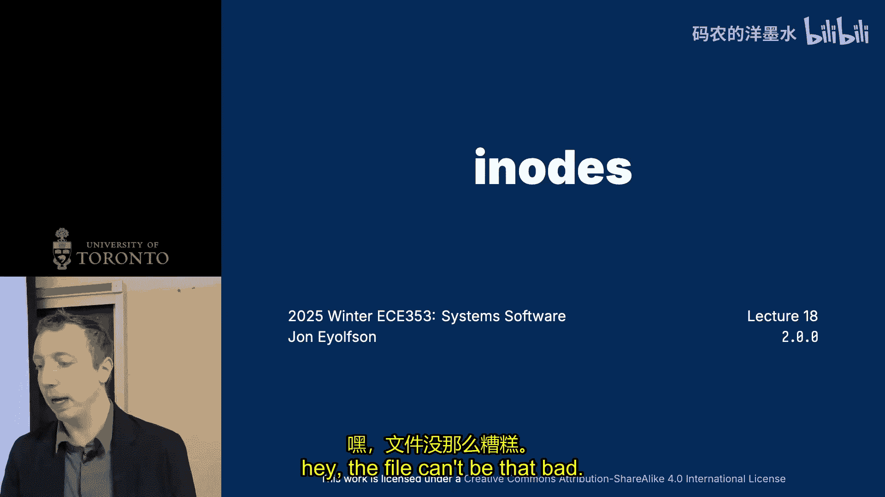

A file is in all of the information about said file。So。

Remember when we talked about V nodes with file descriptors well in terms of like regular files。

 the V node it's referring to is actually an in for regular files because this tells you where on disk things are so content stored on the inode are like the mode of the file so like you all your permissions。

 everything like that， who owns the file， the user and the group timestamps like when you created it when you last modified it and when you last changed it which are a slightly different thing the size block count so how many blocks does this file consume and then some other information and then here are is like that array so。

That array what we talked about before would be called a single indirect block。

 so it's just a pointer pointing to a block on disk。

 and this block is an array of pointers pointing to the blocks that store the actual data。

So this might look similar to virtual memory， so the only difference here is we have different sizes with virtual memory。

 it's just always three levels or always four levels or always two levels or whatever here it kind of depends so the idea here is there are a whole bunch of pointers stored on the in itself。

 usually 15。And there are 12 of them usually reserve that point directly to blocks so that if the file is small。

 it doesn't actually have to waste a block of data on the disk to store all its array。

 small files can just have their block stored directly on the ine itself if the file was larger than 12 blocks of data in this case then for the next 13 and up data blocks。

 it would use a single anddirect block so it would get a block full of pointers and then they point to data and that's where we left off where the file wasn't that big so in terms to make it more flexible。

 there can be a double indirect block which points to a block full of pointers and each of those pointers to a block points to another block full of pointers which again points to a whole bunch of data and then if we need a even larger file we can use a triple indirect which is the same idea as the threele page table。

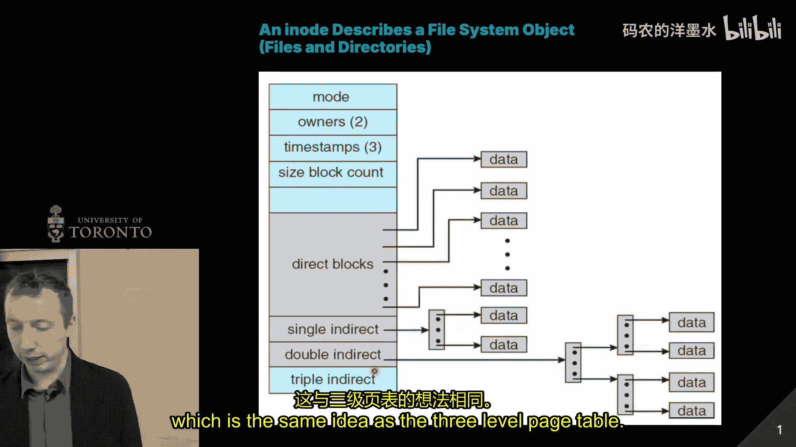

So why it does this is because theres a tradeoff， it aims to be efficient for small files and also support large files。

 so UniX Iodes hold metadata and pointers to blocks for the most point or the most part。

 smaller files only use direct pointers so they don't have to waste a block on disk to store the pointers。

If it was just one big array， and then if you have a larger files。

 they would have additional index blocks or index nodes with pointers to additional blocks。

How many levels depends on how big that file is。There is also an optimization that very， very。

 very small files can have its contents directly stored inside the in itself， similar to。

Most other optimizations and languages with strings， so if a string is small enough。

 it will be stored in the string pointer itself instead of it actually points to somewhere else on disk。

 so if you haven't heard about that， that's a small string optimization， same idea here。

So we can make it an iode problem， look to look similar to the virtual memory problems。

 so we could just say， hey， an index block。So an i note itself stores 12 direct pointers。

1 single pointer or one single indirect pointer， one double and one triple。 And we could say， hey。

 a disc block is 8 kB in size just to make it I know， more fun and do something different than 4 kB。

 Then we could say a pointer to a block is 4 B。😊，And then assume the indirect blocks or index blocks consist of direct pointers only。

 So then we can answer the question， what is the maximum size of a file managed by this index block or how many data blocks can it point to。

 Well， in this case。We can figure out just like with virtual memory。

How many pointers can we store on a single block so in a single indirect table so it would just be the size of a block。

 which is 8 kiloby， otherwise2 to the power of 13 divided by the size of a pointer which is4 bytes。

 which is just two to the power of 2， then we can do our math and figure out that we can store  two to the 11 pointers on a block so in total given that scenario。

 the number of addressable blocks we can actually use for the file is well we can use 12。

From the direct blocks because they just point directly to a block we can use for data。

Then through the single indirect block， we have two to the 11 and then for the double indirect block。

 it's2 to the 11 all to the power of 2， and then for the triple。

 it's 2 to the 11 all to the power of three if we want to just estimate it。

 This term will dominate all the other ones。 you can calculate it out if you want。

 but it will be approximately equal to 2 to the 33。

 so the total number of bytes we can actually use as the maximum size of our file。

 is two to the 33 times the size of a block， which is 2 to the 13 in this case， which is 2 to the 46。

 which is 64 terabytes， so a single file can be 64 terabytes。

So that should keep us happy for a while。If we wanted to easily make it so that we could store a file2 the 11 times bigger than that。

 what would I have to add？Yeah， quad indirect block and then boom。

 we're done and just figure it out from there， but this is what we use right now because no single file really is more than 64 terabytes。

Alright， so to store， we can actually start talking about how to actually read the output of L S now。

 which you don't really know how to do， so。Hard links。

 there is something called hard links on your file system and they are just pointers to iodes and a hard link is just a name to an iodeode just so you don't have to refer to the contents of a file as you know iode 2658。

 you just say a I want to refer to it as to do dot TxT， so a hard link is just a pointer to an iode。

And this is what is in a directory， so directory， entry， AK， a file name， anything in your directory。

 any file you're accessed is technically called a hard link and a hard link just points to one iode。

Okay with that。All right， so。Well， if there's something called a hard link。

 you might imagine there's something called a soft link。But before we get to that。

 multiple hard links can point to that same iode， so I could have to do dot Txt and B dot TxT both pointing to the same iode。

And this is why that RM command doesn't actually delete a file。 It doesn't actually remove anything。

 So deleting a file or using the RM command only removes a hard link。

 the file can still be hardlink somewhere else。 So if you S trace。RM。

 you'll see that it doesn't there's no system called called RM or anything like that。

 it's just called unlink， so just removes that name。

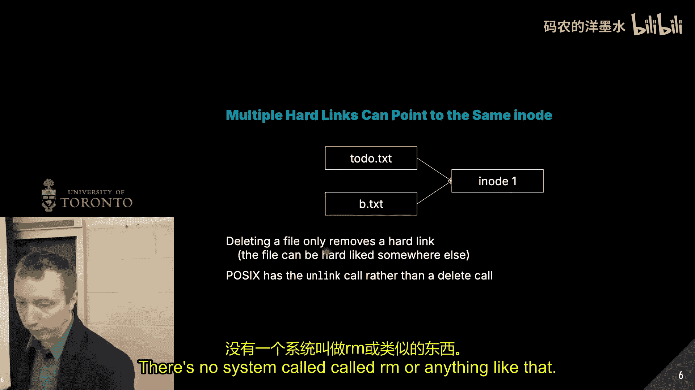

So， that we。All right， so why are you doing this？Now， let's see， let's create a file called。呃。

So let's touch a file called。A dot T X T， the touch command will just create an empty file with that name if it doesn't exist。

 Otherwise it just updates the timestamp of when you've last modified it。

 So if I do that and we've all done LS L before right。So。

Let's go through all of these because we should be able to explain what they all mean。

 Anyone tell me what that means。Permissions， right， specifically that's like。User permission。

 So what whoever owns this file can do to it， then group permissions。

 whoever is in that group that can do with do with it。 and then other permissions。

 if you're not that owner or you're not in that group。 and then this is the user name of the。Owner。

 so the user， and then this is a group name of the group that owns that file。All right。

What about this， one。You've been using LS for how long you don't know。This。First number。Any guesses？

Alright， well， let's skip that then。So。These， we just went over， what's this number？File size， right。

 So let's say I just try and edit the file and go。Hello。And that will also tack on a new line。

 So if I do this now， I can see the size of the file is now6， So hello。

 and then it added a new line at the end of it， not an null byte or anything like that。

 So that is the size of the file。 All right， what is this。Yeah， last modified date probably。

 and then the name of the file。So no one knows what this number is， right？All right， here。

 let me add another thing。All right， so if I do dashLI， I have a new number。

 anyone guess what this big number is。Yeah， that is the iode number。

How to actually create a hard link which you probably have never done before is the command called LN。

 So if you use LN。That will create a hard link and if I do something like a。txT b。txt。

 this is the new name that is created B。txt， and it will actually make it so that B dot TxT's iode points to the same in as a。

t TxT。So if I do that and just run LS， I can see that， hey。

 I have an A dot TxT and I have a B dot TxT。So， if I run。LSL again。

Anyone guess what that number is now？Yeah， the number of hard links to that iode right so you can see both of them I have a dot Txt and B dot Txt and these in numbers are the same so this is the in number and there are two links to it so if I want to get more information about a file I can use stat so if I do stat B do Txt will tell me a whole bunch of other information so size 8 or sorry size 6 blocks 8 seems a bit weird will get into that in a little bit。

What the size of an IO block is， it's a regular file， what device it's on， what I know number it is。

 number of links it has， so that's number of hard links， and then access some weird permission stuff。

 access， modify， change and birth。So B is just created， access is when you've last accessed it。

 modified is when you've last modified the contents of the file and change is when you've last done something to the inode itself。

 which is slightly different， so that changed， I didn't actually change the contents of the file whenever I made a hard link to it but I changed the iNotode itself because I increased the number of links from one to two。

 so that is why those numbers are slightly different。All right， so。

The contents of my A dot TXT were just hello。 If I cap B do TXT， what am I likely to see？Same thing。

 right， hello。So now without modifying file A， if I just modify file B and say hello。

Class and say I'm yelling。So if I do that。What should I see if I cut A dot TxT now？Yeah。

 the modified one right so if I do this even though I didn't change A dot TxT I see hello yelling class because well the inode itself is storing all the information about the contents of that file。

 if both A do TxT and B。tTxT are pointing to that iode，😊。

If I change the contents of the file through either one。

 I'm changing what that Iode refers to and it will update both of them。

 so that's also a fun way to confuse people that haven't taken this course。

 just create a bunch of hard links to everything and tell them to you just I don't know。

 just create a bunch of hard links to everything。嗯。Yeah， and then we can see here that indeed。

 if I just do RMB。txt。I can see that， hey。I still have one link to the file or one link to that in。

 So this doesn't do anything。 I wouldn't that doesn't actually delete anything， right， so。

The only time something may be deleted is if you decrease that count from 1 to a0。

 that it's not referred to by anything that could be deleted。

So spoiler alert this is also basically how your recycle bin works so your recycle bin will just keep a hard link to that iode so it doesn't get actually deleted by the operating system。

 keep it around for 30 days or whatever that is and that's why restoring is also really really fast because it just recreates a name that points back to that iode so even if you delete a 10 terabyte file。

 it will restore instantly because just。It's just creating a name to an iode that iodeode。

 you're not copying anything， you're not doing anything like that。Yeah。

 you just recreate that name pointing back to that iode， you always just save a reference to it。

 so that's what your recycle bin does。All right， any questions about that or any other fun stuff you want me to do with that one？

Allright， cool， so。

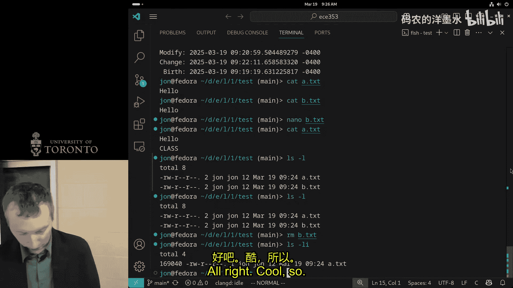

Yeah， there's soft links。So soft links are paths to another file。

 so when resolving the file the file can be redirected somewhere else， so a soft link。

 the way I like to think about a hard link is a name to an iodeode while a soft link is a name to a name。

So technically， there's an iod so technically。This is a soft link or symbolic link or shortcut。

 whatever you want to call it。The contents of that symbolic link will be stored on INote itself。

 but when you try and access it， the easiest way to think about is a name to a name。

 so when resolving the file the file system is redirected somewhere else。

 so because of this you can create loops and all sorts of fun things so softlink targets do not need to exist。

Their targets can be deleted without notice of the soft link。

 so if B dotTxT points to do dotTxT and I get rid of to do dot TxT。That's fine。

 It will just be unresolvable， and they might lead to an exception or some type of error。

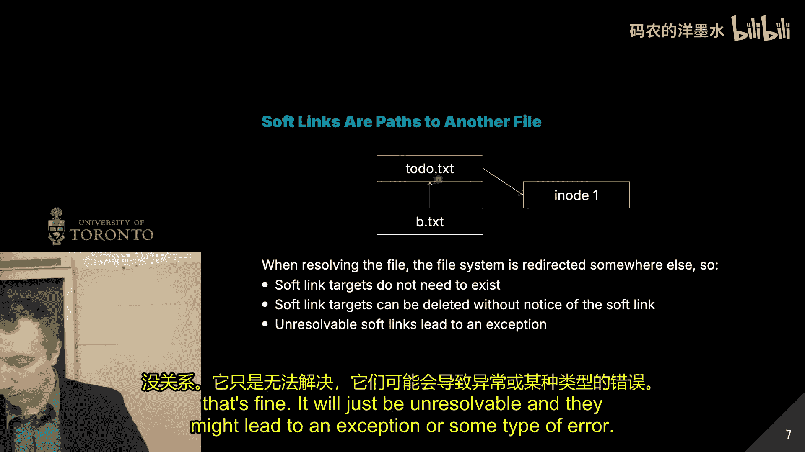

So how we create soft links is the same way we create hardlink。

 so this is how we created a well without the dash S， this is how we created a hard link。

 if we want to create a soft link or symbolic link or in Windows land a shortcut， we just do dash S。

 So if I do oops other way around。So。I want to create a file called B dot TxT that is a symbolic link。

 so BToc TxT should essentially point to A dot Txt。If I do this and do LS now， I can see that hey。

This is how it displays a symbolic link to me。 So there's a symbolic link called B dot T X T that points to A dot T X T。

 And if I。That's the way to think about it。 if I look at it， look at the IO numbers。

 I can see that it。By itself is stored on an iode， so this content， which is A dot TX。

 needs to be stored somewhere， so it's stored on this iode， but in terms of using it。

East way to think about is a name to a name。If I cat B dot T X T。

 I'll see hello class because it will go from B dot T XT， be like， oh， okay。

 well I need to find whatever iode A dot TXT refers to and then okay well that oh okay。

 well that finally points to an iode， I'll use that from the contents of my file。Now。

 if I remove A dot T X T， I can see that。It doesn't really。Show anything。

 it just B dot TxT goes to A。t Txt。Any guesses what will happen if I cant B。ttxt now？Yeah。

 it probably shouldn't work， it might give us a weird error， so if I do that。

Gues it's a very weird error， it says B dot TxT， no such file directory。

 which is a bit misleading because B dot TxT does exist。But what it's trying to point to，8。

TxT does not exist。So。Other fun things we could do。 You might imagine we could create a loop。

 like what happens if we do， Oh't know， Let's say we create。😊，A file called A dot Txt。

That points to B dot TxT。So we could do that， right， Nothing prevent it from doing us。

 Any guesses what will happen if we do something fun like that。Yeah infinite loop right。

 so it's like hey， to get the contents of a dot Txj I need to go to B dot TxT to get the contents of B dot TxG I need to go A。

😊，A to B， B to A。So on and so forth， infinitely。 So if I run cat A。 Txt。

 and guess is what will happen。Should infinite loop， so either should get error or it crashes。

 so if I cut it， I'll seeooh， they're smart。Says error too many levels of symbolic links。H。

If I wanted to figure out who is smart？Because either cat could be smart right。

 where they detected it， detected a loop or something like that。

 or the kernel could be smart where it detected a loop or something like that。

 if I wanted to figure out who the smart one was， how would I do that？

Fun tools you should use that works for every single programming language。S， do I hear S trace？

I heard Strace， so we can see what the cat program does by running Strace and see who is smart。

 the kernel or whoever developed cat， so if we run this， we can see that okay。

 this is a right to standard error too many levels of symbolic links。

Had to open some locale stuff so it could display my message。Go up to the first thing。

 So this is also just writing part of the error message in parts。 Oh， there it is。

 so I it only did one open system call of A dot TxT and it got an error from the kernel。

 so the kernelel said gave an error code E loop to my errors so。

Kind of makes sense that you didn't know this was a possibility before probably this lecture。

 so Colonel takes care of it for you， so your program。

 you just don't have random infant looping programs because that would be very bad。All right。

Any other questions or fun things you want me to do with this？Alright， Well。

 I can show you something that is totally。Totally why I trust file name permission。

Has anyone ever argued with their professor someone like， hey？I was done my assignment on time。

 here's the timestamp for the file， Trust me bro， I definitely did this， right。

 people have probably done that。Mhight notice that the bottom of the。The lab docs， it's like。

 I don't trust your times because guess what， this touch command。It can just update times for you。

 so if I did something like this， touch。You can just set the modified date because that's just stored on the iNote itself right。

 doesn't matter。 you can modify it， do whatever you want with it。

 So let's say I want to change my modified date of C dot TxT to 19 Christmas Day 1980 at 6 a and I' am not that old I was not alive then So if I do this in LS oops LS L see that hey。

 yeah， there's my modification date。I submitted it on time， trust me。

So I did not show you how to do that， but someone I know may or may not have done that。

 and it may or may not have worked。So if you're。Actually， no， I should just shut up。

 I'll probably get in trouble。People should not trust your modified date because you can change it to whatever the hell you want。

 so store it on the i itself， even if you couldn't do this， I。Like with games and other stuff。

 Just set your system time to whatever you want。 and it trusts that so。Yeah。

 timestamps you don't control don't mean anything。

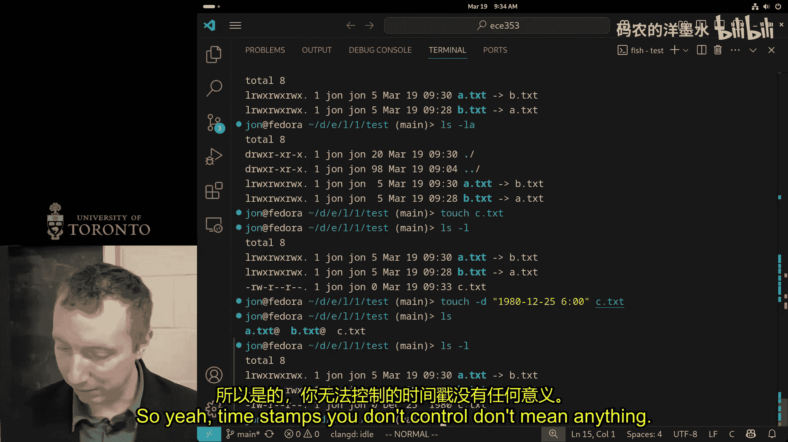

So I don't know why I showed you that， but whatever。There could be little problems like this。

 file system， example problems that。Ask you what does the file system look like here before and after are some commands。

 so if we do something like touchuch to do dot TXT。

 that will create a new empty file called to do dot TXT that would get its own In。Here， LN。

 to do do TxT， B do TxT， so this would create a new hard link called B doTxT that points to the same iode as to do do TxT。

 and then if we do LNS， that is a soft link or a shortcut。

SoWe're going to make something called C dot TxT that points essentially to the name to do dot TxT。

The question is， what does it look like before and after the move and RM commands。

 So before this move command， before I do anything， it should look something like this， right so。

If I have。So I have iode 1， which was created when I created to do dot TXT。

 created another hard link called B dotTXT that pointed to that same iodeode。

 and then I created a soft link called C dotTXT that points to do dot TxT。And again。

This is more of a way to visualize it because C dot T X T will， you know。

 there's an iode in between here。 So the contents of C dot T X T。

 which are to do dot T X T is stored itself on an iode。 So there's actually an iode in between here。

 but we don't really care about that in terms of understanding。

 Just draw a soft link as a name to a name。 and then a hard link as a。Name to an iNot。So， if we do。

MV。You might have heard a cold move。But that's a pretty poor name because all it does is rename the directory entry。

Probably， well， they decide against calling it rename because that looks an awful lot like RM。

 which is remove， but that one doesn't actually remove anything either。

 So I guess both the names are kind of misleading。So if we do move。Which doesn't move anything。

 All we're doing is changing this name to do dot T X T to D dot T， X T， so。We change so。To do。Txt。

 which was referring to in 1 is now got renamed to D。txt， and this to do。

txt is only referred to by the softlink C。TxT so it got removed from the directory。

We wouldn't see it if we did LS， we would only see C do TxT， B doTxT， and D dot TxT。

 so if we tried to access c。tTXT， we'd get file not found C。 TXT。So if we do RMB dot Txt， well。

 that just removes。Or that just unlinks， gets rid of the name B dot TxT。

 so we still have something referring to in 1， and it wouldn't actually get the deleted or anything like that。

So any questions about going through that？Wow， today is going to be fast then。All right。So in UniX。

 everything is a file， directories are actually files of type directory。

So additional types are they can be regular files as well， symbolic links， which I didn't put here。

 but that is a different file type block device so like hardware gets represented as just a file so HDDs and SDDs pipe can get represented by files。

 sockets which we saw and a whole bunch of other things so directory iodes do not store pointers to data blocks or anything like that。

 it just stores a whole bunch of name， iodeode pairs so。

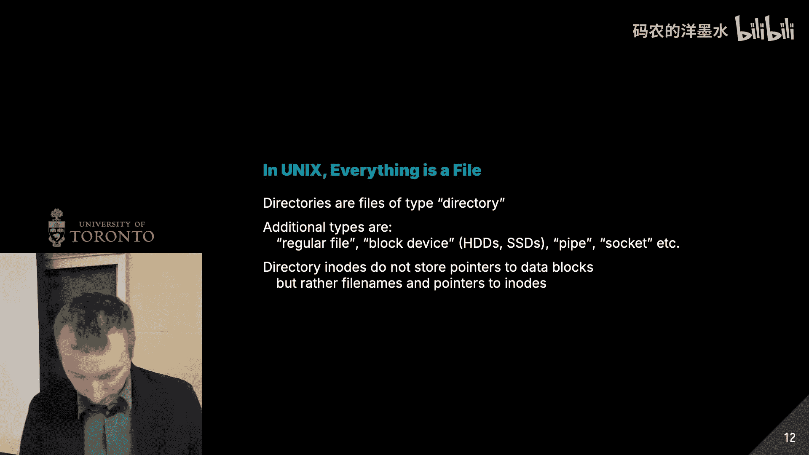

If I go here and I look at this and do dash。LI， so there'll also be an entry for dot and dot dot and dot refers to the current directory。

 so its iode is I't know this I'll just call it by the last two numbers so the current directory is iode 78 and the parent directory is iode 51 so if I。

Go backwards。And I go up a directory to the parent directory and go here， I'll see that hey。

 78 is what's called test in this directory， so in this directory。

 well that is the contents of the test directory， so this I number and this IO number are the same。

Makes sense and then。This directory here， which is called 18 iodes is iodeode 51。

 which makes sense because it's the parent of this one's directory and should be noted here that just because of this file system。

 this number is actually just one for all directories some file systems that would not be true so if it was on a slightly different file system。

 this number might be actually two because it's referred to by dot in this directory。

And then it's referred to by test in this directory。 So technically the number of links to it is2。

Just happens that the file system I'm using on this machine now just displays all directories as just having one link to it。

 even though it's not technically true。2。Any questions about that。

 we finally figured out what the hell that number means。So， took。

Took until third year to figure out what LS is telling us。

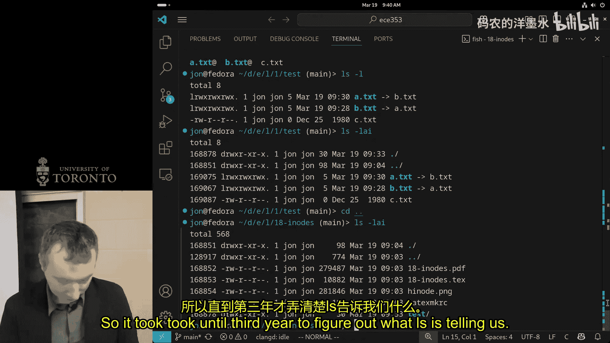

All right， so we can do quick little quiz or just quick little what's stored on an iNot。

If we go through the list， what's stored on IO the file name， not stored on the inode。

File names are only stored in directories， so the contents of both directories。

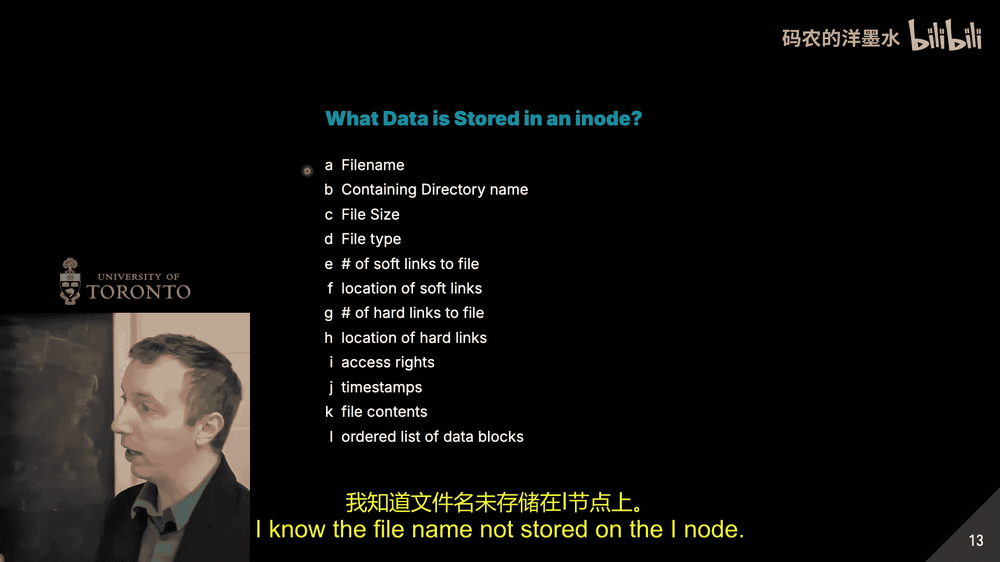

So thered be a whole bunch of data stored for this directory but all it stores is name。

 so dot and then iodeode pairs， so it would just store dot 78 dot do 51。

 a dot TxG 75 B dot TxG67 and C do txG87， so that would be the entire contents of that directory it just stores a whole bunch of name iodeode Tuples that is all that a directory is。

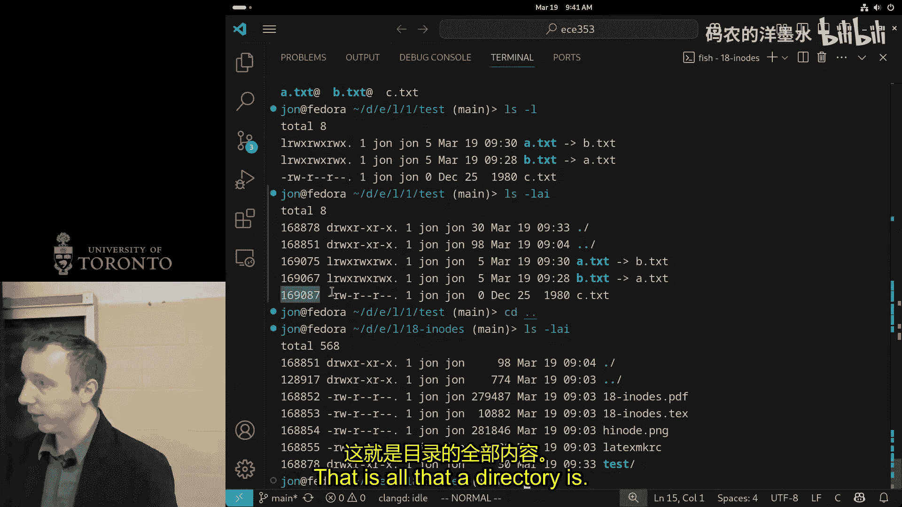

So the file name itself is not stored in the in because well also you can have multiple names referring to that iode。

 so they're not stored there。Also， it does not know what the containing directory's name is， in fact。

Because multiple names can refer to that iode， they don't even have to be in the same directory。

What is stored on it on the iNotode is the file size。

 so how many bytes of the file are actually valid how many bytes of the block does it actually use for the contents of the file。

 file type is also stored on the iNot it'stying you information about the file。

 the number of soft links to a file， not stored on the iNot itself， it's just a name to a name。

 doesn't get updated if you remove it， it's fine。And similarly。

 the location of soft links aren't saved anywhere or sorry， they are saved on the iNotode itself。

 but you'll get experience with that in the lab as well。

 and then the number of hard links to a file is stored on the inode itself。

 basically minus the file name， whatever you stat about the file that's stored on the inode itself。

The location of the hard links are again not stored on the INot itself。

 but it does store access rights， timestamps which you can definitely not modify。

 and then the file contents。't stored the well sometimes they'll be stored on the Iode itself in special cases。

 but it's pointing to where on the disk the file contents are。

 and then it also has an ordered list of data blocks because that is the whole point of an iode。

So just to make sure that。We're not crazy。 These are all the answers to them。That is。

All the answers to them again， just what we went through。

 so the file contents only says sometimes because of that small optimization and that's only true for siblinglinks but again you'll see it on the lab。

So。Any questions about anything we went over today， iodes， big fun。 Yeah。

 the drive are also presented as inots。Yeah。Size limit or supply。Is a size limit？Let's see。

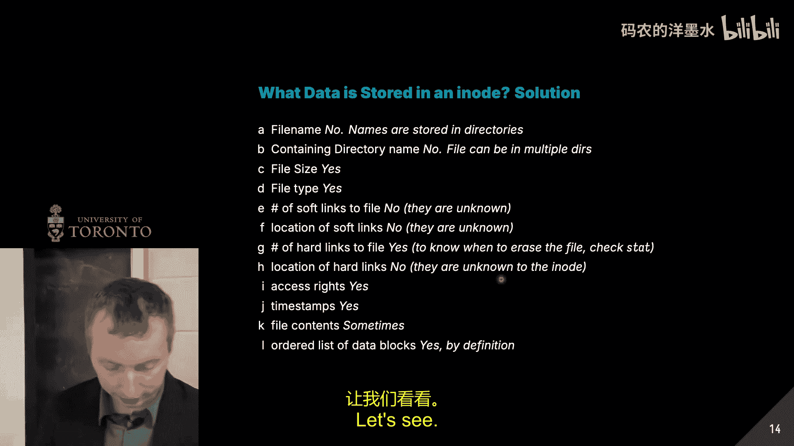

So the drives on your oops， on your system， they'll be representing this dev。

This dev directory which isn't real and you'll see that， hey， there's a whole bunch of things here。

 they're all in yellow and this be here means they are block device so they can only be accessed blocks at a time。

🤢，I haven't explored this one yet， let's see it should be called。St of S D。In very。Okay。

 I'm using a virtual machine。 I'm not sure what my。Hard drive is called。Let's see El。Be okay。Okay。

 so。This will tell me。The name of my devices and where they are mounted in my file system。

 So the name of the discC I'm using is VDA apparently， so if I stat dev VDA， that is。

I know that represents my well the V node that represents my disk and if I look at it I can see that hey。

 it says that hey there's no blocks， it's a block special file tells me what the block size is but it doesn't actually contain any blocks or anything like that doesn't give me any useful information so they'll be like special system calls you can use that say hey how big is this disk and everything like that。

 but when you if you want to like access the disk。Just straight up。

 you can use that special file to access that disk or if you like try flash a USB drive。

 it will appear something like that and you can go ahead copy stuff to it。

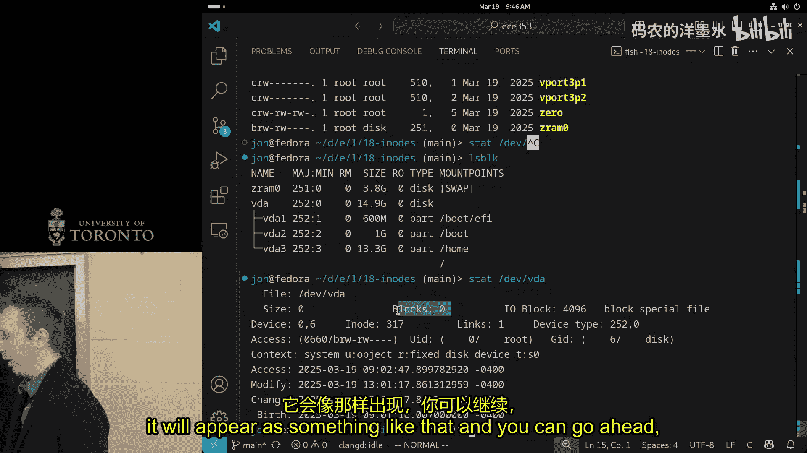

All right， any other stuff？So that was slightly on the fly。 right oops， all right。

 so other little fun things。 So file systems have caches that speed up writing to dish。

So writing data to a disk is slow， we can use a cache to speed it up， so file blocks。

 so the actual blocks that represent the file。Can be cached in main memory。

 especially really easy if they're the exact same size as a whole page of virtual memory and typically the kernel will have something called a file system cache where it will actually。

 if you go ahead and update the contents of file， it won't actually write it to disk because that would be slow so it just keeps that disk in memory because likely if o。

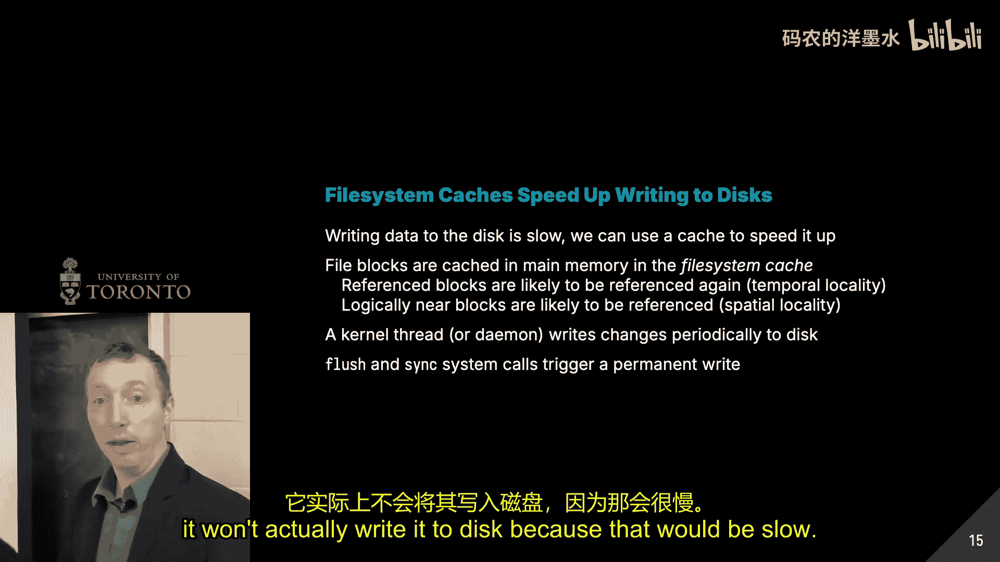

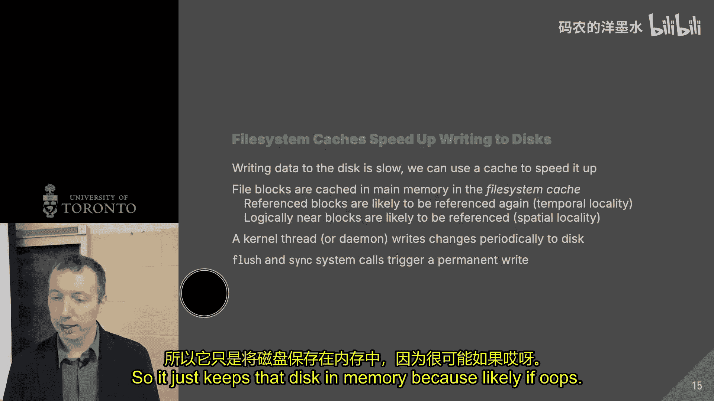

Likely if you've referenced a block or if I modify a file likely you're likely to modify it again。

 that's something called temporal locality， which is properties of caching that make caching great。

 and then logically near blocks are likely to be reference a spatial locality so if I'm modifying a big file。

 likely I'll be modifying the next few contents of the file as well。

Any changes you make to the file they'll just be only represent in main memory and then a kernel thread or demon process or anything like that will just write changes periodically to disk so when you save your file doesn't mean it's actually saved to disk so if you lose power。

 anything like that， well you may actually lose work if it's been cache if it hasn't actually been saved to disk that's what the flush and sync system calls do they make sure that all the rights in the file system cache actually occur。

🤢，And I've had this happen to me when I was trying to set up a USB boot drive。

I knew the USB drive was slow， I copied a Linux ISO to it and it was done way too fast so if you ripped out the drive it would be corrupted and then it was like oh okay well then I had to run the sync command so you can just do so do sync and then took a long as time because well USB drives are slow but after that it was done I could pull it out no problem also you might have no plus also works for your standard file descriptors slightly different because print F itself will cache things to reduce the number of right system calls that happened so same idea is the same there's a cache if I want to make sure something actually happens。

 I have to flush the cache or sync it or whatever you want to call it。All right。

 speaking of maybe losing data。Like I said， because of file system cache。

 you delete something or you modify something might actually not be reflected on disk。

 especially if you lose power， files get corrupted， probably not a good thing。

 so there is something called a journaling file system because deleting a file on UniX if we take that as an example operation it takes three steps I have to remove the name from the directory entry as the first step so I remove that name to iodeode link。

Then well， if that's the last thing referring to that iodeode， well then I can free that iode right。

 that iodeode can be reused for a different file， so I would have to release that iodeode back to the pool of free iodes basically deallocate it and then any dis blocks that file used。

 well they're not used anymore so I can return them back to the pool a free disk blocks。🤢，And well。

 between any of these three steps。Right， if we wanted it to happen thread safely。

 we could put a lock around these three steps， make sure they all happen safely。

 but one thing you can protect against is you know someone yanking the power cord out between these three steps。

 Lock isn't going to help you at all there or anything like that。

So if I crash between step two and step three， then。That inode looks free。

 is not referred to by anything， but all of the disk blocks it used will be marked as used on the file system。

 even though they are not used at all， so before journaling file systems。

 you'd have to scan the entire file systems， look for integrity checks。

 look for things like that where some things aren't referred to it's going take a long time that's what FS check is file system check basically what it'll do but if you have a journaling file system。

 basically what the journal will do is before starting these operations it will just record what it is doing so it'll be like I'm going to delete a file then write it to D before it starts deleting the file and then it will start doing the three steps and then if it crashes。

Or power gets removed between any of these steps， it can look at the journal and be like， hey。

 I was in the middle of deleting a file。So I should go back， replay those three steps。

 and then I know what I need to do in order to make the file system correct again and consistent。

After you've done all these three steps， you would remove that entry from the journal and say， hey。

 I've done this， it completed successfully so there's no problem with this operation。

 so that's basically what the journal is。His name is not creative。

 you just record what you're about to do。Do the operations， if you successfully do them all。

 you cross them off the list， if you crash and you look at the journal and there's things not crossed off the list。

 then you go back， look through it again and fix it。So。What we learned today IOs。

 they are a hybrid allocation strategy， so they offer greater flexibility over what we explored before。

 contiguous linked file allocation table or fat， which is basically just linked or indexed which just use basically a single indirect block。

So on UniX or Po system， so Mac OS or Linux everything is a file。

 names in a directory can either be hard links or soft links for the most part so with that I will hang around the extra eight minutes you can tell this course is starting to get thankfully easier now so we have made it past the hump。

All the topics from now to the end are。Well， let's not say easy， but they are。

Considerably less difficult Let's say that。 So we made it over the hard part of the course。

 so congratulations if you did not drop the course now because it is now too late to do that。

 So just remember Bofo you， we're all this together。

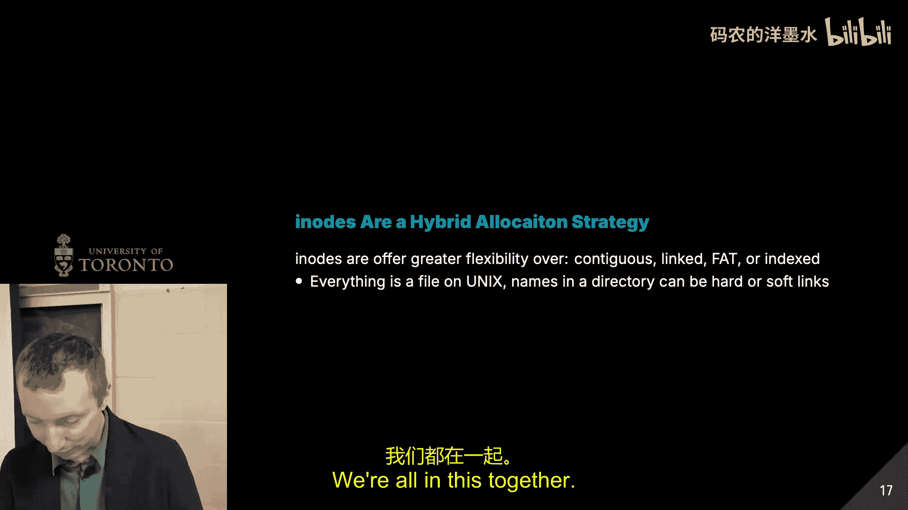