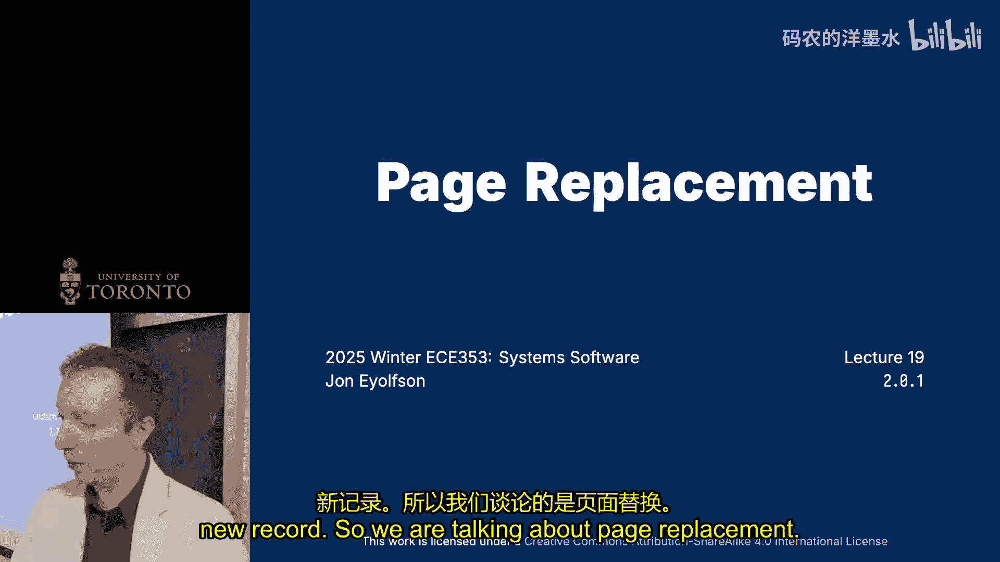
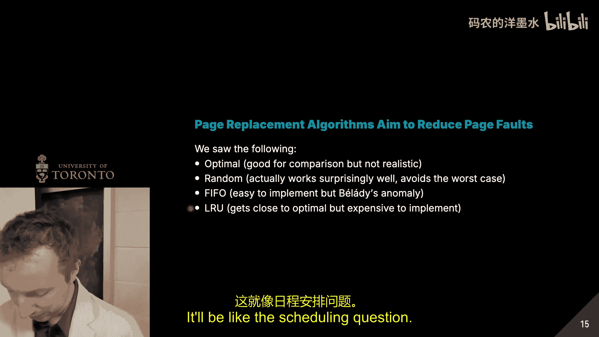
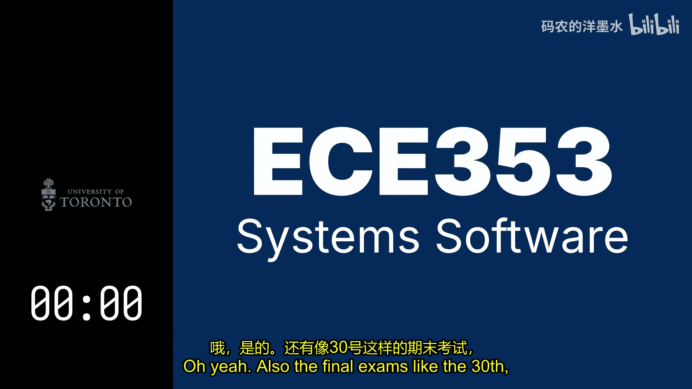
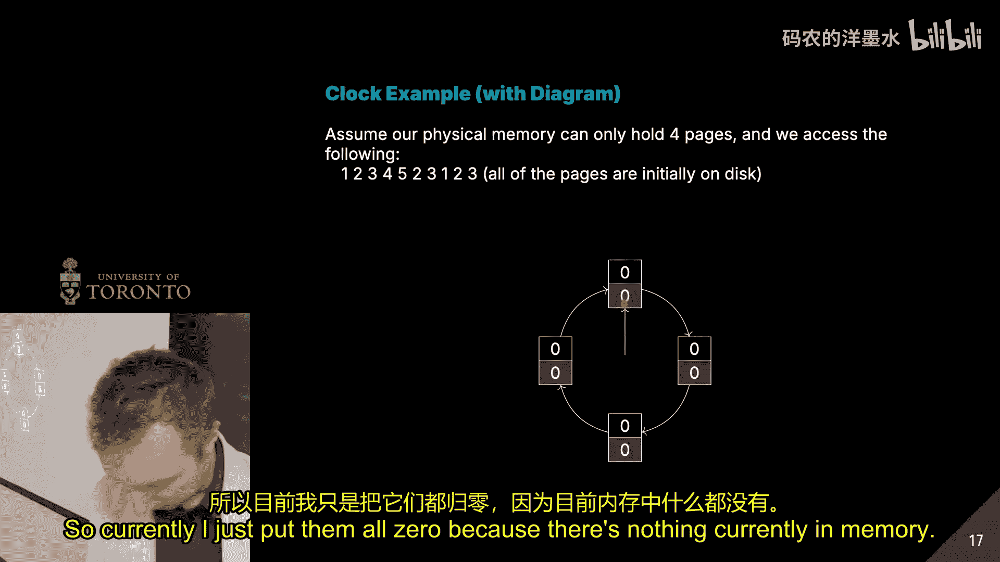
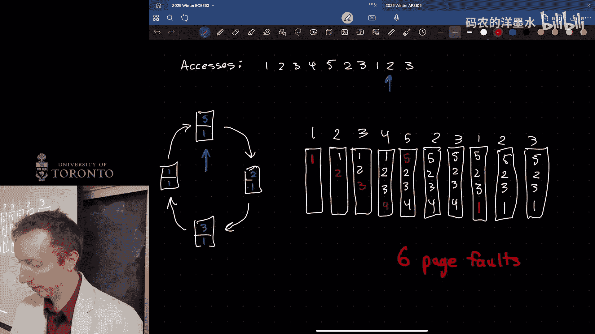
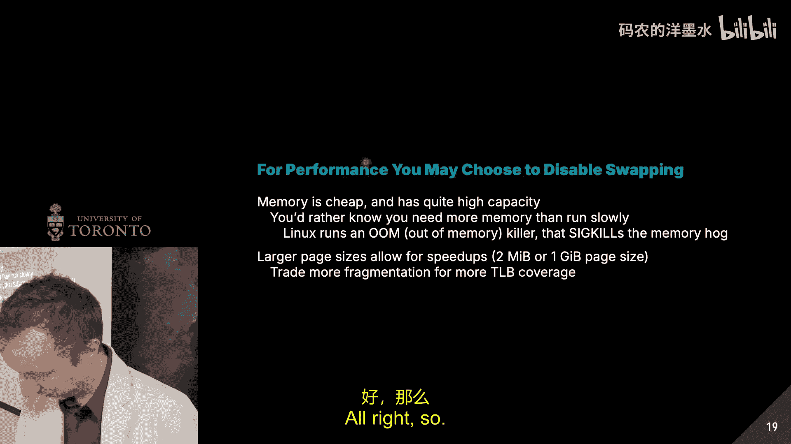
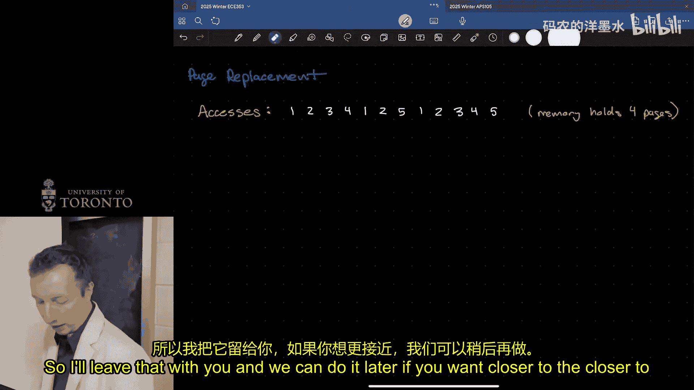
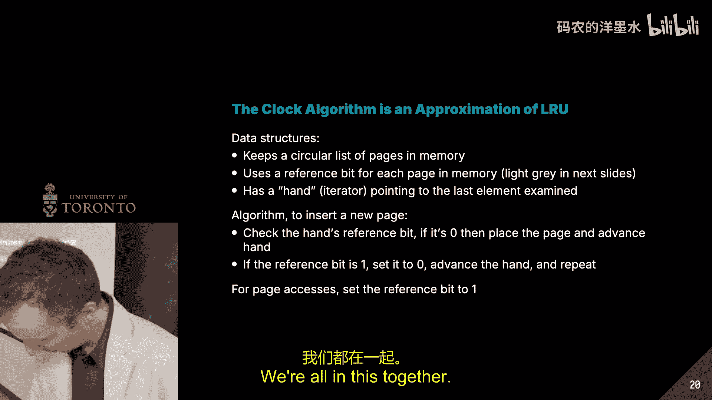

# 【全集 2025】多伦多大学 系统软件设计与编程 中英字幕 1080P p19 Lecture 19 - 页面置换 -BV1YrkYBQEeL_p19-

What a wild these so。Oh。Alright， We back to 3，5，3。 We have officially survived pretty much the whole year。

 So this lecture will probably be a new record。 You can stop me if you want me to slow down or do anything。

 but。Everyone liked the scheduling questions， right？

This is the second half version of scheduling questions，Should be， again， new record。

 So we are talking about page replacement。

So two I don't know， recap， I guess， architecture courses or organization。

Computer memory hierarchy is always a tradeoff of capacity and speed。

 so at the top we have as our fastest things。Your CPU specifically your CPU registers。

 there's not that many of them but they are very fast and kind of expensive then as we go down this pyramid。

 our capacity increases but our speed decreases and usually our price so below that we have cash on our CPU this is your L1 cache your L2 possibly L3 that is unrelated to the how we name levels of page tables so there's your CPU cache and then after that you have your memory or your RA it's random access memory it's volatile so if you unplug the power you lose all your data but we don't really care about that it is basically a cache for your CPU that's where all the data you feed your CPU comes from。

And then below that we have nonvolatile memory or NVM storage which are like the fast SSDs that most of you should have in your laptops then below that we have old Sa SSDs which you might have in your older computers so those are another variation of solid state disk then we have our hard disk drives which are the spinning metal things you probably never seen before but that's what was in the first gen iPod I guess iPods don't even exist anymore but that is what was in that or you know if you want to buy like 20 plus capacity drives you have to buy something like that and below that our tape drives so none of you know what the hell of VHS tape is you might have heard it like some weird retrotech thing but in fact data lots and lots of data。

Archial data stored still to this date on tape drives。

 They are magnetic tape drives that you have to like unwind and spin and everything。 They are very。

 very slow， but they are very cheap。 And you can buy them at like。I forget the price。

 but the price per terabyte is very， very low。But they're very， very slow。

 That's where like Google archives the entire internet。 they archive it on tape drives。

If you go at the data center， you'll see some machine that physically takes tapes out of a cassette thing and puts them in so it can read them so it's very。

 very slow， but you can buy it for like pennies。per terabyte or something like that。

 probably not that cheap， but along those lines， it's just way cheaper and believe it or not still in use。

 you probably will never see one and neither have I。

But the whole goal of this is we want to hide this hierarchy from the user。

 so each level wants to pretend it has the speed of the layer above it and the capacity of the layer below it。

 so that means if we're doing it for memory， we want memory to be used by all processes actually to exceed the amount of physical memory we have because while we can take advantage of the fact that not all of them are going to be in use at the same time。

 so we can only keep pages。嗯。In memory， if they're being actually used。

And the whole idea behind this is we can use the disk as or we can use memory as a cash for disk if。

A page isn't being used for a long time in memory， we can kick it to the disk and store it on the disk。

 and then of course it will be slower。If we need to get that memory again。

 we have to load it from the disk back into memory。

But we can actually use more memory on our computer Then we actually have physically on our machine。

 and the process of doing that would be swapping pages back into memory when they're needed。

 if you're on Windows or anything like that。 And you notice a big file on your C drive。

 if you look at the hidden files， There's something called， I forget what they call it。

 I think it's just called a swap cis file or something like that， that's what it does， it's。

Just storing pages， like using your disk to store pages of memory that aren't used for a while。

You know， even with。If you even had or88 gigabytes of Ram， what year is it。

 well you can still use Google Chrome with like two tabs open that uses。

10 gigs of memory because some of that information can go to disk。So。

What the typical system is we currently use is called the band paging。

 so we're using memory as a cache for the file system。

What we can do is map memory pages to file system blocks。

 so some blocks will not be used and again we'll only load them into memory when they're used through the page fault handler we saw previously。

 so if you're trying to access that memory， you get a page fault。

 the OS can go ahead or the kernel specifically can go ahead。Pause what's going on。

 load that page into memory and then resolve that page fault and transparently just let you use memory。

 So what it can do is if the page doesn't represent represent a file。

 what we can do is map it to swap space。 So if we just have， you know memory we're just using for。

Just random memory for our machine， we can map it to swap space so that would be like that big swap file if you're using Windows or Mac has an equivalent。

 Linux has an equivalent as well， and then just move it to disk if we need more physical memory for other programs on our machine or if we don't have to load a file in or anything like that。

So。A process working set that's our only fun definition for the day should fit in physical memory so what a working set is is given an amount of time。

 it's the number of pages your process uses all that's called its working set if it's working set is not all in memory at once then your program is going to go very。

 very slow because it can't fit that working set into physical memory your process will do something called thrash meaning the pages will go back and forth between the disk and memory over and over again。

 and it will make your program even even slower so we want to avoid that at all cost。

If you care about performance at all。So。Specifically。

 what we get to talk about today are things called page replacement algorithms。

We're assuming we have pages on disk and we only have a set amount of size in our memory。

So we have to pick and choose which pages we kick out of memory and throw them back to disk so there's a few page replacement algorithms。

 in fact this is actually simpler than scheduling so there's the optimal which is replace the page that won't be used in the longest again like with scheduling we look into the future see the page that's not going to be used in the longest and replace that page we could do random so replace the random page we could do our friend first in first out so pick the oldest page first that we brought into memory and throw that one back to disk or we could use lease recently used so replace the page that hasn't been used in the longest time so that's using the past to predict the future so。

To evaluate it， this is how all the questions will look like， similar to the scheduling questions。

 So we'll assume。Our physical memory has some very silly limit while some limit that's hilariously small because we want to be able to do these questions in a timely fashion。

 so we can assume it only holds four pages in total in memory and we access the following so these are all the pages that are initially on disk。

I'm just going to give them a number so same number means same page so this is page one on disk2，3，4。

1，2，5 so in total there's five pages we're accessing on disk we're keeping track of what pages are in memory so initially none of these pages are in memory and we only have space to hold four pages so we'll use this order of access for a bunch of examples during the lecture and the whole goal here unlike with scheduling is pretty straightforward we want the fewest number of page faults where we have to load data in from disk in total so for every example we will find the number of page faults。

So。How I'm going to do this is in for every access， I will draw a box， so this box is。

Is all the pages that are currently in memory and at the top of the box is going to be the page we are going to access so initially we assume nothing is in memory so the box is empty it could hold four pages or four numbers and on my first access for page one well in order to use it I have to bring it into memory so I put a one in here in memory and I put it in red because it had to come from disk into memory。

So everyone okay with that。All right， the next three steps are going to be very boring。

 so if I access page two， same idea， I access page two。I could kick out page one。

 thered be no point to it because I have four slots I can hold other ones so I can read page2 in from disk to memory again。

 I would put it in red here indicating that hey， that was a page fault I had to read it from disk into memory。

Everyone's still good。All right， so same thing happens for page three and page four。

 this is pretty much what's going to happen in all the examples。

 do I permission to skip this for all the examples？Plus 10 minutes。 right。Now。

 when we access page one。We don't have to worry about it right So we access page1。

 It's already in memory again， this box is what's in memory。 So there wouldn't be a page fault。

 I don't have to do anything。 A page fault means I have to kick one of these pages out of memory and move it back to disk。

 So if I access page1， it's already in memory， I don't have to touch it right So in that case。

 I put a one that I'm accessing and I keep all the numbers here and I don't write any of them in red because they were already in memory。

 I'm all good。 So everyone's still good。All right， what's going to happen way axis P2？Same thing。

 right， access page2， already in memory， I don't have to do anything。

The fun comes in when we access page5 oh no， so we access page5。

 so we want to bring that into memory so we have to replace either page1，2。

 three or4 so this is why it's called page replacement so if we are doing the optimal thing that means we are accessing five it means we are looking into the future and we are replacing the page that is not being used in the or that is not being used in the longest time。

 so if we look in the future from the access for five should I replace one。No。

 because I use it right after。 should I replace2， No， it's used right after that， Should I replace 3。

 No， it's not， it's used after that。 Well， at that point， I only have one victim left in memory。

 So it's 4。 So I just need to get rid of 4。 So we are kicking out page 4 for page 5。 Yes。All right。

 so how I would write that is access page5 and I'm kicking out page four。

 so I'm removing it whatever you feel like， and then writing page5 and red because I had to bring that from disk into memory。

Still good。All right， well， we did the optimal thing， Re access page1。We don't have to do anything。

 right？We did the smart thing。Just write it as an access， again， access page two。

Don't have to do anything。 We already have it in memory， access page 3。Don't have to do anything。

 It's already in memory。 Okay， now we access page 4。 We have to kick out something。

 What are we kicking out。1。Everyone agree with one？Can we kick out two？Can we kick out？3。

Can we kick out five？Yeah， pretty much we just don't want to kick out five right because five is the next one we're going to use in this case we would accept all answers because as long as you don't kick out five。

 you're good， most people seem to hate one for whatever reason。

 so we can kick out one for page four again write it in red。

 then our last access is going to be five and we're done。We're done。

 the last thing we have to do is just count the number of page faults since we've done this。

 it's basically count the number of red numbers。How many red numbers are there？6ix。So， again。

You can have a non programming calculator if you want to add this if you want。

Probably shouldn't need to。At the end， six paid faults， this would be done。 So this， again。

 looks like scheduling。So questions about that。All right， let's do this。Like six more times。

 and then we'll call it the lecture。Maybe not six， all right， let's do PIFO， so reset it again。

 same order of operations。We're going to do FiIFO full first in first out for the replacement。

 so like you've given me permission to do， I can skip the first four accesses because I have to bring them all into memory。

 so those are first four accesses again， loading them from disk into memory。So。

Now we access page one， again that's already in memory， we're good， we don't have to do anything。

Same with page2， it's good。 It's already in memory we don't have to do anything。 Now， oh no。

 we access page5， we have to replace something if we are doing first in first out what is the first page we loaded into memory given everything we have here between1。

2，3 and4 one right so we loaded one first so we kick out page one for page5。

So it would look like this， right？Okay， now we access page one crap。 It is not in memory。

 I have to kick out something。 What am I kicking out for page1。Two， the next oldest， right？

So I'm kicking out page two。So oh no， this seems crappy。

 now I'm accessing page three or sorry now I'm accessing page two， what do I kick out？Page three。

 right， so I kick up page  three。Oh no， now I access page three， what do I kick out？

I kick out now four。So now it looks like this。Now I access page four。Oh no。

 this seems like the worst thing I could have done right， so now I access page 4。

 what do I kick out Well now the oldest one is5， so I kick out page5。Oh， now I access page 5。 Wow。

 this is the worst thing Ive。😮，Encountered。So now I have to kick out something for page5 in this case I'd kick out page1 again so should look like that and yeah if you want to do first in first in first in first out fast。

 all your page faults will be diagonal lines so all your red numbers should be in diagonals so they might be spaced out like here there's a space between two of them。

 but the page faults will always be in diagonal lines so top to bottom top to bottom if you want to do it fast and not even argue about it。

So this was pretty crap， right， so how many page vas were there？8ight。10， all right， good thing。

 We'll have a calculator。 So 10， that's pretty terrible， right？So。

Let's have a little bit of a thought experiment。How many paid faults would I have if I had？

If memory could hold， let's say five pages。No。Four。5， right， If I could hold 5， I would just have。

Page fault on the first axis to every page， but I can hold them all in memory， right。

 So makes sense if I hold have five pages， that also means I have more memory。 If I have more memory。

 I should have less page faults， right。Makes sense。

So it should make sense that the opposite is also true right。

 if I have less memory I should have more page faults。Okay。Everyone agree with that？Makes sense。

Alright， so we'll do the same thing again。 So let's put that theory to the test。

 So we'll do first and first out where。Our physical memory can only hold three pages。

 so less than before。So。We had 10 page faults before。 Let's do this again。

 so I can skip the first three accesses。 They're going to be boring， right。One， two， and three。

All not going to be in memory， so let's see if we can do this fast。So I access page four wont。

I'm out of memory， I can't just load to have to kick something out。

 What do I kick out one by waterfall method right oh。

 that seems bad so now I just kicked out one and I access page one before this was a hit right I didn't have to kick out anything those looking like our theory is correct。

So I access page one， what do I kick out？2。Access page two， what do I kick out？3。Yikes。

 I'm six for six so far now I access page five， well I have to kick out something right。

 I have to kick out four by waterfall method。Now， thankfully it finally got a hit。

 so I access page one， mercifully， it's already in memory so I don't have to do anything。

Also for page two or yeah， page two， Audrey and memory don't have to do anything。Page three。

 not in memory， I have to kick something out。What do I kick out？1 by。Dagonal method。

 so one is our next victim here， so I'd kick out one for three。Now I access page four。

 what do I kick out？Kick out two， right， kick out two， then last access， access page5。

And that's the hint。 How many page faults are you there？9ine， you all lied to me。 This is less。So。

If your computer is ever running slow， just take it to stick a ramp。This is better than before。

 this is only nine page faults we had 10 before。The hell is going on。That's the worst advice。

You would probably ever think of hearing， but technically in this case it worked。So。

What we encountered is beadiesel novelly， which says more page frame。

 so more memory can actually cause more faults。This is a specific anomaly with PIFO algorithms and PIFO algorithms only。

 so unless your operating system is implemented very poorly。

 that advice I just gave you actually isn't true so it does not exist with the least recently used or quote unquote stack-based algorithms in fact if you like math and Greek letters someone proved in 2010 that that anomaly is unbounded which basically means you can construct a sequence to get any arbitrary page fault ratio you would like and。

For other algorithms， we don't have to worry about this because what we thought initially was true。

 if you increase the number of page frames or get more memory。

 that decreases the number of page faults， so for everything else it makes sense except for FiIFO。

 which is also why PIFO is especially bad for page replacement， so fun little anomaly。

Fun for some definition， fun， right。So last example before first break。

 we are steamroll here so we're going to do least recently used and in case this was multiprocessing we could use PIFO to break ties in this case we won't have any ties so we can just not worry about that so we'll go back to memory can hold four pages and our accesses so again first four accesses they're going to be faults we have to load them into memory so we argued about that again before we can skip that step。

Now we access page one again， already in memory， don't have to do anything， access page two。

 already in memory， don't have to do anything。Access page5。

 So now we have to find something to kick out so least。

Recently used means we will look backwards to try and predict the future。If we do least recently use。

 we try and find the page that hasn't been used in the longest， if we go backwards。

2 was just used so we should not get rid of two。Well。

 one was used right before that so we shouldn't get rid of one and then we also shouldn't get rid of four。

 so we only have one victim left， so if we use least recently used， we should kick out page three。

 right？Isn't this a joy？Brings us back to those good memories of scheduling before thread screwed everything up。

So。Everyone， okay with that， we replaced page three from page5。All right。

In this case now we access page1 hey， it seem to work this time。

 so page1 already in memory don't have to do anything page2， already in memory。

 don't have to do anything page3， oh no， not in memory I have to replace something so again I can look back at the past。

 I can't replace two。Can't replace one。Can't replace five。

 so that only leaves me with four as my victim。 so everyone agree， I have to get rid of four。

All right。Screw 4， it's replaced by page  three， so again， write it in red。Now。

 it turns out that was a bad idea。 my next access is paid for， so I have to get rid of something。

 What do I get rid of。5， so if I look back， can't get rid of one， can't get rid of three。

 can't get rid of two， can't get rid of1， so I can only get rid of five。

 so this was looking so promising， but now I have to get rid of five， replace it with four。

Now I access page5， which I just kicked out， oh no， so now if I look backwards， I can't remove four。

 can't remove three， can't remove two， so I can just remove one so this is what it would look like again if I count all my page faults looks like I have1。

2，3，45，6，7，8 so eight page faults。So wasn't as good as optimal， optimal as six。

 but it's called optimal for a reason， can't do better than that。First and first out for this got 10。

 So this landed somewhat in the middle， but we could kind of actually implement this ish。

So speaking of implementing it。If we tried to implement it。

 this would actually be kind of a pane in the butt because it has to search all the pages so how you could implement it was you could keep like a timestamp or counter for each page every time you reference the page just update the timer so like you could save the system clock into that counter and then form replacement what you would have to do is scan through all the pages and find the one with the oldest clock and that's the oldest one so you get rid of it。

Any other ideas how we would implement this faster than this？Yeah。The computer。

Some indicator of which one's the oldest， what would your indicator be or what would you use？A flag。

 So how would you keep track of？So you just give one page of flag。Yeah thenバ。Every new access。

So with every new access， I'd go back to and reset the flag and then。The flexibility。

You kind of keep track of the oldest one。I see where you're getting， you're very close think of。

Think of a fun data structure that is in constant time。Hash table， no。S승。Yeah。

 what would you be hashing to and from？yeah。Yeah， a linked list and we can keep the oldest one the head or the tailor or whatever。

 just keep on adding to it right， it's actually an appropriate use for a linked list。

Believe it or not。You could create a DoE link list which kind of is your idea of flags except while the flag is whoever is at the front of the link list right。

 so if I had a DoubA linked list of pages，For each page reference， I could move it to the front。

 so in this case， my newest one would be at the front， my oldest one would be at the back。

But you could reverse that if you really wanted to。

 so for each reference I could move it to the front of the list and then for replacement I can move it。

 remove the page as at the back of the list， so my newest one is always at the front。

 therefore my oldest one is always at the back but if I were to implement this。

It requires in the worst case or in the average case， six pointer updates for each page reference。

 so changing the previous and next。Pointer of two nodes and possibly the head and the tail of the lengthless structure itself。

So on every reference even if I read a single byte， I have to do six pointer updates， very bad trade。

 even though it's a constant time operation， the constant actually matters。

 so six pointer updates is going to be way too much if I'm only accessing a single byte and also。

Should more or less be done with paralyzing your hash table， imagine paralyzing a link list。

 the locks you would need for that to make sure it is safe， pointers all over the place。

 yet that would be even more fun。It would need a lock to make sure that it is all free of data races。

 so it would probably be under high contention too because multiple processors use memory and it would probably be a very bad idea。

Implementing it in practice isn't going to work so what we are going to do is actually implement some approximation of lease recently used and the whole intuition behind that is least recently used is an approximation of the optimal case so an approximation of an approximation is exactly what operating systems is about so there's lots of different tweaks you can do to implement it more efficiently specifically what we'll look at after the break is something called the clock algorithm that tries to approximate least recently used but there's also least frequently used so you keep track of less information try and estimate it。

2 Q， which tries to do that idea in hardware or objective adaptive replacement cash。

 which is way too complicated for an intro offering system course。

We'll get to that the clock algorithm when we come back from the break。

 we literally get to draw a clock， it will be lots of fun， so before we go on our break。

 just remember that whole idea of page replacement algorithms is to reduce the number of page faults。

We started off initially with pages only on disk and we are trying to bring them into memory。

 there's only so much capacity in memory， so when it gets full。

 we have to kick something out so the algorithms we saw so far were the optimal good for comparison。

 not realistic， that's looking in the future， kicking out whatever pages is not being used in the longest random。

 actually works surprisingly well， it avoids the worst case， it's better than FIFO for the most part。

 FiIO。It's easy to implement， but has that weird anomaly， which we really don't want。

 because that is very strange。 And at least recently used， it gets close to optimal。

 but it would actually be expensive to implement in hardware， so。Let's take our 10 minute break。

 Come back and we will draw clocks for the remainder of the time and it will be fun。

 and I guarantee it will be on the final again， it will be like the scheduling question we shall。

Rejoice。

🎼。🎼。我是张。

Alrighty， we're back so we can do the clock out of there we can get out here。 Oh yeah。

 also the final exams like the 30th right yikes， that's terrible。

 So already ahead of time I proposed canceling the last Monday and instead I'll stream a review session closer to the 30th because it's like a month later。

 yes。Yay， okay， great， I don't want to come here Monday anyways。Not next Monday， the one after that。

 the last Monday。 All right， we'll do that instead， because， yeah， if I do review then。

 you'll just watch it again closer to the 30th， probably the 29th anyways。

 So I'll stream closer to that， like 28，20。wy 7， 28， 29 one of those days。

 so let's do that instead again， like I said the course gets easier as we go on。

 we've survived the hard parts。So let's go into the clock algorithm。

 guaranteed it'll probably be on it， so still a page replacement。

 the data structures we are going to use here。were going to keep a circular list of pages in memory and what this will do is use a reference bit for each page in memory。

 so I will put it in lightG in the next slides and that reference bit is the only thing that's going to be updated when we reference a page so we can't go any faster than that just flipping a single bit if we access our page。

about the fastest thing we can do when we reference a page again that is going to be our bottleneck。

 our slowest operation is what we do when we reference a page so we'll do this in fact this is what is already handled for you by the MMU it will set that for you whenever you access a page it will update a reference bit for you so the other data structure it has is the hand so it's just an iterator pointing to the last element examined or last page so how to remember what happens with this is whenever you reference a page or use a page if it's in memory or not you're only updating a bit you're not doing anything more than that。

The algorithm only runs when you are doing page replacement。

 when youre figuring out something to kick out， so when youre figuring something to kick out or to insert a new page。

The hand is pointing to a page already in memory。 So you check which。The reference bit of that page。

 if it's0， that means it hasn't been referenced recently， So you evict that one。

 you kick it out and you place the page there and advance the hand。 We advance the hand because well。

 what's going to happen is if the reference bit is one。 we set it to zero and then advance the hand。

 So we essentially give it a second lease on life。 So we just flip the bit from a one to0 and then find another victim to to evict。

So that's why we advance the hand because if we didn't advance the hand after we insert a new page。

 we would immediately try and replace whatever we just put in。

 which would go against the whole idea of approximating least recently used。

 so that is why we need to advance the hand after we replace the page。Then again， for page accesses。

 like I said before， all we're doing is setting the reference bit to one if it is not already。

This is how we would do it with a diagram， so you should probably have this on the scrap piece of paper beside it and again。

 just to save me some time， I'll just make fewer page accesses。Just so again。

 I don't have to write this damn thing over and over again。

 so we'll assume physical memory can only hold four pages。And initially， nothing is on the disk。

 So how I draw the clock initially is I draw a box for every single page。

And at the top that's the number of the page currently in memory and then the light gray box is the reference bit。

 so currently I just put them all zero because there's nothing currently in memory so let us do this so if I go through it。

Our accesses。ItT off strong， for some reason I can't write when I stand up。So the accesses。Our one。

 two， three， four， five。2，3。One， two， three。So。Again。Like I had before。

 I could draw a box for every single access。Like that。 and put in what's in memory and what is not。

 So I'll have my first three page accesses here。 then to the corner， I can draw the clock。 So 0，0。

0ero， zero。0ero， zero。0， zero and。I can just add in。

Each page pointing to the next page in the list going around in a circle again。

 you can draw it that looks kind of like a clock and then the hand。

 which is just the iterator that is the current victim for eviction。

 so this is what it would look like initially。Everyone okay with Wayne。Amazing drawing。All right。

 so if we follow this， we access page one， we have to find a victim because it's not currently in memory。

 so we would follow the clock algorithm so what it would do is I inspect the page this iterator is currently pointing to。

Its reference bit is0。 I don't care what page it's in。 In this case， it's an invalid page anyways。

 but it means I'm getting rid of that。 if it was something or if it's just0。

 that's what I'm using to replace it。 So the steps are， Ive picked my victim， So I'm inserting page1。

And I would also make its reference bit a one。 And then the final part of it is， I would advanced。

The iterator， so I should point to the next element。

So advance the iterative point to the next element， and then if I were to draw it。

In the same box before， well， I brought one into memory。 So everyone good with that。All right。

 so again。If I do two， I access page two。It's not in memory。 So I have to kick something out。

 Well the hands currently pointing to this invalid page。 its reference bit is 0， so I kick it out。

So I replace it with page 2， set its reference bit to1， and now it is replaced。Still follow me。

On the same page。I have to do that joke every year， it is in my contract。So。

Did I forget to do anything before I go on to the next one？Yeah， I have to advance the hand， right。

 otherwise I'd be trying to kick out page two， probably wouldn't want to immediately have a strike against it。

So advance the hand before I start the next access。Now I access page3， oh no。

 I have to replace something currently the reference bit is0。I kicked that out。Update the hand。

And now three is in memory， one， two， three。So now I'm accessing。f。So same idea again， right？

So same idea again。It reference bit is 0， I replace it。It's now page four， reference bid is1。

Adventnce the hand。So it would look like this。And let's get rid of this。All right。

 so now I access page five。Oh no， I have to kick out something。 this is going to be more fun so。

If I write it in my handy dandy boxes here， I'm accessing page 5。And I have to pick one to kick out。

 so if I follow the clock algorithm。I'm going to first inspect the page that my hand is pointing to so it's page1。

 what's its reference bit？One， so I do not kick it out。 All I do is I change its reference from a。

One， two is zero， and I advanced the hand to try and find a new victim。All right， what do I do here？

Same thing， right， reference bit is1， I can't kick it out。

 so I change the reference bit from a1 to a0 and then update the hand。

Same idea pointing to the next one， its reference bit is 0 or sorry，1， I change it from a1 to a0。

I'm not kicking it out。Then I update the hand。Same thing with four， update it to a1 to a0。

Advance the hand。And now I'm pointing to the first page， its reference bit is zero。

 so I'm pickinging up page one。Right。So。To show you a。Shortcut， so if I back up。

I kind of just went around the world right around the world that was kind of boring。

 if you're in the situation where you're trying to do the page replacement。

 you're pointing to a node and all of them have a reference bit as one。

They're all going to get changed to zero。 If you want to do it fast in one step。

 just change all the ones to zero because it's going to go around and try and evict everyone。

 So if you want to do it fast， just change all the ones to zero。 don't touch the hand。

 That's what's going to happen anyways。 So you can shortcut it by doing that。

 Everyone like the shortcut。Perfect because going around the entire time is。A waste of time。

Do that shortcut Now we are pointing at page1， its reference bit is0， so it is goonzo。

 so we would replace page1 with page5， so it's reference bit to1。

And replace and update the hand so we replace page one。With page5。So it would look like that。

Now we access page2。What do I do when I reference page2 or use page2？Yeah。

 well I just have to update its reference bit right I want to be as fast as possible。

 I'm not going to screw with the hand。 I'm not going to do anything。

 All I'm going to do is change its reference bit from a0 to a1 or a12 a1 if it's already referenced so it's going to be a page hit but something is happening in the algorithm so I should keep track of it。

 but according to the page fault nothing happened it was already in memory good。All right，I access。

 let's see that was two， now I access page  three。So what do I do in this case？

Change its reference bit， right？So change page3's reference bit from a1。

Theres 0281 since I just used it， otherwise it was still in memory， so we have five。2，3。

4 you can kind of see how this works。 So now if I look at this。

 I'm trying to replace something while I'm not going to replace two anymore because I just used it。

 not going to replace three anymore because I just used it。

 not going to replace five because well I haven't tried to I haven't got to that point yet so I must have。

Used it recently Ih。So。Now， when we get back to page one。Oh no。We have to kick something out right。

 So page1 is not currently in memory， so I have to kick it out。 I have to follow the algorithm。

 So do I kick out page 2。No， all I do， its reference bit is a1。

 so I change the1 to a0 and move the hand forward one to find my next victim。

So now I'm pointing in page3， its reference bit is1。Can't get rid of it。 I change the 1 to0。

 update the hand。And now I am pointing at4， oh， its reference bit is0， so that is my new victim。

I get rid of four。I replace it with page one。Its reference bit is 1。

 and then I remember to update the hand2 point。Just go forward one。

 so in this case I replaced page four with page one， everything else stayed the same。

Now I access page two。Exs P2。All I do is update that reference bit from a0 to a1。And that is it。

 it was still in memory， so we are all good still。So5， two， three，1， now I access page three。Again。

 same idea， it's already in memory， I update its reference bit from a0 to a1。So。

This would be my final chart at the end， and then if I want to count the number of page faults。

 it's count the number of red things， so there are six page。Falults。2。Everyone good with that，Yeah。

 you only advance the hand when you do the page fault because you're hoping that that's the rare thing。

 doing that would be slow， but that's the exception not the rule。

 the rule is the reference and we only update one bit when we have a reference。

 otherwise it would be slow。All right， any other questions with that？

So also you have it on the slides， so why it's called the clock。

 if you look at going up through all those steps， one by one by one where we initially put them in memory and then here we could have taken our shortcut to set everything from a one to a zero。

 but if you go through it， you know it just goes around。

All the places and we would eventually replace one with five， advance a hand， access page2。

 so that's reference bit to1， access page3， so that's reference bit to1， oh， access page1。

So we're finding a victim here， so not kick out two， not kick count three， we're kicking out four。

 so insert it， advance the hand， then we access page two， update reference bit。

 and then three update its reference bit。So again。This is just the chart that you would draw alongside that I did correctly。

 so this is our six page faults here from that example。All right。

So。Oops。Not that， not that， oh God， struggle， all right。

Do we want to do that example or are we tired？Who wants to do this example？呵呵。😊，No one， one person。

 all right， we can do it after or it's on the slides， I guess。I'll skip it。

 It should be on the slides or quick， or there's now lots and lots of。

Clock replacement examples on exams because on the final it's pretty much always there。

 even going back to that UCLA course， so I'll leave that with you and we can do it later if you want closer to。

But。

Closer to the final。So as just another word of advanced， for performance。

 you might choose to completely disable swapping， so typically memory is cheap and as high capacity。

 so rather than doing this and swapping things back and forth to disk that will make your program run slowly。

For some cases you might actually care to be notified of this。 and while page replacement。

 you'd have to ask your kernel if it's happening or not otherwise。If you have access to do that。

 otherwise your program is just going to be running slow so what you might choose to do is disable that completely disable swapping a lot of people do this on servers and well if you actually run out of memory Linux will run the OM or out of memory killer that basically just Sig kills the memory hog and then boom。

 you have memory again and we could also do different things with our virtual memory system to you know。

Try and speed it up。So we could have larger page sizes to allow for speedups。

 so instead of a 4 kilobyte page， we could essentially get rid of the last level and then just make the L1 point to a 2 megabyte page instead of pointing to an L0 page table which points to a 4 kilobyte page so you might see on some systems。

 some operating systems are kind of moving to it because4 kilobyte pages we've had since the 70s so。

Now the Linux kernel will use two megayte pages， they're called huge pages if you see that terminology。

 or if we knock out two levels of page tables， each of the pages would be one gigabyte in size。

 those are cleverly called gigab pages。But the whole idea behind them is we trade more fragmentation for more TLB coverage and what is that is trying to say。

 remember the TLB is just a cache from virtual page number to physical page number。

 this is just saying if our pages are bigger then for the same number of entries we cover more memory so let's say if we had。

10 entries in our TLB and all our pages were 4 kilobytes then across all them that covers 40 kilobytes worth of memory for those 10 entries。

 if our page size was two megabytes， then those same 10 entries would cover 20 megabytes worth of entries。

My program could use 20 megabytes of memory all at once without having to do those slow virtual page lookups or anything like that。

 if I used huge pages which might be advantageous to you。

 but your kernel typically does this under the hood and again the tradeoff is going to be。

 well if your program doesn't use all two megabytes， it's just some wasted space。

 which is what we call fragmentation。So questions about that or anything else today。New record， Heah。

 so the clock algorithm， it's an approximation of least recently used。

 the data structures are a circular list of pages in memory。Again， just draw a little circle。

 want links to the other。They go around in a circle。

You'll be using a reference bit for each page in memory， I just put a box at the bottom。

 you can do whatever you want， but this would be managed by the MMU itself。

 It also just has a hand or an iterator pointing to the last element examined and then the algorithm which is only runs when we do replacement we want this is the slow operation we want to。

Happened at least。We want to update the hand as least amount of times as we can。

 so only when we need to find a page to remove， we check the hand reference bit if it's zero while we place the page there。

Insert the new page， make its reference bit of one， advance the hand。 Otherwise。

 if we're pointing at something whose reference bit is one， set it to 0。

 Adv the hand and repeat until you finally find a victim and then。For page accesses。

This is the fast operation。 All we ever do is set the reference bit to one。 So if it's  zero。

 it becomes a1， if it's one， stays a1。So。Or good。All right。

 I'll hang out here because I have nothing better to do anyways， but the rest of you are free。

 so just remember pulling for you， we're all in this together。

