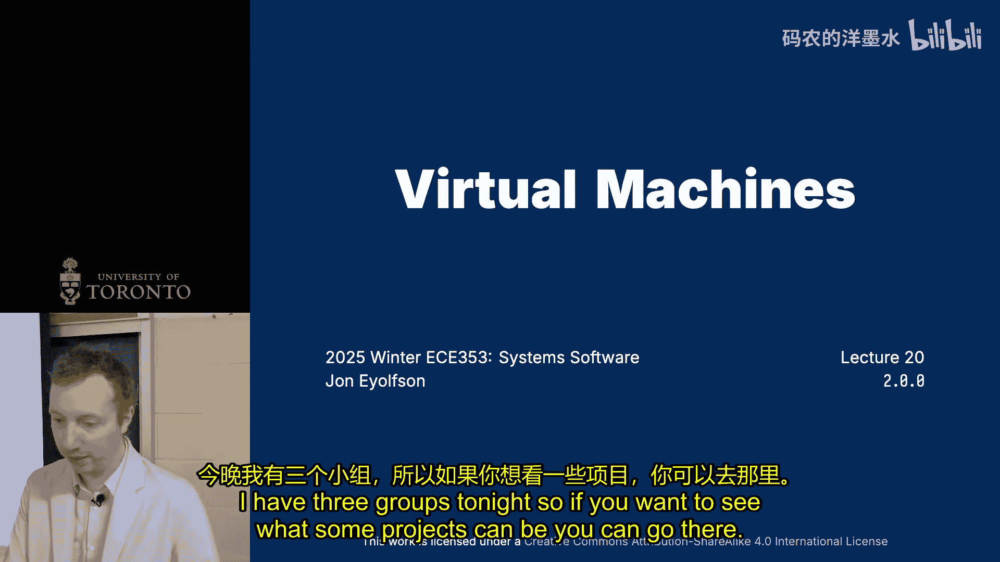
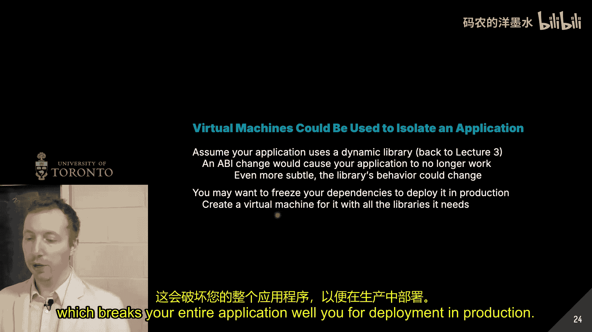

# 【全集 2025】多伦多大学 系统软件设计与编程 中英字幕 1080P p20 Lecture 20 - 虚拟机 -BV1YrkYBQEeL_p20-

🎼Okay。🎼。🎼Okay。All alreadyy， welcome back to 353。 So today we get to talk about virtual machines。

 how many of you have used a virtual machine？All your hands should be up because you've all been doing it。

 even if you don't know， you've been using Docker， right， and using the dev containers。

 you've been using。Unless you actually， your operating system is Linux。

 you are using a virtual machine， whether you know it or not， if you're using Docker。Today。

 we can briefly talk about them。 So virtual machines also。Pluug the E C design fair starts tonight。

 I have three groups tonight。 So you， if you w to see what some projects can be， you can go there。

 Lots of fun。 Alright， back to virtual machines， so。😊。

Virtual machines， like processes， abstract， running a program。

 Virtual machines abstract an entire machine。 So instead of running multiple。

Programs on the same computer our goal here is to run multiple operating systems on the single physical machine and because they're virtual machines。

 of course， each operating system believes they are the only one running。

 they cannot see anything else， they believe they have soulle access to all the memory。

 all the hardware and everything like that。So some definitions， when you're using virtual machines。

 the host is the thing that has direct control over the hardware。 So that is what you know。

The core part is installed on。 So in terms of virtual machines。

 there is something called a hypervisor or virtual machine manager。

 And that controls the virtual machine。 So it controls creating them。

 managing them and isolating them。 So which hardware it is actually allowed to access which physical hardware it's allowed to access。

 you can restrict it if you so choose。 So there are two types of hypervisors， a type1 and a type 2。

A typey1 is called a bare metal hypervisor， so it runs directly on the host hardware and it requires special hardware support。

That is generally the faster one for reasons we will get into in a bit。

 And if you are running Mac OS or Windows or something like that。

 while your operating system is actually acting as a hypervisor as well。

There is a type 2 called a hosted hypervisor that just simulates a hypervisor and runs as a normal application。

 so it's running a whole different operating system in user mode so there's some tricks we have to do to do that which is going to be slower we'll get into why but doesn't require any special hardware although most things now have hardware support for it and then a guest is what we call the virtual machine and it sees its own virtual copy of the host。

 so it might not see all of the hardware。So we can compare that to processes。

 so our diagram for processes， the world we know is on the left。

 so we have hardware at the lowest level， then we have our kernel running in kernel mode。

 we have this programming interface between well user mode， which is for processes and kernel mode。

Quick review。 what is this programming interface called between kernel mode and user mode。Yeah。

 it's a system call interface。 So we can look at that using Strace， all that fun stuff。

 So this is the world， as we know it。 If we add on virtual machines。

 we just add another layer on top of that。 So we take what we did before。

 But instead of real hardware， it's virtualized hardware。 So in this example on the right。

 There are three operating systems， all running different processes。

 all using running different kernels。 So one could be Linux，1 could be Mac。

 one could be window Linux。😊，And then they are three different virtual machines。

 so they have their own set of virtual hardware， and they're all being managed by the hypervisor or virtual machine manager。

 which is what is actually controlling all of the hardware。

So should be noted that virtual machines are not emulation。

 so emulation is typically used to translate one ISA or instruction set architecture to another。

 so like X8664 bit to arm or risk 5 or the other way around。On。Newer Mac with the M series CPUs。

 it actually translates X 86 to arm very， very quickly。

 so you can actually virtualize a normal windows on your Mac。 No problem。

 So our guest operating system usually executes instructions directly on the CPU。

 the hardware CPU using the same instruction set architecture。

 Otherwise it has to translate the instructions from one instruction set architecture to the other。

 which is typically so it's okay for most uses such as writing you know the old 80s N Nintendo entertainment system emulator。

 So when I was in grad school， I didn't want to write my thesis。 So I've made one of those because。

I know， I procrastinated and I want to do anything except write my dissertation。

 So I did that and still graduated somehow so。A virtual machine。

 It could use emulation to run a virtual machine on a different I SA， but generally。

 unless you have special things like Max do， performance would be really， really bad。

So cool things virtual machines enable us to do are pause and play。

 So much like our kernel can pause a process。 a hypervisor can pause an entire operating system。

 So the hypervisor needs to context switch instead of between cores or something。

 That context switching between virtual machines。 So it does the exact same thing。

 It's a bit more state， but it just does the same thing as context switching processes。

 saves the state。😊，Restores it。 That's it。Is just we have a bit more state because we need to keep track of you know。

 special system registers and things like that。 And you can also move it around exactly like a process。

 So this is what your server is running on why it doesn't go down unless my internet goes down for some reason。

 because even if I need to reboot a machine， I can just migrate a everything's running on virtual machine。

 I can just migrate it to a different physical machine。

 reboot the physical machine and then move it back after it comes back up again。 So you can do that。

 It is great all the cloud providers and everything。

 Well use virtual machines for literally everything。Another thing they can do。

 they can provide some protection through isolation so the guests like processes are isolated each other guests are isolated from each other and the host。

 so the hypervisor can do special things， like set limits on how much CPU time they have。

 how much memory they can use， how much network they can how much network bandwidth they get etc cea and if a guest gets compromised。

 it only has access to its own virtualized hardware so you just roll it back。Do something like that。

 restore it。 And then you're good to go again。 so you can easily roll it back or remove it。

 Also good for testing malware and stuff like that or just seeing different operating systems across the world。

 So anyone know what North Korea's operating systems is called。It is called Red Star OS。

If you would like to try it， you can download it， highly suggest you don't actually install it on your computer。

 but if you want you can install it on a virtual machine。

 highly recommended you do not give that virtual machine any network access。

But you can install it on there。It's isolated， you can play with it， you can do whatever you want。

It's fine， no harm， no foul， again， don't give it network access， you can create a virtual machine。

Again， don't give a network access， download as much malware as you can and just see who comes out on top at the end if you want to just have a battle royal or something like that or。

Do security research or something like that， but security research is generally just screwing around with stuff and trying to break stuff。

So。Other things virtual machines help is with consolidation。

 like I alluded to with the cloud servers。 So in data centers。

 lots and lots and lots of servers running， not making use of all the resources。

 so servers with different purposes could actually be sharing the same hardware， for instance。

You could you know have a virtual machine for a database and a separate one for the web server and things like that。

 and if it's not being used very heavily， you can put both virtual machines on the same physical machine。

 save costs and then once you know your site blows up or has more users just buy another physical machine and can migrate the virtual machine to a separate physical machine and boom you have more performance or you you can consolidate them if they're not being used。

 just consolidate them all on the same machine and if someone starts using it。

 then migrate it off it so。That's what's happening all the time。

 If you're using AW S or any other cloud provider， they're all using virtual machines and。

Without you knowing your connection might be like actually your virtual machine might be swapping between different physical machines。

 all without you knowing it is pretty much imperceptible when it actually switches。

 there's like a slight millisecond blip， but you probably will not notice it。So this。

Is really helpful， so instead of having lightly used physical systems， some virtual machines。

 run as many of them on a single machine as possible。And then， well。

 I don't have to bother paying for a whole bunch of different things。

 and I get the whole advantages of having everything completely separated and isolated from each other as well。

So the key abstraction for this is something called the virtual CPU or V CPU。 So for a process。

 part of the process control block kind of acted as a virtual CPU。

 but it only saved the registers that were accessible in user mode， the virtual CPU。

Actually represents the entire CPU， so it would include a copy。

 its own virtual copy of what kernel only registers。Again。

 processes just have enough space for user mode， a virtual CPU for operating system virtualizes all of it。

 including kernel only registers。So that's the structure that stores the entire state of the CPU and the hypervisor saves this when the guest is not running and when the virtual machine resumes like a process control block。

 it just loads the data， restores from that and just resumes where it left off。

 so same idea as we had for processes， nothing is really that new。So the guest。

 important to know here that from the guest point of view or the virtual machine itself。

 it is still uses user and kernel mode， so there's no changes to the guest operating system the Linux kernel or any other kernel you install on an operating system still uses privileged instructions that are only accessible in user mode and way back at the beginning we looked at the X86 user mode in Ring33 and kernel mode is ring 0。

 so you can tell how old this ISA is because while they couldn't rename the numbers or renumber them and a hypervisor needs to be more privileged than kernel mode so they renamed it or they just named it ring negative1。

So if there's already a zero and it's more privileged， well you have to go into the negative。

 so on X86 it's called ringing negative1 and that lets it control the guest and have control over kernel mode as well。

On newer architectures， it's just called hypervisor mode。On arm or risk5， but on older things。

 it's ring negative1。So for type 2 hypervisors。The host basically has to create a virtual kernel mode and user mode。

 But user mode is kind of already done through processes。 So it has to create its own kind of。

Clonnal mode， because for typey 2， the hypervisor runs completely in user space。

 so it has to kind of simulate the kernel mode in some way that we will get into。So。If I am。

Actually using a typepe 2 hypervisor where the guest runs only in user mode。

 Well if I directly try to， if you tried to do it in your process。

 you just put in some inline assembly or whatever that tried to use some kernel only some kernel mode only instruction well you would get an illegal instruction exception。

 you'd probably generate a trap， you get a wrong mode。

 your program would actually crash well if you're the hypervisor you need to explicitly handle this error so like with Seg faults and everything like that。

 you can intercept the signal and actually do something so they would have to actually intercept the illegal instruction signal and try to emulate or simulate what this kernel mode only operation is and just resume it。

This will definitely slow it down over just native execution if it was actually running in kernel mode。

 so that is why typepe 2 is a lot slower。How that works is this is all running in user mode。

 So the hypervisor or virtual machine manager， which is at the bottom of this line here that would also be written in user mode just written as a program but it's something that's transparent that the guest operating system should not see So above this line is the guest that has kernel mode and user mode So how it has to work is if it tries to execute a privileged instruction。

 so it tries to execute so kernel mode only instruction。

 it will generate a trap and then when that trap gets generated the software hypervisor needs to catch it。

 emulate what's supposed to happen update that virtual CPU that will have to model the actual CPU that's running on So that's where you would have your own copy of all of the registers that are only available in kernel mode again only。

and software， and then you return， you just resume execution of wherever the guest operating system left off and you just do that over and over and over again。

So。Sometimes this is not always work because in some CPUs。Especially older ones。

 There was no such thing as a hypervisor mode。 So they did a bunch of tricks to save on instruction space and all that stuff。

 So some CPUs。There's not really a clear distinction between privileged and non privilegevid instructions。

 so some instructions。Are the same op code or the same machine code that just happen to behave differently。

 depending on what CPU mode you're in， because， hey， that saved them an op code back in the day。

 So especially on X 86， virtual machines did not exist in the 1970s when this instruction set architecture came to be。

 So wasn't really a design consideration。 So one example is this pop F。Asmbly instruction on X 86。

 it pops the flags register from the stack and it's like okay well what flags register so what flags registered depends on what CPU mode you're in so if you're in kernel mode it's the kernel flags register if you're in user mode。

 there's the user flags it's the user flags， there's no way to access the user flags if you're running in kernel mode easily so。

In this case， we would have a bit of mismatch if the。

Gest operating system thinks it's in kernel mode and executes a pop F instruction。

 it should get the kernel flags， but since it's really only running in user mode。

 it would get the user flags which would be definitely wrong so we can't trap and emulate or anything like that because this is an illegal instruction it will just behave differently than we actually expect so we call these special instructions and we need another approach for them。

So these special instructions need something called binary translation， so。

If the guest virtual CPU is in user mode， so one of the states it would have is what mode the CPU is supposed to be in if it's in user mode and the guest operating system also thinks it's in user mode。

 we don't have to do anything we can just run instructions natively as before and the only difference is that if。

The virtual CPU thinks it's in kernel mode， the hypervisor has to inspect every instruction before execution because it has to check if it's one of these special instructions。

So it has to look at it before it executes， so these special instructions need to be translated。

Two instructions with the same effect， so it's the same simulating idea。

If it's just a regular instruction， we can just let it run。

 but we have to inspect it to make sure it is not a special instruction and the reason we can do this is because well thankfully the CPU instruction to switch from user mode to kernel mode is something we can actually keep track of because well that's a special instruction so the hypervisor can handle that using trap and emulate so it can actually detect what mode the guest operating system thinks it is in because well。

If we try and do that instruction， we can。We can handle that legal instruction。

 update our virtual CPU to say， hey， we are now in。

Clonnel mode so we have to start inspecting everything so overall the performance is going to really really suffer。

 they're adequate typically now the only time you will run a type2 hypervisor is by accident where you forgot to enable some setting on your computer or something like that and it's just painfully slow and you just go ahead and try and enable the hardware support。

This is also the same techniques。Fun tools do so everyone's probably used Valgrnd。

 I hope so Valgrnd does the exact same thing。 That's why you don't need to recompile your program with it or anything。

 so it will inspect all the instructions， all the memory read and write instructions。

 also intercept any cost to malloc so it can do its own keeping track of stuff and it will do that using binary translation which is why your program runs 70 times slower or something like that with Valalgrnd。

 but typically you don't really care right you're just using it for debugging。

 it doesn't really matter to you。So。Finary translation， visually， again， same idea。

 hypervisors under the line。 the guest operating system is above the line where there's user mode and kernel mode。

 but the whole thing's actually running in user mode， so。If the hypervisor。

Is thinks it's in kernel mode， it's going to read all the instructions if it's a special instruction。

 same idea， it's just going to simulate what happens to it， update that virtual CPU。

 and just continue on execution， skip over that instruction that got handled explicitly。All right。

 so there's also more hardware to the rescue， so this is going on what a type1 hypervisor is。

So this is in。 they first kind of came to being in 2005， which is。Younger than you？

I'm not that old yet。 He yeah， all right。After you were born。In 2005。

 Intel actually introduced virtualization as something called VTX， and AMD did in 2006 is A B V。

There's a whole bunch of different names for these。So if you go into the settings of your computer。

 they might be called different things in your bioOS depending on what the manufacturer decided。

 so that might also be called when they developed it， Intel codenamed at Vanderpooled。

 and then published it as virtual machine extensions， VMX。

AD code namedd at Pacifica and published as a secure virtual machine or SVM。

 so they all mean the exact same thing， they're just different names for the exact same thing。

 so all this did is add that concept of ring negative1 or hypervisor mode。So。On your physical laptop。

The host kernel， so Mac or Windows or whatever you happen to have claims this hypervisor mode and it's the only one able to access it。

 so that is how it can run your virtual machines nice and fast。

 so it sets isolation for the guests and what hardware it can actually have access to when it virtualizes it。

So as you might imagine， there's scheduling just like you schedule a process that we all know and love。

 you can schedule virtual machines as well。 so if there's only one CPU on a physical machine again。

 the guest doesn't know it， it could present as however many CPUs you want the host could still present you 1020。

60 CPU cores to the guest， they don't actually have to exist so in this case you would have to map virtual CPUs to physical CPUs or just schedule them like processes so like a normal kernel there's also hypervisor threads that keep control of the actual hardware that would interrupt them。

 take them off if they are running or you know。Monitor all of the limits。

So like with scheduling one approach is CPU assignment。

 so if there's more physical cores than all host than on the hosts and all the virtual machines or all the VCPUs across the virtual machines。

 you can just map them or one to one， the host can continue using any spare cores and it can be configured just to not touch the other ones。

 if you have to share things get more complicated， often this is called overcommitting so at equal numbers you can still map one to one。

 the hypervisor doesn't really run that often and otherwise you have to use a scheduling algorithm like we use for processes just nothing is really different except that the context which has a bit more information but we don't really care about that。

So some additional problems it might cause if we have some overcommitment issue is while your guest operating system now runs too unpredictably for soft real-time tax because it might be context switched out when the user process says not to so we know on Linux you can just set your process to like real-time scheduling that will have priority above literally anything else so you're guaranteed it will not be switched out well if it's running a virtual machine you ultimately do not have control over the hardware so your virtual machine might get context swapped out and therefore your process will get context switched out even though you said for it not to be so。

Again， as a concrete example， if your process is doing real time round Robbin with a time slice of 10 milliseconds on real hardware。

It would。It would。Kick out or context switch at most every 10 milliseconds。

 but the guest will not have a consistent time slice at 10 milliseconds and might be higher if it gets context switched out between or wallet it's in the middle of a time slice。

 so this might make processes missed deadlines they otherwise wouldn't have if they were actually running on the physical hardware so this is the only weird special case where virtualization has a different observable behavior and this is only really for performance sensitive of test for running your test cases or your labs or whatever it doesn't really matter too much。

So。The only thing that gets more complicated is virtualized memory management。 So our favorite topic。

 virtualt memory， allows each process to think it has the entire address space。Well。

 now the guest colonel thinks it's managing the entire physical address space。But that's virtualized。

RightBecause if you are the hypervisor， you are the only one with access to physical memory and what your operating system sees is actually virtual memory because it's not accessing the real one。

 so what your process sees is actually virtual virtual memory， isn't that fun。The guests。Again。

 we have to virtualize that too， so it makes virtual memory management a lot more complicated。

 but thankfully that's mostly what hypervisor mode aims to speed up because this problem gets even worse if memory is over committedmit as well and then we have to deal with swapping and all of that stuff。

 So with just relating to page tables。 Well we have to do something like we have to have nested page tables。

 so。😊，For virtual machines， you've nested page tables to enable virtual memory for guest kernels。

 so again。The guest thinks it controls the entire physical memory。

 it does its own page table management again， remember the kernel running on the virtual machine is completely unmodified and the hypervisor that's maintaining the nested page tables that retranslate the physical addresses。

 the guest thinks it's using to the real physical addresses on the machine so there's a nested page table and you could imagine if we have a three level page table。

On first access， we have to go ahead， take that virtual virtual address。

 translate it to a virtual address， going through three levels of page tables。

 then we have to do it again for that virtual address to a physical address to go through another three levels of page tables so。

That is basically。What the hardware support of hypermor mode does。

 It basically tells the MMU there are nested page tables here。 So actually cash the。

Virtual virtual address to a physical address， so your lookup still would be a bit slow。

 but what saved in the TLB is a final translation of going through all those nested page tables。

And if we have overcommit memory， the hypervisor can provide double paging so the hypervisor would do its own page replacement algorithm like we saw in the last lecture。

But in this case， we might want our guest to actually do its own page replacements since it probably knows its memory access patterns a bit better。

 that is a bit of a less important point。So。We could also use other advantages we knew from before。

 we can use copy on right so guests can actually share pages if they're duplicates。 So if we have。

Two virtual machines。Running the exact same kernel。Possibly running the exact same processes。 Well。

 ideally， if they were on the same or if we were running them， you know， on one operating system。

 we could use copy on right。Be memory efficient， all that stuff。Just like copy on right。

 while we can actually save memory between virtual machines by sharing pages as well。

 But the only difference here is instead of sharing between processes。

 we're sharing between guests or operating systems。 So the hypervisor。

 there's no fork or anything like that when you create a virtual machine。

 you can't fork one virtual machine from another。 So the hypervisor can do duplicate detection by hashing the content of the pages。

If the two hashes are the same， well， that means they might be the same or may not be the same。

Not possible that they are not the same， so if the two hashes are the same then it will go through check them byte for byte and if they're the same byte for byte。

 then it would share those two pages just like copy on right and it would share them until one the guest tries to write again。

 same idea as copy on right。All right， another fun thing you can do is you can provide virtualized IO devices so a hypervisor can multiplex one device two multiple virtual machines。

 could also emulate devices that don't physically exist。For instance， a network card。

 there's one physical network card on your machine， but each virtual machine can have access to it。

And another thing you could do is a hypervisor could also map one physical device to a virtual device on one VM。

 so one virtual machine has exclusive access to the device but the hypervisor is still in the middle still translating because it could actually share it between different operating systems so there's actually a newer hardware solution to remove the hypervisor during runtime and it's called IOMMu so this will let the hypervisor map devices in virtual memory exclusively to the guest so now the virtual machine really does have exclusive control over some hardware and that allows come complicated things like GPU to work at native speeds in a virtual machine so you just plug in another GPU on your machine create a virtual machine and just pass the virtual or the GPU directly to the virtual machine and then。

Get pretty much exact native performance or if there's any weird hardware things。That， for instance。

 only work on Windows。 You can do that and use windows as。Pretty much native performance。So。

How virtual machines work is while just like your operating system boots from a hard drive。

 so if you really wanted to， you could take your hard drive out。

 put a different computer and boot your operating system on different machine。

 virtualr machines act the same way。 All you really need is a virtualized disk so you create a disk image that has all the contents of the physical disk。

 It would contain like partitions。 Each partition would have a file system which you are now exploring in lab6。

Usually it's just one big file but some formats let you split it up and the guest kernel sees this as a normal disk it has full control over that disk image is all you really need for a virtual machine so if I want to let you run the web server that's grading your code I just give you the disk image and say go ahead run this booted up and you can go ahead and modify it as you wish so it makes it easy to move to if you're using virtual box or something like that there's like OVA files that represent the virtual machine basically they're just a disk image and a whole bunch of guest settings like how many CPU should there be by default。

 how much memory should there be but like 99% of it is the disk image that's the only important part。

Nice another advantage of it is virtual machines can also be used to isolate an application。

 so going back to lecture three or two， assume your application just uses a dynamic library。

If you change the A that causes your application to break well or even more subtle。

They don't even break the API。 they exchange the behavior slightly。

 which breaks your entire application。 Well you forward deployment in production。

