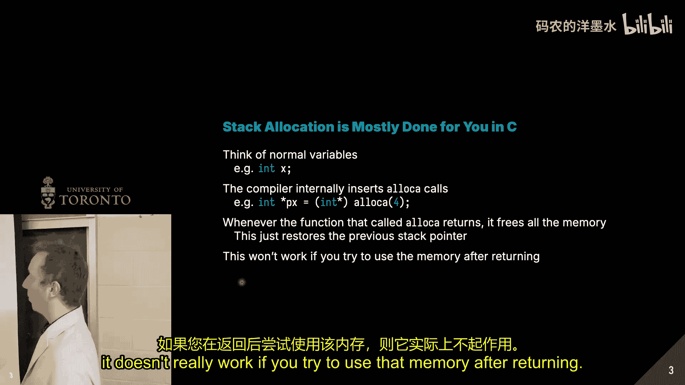
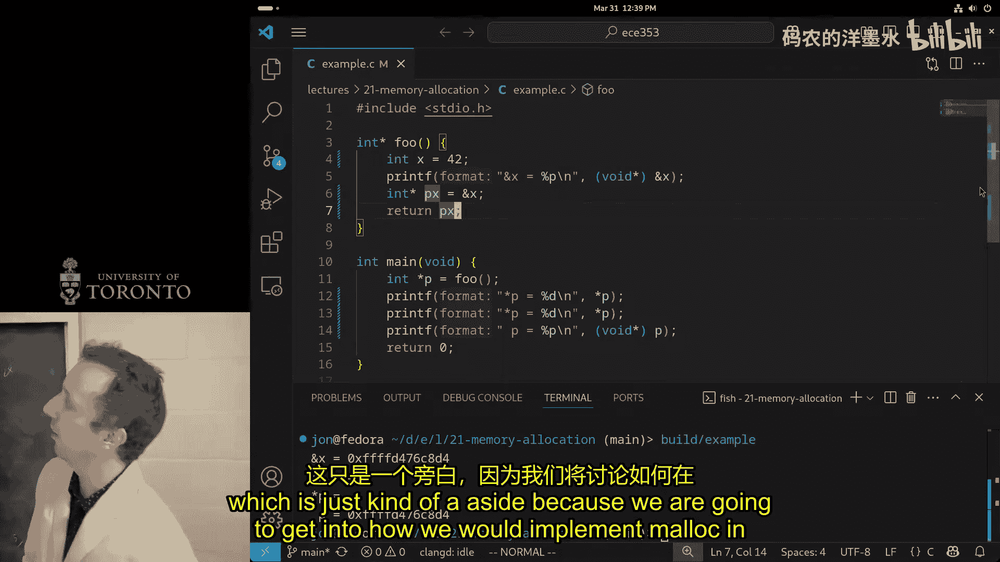
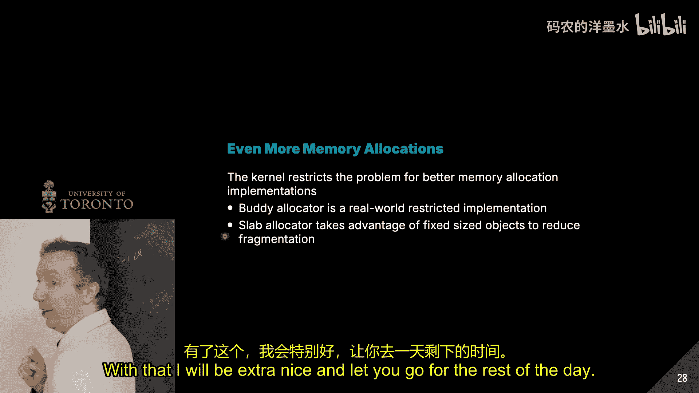

# 【全集 2025】多伦多大学 系统软件设计与编程 中英字幕 1080P p21 Lecture 21 - 内存分配 -BV1YrkYBQEeL_p21-

あ。あどい。Alrighty， welcome back to 353。So I have an interesting proposition for you。

 How about we skip our break today。And by skipping our break， I mean we will finish within an hour。

 probably， yes。All right， sweet， so we are talking about memory allocation today。

 which is kind of separate from the rest of the stuff we talked about。

 but important topic to touch on for operating systems first。

Well， I mean we need to allocate memory at some point right so well static allocation if we're writing your program is the simplest strategy so you guys have all done this before。

 so you create a fixed size allocation in your program。

 maybe you have a global variable called buffer or just something in your program where you just have char buffer of the size of a page 4096 bytes。

 and then when the program loads if this is a global value。

 then the kernel is going to set aside that memory for you when your program loads。

 the memory exists and is valid as long as your process does。

 so there's no need to free it or anything like that， everyone loves good old global memory。

So in most programs， dynamic allocations often required。

 so you may only conditionally require memory， static allocations are sometimes wasteful because you have to consider the worst case the worst case only happens for like a millisecond of your program and your program lives for It know a year then you are wasting a lot of space because you actually only need that memory for a very small portion of the time and well you may not notice the size of the allocation。

 static allocations again， like I just said， need to account for the maximum size and then we have to figure out where to allocate memory if we are writing your program because we can either allocate it on the stack or the heap and now we know that that difference is very important because variables on the stack should be independent for each thread。

So stack allocation is mostly done for you in C。 so if I think of a normal variable in X。

 well that it has to live somewhere in memory and well you can actually allocate like using malloc。

 you get back a pointer， you can actually call a function to allocate space for you on the stack。

 in fact that function is called Alloc A， you probably never used it before because that's what the beauty of the C compiler if you can call it that it will。

Actually， internally insert the alloc A calls for you。 So if I have int X like this， well。

 I need to allocate a size of int， which is just4 bytes。

 so that needs to live somewhere on the stack。 So since it lives somewhere in memory。

 it exists at a pointer。 So in this case， whatever the function called all A returns。

It doesn't matter we don't have to free it because well when the function is done。

 it just restores the stack pointer， which instantly frees everything associated with that function。

 so again you never had to free X or anything like that。The beauty。

 if you can call it this as a little bit of review。

 it doesn't really work if you try to use that memory after returning。 like， for instance。

 what if I wrote a program of like this so。

I wrote a function called F that returns a pointer to an int in here， I say int x equals1。

 I print off the address of x here。I can do the P format specifier to print a pointer。

 and I just have to typecast it to void star because it's C C's way of saying it's a pointer to what I don't really care。

 So then at the end， this function， I return the address of X。 so that should just be some address。

 some memory value。 and it is。Copyied by value。 So when F returns。

 P should be the exact same thing as the address of X。 So if I print P， the value of P here。

 it should be the same as the address of X， right。Yes。Who disagrees with me？

Why do you disagree with me？The memory gets freed， Yes， but I'm just returning a point an address。

 right？invites to。But the address should still be there， right， Like it should be the right address。

 like I'm just copying the address。All right， so I've convinced you。

 so everyone agrees that they should print the same thing。Wow， I'm so convincing。 All right。 So。

 I mean， it should if， if this， you know， if I change it to an int and I just had x equals 1。

 I returned X。It should be one if I had a variable there called in y equals P， it should be one。

 it should print one to both things right， same case if it's an address。

So I compile and run this while I already compiled it， let's just run it。

 let's assume I can type the word build， and no it is null。I convinced you all。

 I am the master of deception。What happened？This should be。

 what's your C course 190 or something like that， Yeah， 190， what happened？R row。第二。我应个放。野中は。

I have to malloc。I mean， for it to be valid， kind of， yeah。H。Yeah。

The local variables are like lost somehow。😔，They're lost Yeah。 I mean， it should be freed。

 so the address。Shouldn't be validating or。 shouldn't de referenceence anything through that address。

 but I don't de referenceence anything through that address or anything like that。 But， you know。

 if you look at the C spec， it is actually。Unfined behavior。

 So if you take the address of a stack memory and then return it。

 it's technically undefined behavior so。C or clang or GCC does it too。 in this case。

 we'll take that undefined behavior to try and crash your program and change that value to null。

 If I want to get around this problem， So， you know， it was smarter than me。 it was like， hey。

 the address of the stack memory。 You're returning that。 That's bad。 Well， I can， you know。

 I can get around that。 I'll just create a variable called Px。

 said equal to X and then just return Px。So if I compile now。

It runs as we expect because my compiler didn't insert any random anything or anything fun。

 the addresses are both the same if I want to align it just to make sure we can go up by one。

 let me add a space there。ToDo something like that。 we can see the addresses are exactly the same。

All right， so anyone want to tell me if I。Uncomment this and dereference。P。What value will I get？

Yeahep。One， everyone agree with one？No one's terribly confident。So compile， run it， boom one。

And we can see， hey， well， if I change this value to 42。What will it print now？One， still or 42。

Let's go 42， all right， I like the confidence。42。So why is it printing 42？

Are we guaranteed that Prince 42？Yeah， no， because while we're pointing to memory that should be freed and not touched anymore。

 So technically， this is undefined behavior。 Again， we just got lucky such that。

The value never got touched。If I were to write， you know， print this line twice。

If it prints 42 the first time， it should print 42 the second time， right？Makes sense。Compile。

Why is that？Well， we just got lucky the first time right So that's pointing the address we got back was pointing to some stack location that when F returns is no longer valid it just so happens the value didn't change the first time we called print F because before we even ran print F。

 we read the value。 So we didn't adjust the stack at all。 we ran it。

 but when you run print F it will use the stack as well， as you might imagine。

 messes with the values， So when we print it again， well。

 we're point to invalid memory that we shouldn't be accessing。

 it was the stack that print F just used。 So if we print it again， we get a whole different value。

 even though the pointer value again is exactly the same。 So yeah， that's fun。

I don't know why we want on that detour， but you should kind of know this stuff。

 undefined behavior is fun。 And that's why most of you， Well， especially first years。

 they're now just starting to learn malloc and their programs are doing all sorts of weird stuff。

So this is one of them。 So any questions about that， which is just kind of a aside。

 because we are going to get into how we would implement Maloc in this lecture。

Perfect。All right， so。Hopefully， we've all used it to varying degrees of success。

 So dynamic allocation， These are the malloc family of calls that are in just。😊。

In the standard C library， this is the most flexible way to use memory you never had to worry about pages。

 you never had to do anything like that。But it's actually tricky to implement yourself if you had the task of implementing Maloc yourself。

Even in order to use malloc， again， remember you have to remember to free。

 so you have to have properly handle the lifetimes of all your memory。

 make sure that you free exactly once otherwise you'll have a double free and then make sure you don't free too early。

 otherwise you might have a use after free to big。Fun errors you might have。

 and there's also a big concern if you are implementing mallocc， which is fragmentation。

 which is basically just wasted space。So。This fragmentation issue is a unique issue for dynamic allocation。

Because when you call malloc， you allocate memory in a contiguous block。

 So it has to be all bitete after byte after byte。 You can't compact it or move it or anything like that。

 So whenever Maloc makes a decision and returns you a pointer。 It is permanent until you call free。

 You can't be like， no， never mind。 I didn't mean to do that address halfway through。

 you move something you change it。 You can't do anything like that in C。 It is。

Essentially permanent in Java， you the JBM will do things like that， but we are not Java。So。Just。

To be clear， a fragment is just a small block of contiguous memory that cannot hand in an allocation。

 again， think of it as a hole in memory or just wasted space and in order for fragmentation to be an issue。

 we need three requirements to happen for our memory allocator。

The allocations have to have different lifetimes， and these all have to be true。 Otherwise。

 if all the allocations had the same lifetime， so like they all live as long as a function lives。

 it doesn't matter。 you can just allocate them like on a stack and then free them all at once。

 you don't have any wasted space because you just stack them on top of each other。

If we have the same sized allocation， then that's like the whole thing of just using pages at a time。

 we don't have any problems because one page is just as good as any other page。

 so we have to have different sized allocations and that is true with malloc because you can call Maloc with any number you want and we have to not be able to relocate previous allocations so the JVM since everything's by reference and you can't actually access pointers or anything like that the JVM will go ahead and try and combat this issue by moving your objects and memory and trying to combat things but in C malloc just returns a pointer we can't do anything about that so we are not able to relocate any previous allocations。

If we could， again， we can just pause everything， move it all next to each other。

 make sure all your memory allocations are contiguous， no harm， no foul。So。

There's two types of fragmentation， internal and external fragmentation。

 which we did talk about briefly when we were talking about file systems。

 external fragmentation occurs when you allocate different size blocks。

 there's no room for an allocation between the block， so for instance。

 this let's say the red is an allocation and the blank space in between。Is free memory Well。

 essentially if I have an allocation that is slightly bigger than this free block that is in between two allocations。

 this block is now useless， I can't actually use it for any allocation。

Internal fragmentation occurs when you have a fixed size block and there's wasted space within a block like for instance。

 on your file system。If the block is 4，096 bytes and you only use 100 bytes of that。

 while then the rest of the space in the block is essentially wasted， that is internal fragmentation。

 that is the issue we had with file systems， but now。

We'll have external fragmentation because we are arguing about how to implement malloc。So。

One of our goals if we implement malloc is well1， it should be fast two。

 we want to minimize fragmentation again， just wasted space。

 which we should prevent so what we want to do is reduce the number of holes between blocks and memory if we have holes we'd like to keep them as large as possible and we want to keep allocating memory without wasting space。

So。When we implement it it usually uses a free list like we had a free list of pages but now we keep track of a bit more information。

 we're keeping track of the size of the allocation as well。

 so what you can do is keep track of free blocks of memory with their sizes by chaining them together implementing it as a linked list and we also because we're writing Maoc we may be able to handle a request of any size so what we could do is for allocation go through that link list choose a block big enough for that request。

 move it from that free list for deallocation just add that block back to the free list if it's adjacent to another free block or contiguous with that we can merge them so。

In general， there's three he allocation strategies we can use at the most basic level。

 the first is best fit， so choose the smallest block that can satisfy the current memory allocation request。

It again needs to search through that whole list unless there's an exact match in which case I found the vast match。

 there's worst fit which sounds a bit silly， which chooses the largest block or most left over space and again it has to search through the whole list。

 the whole intuition behind that is well if I allocate from the biggest block then。Hopefully。

 the leftover is still useful for something。 So I won't have。

 I maybe will reduce my fragmentation for that， or I could just use。

It's a strategy called first bit that just choose the first block that satisfies a request。

 I don't care if it's the smallest or the largest one。

 I just want to find it fast and get it over with。So。To allocate using best fit。

 how I will do this is， I'll just assume that we are managing this block of memory。We are malloc。

 and any colored box is some allocation that already exists。

 So there's a red allocation and a blue allocation。 and any of the blank。Boxes with a number。

Is what would be on the free list， and that is how many bytes free there are。

So if we get an allocation so someone calls malloc of 40 bytes， I'll put it in green。

 we have to figure out what free list do we kind of cut in half or not cut in half。

 but we take memory out of to satisfy this request so if we are using best fit well we have two choices right we can either use the 100 byte size free block or the 60 byte block size free block if we are doing best fit。

Is 100 or 60 closer to 40？60， so we choose 60 to do that allocation。 What we would do is of that 60。

 we use 40 of it for the green allocation。 So there's now a 20 block left over。

 Everyone okay with that。All right， so now we have a 60 byte allocation that is in this purple。

Is too big for this 20。 It fits in the 0。 So I have no choice but to put it there， right。

 So I put it there。 And now there is 40 B free here and 20 B at the end。

 Now I have this magenta allocation。 Look at me with fancy color names come in and it 60 Bs and now I am screwed。

 right， I can't actually fit it anywhere。 I have 60 Bs in total free。

 but they're not beside each other。 So I would have to be like， hey， I'm out of memory。

 I can't do anything with this。 Those would both be considered fragmentation for this request。

 So questions about that。All right， let's do it again， let's do it with worst fit。So worst fit。

Finds the biggest block。 So if I have an allocation of size 40。

 do I choose 100 or 60 if I'm doing worst fit。100 right， I find the biggest block。

I find 100 and use 40 of it for the green allocation。 That means it has 60 left。 So now I have 2。

60 blocks free。 Now， if I have this purple allocation， where do I allocate it doesn't matter。

 They're both 60。It。Just pick one。 I'll pick the one on the left just for fun。

 And then if we had that magenta allocation again， hey， look。

 it fits exactly in the remaining space and we used all the stuff。

 So worst fit seemed to be the best in this case。 Did we get the names reversed。😊，Turns out， no， so。

Well， it turns out you don't want to use either of them。 So both best fit and worst fit are slow。

 So best fit actually tends to leave very large holes， which are useful and very small holes。

 which are probably fragmentation and worst fit， if you simulate it， it actually does。

 as the name suggest， and it is actually the worst in terms of storage utilization。

First bit on top of being quicker to implement and quicker to execute tends to leave average size holes and works fairly well。

 So if you had to implement malloc， the first thing you could do is。Is implement something like this。

 if you want to。Go into the performance of MalOoc and all that， you can take EC 454。

 so that you'll be implementing Meloc with threads and all that fun stuff and use your caches more effectively and all that。

 but we are just talking about general strategies。So。If you are the kernel。

 you have to implement your own memory allocation。 You won't have Lib C， So you'll have to。

Either you might have to implement Maloc at some point or if you're the kernel where Lib C doesn't exist。

 you have to implement it yourself， so if you're the kernel you have to implement your own memory allocation again。

 these concepts are same no matter what you are， their static and dynamic allocations for dynamic fragmentations are big concern。

Dynamic allocation returns blocks of memories。 Frmentation between blocks is called external that is。

Unique for this type of problem， fragmentation within a block is internal fragmentation。

 that's what we saw in file system and the three very general allocation strategies for implementing something like malloc is best fit worst fit and first fit which just use a single link list and free blocks keeping track of the size of each block。

All right， the fun one。If you want to implement it yourself and have a。

Without making it too complicated。We can do something called the Budy allocator。

 so typically on a computer。Especially if you're the kernel and you're doing all your own memory requests and you're not insane。

 typically all the allocation requests are going to be powers of two。

 so they're going to be something like two to the power of n so like two bytes， four bytes。

  eight bytes， 16 bytes， so on and so forth up to some giant number， so the buddy allocator。

 restricts any allocation to be exactly a power of two for a more efficient implementation and what it does is it splits blocks in two possibly recursively until you can handle the request and the whole purpose of this is so we can do fast searching and merging so we'll go into an example of that。

So。To implement the buddy allocator， you do it using multiple linked lists instead of just one free list。

 so since we restrict requests to the power of K for some K up to n。

Where if something is not a power of two we can just round up if we need to our implementation uses n plus one free lists for blocks of each size so we would have a free list for all blocks of size 1。

 all blocks of size 2， all blocks of size4， all blocks of size8。

 16 so on and so forth So how this algorithm would work is if we get a request come that comes in that's to the power of k。

 we just search the free list until we find a big enough block and we only need to search one entry in the free list so we search。

For a block that is exactly the same size， so we'll search for k so for example。

 if it's an allocation of 64 bytes， we will search the 64 byte free list first。

 if there is nothing free on that， then we'll go up to the next power of2 so k plus1 or 128。

 if that's not free we'll go up to 256。So on and so fun until we find one。 And then。We're done。

 either we find it or we ran out of memory。Then if we have a bigger block than before we recursively divide it。

In two， until it's the correct size， and then you insert the buddy blocks onto that free list。

 so we'll have an example of this as well， and then 4 D allocations。

 the coalesce operation are merging things back together。

Is really easy because everything's the power of two。😡，Knowing what size the allocation is。

 I know what bit to look at and I know who my buddy is， so if your bit is0， your buddy is one。

 if it's one， your bit is the other bit is zero for that level。

 so by using bit manipulation that you don't really have to know or worry about。

 we can efficiently know who our buddy is immediately。

So this is an example of using the buddy allocator。 So let's assume that in total。

 we are managing 256 bys of memory。 So anything in the white box are just for our accounting。

So I have a level for each power of two。 if it's white， that doesn't mean it's free or anything。

 it's just everything of this level。 white just means it's used and it's not directly used for an allocation。

 so。This 256 by that I originally had， This is just the state after the user uses it after some time with two allocations so that 256 byte I was managing before split up into two128 byte buddies and then each of them got split up into2 64 byte buddies this 64 byte block got split into 232 byte buddies where one buddy in the red is used for a 32 byte allocation in the red and then this one is free So on the 32 byte free list。

 there would be one entry and then on the 64 byte block free list， there would be two entries。

 this 64 byte block and this one and someone's using a blue allocation in 64 byte block。 So is that。

Kind of set the scene for everyone。All right。So now if someone calls Maloc using the buddy allocator。

For an allocation of size 28 bytes， what do I do？Yeah。Yeah， I would round it up to 32。 Hey。

 there's a 32 B free block。 So I'll just use this one， right， So I would use that boom。 It's good。

 Now we have another request come in for 32 B blocks。 Now， what do I do yeah。😊，Yeah， so in this case。

 now I don't have any free 32 B blocks。 So I go up to the next power of two。 Hey。

 there's a 64 B block free。 In fact， there's two of them。 So I just take one。

 I split it into two buddies。 I use one for the allocation， and one is free。

So now let's say I go on and I do a free of this， what should happen？Yeah。There。Yeah。

 so if we free this one， this is the only 64 B block。 They're both free。

 So you and your buddy are free so we can coalesce them， and we can have a free 1 28 B block。

 So after that， it would look like this。😊，Everyone all right with that。

 that's basically how it would work。Again， we can implement that coalescing very。

 very efficiently by just checking a single bit。And then we do it recursively。あさ。

But how does you know that？W I split the other one？あ。From the left。Like， do you need。

When did this one， Yeah， when I did this one， I just split in two， then they were both free。

 and then I just pick one of them to do the actual allocation because it's big enough now。So。If。

 you know， if we went here and then。Say we did another 32 B allocation that filled this。

 And then there's another 32 B allocation。 Then we would have to， this is our only free thing。

 So wed then split that in 64 and then split one of the 64s into 2，32s。And then it's always log n。

 it's a whole point of this。All right， any questions about the buddy allocator？Cool， buddies are fun。

They are used in the Linuxx kernel all the time， so they are fast。

 they are simple to implement compared to general dynamic memory allocation。

 It avoids that issue of external fragmentation by keeping like free physical address ranges contiguous the disadvantages are that there's always going to be some internal fragmentation if your request is not a power of two because again we restricted the problem we only deal with allocation inside powers of two so since we always rounded up that memory can't be used for anything so might not work well in general if someone you know request 100 bytes or in the worst case。

I would request like。65 bytes or a power of  two plus one， because I'm wasting all the other bytes。

 almost half of them。And they'll all be lost to internal fragmentation。

So another option is slab allocators that take advantage of fixed size allocations。

 so allocate all objects of the same size on like a dedicated pool。

 you might even use this for your own programs if you want。

 and this is really easy because all structures of the same type are the same size it's basically just an array So every object type has its own pool with blocks of the correct size and this prevents internal fragmentation。

 So one of the things。That the Linux kernel does extensively and what， hey。

 what you're now discovering hopefully in lab6 is there is a big pool of iodes， right？

So it's basically a big array and you just constantly reuse elements in that array and you just have a single bit keeping track of whether or not they're allocated or not。

Kind of a spoiler for La6， but it's basically what a slab is。 So a slab is a cache of slots。

Each allocation size has a corresponding slabbook slots， one slot holds one allocation。

 so if you have a very weird size in your own program you can just mall a whole bunch of memory and treat it as an array that you reuse so now to keep track of what's free and what is not instead of a link list I can use a bitmap so there's a mapping between which bit we're looking at and the slot or the index we're looking at for allocations。

All we do is search for a0 bit somewhere。 And then as soon as we find it。

 set the corresponding bit to a1， return the address to the corresponding slot。 We're done。

 And then for deallocs， we didn't just clear the bit， set the bit from a1 to a 0 and we're done。

 So we could also implement a slab on top of a buddy allocator if we want。

 So we use an buddy allocator to get a huge。Huge amount of memory。

 and then we implement a slab on top of it， so we basically just do an array plus a bitmap。This is。

Kind of using both of them。 If you didn't have， you know， a dedicated slab。 So these slab 1， A2， a。

B1 and B2。 those are blocks of memory that would be powers of two return from the buddy allocator。

 and then on top of them， I'm using them as basically an array。 so let's say。

It has a really weird size slab。A has objects of size A that's maybe I don't know 20 bytes or something like that。

 So maybe I can fit four on this s if I pack them all together tight instead of you know if I was just using the buddy allocator for each individual element。

 it would round up each individual element to the power of two。

 which would waste a whole lot of space， instead of just this little bit。And then maybe， you know。

 Ive slab B for an object of size B that exactly fits two elements and。That's it。

 So I would also have to put the bitm somewhere there， which I'm kind of glossing over on this。

 But if we had really weird size objects， we could reduce internal fragmentation again if the slabs are located adjacently。

In this example again， here would be some internal fragmentation for object A on this lab and this lab。

But。It's just to say， we could。Merge things together。 We could， you know。

 mix and match our memory allocation in things of that nature。 So any questions about that。All right。

So。I didn't lie， we were quick。So that's even more memory allocation。

 the kernel restricts the problem for better memory allocation implementation。

 so we'll use both the buddy allocator， which is like a real world restricted implementation which is fast and still not bad to implement and then slab allocators which takes advantage of fixed size objects to reduce fragmentation basically uses it as an array and gets rid of a link list so other housekeeping note so I will stick around here if you want to work on lab 6 or ask me any questions。

But also， since you have time left over and course evaluations are out。

 please fill those out if you log on Coras， it should pop up。If you didn't know this。

 your professor's pay is directly related to how you fill them out and your response rate and all of that。

 the current response rate is 4%， which is absolutely abysmal， that means。

Three or four of you have filled it out to date。So you can't hide that much so yes please fill them out。

 I do read the comments the university actually cares about them。

 all your professors pay is directly related to them。If you like it， fill it out nicely。

 if you don't like someone， hopefully not me， you can fill it out not so nicely。

 and then they will get paid less。Or。Especially important for me because I'll be up for my review very shortly。

 so if you would like to keep me employed and keep me teaching here， then please fill it out nicely。

With that， I will be extra nice and let you go for the rest of the day。 So remember born fo you。😊。

