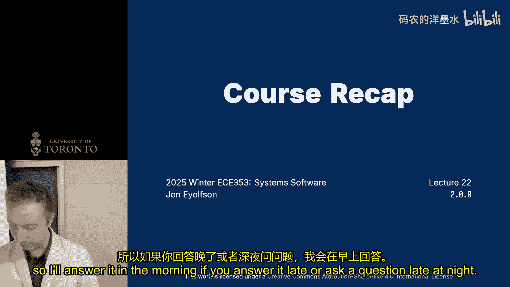
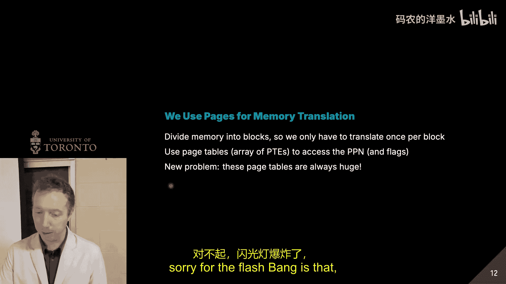
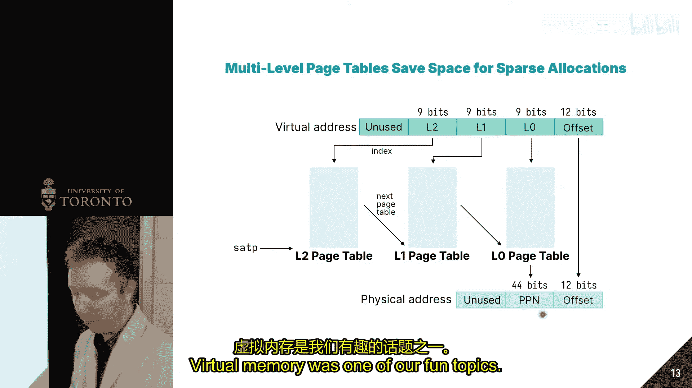
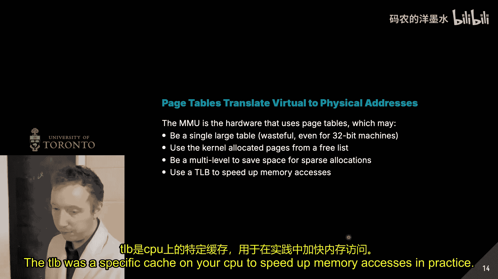
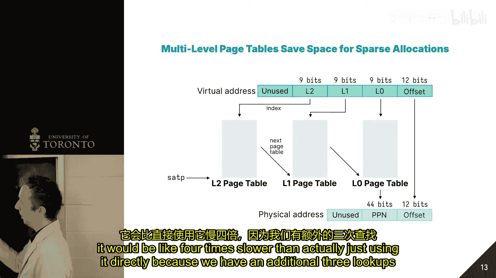

# 【全集 2025】多伦多大学 系统软件设计与编程 中英字幕 1080P p22 Lecture 22 - 课程复习 -BV1YrkYBQEeL_p22-

🎼Yeah。A least order。这 here。Like you might be other。Allrighty， welcome back to 353。

 this is our last lecture。You only't have one Monday， so。This is last lecture。

 we'll do a quick course recap。I imagine you might be， you know， the exams the 30th。

 I imagine you might be watching this instead of being here。

 but there are a good number of people here。 So that's good。 So this is just kind of a course recap。

 You should watch it。Before your exam， obviously answer questions， all that stuff。

 I'll assume we went through this。Before the review session I will host all announcement that on Discord and any time studying whenever just ask questions on discord。

 I will be around at home for until your exam， so I'll be happy to answer questions as long as it you know I'm an old man。

 I sleep pretty early， so I'll answer it in the morning if you answer it or ask a question late at night。

So this is the quick course recap that you should know off the top of your head because I'm doing it more or less。

 well， I try to do it kind of blind myself， so anything I say here should be important。So first off。

 we got into the role of what an operating system is， why you're taking this course。

 So I guess for you， the course codes are slightly different， but you use applications before。190。

 180， whatever the other courses are， you made applications。

 and then some course you had that dealt with assembly， low level hardware。

But it was kind of like a little toy example， not that much。

 you weren't actually you' were writing parts of an operating system even if you don't know it and we have an operating system which kind of runs in between the application and the hardware。

 so application talks directly to the operating system。

 either using system calls or some libraries depending on how you define what's in operating system。

 kernel is for sure in the operating system， so a kernel is the only thing that actually interacts with the hardware and it's a special CPU mode and all of that fun stuff we went over。

So there were three key concepts in this course at the beginning and we saw them a whole bunch of times。

 so virtualization probably the most key concept so that sharing one resource by mimicking many independent copies。

 we virtualize pretty much everything so threads are basically virtualized CPU courses like execution units。

 so each thread has its own independent copy of a stack and registers that is a thread and then we virtualized memory then put memory into a process which is a process is just a running instance of a program everything we need to know that do that and then to top it off we even virtualized an entire machine so we did virtual machines which you are all using whether you know it or not。

Then we got into concurrency that was fun。 that was handling multiple things happening at the same time。

 that's when programming became real because now just instead of just running at mainine。

 going straight through line by line by line， you realize that doesn't actually happen especially if you want to write real applications and real performanceant code。

 you have to do things concurrently or in parallel hopefully but to argue about it you can argue about it concurrently。

 and then we capped off with persistent， so retaining data consistency even without power。

 just describe a little bit about file systems， how files are stored and common hardware approaches you can to make sure you have consistent data。

 using raid which we will go into towards the end。So there are multiple privilege modes on your CPU that we can actually explain all them now。

 so applications and libraries run in user mode so that can't access any hardware or anything special like that then there's the kernel which can access instructions that directly interact with the hardware on your machine and then on top of that there is some more privileged CPU mode called the hypervisor and that's where virtual machines run in so it has to be more privileged than the kernel because the virtual machine will be running an unmodified kernel。

 still running in actual kernel mode， so hypervisors actually manage multiple virtual machines on newer hardware which everyone will have since it's been a thing since 2005 and then there's actually on some CPU architectures just unrestricted the most privileged CPU mode imaginable and that's where like your bootloader。

From where it would be that we didn't touch on this course。

 but if you go into embedded computing something like that you might have to deal with those things。

 but they basically have access to literally everything。

So we argued first that the kernel is the core part of the operating system。

 It can actually interact directly with the hardware and there's a few different kernel architectures we could have are how we organize what type of code is in our kernel。

 So we have a very clear line between user space which runs in user mode and kernel space which runs in kernel mode。

 and one design is just hey， anything that even remotely sounds like it touches hardware。

 just run it all in kernel mode， and that is called a monolithic kernel。

 This is an example of the Linux kernel。 So the kernel would be responsible for managing virtual memory。

 scheduling processes， in process communication or IPC。All the file systems and device drivers。

 anything specific to hardware runs all in kernel space。 So the other major design is hey。

 if you write a lot of code， more code， more bugs so let's push more code into user space because if there's a bug with it or something like that doesn't have access to our hardware if we really。

 really care about security， we might want to do something like this so a micro kernelnal runs the minimum amount of services in kernel mode。

 so virtual memory has to be protected because well if user processes can change virtual memory。

 you can read any other processes information there goes isolation you have no security whatsoever。

 So virtual memory has to happen in kernel space。Basic process scheduling also has to happen in kernel space。

 so it has to maintain control over what's running。

And then some type of basic IPC to communicate between processes and then in user space。

 you could implement more advanced types of IPC built upon that。

 and then you could also have device drivers in user space and file systems in user space as well。

 and those are basically the two。More or less extremes of kernel architecture。

 you can fall somewhere in the middle to induce kind of a hybrid approach。

 so like Mac OS for example， all the device drivers are in users mode because vendors write that Apple doesn't trust them while things like file systems or Apple's file systems so they would still be in kernel mode so there's some tradeoffs here。

Basically， the trade off is well。This might be a bit more secure。

 but it's also more slow because to transition between user space and kernel space。

 I have to do a system call， which is slow。 it has to trigger an interrupt， change CPU modes。

 do a whole bunch of different things so if I wanted to change a file or something like that well I might have to make way more system calls and if I just had a monolithic design。

 I just said hey， go ahead， change this file， did all in one system call。

 didn't have to do multiple system calls or anything like that。

 So tradeoff is basically speed and potential security。

 but just because there's less code doesn't mean it's written any better。 so。All right。

Then we talked about what other things are in an operating system。

 so kernel mode or the kernel is definitely part of the operating system。

But applications may pass through multiple layers of libraries。 Some might be on top of the other。

 like for instance， the C standard library， basically every single application uses it。

 no one does any like raw system calls， they generally use a C standard library wrapper。

 and then on top of that you know some other tools might be developed like a display server or some。

System demon that actually presents hardware in a better way。

 maybe there's some gogi toolkits on top of the display server。 So depending on your application。

 it may or may not use it depending on what your application is So if you just say an operating system is whatever supports your applications or whatever is required to run your applications。

 Well， the definition of what is in an operating system and what is not kind of depends on your applications and what you want to support So the definition of an operating system is kind of again。

 it kind of depends on the applications， but for sure the kernel is part of the operating system。

All right， then we got into fun， so then we learned how to create processes。

Learned about all of the responsibilities the kernel has to do。

 so it has to maintain process control blocks， it's how it keeps track of processes。

It would include the state like， is it running， what's its process ID？like what's its virtual memory。

 all of its page tables that we learn later and all of that fun stuff， what files does it have open。

 and we have to create new processes。Through well， the4 system call。

 that is the only system call that can create new processes。

 and they start off as a clone of another。There's also another system call that will go ahead and load a new program。

 reinitialize a process with that context and that was that exec VE system call and that's how we can run other programs。

So we learned that we are responsible for managing processes。

 the operating system maintains a very strict parent child relationship between processes and you should be able to identify and prevent both zombie processes and orphan processes。

 so a zombie process， means， hey， you have created a child process and your child terminates without you acknowledging it you acknowledge it through that weight system call at the very least it has to go ahead and read the exit status。

So if you don't call weightdon and it's terminated。

 it's technically in a zombie state where that process ID still exists but that program cannot run anymore because it is terminated and then the other side of the coin our orphan process that means the parent process has terminated while the child process is still executing and in that case you have to be repared to a new process likely a knit extra stuff a knit was called a reaper you could also be repared to a subreaper that was all lab to and all fun so quick quiz is it possible for a process to be both a zombie and an orphan at the same time。

Yes。😊，Yeah。If it's a zombie process， that means your parent hasn't acknowledged it。

 the parent's still running， and then the parent could exit。Tminate and then boom。

 this process is temporarily， both a zombie and an orphan， it will get repared likely to a knit。

 and if a knit is written correctly， it will wait on it。

 clean up all the three resources and all of that。 we even saw one possible way to write a knit which was just launched a shell。

 a knits responsible for launching every other process on your machine either directly or indirectly So we saw one implementation of a knit that just launched a shell and other than that it just had a wall loop that just wall through weight。

 So it just cleaned up all of the processes that got adopted to it。

So then we explored some more basic IPCs in operating system。

 the most basic form of IPC were those read and write system calls that use file descriptors。

 those file descriptors originally could be your terminal could be a regular file。

 but as we went on through the course we learned they could be more things they could be sockets。

 they could be shared memory all sorts of different things we also saw the kind of power of the standard file descriptors so redirecting file descriptors for communication because well each process just reads from standard in。

 which is file descriptor0 and writes to standard out。

 which is file descriptor1 so before you go ahead and run a program。

 you can change those file descriptors to point to whatever resource you want fileile descriptors are basically disappointing。

To some type of virtual resource that can read or write bytes too。

 so just writing your program that uses the standard file descriptors。

 it can handle things like files and that just by using your shell to play with the file descriptors before it actually runs your program。

 Then we got into signals， signals were are basically like interrupts， but for processes。

 the kernel has to handle three kinds of interrupts。 That was more of a hardware thing。

 you won't have to remember the three types of interrupts or anything like that。

 Just remember signals are basically interrupts for user processes。Then we went into scheduling。

 we rejoiced because it was a reprieve from managing processes and multiple things going on。

 so we looked at a whole bunch of different algorithms first come first serve。

 most basic scheduling algorithm or first and first out that was the most basic algorithm for basically every problem we had。

Then we tweaked it to do shortest job first， that reduced the waiting time。

 shortest remaining time first， which added preemptions to further reduce the wasting waiting time。

And。Then we did round Robbin， which tries to optimize fairness and response time generally for scheduling questions。

 we cared about average waiting time， average response time。The number of context。

 which is we have and fairness， which is at odds with the rest of them。

So you had a scheduling question on。Your test。 So unfortunately， probably not on the final。

 So wouldn't worry about that probably short answer question， though。

 when we got into more complicated solutions。 So we introduced priority。When we introduce priority。

 we introduce priority inversion because well one process might be dependent on another one to finish some operation。

 so if that's the case， the process you're depending on should temporarily inherit the priority of whoever the highest priority process is in order to fix that priority inversion issue。

Which is some more complexity to our operating system。

 and then some processes might need good interactivity， others not so much。

 So you might want to divide them into two different categories like that。

 That's what we used to do back in the day， but don't do that so much because now we have multiprocess that require probably like something like。

at least per CPU cores for efficiency and there's also the problem of real time tasks so they require some predictability。

 so I have a certain deadline that I have to meet and the Linux kernel only has soft real time which is like hey。

 this kind of works in practice。If you get into very embedded computing or have to do train signaling or something like that。

 you will go into the world of hard real time where you have to actually argue about the worst case scenario to respond to some type of event。

Then we finally went into what the Lanx kernel currently uses as the scheduler。

 which is the completely fair scheduler that tries to model that ideal fairness。

s no one answer for scheduling， it's just whatever kind of feel good feels good。

 the idea behind this is it tries to give each process an equal share of the CPU。

 keeps track of how long they run for， and the lowest the process that has run the least is going to get picked to run and it's fudged a little bit by just changing the accounting of like how much a program ran for based off its priorities so to kind of get in between those two issues。

Then。We took a nose dive， big nose dive， we went into virtual memory and how we used pages for memory translation。

Everyone wanted to use a hash table to keep track of what bite translates to what by。

 But we decided to do something a bit different。 We divided memory into big blocks。

 So we only have to translate one block at a time。 So blocks， we call pages and what we should know。

 There's only a few fundamental things we should actually know about virtual memory page tables。

 So the whole idea of。😊，Virtual memory translation with just a virtual page number to a physical page number。

 you have to use page tables to do that page tables basically you look up a VPN and you find a PPN that translates to。

Instead of that， well， what we actually look up is page table entries which contain the or PPN and a whole bunch of flags like hey。

 is the entry valid， am I allowed to read to it， am I allowed to write to it and you custom bits that you can set that you did for lab3 as well。

So we argued before that， hey。If we just。For each process had an entry for every single possible virtual page number。

 the page tables would be absolutely humongous， even on you know a。

Fairly modest 39 B virtual address。 The page table would be a gigabyte per process。

 which would be very， very bad。 so the whole idea， sorry for the flash panang is that hey， well。

 instead of just using a giant page table for use and trying to keep track of where that page table is in memory as well。

We'll just fit。Break up the page tables into different levels organized exactly like a tree。

 and we will make it so that each smaller page table fits exactly on a page。

 And that's the other fundamental thing。 So all you have to remember。

Multi-level page table whole goal is there is that the page table fits on a page and page table just has a whole bunch of page table entries。

 page table entry contains a PPN and at least a valid bit， probably some other permissions。

 and it would probably be a power of two。In bytes so。Other than that。

 this is how it would be organized。Your process would each have its own root page table。

 which in this case。Example we used the whole time was a 39 bit virtual address with our page size of 4 kilobytes。

 so the page size directly dictates how many bits you need for an offset because you need to address every single byte on a page because memory is byte addressable so the offset we don't have to translate it's just where on a page we're accessing information。

 it's the same thing if it's a VPN or PPN doesn't matter， so we never have to translate that。

In this case。Well， to fit a page table on a page， we figured out how many page table entries could fit on our page。

 That would tell us how many index bits we need to use for each level。

 So that gives us our 9 bits here。 and then all these bits。

With the offset that is how large our virtual address be would be in bits。

 so all we need to translate is while we need a route page table or the highest level page table。

 we'd only have one of those that would be kept track of the kernel store data register our MMU。

 which is the actual hardware on your CPU that actually does a Trans we need to know where to start and if it knows which page to start as the highest level page table based off the virtual address it can actually go ahead and translate it so it would use the L2 index from the virtual address。

 look up the entry in the page table that tells us where L1 is。

Then we look up the L1 entry by using the L1 index in this page table that tells us where the L0 is。

In the L0 page table you use the L0 index， look up that page table entry and always in the L0 page table。

 the PPN there now doesn't tell us what the PPN is of the next page table。

 it tells us what the PPN is of the final translation。

 so we just use that PPN and then we are golden。Then that gives us our final address。

 so any further questions about virtual memory？Virtual memory was one of our fun topics。

All right， so。Core concepts again， page tables， these translate virtual to physical addresses。

 the MMU is the hardware that uses page tables which may well be a single large table。

 although that's wasteful like we described before and while to simplify it we use a multi-level page table。

 the kernel just allocates pages from a free list we might use the pages for page tables or data。

 but they're the size of the page we don't really care from the allocation point of view and。

If we use a multilevel page table， we save space for sparse allocations because typically any one process does not need to have every single translation because it doesn't use。

Like 512 gigabytes of RA。Of course， unless you are Google Chromeman then you might。

Then we used the TLB。 the TLB was a specific cache on your CPU to speed up memory accesses in practice。

 so that just。

Saves the result of the translation， so the whole VPN， which is this part of the virtual address。

It saves。What。PTE， we got as the final translation。

 which would tell us all the permissions and the final PPN without having to go through each of these levels of page tables because as you would imagine this is very slow so instead of accessing physical memory directly now if we use virtual memory to access a single value in physical memory。

 well we have to have a memory access in this page table， then a memory access in this page table。

 then memory access in this page table and then the original memory access。

 so if we had a threelevel page table it would be like four times slower than actually just using it directly because we have an additional three lookups we have to do。

So that's why we use the TLP。 We speed that up because typically。If you use an address。

 you'll probably use that same address again， or you'll use an address beside it on the same page。

 so you won't have to bother looking up through that。

 we ran that little TLB test to see how slow things actually get when you start accessing random addresses on different pages。

Then we had a brief detour， we had like a priority scheduling question， we also looked at MMAP。

 don't worry about MAP for the exam， that was just for you。Then we went to threads and yeah。

 hell continued。So threads enabled concurrency， we export threads related them to processes。

 their light weight and they share memory by default， a process can have multiple threads。

One way you can think about processes。When a process is first started， it only has one thread。

 That thread is called the main thread， and it runs the main function other than that。

You can create more threads in your process， they all live within the process。

You can create as many as you want。 They don't have a parent child relationship or anything like that。

 So there's no such thing as orphan threads or anything like that。

And we also went into the difference between concurrency and parallelism。

 but for any of the examples you do， you can just argue about it concurrently because that's probably a lot easier to do。

But in practice， you want things to run in parallel so your operating system should be aware of it。

 so both processes and kernel threads enable parallelization。 you just say hey。

 you're telling your operating system what you want to run if you have multiple cores on your machine as long as your operating system isn't bad it will run them on different cores if it's able to and run things in parallel so most implementations of thread libraries you will use will either be one to one。

 so therere always user threads because you'll be using a P thread in some library or whatever you want so most implementations will either be one to one which is one of those user threads corresponds to one kernel thread or many to one。

 so all of those user threads correspond to a single kernel thread and the kernel has no idea you actually have threads on your machine。

So。If we have that， then the operating system has to manage what happens during a fork or what happens during a signal。

 if I have multiple threads。Clonnal threads running in my process。The rule is whenever it forks。

 it create the new process is created with just a single thread that's a copy of whoever called fork and if your process receives a signal。

 just a random thread is going to get that signal you have no idea who it is and also with threads since they don't have parentchild relationships or anything like that。

 like I said， can't have any orphan threads or anything like that， but you can have zombie thread。

 so a thread by default， if you don't specify anything is joinable which means in order to clean up all the resources you have to call join on it。

 but unlike processes， one thread can join any other thread doesn't matter。

 there's no restrictions for that。If you don't want to wait on a thread。

 you don't care about its return value or anything like that with threads。

 you are allowed to detach them， a detached thread will immediately clean up its resources as soon as it exits so you don't have to worry about zombie threads or anything like that。

And of course。The main drawback to having pure user threads is while you don't have any parallelism or anything like that。

 also weird things will happen when you fork because， hey， if you ran your lab4。

 which was your user threads，And you forked after someone created 10 threads。

 while your new process is going to also have 10 user threads because the kernel doesn't know any better。

 it's going to be an exact copy of your process。 And since it doesn't know about your other threads。

 they're going to get copied you should probably also know a little bit about you context and stuff like that。

 generally， it'll be short answer or something like that because。Assume。Well， you used it in La four。

Then we went into some synchronization errors， we see if we just blindly try to do something like increment a value between many threads。

 so that was our data race issue。So。We also talked about context on our detour。Or sockets。

 you don't have to know about sockets for the exam。

 but they're just basically IPC with a whole bunch of different setup。

I assume no one sent random information to Google servers or anything yet。No， well。

 you can see what happens。Write your own web server。

 you could write your own web browser if you really want， but yeah you probably won't be able to。

 like I said， you contact us fair game， it's just the state of your user registers and you used it in lab before。

All right， then we talked about data races。A data race is two concurrent accesses to the same location with at least one being a right。

 So you should know that。By heart， because if you program with threads。

 you will have to deal with data races and prevent them。

If you go to work and someone is using threads in an application and you ask them what a data race is and they said。

 I don't know your their code is full of bugs。 I guarantee it and you will have to spend months fixing their screw ups so you should know what a data race is cold and how to prevent it。

Also， using thread sanits are probably a good tool to know as well。

So a mute text or a spin lock are the most straightforward locks。

 they just ensure mutual exclusion so between the lock and the unlock function。

 if it's implemented correctly， only one thread will be able to enter that section at a time。

 so you don't have concurrent accesses anymore because only one can be there at a time。

 so you don't have any data races provided that all your accesses are protected by a lock and an unlock including read accesses。

Unless you can argue that there's something called a benign race。

 but that is beyond the scope of this course， we should always just assume bad things will happen if we have a potential data race。

So if we need to implement Lock， we need some hardware support like compareare and Exchange。

 which again you kind of used in lab。May have used in lab 5。

 so we need some hardware support to implement locks。

 that was a comp exchange instruction or whatever how they called it or compare and exchange。

You also need some kernel support for wake up notifications if you want to implement。

Not a spin lock that doesn't waste resources。And we know if we have a lot of readers。

 we should use a read write lock， so you can have as many readers as you want at one time as long as there's not a write happening concurrently。

 you're all good。 So if you have some code that has a lot of readers and writes are infrequent。

 you might want to use something like a read write lock and we saw how we would implement that as well。

But with locks， we just prevented data races we couldn't ensure any ordering。

 so to ensure order we learned some other new tools we use center4s and condition variables。

 center4s are basically just a whole number with an initial value that you choose and center fours contain two fundamental operations。

 the first is post which atomically increments that value and the other one is weight。

 which atomically decrements that value and the only special thing is it will not decrement that value if it's going to go into the negatives。

 so it will block if the current value is zero and only unblock when that value rises above zero so it can decrement it so that number will never go negative。

On the other hand， a condition variable was basically like a Q。

So it's basically a queue that you can atically add yourself to and atically or and then try and wake up other threads that might be waiting on some condition。

 It needs to be paired with a mu text。 You need to ensure the condition。 Okay， thanks， watch。

I don't know why we found that， so you still need to prevent data races with this and using center4s or condition variables is kind of up to you。

So that's what condition variables were for more complex signaling。

We saw that with our producer consumer example。We did it with Center force as well。

 It was kind of up to us。 that one。There's no clear answer for which one's better。

 but if you have very， very complicated conditions for signaling and waking up another thread and saying。

 hey， when you can execute， you probably want to use a condition variable and then practically。

When you actually use locks， the locking granularities matter， especially for performance。

 which again you discovered hopefully in lab5， if you just have a big lock around something。

 it's probably going to go much slower than you expect， so you might have to have multiple locks。

To actually make sure you can actually run a lot of it in parallel and that's locking granularity which is basically what block of code your locks cover if I have multiple locks now I have to prevent deadlocks a deadlock is when was when a thread cannot make progress anymore because it's trying to acquire a lock some other thread has so。

There's。Do we have a slide for that。 Yeah， so there's basically two conditions for a deadlock that we really care about both have to happen at the same time。

 So we have to have either， well， we have to have both a circular weight。

 So we have to have one thread depending on。The original thread。

 either A depends on B and B depends on A or through a circle。A depends on B， B depends on C。

 and C depends on A， so that would be an example of a circular weight。

And we also have to have hold and weight， so we have to be able to acquire a lock while trying to get another one。

 so if both of those conditions hold， then you are in the realm of the deadlock to prevent one we can break just one of those conditions so we can break circular weight by always acquiring locks in the same order or we can break hold and weight by doing that by if we have a lock。

 we can try to acquire the other one if we don't get it。

 we give up the first lock and then just try again。

 but when we try again we initially don't have any locks acquired so up to you which you want to break。

Then we。Finished all of our hard topics， we went into this， we explored SSDs and RA。

 SSDs are kind of like RAM except they are always accessed in pages and blocks at a time。

RAM is only accessing pages because of the virtual memory system， but RA itself is byte addressable。

 like we said before。SSDs need to work with the O S for best performance trim。

 So it has those weird thing where SDs can only。Ased blocks at a time and not pages。

 so it can only erase multiple pages at a single time and it has some other weird rules like it can only write to a freshly erased page and things like that。

 so it has to work together with the operating system for best performance to move things around to go ahead erase blocks if they're not used because the hardware might not you know that a file is no longer being accessed anymore。

Then we also talked about ways to combine multiple disks。

 to tolerate failures and or improve performance using multiple disks。Two extremes were raid zero。

 which was just striping， you take your data across any number of drives you want that will make things fast but adds more points of failure。

 The other extreme is raid one， which is every disc is the exact copy of the other one。

 so as long as you have one disc remaining， you're golden。And then there's varying degrees of that。

 so we saw Ra5 which introduced a single disc of parity distributed amongst all the other discs。

 so that if one disc derived dies。You don't lose any data and you still get good performance。

 basically just lose out in the performance of OneDrive。And then there's raid 6。

 which has two disk worth of parity distributed across all the other ones， so if two disk drives die。

 then you're golden you won't lose any data， you can buy another one。

 replace it and recover your data， then there's nested raid label nested raid level so you can combine raid one and zero or something like that when worry about too much again at most probably a short answer type question。

Then we had file systems， so we described how files would store on disk。APpiI wise， right。

 we open files， and then we also argue about hey。In that global open file table managed by the kernel。

 it also keeps track of what physical file we're referring to and what position we're currently accessing or reading or writing at each process。

 whatever。You create it， has its own local open file tables which point to global open file table entries。

 so when you fork。Theyre exact copies， so both processes now point to the same global open file table entries。

 so that might cause issues because well if you modify the position in one。

 it will modify the position in the other because they're pointing to that same entry and then in terms of keeping track of where the content of regular file is on disk。

We could keep track of what blocks it uses in a contiguous manner like an array。

 but a whole bunch of different problems like from that could do a link list which was bad because we stored the pointer of the link list on the block itself which is really bad for caches so the first one that's actually used its fat or file allocation table which basically just moves all those next pointers to a big array so they're all close together we could load them all cache them in memory speed things up like that and then we were like。

 hey， why don't we use the virtual memory idea and just。

Keep track of what blocks this process uses or this file uses as an array。

 just use a block as just a block of yeah use a block as a block of pointers that tell me which blocks this file refers to and that was called index but with one single level that couldn't support big files at all so then we went to iodes which was a hybrid allocation strategy it was basically the idea of link but had varying levels of indirection depending on how big the file was so typically。

They store 15 pointers， 12 are direct， so they point directly to a block。

 so if the contents of a file is less than 12 blocks large。Well。

 we don't have to allocate a block to store all of our pointers。 They can be stored on the in itself。

 Then usually there is one pointer that points to a single indirect block。

One to a double and one to a triple。If our file grows。

 we can actually use up to three levels of pointers， just like with our page table in the worst case。

 so we can support an absolutely gigantic file。On UniIix systems， so Linux and Mac。

 everything's a file， names and directory， they can be hard links or soft links。

 so a hard link is just a name to an iode， a soft link you can think of as a name to a name。

 although technically it's a name to an iodeode to a name but where that iode stores a name but practically soft link is a name to a name。

 but as youre learning in lab6 hopefully when you create your soft link。

 it's stored on an iodeode and well。You use it as a name to your name， but again it's。

Dod on an inote itself。Then we went into page replacement， and page replacement was fun。

We just want to reduce page faults。 and then this is a whole idea that。

We don't have that much memory。 We have to move some pages of memory to disk and it figuring out which pages should remain in memory versus what should be thrown back to disk。

 So we saw the following algorithms， there's optimal。Good for comparison。

 not realistic because it looks into the future random， which works surprisingly well。

 avoids the worst case， again， wouldn't be testing you on that， how the hell would you do that。

 that would be silly。Then we did first in， first out， easy to implement。

 but had that weird anomaly where we had more pages， which is more memory and cause more page faults。

 which is weird。And then we got talked about LRU。It gets close to optimal。

 we can actually implement because it looks at the past to predict the future。

 but it's expensive to implement。Then we talked about the clock algorithm and it's an approximation of LRU。

 It will be on the final。 it will be like the scheduling question， it should be more or less free。

 The data structures here are again a circular list of pages in memory we use a reference bit for each page in memory on the slides I did it in a light gray。

 it has a hand or an inerator pointing to the next element examined and then the algorithm that only runs when you are doing the page replacement when that page is not in memory you check。

What page the hand is currently pointing to， check its reference bit。

 if it's zero that page gets kicked out immediately， you place the new page there。

 set the reference bit to one and then advance the hand while you do that its because you don't immediately want to try and kick it out since it is now the newest page you have inserted。

And other than that， if you're pointing out a page and reference bit is1， you set it to zero。

 advance the hand and repeat until you find your victim， and then the whole idea behind this is that。

For page accesses， you want the operation to be as fast as possible， so for page accesses。

 you wouldn't touch the hand， you wouldn't do anything of that nature。All you would do。

Is set a single bit to0， which is the minimum amount of work we would do。 In fact。

 this would be done by the MM Mu for you。 So for page accesses。

 all it does is set the reference bit to one if it is not already set as one。

 So this kind of gives pages a second chance at life。 if they have been used somewhat recently。

All right。Then we talked about memory allocations in the last lecture。

 so the kernel has to manage its own memory allocations。

There' static and dynamic ones for dynamic allocations like generally fragmentation is a big concern if we're implementing MaO。

 so there's two types of fragmentation， fragmentation between blocks is something we call external which was more or less unique for when we talked about memory general memory allocation。

 fragmentation within a block is internal if your block you give back to the user is not the same as the space they use。

 generally we saw that more with file systems， but it could be a thing for some types of memory allocators。

The three most general allocation strategies for different sized allocation is you have a linked list of free blocks and to pick up what free block you use for an allocation。

 you can either do best fit so you find a free block closest to the size of the requested allocation。

 worst fit， you find the biggest free block to do the allocation is and first fit。

 you just find this first block to actually place the allocation because you don't want to iterate over every single element of the free list looking for either the worst fit or the best fit。

Then we had even more memory allocation， we talked about the buddy allocator。

 which is a real worldor restricted implementation， everything has to be in powers of two。

 so it would round up if someone gives it a weird allocation size we would have internal fragmentation then other than that it would recursively subdivide things into buddies and then coalesce them into buddies so that both of them are log n operations and they're fast。

And there is a slab allocator that takes advantage of fixed size objects to reduce fragmentation。

 You'll see that in lab 6。 if you haven't done that， that's basically the iode table。

 the Iode table is basically an array of i nodes。 there is an iode bitmap。

 which keeps track of which inots are used in which iodes are not。 So youll see that in lab 6。

We also talked about virtual machines， so they allow multiple operating systems to share the same hardware。

 they provide nice things like isolation， Hyvisor allocates resources， controls all the hardware。

 Type2 hypervisors are going to be slower because they purely run in user mode so they have to emulate or simulate kernel mode because they'll only actually be running in user mode。

If there's a nice clear separation of user mode and kernel mode， we can use trap and emulate。

 so we execute any illegal instruction， we detect it， we simulate what's actually supposed to happen。

 or if our CPU does something crazy depending on the mode， we have to do binary translation。

 inspect the instruction。It's supposed to be running kernel mode and do the right thing if we actually inspect that。

 hey， this is one of those instructions that has to be handled special。

 but most of the time now we have typey1 hypervisors。

 which is basically hypervisor mode in hardware so there's other things that hardware support you can do to speed up。

Performance for your virtual machine。Something newer like IOMMU that just gives a virtual machine direct access to some hardware。

 so you don't have to try and share it to one virtual machine and have the hypervisor get in the way。

Hypervisors might overcommit on resources， either CPU or memory。

 then that gives us the same problems as we had for normal operating systems。

 The only difference is we are now scheduling a virtual machine instead of a process now and because of that well。

Like we can physically move or like we can move a process between CPU cores。

 we can move a virtual machine between different physical machines。

Containers like Docker aim to have all the benefits of virtual machine without the overhead so they all share the same Linux kernel。

 so if you're using Docker， you're on Windows or Mac while you have a single Linux virtual machine running。

 even if you don't know it and all of your containers are using that virtual machine if you are running Linux。

 then all your containers are using your kernel that you're already running。

 you don't have a separate kernel running or anything like that。ふ。That is the entire course。

 so again， like I said， please let me know any questions in Discord or anything like that。

 I imagine you have other exams ours again is the 30th。

Just because it's last day does not excuse you from missing it for whatever reason。

 or I had some emails with that， unfortunately， yeah， the school scheduled it。

 you were responsible for going to it。😊，Other than that。Thank you。

 it's been a good year and hopefully you enjoyed the course so with that。

