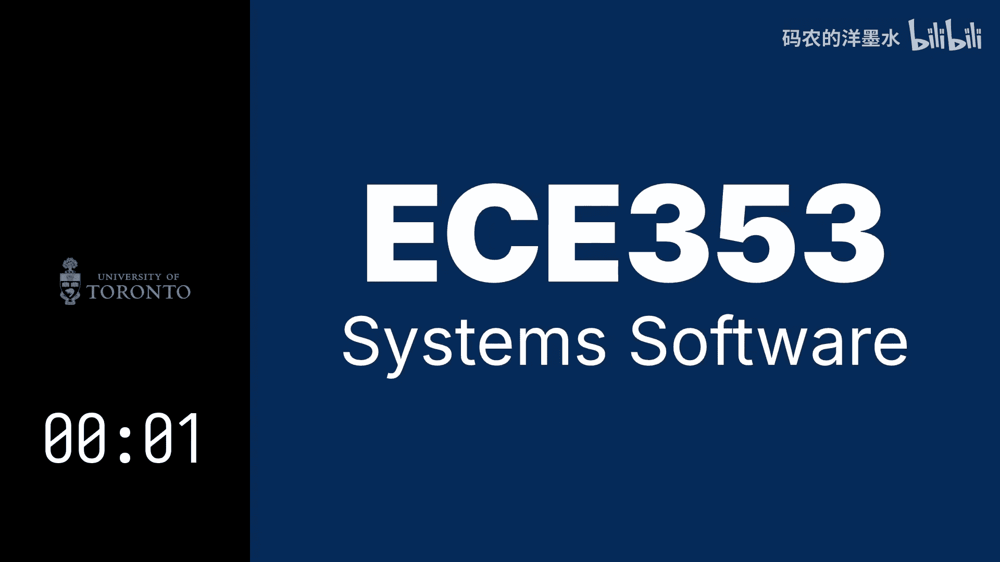
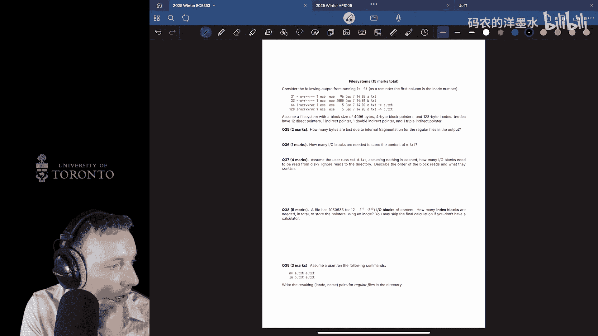
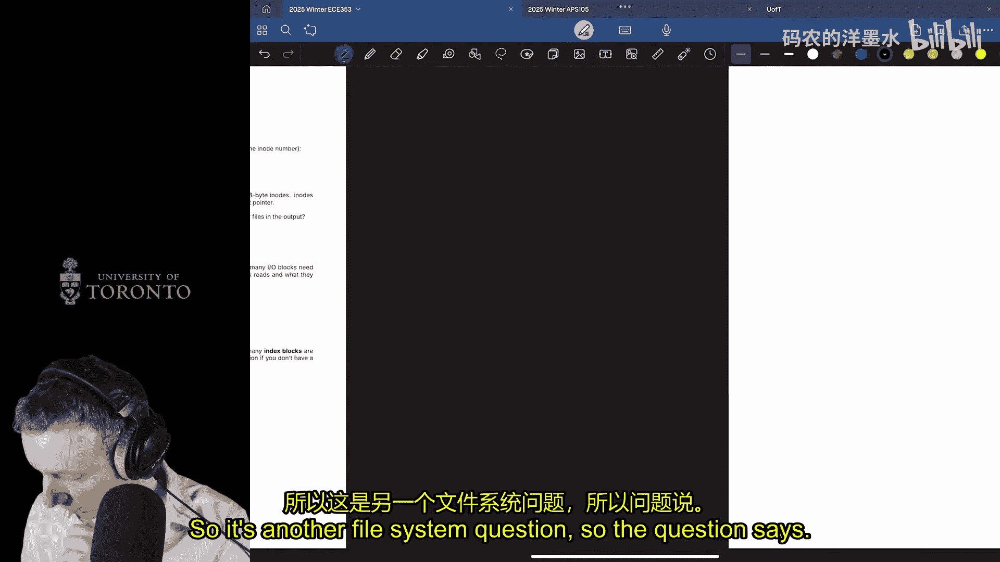
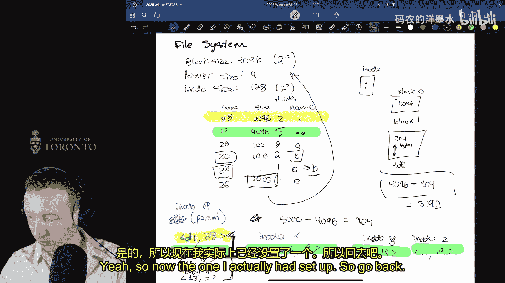
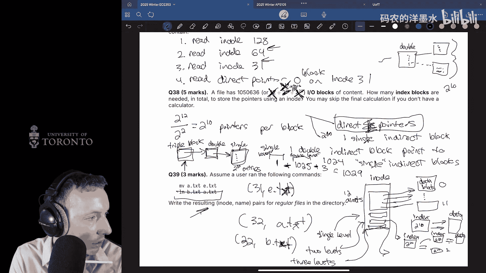

# 【全集 2025】多伦多大学 系统软件设计与编程 中英字幕 1080P p23 Lecture 23 - 最终复习 -BV1YrkYBQEeL_p23-

Alrighty， good。 I guess I'm not seeing you。 but hey， you're seeing me。So。Om。Let's get this started。

 So there is a new Discord channel。So ask away your questions there， whatever you want to start with。

 however we can help。Because I assume this is your last exam。So。A one want to stir us off。

 Anyy questions， Anything we should do， I can。Hang around here for a while。 I'm， you know。

 in the void。So let's see。 Could we review the 2024 I ob bound question。

 question 20 which one was that。So yeah。Preparation wise， I do have。2024 fall final blank。

 if we want to go through that。The question， Ibound question，2024。I assume。2024 winter， you see。3，53。

Al right， let's see what that says to to do。Oh。To。202 for this course I assume。 final。And。Alright。

 so。Question， something。I do not see， said question。There's page replacement。

So which question are you talking about。The 2024 winter。You see 3，5，3。Is not there you see。

OhLet's see。Maybe it is。3，44。344。 No， I have that one pulled up。 I've no。No idea which one that is。

Final。Am I blind？Question 37 to 39 is。INo， okay， someone said Ibound question。

 that's the file system question。Okay， file system questions different。 So let's go back to it then。

So， this is。want to。Okay。あす。Okay， so tablet。

So we're assuming， I'm assuming this question， is this the right question。No， not the right question。

Alright， anyway。 So the question is， I'll just pull it up here。

So it's another file system question。 So the question says。

We have a file system。 Let's see here， a file system。And in this， it states we have a block size。

Of4096， I always write it in powers of two just in case it's relevant。Pointer。5。Is four bytes。

And I knowed sighs。It is  a hundred28 B。Then I know to have their usual 12 direct pointers，1。

 double and direct one， triple， analyze the output of LS。

That shows you the iode numbers and everything output format includes iodes in the first column。

 which I included just in case。So， question is。So we do LS， and it looks something like this。

 So there's our iode column。We have 28。19。20。20。😔，22。26。 and that。Oops， that looks atrocious。

 let me rewrite the 20s。So we have IO 2020， and then the files。Well， let's just put the size。

The other relevant column size is 4096。4096。100，100。Of courseour， they have to be the same。

1 and 5000。And this should actually be 22。And then the other column is just the name。Ops set file。

 So we've dot dot dot。 And then we also have A， B， and then we have C。To。

B indicating that it is indeed a symbollink。 and we have file E。

 So first question says when editing file C， which i notes contents are modified。

 So when we modified C， right。It is a soft link。 So 22， hopefully you've done labs。 I mean。

 you have to have done lab 6 or attempted it by now， so。For the Sim length the name that C refers to。

 which is B is stored itself on in 22， you can think of it as just string to string whenever or named a name for a symbolic link。

 whenever where you're trying to edit the file， so that would redirect us if we try and access file C。

 it woulddirect us to B and B， hey， that's a regular file， it's a hard link。

 so that ine is the one we would modify， so it is 20。Then the next question says。

Possible to store all the inotes associated with directory and a single block provided。

So you just keep track of how many i notess you can store on each block。128 is2 the 7。

 so in this case， you can store two the five on each block。Iodes， they started iode 1。

 So the first iode block would be 1 to 32。 I also did the iode numbers in a wave where if you're off by one。

 didn't matter。嗯。And then。Determine the number of data blocks that file E will occupy。

So in this case， we know that hey， for our i node， right， our i node。

It would have some space for direct blocks and that's where the data would so the size of a file here。

 if it's just a regular file， that's how many bytes of data it needs。

 so you can see from this if we only had one block our block size is 4096。

Wouldn't quite fit on a block， so we would have。Block 0 of that file。It would be full。

 It would contain 4096 B of actual data we need for that file， and then it would need a block 1。

Which。The maximum size would be 4096， but to store the Conss file， it only needs to use you know。

 5000 movess。5000-4096 Bte because the some Bte are covered in that block。 So this。

You can either do the math， which is 94 or you know。You can use your calculator。

 so this block would have 904 bytes of that file actually being used。

 the rest of it would be internal fragmentation because we're only dealing with blocks at a time。

 so we would need two blocks to store the contents of this file。

So hopefully everyone's good with that and then calculate the number of bytes lost due to internal fragmentation for file E。

It's exactly what we just kind of said here。 So weve 4096。Bys of。Like。That's the size of the block。

Minus， however many bytes we're actually using for data because that's useful information， so 904。

 so the total loss to internal fragmentation is just this number on the exam I don't even care if you give me the final number as long as you have this calculation you're fine。

 but if you want to do this calculation it is 3192。And then。A。Then heres the rest of the question。

Yeah， so that one， the rest of the question is like。Yeah， we also have the number of links here。

So the number of links here， this one was kind of tricky。 So there's。Two to dot，5 to dot dot。

They would have to be 2 to A，2 to B，1，2 C， and one2 E， I guess。So。One of the questions says。Hey。

 how many directories are contained within the parent directory represented by Ido 19 Describe what they all are。

 so。Somewhere。Somewhere there has to be， you know， there's a link between dot， dot and dot， right。

 So let's just give this directory a name。 So let's just。Say。I know 19。So we can say on I note 19。

Ohoops。I know 19， it's a directory。 so let's just give it a name for， I don't know， for fun。

 let's just call it parent。So some entries that would have to be in IO 19。

 there'd be some real name for our。Directy represented by Iode in this case 28。

 because that is thought。 So let's just say it would be， you know， name D1，28。 and then inside of 28。

Hhir。😔，Right。It's referred to in two places， it's referred to as its name D1 in the parent directory。

 which is represented by IO 19， I just gave it name parent， we don't actually know the name。

 there's no way to figure it out。So I just made something up。

 And then this would be our two links here。 So it would be dot in。Sttord， you know。

As one of the entries in I know 28 itself。 and then it would also be in the parent directory。

 given a name。 So 28。 So that would be how we got our two links here， all highlighted in yellow， so。

Here， right， for the parent directory。This is one of the links in my D1 directory。 And it turns out。

 well。This is。Going to be exactly the same as arguing about the number of links in。

The current D1 directory is just one level up， so in that parent directory。

 it would have an entry for dot。And that would be itself， so 19。

And then it would be given a name somewhere。 It would have a parent right。

 so it would also have a parent dot dot。I don't know， I have no idea what it is， I'll just call it X。

So on in。X。This parent directory would be given a name as well， right， and be given a name。

 and it would be I knowed 19。 So it would need to be there。

 Otherwise it wouldnt be connected and it would not be a valid file system。

 So this would be another link here for the parent directory。

So turns out that every time I make a new directory in the parent directory。

 I'm going to increase the number of links by one because every time I create a new one。

 it's going to have entry of dot dot， which points back to I know 19， so。If I know the number is 5。

 while I know that there is some other entries here because every single other entry here。

 So let's just call them。Dwen。Or sorry D2， which would be I don't know， iode y and D3。

 which would be iode Z。Well。On those， I knowed。Why an i node。Zed。

 well there would also be an entry of dot dot to Iode 19， just like there is in。

My current directory that I is randomly called D1。So it would look like that。

So that would get us our 5 other。 Well， that's the only number that would make sense to get us our number。

 So in green， it' everything that's highlighted there。

 So it means that this parent directory would have to。Have。3 directories within it， because it would。

Have its name from its parent， its dot in itself。 that would be two links。

 And then every time there's directory created in it， it would have a dot dot entry pointing to it。

 So that gives us our number of five。All right， so everyone good with that one。And then。Yeah。

 so now the one I actually had set up， so go back。

Oh， okay， I already had it pulled up， perfect。

Oops， that's the wrong thing。All right， so this question。So， this is。Yeah。

 most people just wanna go over。File system questions。 And then for the term test2， sorry， excuse me。

 threads question。 I update the solution。 so you should refresh it。

 And if the solution was confusing， I just。Accidentally omitted something。 So have a look at that。

 And if it's still confusing， I will go over it。 So let's do the other file system question as well。

So let's look at this。 So consider output from running LS L。 So this gives us our iode number here。

And this is the number of links。This is the size。And then these are our names。

 so there's two slink here， right， so there's one s link， two slink。So。

First question says how many bytes are lost due to internal fragmentation for regular files in the output？

 So first one would be， hey， what's a regular file， So in this case。

A and B are just regular files there， not Slink， and we have no directories in here or anything like that。

So。We have to calculate the internal fragmentation for it。A and B dot Txt， so it says here。

Our block size is 4096， so for file A， what's lost is 4096 because it would have to occupy a block。

Minus 96。So。It has 4000 bytes lost due to internal fragmentation and for B dot Txt， well。

 it also takes a block and。It needs 4，000 bytes， so 96 bytes are lost due to internal fragmentation for that。

 and in total we just add those numbers together， which is 4096。Alright， next one。

 How many aisle O blocks are need to store the content of C dot T X T。

 This is the tricky one to make sure you did lab 6， so。There is that optimization， right。

 If it's a Sim link and it's less than the total size of the pointers on the i note。

Typically 60 bytes， the content of the simlink or the name it refers to will be stored using that space for the pointers That was an optimization that happened in lab 6。

 so this would just be a big fat zero。So next one is assume the user runs cat D。 TxT。

 assuming nothing is cached， how many I O blocks need to be read from disk。

 ignore reads to the directory， De the order of block reads， and what they contain。In this case。

 we would have to read i notes， right， so we read。High node。128， because we have to know。Hey， well。

 if they use cat D dottxt。Well， ignoring the director relookup because it would need to look up G dot TXT to find what iodeode it refers to in this case。

 it refers to in 128， so we would read in 28， it would figure out that hey， that is a slink。

Read the contents of it doesn't have to read an I O block， because。嗯。Because。

The contents are already stored on the iode itself。 So we don't have to do anything with that。

 So that says， hey。Referred to C dot TX T in this case， Oh， okay， while ignoring the directory read。

 so I'd have to look up what I know C dot TXT refers to。It's iode 64。

 I'm ignoring that lookup because that's what the question said。 So I'd have to read that iode。

 so I'd have to read。I knowed。64。After I read 64 again， I don't have to read data block。

 The contents are stored on the iode itself。 that would give me a dot Txt。

 So I would have to look up what in a dot Txt refers to。 So in this case， it refers to iode。31。So。

 I would read。I knowed。31。And then， that would actually tell me。Where all the data is。 So after that。

 in this case， it only stores one block。 that's it。 So it would read。呃。Direct。Pointer。0 on。Well。

 it would read that block。The direct pointer0， the first one would refer to a block。

 so I'd have to read that block。On I note 31。 so whatever data block that is， I read it， boom。

 that's it so。That is 1，2，3，4。 and to not carry a。 We made it that if you answered this wrong。

 So if you assumed the iode。Was actually stored using a data block。

 then you would have to have some additional reads there。 So if your answer was one here。

 it would mean your answer is 6 for this part， but。If you didn't do that， the answer should be four。

So next question， file has。A large number， thankfully。

 I wrote some powers of two I O blocks of content。 How many index blocks are needed and totaled to store the pointers using an i note。

 You may skip the final calculation if you don't have a calculator。 So remember。On an in itself。

 it has 12 direct pointers， one indirect pointer， and one double indirect， one triple indirect。

And also， block size is。4096，4 byte block pointers。

 so we can figure out how many pointers we can put on a single block so that would be。Two to the 12。

 which is 4096。Divided by2 to the。2， which is 4。 That's our size of our block。

 So it means we can fit 2 to the 10。Ha。Pointers。Per。Block。So。These 12 are covered。

Using the direct block。Or， sorry。Direct pointers。Only two to the 10 of these can be covered by a single indirect block。

 And remember， it would fill them up in order， so。It would have。Wen。😔，Indirect or one。Let's be。

Let's be let's be very clear about this。 This would be one single。Indirect。Block。And then。

I still have two the 10 left over here， right， so I've covered those。

 I haven't covered all those to the 10。Left over。 And then to the 2th。

 that can be covered by a single。Double indirect block。 And then each of those would point to。

So for the double， we'd have one double indirect block。

And that would be full of entries if it can point up to two the 10 things。 and we'd be pointing to。

Each of those entries。Would be pointing to a single indirect block。

 right because that's how levels work。 And we would have， if they were full。

 we'd have two the 10 of them。So。You would have one。Double。Indirect block。And it would point。2。😔。

1024， that's2 the 10。呃。SingSingle， indirect。Blocks， so just like page tables， we went down a level。

 So we've handled that。 So now we have to handle the next to the 10 entries。 So for that。Well。

 we need one triple block。And if we' are all good， we know we can fit to the 10 on a single indirect block。

 So at the lowest level， our single indirect block here。Would be full of。To the 10 entries。

 be full to cover all of them。 So I would need at least one entry here。

 my triple block to point to at least one double here。And then that can point to my single full one。

 So in total。The direct pointers don't count。 I need one block for direct。For my one level。

 if you want to think of it that way， So here's one。From my single。Level。I need 1000。

25 from my double level。And then I need three， for my from my triple level。

 because I have one one block that。Needs to go through three steps。

 It could have a single entry pointing to one double block。 So that' would be like one L1 page table。

 And then here are my， here's my single L 0 page table。 If you want to think of it that way。

 full of entries。 So in total， I need 1000。29。And。Yeah， basically what I did here。Is。

This 12 that was handled through the direct block， this2。

 the 12 I know through a single indirect block。Another way to write it is I could write the the 11 as 2 the 10 plus 2 the 10。

 because that's how you know math works。 So this can be taken care of by a single。

Single indirect block。To the twa can be taken away from a double anddirect block。

 so I have to go through three levels to take care of the next two， the10。

How we figured out the strategy。 So just the way it works， right， So the iode。Itself。How it works is。

12 direct。 So 12 direct pointers。Means we don't have to store them on a block or anything， right。

 They just point directly to data blocks。So， this would be data。Block。Zero all the way to data block。

11， which would be the first。12 right， because there's 12 direct blocks then。It would have。

3 pointers， unlike page tables， this is basically。One if you want to think of it in terms of page tables。

 you can think of this as， hey， this pointer is just a single level。This is two levels。

And this is three levels。And we'll fill them up in order。 So remember with page tables。

 the more levels we got， the slower it was because it had more hoops to go through same idea with this。

 So the more levels I have， the slower it is， so I want to populate them in order。

 but unlike memory where everything has to be treated the same in this。

 if I don't need to use two levels I just won't use two levels。 So with page tables。

If I have three levels， right， I only have one route page table。 That's it here。

 You can think of it as， hey， I have three route page tables， one for a single level。

 one for two levels， one for three levels。 and I'll fill them in as needed。 So I'll if I have。

For example。I have a 13th block here。 Well， then I need to。 I can't。

 I ran out a room with my direct pointers， which are fast。

 So I need to have an index block here that can store up to。To the 10 entries。

 and then each one of those would point to data blocks， right？If I had， if I ran out of those。

 so I ran out of those two the 10， that means， oh， crap， I have to use two levels at maximum。

I have one index block， which has two the 10 entries， each of them， since its's two levels。

 points to another index block。With two to 10 entries。 and then each of those ones。

Points to a whole bunch of data blocks。And then similarly， for the triple1。

 although I'm going to run out room here。 So does that clear it up， hopefully that's okay。

Think that should be okay。 And then。Last question says， assuming a user ran the following command。

 we moved。So move is just a rename。So we basically renamed。A dot T X T to E dot TX T。So。

 we would have。31。E dot Txt。After that and no entry for A dot Txt。And then if we do LN B。ttxt。

 that creates a hard link。New name is called A dot Txt and it will refer to the same iode as B dot Txt and up here B dot Txt is 32。

 so it would be 32。And then the question says write the resulting iode name pairs for all the regular files in the directory。

 so we would have to also include B dot Txt as well， so it would be 32 B dot Txt。TXT， good writing。

So that should be our answer。 seems to check out。So everyone okay with that seems to be a whole bunch of file system questions。

D do do。Alright， someone wanted to do。The lost wake up question。

Is there anything specific in that last wake of question。

Cause the whole whole thing there is basically a data race with line 8。Where it does not protect。

Accessing the Mutex。What would happen to the second line， Which second line。

P。