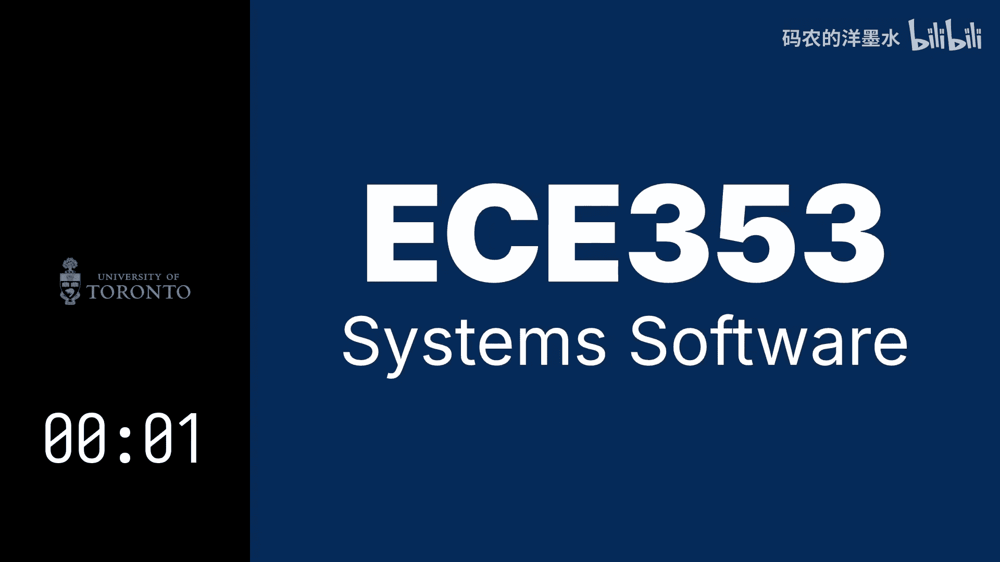
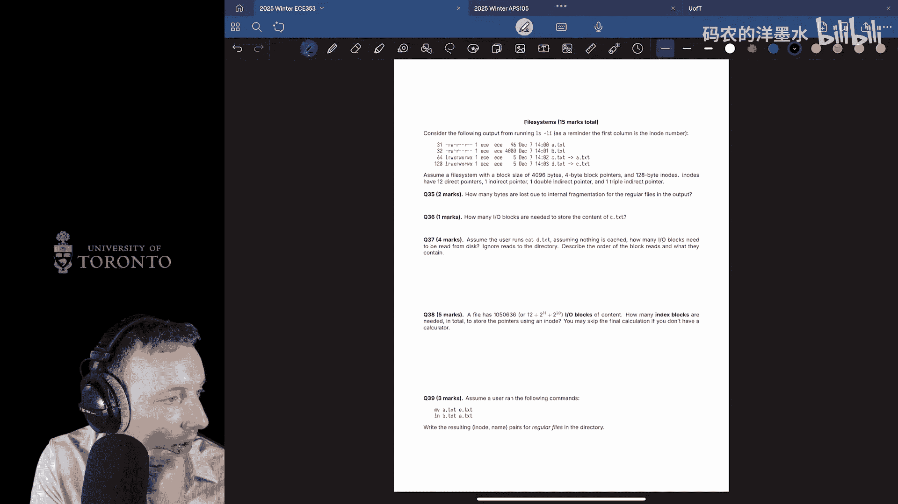
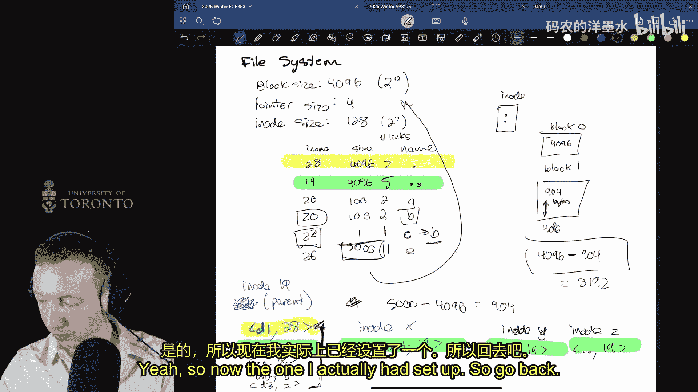

# 系统软件设计与编程：23：最终复习



在本节课中，我们将对课程的核心概念进行最终复习，重点回顾文件系统、进程同步等关键知识点。我们将通过分析具体的考试题目，来巩固对这些概念的理解。

## 文件系统问题解析




上一节我们介绍了复习的总体目标，本节中我们来看看一个具体的文件系统问题。这类问题通常涉及索引节点（inode）、块大小、指针和链接等概念。


考虑一个文件系统，其参数如下：
*   块大小：`4096` 字节
*   指针大小：`4` 字节
*   索引节点大小：`128` 字节
*   索引节点结构：包含 `12` 个直接指针，`1` 个一级间接指针，`1` 个二级间接指针，`1` 个三级间接指针。

执行 `ls -l` 命令后，输出格式包含索引节点号、链接数、文件大小和文件名。输出示例如下：

```
inode#  links  size  name
28      2      4096  .
19      5      4096  ..
20      2      4096  A
20      2      100   B
22      1      60    C -> B
26      1      5000  E
```

以下是针对此输出需要分析的问题：

**问题一：编辑文件 C 时，哪个索引节点的内容会被修改？**

文件 C 是一个符号链接（软链接）。其内容（即它指向的目标文件名 “B”）存储在索引节点 22 中。当编辑 C 时，系统会跟随链接找到目标文件 B。B 是一个硬链接，其数据由索引节点 20 管理。因此，最终被修改的是索引节点 20 的内容。

**问题二：是否可能将所有与目录相关的索引节点存储在单个块中？**

需要计算一个数据块能存储多少个索引节点。已知块大小为 4096 字节，索引节点大小为 128 字节。因此，每个块可存储的索引节点数为：
`4096 / 128 = 32`
索引节点号从 1 开始编号，所以第一个索引节点块包含节点 1 到 32。只要目录使用的索引节点号都在这个范围内，就可以存储在单个块中。

**问题三：文件 E 将占用多少个数据块？**

块大小为 4096 字节，文件 E 的大小为 5000 字节。
*   第一个数据块存储 4096 字节。
*   剩余字节为 `5000 - 4096 = 904` 字节，需要第二个数据块存储。
因此，文件 E 需要占用 `2` 个数据块。

**问题四：计算文件 E 因内部碎片而丢失的字节数。**

内部碎片是指分配给文件但未被使用的块内空间。
*   第一个块已满，无碎片。
*   第二个块大小为 4096 字节，但只使用了 904 字节。
因此，丢失的字节数为：
`4096 - 904 = 3192` 字节。

**问题五：由索引节点 19 表示的父目录中包含多少个子目录？描述它们。**

链接数（links=5）提供了线索。对于一个目录，其链接数等于：
`2（来自自身的 ‘.’ 和父目录中的条目） + 子目录数量（每个子目录的 ‘..’ 条目指向它）`
设子目录数量为 `N`，则有：
`2 + N = 5`
解得 `N = 3`。
因此，父目录（索引节点 19）中包含 `3` 个子目录。它们分别是：
1.  当前目录 “.” （索引节点 28）。
2.  另外两个未在给定 `ls` 输出中显示名称的目录（它们的 ‘..’ 条目指向索引节点 19）。

## 另一个文件系统问题

接下来我们分析另一个文件系统问题，以加深理解。

假设 `ls -li` 输出如下（块大小 4096 字节）：

```
inode# links size name
31     1     4000 A.txt
32     1     4000 B.txt
64     1     60   C.txt -> A.txt
128    1     60   D.txt -> C.txt
```




以下是需要解答的问题：

**问题一：输出中常规文件因内部碎片丢失了多少字节？**

常规文件是 A.txt 和 B.txt。
*   每个文件占用 1 个块（4096 字节），实际数据为 4000 字节。
*   每个文件的内部碎片为 `4096 - 4000 = 96` 字节。
总丢失字节为：
`96 + 96 = 192` 字节。

**问题二：存储 C.txt 的内容需要多少个 I/O 块？**

C.txt 是一个符号链接。在类 Unix 系统中，如果符号链接的目标路径名很短（通常小于等于 60 字节），该路径名会直接存储在索引节点的指针区域，而无需额外的数据块。这里目标 “A.txt” 长度小于 60，因此需要 `0` 个额外的数据块。

**问题三：用户运行 `cat D.txt`（假设无缓存），需要从磁盘读取多少个 I/O 块？忽略目录读取。**

需要跟踪解析过程：
1.  读取 D.txt 的索引节点（128），发现是指向 “C.txt” 的符号链接。内容已在索引节点中，无需读数据块。
2.  读取 C.txt 的索引节点（64），发现是指向 “A.txt” 的符号链接。内容已在索引节点中，无需读数据块。
3.  读取 A.txt 的索引节点（31），发现是常规文件。
4.  根据索引节点 31 中的指针，读取文件 A.txt 的第一个（且唯一一个）数据块。
因此，总共需要读取 `4` 个 I/O 块（3个索引节点块 + 1个数据块）。

**问题四：一个非常大的文件需要 2^22 个 I/O 块来存储内容。使用所述索引节点结构，需要多少个索引块来存储所有指针？**

首先，计算一个索引块能存储多少指针：
`块大小 / 指针大小 = 4096 / 4 = 1024（2^10）个指针/块`

索引节点指针结构的使用顺序是：先填满直接指针，然后是一级间接，接着二级间接，最后三级间接。
1.  **直接指针**：覆盖前 `12` 个数据块。无需额外索引块。
2.  **一级间接**：一个一级间接索引块可覆盖 `1024` 个数据块。
3.  **二级间接**：一个二级间接索引块可覆盖 `1024 * 1024 = 2^20` 个数据块。
4.  **三级间接**：一个三级间接索引块可覆盖 `1024 * 1024 * 1024 = 2^30` 个数据块。

现在计算覆盖 2^22 个数据块所需的结构：
*   直接指针覆盖：`12` 块
*   剩余：`2^22 - 12 = 4194292` 块
*   一级间接块覆盖：`1024` 块 → 需要 `1` 个一级间接索引块。
*   剩余：`4194292 - 1024 = 4193268` 块
*   二级间接块覆盖：`2^20 = 1048576` 块 → 需要 `1` 个二级间接索引块，它指向 `1024` 个一级间接索引块。
*   剩余：`4193268 - 1048576 = 3144692` 块（实际上已超过二级间接的覆盖能力，此处计算仅示意流程。对于 2^22，主要靠二级间接覆盖）

更精确的计算是：
所需数据块总数：`N = 2^22 = 4194304`
1.  直接指针覆盖：`12`
2.  一级间接覆盖：`1024` → 需要 `1` 个索引块。
3.  二级间接覆盖：`1024 * 1024 = 1048576` → 需要 `1` 个二级间接索引块 + `1024` 个一级间接索引块。
4.  总计索引块数：`1（一级间接） + 1（二级间接） + 1024（二级间接指向的一级间接） = 1026` 个索引块。
（注意：此计算假设文件足够大，用满了二级间接的所有容量。对于精确的 2^22 块，可能不需要全部1024个一级间接块，但根据填充顺序，会需要大量此类块。）

**问题五：用户执行命令 `mv A.txt E.txt` 和 `ln B.txt A.txt` 后，写出目录中所有常规文件的（索引节点号，文件名）对。**

1.  `mv A.txt E.txt`：将文件 A.txt 重命名为 E.txt。索引节点号不变（31）。
2.  `ln B.txt A.txt`：为 B.txt（索引节点 32）创建一个硬链接，新链接名为 A.txt。
因此，最终的常规文件列表为：
*   `(31, E.txt)`
*   `(32, B.txt)`
*   `(32, A.txt)` （新创建的硬链接）

## 进程同步与“丢失唤醒”问题

上一节我们深入探讨了文件系统，本节中我们来看看进程同步中的一个经典问题——“丢失唤醒”（Lost Wake-up）。

考虑以下简化代码：

```c
// 消费者线程
1: pthread_mutex_lock(&mutex);
2: while (count == 0) {
3:     pthread_cond_wait(&cond, &mutex);
4: }
5: // 消费数据...
6: pthread_mutex_unlock(&mutex);

// 生产者线程
7: pthread_mutex_lock(&mutex);
8: // 生产数据...
9: pthread_cond_signal(&cond);
10: pthread_mutex_unlock(&mutex);
```

问题出现在第 8 行（生产者代码中的“生产数据...”部分）。如果生产者在持有互斥锁（mutex）的情况下修改共享状态（如 `count`），然后调用 `pthread_cond_signal`，这通常是正确的。

然而，“丢失唤醒”问题发生的典型场景是**条件变量等待与信号之间存在竞争条件**。但上述代码结构是标准的、正确的用法。

更典型的“丢失唤醒”例子如下：
1.  消费者检查条件（`count == 0`），发现为真。
2.  在消费者调用 `pthread_cond_wait` **之前**，操作系统调度走了消费者线程。
3.  生产者线程运行，生产数据，增加 `count`，并调用 `pthread_cond_signal`。此时没有线程在条件变量上等待，信号丢失。
4.  消费者线程恢复运行，调用 `pthread_cond_wait` 并进入等待。由于信号已经丢失，它可能永远等待下去。

**解决方案**：确保条件检查和进入等待是一个原子操作。这正是 `pthread_cond_wait` 函数的设计目的——它在内部会释放互斥锁并进入等待，然后在返回前重新获取锁，这个过程对调用者是原子的。因此，只要消费者线程像示例中那样，在 `while` 循环中、且在持有互斥锁的情况下调用 `pthread_cond_wait`，就可以避免丢失唤醒。生产者在修改状态和发送信号时也应持有同一把互斥锁。

## 总结

本节课中我们一起进行了课程最终复习，重点涵盖了：
1.  **文件系统**：分析了索引节点结构、直接/间接指针计算、文件存储所需块数、内部碎片计算、硬链接与符号链接的区别及其对索引节点链接数的影响。
2.  **进程同步**：回顾了“丢失唤醒”问题的成因，即条件变量的等待和信号之间存在竞争条件，并强调了使用互斥锁保护条件检查和 `pthread_cond_wait` 调用的重要性。


通过解决这些典型问题，希望你能巩固对系统软件核心概念的理解，为考试做好充分准备。