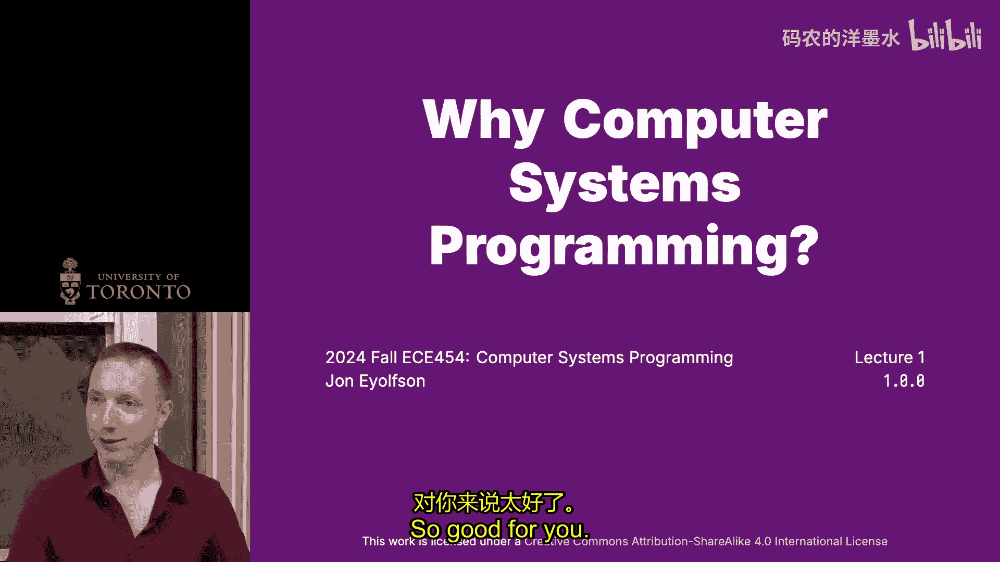
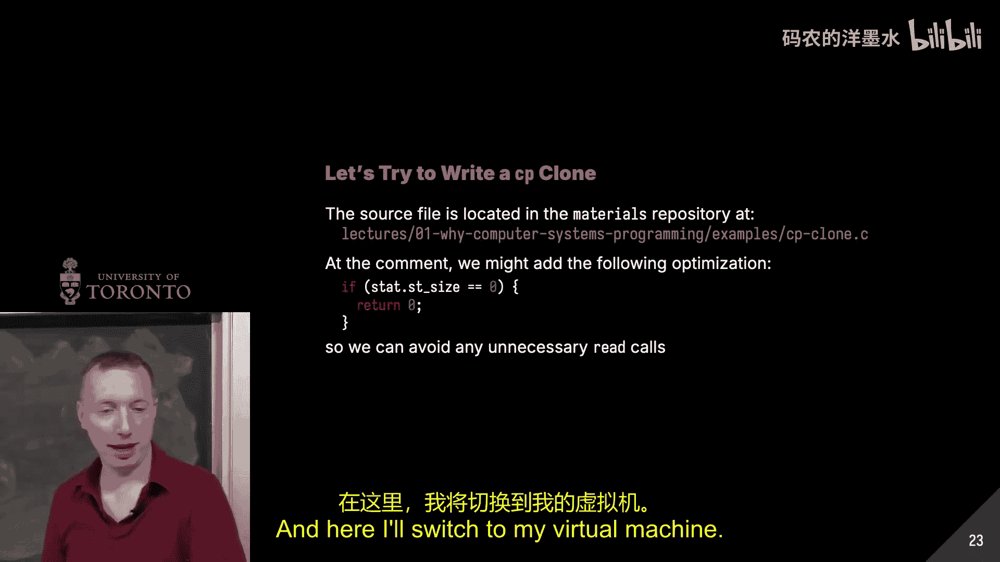
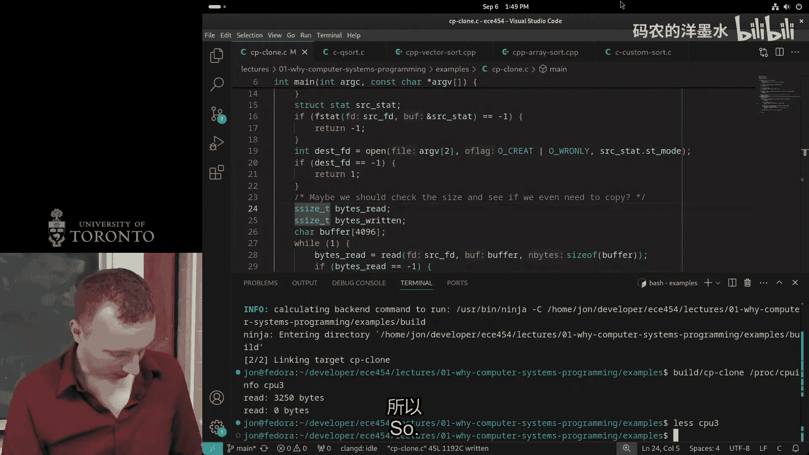
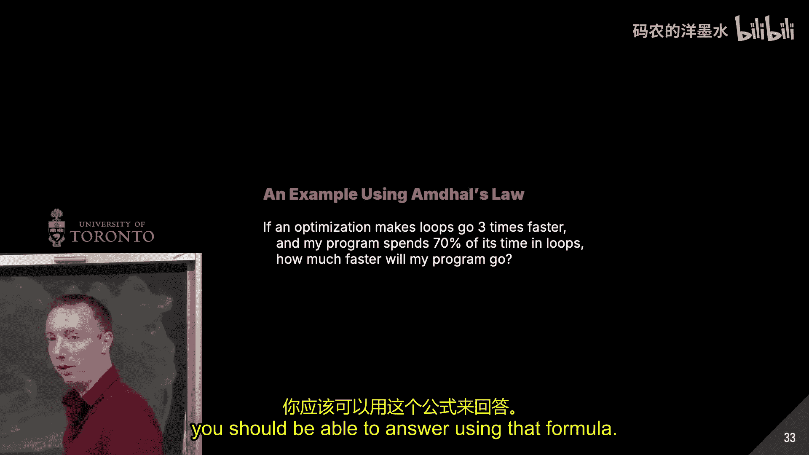
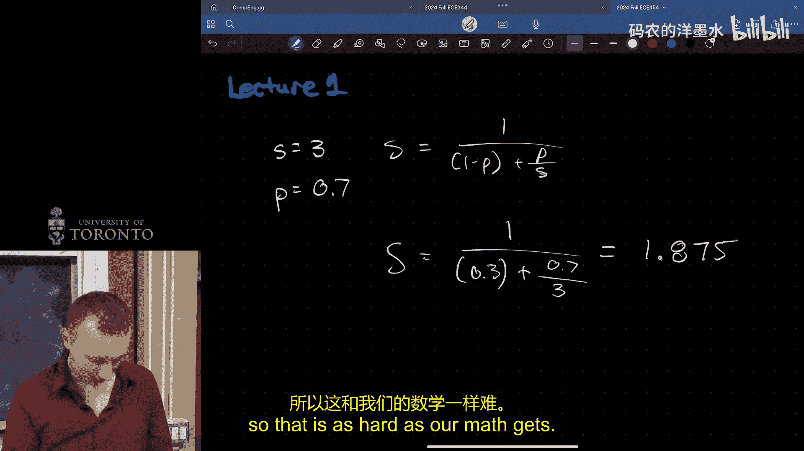
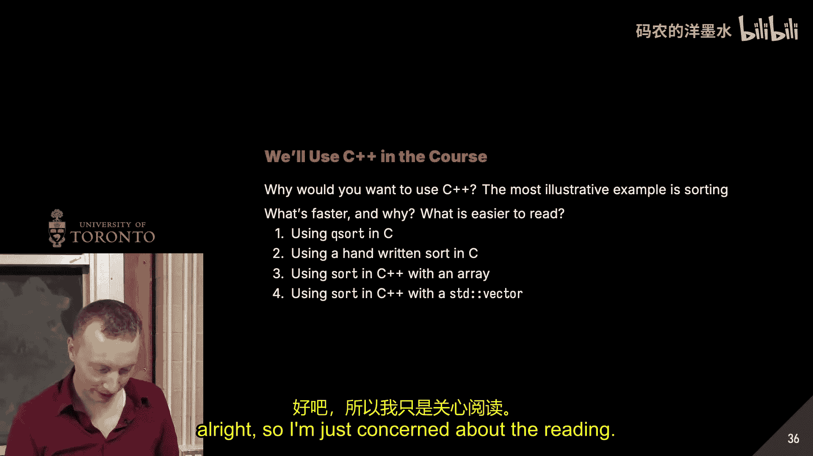
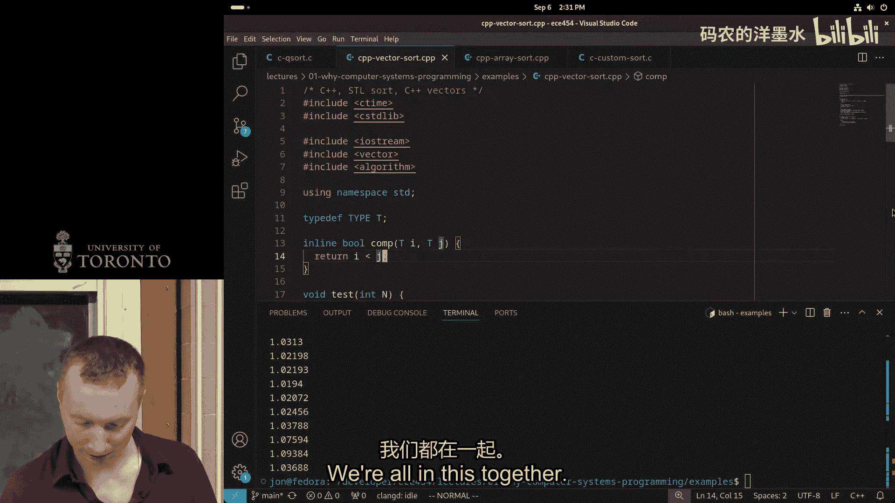

# 001：导论

在本节课中，我们将要学习高性能系统编程课程的基本介绍、课程结构、核心概念以及为什么性能优化如此重要。我们将探讨从编写功能正确的软件到编写高效能软件的关键转变。

## 课程概述与目标

欢迎来到计算机系统编程课程，或者我更愿意称之为“性能编程”课程。很高兴再次见到许多熟悉的面孔。我是你们的讲师 John。

本课程的目标是，在课程结束时，你们将能够编写不仅是功能正确，而且是高性能的软件。你们目前可能已经能够编写功能正常的软件，但很可能还无法编写高性能的软件。

## 为什么性能至关重要

我们为什么需要关注软件性能？除了课程名称本身有些模糊外，其核心在于价值。如今，大多数运行在云端服务器上的软件都非常昂贵。即使只提升2%的性能，乘以巨大的规模后，其意义也相当显著。

关注环境与能源消耗也是一个重要原因。编写更高效、性能更好的软件意味着消耗更少的电力。此外，云端服务器经常处于闲置状态。如果你知道如何充分利用所有资源，提高利用率，就意味着你正在有效利用所支付的硬件，这会让你的雇主和你自己都非常满意。

## 课程结构与物流信息

课程的前半部分主要是介绍课程安排。以下是一些重要的课程链接，请务必使用你的多伦多大学ID登录并关联你的 Discord 和 GitHub 账户。

*   **课程网站与资源**：讲座材料将公开在我的网站上。实验课材料将使用 GitHub Classroom，目前第一周是空的，但之后会更新。
*   **交流平台**：课程讨论将全部在 Discord 上进行。我将在 YouTube 上直播讲座并发布录像。
*   **匿名提问**：为了解决 Discord 无法匿名发送消息的问题，我们创建了一个 Discord 机器人。输入 `/anon` 然后输入你的消息，消息将以机器人的名义发出，对其他人保持匿名。

讲座出勤仍然很重要。现场反馈和实时编码演示能帮助我根据你们的反应调整讲解方式。性能优化领域常常会出现一些奇怪的现象，现场互动有助于澄清疑惑。

## 实验与考核安排

本课程是讲师和助教第一次讲授，所以请大家多多包涵。我们可能会遇到一些问题，但会尽力解决。课程安排大致如下：

以下是实验和考试的时间线与权重：
*   **实验 1**：为期一周，占 5%，将于下周发布。
*   **实验 2**：为期三周，占 9%，截止日期为 10月7日。
*   **期中考试**：占 20%，暂定于 10月17日那一周。
*   **实验 3**：为期三周。
*   **实验 4 和 5**：是较大的实验。实验 5 要求你将课程所学应用于一个软件，使其性能最大化，这应该会非常有趣，截止日期为课程最后一天。
*   **期末考试**：占 40%。

所有分数加起来为 100 分。

关于学术诚信，你们可以一起学习，在 Discord 上讨论概念，但请不要在 Discord 上发布实验代码的解决方案。请勿作弊，因为检查代码相似性非常容易。如果遇到困难，请尽早寻求帮助。

## 性能优化的背景与趋势

本课程关注性能，特别是可扩展性和效率。过去，提升性能非常容易。摩尔定律盛行，每 18 个月晶体管数量翻倍，单核速度随之提升。这意味着，要让软件运行速度翻倍，你只需要等待 18 个月然后购买新 CPU 即可。

然而，这种情况已不再成立。单核性能在很久以前就趋于平稳。这主要是由于 CPU 的物理限制。现代系统拥有大量核心，即使是手表也有两个核心。因此，编程时必须考虑并行性。

另一个趋势是使用专用硬件。大多数 CPU 现在都有用于特定功能（如视频编码、AI 矩阵乘法）的专用硬件。还有使用 ASIC（专用集成电路）的趋势，即将 C 函数烧录到硬件中以极速运行。GPU 也被广泛用于需要大规模并行计算的任务，如 AI。

## 程序员应知的性能数字

既然我们关心性能，就需要了解一些基本的性能数量级。以下是每个程序员都应该知道的延迟数字，它们说明了远离 CPU 计算核心时，性能下降得非常剧烈。

以下是一些关键操作的近似延迟时间，请注意数量级的巨大差异：
*   **L1 缓存引用**：约 1 纳秒。
*   **分支预测错误**：约 3 纳秒。
*   **L2 缓存引用**：约 4 纳秒。
*   **互斥锁（Mutex）加锁/解锁**：约 17 纳秒。
*   **主内存引用**：约 100 纳秒。
*   **从 SSD 顺序读取 1MB**：约 16 微秒。
*   **同一数据中心内的往返延迟**：约 500 微秒。
*   **从磁盘顺序读取 1MB**：约 20 毫秒。
*   **从加州到荷兰再返回的互联网数据包往返**：约 150 毫秒。

这些数字告诉我们，在编程时应尽量避免磁盘 I/O，并尽可能让数据停留在缓存中。

为了降低程序延迟，我们必须找到瓶颈。例如，完全避免磁盘访问可能带来十万倍的性能提升。使用 Memcached 等缓存层将数据保存在内存中，而不是每次访问磁盘。优化内存分配器，让数据更适合缓存，也能带来百倍的提升。

## 课程模块与实验设计

本课程将从单线程应用开始，逐步深入到多线程应用。课程模块组织如下：

第一个模块是代码测量。在改进之前，我们需要知道改进什么。主题包括如何找到程序瓶颈、代码优化原则、编译器的作用以及如何剖析程序。相关实验是实验 1（性能剖析）和实验 2（基于剖析结果进行优化）。

第二个模块主要是内存管理，目标是让单核程序运行得更快。主题包括内存层次结构、缓存与局部性、虚拟内存，内容会比操作系统课程更深入。相关实验是实验 2（优化给定代码的内存性能）和实验 3（编写自己的高性能内存分配器，实现 `malloc` 和 `free` 等函数）。

第三个模块分为两部分，都是关于并行化。3A 部分是在单台机器上进行并行化（多核、多线程、同步及其性能）。相关实验是实验 4（使用线程和同步加速程序）和实验 5（对给定的游戏模拟进行极致性能优化）。3B 部分是在多台机器上进行并行化（大数据分析框架、云计算、存储系统），由于预算限制可能没有对应实验。

从视觉上看，模块 1 关注单个核心上的代码优化；模块 2 关注内存管理，以更好地利用缓存；模块 3A 引入并行性，处理多核及其共享缓存，构建更真实的系统。

## 开发环境与代码示例

代码示例将会很多，并会提供给你们。你需要接受 GitHub 组织的邀请才能访问代码仓库。实验的设置指南将帮助你配置开发环境。

对于课程中的示例代码，我使用 Meson 构建系统。你只需要在代码目录中执行 `meson setup build` 和编译命令即可。实验可能使用不同的构建系统，但我的材料都使用 Meson，可执行文件会在 `build` 目录中生成。

## 避免过早优化

有一句著名的格言：**过早优化是万恶之源**。我们可能自以为知道得更清楚，在没有任何证据的情况下就去优化看似不合理的代码，但这通常是个坏主意。

为了说明这一点，让我们尝试编写一个 `cp` 命令的克隆程序。一个简单的实现会打开源文件和目标文件，然后循环读取并写入。这个程序功能正常。

然而，有人可能会想：“如果文件是空的（0字节），我为什么还要执行读系统调用呢？我可以先检查文件大小，如果是0就直接退出，避免无用的读操作。” 这看起来是个聪明的优化。

但问题在于，类 Unix 系统中有一些特殊的文件（如 `/proc/cpuinfo`），它们并不实际存在于磁盘上，其报告的大小为0，但却包含内容（读取时由内核动态生成）。上述“优化”会导致无法正确复制这类文件，使程序从功能正确变为功能错误。

这个例子告诉我们，除非你真正了解系统的所有细节，并且有确凿证据表明优化是必要和安全的，否则不要试图过于聪明。一个不执行任何实际工作的读系统调用所浪费的几纳秒，与程序正确性相比微不足道。

## 性能度量指标

衡量程序性能最简单的方法之一是**加速比**。我们通常关注延迟，即完成一个任务需要多少秒。

计算延迟加速比的公式是：
`Speedup = L_old / L_new`
其中 `L_old` 是优化前任务的延迟，`L_new` 是优化后的延迟。例如，原任务耗时1秒，优化后耗时0.5秒，则加速比为 2。

测量延迟的常用工具是 `time` 命令。使用 `/usr/bin/time -p` 可以获取三个时间：
*   **real**：实际流逝的“墙钟时间”。
*   **user**：所有 CPU 核心在用户模式下执行指令的时间总和。
*   **sys**：所有 CPU 核心在内核模式下执行指令的时间总和。

对于多核系统，`user + sys` 时间可能大于 `real` 时间。

另一个指标是**吞吐量**，即单位时间内完成的任务数量。

吞吐量 `Q` 的公式为：
`Q = P / L`
其中 `P` 是可同时处理的任务数（初期可视为1），`L` 是单个任务的延迟。吞吐量本质上是延迟的倒数。

我们需要根据应用场景决定关注延迟还是吞吐量。例如，空客 A380 飞机从多伦多到法兰克福需8小时，可载470人；协和飞机只需4小时，但仅载132人。对于乘客（关注延迟），协和更好；对于航空公司（关注吞吐量，即每小时运送乘客数），空客更优。卫星互联网带宽（吞吐量）很高，但延迟很大，因此不适合在线游戏。

在服务器中，使用更快的 CPU 可以同时降低延迟和提高吞吐量（正相关）。但通过并行处理多个请求，可能会以增加单个请求的延迟为代价，来换取更高的吞吐量（负相关，存在权衡）。

## 性能提升的理论上限

性能提升存在理论极限，这由**阿姆达尔定律**描述。该定律指出，程序的整体加速比取决于可被加速部分的比例。

阿姆达尔定律的公式为：
`Overall Speedup = 1 / ((1 - P) + (P / S))`
其中 `P` 是程序中可被加速部分的比例，`S` 是该部分获得的加速比。

即使可加速部分能获得无限大的加速比（`S` 趋近于无穷大），整体加速比的上限也是 `1 / (1 - P)`。例如，如果程序中 90% 的代码可以被优化，那么整体加速比的上限是 10 倍。

举例来说，如果一个优化使循环速度提升3倍，而程序 70% 的时间花在循环上，那么整体加速比约为 1.875。

## 其他性能考量

加速比和吞吐量并非性能的全部。其他重要考量包括：
*   **利用率**：硬件资源的实际使用率。
*   **有效吞吐量**：传输的有用数据量（排除协议开销等）。
*   **抖动**：延迟的一致性。
*   **最佳/最差/平均情况**：取决于具体需求。

性能评估非常复杂，至今仍是活跃的研究领域。过度专注于性能有时会带来巨大压力。

## 为什么使用 C++

本课程主要使用 C++ 进行演示。一个简单的排序例子可以说明原因。我们比较四种排序实现：
1.  C 语言使用 `qsort`。
2.  C 语言手写排序（如归并排序）。
3.  C++ 使用 `std::sort` 对数组排序。
4.  C++ 使用 `std::sort` 对 `vector` 排序。

在速度和可读性上，C++ 版本（尤其是使用 `std::sort`）通常更具优势。C 语言的 `qsort` 需要传递函数指针和进行指针转换，这带来了调用开销和间接性。C++ 的模板机制允许编译器在编译时生成针对特定类型的优化代码，内联比较操作，避免了函数调用和额外的解引用开销，从而获得更好的性能。同时，C++ 的语法通常更清晰易读。

使用 `vector` 和数组的性能差异很小，但 `vector` 提供了更多便利。因此，为了编写高性能且易于维护的代码，我们选择使用 C++（当然，需要合理使用模板等特性）。

## 总结

本节课中我们一起学习了高性能系统编程课程的导论。我们了解了课程目标、结构以及性能优化的重要性。我们探讨了从功能正确到高性能软件的转变，学习了关键的性能度量指标（延迟、吞吐量、加速比）以及阿姆达尔定律。我们通过实例明白了“过早优化是万恶之源”的深刻含义，并了解了为什么 C++ 是进行系统级性能编程的合适语言。在接下来的课程中，我们将深入代码测量、内存管理和并行化等具体技术。