# 002：性能分析入门 🚀

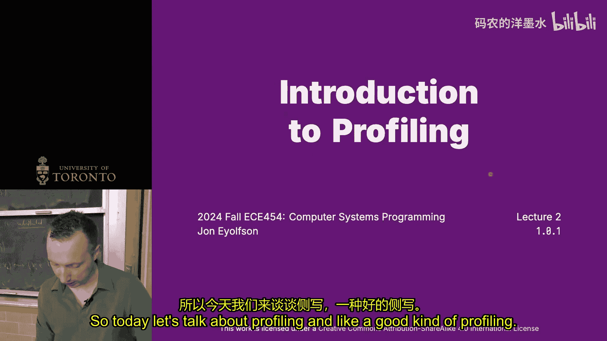

在本节课中，我们将要学习性能分析的基础知识。性能分析是优化程序的关键第一步，它能帮助我们精确地定位程序中消耗时间最多的部分，从而避免盲目优化。

## 性能分析的必要性

上一节我们介绍了性能编程的基本概念。本节中我们来看看如何具体测量和分析程序性能。

在性能编程中，我们需要精确地测量我们感兴趣的函数所花费的时间。如果仅仅使用系统时间来测量整个程序的运行时间，工作量会非常巨大，并且我们无法知道具体是哪个部分拖慢了速度。盲目优化是万恶之源，因此我们必须通过测量来确保我们优化的是正确的地方。

我们使用性能分析工具来测量程序，以查看程序执行时间具体消耗在哪些部分。这就是实验一的内容。

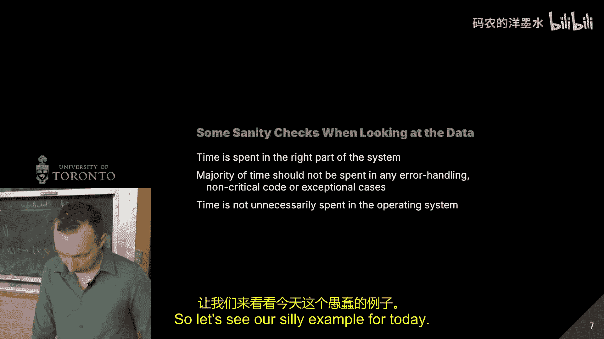

## 性能分析工具的类型

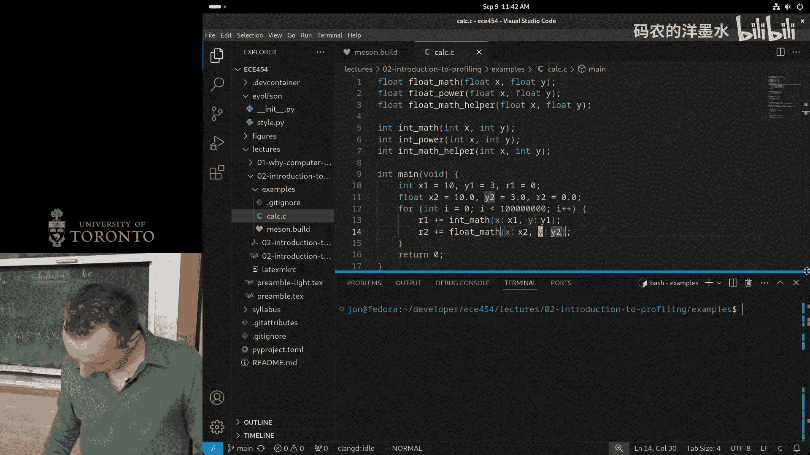

性能分析工具主要有两种输出形式：扁平分析和调用图分析。

以下是两种主要的性能分析工具类型：
*   **扁平分析器**：仅计算特定函数的平均执行时间，不包含更多信息，例如谁调用了它。
*   **调用图分析器**：计算函数的调用时间、调用频率，并展示一个显示函数调用关系的调用图。调用图以图形方式展示函数间的调用关系，例如 `main` 调用 `foo`，`foo` 再调用其他函数。

性能分析工具收集数据的方式也有两种：
*   **统计采样**：以固定频率（例如每2毫秒）对系统状态进行采样，检查程序正在执行什么。这会轻微减慢程序运行速度。
*   **代码插桩**：在编译时或运行时向程序中添加额外的指令来记录数据。例如，Valgrind 就是在运行时进行插桩的工具。

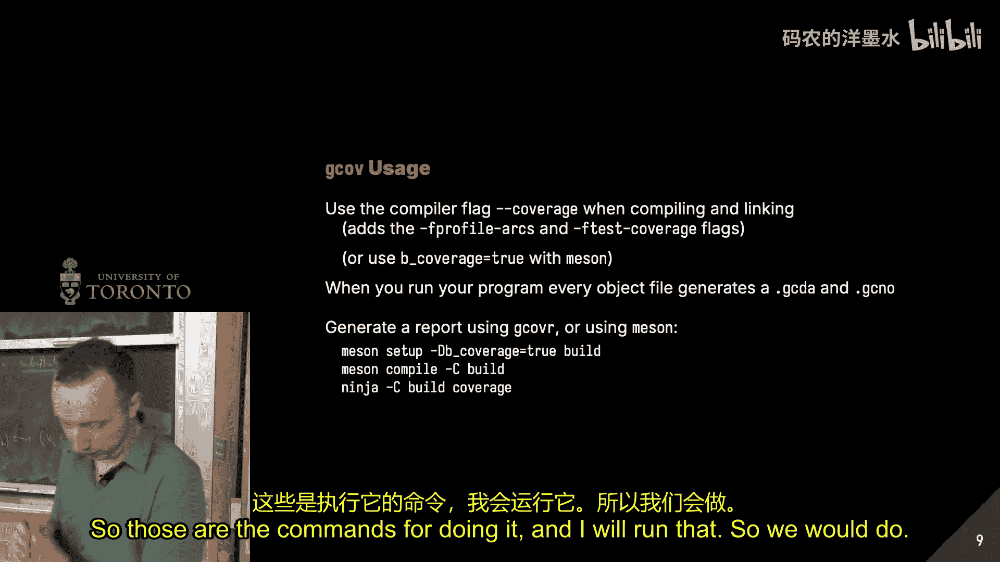

## 大型软件项目的性能分析指南

对于大型软件项目，我们遵循以下基本准则：
*   **首先编写清晰简洁的代码**：确保代码正确，避免过早优化。
*   **建立性能基线**：在确保程序满足基本功能后，进行性能分析以获得一个性能基准。
*   **及早重新设计**：如果发现程序架构存在根本性的性能瓶颈，应尽早重新设计。
*   **聚焦关键代码**：将优化精力集中在真正影响性能的代码上。

## 示例程序分析

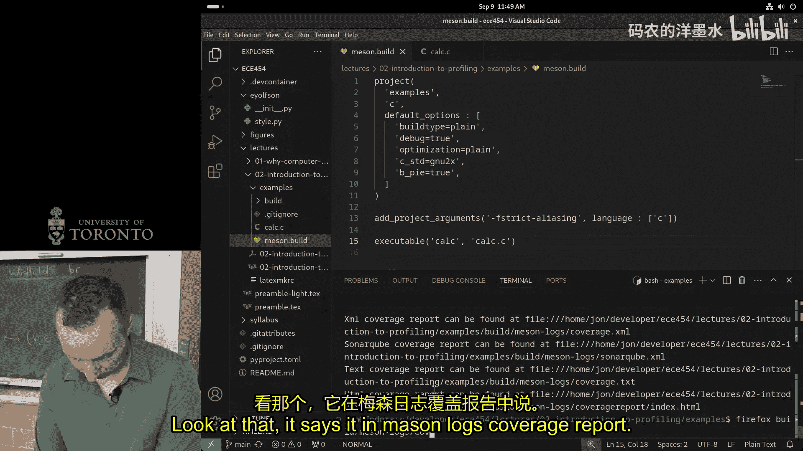

让我们通过一个简单的示例程序来实践。这个程序会进行一些随机的整数和浮点数数学运算。

```c
int main() {
    long long sum = 0;
    for (int i = 0; i < 100000000; ++i) {
        sum += int_math(i);
        sum += float_math(i);
    }
    return 0;
}
```
`int_math` 和 `float_math` 函数内部会调用 `power` 和 `helper` 函数，其中 `power` 函数使用一个简单的循环来计算幂。我们的目标是找出这个程序中耗时最多的部分。

## 本课程将使用的工具

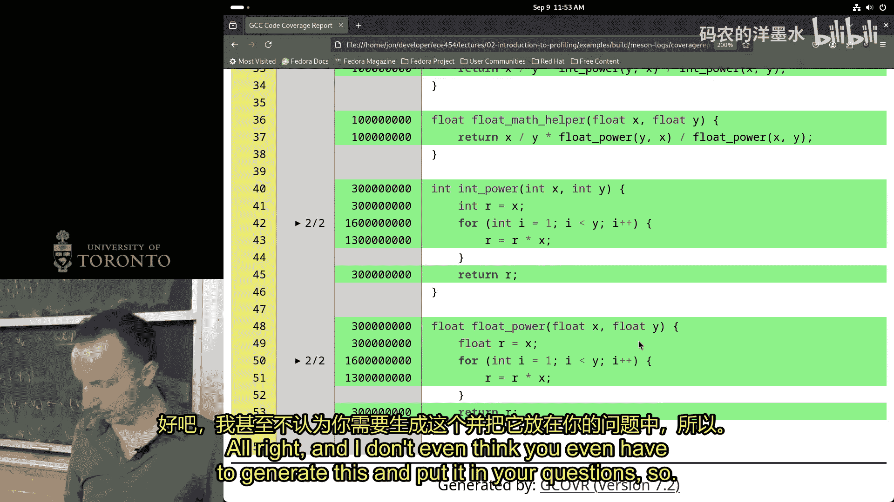

在本课程中，我们将主要使用两个工具：`gcov` 和 `gprof`。

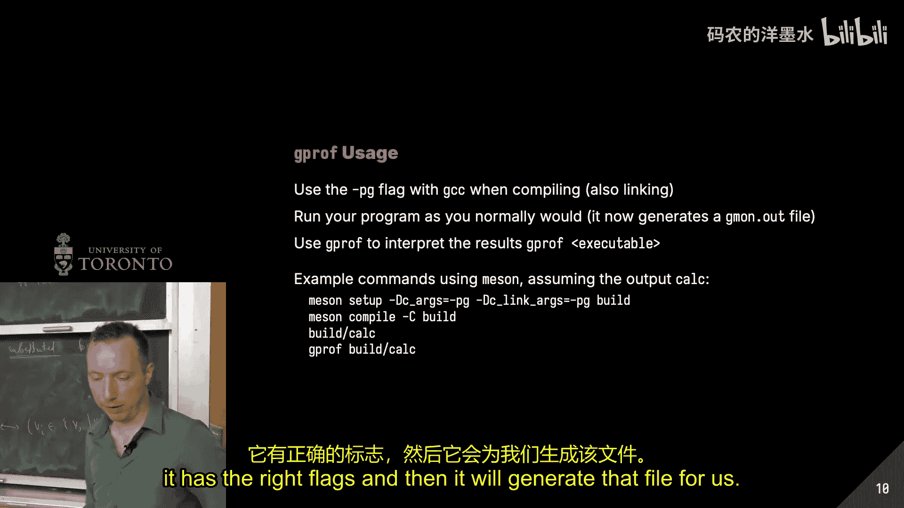

以下是这两个工具的简要介绍：
*   **`gcov`**：一个代码覆盖率工具。它通过插桩来统计程序中每一行代码被执行了多少次。它需要调试信息，但不提供性能时间数据。
*   **`gprof`**：一个性能分析器。它结合了采样和插桩技术，告诉你每个函数执行了多长时间以及被调用了多少次。

### 使用 `gcov`

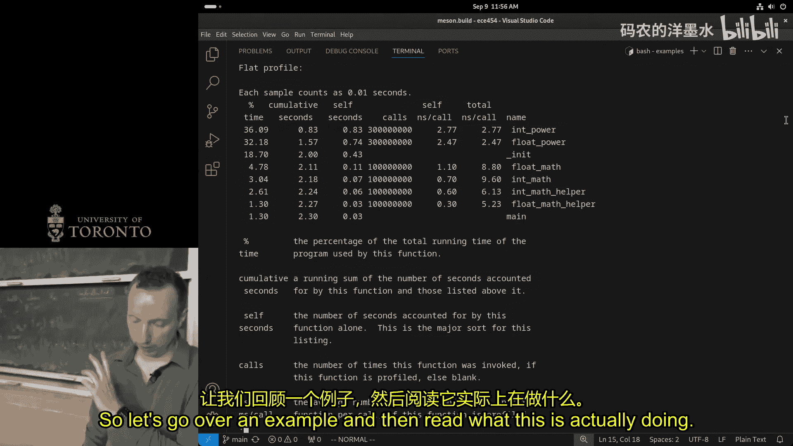

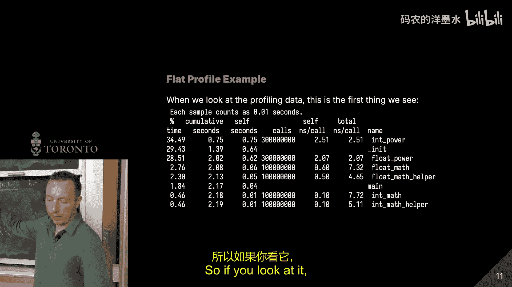

要使用 `gcov`，你需要在编译和链接时添加 `--coverage` 标志。使用 Meson 构建系统时，可以通过 `-Dcoverage=true` 选项来启用。编译后运行程序，`gcov` 会生成数据文件。使用 `gcovr` 命令可以查看文本或 HTML 格式的覆盖率报告。

覆盖率报告会显示每行代码被执行的次数。例如，`main` 函数中的循环体被执行了 1 亿次，而 `int_power` 函数总共被调用了 3 亿次。这能帮助我们识别出执行最频繁的代码区域。

### 使用 `gprof`

要使用 `gprof`，你需要在编译和链接时添加 `-pg` 标志。在 Meson 中，可以通过设置 `c_args` 和 `c_link_args` 来添加。编译后运行程序，它会生成一个 `gmon.out` 文件。使用 `gprof <可执行文件名>` 命令即可解读性能数据。

`gprof` 的输出分为两部分：扁平配置文件和调用图。

#### 解读扁平配置文件

扁平配置文件按函数自身消耗的时间排序。以下是对各列的解释：
*   **% time**：程序执行时间中，花费在该函数上的百分比。
*   **self seconds**：估计花费在该函数本身（不包括其调用的子函数）上的秒数。
*   **calls**：该函数被调用的次数。
*   **self ns/call**：每次调用该函数本身平均花费的纳秒数（self seconds / calls）。
*   **total ns/call**：每次调用该函数平均花费的总纳秒数（包括其调用的所有子函数）。

通过扁平配置文件，我们可以快速找到“热点”函数，即最耗时的函数，从而确定优化重点。

#### 解读调用图

调用图展示了函数之间的调用关系和时间分布。它的阅读方式如下：
*   **索引行**：以索引号开头的那一行是当前正在查看的“主”函数。
*   **上方行**：列出了调用这个“主”函数的函数（调用者）。
*   **下方行**：列出了这个“主”函数所调用的函数（被调用者）。

对于“主”函数这一行：
*   **% time**：执行该函数及其所有子函数所花费的时间占总时间的百分比。
*   **self**：与扁平配置文件中的 `self seconds` 含义相同。
*   **children**：该函数调用的所有子函数所花费的时间。

对于调用者/被调用者行：
*   **self**：当从当前行函数调用时，花费在“主”函数本身的时间。
*   **children**：当从当前行函数调用时，花费在“主”函数的子函数上的时间。
*   **called**：从当前行函数调用“主”函数的次数 / “主”函数被调用的总次数。

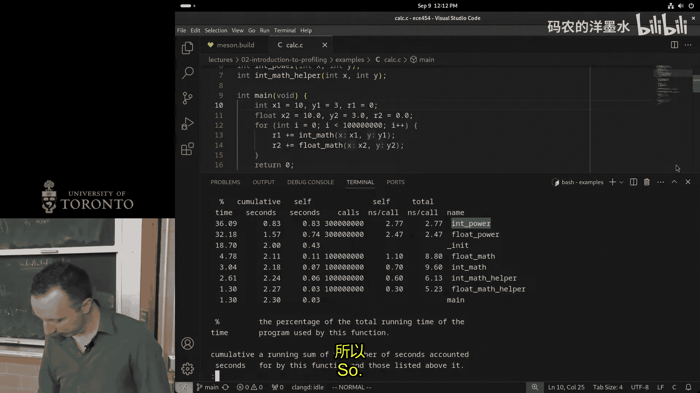

调用图帮助我们理解时间的传播路径，以及某个函数在不同调用上下文中的性能表现。

**注意**：在 `gprof` 的输出中，你可能会看到一个名为 `_init` 的函数占用了相当比例的时间（例如18%）。这通常是性能分析工具自身开销的误报，可以忽略。这也是为什么从 `main` 函数开始的累计时间百分比不是100%的原因。

## 实验一提示


在实验一中，你将使用这些工具来分析一个给定的代码库。你还需要尝试不同的编译器标志组合（例如开启/关闭调试信息 `debug` 和优化级别 `optimization`）并观察它们对性能分析结果的影响。你可以使用 Meson 的 `-D` 选项来设置这些标志，例如 `-Ddebug=false -Doptimization=2`。

## 总结

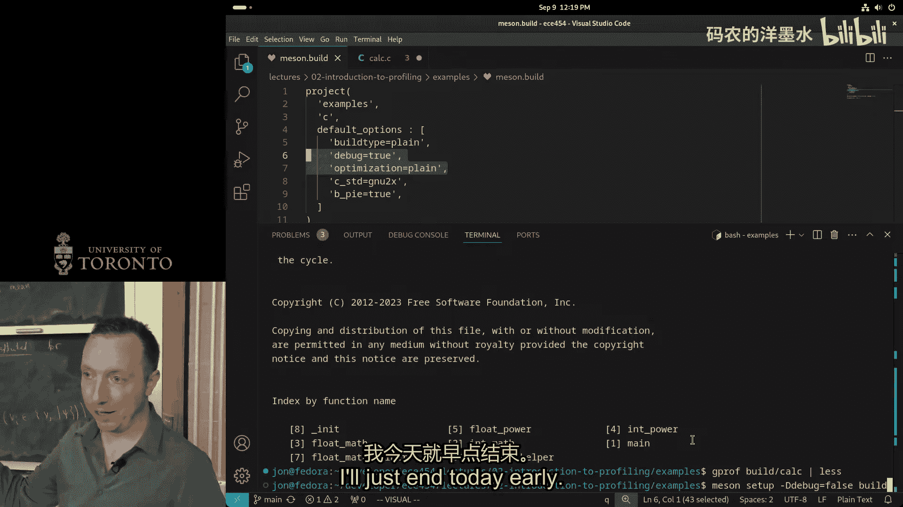

本节课中我们一起学习了性能分析的基础知识。我们了解到性能分析是优化程序的第一步，它帮助我们定位性能瓶颈。我们介绍了两种主要的分析工具：用于代码覆盖率的 `gcov` 和用于性能分析的 `gprof`。我们学习了如何生成和解读 `gprof` 的扁平配置文件与调用图，从而找出程序中最耗时的部分。掌握这些技能将使你能够有针对性地进行优化，从而显著提升程序性能。