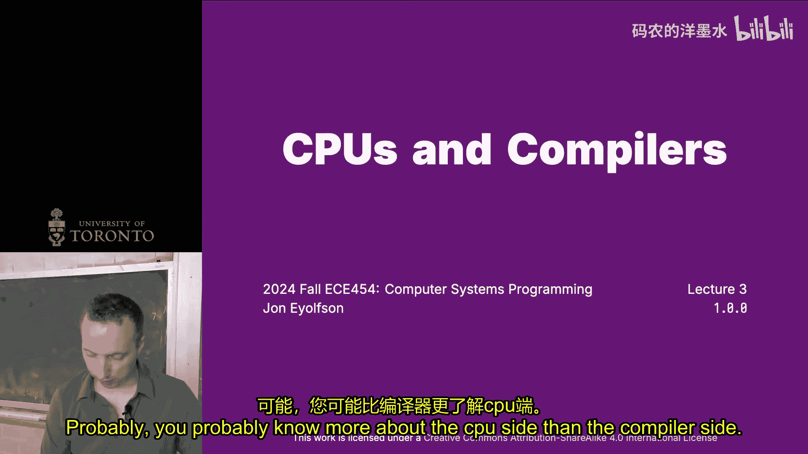
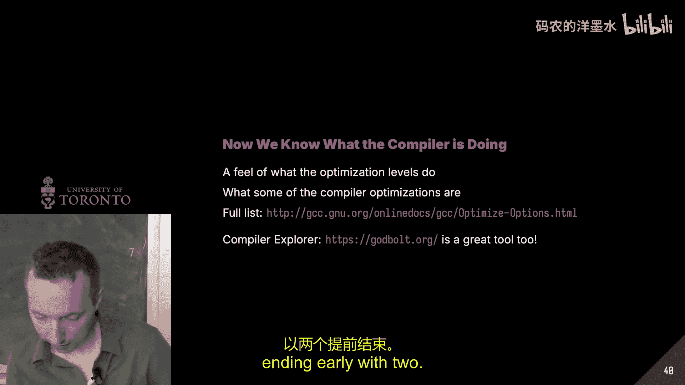

# 003：CPU与编译器 🚀



在本节课中，我们将学习CPU架构的基础知识以及编译器如何优化我们的代码。理解这些硬件和软件层面的原理，对于编写高性能程序至关重要。

## CPU架构演进之旅 💻

上一节我们介绍了性能分析工具，本节中我们来看看程序运行的硬件基础——CPU。为了优化程序，我们需要对硬件有基本的了解。

### 性能衡量指标

如何衡量单个CPU核心的性能？更高的频率是否意味着更快的核心？答案是否定的。有许多因素需要考虑，包括：
*   **IPS**：每秒指令数。
*   **FLOPS**：每秒浮点运算次数。
*   **IPC**：每时钟周期指令数。
*   **CPI**：每条指令周期数（CPI是IPC的倒数）。

这些指标衡量的是**吞吐量**，而非**延迟**。虽然现代计算机速度很快，延迟通常不是主要性能瓶颈，但在多核时代，理解这些概念依然重要。

### 历史回顾：从简单到复杂

CPU设计经历了漫长的演进。早期的处理器（如Intel 4004）没有流水线、虚拟内存甚至中断。指令按顺序执行，CPI等于流水线阶段数（例如5个阶段，CPI就是5）。

随后，**流水线技术**被引入。其核心思想是让处理器不同单元在每个时钟周期同时工作，处理指令的不同阶段。理想情况下，这能将CPI降低到接近1。

然而，流水线遇到了**分支指令**的挑战。CPU需要知道下一条指令是什么，但分支结果在执行后才能确定。最初的解决方案是**流水线停顿**，但这会降低性能。

为了解决分支问题，现代CPU采用了**分支预测**技术。CPU根据历史记录猜测分支走向，并开始**推测执行**。如果预测正确，则性能大幅提升；如果错误，则回退执行结果。现代分支预测器的准确率通常高达95%左右。

为了进一步提升性能，CPU设计走向了**超标量**和**乱序执行**。
*   **超标量**：通过复制硬件单元，在单个时钟周期内执行多条**相互独立**的指令（指令级并行，ILP）。
*   **乱序执行**：CPU不再严格按照程序顺序执行指令，而是动态调度，只要最终结果一致即可。这主要是为了隐藏缓存未命中等延迟。

此外，还有**同步多线程**技术（如Intel的Hyper-Threading）。它让单个物理核心能同时执行两个线程的指令，以更好地利用闲置的硬件资源。不过，这项技术的实际收益有限，现代CPU有逐渐弃用的趋势。

### 核心要点总结

CPU性能提升的历程，本质上是降低CPI（每条指令周期数）的旅程：
1.  **顺序执行**：CPI等于流水线阶段数（例如5）。
2.  **流水线**：将CPI降低至接近1。
3.  **分支预测与推测执行**：克服分支导致的停顿，使CPI稳定在1左右。
4.  **超标量与乱序执行**：通过指令级并行，使CPI**低于1**，实现超线性缩放。
5.  **同步多线程**：旨在提供更多指令选择以保持CPI低于1，但收益有限。

如今，硬件已经非常智能。对于软件开发者而言，最主要的性能关注点在于**缓存**。数据的布局和减少间接访问的层级，对性能有巨大影响。

## 编译器优化揭秘 🛠️

了解了硬件如何“加速”代码后，我们来看看软件的搭档——编译器。大多数人使用`-O2`或`-O3`选项时，并不清楚编译器具体做了什么。本节将揭开这部分魔法。

### 编译器优化等级

GCC等编译器提供不同的优化等级，各有侧重：
*   **-O0**：默认级别。不进行优化，编译速度最快，生成的代码最易于调试。
*   **-O1**（或`-O`）：进行一些能明显减小代码体积或缩短执行时间且无副作用的优化。这是“免费的”性能提升。
*   **-O2**：进行所有不涉及空间与速度权衡的优化。这是大多数Linux发行版的默认编译选项，在代码大小和运行速度间取得了良好平衡。
*   **-O3**：进行所有优化，包括可能显著增加代码体积的优化。
*   **-Ofast**：在`-O3`基础上，进行不符合严格语言标准（如IEEE浮点规则）的激进优化，以换取更高速度。适用于对精度要求不高的场景。

**重要提示**：使用`-O2`或`-O3`编译的程序**不适合用GDB调试**，因为优化会改变代码结构，导致调试信息与执行流不符。

### 标量优化

编译器擅长对单个值进行优化，这些优化通常在所有级别开启。

**常量折叠与传播**
编译器会在编译时计算常量表达式，并将结果直接嵌入代码。
```c
int i = 128 * 128; // 编译时直接计算为 16384
```

**公共子表达式消除**
如果同一表达式被多次计算，编译器会计算一次并复用结果。
```c
a = b * c + g;
d = b * c + d;
// 编译器会生成类似如下的中间代码：
temp = b * c;
a = temp + g;
d = temp + d;
```

**复制传播**
如果一个变量只是另一个变量的副本，编译器会直接使用原变量。
```c
y = x;
z = 3 + y;
// 优化为：
z = 3 + x;
```

**死代码消除**
编译器会移除永远不会执行的代码。
```c
if (0) {
    z = x + y; // 整个代码块会被删除
}
```

### 循环优化

循环是性能优化的关键区域，编译器会进行多种变换。

**循环展开**
将循环体复制多次，减少循环开销。
```c
for (int i = 0; i < 4; i++) f(i);
// 可能被展开为：
f(0); f(1); f(2); f(3);
```
编译器会根据循环次数权衡展开的收益，避免代码膨胀过度。

**循环交换**
为了改善内存访问模式（缓存友好性），编译器会交换嵌套循环的顺序。
```c
for (int i = 0; i < N; i++)
    for (int j = 0; j < M; j++)
        array[j][i] = ...; // 按列访问，不连续
// 编译器可能交换循环，改为按行访问：
for (int j = 0; j < M; j++)
    for (int i = 0; i < N; i++)
        array[j][i] = ...; // 按行访问，连续
```

**循环融合与裂变**
*   **融合**：将两个相邻的、迭代范围相同的循环合并为一个。
*   **裂变**：将一个循环拆分成多个。这两种优化需要在循环开销和数据局部性之间权衡。

**循环不变量外提**
将循环内不变的计算移到循环外部。
```c
for (int i = 0; i < 100; i++) {
    int s = x * y; // x, y 在循环中不变
    array[i] = i * s;
}
// 优化为：
int s = x * y;
for (int i = 0; i < 100; i++) {
    array[i] = i * s;
}
```

### 其他重要优化

**去虚拟化**
对于C++的虚函数调用，如果编译器能在编译时确定具体调用哪个函数，就会绕过虚函数表查找，直接进行静态调用，提升性能。

**尾调用消除**
如果函数的最后一步是调用另一个函数（或自身，即尾递归），编译器可以优化掉这次调用的栈帧开销，将其转换为跳转或循环。
```c
int factorial(int n, int acc = 1) {
    if (n <= 1) return acc;
    return factorial(n - 1, acc * n); // 尾递归，可优化为循环
}
```

### 与编译器沟通：`restrict` 关键字

`restrict`是C99引入的类型限定符，仅用于指针。它向编译器承诺：**此指针是访问其所指内存的唯一途径**（即不存在指针别名）。这能帮助编译器进行更激进的优化，例如减少冗余的内存加载。

```c
void update(int* restrict a, int* restrict b, int* val) {
    *a += *val;
    *b += *val; // 编译器知道val不会被a或b修改，可能无需重新加载*val
}
```

**⚠️ 重要警告**：如果你对编译器撒谎（即`restrict`指针实际上存在别名），将导致**未定义行为**，程序可能产生错误结果。除非你非常确信且能从中获得显著性能提升，否则应谨慎使用`restrict`。

### 编译器内部表示

编译器在优化时，通常会将代码转换为一种称为**三地址码**或**中间表示**的形式。它类似于汇编，但假设有无限多个寄存器，便于进行分析和转换。例如，GCC的中间表示叫做GIMPLE。你可以使用`-fdump-tree-gimple`选项来查看它，这有时比直接阅读汇编更清晰。

### 辅助编译器优化

**分支预测提示**
你可以使用`__builtin_expect`内建函数或`likely`/`unlikely`宏，向编译器提示分支的走向概率，帮助它生成更优的代码布局。
```c
if (__builtin_expect(condition, 1)) { // 提示condition很可能为真
    // 快速路径代码
}
```

**架构特定优化**
使用`-march`和`-mtune`标志可以针对特定CPU架构（如`-march=native`）进行优化，启用特殊的指令集（如AVX）。这能提升在目标机器上的性能，但会牺牲可移植性。

## 总结与工具 🎯

本节课中我们一起学习了CPU架构的演进历史和编译器执行的关键优化。
*   **CPU方面**：我们了解了流水线、分支预测、超标量、乱序执行等技术如何协同工作，将CPI降至1以下，从而提升指令吞吐量。
*   **编译器方面**：我们探讨了不同优化等级的含义，以及常量传播、循环优化、尾调用消除等具体优化技术。我们还学习了如何通过`restrict`关键字和分支提示与编译器沟通。

记住**黄金法则**：过早优化是万恶之源。首先编写清晰、正确的代码，然后利用性能分析工具找到瓶颈，最后再考虑应用这些高级优化知识。

**实用工具推荐**：[Compiler Explorer (godbolt.org)](https://godbolt.org/) 是一个绝佳的网站，可以让你在线编写代码，实时查看不同编译器、不同优化选项下生成的汇编或中间代码，是学习和试验编译器优化的利器。



希望这些知识能帮助你更好地完成实验，并理解高性能编程背后的原理。