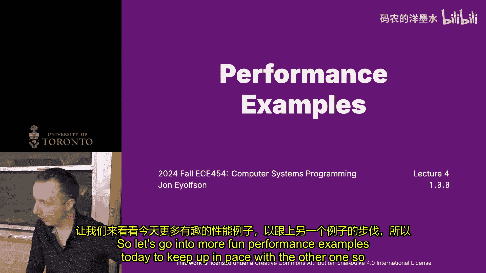
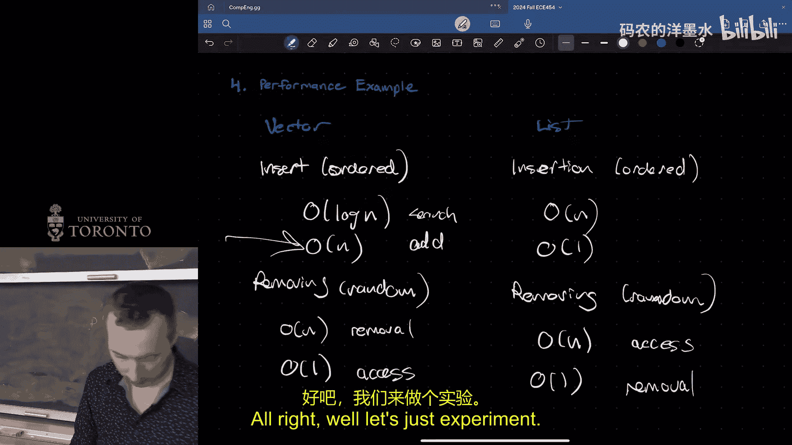
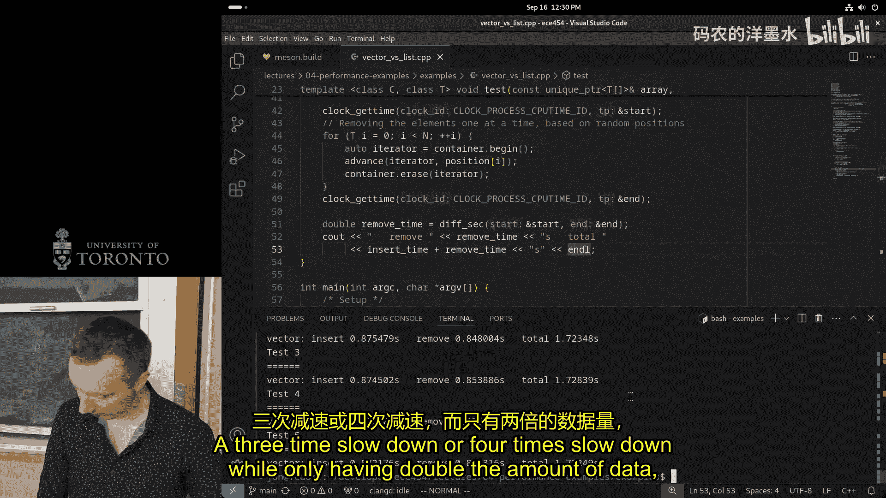
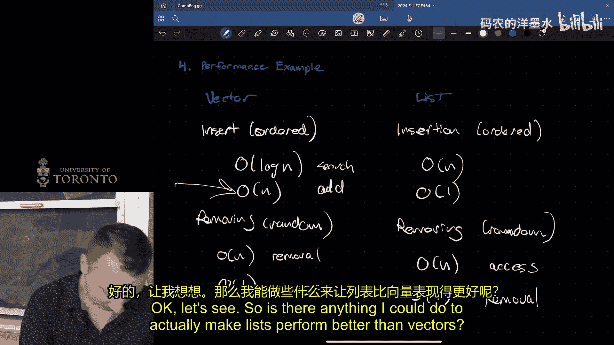
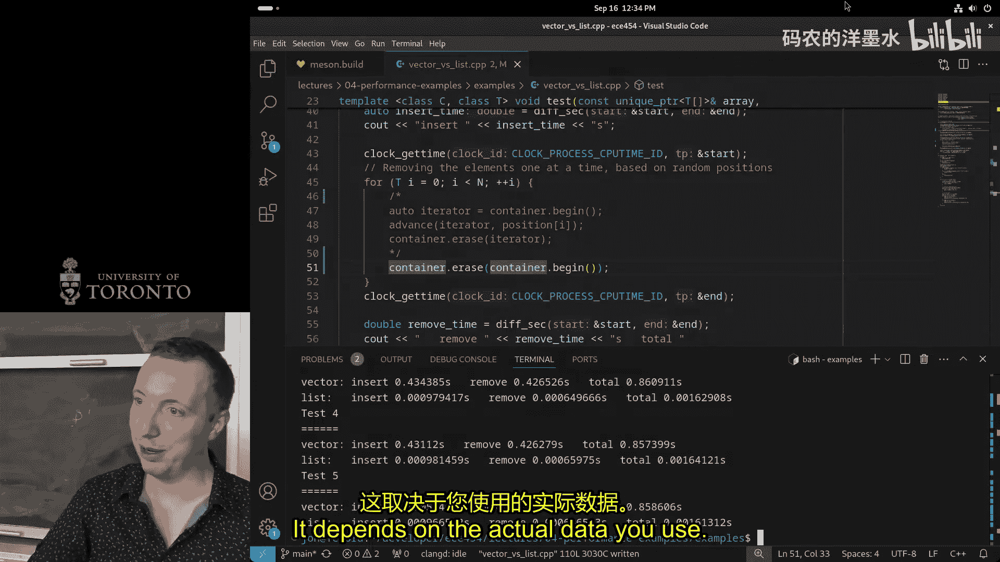
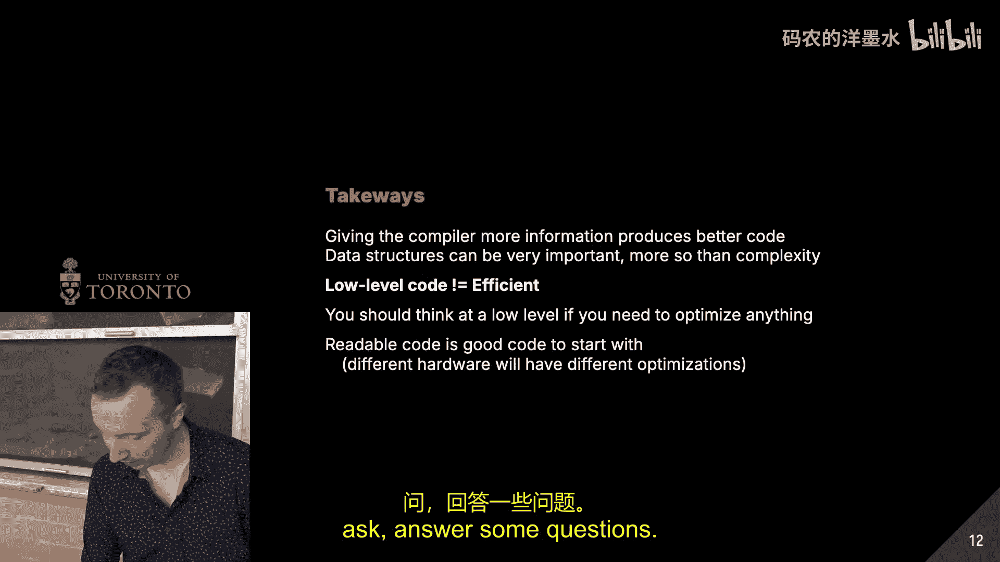

# 004：性能示例 🚀



在本节课中，我们将通过具体的性能示例，深入探讨编译器优化、数据结构选择以及性能分析工具的实际应用。我们将重点关注内联优化、向量与链表的性能对比，以及如何使用 `perf` 工具分析缓存行为。

## 概述

上一讲我们介绍了一系列编译器优化。核心结论是：你应该专注于编写可读性强的代码，编译器通常比你更擅长进行简单的优化。性能分析的目标是集中精力在能带来最大性能提升的地方。此外，应尽可能多地为编译器提供正确的信息，以获得更好的性能。

## 内联优化详解

上一节我们介绍了编译器优化的理念，本节中我们来看看一个最具影响力的优化：**内联**。

内联优化如其名，它将函数体直接“移动”到调用它的地方，从而消除函数调用的开销。例如，一个简单的访问器方法：

```cpp
class Point {
private:
    int x;
public:
    int getX() { return x; }
};

// 调用
Point p;
std::cout << p.getX();
```

经过内联优化后，编译器生成的代码本质上等同于直接访问成员变量 `x`：

```cpp
std::cout << p.x; // 概念上的等价代码
```

这消除了函数调用和返回的指令开销。如果涉及虚函数，内联还会与**去虚拟化**优化协同工作。


然而，内联也存在权衡：
*   **优点**：消除函数调用开销，并为后续优化（如常量折叠、公共子表达式消除）创造更多机会。
*   **缺点**：如果函数体较大或在多个地方被调用，会导致代码体积（二进制文件大小）显著增加。这可能会因指令缓存未命中而降低运行时性能。

C++中的 `inline` 关键字仅是对编译器的**建议**。编译器会根据自身的启发式规则（如函数大小、调用频率）决定是否真正内联。盲目使用 `inline` 不一定能提升性能，甚至可能适得其反。因此，**必须通过性能分析来验证优化效果**。

正是内联优化，使得我们在之前的排序实验中，C++版本的性能大幅超越C版本。Java虚拟机（JVM）也采用了类似的热点代码检测与内联策略。

## 数据结构性能对比：向量 vs 链表



在讨论了编译器优化后，我们转向一个经典的性能抉择：在特定任务中，选择向量（动态数组）还是链表？

假设我们有一个任务：
1.  向一个数据结构中插入 N 个随机整数，并始终保持其有序。
2.  随后，按随机给定的索引，逐个移除所有元素。

以下是两种数据结构操作的理论时间复杂度分析：

| 操作 | 向量 (Vector/Array) | 链表 (Linked List) |
| :--- | :--- | :--- |
| **插入** | **搜索**：O(log N) (二分查找) <br> **插入**：O(N) (可能需要移动后续所有元素) | **搜索**：O(N) (线性遍历) <br> **插入**：O(1) (修改指针) |
| **移除** | **访问**：O(1) (按索引) <br> **移除**：O(N) (可能需要移动后续元素) | **访问**：O(N) (遍历到索引处) <br> **移除**：O(1) (修改指针) |

仅从理论复杂度看，链表在插入和移除操作上似乎有优势，因为它避免了移动大量数据。



### 实际性能测试



我们编写了一个测试程序，使用C++模板对向量(`std::vector`)和链表(`std::list`)进行上述操作并计时。

以下是测试的核心逻辑片段：
```cpp
template<typename Container>
void test(Container& c, int* insertData, int* removeIndices, int N) {
    // 计时：有序插入
    for (int i = 0; i < N; ++i) {
        auto pos = std::lower_bound(c.begin(), c.end(), insertData[i]);
        c.insert(pos, insertData[i]);
    }
    // 计时：按随机索引移除
    auto it = c.begin();
    for (int i = 0; i < N; ++i) {
        std::advance(it, removeIndices[i]);
        it = c.erase(it);
    }
}
```



**测试结果令人惊讶**：对于中等规模的数据（如数万个元素），向量的性能**显著优于**链表，速度可能快一个数量级甚至更多。

### 性能差异的核心原因：缓存局部性

理论复杂度忽略了现代计算机体系结构的一个关键因素：**缓存**。
*   **向量**：数据在内存中是**连续存储**的。当CPU访问一个元素时，会将其周围的一大块数据（一个缓存行）加载到高速缓存中。后续的顺序访问很可能直接在缓存中命中，速度极快。即使插入/删除需要移动数据，这些移动操作也是高效的顺序内存访问。
*   **链表**：每个节点分散在堆内存的不同位置。遍历链表时，每次跳转到下一个节点都可能导致**缓存未命中**，必须从更慢的主内存中加载数据。这种随机内存访问模式对缓存极不友好。

使用Linux性能分析工具 `perf` 可以量化这一点：
*   运行向量版本：缓存未命中率可能低于 **1%**。
*   运行链表版本：缓存未命中率可能高达 **90%** 以上。

巨大的缓存未命中率差异是链表性能远低于理论预期的根本原因。

### 没有放之四海而皆准的方案

当然，链表并非一无是处。如果我们改变数据访问模式：
*   **始终在头部插入和删除**：链表确实能展现出O(1)的优势。
*   **存储的元素非常大**：移动元素的成本可能超过缓存优势。

关键在于：**性能取决于实际的数据和使用模式**。因此，必须使用**具有代表性的数据**进行性能剖析，避免为错误的情况进行优化。

## 更多性能建议与工具

在对比了数据结构之后，我们来总结一些通用的性能准则并介绍强大的分析工具。

### 通用性能建议
1.  **精简数据结构**：不要存储不必要的数据。选择合适的最小数据类型（例如，用 `uint8_t` 代替 `int` 存储0-100的值）。
2.  **追求可预测的内存访问**：顺序访问优于随机访问。
3.  **默认选择向量**：在不确定时，`std::vector` 通常是更好的默认选择，因其出色的缓存局部性。
4.  **利用抽象编程**：使用C++模板等抽象机制，可以轻松地在不同实现（如向量和链表）之间切换和测试，而无需重写大量代码。
5.  **编写可读的代码**：可读的代码是优化和维护的基础。难以理解的代码（如深度嵌套的宏、随处可见的 `void*`）会阻碍性能分析和优化。

### 性能分析工具：`perf`

`perf` 是一个强大的Linux性能剖析工具，可以直接访问硬件性能计数器。

基本用法：
```bash
perf stat -e cache-references,cache-misses,instructions,cycles ./your_program
```

它可以提供的信息包括：
*   **任务时钟时间**、**CPU利用率**
*   **指令数**、**周期数**，并计算 **IPC（每周期指令数）**
*   **缓存引用**和**缓存未命中**次数及比率
*   **分支预测**次数及误预测次数
*   **缺页异常**次数

这些硬件层面的数据（尤其是缓存未命中率）对于解释像向量/链表对比这样的性能现象至关重要。

## 总结

本节课中我们一起学习了：
1.  **内联优化**的原理与权衡，它是提升函数调用密集型代码性能的关键。
2.  **数据结构选择的实践**：通过向量与链表的对比，我们认识到**缓存局部性**对实际性能的影响往往超过理论时间复杂度。在多数情况下，连续存储的向量因更好的缓存友好性而表现更佳。
3.  **性能分析的方法**：强调使用 `perf` 等工具进行实证分析，关注缓存未命中率等硬件指标，并使用代表性数据来指导优化方向。
4.  **核心编程理念**：始终从编写清晰、可读的代码开始，在性能分析指出瓶颈后，再有针对性地进行优化，并充分考虑数据访问模式与硬件特性。



记住，在性能优化领域，“视情况而定”是常态， profiling（性能剖析）是你最可靠的导航仪。