# 005：程序优化

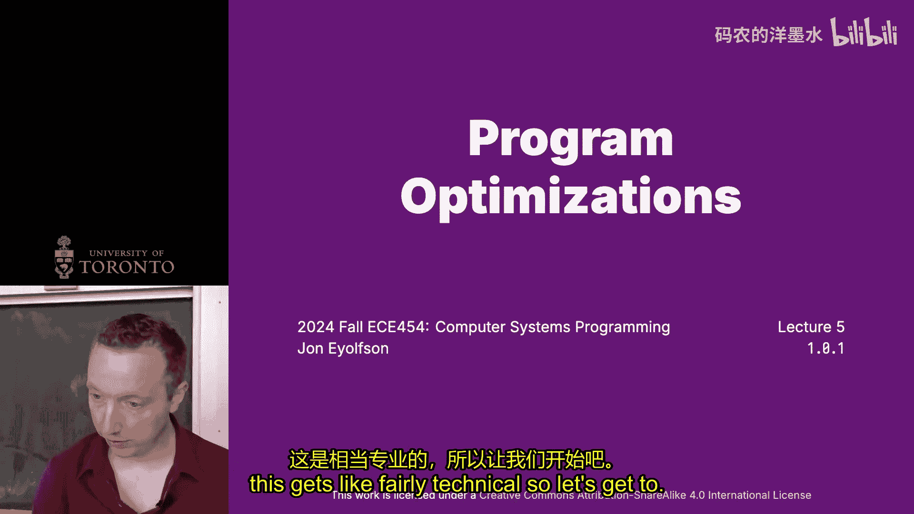

在本节课中，我们将学习如何对一个简单的C语言向量（动态数组）求和函数进行性能优化。我们将从最基础的版本开始，逐步应用各种优化技术，并观察每一步带来的性能提升。课程的核心是理解编译器优化的局限性，并学习如何通过手动调整代码来充分利用现代CPU的硬件特性。

---

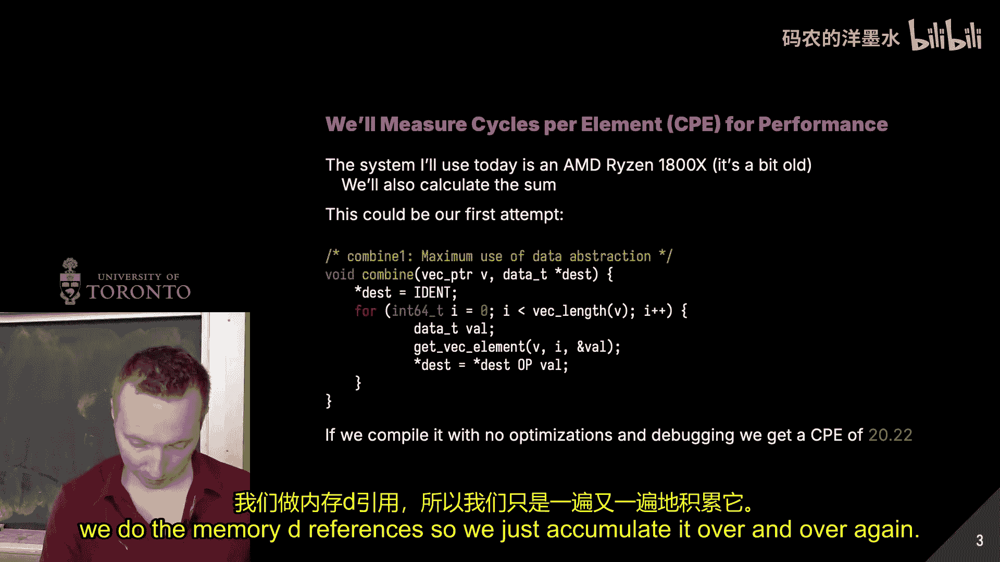

## 概述：我们的优化目标

我们将优化的函数名为 `combined`，其功能是遍历一个整数向量，将所有元素通过一个可配置的操作（如加法、乘法）累加起来。初始版本代码功能正确但性能低下。

我们的性能指标是 **每个元素消耗的CPU周期数 (Cycles Per Element)**。目标是从初始的20个周期/元素，通过优化降低到接近甚至低于1个周期/元素。

**初始代码框架**：
```c
// 向量结构（简化）
typedef struct {
    int* data;
    size_t length;
} vector_t;

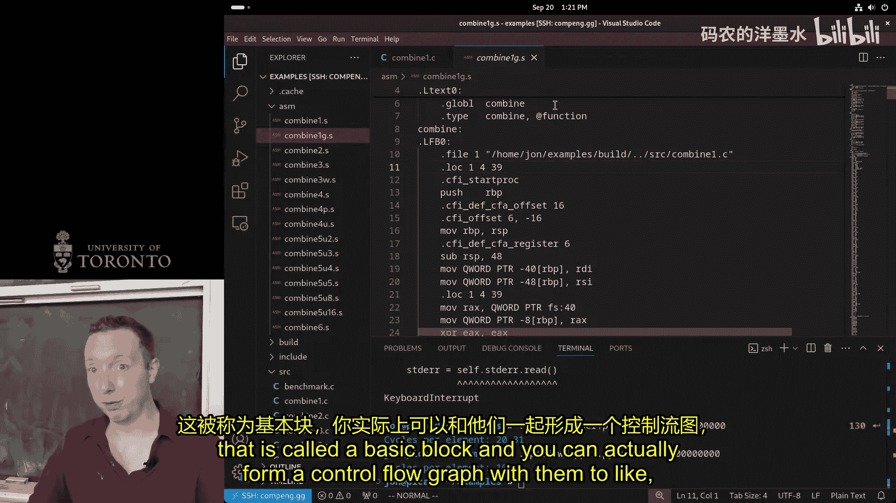

// 需要优化的函数
void combined(int* dest, vector_t* v, int identity) {
    *dest = identity;
    for (size_t i = 0; i < vector_length(v); i++) {
        int val;
        vector_get_element(v, i, &val); // 获取元素值
        *dest = *dest OP val; // OP 是编译时定义的操作（如 + 或 *）
    }
}
```

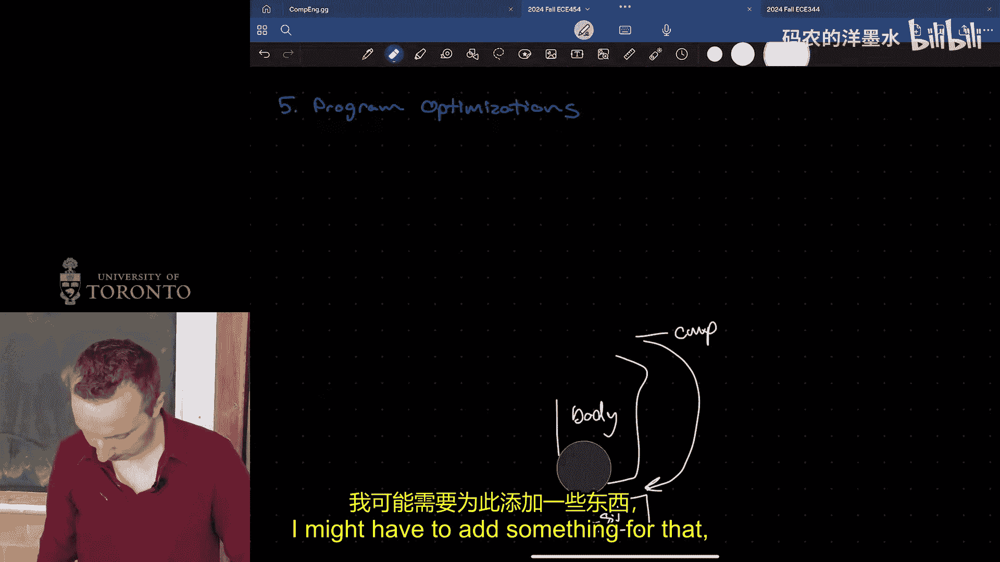

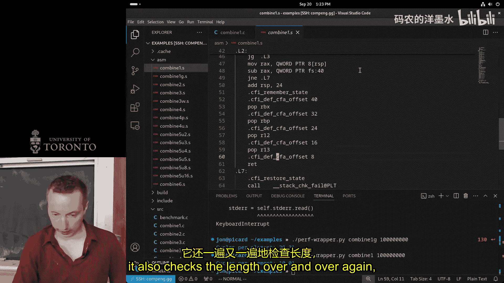

---

## 优化步骤1：启用编译器优化

上一节我们介绍了性能基准。本节中我们来看看最直接有效的优化手段：让编译器为我们工作。

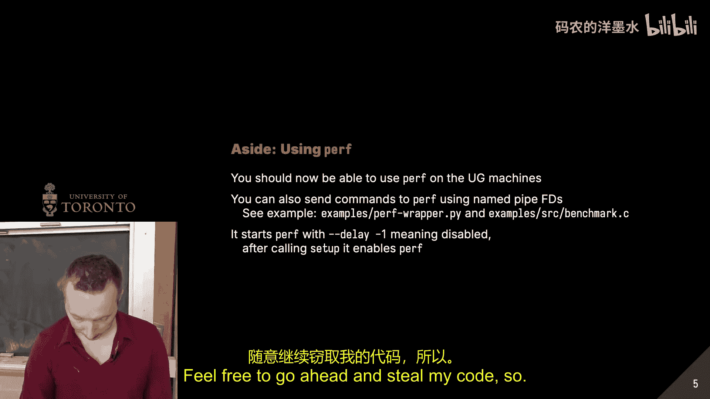

编译器优化是提升性能最简单、最安全的方法。在没有任何优化标志（`-O0`，通常用于调试）的情况下，我们的函数需要 **20个周期/元素**。

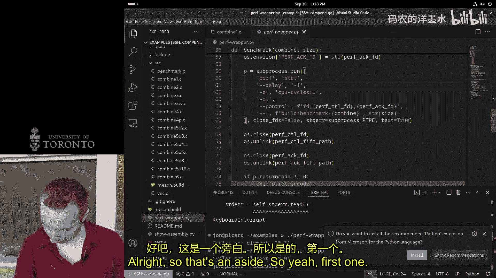

**操作**：在编译时添加 `-O2` 优化标志。
**结果**：性能立即提升一倍，达到 **10个周期/元素**。
**原理**：`-O2` 优化级别启用了包括更好的寄存器分配、指令调度和内联小型函数在内的多种优化，但尚未触及算法层面的问题。

---

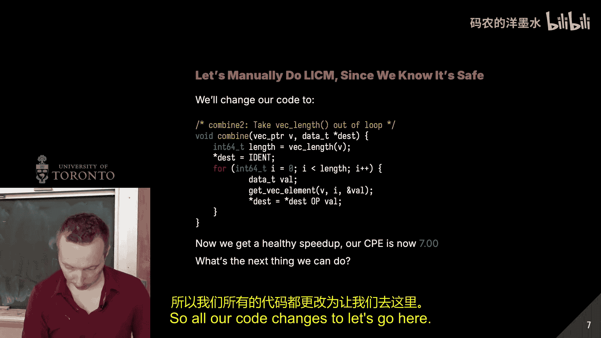

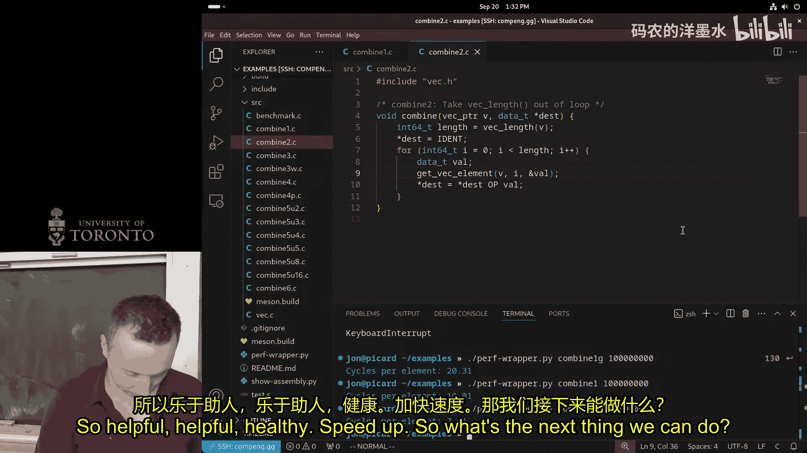

## 优化步骤2：手动提升循环不变量

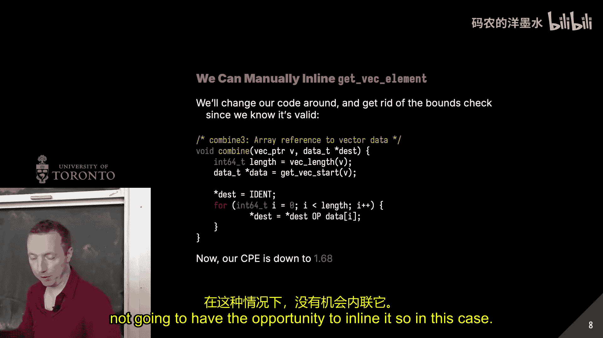

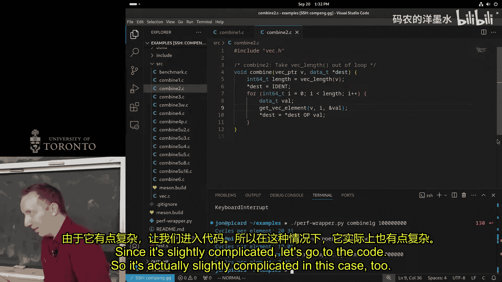

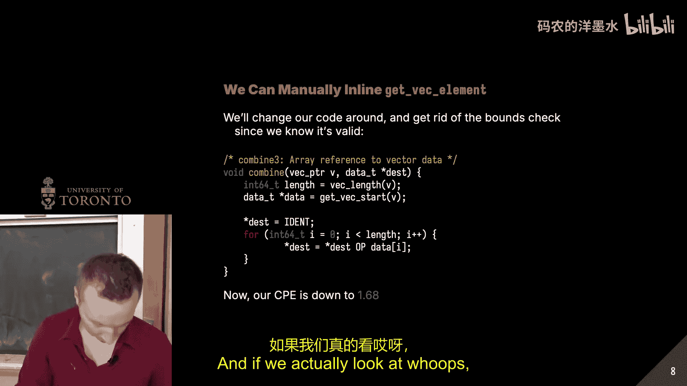

尽管使用了 `-O2`，编译器仍然不够“聪明”。观察循环条件 `i < vector_length(v)`，每次迭代都会调用 `vector_length` 函数。然而，向量的长度在循环中不会改变，这个调用是“循环不变量”。

**循环不变量代码移动 (Loop-Invariant Code Motion)** 是一种优化，将循环中不变的计算移到循环外部。

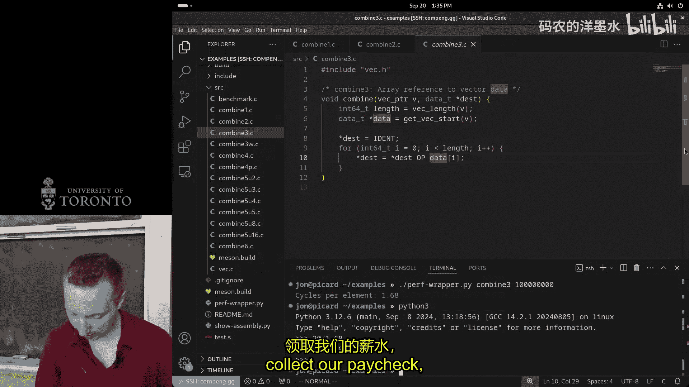

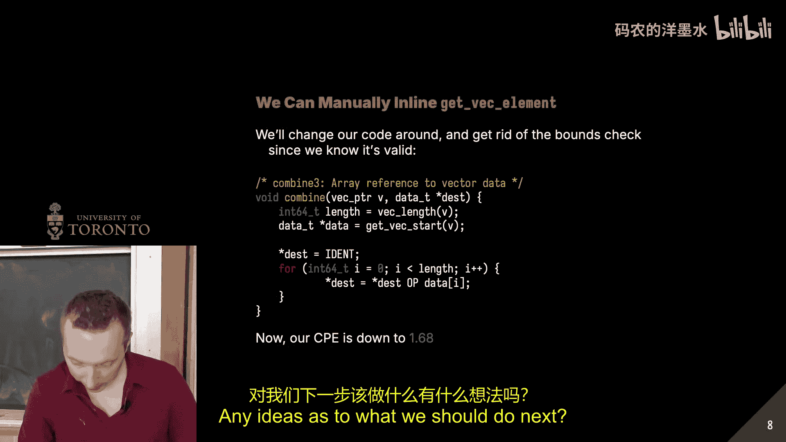

**优化后代码**：
```c
void combined(int* dest, vector_t* v, int identity) {
    *dest = identity;
    size_t len = vector_length(v); // 将长度计算移出循环
    for (size_t i = 0; i < len; i++) { // 直接使用局部变量
        int val;
        vector_get_element(v, i, &val);
        *dest = *dest OP val;
    }
}
```
**结果**：性能从 10 提升到 **7 个周期/元素**。
**为何编译器不做**？编译器在编译 `combined` 时，只看到 `vector_length` 的函数声明，不知道其内部实现。它必须假设这个函数可能有“副作用”（例如修改全局状态、打印日志），因此不能安全地将其移出循环。

---

## 优化步骤3：手动内联函数调用

在循环体内，`vector_get_element` 函数调用开销很大。它内部可能包含边界检查等逻辑。对于我们的场景，我们知道索引 `i` 始终在边界内，因此可以安全地手动内联这个操作。

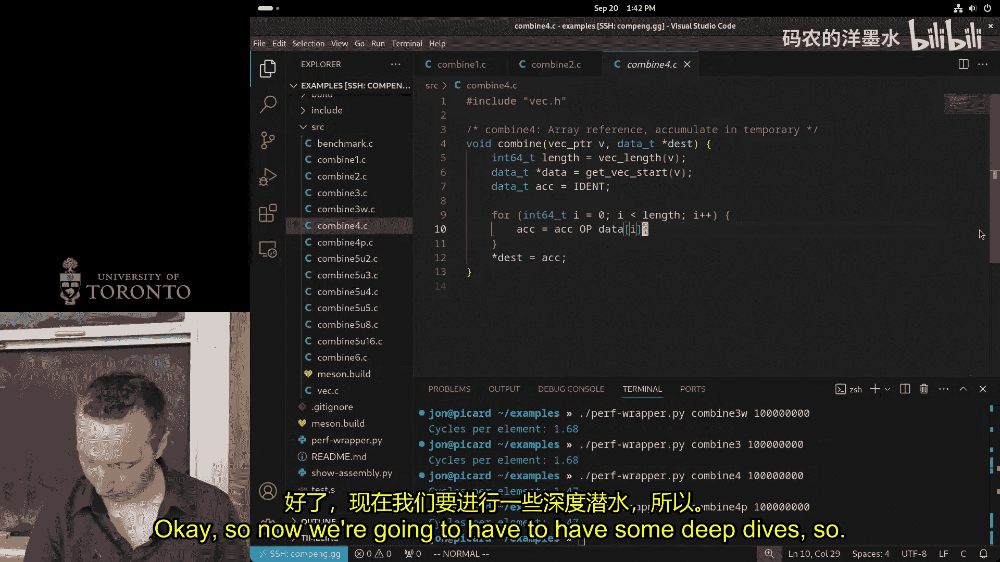

**优化思路**：直接获取向量数据数组的起始指针，然后通过数组索引访问。
**优化后代码**：
```c
void combined(int* dest, vector_t* v, int identity) {
    *dest = identity;
    size_t len = vector_length(v);
    int* data = vector_start(v); // 获取数据数组起始地址
    for (size_t i = 0; i < len; i++) {
        *dest = *dest OP data[i]; // 直接数组访问，省去函数调用
    }
}
```
**结果**：性能产生巨大飞跃，从 7 提升到 **1.78 个周期/元素**。
**关键点**：消除函数调用开销和冗余的边界检查是此步性能提升的主要原因。

---

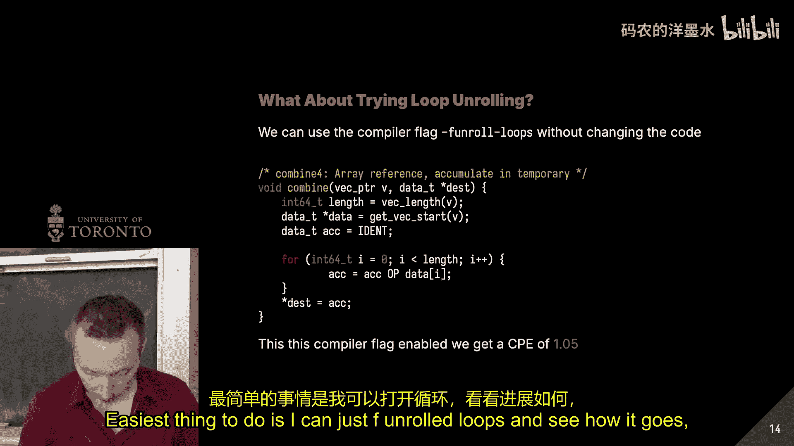

## 优化步骤4：减少内存访问

目前，每次迭代我们都要对 `*dest` 进行“读-修改-写”操作。访问内存（即使是缓存）的速度远慢于访问寄存器。

**优化思路**：使用一个局部变量作为累加器，只在循环结束后将结果写回 `dest`。
**优化后代码**：
```c
void combined(int* dest, vector_t* v, int identity) {
    int acc = identity; // 使用局部变量作为累加器
    size_t len = vector_length(v);
    int* data = vector_start(v);
    for (size_t i = 0; i < len; i++) {
        acc = acc OP data[i];
    }
    *dest = acc; // 循环结束后，一次性写回内存
}
```
**结果**：性能从 1.78 轻微提升到 **1.6 个周期/元素**。提升不大是因为原来的内存访问已被缓存很好地处理，但此优化在更复杂的场景下可能更有益。
**核心概念**：**局部性原理**。编译器更容易将局部变量优化到寄存器中，而内存地址可能被其他线程或函数访问，编译器优化时必须保守。

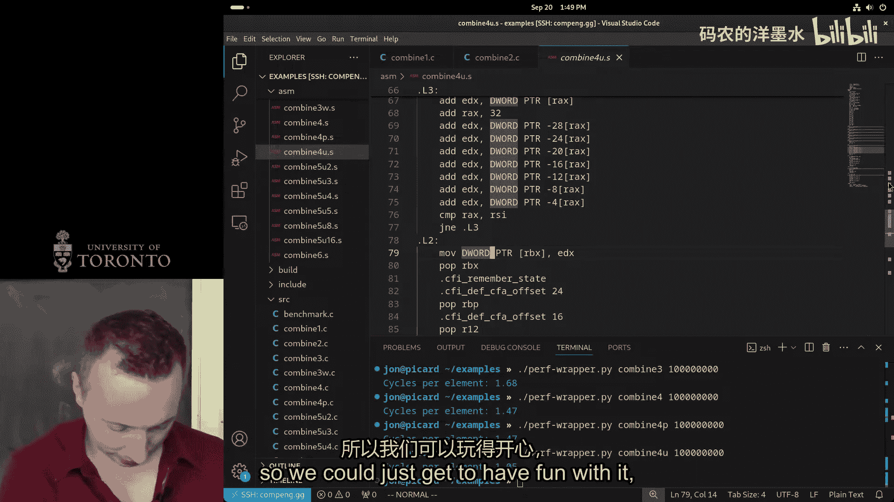

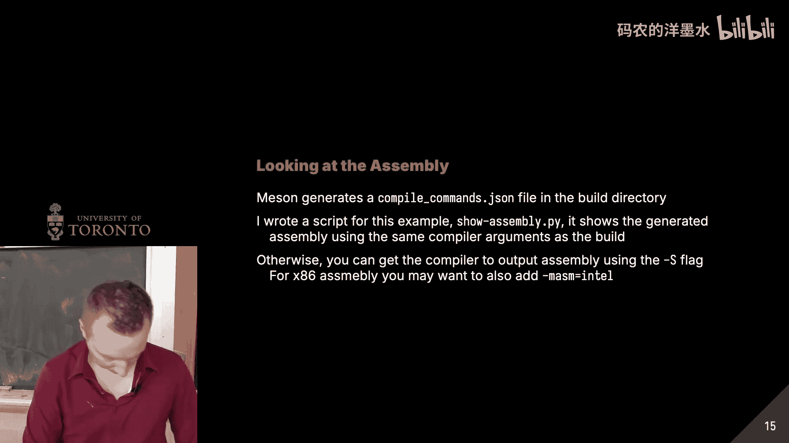

---

## 优化步骤5：循环展开

循环控制（i++，条件判断）本身也有开销。**循环展开 (Loop Unrolling)** 通过在一次迭代中处理多个数据元素来分摊这种开销，同时也为CPU的指令级并行提供了更多机会。

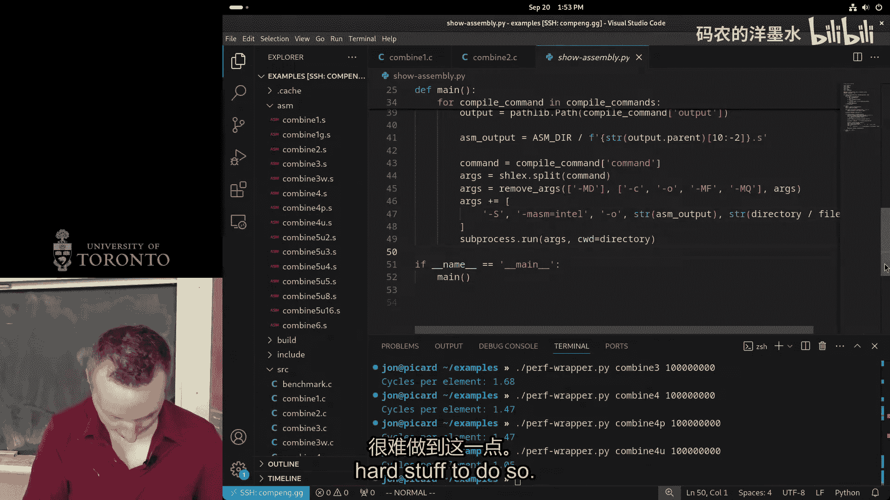

**手动展开2次的示例**：
```c
void combined(int* dest, vector_t* v, int identity) {
    int acc = identity;
    size_t len = vector_length(v);
    int* data = vector_start(v);
    size_t i = 0;
    // 每次迭代处理2个元素
    for (; i + 1 < len; i += 2) {
        acc = acc OP data[i];
        acc = acc OP data[i + 1];
    }
    // 处理剩余元素
    for (; i < len; i++) {
        acc = acc OP data[i];
    }
    *dest = acc;
}
```
我们测试了展开2、3、4、8、16次的效果。发现展开4次时性能有显著提升，这是因为触发了编译器的**自动向量化**。

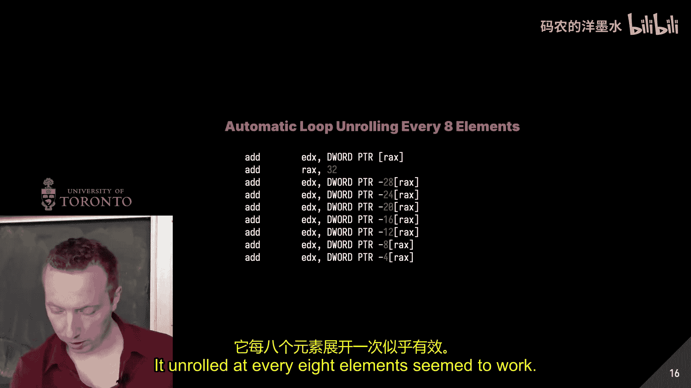

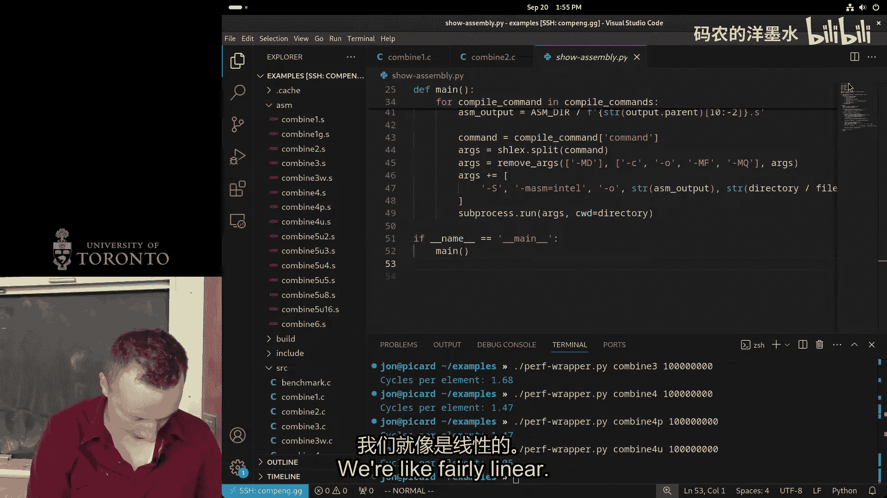

**使用编译器自动展开**：我们也可以使用 `-funroll-loops` 编译标志让编译器自动决定展开因子。在本例中，编译器选择了展开8次。

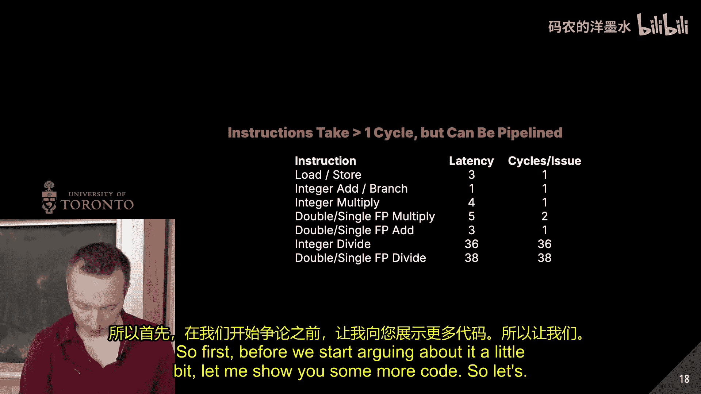

**结果对比**：
*   手动展开4次：**~1.1 周期/元素**
*   手动展开8次：**~0.7 周期/元素**
*   编译器展开8次：**~0.9 周期/元素**

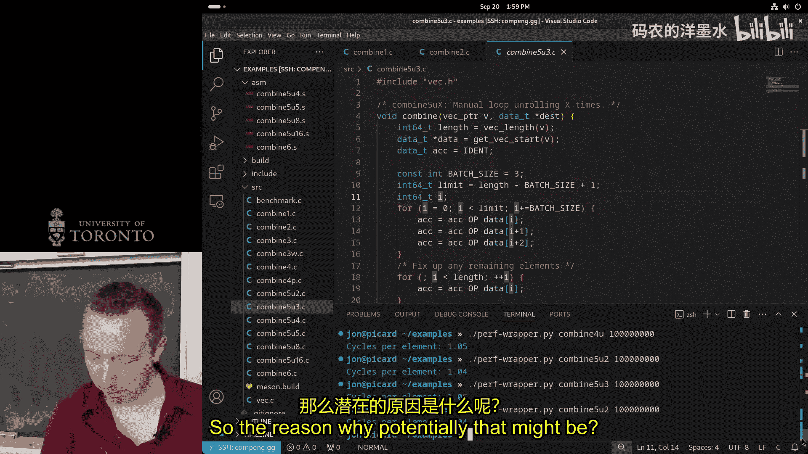

**为何展开有效**：
1.  **减少分支**：减少了循环条件判断的次数。
2.  **增加指令级并行**：CPU可以同时执行多个独立的加载和加法操作。
3.  **启用向量化**：为编译器使用SIMD指令创造了条件。

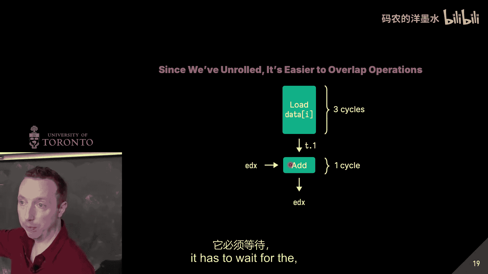

---

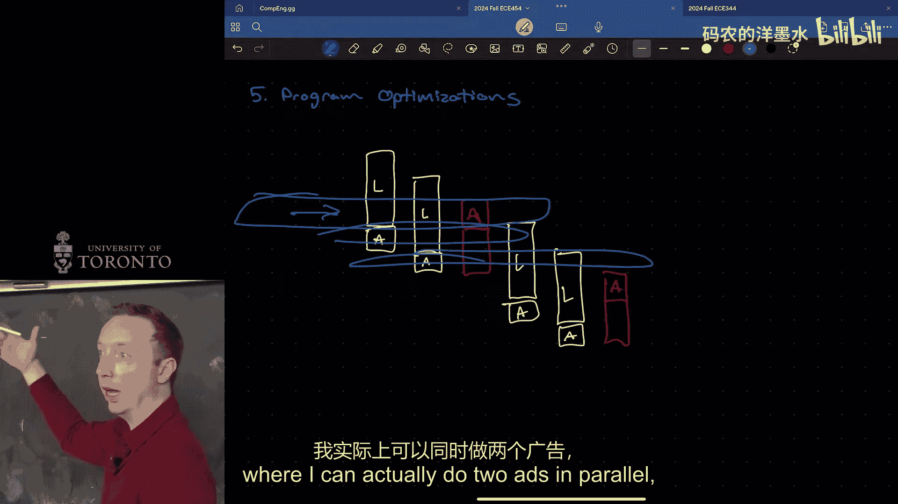

## 深入分析：SIMD向量化

性能在展开4次和8次后大幅提升的关键，是编译器生成了 **SIMD (Single Instruction, Multiple Data)** 指令。

**什么是SIMD**？
*   SIMD允许一条指令同时对多个数据执行相同的操作。
*   例如，SSE/AVX指令集提供了128位、256位甚至512位的寄存器（XMM, YMM, ZMM）。
*   一个128位的XMM寄存器可以存放4个32位整数。一条 `PADDD`（压缩整数加法）指令可以一次性完成这4对整数的加法。

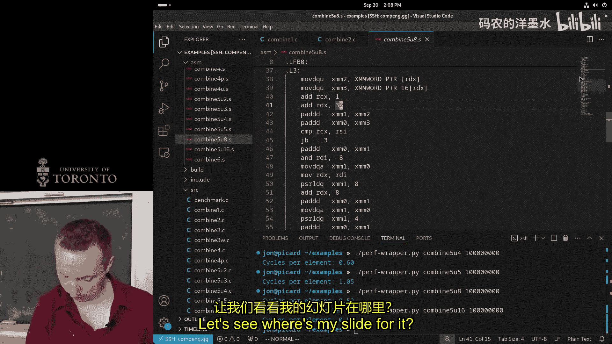

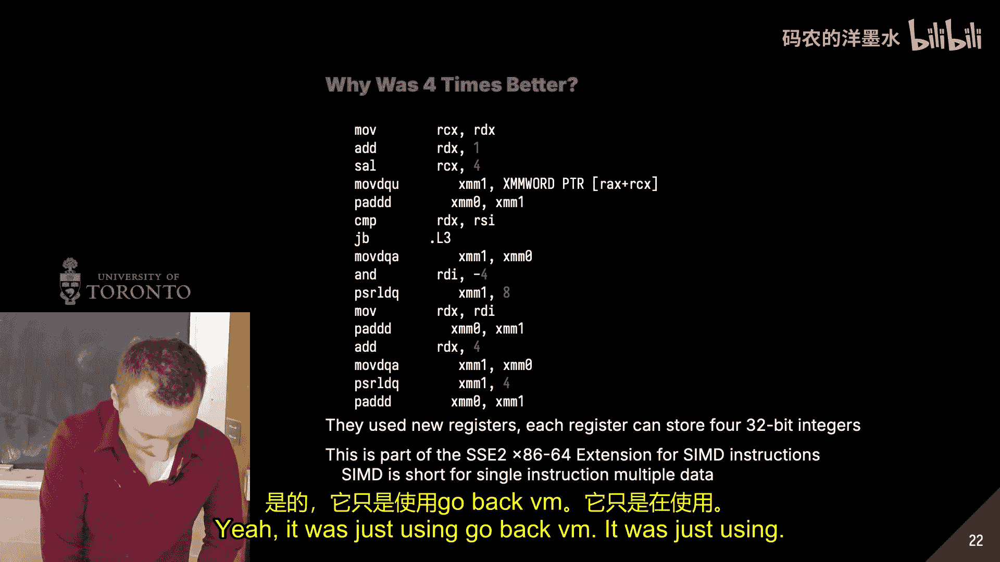

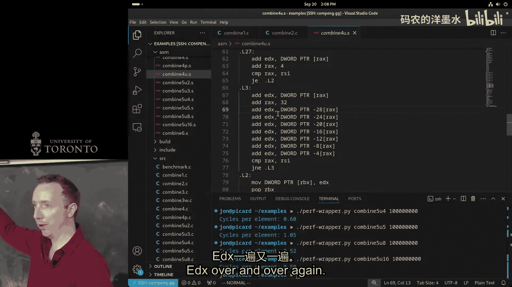

**编译器生成的向量化汇编代码示意**：
```assembly
; 将 data[i] 开始的4个整数加载到 XMM0 寄存器
movdqu xmm0, [rdx + rax*4]
; 将累加器中的4个整数加载到 XMM1 寄存器
movdqu xmm1, [rsi]
; 执行4个整数并行加法
paddd xmm1, xmm0
; 将结果存回累加器位置
movdqu [rsi], xmm1
```
这使得我们实现了 **超线性加速**，即每个元素消耗的周期数小于1，因为硬件在每个周期内处理了多个数据。

---

## 优化步骤6：改变结合顺序以提升并行度

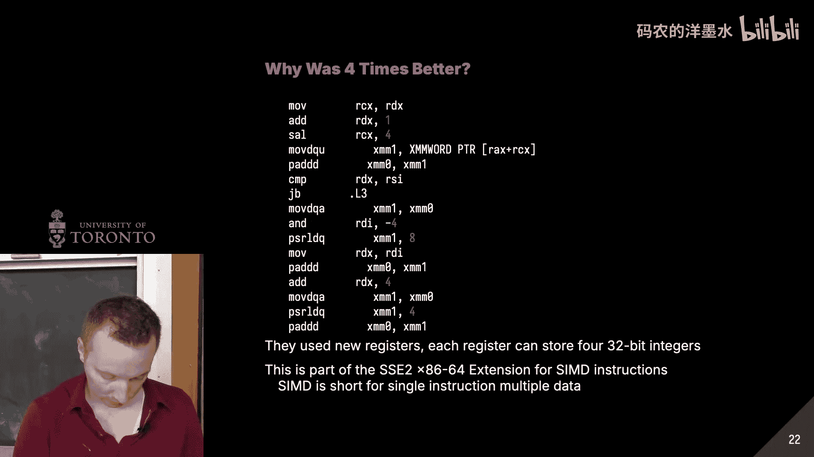

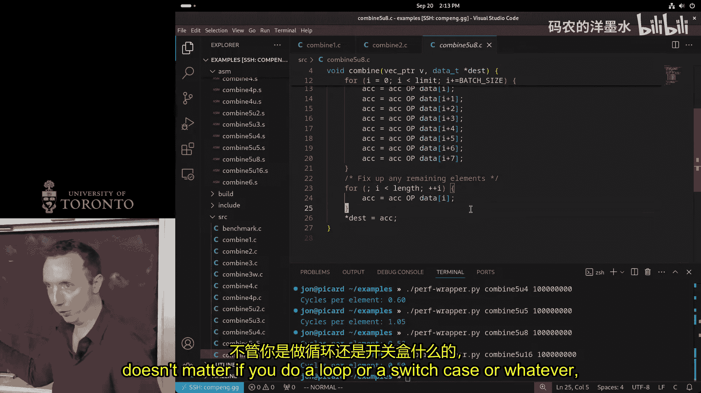

对于满足结合律的操作（如整数加法、乘法），我们可以改变计算顺序来打破数据依赖链，从而暴露更多并行性。

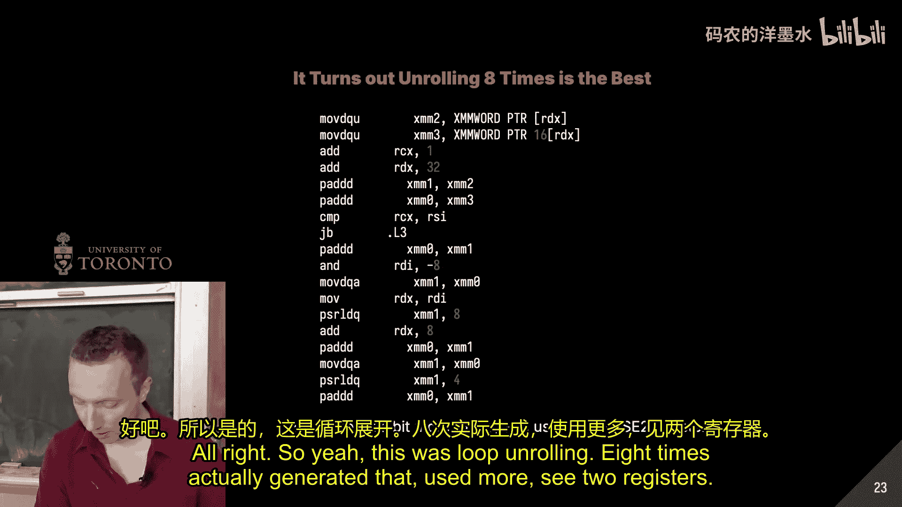

**原始顺序（左结合）**：`acc = ((((acc + data[0]) + data[1]) + data[2]) + data[3]) ...`
这形成了一个长依赖链，每个加法都必须等待前一个加法的结果。

**优化顺序（两两结合）**：
```c
// 假设展开8次，并手动分组
acc = (acc OP data[0]) OP data[1]; // 组1
int acc2 = data[2] OP data[3];     // 组2，独立计算
int acc3 = data[4] OP data[5];     // 组3，独立计算
int acc4 = data[6] OP data[7];     // 组4，独立计算
// 然后合并各组结果
acc = (acc OP acc2) OP (acc3 OP acc4);
```
**结果**：此手动优化版本（在SIMD出现前）是性能最好的，达到了约 **0.7 周期/元素**。它通过创建多个独立的累加路径，让CPU能同时执行更多操作。

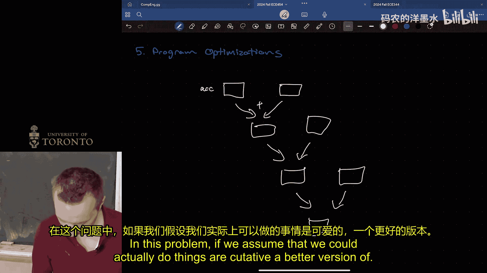

**重要启示**：在现代编译器能够自动向量化后，这种复杂的、难以阅读的手动优化可能不再是最优选择。简单清晰的代码反而更容易被编译器优化。

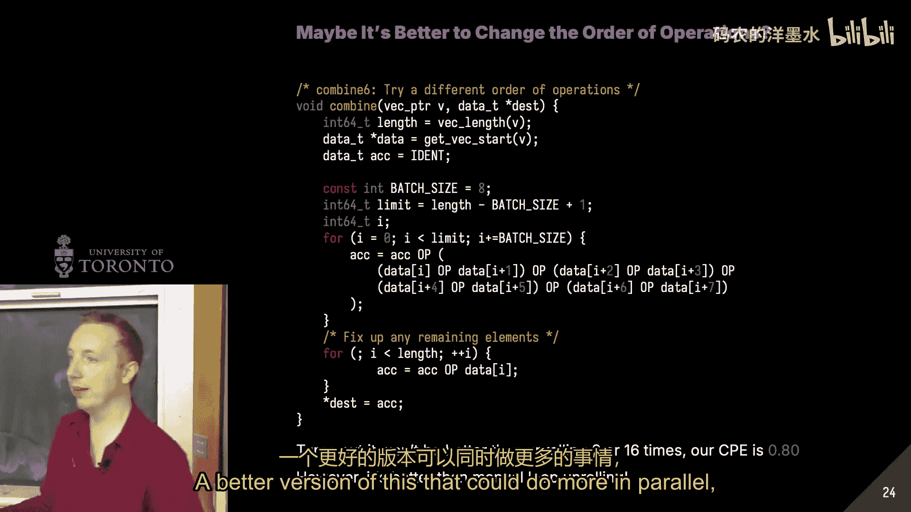

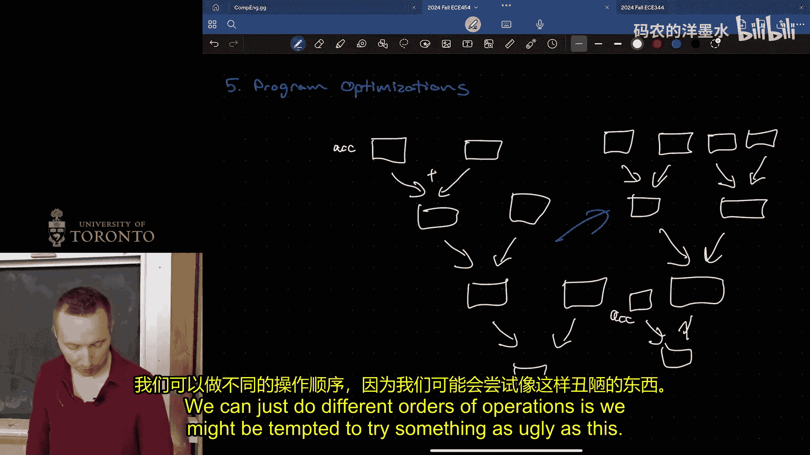

---

## 性能优化总结表

以下是本节课所有优化步骤的效果总结：

| 优化步骤 | 关键改动 | 周期/元素 | 加速比 |
| :--- | :--- | :--- | :--- |
| 1. 初始版本 | 无优化 (`-O0`) | 20.0 | 1.0x |
| 2. 编译器优化 | 添加 `-O2` 标志 | 10.0 | 2.0x |
| 3. 提升循环不变量 | 手动将 `vector_length` 移出循环 | 7.0 | ~2.9x |
| 4. 手动内联访问 | 直接使用数组指针，消除函数调用 | 1.78 | ~11.2x |
| 5. 使用局部累加器 | 减少内存读写，使用寄存器 | 1.60 | ~12.5x |
| 6. 循环展开 (4次) | 手动展开循环4次，触发自动向量化 | ~1.10 | ~18.2x |
| 7. 循环展开 (8次) | 手动展开循环8次，更好利用SIMD | ~0.70 | ~28.6x |
| 8. 改变结合顺序 | 手动分组计算以增加指令级并行 | ~0.65 | ~30.8x |

最终，我们实现了超过 **40倍** 的性能提升。

---

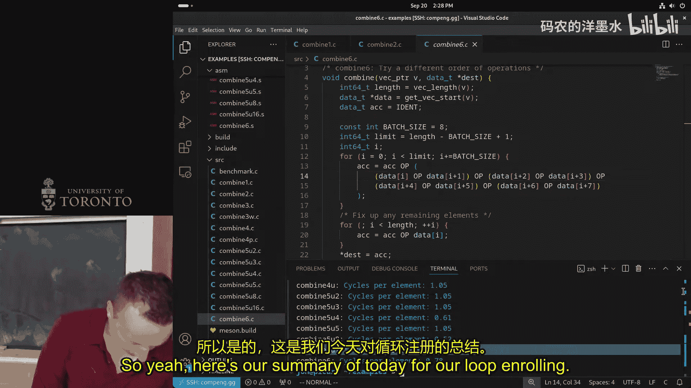

## 核心要点与最佳实践总结

本节课中我们一起学习了从编译器选项到底层手工调整的一系列程序优化技术。以下是需要牢记的核心要点：

1.  **信任但验证编译器**：始终先使用高级别优化（如 `-O2`, `-O3`）。这是性价比最高的优化。
2.  **理解编译器的局限**：编译器无法优化具有潜在副作用的函数调用、通过指针的别名访问等。需要程序员通过**领域特定知识**提供帮助。
3.  **性能分析是关键**：永远基于性能剖析数据（如使用 `perf` 工具）进行优化，避免盲目优化非热点代码。
4.  **偏好局部变量，慎用指针**：局部变量生命周期清晰，利于编译器优化到寄存器。原始指针难以进行别名分析，会阻碍优化。
5.  **利用现代CPU特性**：循环展开可以帮助编译器生成 **SIMD** 向量化指令，这是实现超线性加速的关键。
6.  **代码可读性与性能的平衡**：最精巧的手动优化代码可能随着编译器升级而变得不再最优。写出清晰、简单的代码，通常能为编译器的优化器提供最好的基础。
7.  **优化是迭代和情境化的**：没有放之四海而皆准的优化规则。性能特征因处理器架构、编译器版本和具体问题而异，需要不断测量和实验。

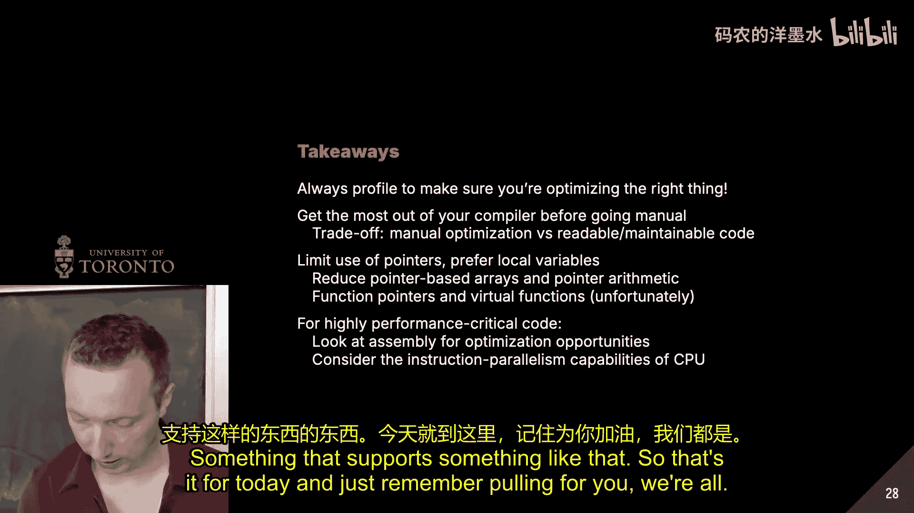

通过本课的学习，你应该掌握了系统化分析和改进程序性能的基本方法论，并能够在实际项目中应用这些技术来挖掘硬件潜力。