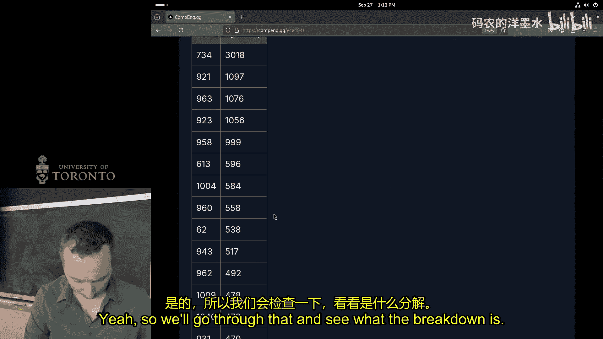
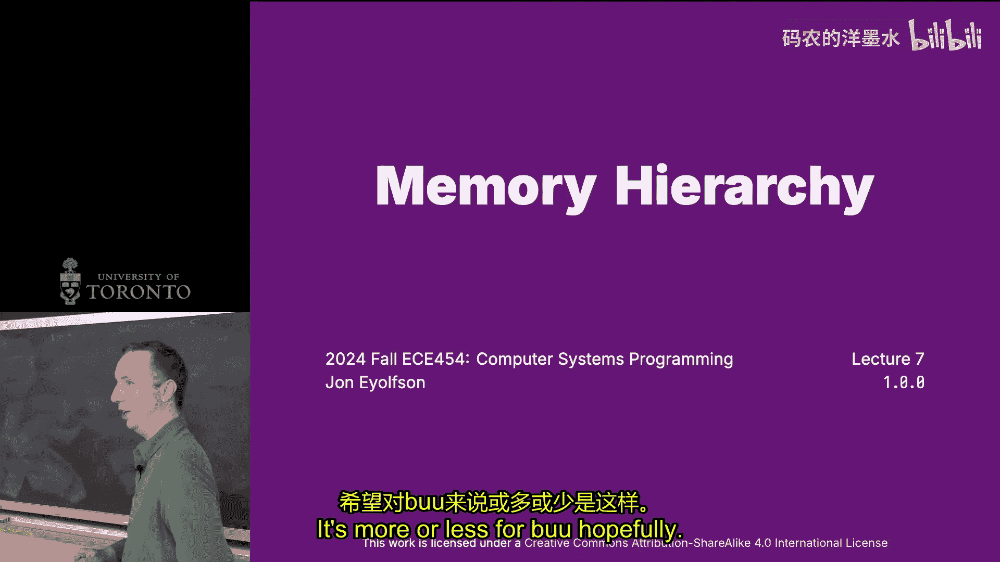
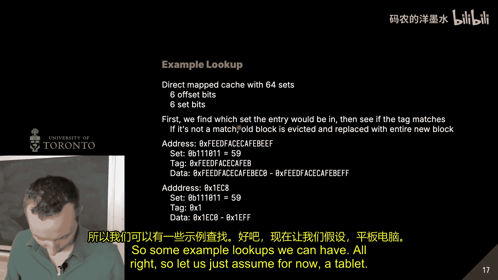
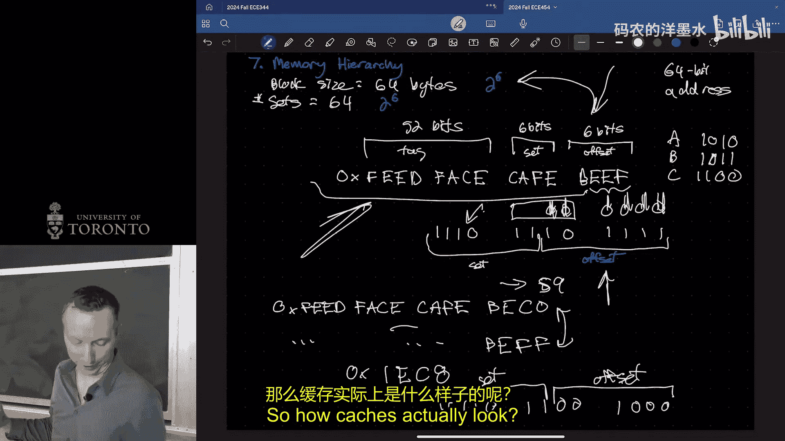
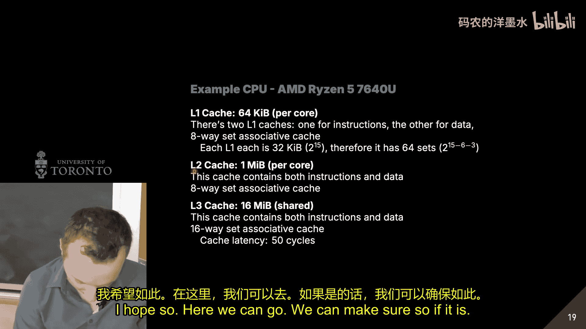
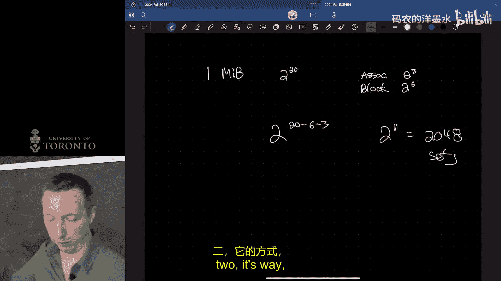
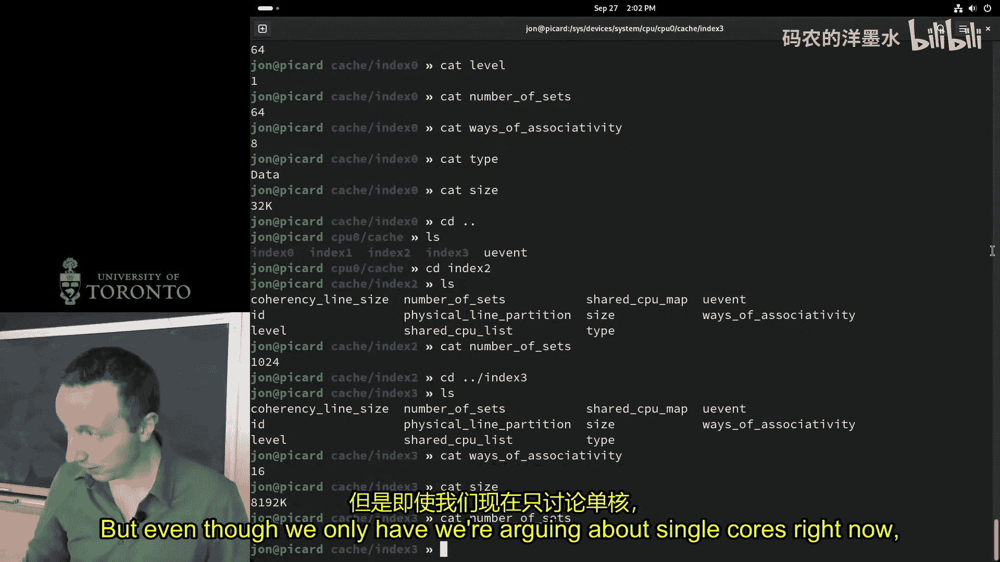

# 007：存储层级 🧠




在本节课中，我们将要学习计算机系统中的存储层级结构，特别是CPU缓存的工作原理。理解这些概念对于编写高性能的C语言程序至关重要。



## 概述

存储层级是计算机系统中不同速度和容量的存储设备的层次结构。从快速的CPU寄存器到慢速但容量巨大的硬盘，每一层都在速度与容量之间进行权衡。本节课我们将重点关注CPU缓存，它是位于CPU和主内存之间的高速存储器，能显著提升程序性能。

上一节我们介绍了性能优化的基本概念，本节中我们来看看如何利用存储层级，特别是CPU缓存，来提升程序效率。

## 存储层级结构

计算机内存是一个巨大的层次结构，在容量和速度之间进行权衡。

*   **寄存器**：位于层次结构的顶端，速度最快，容量最小，直接位于CPU内部的计算单元旁。
*   **CPU缓存**：通常分为三级（L1、L2、L3），作为主内存的缓存。
*   **主内存（RAM）**：容量更大，但速度比缓存慢得多。
*   **非易失性存储**：如NVMe固态硬盘、传统固态硬盘和机械硬盘，容量极大但速度较慢。
*   **磁带驱动器**：用于超大规模、低成本的数据归档存储。

本节课我们将集中讨论CPU缓存。

## 缓存基础机制

任何类型的缓存都通过按块传输内存来工作，而不是一次传输一个字节。

缓存机制的核心思想是：较小、较快、较昂贵的内存（缓存）持有较大、较慢、较便宜内存（如主内存）中数据块的一个子集。当CPU需要访问数据时，如果数据已在缓存中（命中），则可以直接快速获取；否则（未命中），则需要从主内存中加载数据块到缓存中，这会产生性能开销。

以下是缓存命中和未命中的过程示意：

1.  **缓存命中**：CPU请求的数据块（例如块14）已在缓存中，数据直接从缓存传输给CPU。
2.  **缓存未命中**：CPU请求的数据块（例如块12）不在缓存中。缓存需要从主内存中获取该块，将其加载到缓存中，并可能根据替换策略淘汰一个现有的块（受害者），最后再将数据提供给CPU。

缓存需要两种策略：
*   **放置策略**：决定一个新的数据块应放入缓存的哪个位置。
*   **替换策略**：当缓存已满且需要放入新数据时，决定淘汰哪个旧数据块（例如最近最少使用策略）。

## 缓存性能指标

衡量缓存性能有几个关键指标：

*   **未命中率**：内存访问中未在缓存中找到的比例。计算公式为：`未命中率 = 未命中次数 / 总访问次数`。通常L1缓存的未命中率在3%到10%，L2则低于1%。
*   **命中时间**：将缓存行（数据块）交付给处理器所需的时间，包括确定该行是否在缓存中的时间。L1缓存约为1-4个时钟周期，L2为25-20个周期，L3为30个周期以上。
*   **未命中惩罚**：由于未命中而需要从主内存获取数据所增加的额外时间，通常为50到400个周期。

命中与未命中之间的时间差异巨大（可达100倍），因此即使未命中率仅有微小变化（例如从1%升至3%），平均访问时间也可能翻倍，对程序性能产生显著影响。

## 未命中的类型

未命中主要分为三种类型：

*   **冷启动未命中**：首次访问某块内存时必然发生，因为缓存初始为空。预取技术可以帮助缓解。
*   **冲突未命中**：由缓存的放置策略引起。当多个数据对象映射到同一个缓存组（`set`），而该组容量有限时，即使缓存整体未满，也会发生冲突和替换。现代缓存的组织方式（组相联）减轻了此问题。
*   **容量未命中**：当程序活跃使用的工作集大小超过缓存总容量时发生。这是当前最主要的问题，因为缓存容量有限。

## 局部性原理

缓存之所以有效，是因为程序具有**局部性**，即程序倾向于使用最近使用过的或地址相近的数据和指令。



*   **时间局部性**：最近被引用过的项很可能在不久的将来再次被引用（例如，循环中反复更新同一个变量）。
*   **空间局部性**：地址相近的项很可能在时间上被集中引用（例如，顺序执行指令或顺序访问数组元素）。

大多数程序访问都表现出良好的局部性，这使得缓存能够高效工作。

## 缓存组织结构

现代CPU缓存通常组织为一个二维结构。

一个缓存由多个**组**构成，每个组内可以有多个**条目**。每个条目存储一个内存**块**的数据。决定缓存大小的三个参数是：
*   **块大小**：每个数据块的大小（B字节）。
*   **组数**：缓存中组的数量（S）。
*   **相联度**：每个组中可以存放的条目数（E）。



缓存总容量可以通过公式计算：`缓存大小 = S × E × B`。

当CPU给出一个内存地址时，它被划分为三部分：
*   **块偏移**：用于定位块内的具体字节（使用 `log2(B)` 位）。
*   **组索引**：用于确定地址属于哪个组（使用 `log2(S)` 位）。
*   **标签**：地址中剩余的高位部分，与存储在缓存条目中的标签进行比较，以确认是否命中。

## 缓存映射方式

根据相联度E的不同，缓存有三种主要映射方式：

*   **直接映射缓存**：每个组只有一个条目（E=1）。一个内存块只能放在一个特定的组中。容易发生冲突未命中。
*   **组相联缓存**：每个组有多个条目（E>1，常见如8路、16路）。一个内存块可以放在对应组中的任何一个空闲条目里。这减少了冲突未命中。
*   **全相联缓存**：只有一个组（S=1），但该组包含所有条目。一个内存块可以放在缓存中的任何位置。实现复杂，通常只用于小容量缓存（如TLB）。



现代CPU的L1、L2缓存通常是组相联的。




## 实际缓存参数探查

在Linux系统上，可以使用命令查看CPU缓存的详细信息。

以下是几个有用的命令：
*   `lscpu`：查看CPU概要信息，包括缓存大小。
*   `lstopo` 或 `lstopo-no-graphics`：以图形或文本形式显示系统的拓扑结构，包括缓存层次。
*   查看 `/sys/devices/system/cpu/cpu0/cache/` 目录下的文件：可以获取特定CPU核心上每个缓存（index0对应L1d，index1对应L1i，以此类推）的详细信息，如级别、类型、大小、组数、相联度和行大小（块大小）。

例如，行大小通常为64字节，这与内存传输的基本单位一致。

## 缓存写策略

当CPU执行写操作时，需要处理缓存一致性问题。主要有两种策略：

*   **写命中**：
    *   **直写**：同时更新缓存和主内存。简单但慢。
    *   **写回**：只更新缓存，并标记该缓存行为“脏”。当该行被淘汰时，才写回主内存。这是更常见的策略，性能更好。
*   **写未命中**：
    *   **写分配**：先将目标内存块加载到缓存中，然后在缓存中更新。适用于后续可能再次访问该数据的情况。
    *   **非写分配/绕写**：直接写入主内存，不加载到缓存。适用于一次性写入且后续不再访问的数据。



现代CPU缓存通常采用**写回 + 写分配**的组合策略。

## 使用Perf测量缓存未命中率

`perf` 是Linux下强大的性能分析工具，可以用来测量程序的缓存未命中率。

例如，可以测量L1数据缓存（L1-dcache）的加载未命中事件：
```bash
perf stat -e L1-dcache-load-misses,L1-dcache-loads ./your_program
```
这将输出加载次数和未命中次数，从而可以计算未命中率。类似的事件也存在于指令缓存（L1-icache）和其他缓存层级。

`perf list` 命令可以列出所有可监控的性能事件。

## 总结


本节课中我们一起学习了计算机存储层级的核心概念，特别是CPU缓存。我们了解了缓存的基本工作原理、性能指标、局部性原理的重要性，以及缓存是如何通过组、块和标签来组织的。我们还探讨了不同的缓存映射方式和写策略，并学习了如何在实际系统中查看缓存参数和使用 `perf` 工具来度量缓存效率。理解这些知识是进行高性能C语言系统编程的基础，能够帮助您编写出对缓存友好的高效代码。在接下来的课程中，我们将学习如何应用这些知识来优化具体的程序，例如矩阵乘法。