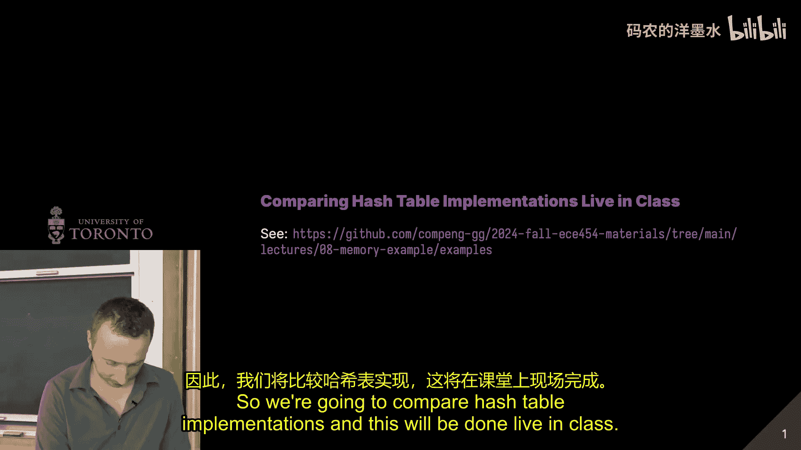
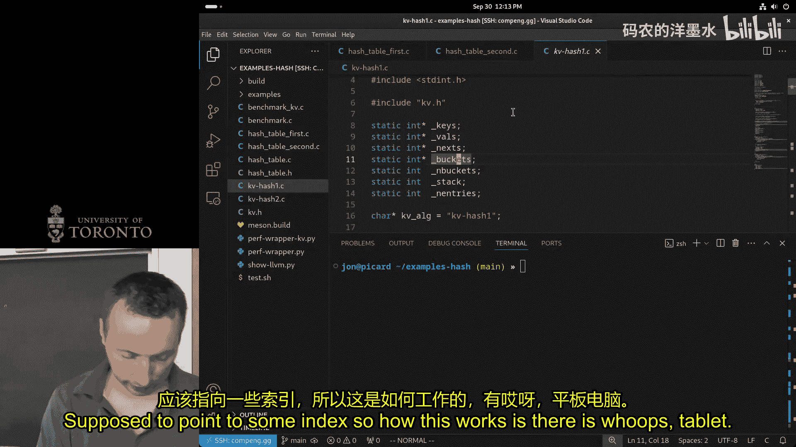
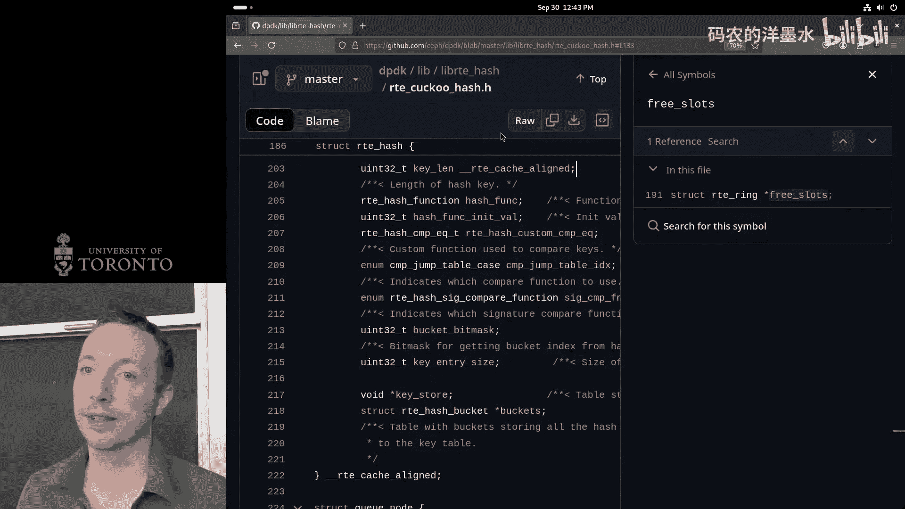

# 008：内存优化示例

在本节课中，我们将通过一个具体的哈希表实现示例，来探讨如何通过优化内存访问模式来提升程序性能。我们将分析几种不同的哈希表实现，并观察它们对CPU缓存命中率的影响。


## 概述





上一节我们介绍了CPU缓存的基本原理。本节中，我们将通过一个实际的哈希表代码示例，看看如何应用这些知识来优化内存访问。我们将比较几种不同的哈希表实现，并分析它们各自的性能表现。


## 初始哈希表实现

首先，我们来看一个基础的哈希表实现。它使用多个全局数组来存储键、值和用于处理冲突的“下一个”索引。

以下是其核心数据结构：

```c
int *keys;
int *values;
int *next;
int *buckets;
int num_buckets;
```

哈希表的工作原理如下：
*   `keys`、`values`、`next` 是三个独立的数组，每个索引对应一个条目。
*   `buckets` 数组代表哈希表本身，每个桶存储一个索引，指向 `keys`/`values`/`next` 数组中的某个条目。
*   当发生哈希冲突时，通过 `next` 数组形成链式索引（类似链表，但使用数组索引而非指针）。

插入函数 `insert` 的逻辑是：
1.  计算键的哈希值并确定桶的索引。
2.  如果桶为空（值为-1），则直接将新条目放入。
3.  如果桶不为空，则沿着 `next` 链寻找，直到找到空位或相同的键（用于更新）。

查找函数 `find` 的逻辑类似，沿着链搜索指定的键。

当我们对这个实现进行基准测试时，其末级缓存（LLC）的未命中率大约在50%左右。

## 尝试优化：缓存行友好的哈希表

接下来，我们尝试一个旨在提高缓存友好性的版本。核心思想是让每个哈希表条目存储多个键值对，使其能填满一个缓存行。

以下是其核心数据结构：

```c
int (*keys)[LINE_SIZE];
int (*values)[LINE_SIZE];
int *next;
int *buckets;
```

这个版本的主要变化是：
*   `keys` 和 `values` 现在是二维数组，每个主索引对应一个缓存行（例如8个键或值）。
*   它减少了桶的数量，但增加了每个桶的容量（`LINE_SIZE`），试图保持总内存使用量大致不变。
*   在发生冲突时，它会先尝试填满当前缓存行内的空位，只有当整行都满时才创建新的行。

运行此版本后，我们发现一个有趣的现象：虽然缓存未命中率上升了，但每个查找操作的平均CPU周期数却下降了。这提示我们，优化效果可能受到桶数量改变（影响冲突率）等因素的干扰，比较并不完全公平。

## 更传统的链表实现

为了进行更清晰的对比，我们实现了一个更传统的、基于链表的哈希表。

其核心数据结构定义如下：

```c
typedef struct entry {
    int key;
    int value;
    struct entry *next;
} entry_t;

typedef struct {
    int num_buckets;
    entry_t **buckets;
} hashtable_t;
```

插入逻辑如下：
1.  计算哈希值找到对应的桶。
2.  如果桶为空，则分配一个新节点并放入。
3.  如果桶不为空，则遍历链表。如果找到相同键，则更新值；否则，将新节点插入链表头部。

对这个版本进行基准测试，其负载未命中率约为7%，末级缓存未命中率仍在50%左右。

## 优化链表实现：缓存行对齐的条目

我们的优化思路是：修改链表节点（`entry`）的结构，使其能容纳多个键值对，并确保其大小与缓存行对齐。

优化后的条目结构如下：

```c
typedef struct entry {
    int keys[LINE_SIZE];
    int values[LINE_SIZE];
    struct entry *next;
    int length; // 当前存储的有效键值对数量
    int padding; // 用于填充，确保结构体大小为64字节
} entry_t;
```

插入逻辑调整为：
1.  找到对应的桶和链表。
2.  遍历链表上的每个 `entry`。
3.  在每个 `entry` 内部，遍历其 `keys` 数组（长度为 `length`）。
4.  如果找到键，则更新值。
5.  如果未找到但该 `entry` 未满（`length < LINE_SIZE`），则将其加入。
6.  如果已满，则移动到链表下一个 `entry`。
7.  如果链表遍历完毕仍未插入，则分配一个新的、缓存行对齐的 `entry`。

我们使用 `aligned_alloc(64, sizeof(entry_t))` 来确保每个 `entry` 在64字节边界上对齐。

然而，运行这个版本得到了令人意外的结果：性能反而下降了！虽然缓存未命中率显著降低（从7%降至3.8%），但每个操作的周期数增加了。原因在于，为了获得缓存友好性，每个条目的大小从16字节增加到了64字节。在保持桶数量不变的情况下，哈希表的总内存占用变成了原来的4倍，这本身就会对性能产生负面影响。

## 关键微调：访问顺序的重要性

我们发现了另一个微妙的性能问题。在之前的插入逻辑中，当一个新的 `entry` 被创建并添加到链表时，它被加在了链表头部。这意味着，对于一个已满的桶，最先被访问的将是那个可能只包含一个元素的新 `entry`，然后才通过指针跳转到那个存满了有效数据的旧 `entry`。

优化策略很简单：确保链表始终指向那个最满的 `entry`。这样，在大多数访问中，程序首先检查的就是包含最多数据的缓存行，从而减少了不必要的指针追逐。

仅仅做了这个调整后，我们重新运行测试。这次，在缓存未命中率进一步降低到2%左右的同时，我们也获得了一个小幅的性能提升。这证明了在优化时，细节至关重要。

## 高级参考：工业级哈希表实现

如果你对这个话题感兴趣，可以研究像 **cuco** 这样的工业级哈希库。它们进行了更深层次的优化，例如：
*   在条目中只存储键的签名（`key`），而将值（`value`）分开存放，这样在搜索时可以在一个缓存行内检查更多键。
*   使用编译器属性（如 `__attribute__((aligned(64)))`）来确保结构体对齐。
*   实现本地空闲槽缓存、环形缓冲区等复杂机制来管理内存。
*   考虑并发访问，集成自旋锁等线程安全机制。



## 总结

本节课中我们一起学习了如何通过实际代码示例来分析和优化内存访问模式。我们比较了多种哈希表实现，并观察到：
1.  简单的数据结构改变（如将多个元素打包进缓存行）可以降低缓存未命中率。
2.  但优化时必须进行公平比较，注意控制变量（如总内存使用量）。
3.  微妙的实现细节，如链表节点的访问顺序，会对性能产生显著影响。
4.  高性能编程通常需要在多个因素（缓存友好性、内存占用、算法复杂度）之间进行权衡。


内存优化是一个需要仔细测量和实验的领域，一个地方的改进可能会在另一个地方带来意想不到的开销。