# 009：缓存优化

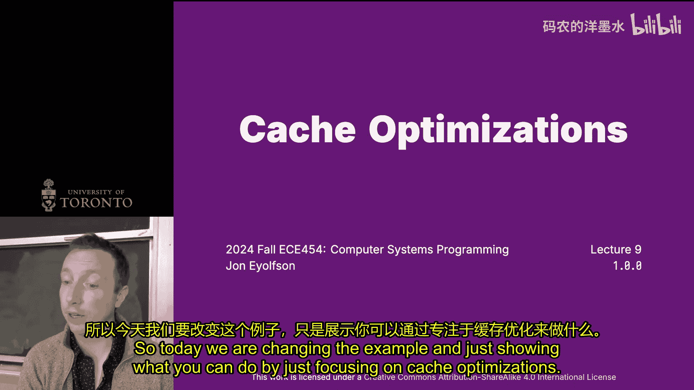

在本节课中，我们将深入学习缓存优化的核心概念。我们将从一个简单的例子开始，分析缓存未命中率，并探讨如何通过改变数据访问模式来显著提升程序性能。特别是，我们将重点研究矩阵乘法，并引入一种名为“分块”的强大优化技术。

上一节我们尝试了缓存优化，但效果并不理想。今天，我们将更换例子，专注于展示仅通过优化缓存访问能实现的效果。

## 🧠 核心概念：局部性

在任何性能编程课程中，一个重要的建议是：编写具有**局部性**的代码。我们之前讨论过两种主要类型：
*   **时间局部性**：如果你使用了某块内存，很可能很快会再次使用它。
*   **空间局部性**：你希望访问相邻的内存地址，这样系统可以高效协作。计算机喜欢顺序访问。

为了实现良好的局部性，我们需要设计优秀的算法，并可能专注于**循环变换**或我们今天将介绍的其他技术。

## 📐 C语言中二维数组的内存布局

首先，每个人都应该了解C语言中二维数组是如何在内存中布局的。C语言采用**行主序**，这意味着同一行的元素在内存中是连续存放的。你可以将其视为一个一维数组。

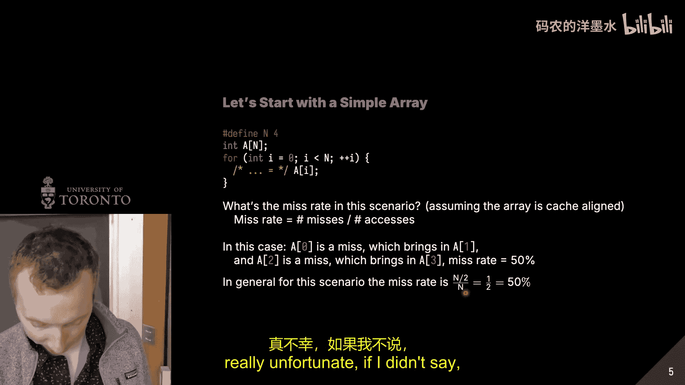

对于一个二维数组 `table[row][col]`，将其转换为一维数组的公式是：
`1D_index = row * NUMBER_OF_COLUMNS + col`

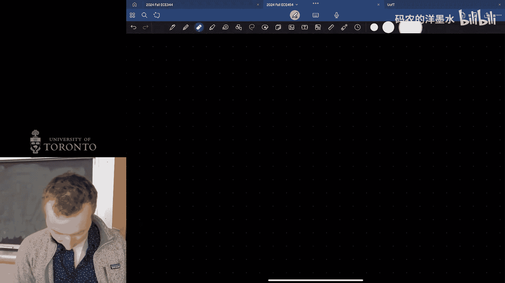

因此，`table[0][0]` 是一维数组的第一个元素，`table[0][1]` 是第二个，依此类推。

## 🧪 分析一个简单的缓存模型

在本讲座中，大多数时候我们将假设一个简单的缓存模型，并计算缓存未命中率。

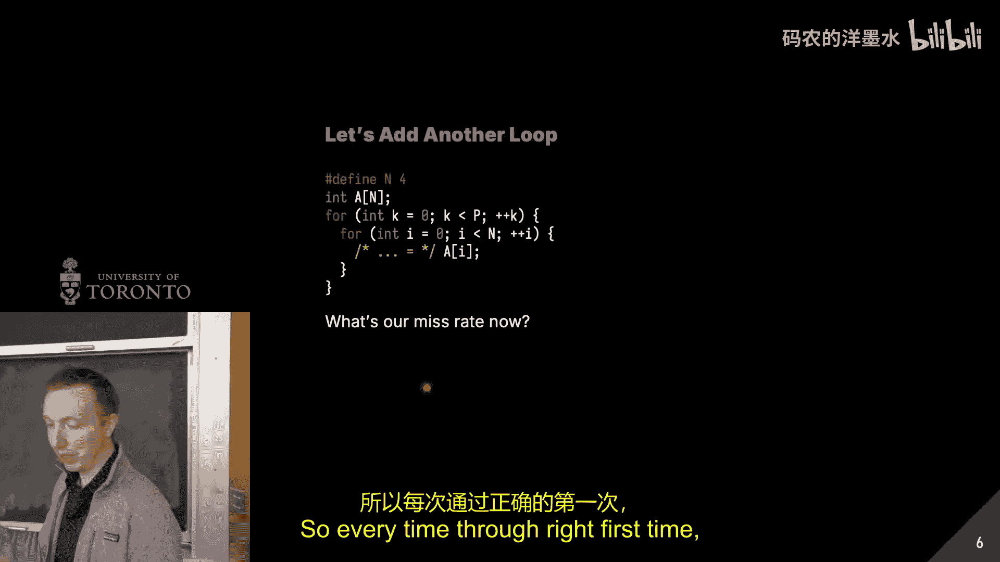

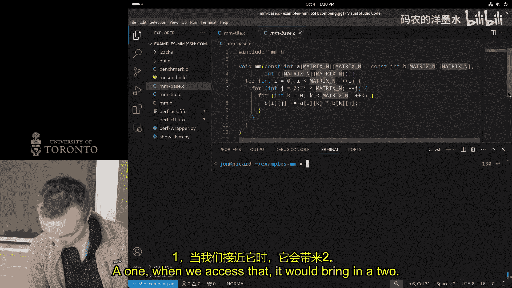

我们将使用的例子是一个非常简单的缓存：
*   **块大小/行大小**：8字节。因此，如果使用整型数组，一个缓存行可以容纳两个 `int`。
*   **关联性**：2路组相联，但只有一个组。这实际上等同于全相联。
*   **缓存大小**：总共只有2个块。
*   **替换策略**：最近最少使用。

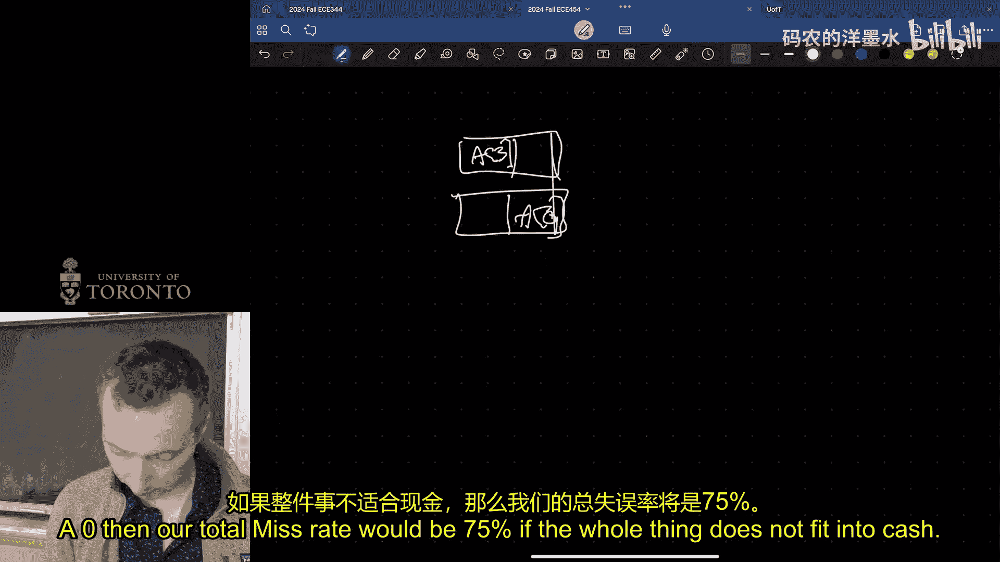

在编程时，尤其是使用数组时，你应该始终问自己以下几个问题：
*   一个缓存块能容纳多少个元素？
*   我的数据结构能放入缓存吗？
*   我是否随时间重复使用缓存块？
*   我以什么顺序访问这些块？

所有这些因素都会影响你的程序性能。

## 🔍 分析一维数组访问

让我们从一个非常简单的数组开始分析。假设 `n = 4`，我们创建一个包含4个元素的整型数组 `a`，然后有一个 `for` 循环来读取 `a` 的元素。

对于我们的缓存，我们应该能计算出这种情况下的未命中率（假设数组是缓存对齐的）。未命中率是 **未命中次数 / 访问总次数**。

以下是访问过程分析：
1.  访问第一个元素 `a[0]`：**未命中**。缓存会加载包含 `a[0]` 和 `a[1]` 的块。
2.  访问第二个元素 `a[1]`：**命中**。
3.  访问第三个元素 `a[2]`：**未命中**。缓存会加载包含 `a[2]` 和 `a[3]` 的块。
4.  访问第四个元素 `a[3]`：**命中**。

在这个例子中，我们有2次未命中和4次访问，因此未命中率是 **50%**。

将其推广，如果缓存只能容纳两个元素，那么未命中率总是 **50%**。如果我们的缓存块能容纳4个元素（假设缓存对齐），未命中率将是 **25%**。

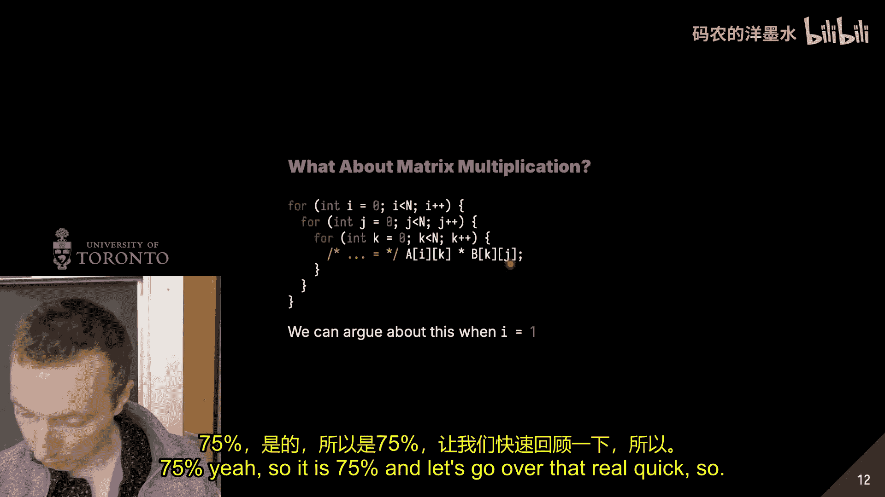

### 缓存未对齐的影响

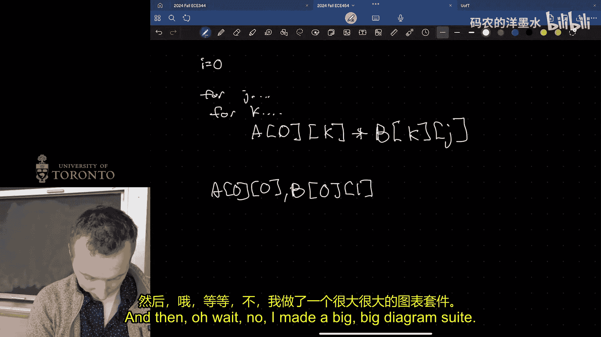

如果我们不假设缓存对齐，情况会变糟。如果数组起始地址没有对齐到缓存行边界，访问 `a[0]` 可能只加载了它自己，而 `a[1]` 在下一个缓存行。这会导致更多的未命中。在上面的4元素例子中，未命中率可能高达 **75%**。因此，**缓存对齐** 非常重要。

## 🔁 嵌套循环下的访问

现在，让我们在外部再添加一个循环。我们假设整个数组可以放入缓存。

内部循环的未命中率仍然是50%。但是，在第一次遍历外部循环后，整个数组已经加载到缓存中。在后续的外部循环迭代中，所有访问都将是**命中**。

因此，总的未命中率公式为：`1 / (2 * P)`，其中 `P` 是外部循环的次数。运行外部循环的次数越多，命中率就越高。

如果数据**不能**放入缓存，那么每次外部循环迭代时，缓存内容都可能被替换，未命中率将回到 **50%**。所以，**数据能否放入缓存** 对于具有多重循环的程序性能至关重要。

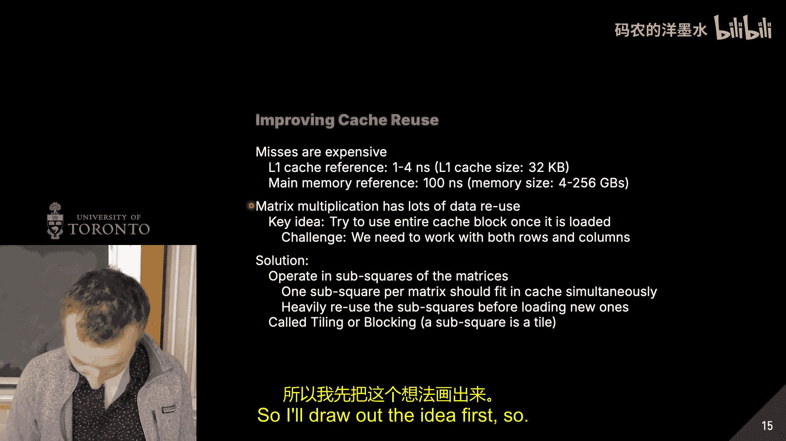

## 🧮 二维数组与访问顺序

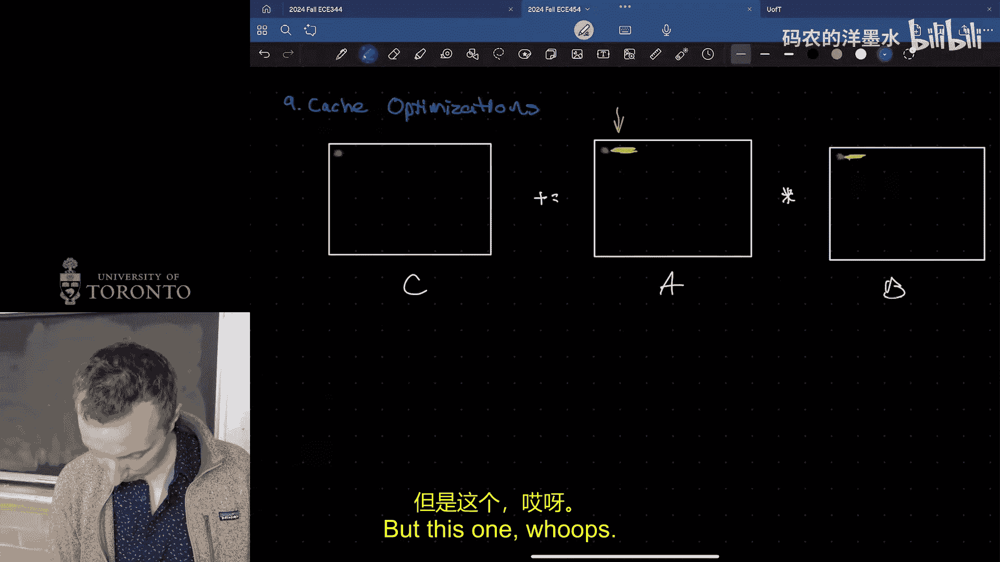

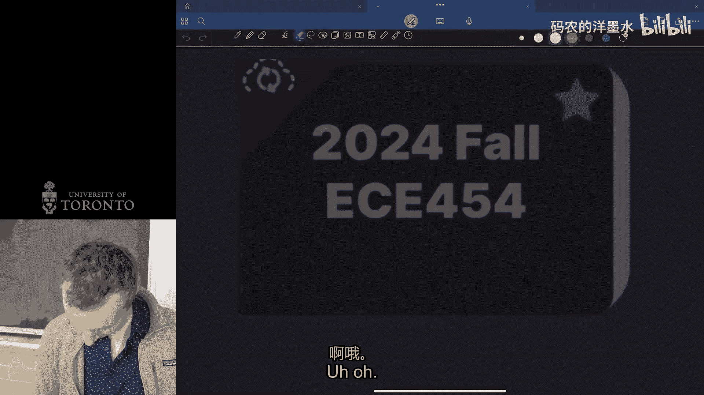

如果我们有一个二维数组，并且按行主序访问（先行后列），只要整个数组能放入缓存，其未命中率与顺序访问一维数组相同。

但是，如果我们改变访问顺序，按列主序访问（先列后行），情况就不同了。只要整个数组能放入缓存，未命中率仍然可以接受。然而，一旦数组太大无法放入缓存，按列访问就会导致灾难性的后果。

例如，对于一个4x4的数组，按列访问的序列（转换为一维索引）是：`a[0]`, `a[4]`, `a[8]`, `a[12]`, `a[1]`... 由于每次访问的地址跨度很大，且缓存很小，每次访问都可能落在不同的缓存行上，导致**100%的未命中率**。这就是为什么**循环交换**（确保按行访问）如此重要。编译器通常会帮你做这个优化，但检查一下总是好的。

## ⚡ 矩阵乘法的缓存分析

现在，让我们分析一个更复杂的例子：矩阵乘法。标准的朴素矩阵乘法代码如下：

```c
for (i = 0; i < n; i++) {
    for (j = 0; j < n; j++) {
        for (k = 0; k < n; k++) {
            C[i][j] += A[i][k] * B[k][j];
        }
    }
}
```

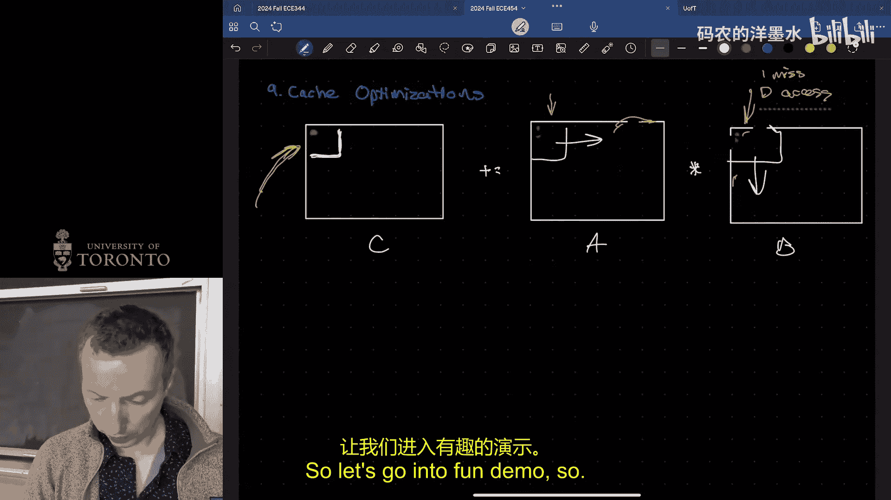

对于矩阵 `A`，我们按行访问（`A[i][k]`），具有良好的空间局部性。但对于矩阵 `B`，我们按列访问（`B[k][j]`），这非常糟糕，特别是当矩阵很大时。

分析表明，在这种访问模式下，对于矩阵 `B` 的访问几乎每次都是未命中。即使缓存很大，未命中率也被限制在 **50%** 左右，无法更好。

## 🧱 解决方案：分块优化

为了改善缓存重用，关键在于尝试在加载一个数据块后，尽可能多地重复使用它。我们需要同时处理行和列。

解决方案是**分块**。我们不是一次性遍历整个矩阵，而是将矩阵划分为更小的子块（Tile）。确保这些子块能同时放入缓存。然后，我们在这个子块上完成所有必要的计算，充分利用已加载到缓存中的数据，然后再移动到下一个子块。

以下是分块矩阵乘法的伪代码思路：

```c
#define TILE_SIZE 16 // 根据缓存大小选择

for (i = 0; i < n; i += TILE_SIZE) {
    for (j = 0; j < n; j += TILE_SIZE) {
        for (k = 0; k < n; k += TILE_SIZE) {
            // 计算子块 (i, j)，使用子块 (i, k) 和 (k, j)
            for (ii = i; ii < i + TILE_SIZE; ii++) {
                for (jj = j; jj < j + TILE_SIZE; jj++) {
                    for (kk = k; kk < k + TILE_SIZE; kk++) {
                        C[ii][jj] += A[ii][kk] * B[kk][jj];
                    }
                }
            }
        }
    }
}
```

虽然代码看起来有六层循环，更复杂，但它访问内存的方式对缓存友好得多。对于矩阵 `A` 和 `B` 的子块，我们都能充分利用每个缓存行，将未命中率从接近100%降低到约 `1 / TILE_SIZE`。

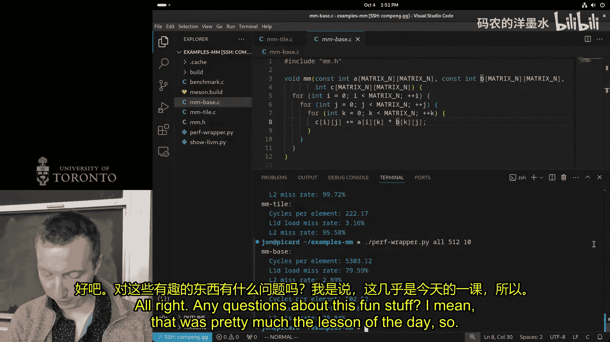

### 性能演示

在实际演示中，对于小矩阵（如16x16），朴素方法和分块方法性能差异不大，因为数据都能放入缓存。但当矩阵增大（如128x128或更大）时，分块技术的优势变得极其明显，性能可以提升数倍甚至一个数量级，同时L1缓存未命中率大幅下降。

分块技术确保了我们只在缓存中保留当前正在处理的数据块，从而最大限度地利用了缓存容量和带宽。

## 📝 总结

本节课中，我们一起学习了缓存优化的核心思想：
1.  **理解局部性**：时间局部性和空间局部性是高效缓存利用的基础。
2.  **分析访问模式**：通过简单的缓存模型，我们可以估算代码的缓存未命中率。行主序访问通常优于列主序访问。
3.  **识别性能瓶颈**：在像矩阵乘法这样的算法中，对第二个矩阵的列访问是主要的性能瓶颈。
4.  **应用分块技术**：通过将大数据集分解为能放入缓存的小块，并在此块上完成尽可能多的工作，我们可以显著减少缓存未命中，从而大幅提升程序性能。这是一种以空间换时间（更准确地说，是以循环复杂度换缓存效率）的强大优化手段。

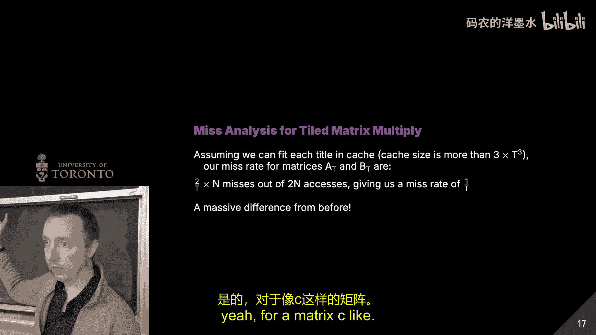

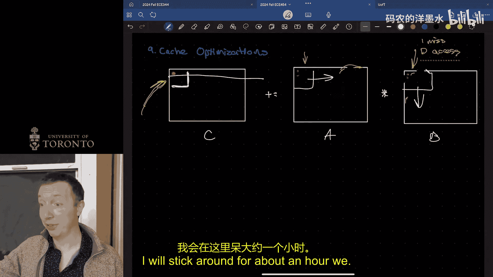

记住，即使代码看起来更复杂（如六重循环），如果它能更好地匹配硬件特性（如缓存层次结构），也可能带来巨大的性能收益。编译器并非总能自动完成这类优化，因此掌握手动分析和优化技巧对于高性能编程至关重要。