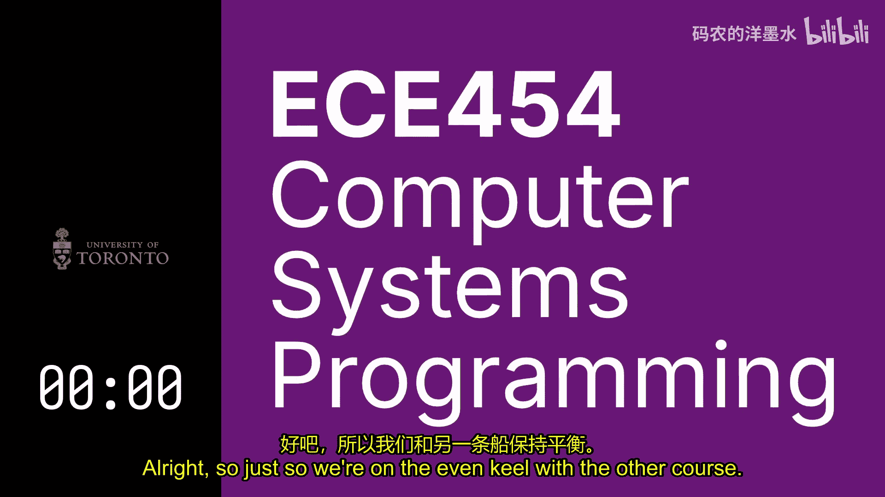

# 011：动态内存



## 概述

在本节课中，我们将要学习动态内存管理。我们将探讨为什么需要动态内存、内存对齐的规则、以及如何实现像 `malloc` 和 `free` 这样的内存管理函数。我们还将了解内存碎片化问题，并学习几种不同的内存分配策略，如隐式空闲链表、显式空闲链表和伙伴分配器。这些知识将帮助你理解内存分配器的工作原理，并为后续的编程实践打下基础。

## 为什么需要动态内存分配？

我们可能无法在编译时知道所需内存的大小。例如，程序可能需要根据用户输入或从文件读取的数据来分配内存。主内存是宝贵的资源，我们不希望浪费它，否则可能会导致内存不足。


首先，我们需要回答一个问题：为什么不能总是使用栈来分配内存？栈上分配的变量在其作用域结束时会被自动释放。如果所有变量的生命周期都相同，并且只存在于一个函数内，那么栈分配是快速且高效的。然而，我们并不总是知道内存的使用寿命。如果内存的使用寿命超过了函数的作用域，我们就必须动态地分配它。

## 内存布局

一个典型进程的内存布局如下：内核会为自己分配一些虚拟地址空间，用户无法访问。栈通常位于顶部，有固定的大小，并向低地址方向增长。内存映射区域用于加载动态库，通常位于堆和栈之间。堆是一个大的内存区域，`malloc` 等函数主要使用堆进行分配。此外，还有未初始化的全局变量（BSS段）、已初始化的全局变量（数据段）以及程序代码（文本段）。


## 内存对齐

对齐是指数据在内存中的起始地址是某个数K的倍数。例如，如果要求8字节对齐，那么地址必须是0、8、16等，即能被8整除。

为什么需要对齐？如果数据结构没有对齐，可能会跨越缓存行的边界。例如，一个整数如果起始于一个奇数地址，它可能一部分在一个64字节的缓存块中，另一部分在另一个缓存块中，这会导致性能下降。CPU通常希望数据按字大小对齐，未对齐的访问可能需要两次内存读取。

编译器通常会为我们处理对齐。`malloc` 返回的地址也是对齐的。例如，在64位系统上，`malloc` 通常返回16字节对齐的地址，以满足最严格的对齐要求。

我们可以使用 `__attribute__((aligned(n)))` 来建议编译器将结构体按n字节对齐。

以下是结构体对齐的具体规则：
*   结构体的起始地址必须与其最大成员的对齐要求一致。
*   结构体成员在内存中的顺序与声明顺序一致。
*   编译器可能会在成员之间插入填充字节以满足每个成员自身的对齐要求。

例如，考虑以下结构体：
```c
struct S1 {
    char c;         // 1字节
    int i[2];       // 每个int 4字节，共8字节
};
```
`int` 需要4字节对齐。因此，编译器会在 `char c` 之后插入3字节的填充，使得数组 `i` 从4字节对齐的地址开始。整个结构体的大小为12字节，对齐要求为4字节。

如果结构体成员顺序安排不当，会导致空间浪费。将大小相似的成员声明在一起可以减少填充。

## 内存管理API

`malloc` 函数用于分配内存。它接受一个表示字节数的 `size` 参数。如果成功，它返回一个指向新内存块的指针。如果 `size` 为0，行为由实现定义。如果失败，它返回 `NULL` 并设置 `errno`。

`free` 函数用于释放内存。它接受一个由 `malloc`、`calloc` 或 `realloc` 返回的指针，并将该内存块返回给可用内存池。调用 `free` 后，指针不应再被使用。

`realloc` 函数用于调整已分配内存块的大小。它接受一个旧指针和一个新的 `size` 参数。它可能尝试在原地调整大小，也可能分配新内存、复制数据并释放旧内存。

## 分配器的目标与约束

内存分配器管理着一系列内存块。每个块可以是可变大小的、连续的。分配器需要处理任意的分配和释放请求序列。

分配器的目标包括：
1.  **吞吐量**：处理 `malloc` 和 `free` 请求的速度要快。
2.  **内存利用率**：尽量减少浪费的空间（碎片化）。

这两个目标通常是相互冲突的。更智能的分配策略可以提高内存利用率，但可能会降低分配速度。

我们需要衡量内存利用率。**聚合负载(P)** 是用户通过 `malloc` 当前正在使用的内存总量（已分配但未释放）。**堆大小(Hk)** 是分配器从系统获取的总内存量。**峰值内存利用率(U)** 是聚合负载的最大值除以达到该峰值时的堆大小。我们希望U尽可能接近1。

## 内存碎片

碎片化是浪费的空间，分为两种：
1.  **内部碎片**：分配块内部未使用的空间。例如，由于对齐或分配器的最小块大小限制，分配给用户的内存块可能大于其请求的大小。
    *   公式：`内部碎片 = 分配块大小 - 用户请求大小`
2.  **外部碎片**：堆中分散的、空闲的、但由于不连续而无法满足当前分配请求的小块内存。
    *   它取决于未来的请求模式，难以测量。

## 实现一个简单的分配器

要实现 `malloc` 和 `free`，我们需要解决几个问题：
1.  如何知道要释放多少内存？`free` 只接收一个指针。
2.  如何追踪哪些内存是空闲的？

一个常见的方法是在每个内存块之前存储一个**头部（header）**。头部可以存储块的大小以及一个标记位（指示块是已分配还是空闲）。由于大小通常是偶数，我们可以利用最低有效位来存储分配状态。

```c
// 假设字大小为8字节（64位系统）
typedef size_t word_t;

// 从头部获取块大小（掩码掉最低位）
#define GET_SIZE(p)  (*(word_t*)(p) & ~0x7)
// 从头部获取分配状态
#define GET_ALLOC(p) (*(word_t*)(p) & 0x1)
// 设置头部（大小和状态）
#define SET_HEADER(p, size, alloc) (*(word_t*)(p) = (size) | (alloc))
```

### 隐式空闲链表

在这种方法中，我们通过遍历所有内存块（包括已分配和空闲的）来寻找空闲块。我们从堆的起始位置开始，利用每个块的头部信息中的大小字段，跳到下一个块。

寻找空闲块的策略：
*   **首次适配**：从开始搜索，选择第一个足够大的空闲块。
*   **下次适配**：从上一次搜索结束的地方开始搜索。
*   **最佳适配**：搜索整个链表，选择满足要求的最小空闲块。

当找到一个空闲块时，如果它比需求大，我们将其**分割**：一部分用于分配，剩余部分形成一个新的空闲块。

释放一个块时，我们只需将其标记为空闲。但为了减少外部碎片，我们需要**合并**相邻的空闲块。为了能够向后合并，我们可以在每个块的尾部也存储一个相同的头部信息（称为**脚部**）。这样，释放一个块时，我们可以检查其前后相邻块的状态，如果空闲则进行合并。

隐式空闲链表的分配时间是总块数（已分配+空闲）的线性函数，这可能很慢。

### 显式空闲链表

为了加快分配速度，我们只将空闲块组织成链表。空闲块本身的空间可以用来存储前驱和后继指针。这样，分配时只需要遍历空闲链表，而不需要检查已分配的块。

释放块时，我们需要将其插入到空闲链表中。插入策略可以是LIFO（插入链表头部，常数时间）或按地址顺序插入（可能减少碎片，但需要搜索）。

合并操作依然需要，并且更复杂，因为我们需要从显式空闲链表中正确地添加或删除块。

### 分离空闲链表

我们可以维护多个空闲链表，每个链表专门负责某一大小范围（或“大小类”）的块。例如，可以为小对象（如<=32字节）设置一个专用链表。

**简单分离存储**：每个大小类的块大小固定。分配时，如果对应链表不为空，则分配第一块。如果为空，则向系统申请一大块内存，将其分割成固定大小的块，加入链表。释放时，直接将块放回对应链表。这种方法分配和释放都很快，且无需合并。但可能导致内部碎片（向上取整）和外部碎片（不同大小类的内存不能互通）。

**分离适配**：分配时，先搜索对应大小类的链表。如果找到，可能进行分割，并将剩余部分放入更小的合适链表中。如果没找到，则搜索更大的大小类链表，或向系统申请新内存。释放时，进行合并，并可能将合并后的块移到其他大小类的链表中。这是许多现代分配器（如`glibc malloc`）使用的策略，在速度和内存利用率之间取得了良好平衡。

### 伙伴分配器

伙伴分配器是分离适配的一种特例，它只使用2的幂次方作为块大小。分配时，将请求大小向上舍入到2的幂。如果对应大小的空闲链表为空，则寻找更大的块，并递归地将其对半分割，直到得到所需大小的块。每次分割产生的两个块互为“伙伴”。

释放一个块时，检查其“伙伴”块是否也为空闲。如果是，则合并两者，形成一个更大的块。然后继续检查更大块的伙伴，直到无法合并为止。通过地址计算，可以快速找到伙伴块的位置。

伙伴分配器的优点是合并快速、简单，外部碎片较少。缺点是内部碎片可能较大（因为向上取整到2的幂）。

## 其他考虑因素

*   **分配模式**：大多数程序的内存分配请求集中在少数几种大小上。优化这些常见情况可以显著提升性能。
*   **局部性**：将同时分配的对象放在内存中相邻的位置，可以提高缓存命中率，并在释放时便于合并。
*   **线程安全**：在多线程环境中，分配器需要锁或其他同步机制来保护共享数据结构，这可能会成为性能瓶颈。现代分配器通常使用线程本地缓存或arena等方法来减少竞争。

## 总结


本节课我们一起学习了动态内存管理的核心概念。我们了解了为什么需要动态内存、内存对齐的重要性，以及 `malloc`、`free` 等API的基本用法。我们深入探讨了内存分配器的目标与挑战，特别是碎片化问题。接着，我们学习了多种内存分配策略的实现细节：从简单的隐式空闲链表，到更高效的显式空闲链表和分离空闲链表，最后是伙伴分配器。每种策略都在分配速度、内存利用率和实现复杂度之间有不同的权衡。理解这些底层机制将帮助你编写更高效、更可靠的C语言程序，并能够根据具体需求选择或调整内存管理策略。