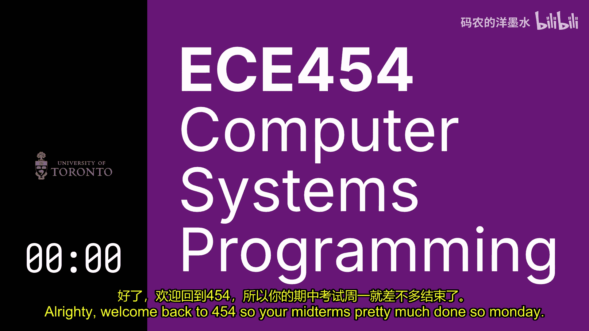
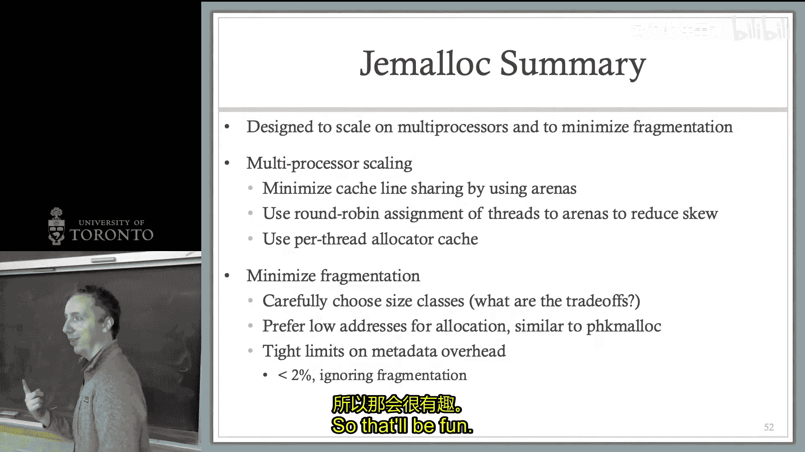

# 012：现代内存分配器



在本节课中，我们将要学习现代内存分配器的设计原理，特别是PHK Malloc和垃圾收集器的工作原理。我们将探讨如何高效地管理内存，减少碎片化，并了解在多线程环境下的性能考量。

## 概述

内存分配是系统编程的核心。一个高效的分配器可以显著提升程序性能。本节将介绍PHK Malloc的两级设计、垃圾收集的基本概念，以及针对多线程优化的分配器策略。

## PHK Malloc 设计

上一节我们介绍了基础的内存分配概念，本节中我们来看看PHK Malloc的具体实现。PHK Malloc采用两级设计：页面分配器和子页面分配器。

页面分配器负责管理整个堆，以页为单位进行分配。它维护一个页面目录（Page Directory）和一个空闲链表（Free List）。

*   **页面目录**：一个数组，用于快速查找每个页面的状态（例如，是起始页、跟随页还是空闲页）。访问是常数时间 `O(1)`。
*   **空闲链表**：一个链表，记录所有连续的空闲页面块，并按地址顺序排列以方便合并。

当需要分配N个连续页面时，分配器在空闲链表中查找。如果找到，则更新页面目录中的标志位（起始页和跟随页）。如果找不到，则通过 `sbrk` 或 `mmap` 扩展堆。释放时，通过页面目录常数时间找到对应页面块，更新目录，并将该块重新加入空闲链表进行合并。

## 子页面分配器

对于小于一页（例如4096字节）的分配请求，PHK Malloc使用子页面分配器。它的核心思想是将一个页面分割成多个大小相同的块。

子页面分配器在元数据头中为每种块大小（通常是2的幂次方）维护一个链表。每个链表指向第一个被分割成该大小的页面。

以下是子页面分配的关键数据结构概念：
```c
// 页面信息结构（简化）
struct page_info {
    size_t chunk_size;      // 本页面中每个块的大小
    bitmap_t allocation_map; // 位图，标记每个块是否已分配
    struct page_info *next; // 指向下一个具有相同块大小的页面
};
```

当请求分配一个32字节的块时：
1.  查找头部元数据中对应32字节的链表。
2.  遍历链表，找到第一个有空闲块（位图中对应位为0）的页面。
3.  在位图中标记该块为已分配（翻转为1），并返回指向该内存的指针。
4.  如果该页面所有块都被分配，则将其从链表中移除。
5.  如果链表为空（没有可用的页面），则向页面分配器申请一个新页面，初始化其 `page_info` 和位图，然后进行分配。

释放一个块时：
1.  找到该块所属页面的 `page_info`。
2.  在位图中将对应位标记为空闲（翻转为0）。
3.  如果该页面之前是满的，现在有了空闲块，则将其重新加入对应大小的链表。
4.  如果释放后页面所有块都空闲，则可将整个页面返还给页面分配器。

这种设计的优点是：
*   子页面分配永远不会跨页。
*   相同大小的对象可能位于同一页面，有利于缓存。
*   通过按地址顺序分配，更有可能在末尾释放整个页面，从而收缩堆。

## 垃圾收集

手动管理内存（`malloc`/`free`）容易出错，例如悬空指针、双重释放和内存泄漏。垃圾收集器（Garbage Collector, GC）旨在自动回收不再使用的内存。

垃圾收集器将内存视为有向图，其中节点是内存块，边是指针。从根节点（如寄存器、全局变量、栈上的局部变量）开始，遍历所有可达节点。不可达的节点被视为“垃圾”，可以被安全回收。

### 标记-清除算法

最基本的垃圾收集算法是标记-清除（Mark-and-Sweep）。

1.  **标记阶段**：从所有根节点开始，深度优先或广度优先遍历对象图，标记所有可达的对象。
2.  **清除阶段**：遍历堆中所有对象，释放那些未被标记的对象（即垃圾），并清除所有对象的标记位以备下次收集。

标记-清除算法需要暂停整个应用程序（Stop-the-World），并且时间开销与堆大小成正比。优化版本（如Baker算法）通过维护已分配块的列表，使清除阶段只扫描已分配块，而非整个堆。

### 引用计数

另一种常见方法是引用计数。每个内存块维护一个计数器，记录指向它的指针数量。

*   当新的引用指向该块时，计数器加一。
*   当引用失效时，计数器减一。
*   当计数器减到零时，表示没有任何引用指向该块，可以立即释放。

C++中的 `std::shared_ptr` 就使用了引用计数。它的主要问题是无法处理循环引用（两个或多个对象相互引用，但外部已无引用指向它们），这会导致内存泄漏。此外，在多线程环境下，原子地增减计数器会有额外开销。

## 应用程序感知的分配器

通用的内存分配器可能无法满足特定程序的模式。开发者可以利用对程序行为的了解，实现自定义的高效分配策略。

内存对象的生命周期通常有几种模式：持续增长型、平台稳定型、短期峰值型和多阶段型。块大小的分布也往往集中在少数几种尺寸上。

以下是几种常见的自定义分配模式：

*   **竞技场（Arena）分配器**：适用于生命周期相同的对象组。它一次性申请一大块内存（多个页面），所有分配都在这块内存中进行。当这组对象全部不再需要时，一次性释放整个竞技场。编译器常用此模式。
*   **Slab分配器**：适用于大量相同大小的对象。它预先分配一个或多个页面，并将其分割成固定大小的槽位。分配和释放通过位图或空闲链表管理，速度极快。操作系统内核常用此模式管理如inode、网络包等对象。

## 性能考量与多线程

在现代多核系统中，分配器的设计需要考虑更多因素。

*   **缓存行共享**：如果两个不同线程使用的对象位于同一缓存行，即使它们互不干扰，硬件也会为了保持缓存一致性而产生“假共享”（False Sharing），拖累性能。因此，分配器有时需要添加填充（Padding）来避免不同线程的对象共享缓存行，但这会增加内部碎片。
*   **锁竞争**：传统的分配器使用全局锁来保护数据结构，这在多线程下会成为瓶颈，导致性能无法随核心数增长而扩展。

### JE Malloc 设计

JE Malloc 是一种为多核性能优化的分配器，被 Firefox 等大型应用使用。

其核心思想是使用多个竞技场（Arena）：
*   将堆内存划分为多个独立的竞技场。
*   通过轮询或哈希等方式，让不同线程尽量从不同的竞技场分配内存。
*   每个线程还维护一个本地缓存（Thread Cache），用于快速分配小对象（如小于32KB），大部分分配无需加锁。
*   这样大大减少了锁竞争和假共享问题。

性能测试表明，在多核环境下，JE Malloc 的吞吐量通常显著高于传统的 Glibc malloc。

## 总结

本节课中我们一起学习了现代内存分配器的关键设计。
*   PHK Malloc 通过页面和子页面的两级设计，高效地管理不同大小的内存请求，减少了外部碎片。
*   垃圾收集器（如标记-清除和引用计数）提供了自动内存管理的方案，但有其适用场景和开销。
*   理解程序的内存访问模式有助于设计应用程序感知的分配器（如竞技场和Slab分配器），从而大幅提升性能。
*   在多核时代，分配器需要仔细处理缓存行共享和锁竞争问题，JE Malloc 通过竞技场和线程本地缓存等设计，实现了更好的可扩展性。



选择或设计内存分配器时，需要在空间利用率、分配速度、多线程扩展性等方面做出权衡，最佳方案通常取决于具体的应用场景。