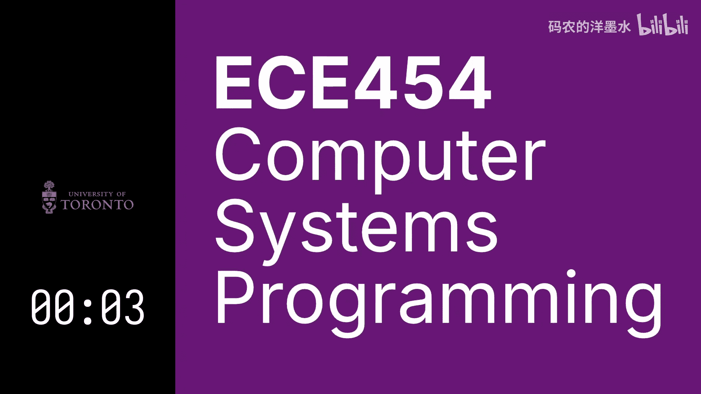
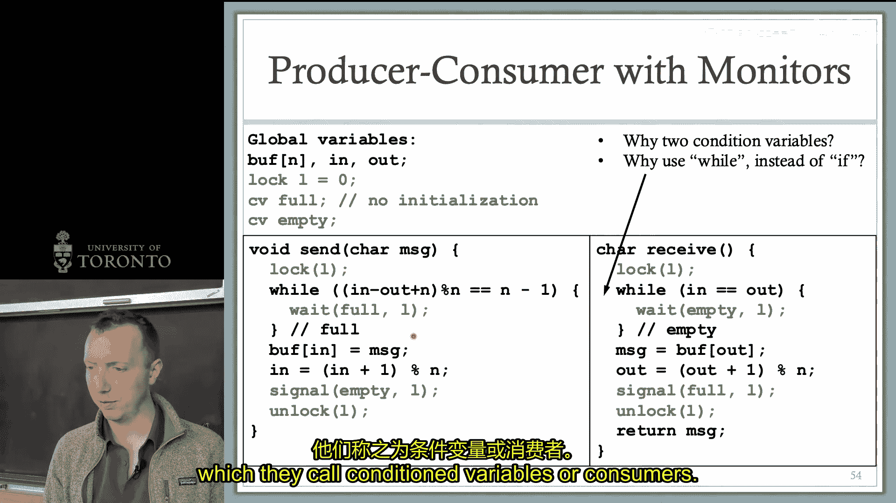
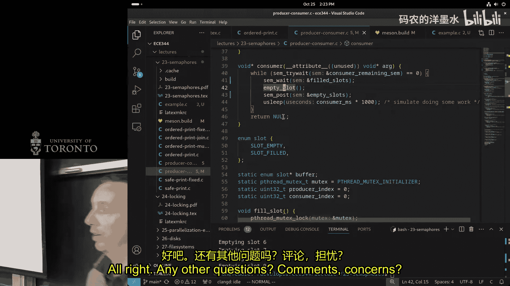

# 014：线程与同步



在本节课中，我们将学习并行编程的核心概念：线程与同步。我们将回顾进程与线程的区别，探讨如何创建和管理线程，并深入理解如何通过互斥锁、信号量和条件变量等机制来防止数据竞争和实现线程间的同步。

## 进程与线程回顾

上一节我们介绍了单核程序的优化。本节中，我们来看看如何在多核机器上实现并行化。现代计算机都拥有多个核心，因此我们需要理解如何在单台机器上使用线程和进程进行并行计算。

### 进程
进程拥有独立的虚拟内存空间、文件描述符表等资源。默认情况下，一个进程运行一个线程。进程是资源分配的基本单位。

### 线程
线程是进程内的执行单元，它包含虚拟寄存器集和一个独立的栈。一个进程可以包含多个线程，它们共享进程的虚拟内存、全局变量等资源。如果进程终止，其内部的所有线程也会随之终止。

### 用户线程与内核线程
用户线程由用户空间的库管理，如果一个用户线程发生阻塞（如系统调用），会阻塞整个进程。内核线程由操作系统内核管理，阻塞一个内核线程不会影响同一进程内的其他线程。现代编程通常使用内核线程（如POSIX线程，即pthreads）来实现真正的并行。

## 线程创建与管理

以下是使用POSIX线程（pthreads）创建和管理线程的基本方法。

### 创建线程
使用 `pthread_create` 函数创建新线程。

```c
#include <pthread.h>
int pthread_create(pthread_t *thread, const pthread_attr_t *attr,
                   void *(*start_routine) (void *), void *arg);
```

*   `thread`: 指向线程标识符的指针。
*   `attr`: 线程属性，通常设为 `NULL` 使用默认值。
*   `start_routine`: 线程启动后执行的函数。
*   `arg`: 传递给 `start_routine` 函数的参数。

### 等待线程结束
使用 `pthread_join` 函数等待指定线程结束，并获取其返回值。

```c
int pthread_join(pthread_t thread, void **retval);
```

### 线程分离
如果不需要等待线程结束或获取其返回值，可以将其设置为分离状态，线程结束后会自动释放资源。

```c
int pthread_detach(pthread_t thread);
```

### 示例：Hello World
以下是一个简单的线程示例。

```c
#include <stdio.h>
#include <pthread.h>

void* print_hello(void* arg) {
    printf("Hello, World!\n");
    return NULL;
}

int main() {
    pthread_t thread;
    pthread_create(&thread, NULL, print_hello, NULL);
    pthread_join(thread, NULL); // 等待线程结束
    return 0;
}
```

## 数据竞争与互斥锁

当多个线程并发访问同一内存位置，且至少有一个是写操作时，就会发生**数据竞争**。数据竞争会导致未定义行为和难以调试的错误。

### 互斥锁
互斥锁用于保护**临界区**，确保同一时间只有一个线程可以执行该段代码，从而防止数据竞争。

以下是使用互斥锁的基本步骤。

1.  **声明并初始化互斥锁**
    ```c
    pthread_mutex_t mutex = PTHREAD_MUTEX_INITIALIZER;
    // 或动态初始化
    pthread_mutex_init(&mutex, NULL);
    ```

2.  **在临界区前后加锁和解锁**
    ```c
    pthread_mutex_lock(&mutex);
    // 临界区代码
    pthread_mutex_unlock(&mutex);
    ```

3.  **销毁互斥锁**
    ```c
    pthread_mutex_destroy(&mutex);
    ```

### 锁的粒度
*   **粗粒度锁**：使用一个锁保护大量数据或代码。简单但并发性差，可能成为性能瓶颈。
*   **细粒度锁**：使用多个锁分别保护不同的数据。能提高并发性，但设计更复杂，需小心避免死锁。

## 线程同步

互斥锁解决了数据竞争，但有时我们还需要控制线程的执行顺序，即**同步**。常见的同步机制有信号量和条件变量。

### 信号量
信号量是一个整型计数器，具有两个原子操作：
*   **`sem_post` (V操作)**：信号量值加1。
*   **`sem_wait` (P操作)**：信号量值减1。如果值为0，则调用线程阻塞，直到值变为正数。

**初始化信号量**
```c
#include <semaphore.h>
sem_t sem;
sem_init(&sem, 0, initial_value); // 第二个参数0表示线程间共享
```

### 条件变量
条件变量允许线程在某个条件不满足时主动阻塞，并在条件可能满足时被唤醒。它必须与一个互斥锁配合使用。

**使用条件变量的基本模式**
```c
pthread_mutex_t mutex = PTHREAD_MUTEX_INITIALIZER;
pthread_cond_t cond = PTHREAD_COND_INITIALIZER;

// 等待线程
pthread_mutex_lock(&mutex);
while (condition_is_false) {
    pthread_cond_wait(&cond, &mutex); // 释放mutex并阻塞，被唤醒后重新获取mutex
}
// 执行操作
pthread_mutex_unlock(&mutex);

// 通知线程
pthread_mutex_lock(&mutex);
// 改变条件
pthread_cond_signal(&cond); // 唤醒一个等待线程
// 或 pthread_cond_broadcast(&cond); // 唤醒所有等待线程
pthread_mutex_unlock(&mutex);
```



### 屏障
屏障用于同步多个线程，要求所有参与线程都到达屏障点后才能继续执行。

**初始化与使用屏障**
```c
pthread_barrier_t barrier;
pthread_barrier_init(&barrier, NULL, num_threads); // num_threads: 需要同步的线程数

// 在每个线程中调用
pthread_barrier_wait(&barrier); // 到达屏障，等待其他线程
```

## 生产者-消费者问题

生产者-消费者是一个经典的同步问题。生产者向固定大小的缓冲区放入数据，消费者从缓冲区取出数据。需要同步确保：
1.  生产者不会向已满的缓冲区放入数据。
2.  消费者不会从空的缓冲区取出数据。

我们可以使用两个信号量来解决这个问题：
*   `empty_slots`：初始值为缓冲区大小，表示空槽位数。
*   `filled_slots`：初始值为0，表示已填充的槽位数。

**伪代码逻辑**
```
// 生产者
sem_wait(&empty_slots); // 等待空槽位
// 将数据放入缓冲区
sem_post(&filled_slots); // 增加已填充槽位计数

// 消费者
sem_wait(&filled_slots); // 等待有数据的槽位
// 从缓冲区取出数据
sem_post(&empty_slots); // 增加空槽位计数
```

## 总结



本节课中我们一起学习了并行编程的基础。我们回顾了进程与线程的核心区别，掌握了使用pthreads库创建和管理线程的方法。我们深入探讨了数据竞争的危害，并学习了如何使用互斥锁来保护临界区。此外，我们还介绍了信号量、条件变量和屏障这三种重要的线程同步机制，并使用信号量优雅地解决了经典的生产者-消费者问题。理解这些概念是编写正确、高效并行程序的关键。