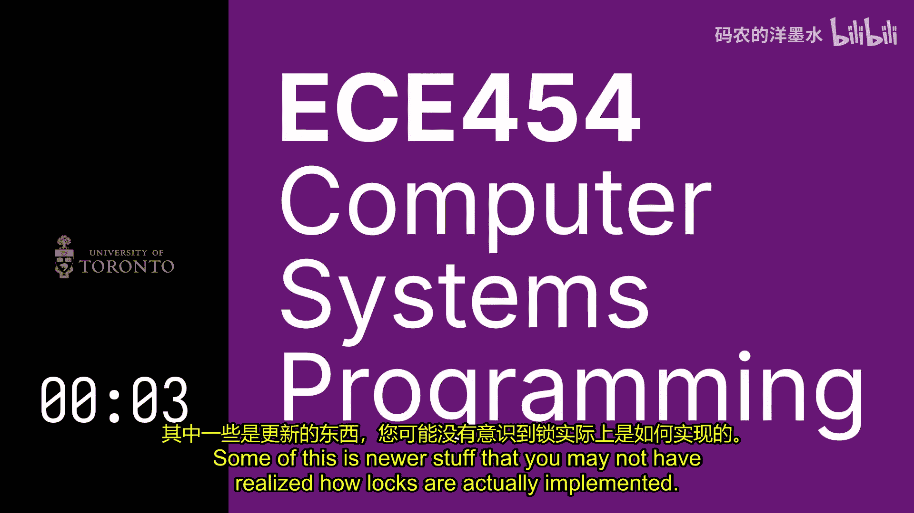
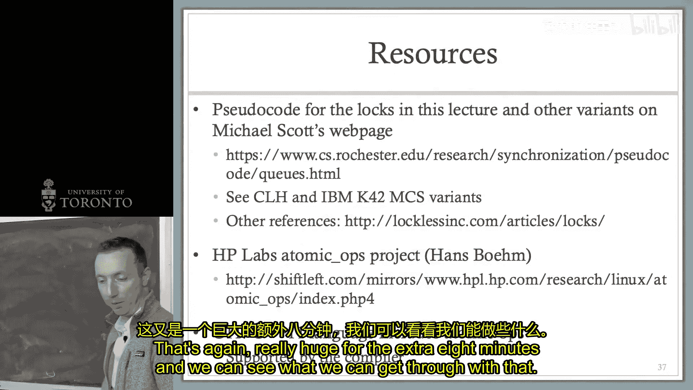

# 016：锁 🔒



在本节课中，我们将深入探讨锁的实现原理、性能成本以及如何设计更高效的锁。我们将从基础的硬件原子指令开始，逐步分析自旋锁、票锁、队列锁（如MCS锁）等不同锁机制的工作原理和优化策略。

---

## 锁的实现概述

上一节我们回顾了进程间通信（IPC）和线程间共享内存的基本概念。本节中，我们来看看如何实现锁来确保多线程环境下的互斥访问。

在多处理器系统中，仅靠禁用中断或上下文切换无法防止真正的并行访问。因此，我们需要硬件提供的原子指令来构建锁的基础。

以下是几种关键的硬件原子指令：
*   **Test-and-Set**：原子地测试一个内存位置的值，并将其设置为1。
*   **Fetch-and-Increment**：原子地读取一个内存位置的值并递增它。
*   **Compare-and-Swap**：原子地比较一个内存位置的值，如果匹配则将其替换为新值。
*   **Fetch-and-Store**：原子地读取一个内存位置的值并写入一个新值。

这些指令保证了操作的原子性，即它们要么完全执行，要么完全不执行，不会产生数据竞争。

---

## 自旋锁

自旋锁是最简单的锁实现之一。其核心思想是线程通过循环（“自旋”）不断尝试获取锁，直到成功为止。

以下是使用Test-and-Set指令实现自旋锁的伪代码：
```c
// 锁变量，0表示空闲，1表示被占用
int lock = 0;

void acquire_spinlock() {
    // 当锁被占用时，持续尝试获取
    while (test_and_set(&lock) == 1) {
        // 自旋等待
    }
}

void release_spinlock() {
    // 释放锁，只需简单地将锁变量置0
    lock = 0;
}
```

在`acquire`函数中，`test_and_set`指令会原子地将锁变量设置为1。如果它返回的旧值是0，则表示当前线程成功获取了锁。如果返回1，则表示锁已被其他线程持有，当前线程需要继续循环尝试。在`release`函数中，由于持有锁的线程是唯一能执行此操作的线程，因此可以安全地将锁变量直接设为0。

自旋锁适用于预期等待时间非常短的场景，或者在中断处理程序等不允许阻塞的上下文中。然而，当多个线程激烈竞争同一个锁时，所有线程都在不断地执行`test_and-set`操作，这会导致缓存行在多个CPU核心间频繁地无效化和同步，产生大量的缓存一致性流量，严重降低系统性能。

---

## 改进的自旋锁策略

为了缓解自旋锁在高竞争下的性能问题，我们可以采用一些优化策略。

### 指数退避

指数退避策略在尝试获取锁失败后，让线程等待一段时间再重试，且等待时间随失败次数指数增长。

以下是该策略的优缺点：
*   **优点**：可以减少对共享内存位置的频繁访问，从而降低缓存一致性开销。
*   **缺点**：无法保证公平性，可能导致线程饥饿。

### Test-and-Test-and-Set

这种策略先通过普通的读操作（不触发缓存一致性协议）自旋检查锁状态，只有当锁可能空闲时，才尝试执行原子的Test-and-Set操作。

以下是其伪代码：
```c
void acquire_ttas() {
    while (1) {
        // 第一阶段：仅读取，不修改
        while (lock == 1) {
            // 自旋等待
        }
        // 第二阶段：尝试原子获取
        if (test_and_set(&lock) == 0) {
            break; // 成功获取锁
        }
    }
}
```
这种方法减少了昂贵的原子操作次数，但所有线程仍然在竞争同一个内存位置，缓存问题依然存在。

---

## 票锁

票锁旨在解决公平性问题，它模拟了排队叫号系统，保证了先到先服务（FIFO）的顺序。

票锁使用两个计数器：
*   **`next_ticket`**：下一个可用的票号（原子递增）。
*   **`now_serving`**：当前正在服务的票号。

以下是票锁的伪代码：
```c
int next_ticket = 0;
int now_serving = 0;

void acquire_ticket_lock() {
    // 原子地取一个号
    int my_ticket = fetch_and_increment(&next_ticket);
    // 等待叫到自己的号
    while (now_serving != my_ticket) {
        // 自旋等待
    }
}

void release_ticket_lock() {
    // 叫下一个号
    now_serving++;
}
```
在`acquire`中，每个线程原子地获取一个唯一的递增票号。然后，它循环检查`now_serving`是否等于自己的票号。在`release`中，持有锁的线程只需递增`now_serving`即可。票锁保证了公平性，但所有等待线程仍在读取同一个`now_serving`变量，缓存争用问题仍未完全解决。

---

## 队列锁（MCS锁）

队列锁（以MCS锁为例）的核心思想是让每个等待线程在自己的本地内存位置上自旋，从而彻底消除缓存行在多核间的“乒乓”效应。

MCS锁为每个线程维护一个节点（`qnode`），其中包含：
*   **`locked`**：指示该线程是否应继续等待。
*   **`next`**：指向队列中下一个等待线程的节点。

此外，还有一个全局的`tail`指针，指向队列的末尾。

以下是MCS锁`acquire`操作的简化步骤：
1.  初始化本地节点：`my_node->next = NULL; my_node->locked = 1;`
2.  使用原子操作将全局`tail`指针指向自己的节点，并获取前驱节点。
3.  如果前驱节点不为空，则将前驱节点的`next`指向自己的节点，然后在自己的`locked`字段上自旋等待。
4.  如果前驱节点为空，则表示自己是第一个，直接获得锁。

以下是MCS锁`release`操作的简化步骤：
1.  检查自己的`next`字段。
2.  如果`next`为空（可能没有等待者），则尝试原子地将`tail`从指向自己改为`NULL`。如果失败，说明有新线程刚加入队列，需要等待它链接上来。
3.  如果`next`不为空，则直接将后继节点的`locked`字段设为0，唤醒它。

MCS锁的优点在于：
*   **缓存友好**：每个线程只在自己的`locked`变量上自旋，无全局争用。
*   **公平**：隐式维护了FIFO队列。
*   **高性能**：显著减少了多核间的缓存一致性流量。

其代价是需要额外的内存来维护每个线程的节点（空间复杂度约为O(P)，P为线程数）。Linux内核等高性能系统中广泛使用了MCS锁或其变种。

---

## 实际锁实现与并行编程技巧

在实际应用中，锁的实现往往更加复杂。例如，Pthreads库中的互斥锁（`pthread_mutex_t`）通常采用混合策略：先尝试一段时间的自适应自旋（类似Test-and-Test-and-Set），如果失败则将线程挂起并放入等待队列，同时可能支持优先级继承、超时等高级特性。

了解了锁的原理后，我们可以应用一些并行编程技巧来提升性能：

### 计数器优化

对于被大量线程频繁递增的计数器，如果精确值并非时刻关键，可以采用以下优化：
*   **每线程局部计数器**：每个线程更新自己的局部计数器，定期或最终需要时再汇总。这避免了频繁的全局锁竞争。
*   **近似计数**：在某些容忍误差的场景（如统计数据），甚至可以允许最终汇总时存在轻微的数据竞争，以换取极致性能。

### 数据布局优化

根据数据的访问模式优化其内存布局：
*   **分离读写**：将频繁修改的数据与主要读取的数据分开存放，避免修改时使大量只读数据所在的缓存行无效。
*   **避免伪共享**：确保被不同线程独立访问的变量位于不同的缓存行中（通常通过填充字节实现）。
*   **锁与数据分离**：尽量让锁变量和它保护的数据不在同一个缓存行，防止锁的争用影响数据访问。

### 使用读写锁

对于“读多写少”的数据结构，使用读写锁（如`pthread_rwlock_t`）可以允许多个线程同时读取，而写入时则独占访问，从而提高并发度。

---

## 总结



本节课中我们一起学习了锁的底层实现与性能优化。我们从基础的硬件原子指令和简单的自旋锁出发，分析了其在高竞争下的性能瓶颈。接着，我们探讨了通过指数退避、Test-and-Test-and-Set策略来缓解问题。然后，我们介绍了保证公平性的票锁，以及能彻底解决缓存争用、性能优异的队列锁（如MCS锁）的实现原理。最后，我们了解了一些实际的锁实现（如Pthreads互斥锁）和提升并行程序性能的数据布局与编程技巧。理解这些内容有助于我们编写出更高效、可扩展的多线程程序。