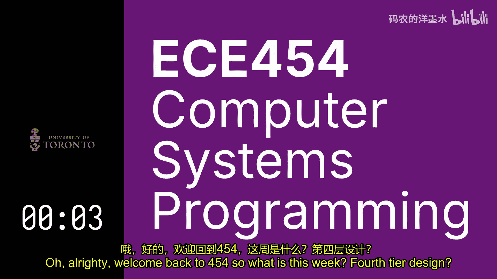
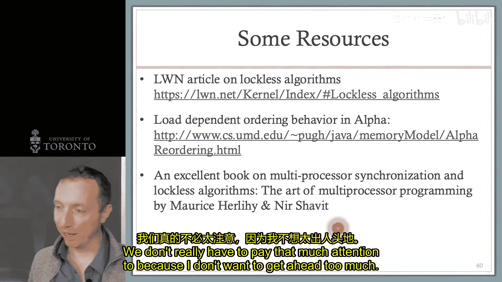

# 017：无锁化编程



在本节课中，我们将要学习如何避免使用锁进行同步，即无锁化编程。我们将探讨锁带来的挑战，介绍非阻塞同步的基本概念，并深入讲解一种在Linux内核中广泛使用的高性能技术——读-拷贝-更新（RCU）。

## 锁的挑战回顾

上一节我们介绍了各种锁机制。本节中，我们来看看使用锁时面临的一些主要挑战。虽然锁是防止数据竞争、确保数据一致性的简单方法，但它们也带来了一系列问题。

以下是锁的几个主要问题：
*   **死锁**：一组线程相互等待对方持有的资源，导致所有线程都无法继续执行。
*   **优先级反转**：低优先级线程持有锁时，高优先级线程因等待该锁而被阻塞，但低优先级线程又无法被调度运行以释放锁。
*   **缺乏容错性**：如果持有锁的线程崩溃或被长时间延迟（如发生缺页错误），其他所有线程都将被阻塞。
*   **队列化（Convoying）**：线程偶尔访问共享数据，大部分时间无竞争。但如果一个线程被延迟，其他线程会开始堆积等待，从而人为地制造出竞争场景。
*   **开销昂贵**：即使在没有竞争的情况下，获取和释放锁的操作（如原子指令、缓存一致性协议）也可能需要上百个CPU周期，如果临界区本身很小，锁的开销占比会非常高。

随着内存层次结构变深、CPU流水线变长以及乱序执行优化，锁操作（尤其是需要内存屏障时）可能显著拖慢流水线，其性能开销已成为一个重要问题。

## 非阻塞同步基础

鉴于锁的种种问题，一个核心思路是：如果不需要，就不要使用锁。这就是非阻塞同步，或称无锁编程。

在锁定模型中，线程通过互斥访问共享资源。在非阻塞同步中，所有线程可以并发访问对象，通过原子指令（如比较并交换 `CAS`）来检测冲突。如果操作失败（例如，因为其他线程已修改数据），则回滚并重试。

以下是一个使用 `CAS` 实现原子计数器的简单示例：
```c
int atomic_increment(int *counter) {
    int old_value;
    do {
        old_value = *counter; // 读取当前值
        // 尝试将值从 old_value 原子地更新为 old_value + 1
    } while (!compare_and_swap(counter, old_value, old_value + 1));
    return old_value + 1; // 返回新值
}
```
对于更复杂的操作（如修改数据结构中的多个字段），可以将所有修改准备在私有内存中，然后通过一个原子操作（如交换指针）来“提交”更改。

## 无锁编程的陷阱：ABA问题

让我们尝试为链表实现的栈设计一个无锁版本。一个直观的想法是：在 `push` 和 `pop` 操作中使用 `CAS` 来原子地更新栈顶指针 `head`。

然而，这种方法存在一个经典问题：**ABA问题**。

**问题描述**：
1.  线程1读取栈顶指针 `head`，值为 `A`，并记下 `A->next` 为 `B`。
2.  线程1被挂起。
3.  线程2执行 `pop`，移除了 `A`，接着又移除了 `B`，然后又将 `A` 推回栈中。此时栈结构为 `A -> N -> C`，但 `A` 的 `next` 指针已指向新节点 `N`。
4.  线程1恢复运行。它看到的 `head` 仍然是 `A`，它保存的 `next` 指针仍是 `B`。它执行 `CAS(head, A, B)`。
5.  `CAS` 成功（因为 `head` 当前确实是 `A`），线程1将 `head` 设置为 `B`。这导致栈顶变为孤立的 `B` 节点，丢失了节点 `N` 和 `C`。

**解决方案**：
一种常见方案是使用**带标签的指针**。每次修改指针时，同时原子地增加一个与之关联的版本号。这样，即使地址 `A` 被重用，其版本号也不同，`CAS` 操作会因为版本号不匹配而失败。不过，这需要CPU架构支持双字（指针+版本号）的原子操作，并且需要妥善处理旧版本内存的回收问题。

## 读-拷贝-更新（RCU）

对于许多应用场景，读取到**稍旧但一致**的数据是可以接受的。读-拷贝-更新（RCU）正是利用了这一点，它允许读者在完全无锁的情况下进行，从而获得极高的读取性能。

**核心思想**：
1.  **发布-订阅机制**：写者创建数据的新版本，然后通过一个原子指针赋值操作“发布”它。
2.  **多版本维护**：在回收旧数据之前，必须确保所有可能持有旧数据引用的读者都已经退出其“读临界区”。
3.  **宽限期**：这是一个时间间隔，在此之后，可以保证所有读者都已不再引用旧数据。之后，写者可以安全地回收旧版本。

**在Linux内核中的使用**：
为了简化编程并正确处理内存屏障，Linux内核提供了专用API：
*   写者使用 `rcu_assign_pointer()` 来发布新指针。
*   读者使用 `rcu_dereference()` 来安全地读取指针。
*   读者用 `rcu_read_lock()` 和 `rcu_read_unlock()` 标记读临界区（在内核中，这通常只是禁用抢占）。
*   写者使用 `synchronize_rcu()` 来等待一个宽限期结束，之后即可安全释放旧数据。

**RCU链表更新示例**：
```c
// 读者
rcu_read_lock();
list_for_each_entry_rcu(node, &head, list) {
    // 安全地访问 node->data
}
rcu_read_unlock();

// 写者（删除节点）
p = search_for_node_to_delete();
q = kmalloc(sizeof(*q)); // 创建新节点或进行修改
*q = *p; // 复制
// ... 修改 q ...
list_replace_rcu(&p->list, &q->list); // 原子替换
synchronize_rcu(); // 等待所有读者退出临界区
kfree(p); // 安全释放旧节点
```

**性能优势**：
RCU在读多写少的场景下性能接近线性扩展，因为它消除了读者之间的所有竞争。虽然写者会变慢（需要等待宽限期），但总体吞吐量通常得到极大提升。在Linux内核中，RCU的使用比例正在逐年增长，以替代部分锁机制。

## 工具选择指南

本节课中我们一起学习了无锁化编程的动机和主要技术。最后，我们来总结一下如何选择合适的同步工具：

*   **只读或允许读旧数据**：如果算法能处理并发读和单个更新，且不介意数据稍旧，**RCU** 是最佳选择，能提供近乎线性的读取扩展性。
*   **简单的更新密集型数据结构**：对于链表、队列等，可以考虑使用 **CAS** 实现**无锁算法**。但需小心处理ABA等问题，通常建议使用成熟的库实现。
*   **复杂的数据结构或逻辑**：当正确性至关重要且实现无锁方案过于复杂时，直接使用**互斥锁（Mutex）** 是更简单可靠的选择。能工作的代码远优于无法正确运行的复杂代码。



记住，你有许多工具可供选择，应根据具体问题选择最合适的一种。目标是编写出正确、高效且易于维护的并发代码。