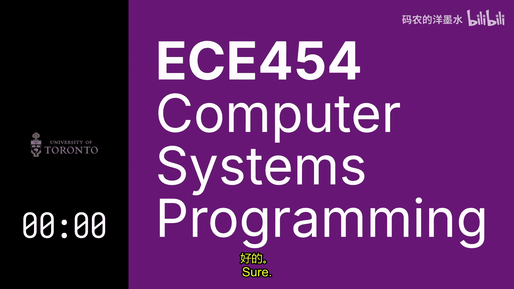

# 019：最终复习

在本节课中，我们将对课程涵盖的所有核心内容进行一次快速的最终复习，帮助你为期末考试做好准备。我们将回顾从CPU架构、编译器优化到并行编程和锁机制等所有关键主题。

## 课程内容概览

课程内容涵盖了从顺序程序优化到并行系统编程的广泛领域。以下是主要章节的回顾。

## 顺序程序优化

上一节我们介绍了课程的整体结构，本节中我们来看看课程的开端：顺序程序优化。我们首先探讨了CPU架构和性能分析。

### CPU架构基础

为了让CPU运行得更快，现代处理器采用了多种技术。

以下是几种关键技术：
*   **流水线**：让CPU的不同阶段同时工作，提高指令吞吐率。
*   **分支预测**：预测程序分支的走向，减少流水线停顿。
*   **乱序执行**：动态重新安排指令执行顺序，以更好地利用CPU资源。
*   **指令级并行**：单个指令可以同时发出多个操作。
*   **同步多线程**：通过从多个线程获取指令来保持流水线满载。

以Intel处理器发展史为例，其演进路径大致如下：从无流水线（每条指令耗时即其CPI），到引入流水线和分支预测（使CPI接近1），再到采用超标量架构（增加并行执行单元），最后加入乱序执行和同步多线程以最大化利用流水线。

### 性能剖析

在开始优化之前，必须先进行性能剖析，避免过早优化（这是万恶之源）。我们使用了多种工具。

以下是几种剖析工具：
*   **GProf / GCov**：GCov主要用于代码覆盖率分析，而非严格意义上的性能剖析。
*   **`time`命令**：测量程序的墙上时钟时间，即用户感知的时间。
*   **`perf`工具**：可以获取大量硬件性能事件细节，如缓存未命中。

性能提升受限于**阿姆达尔定律**。该定律公式为：
`Speedup = Old Time / New Time`
即使我们能将程序中某部分（例如占50%运行时间的部分）优化到零耗时，整体加速比上限也仅为2倍。

### 编译器优化

编译器能够自动进行多种优化，但不同编译器在不同方面的能力有差异。使用`-O1`级别优化时，GCC或Clang会进行基础优化。

以下是`-O1`包含的典型优化：
*   常量传播与折叠
*   公共子表达式消除
*   复制传播
*   死代码消除
*   循环不变代码外提
*   函数内联（针对非常小的函数）

更高级别的优化（如`-O2`、`-O3`）可能包括更智能的指令调度、循环展开和向量化。我们发现Clang在自动向量化方面通常比GCC做得更好。作为程序员，我们的职责是编写清晰、可读的代码，并帮助编译器消除优化障碍（例如启用链接时优化）。优化的重点应放在最内层循环上，因为它们是代码中的热点。

## 缓存性能

上一节我们讨论了编译器如何帮助我们优化，本节中我们来看看对性能影响巨大的另一个因素：内存层次结构，特别是缓存。

### 局部性原理

缓存之所以有效，是因为程序通常表现出两种局部性。

以下是两种主要的局部性类型：
*   **时间局部性**：程序倾向于重复访问相同的内存位置。
*   **空间局部性**：程序倾向于访问彼此相邻的内存位置。

硬件预取器会尝试利用这些模式。通常，我们应编写具有良好局部性的代码（例如连续访问数组），而不是尝试手动预取，因为硬件预取器通常更高效。对于大型数据结构，可能需要调整其内存布局以提高缓存利用率（例如，将频繁一起访问的键值对存储在一起，而非分成两个数组）。

### 缓存优化实践

为了利用缓存，我们需要关注缓存行（通常为64字节）。我们讨论了矩阵乘法中的分块技术，通过将计算限制在能放入缓存的数据块内，来重用已加载到缓存中的数据，从而显著提升性能。

## 动态内存管理

上一节我们探讨了如何优化缓存使用，本节中我们来看看程序运行时另一个关键系统：动态内存分配器。

我们学习了三种主要的内存分配器设计。

以下是三种分配器模型：
*   **隐式空闲链表**：在内存块头部和尾部放置大小标记，分配时需要遍历所有块（包括已分配和空闲块）来寻找空闲空间。
*   **显式空闲链表**：额外维护一个连接所有空闲块的链表，使得分配时只需搜索空闲块，速度更快。
*   **分离空闲链表**：为不同大小的块维护不同的空闲链表，可以更快地找到合适大小的块。

分配策略包括首次适配、最佳适配和最差适配。当释放内存块时，需要与相邻的空闲块合并（合并操作）。我们还简要介绍了`ptmalloc`（glibc默认）和`jemalloc`等现代分配器如何利用线程局部存储和页面管理来提升多线程性能。

## 多线程与同步

上一节我们了解了内存如何管理，本节中我们来看看如何让多个线程协同工作。多线程编程的核心是数据共享与同步。

默认情况下，线程间内存是共享的，这可能导致**数据竞争**。数据竞争的定义是：两个或更多线程并发访问同一内存位置，且至少有一个是写操作。为防止数据竞争，我们需要同步原语，如**互斥锁**，它确保互斥访问。但粗粒度的锁（单个锁保护大量数据）会引入争用，降低性能。细粒度的锁（多个锁保护不同数据区域）能提升并发度，但可能带来**死锁**风险。

我们使用Pthread库（或C++的`std::thread`，其底层也使用Pthread）来创建和管理线程。在并行化循环时，需要注意迭代间的依赖关系。如果每次迭代依赖于前一次的结果，简单的并行化会导致读取旧值，此时需要使用屏障等同步机制来协调线程。

## 并行架构：一致性与连贯性

上一节我们介绍了多线程基础，本节中我们深入探讨在多核环境下保证内存视图正确性的底层机制。这是理解并行性能的关键。

在多核系统中，每个核心通常有私有的L1和L2缓存，并共享L3缓存。因此，我们需要确保不同核心看到的内存是一致的。这里需要区分两个重要概念。

以下是两个核心概念：
*   **缓存连贯性**：关注**同一个**内存位置在不同核心的缓存中的值是否一致。
*   **内存一致性**：关注**不同**内存位置的读/写操作在所有核心看来执行的**顺序**。

### 缓存连贯性与MESI协议

缓存连贯性通常由**MESI协议**实现。该协议为缓存行定义四种状态：修改、独占、共享、无效。最初的MSI协议（无独占状态）会导致不必要的缓存失效。添加独占状态后，当只有一个核心持有某缓存行时，它可以在本地修改而无需通知其他核心，从而提升性能。

**伪共享**是连贯性导致的一个典型性能问题。它发生在两个核心访问同一缓存行中**不同且独立**的数据变量时。根据MESI协议，这会导致缓存行在核心间来回无效和传输，即使数据本身并未共享，也会严重损害性能。解决方法包括添加填充字节，确保变量位于不同的缓存行。

使用`perf`工具可以监测到因伪共享导致的缓存未命中率飙升。在多插槽NUMA系统中，跨插槽通信的延迟更高，此时可以通过设置线程的CPU亲和性，让通信频繁的线程运行在物理上接近的核心上，以优化性能。

### 内存一致性

**顺序一致性**是最直观的模型，它要求所有核心的内存操作看起来像是按某个单一全局顺序执行的，且每个核心的操作按其程序顺序出现。但这会禁用CPU的许多优化（如乱序执行、写缓冲区），性能代价很高。

实际硬件使用更宽松的内存模型。当需要强制排序时，可以使用**内存屏障**。
*   **读屏障**：确保屏障前的所有读操作先于屏障后的所有读操作完成。
*   **写屏障**：确保屏障前的所有写操作先于屏障后的所有写操作完成。
*   **全屏障**：确保屏障前的所有内存操作先于屏障后的所有内存操作完成。

高级语言（如C++）的原子操作和Pthread锁内部已经包含了必要的屏障。但如果在底层进行无锁编程，就必须仔细考虑内存序。

## 锁的实现与优化

上一节我们了解了内存模型，本节中我们来看看如何基于原子指令实现高效锁。锁的性能至关重要。

### 自旋锁

最简单的锁是**自旋锁**，线程在获取锁失败时会忙等待。我们首先实现了基于`test-and-set`指令的自旋锁，但它会持续产生写操作，导致缓存行无效。改进后的`test-and-test-and-set`锁先通过普通读操作自旋，直到锁可能可用时才尝试原子操作，减少了缓存流量。

**票号锁**通过两个计数器（当前服务号和下一个票号）实现。线程取号后自旋等待服务号等于自己的票号。它的主要优点是**公平性**，能大致按照请求顺序分配锁。

**队列锁**（如MCS锁）将等待线程组织成链表。每个线程自旋于自己本地的标志变量上，而非一个全局变量。这极大地减少了缓存一致性流量，因为每个线程只访问自己的缓存行，性能更好。

## 避免锁：无锁编程

上一节我们探讨了如何实现更好的锁，本节中我们来看看能否完全避免锁。锁的争用和开销有时难以承受，无锁编程提供了另一种思路。

无锁同步通过**原子指令**（如比较并交换`CAS`、获取并增加`fetch-and-add`）直接操作共享数据。其常见模式是：在本地准备新状态，然后尝试用原子操作（如`CAS`）将指向旧状态的指针更新为指向新状态。

无锁编程可能遇到**ABA问题**：一个线程读取值A，在此期间，另一个线程将值改为B后又改回A。当第一个线程执行`CAS`时，会发现值仍是A，从而错误地认为数据未变并执行更新。这可能导致数据不一致。解决方案通常包括使用带版本号的指针。

**RCU**是一种用于读多写少场景的高效同步机制。其核心思想是：写者复制要修改的数据结构，更新副本，然后通过原子指针切换使新版本对读者可见。旧版本的回收会延迟到确保所有读者都离开后才进行。这允许读者和写者并发执行，极大地提升了读性能。

## MapReduce与课程总结

最后，我们简要介绍了**MapReduce**编程模型。它用于大规模数据分析，程序员只需定义`map`和`reduce`函数，系统自动处理分布式执行、容错、负载均衡等复杂细节。这体现了系统编程的一个目标：将复杂性隐藏在易用的接口之下。

### 技术演进与核心收获

摩尔定律在单核频率上已接近极限，未来性能提升将依赖并行化（多核、分布式）。我们课程主要关注单机并行。

尽管技术不断变化，但一些核心原则始终有用：
*   优化瓶颈是关键。
*   缓存（CPU缓存、内存缓存、乃至Web缓存如Memcached、CDN）将始终存在并影响性能。
*   并行化是永恒的课题。
*   **最快的操作是什么都不做**。在优化前，先问是否真的需要执行该操作。
*   **视情况而定**。没有放之四海而皆准的优化方案。

比掌握具体技术更重要的是理解**原理**。例如，理解为什么缓存连贯性会影响性能，而不仅仅是知道如何避免伪共享。保持怀疑和好奇，探究工具是否真的帮到了你，底层究竟发生了什么，这将帮助你在未来不断变化的技术环境中保持优势。

## 总结

本节课中我们一起回顾了高性能系统编程课程的全部核心内容：从CPU架构与剖析、编译器优化、缓存性能、动态内存管理，到多线程同步、并行架构的内存模型、各种锁的实现与优化，以及无锁编程技术。希望这次复习能帮助你巩固知识，为期末考试做好充分准备。恭喜你完成了课程的主要内容！