# 020：Rust 语言入门

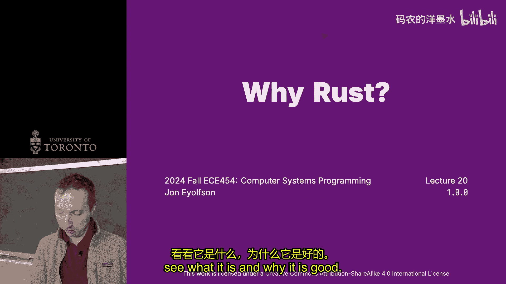

在本节课中，我们将学习 Rust 语言的基础知识。Rust 是一种旨在成为更好 C++ 的下一代系统编程语言，其核心思想是只编译正确的程序。编译器会进行大量检查来确保程序的正确性。

## Rust 的核心优势

Rust 编译器主要检查三个核心概念，这带来了三大优势：

*   **所有权**：防止内存问题，无需垃圾回收。它确保对象在任何时刻都只被一个所有者拥有，编译器会强制执行这一点。
*   **借用检查器**：防止并发问题，如数据竞争。它只允许存在一个可变引用，这意味着可以有任意多个读取者，但同一时间只能有一个写入者。如果违反此规则，编译器会报错。
*   **生命周期**：确保引用始终有效。

## Hello, World!

Rust 的 “Hello, World!” 程序看起来很简单，除了 `println!` 后面的感叹号。

```rust
fn main() {
    println!("Hello, World!");
}
```

在 Rust 中，`println!` 技术上是一个宏。宏总是以感叹号结尾。与 C 语言中只是文本替换的预处理器宏不同，Rust 的宏与编译器协同工作，因此能提供有意义的错误信息，并能做很多高级操作，同时避免了错误的文本替换。

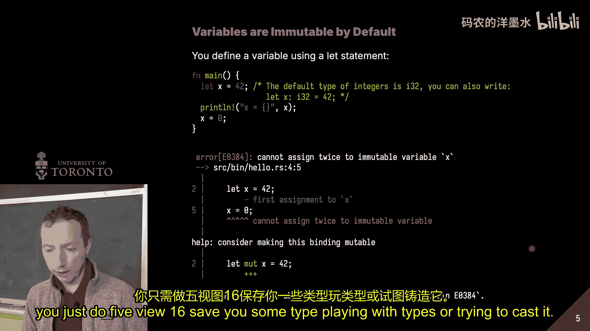

## 类型系统

和 C 或 C++ 一样，Rust 是静态类型语言。然而，它的编译器很智能，默认会进行大量的类型推断。你可以省略类型，让编译器去推断。

这有点像 C++ 中的 `auto` 关键字，但你不必写 `auto`，因为这是默认行为。唯一必须显式声明类型的地方是函数参数。

Rust 的原始类型都有明确的尺寸，无需像在 C 中那样记住 `short`、`int` 等类型的大小。

*   **有符号整数**：以 `i` 开头，后跟位数，例如 `i8`, `i16`, `i32`, `i64`, `i128`，以及 `isize`（指针大小，取决于架构）。
*   **无符号整数**：以 `u` 开头，例如 `u8`, `u16` 等。
*   **浮点数**：以 `f` 开头，例如 `f32`, `f64`。
*   **字符**：`char` 类型是一个 Unicode 标量值，占用 4 字节，可以表示任何 Unicode 字符，包括表情符号。
*   **布尔值**：`bool`，值为 `true` 或 `false`。
*   **单元类型**：`()`，类似于 `void` 类型，其唯一可能的值是空元组。

如果你想为字面量指定类型，可以添加后缀。例如，默认数字是 `i32` 类型，如果你想确保字面量 `5` 是 `u16` 类型，可以写成 `5u16`。

## 变量与可变性

Rust 的一个特点是变量默认是不可变的。

在 Rust 中，使用 `let` 语句定义变量。例如：

```rust
let x = 42;
```

默认情况下，`x` 是不可变的。如果你尝试修改它，编译器会报错。

```rust
x = 0; // 编译错误！
```

如果你想让变量可变，必须显式声明：

```rust
let mut x = 42;
x = 0; // 现在可以了
```

另一个有用的特性是**变量遮蔽**。你可以在同一作用域内用 `let` 重新声明同名变量，甚至可以改变其类型。

```rust
let x = 42;
let x = "现在我是字符串了"; // 遮蔽了之前的 x
```

这在你需要改变变量类型时很有用，避免了起 `x_str` 这类新名字的麻烦。

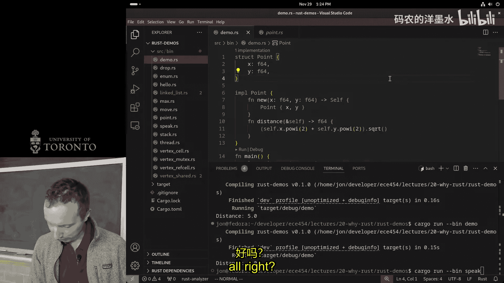

## 函数

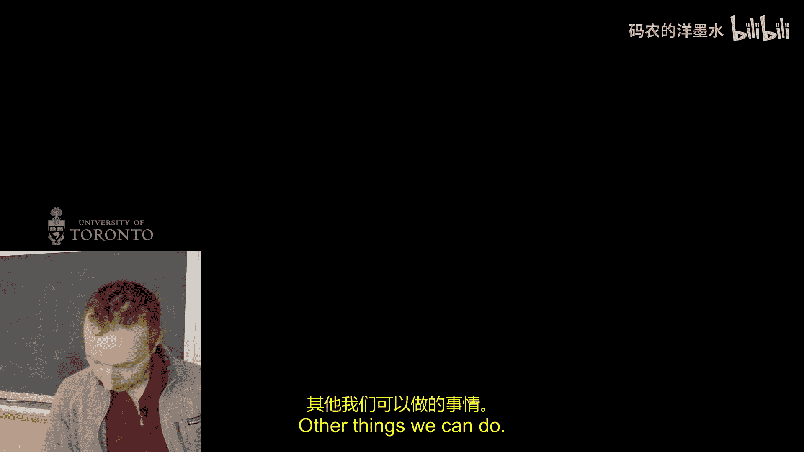

Rust 是一种基于表达式的语言。函数的返回值是最后一个表达式的值，无需显式使用 `return` 关键字（除非需要提前返回）。

```rust
fn get_val() -> i32 {
    42 // 隐式返回 42
}
```

这与下面的写法等价：

```rust
fn get_val() -> i32 {
    return 42;
}
```

基于表达式的风格让编写函数变得更简洁。

## 结构体与方法

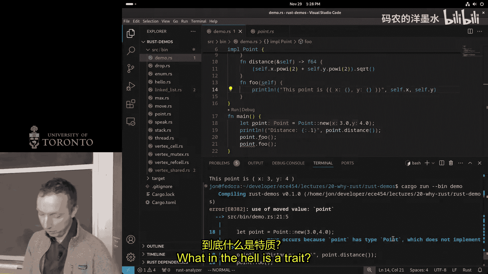

和 C/C++ 一样，你可以定义结构体。

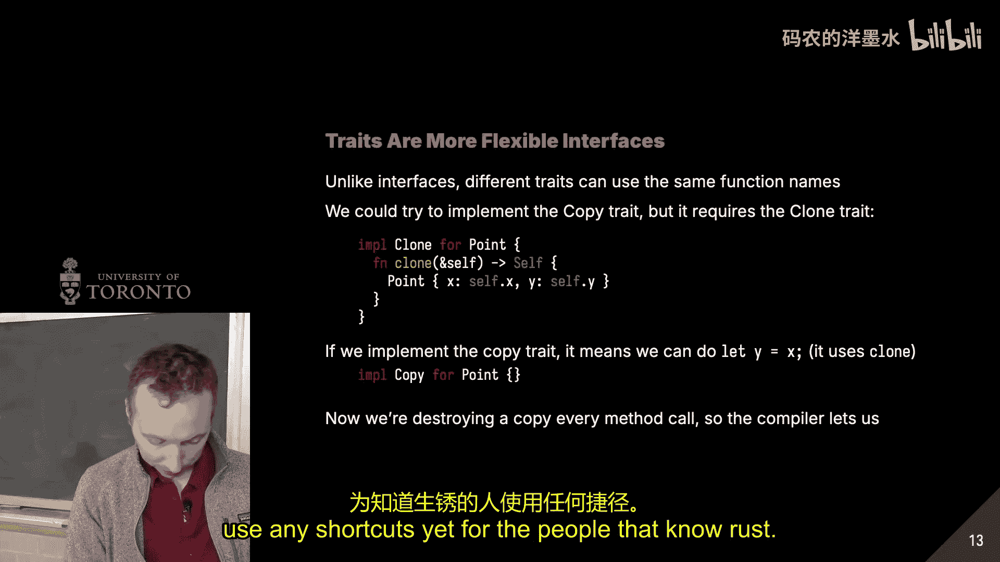

```rust
struct Point {
    x: f64,
    y: f64,
}
```

要为结构体实现方法，需要使用 `impl` 块。

```rust
impl Point {
    fn distance(&self) -> f64 {
        (self.x.powi(2) + self.y.powi(2)).sqrt()
    }
}
```

这里的 `&self` 是一个对自身的引用，类似于 C++ 中的 `this` 指针。方法体最后的表达式就是返回值。

创建结构体实例：

```rust
let point = Point { x: 3.0, y: 4.0 };
println!("距离是: {}", point.distance());
```

通常，Rust 中会隐藏结构体字段，并通过一个关联函数（通常叫 `new`）来构造实例。

```rust
impl Point {
    fn new(x: f64, y: f64) -> Point {
        Point { x, y } // 字段名与变量名相同时可简写
    }
}

let point = Point::new(3.0, 4.0);
```

## 所有权与借用

上一节我们介绍了结构体，本节中我们来看看 Rust 最核心的概念：所有权与借用。

在之前 `distance` 方法中的 `&self`，是一个**不可变借用**。这意味着你可以同时拥有任意多个对数据的不可变引用。

你也可以拥有一个**可变借用**（`&mut self`），但同一时间只能有一个可变借用。这由编译器强制执行，以防止数据竞争。

如果你不使用引用，而是直接传递值，会发生**所有权转移**。

```rust
fn foo(p: Point) { // 这里 p 获得了 Point 的所有权
    println!("Point is {}, {}", p.x, p.y);
} // p 离开作用域，被丢弃

let point = Point::new(1.0, 2.0);
foo(point); // point 的所有权转移给 foo 函数
// println!("{}", point.x); // 编译错误！point 已不再有效
```

编译器会在编译时捕获这类“使用已移动值”的错误，防止了 use-after-free 等问题。

如果类型实现了 `Copy` **特征**，那么在赋值或传参时会进行隐式拷贝，而不是移动所有权。对于简单类型（如整数），Rust 会自动为其实现 `Copy`。

## 特征

特征类似于其他语言中的接口，但更灵活。不同的特征可以有同名方法，编译器会根据上下文推断。

例如，如果我们希望 `Point` 能被拷贝，可以实现 `Clone` 和 `Copy` 特征。

```rust
#[derive(Clone, Copy)] // 使用 derive 属性让编译器自动生成实现
struct Point {
    x: f64,
    y: f64,
}
```

`#[derive(...)]` 是一个编译器指令，可以为简单的结构体自动生成特征实现。另一个有用的特征是 `Debug`，它可以让你方便地打印结构体内容。

```rust
#[derive(Debug)]
struct Point {
    x: f64,
    y: f64,
}

let p = Point::new(3.0, 4.0);
println!("{:?}", p); // 打印调试信息
```

## 泛型

Rust 没有 C++ 那样的模板，而是使用**泛型**，类似于 Java。

```rust
fn max<T: PartialOrd>(a: T, b: T) -> T {
    if a > b {
        a
    } else {
        b
    }
}
```

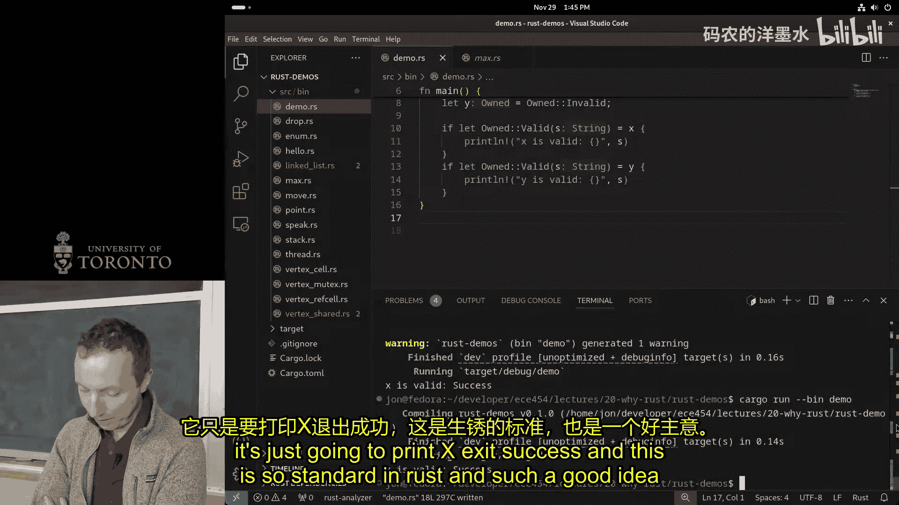

这里的 `<T: PartialOrd>` 表示函数对类型 `T` 是泛型的，并且 `T` 必须实现 `PartialOrd` 特征（该特征定义了比较操作 `>`）。这比 C++ 模板的编译错误信息更清晰。

在底层，编译器会为每种实际使用的类型生成一份特化后的函数代码。

## 使用特征实现多态

Rust 不直接支持传统的类继承多态，但通过特征可以实现类似的功能。

假设我们想表示会“说话”的动物：

```rust
trait Speak {
    fn speak(&self);
}

struct Cat;
impl Speak for Cat {
    fn speak(&self) {
        println!("Meow");
    }
}

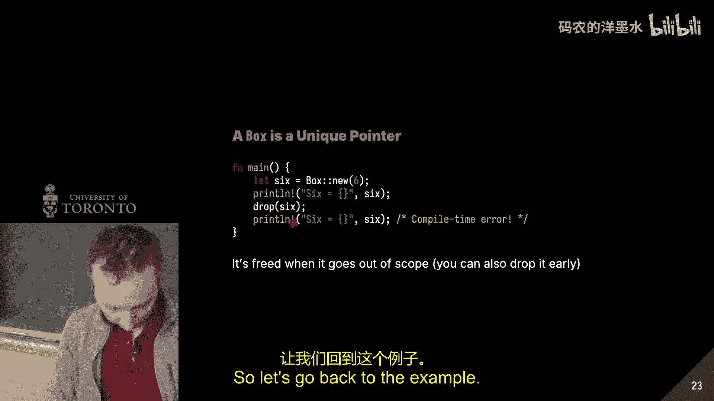

struct Dog;
impl Speak for Dog {
    fn speak(&self) {
        println!("Woof");
    }
}
```

`Cat` 和 `Dog` 是零大小类型，在运行时不占空间。

现在，我们可以写一个泛型函数来处理任何实现了 `Speak` 特征的类型：

```rust
fn call_speak_static<T: Speak>(s: &T) {
    s.speak();
}

let cat = Cat;
let dog = Dog;
call_speak_static(&cat);
call_speak_static(&dog);
```

这会为 `Cat` 和 `Dog` 各生成一份 `call_speak_static` 的代码，是静态分派，速度快。

如果你需要运行时多态（动态分派），可以使用**特征对象**：

```rust
fn call_speak_dynamic(s: &dyn Speak) {
    s.speak();
}
```

这里的 `&dyn Speak` 是一个“胖指针”，包含数据指针和虚函数表。这类似于 C++ 中带有虚函数的基类指针，性能稍慢，但只需要一份函数代码。

## 枚举与模式匹配

Rust 的枚举比 C/C++ 强大得多。枚举变体可以携带数据。

```rust
enum Owned {
    Valid(String), // 有效时携带一个字符串
    Invalid,       // 无效
}

let x = Owned::Valid(String::from("success message"));
let y = Owned::Invalid;
```

可以使用 `if let` 进行条件匹配和解构：

```rust
if let Owned::Valid(s) = &x {
    println!("x is valid: {}", s);
}
```

`match` 表达式提供更全面的模式匹配：

```rust
match &x {
    Owned::Valid(s) => println!("Valid: {}", s),
    Owned::Invalid => println!("Invalid"),
}
```

编译器会确保你处理了枚举的所有可能变体。

这种“可能有值，可能没有”的模式非常常用，因此标准库提供了 `Option<T>` 枚举：

```rust
enum Option<T> {
    Some(T),
    None,
}
```

类似地，用于错误处理的 `Result<T, E>` 枚举也很常用：

```rust
enum Result<T, E> {
    Ok(T),
    Err(E),
}
```

Rust 没有异常机制，函数通过返回 `Result` 类型来强迫调用者处理错误。`?` 操作符可以简化错误传播。

## 智能指针与线程

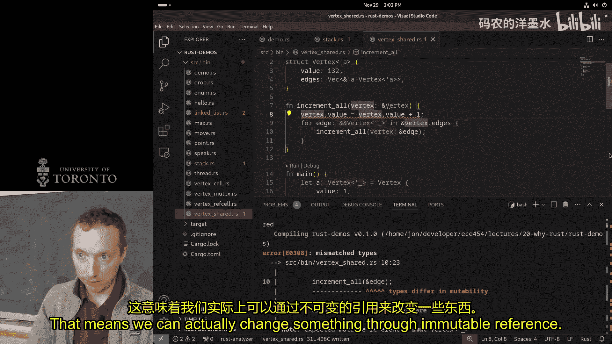

`Box<T>` 是 Rust 中的独占指针（类似于 `std::unique_ptr`）。

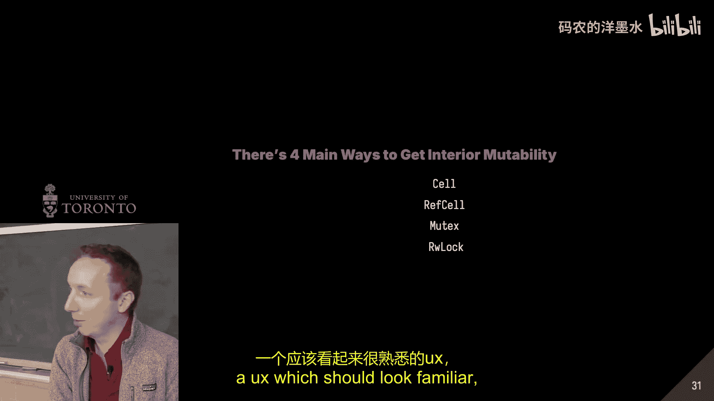

```rust
let six = Box::new(6);
println!("{}", six); // 解引用是自动的
```

`Box` 在离开作用域时会自动释放。你也可以显式调用 `drop` 来释放。

```rust
drop(six);
// println!("{}", six); // 编译错误！six 已被释放
```

所有权可以转移给函数或线程：

```rust
use std::thread;

let data = Box::new(42);
let handle = thread::spawn(move || {
    println!("在线程中: {}", data);
});
handle.join().unwrap();
// data 在这里已不可用，所有权已移入线程
```

`move` 关键字强制闭包获取所用变量的所有权。编译器确保被移动的值在原始上下文中不再被使用，从而安全地在线程间传递数据。

## 生命周期

生命周期是 Rust 确保引用始终有效的机制。编译器会分析引用存活的时间。

一个典型的错误是返回局部变量的引用：

```rust
fn stack() -> &i32 {
    let x = 42;
    &x // 编译错误！不能返回局部变量的引用
}
```

编译器会报错，指出返回的引用指向函数内局部数据，该数据在函数结束后就无效了。这防止了悬垂指针。

在结构体包含引用时，需要使用生命周期注解来明确关系：

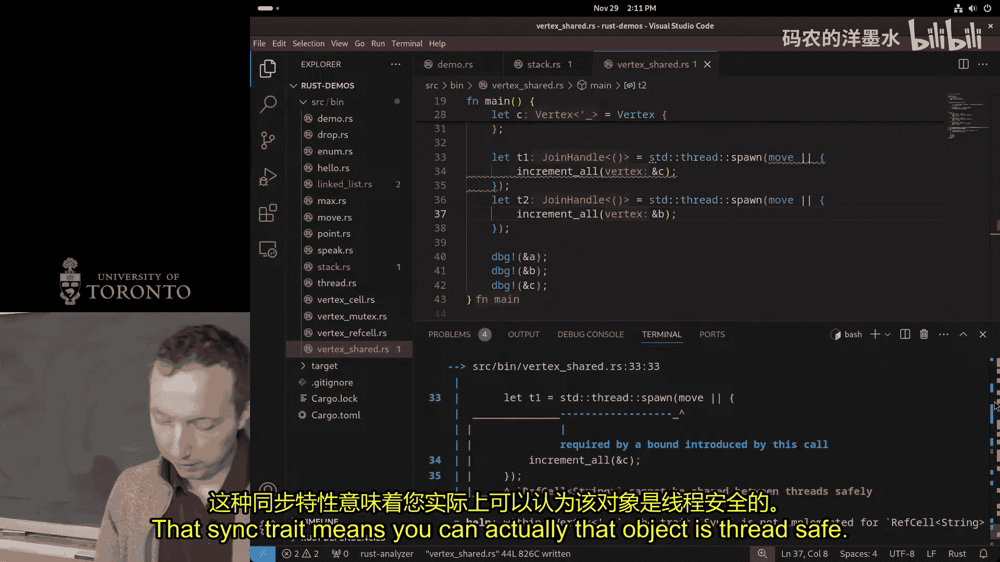

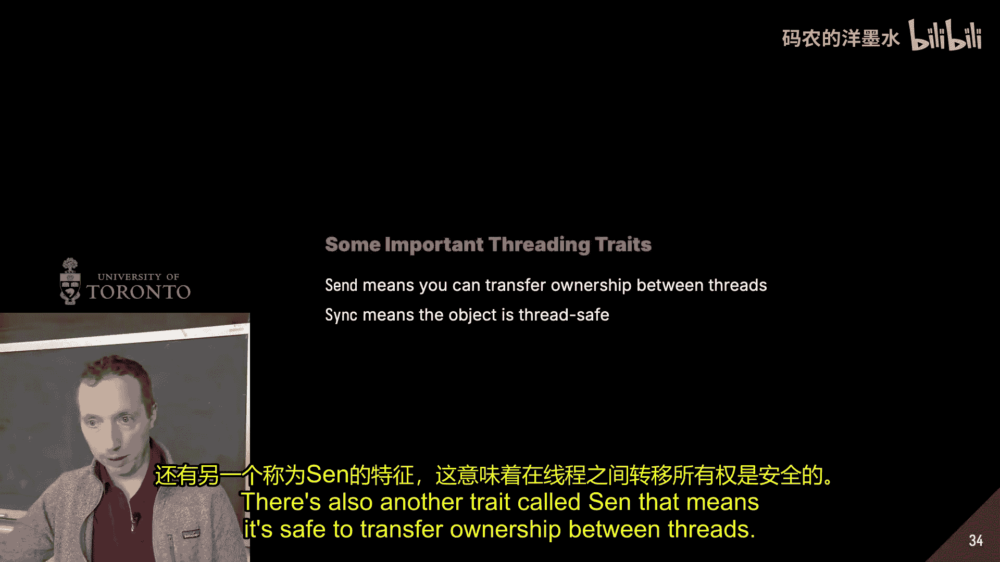

```rust
struct Vertex<'a> {
    value: i32,
    edges: Vec<&'a Vertex<'a>>, // edges 中的引用必须比 Vertex 实例存活更久（或一样久）
}
```

`'a` 是一个生命周期参数，它表明 `Vertex` 实例和其 `edges` 中的引用具有某种关联的生命周期。

## 内部可变性与线程安全

有时，我们需要通过不可变引用来修改数据，这称为**内部可变性**。Rust 提供了几种工具，适用于不同场景。

假设我们有一个图节点 `Vertex`，我们想修改它的值：

```rust
struct Vertex {
    value: i32,
    edges: Vec<Arc<Vertex>>, // 使用 Arc 共享所有权
}
```

如果我们写一个函数来递增节点及其所有邻居的值，会遇到借用检查的问题。

以下是四种实现内部可变性的主要类型：

1.  **`Cell<T>`**：用于实现了 `Copy` 特征的类型。通过 `get` 获取拷贝，通过 `set` 设置新值。单线程使用。
2.  **`RefCell<T>`**：用于任何类型。在运行时执行借用规则，通过 `borrow_mut()` 获取可变引用。如果违反规则（如两个可变引用同时存在），程序会 `panic`。单线程使用。
3.  **`Mutex<T>`**：互斥锁。线程安全。通过 `lock()` 方法获取锁，返回一个守卫，在守卫离开作用域时自动释放锁。
4.  **`RwLock<T>`**：读写锁。允许多个读取者或一个写入者。线程安全。

对于我们的多线程图节点例子，我们需要 `Mutex` 来保护数据，并使用 `Arc`（原子引用计数）来在线程间安全地共享所有权。

```rust
use std::sync::{Arc, Mutex};
use std::thread;

struct Vertex {
    value: Mutex<String>, // 用 Mutex 保护 String
    edges: Vec<Arc<Vertex>>,
}

fn increment_all(v: Arc<Vertex>) {
    // 获取锁，修改值
    let mut val = v.value.lock().unwrap();
    val.push_str("+");

    // 递归处理邻居
    for edge in &v.edges {
        increment_all(edge.clone());
    }
} // val 离开作用域，锁自动释放

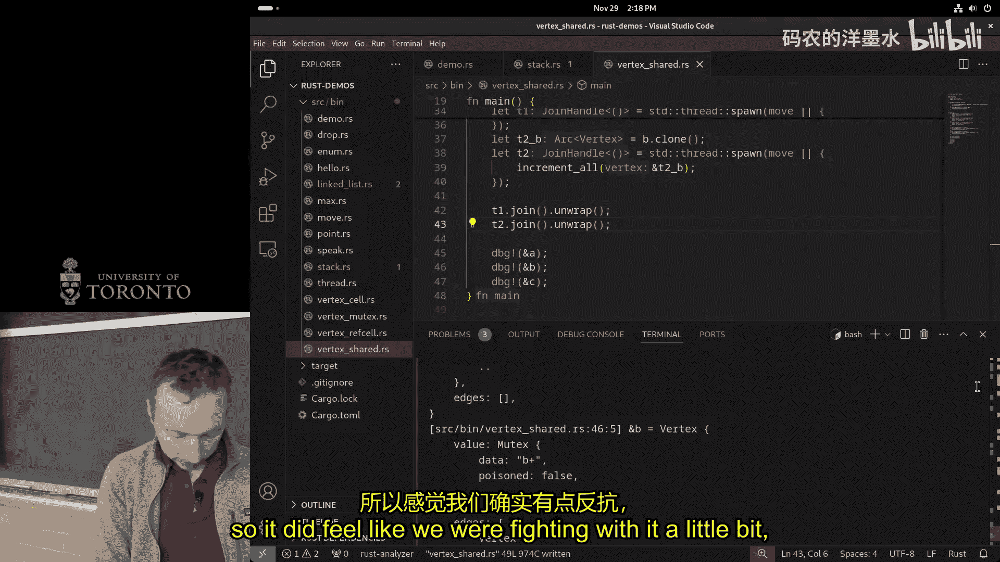

fn main() {
    // 创建节点并用 Arc 包装
    let a = Arc::new(Vertex {
        value: Mutex::new(String::from("A")),
        edges: vec![],
    });
    let b = Arc::new(Vertex {
        value: Mutex::new(String::from("B")),
        edges: vec![a.clone()],
    });
    let c = Arc::new(Vertex {
        value: Mutex::new(String::from("C")),
        edges: vec![a.clone()],
    });

    // 在线程中调用
    let c_clone = c.clone();
    let handle1 = thread::spawn(move || {
        increment_all(c_clone);
    });

    let b_clone = b.clone();
    let handle2 = thread::spawn(move || {
        increment_all(b_clone);
    });

    handle1.join().unwrap();
    handle2.join().unwrap();

    // 打印结果
    println!("A: {:?}", a.value.lock().unwrap());
}
```

虽然编写过程中可能需要与编译器“斗争”，但最终结果是，编译器帮助我们创建了一个内存安全且无数据竞争的程序。

## 总结

本节课中我们一起学习了 Rust 语言的基础。Rust 通过所有权、借用检查和生命周期系统，在编译期确保程序的内存安全和线程安全。它的核心特点包括：变量默认不可变、强大的模式匹配、基于特征的多态和泛型、丰富的错误处理机制（`Option`/`Result`），以及为并发编程提供的安全抽象（`Mutex`、`Arc` 等）。

从 C/C++ 转向 Rust 的初期可能会感到有些束缚，因为编译器非常严格。但这种严格性旨在消除一整类的运行时错误。如果你确信自己的代码是安全的，但编译器无法证明，可以使用 `unsafe` 关键字来绕过检查，但相应的代码就需要你自行确保其正确性。

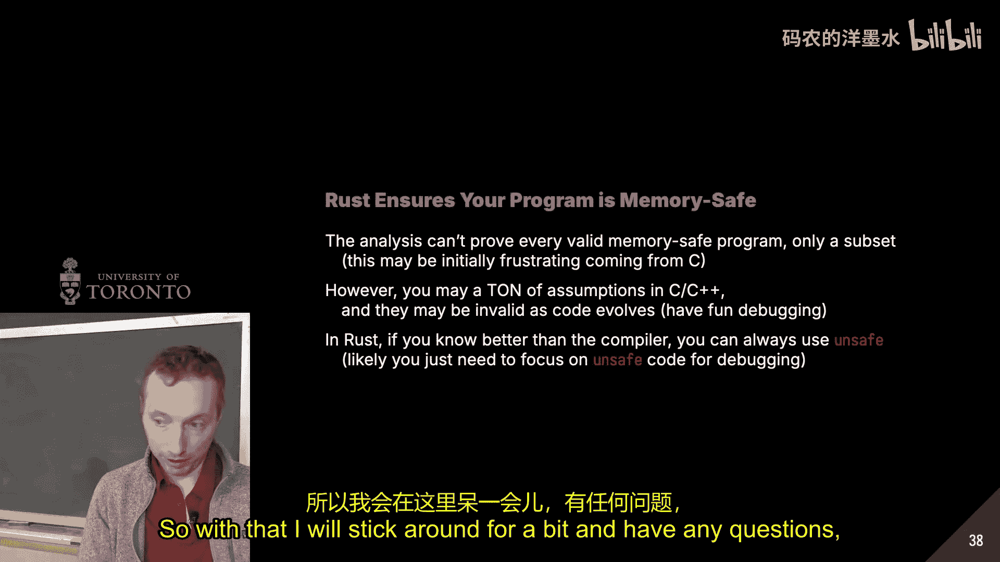

对于编写高性能且安全的系统软件，尤其是并发程序，Rust 是一个非常值得考虑的选择。