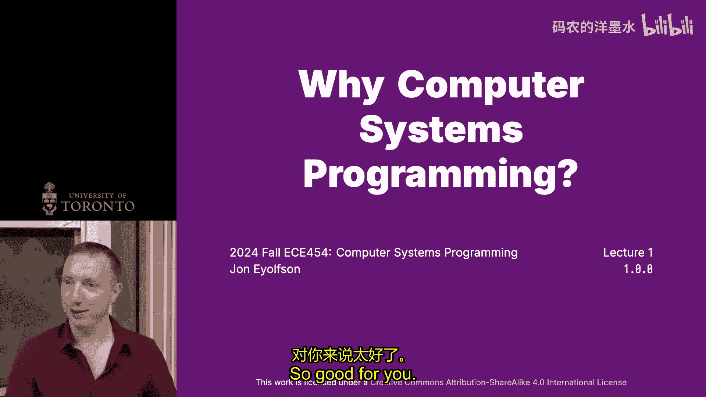
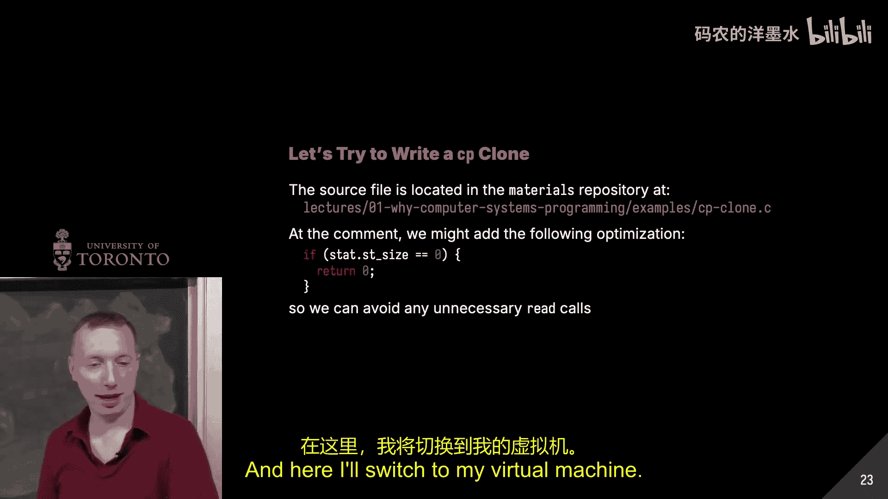
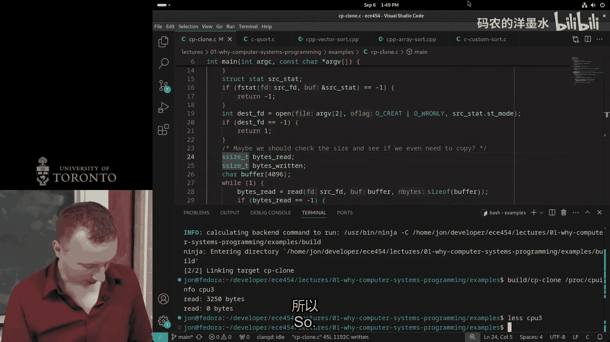
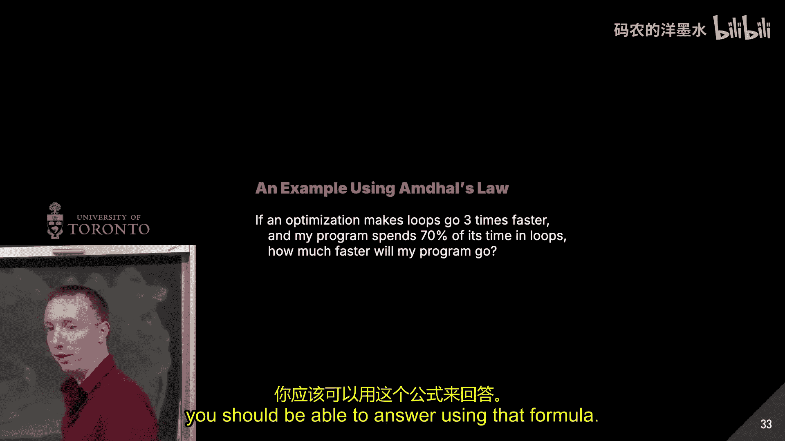
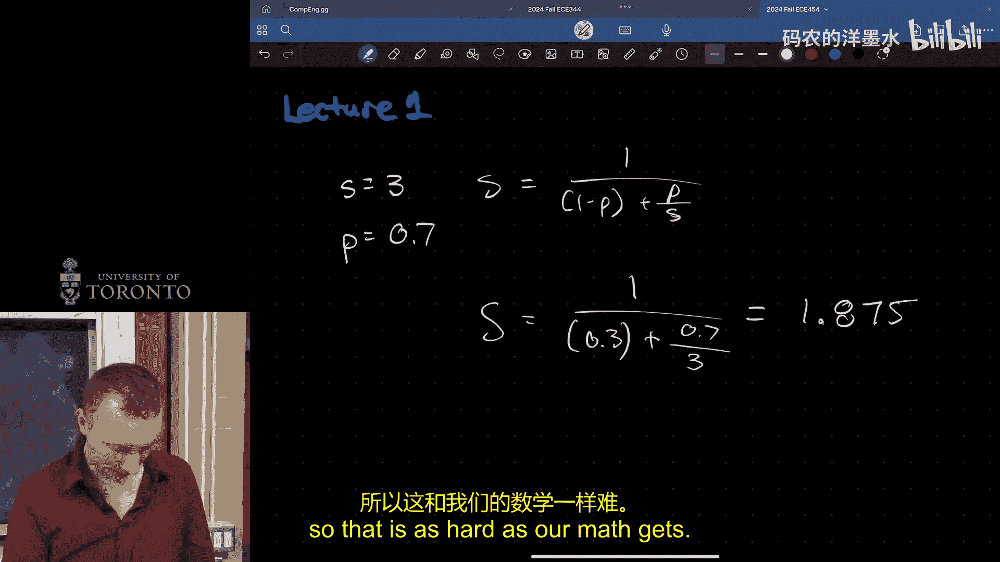
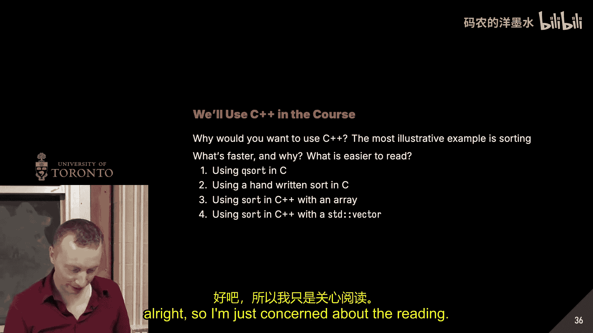
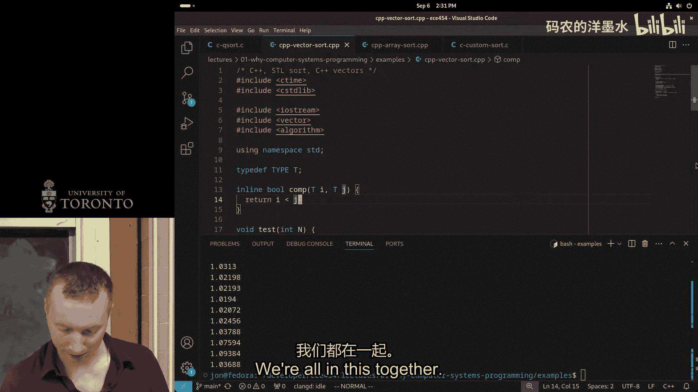

# 【全集】多伦多大学 C语言高性能系统编程实战 中英字幕 1080P p01 Lecture 1 - 导论 -BV1oDrZBZEG2_p1-

🎼Yeah。は。Allrighty， welcome whoa that tech we， all right， welcome to454。

Computer systems programming or what I like to call this course， while still Ey。

 what I like to call this course programming for performance。

So good to see a lot of familiar faces again。 some of you from just last year。

 some of you from two years ago， that actually got a job and made money。 So good for you。

 So just in case you have not seen me before， I am John， your instructor。😊。

Last name， kind of a disaster， yeah， Eson。So。Just in case you don't know how to pronounced my last name。

 I pronounced it Epson。 I was told when I was like 25， that was incorrect。

 That's not how I pronouncednounce it。 So I went to Iceland and gave my passport to the nice Icelandic man。

 And then he looked at my name， looked at me。 He's like， say your last name for me。 I said， Elsin。

 I looked at me and was like， no。So apparently， you're supposed to pronounce it a Alpsson。

But screw that。 I don't do that。 So I don't expect you to do that either。

 Easy way to pronounce it elf。Christmas is thankfully at the end of the semester， so elf。Sin Altin。

 Ta pronounce it。 nice and easy。If you need to， for some unfortunate reason， spell it。

 Easy hack for that is take the L and the F， shove it over。 and that hole stick a yo in and then。

You can spell it without having to try and pronounce it。So that's it。 Or if you prefer just John。

 John is the easiest way， hopefully you can't screw up typing three letters。 But you know。

 some people have screwed that up to。 So what do you know。So。Why would we take this course。

 besides from its like kind of weird， slightly ambiguous name。

 It doesn't really mean anything by itself computer systems programming。 So at this point。

 you can probably write functional software。 But can you write performance software。

 The answer to that is probably no。 But at the end of this course。

 you hopefully will be able to write software that is not only functional。 That's a good first step。

 but also somewhat performant。 So most software you interact with。

 that runs on the cloud or some cloud servers that， you know。Are going to be very expensive saving。

 even if you save like 2% performance。That multiplied by a billion。 Its still quite significant。

 You might actually care about the environment and energy usage and things like that。

 So if you can make more performant and efficient software。

 you will lose less power and everyone wants to do that。

 and also servers in the cloud are also idle a lot of time。

 So if you know how to use all of the resources and you have higher utilization rates。

 That means you're actually using the hardware you're paying for。

 which will make both you and your employer very， very happy。😊，So。

This is first half is pretty much just all logistics， getting it out of the way。

 So here's some important URLs for the course。 So very important。 if you haven't already。

New for this semester is this compEch。 G G thing to tie together Discord and Github and everything we're going to use in this course。

 So very important to sign into that。 It just uses your Toronto ID。

 and then it asks you to connect your Discord and Github account。

For lectures I'll just have them publicly available on my site for the labs we'll be using this right now it is empty since it is the first week and we haven't started labs yet。

 but that's where you'll find the labs and the materials you can also find them in the GitHub repository I'll have code examples as I'm going through everything so you'll find them in that repository that you should have access to once you accept the GiHub invite and all the links I'll post on Corus just so you have them all in one place for both sections。

So yeah， as I alluded to new this time is the labs are going to be using GitHub。

 discussion is all going to be on discord and I'll stream my lectures and have the recordings on YouTube。

 So again， connect your accounts on this comp E do G G site。 turn that let's echoe。

So the one complaint I heard about discord。 Otherwise， it's like extremely positive。

 except that like， you can't send anonymous messages。

 I thought just by virtue of Discord and like having a username， you guys would not know each other。

 but apparently， you're all friends。So so I don't know， I don't know， I didn't figure that one out。

 but I know seemed weird to me at the time， but I guess it makes sense。

 So I fix that over the summer we created a discord bot。 So if you want to be actually anonymous。

Just do slash it on and then type your message， and then the message will appear as if it's coming from the bot。

 You won't know who sent it。 You'll see that you sent it， but it's a message only you can see。

So this is how you can send anonymous messages， so we don't have to use piazza or anything like that。

 so they will always send a message from the current channel you're in and please do not abuse this like like piazza。

I do record who actually sends a message， but it's really a big pain in the ass for me to check who sent it。

 So basically， if you don't abuse it， I don't need to check who sent a message。

 it's anonymous even to me because I'm not even going to bother to check， so。

Please feel free and use this and you will be definitely anonymous to each other。Allright。

 so other thing， lecture attendance still important。

 It's a lot faster to get feedback for you and me to clarify if anything is unclear during while I'm doing the course。

 like even if you're just sitting there and you look confused。 hey。

 that's good feedback for me because I can actually adjust what I'm doing。

 try and wake you up and try and explain it in a different way， we'll have lots of live coding。

 we'll be able to explain any weird things that happen。Especially with performance， it gets really。

 really weird。 There's a lot of different factors that could change your performance of your software。

And again， let me know anything else that might make this course better。

 This is a new course for both me and the co instructor in Section 2。 So please be gentle to us。

 If anything doesn't work。 we got materials and we're trying to use them。

 But it's the first time for both of us。 So I guess you guys are all beta testers。 So good luck。

 I've done this course before at Waterloo， but that was like。😊，Oh god。That was like 12 years ago now。

 which makes me feel really old。 All right， so I have done this course before， but just not here。😊。

So how this is going to work， which is mostly we got labs from before that we're going to just use and try and modernize a little bit and as we're doing them any bumps in the road we'll try and fix them。

 make them easier， but this is the way it looks right now so lab one will be one week。

You'll have one week to do it and it will start next was it be released next Tuesday so you'll have one week to do that it'll be worth 5% I'll go into details of what each lab entails in a little bit then for lab two you'll have three weeks to do it it'll be worth 9% brings us to October 7th。

Then we'll have a midterm。 We're 20%， tentatively the 17th and。

Is that if I just throw that data up there， does that， is that like immediately。

 do people have conflicts。No conflicts immediately。Okay。

 so this is relatively good I saw on one hand。Oh， there's 3，20。 Okay， So there's one other one。

 but nothing else that week。 So I could probably do like Thursday or something。Okay。Sorry。

That is Thursday。 Oh， okay， the Tuesday， oht know。Oh I hate scheduling midterms here。

 It's so terrible。Alright， well， we'll figure out a date。 That's a guess， not that date。

 But sometime that week， So probably。Earlier or later， we'll figure it out。So， yeah。

 lab 1 and 2 will be related。 I'll get into that a little bit。 Then for lab 3。

 you'll have three weeks bring us to that date。 Then lab 4 and 5， they are the bigger ones。Lab five。

 you're essentially just。Taking everything you learn in this course and trying to apply it to just one piece of software。

 So that's the last one you do。 that should be really， really fun。

 and that'll be due on the last day of classes or next to the last day of classes。

 And then we'll have a final worth 40。 So fairly boring stuff， but that should all add up to 100。

So academic OI， you can study together， discuss concepts on Discord， don't post lab code on Discord。

 like you can post the starter lab code that's fine， or any other relevant code that is also okay。

 just not something directly from your solution。Please， and please don't cheat。

 It wasn't one of you where I had to like。Catch someone air dropping files to their friend and then claiming that。

 oh， I don't know how it got there。 It's like it's software。 It's really， really easy to check。

 If you blatantly copy off someone。 or if you just change variable names or something like that。

 So please don't do that because that's an awkward conversation with me。

 then you have to have an awkward conversations with the department。 And at best。

 you just have those two awkward conversation。 But if you want to fight more。

 you've up to like four awkward conversations and blah， blah， blah and。😊。

It's just a big waste of time。 Just ask for help instead and try and start early。 and again。

 I know the labs might be slightly bumpy， so will be nice， so just ask， try and start early。

 find all of our bugs because unfortunately we are kind of beta testing in this semester。So。

 like I said。Please provide some feedback。 This course will be quite challenging。

 Let me know if anything is unclear。 We also have like an awkward situation where we're essentially like a week behind the other section。

 So they've already had their three hours of lectures。 And this is our first lecture。

 And I don't know about you。 That's already feels like we're in week 3 to me。 So that's not good。

 But so we might have to reorder things so that we're on。Task with the labs。But again。对。

And of course， because this class is super general， it's just about software performance。

You can ask questions about any type of software you want if you're。Curious why， you know。

 any piece of software is not very performant。 You can ask questions about that。

 There's lots of open source software。 We can go explore and that we can go look at。

 And by the end of this course， you will be a much。

 much better programmer that produces much better software than you were before， because。

 like I said。😊，Before you're writing functional software， now you're writing good software。

So like I said， in this course， we care about performance。 specifically。

 we're focusing on scalability and efficiency。So。In the past， performance was really， really。

 really easy。 So Wars law was in full swing。 Everyone's probably heard of that before。

 like a doubling in transistors every 18 months。 and all the extra transistors went to like single core speed。

 So that basically meant every 18 months。 You got a processor that was twice as fast。

 So that means you don't have to change your software。 If you want your software to go twice as fast。

 It just means you wait 18 months。 And then you buy new CPU。 and then it goes twice as fast。😊。

That has not been true for a while。Which is why we have to take something like this course。

 because we have to be able to use all of the hardware that's given to us。

So some other current trends like Moore's law。 We're still kind of doubling transistors。

 but the physical limits are kind of coming in for that as well。

 And our single core performance has leveled off。Quite a long time ago。

 and this is mainly due to the physics of a CPU that I don't quite understand。

 I heard from a reputable source that if you tried running a CPU at like 10 gigahertz because of some inverse square。

 whatever electronics， you guys probably know more than me。

 it would be hotter than the surface of the sun and well that wouldn't work if that was sitting on your desk。

 it would probably melt your desk so。Don't quote me on the exact temperatures。 again。

 you guys took semiconductor physics。 That's when I kind of gave up on physics。

 So you probably know more than me。 trust your props that teach you about electronics， Def not me。

 I'm the guy that in my electronics lab， I blew up a capacitor and。

Sprayed whatever liquid was inside of it on my lab partner。So yeah。

 don't listen to me about electronics， I can do software though。Also modern systems。

 they have lots and lots of cores of them， even like a wristwatch has two cores on them you'll need the program with parallelism in mind if you took3。

4，4， you kind of got a taste of that but we'll be going into more details of how to do that and how to do it performantly in this course because like I said before concerned about functionality now we actually care about performance and for really。

 really， really large scale software we will use multiple machines instead of just one single machine with multiple cores that hopefully we'll have time for in this course。

So another trend is to have specialized hardware。 So most CPUs now have dedicated hardware for certain functions。

 video encoding， transporting， stuff for AIs matrix multiplies everything like that。

 There's also a trend to have Asics or application specific integrated circuit。

 That's basically you take your C function， and you burn it into hardware。

 and it just runs in hardware。 You of course can't change it， but it's going run really。

 really quick。 and that's what you do for less common functions。 for example。

 all the bit miners now a day are all a6 machines So they're actually power efficient and can just mine Bitcoin without losing a bunch of money because it is not profitable anymore。

You can also use like other hardware like GPUs that are you know， supposed to just do graphic stuff。

 turns out。Multiplying numbers and adding numbers really fast。

 massively in a very parallel way is useful for things like AI so we can actually program our GPUs to take advantage of that hardware as well。

 which we may or may not actually get to touch on to this course。

 I'll try to introduce some GPU programming at least towards the very end。

So since we care about performance， we probably need to have some idea of relative performance numbers。

So latency numbers every programmer should know， so like having an L1 cache reference or something that is in your cache on your CPU takes about one nanosecond。

 which is very， very quick， like one nanosecond at the speed of light is about that far like about 30 centimeters ish。

 so really， really， really quick。And then we have to go through everything that might slow down our programming。

 So law of CPUs， we'll get into this more in the later lectures。

 have branch predictors that try and speculatively execute code depending on， you know。

 by guessing the outcome of a branch。 But if it turns out to be wrong。

That is a major place where we lose performance。 So if the CPU hardware guesses the wrong branch and mispredics it。

 while then we get a slowdown of about three times， if we have to。Go to our L2 cache。

 It's about four times slower， and usually the L2 cache is a lot bigger than L1。Then if we use Mutex。

 which you're familiar with from programming with threads， that's fairly that's much slower。

 It's about 17 nanoseconds because it has to coordinate all those atomic operations， then sending。

Information over a network，44。 I won't go over all of these numbers。 Just know that。

The further and further away we get to a CPU from CPU， performance drops off very drastically。

 So if we have to go from the CPU to main memory， the difference is like 100 times。

 And then as soon as we get to like hitting the disk， it's almost another00 times slower than that。

 So that's 16 microseconds。Which is millionth of a second instead of a billionth。And then， you know。

 if we have to work within a data center， then that's about 500 microseconds hitting the disk。

 like writing， sorry， reading a lot of information from the disk that might not be on cache is way slower。

 if it's a magnetic disk。 It's going to be even slower than that。 So， oh sorry， So sorry。

 this is reading from like an SSD。So like flash storage on your device without a big spinning mechanical disc。

Is quite fast， but if you have to go to a spinning mechanical desk。

 it's going to be slower by like another 40 times and then seeking information on disk even slower than that and sending a packet over the internet from like California to the Na lenss back to California。

 that's like on the order of milliseconds which is really， really， really。

 really slow compared to our L1 cache just on a single CPU core。

So those are numbers just to keep in mind as we're doing this course。And just knowing。

We want to be up in this region。 We want to have things in cash， as much as possible。

So if we want to reduce latency in our programs， we have to be able to find the bottleneck。

 So one thing looking at all those numbers we definitely want to avoid is disko so if we can just avoid disko completely or just have it loaded ahead of time well our performance might speed up by like 100000 times。

 so for example。People will do everything to avoid going to disk。

 so if you've heard of MeCash that's basically a cache layer for web software。

 basically it tries to cache any kind of request to a database or file or any API and save that into memory and hold it into memory instead of accessing disk every single time someone requests that information。

We can also change our memory allocator if we want， so we can allocate memory in a better way。

 so if I can fit data entirely in cache instead of having to go to memory all of the time。

 my program will also be much faster by like 100 times。

And these are all strategies for just a single threaded application later in the course we'll also be paralyzing and arguing about how to make that more performant。

So in this course， we will start with a single threaded application and then work our way to having multi threaded applications。

So a bit about how the course and the labs are organized。

 first module is code measurement so we can't actually improve things until we know what we need to improve so the topics here are going to be like how do we actually find the bottleneck and our programs some principles of code optimization what our compiler does and doesn't do how it can help us produce better executables and how to actually profile programs or measuring time so the labs that are related to this module are lab1 so that will be kind of lab one will just be profiling lab2 so you'll have an idea of what you need to focus on to actually improve the performance of lab2。

Lab 1， you won't be writing any code。 You'll be literally just collecting data about some code that is given to you and then answering。

I forget how many questions， and we'll probably just put them on crowdmark。 So lab 1。

 just measuring lab 2。Then in module 2， it's mostly memory management， trying to make。诶。

Program that uses a single core go much faster。 Some topics we'll talk about then is more about memory hierarchy。

 caches and locality， much more detail than the operating system course。 and virtual memory again。

 more detailed than the operating system course。 the labs here are going to be lab 2 where you're going to optimize the memory performance of the code that is given to you。

 and then lab 3， you're going to actually write your own memory allocator。

 So you're going to be implementing malloc and free and all of those fun functions。

 and you'll be doing it for performance reasons， of course。😊，So。Next， we have module 3， which is。

Split into two parts， it's basically module 3 is basically all parallelization。

 So 3 a is parallelization on a single machine， So one machine with multiple cores。

 thatll be more threads and threaded programming， synchronization and performance for that。

Labbs that are relevant to this are going to be lab 4 where you speed up a program using threads and synchronization。

 and it will be more difficult to actually paralyze it than you saw in the operating system course。

And then La 5， basically， you're given a game simulation。

 and then you're told to go wild and make it go as fast as possible。So should be a fun lab。嗯。

And then if we have time， we'll have module 3， B。 So that's parallellyization on multiple machines。

I guess due to budgetary concerns， I guess we can't give you multiple machines to run all your code on。

 So I guess that's why there's no lab for it。 Hopefully we can make improvements of that on the future。

 We'll see what we can do during the lectures。 But topics here would be like frameworks for。

Big data analytics， cloud computing， storage systems。

 basically how we run these giant applications and make them all scalable。

So how everything kind of fits together visually is in module1 code optimization。

 we're primarily concerned about just what happens on a core without。

Having to worry about anything about cash or memory， so just how our compiler works。

 how to measure just our code straight up without care for anything else in the world。

Then in module2， we'll be concerned about memory management。

 which is how can we use our memory better so that it uses our cache better and we get that nice speed up that we want and again this is where writing your own custom memory allocator comes into play。

Then we will switch to introduce parallelism， and that will include module 3 a。

 which is basically having multiple cores with their own caches。

 And then there's probably a shared cache that acts as a cache for memory between them。

 and then we're going to make。That more performance。 So a more realistic system。So。

Code examples will be doing lots and lots of code examples。 They should be available to you。

 So you should have access to this Github repository。

 You're going to have to accept the invite to the organization。 if you haven't already， if you。

 for some reason， if you like。Set up your GitHub for an email you don't check。

 you might not have access to it it'll just say 404 when you try and get it that means you probably haven't accepted the invite as soon as you connect your account on that site it should send you an invite so I'll also post that on the setup guide as we go but if you can access this it's likely because you have not accepted the invite yet。

The setup will be the same as the lab， so I'll have this go live so that you can actually set up your development environment and everything like that。

Should just。Basically have to open that folder in VS code。

 and then you can go ahead and unlike the labs。If you want to run the sample code in the lecture。

 I try and use Meson for all of the compilation and setup so you should just have to do Meson setup build compile and that's how you can run everything from the lecture so the lab since we're using them from another professor then they're going to be using a slightly different build system but for all of the material I use。

 I generally use this build system and this place is executable in the build directory。All right。

 so first fun quote， premature optimization is the root of all evil。 So we might just think， a。

 we know better。 like if something is obviously。Doesn't make sense why we're even doing it。

 We can probably optimize it before we even try and measure anything。

 But turns out that always become， that's always a bad idea。

 So always remember this quote that premature optimization is the root of all evil。 if you just。

Optimize something and you don't know why you're doing it or have any evidence for it。

 You probably have already made your first cardinal sin。So。To illustrate this， let's try and。

Write some software。 Well write we've all used CP before to copy a file， right。

 so let's write a clone of that and。

Here I'll switch to my virtual machine， so let's write a clone of that。So everyone can see that O。

 ish。Everyone in the back see this。Okay。So。Here is my copy program。

 so I'm going to assume we have three arguments。I want to copy a file from the source to a destination。

 and then in my implementation I'll have some error checking。

 but I'll open the first argument to read。And then here， whenever I need to create the destination。

I have to make sure all the modes are the same。 if you remember all that iNot stuff， you know。

 from operating systems， I have to make sure all the permissions are essentially the same if I'm copying a file so I have to actually stat the file so I can figure out what permissions。

 this file has so if I use the stat function that will tell me all of the file permissions it has and then I go ahead and create the destination。

 use the file name as the second argument I'm going to create and write to this file and then I'll just use the mode from the file I'm copying from so I'm going to copy all all of its permissions。

 so if it is readwrite on this one will have rewrite it's supposed to be copy so it should be the same。

Check for errors and then here's a little comment I have that we'll come back to。

 so the rest of the code。Just declares a buffer， reads from the source file and then takes any information it reads and writes it to the destination file。

 So does that look all right for a copy clone。Should work， right， so let's make sure that it works。

So， bills。So let's say， oh don't know， I want to just copy this file and just say。

Totally my assignment。So do what someone did to submit their own assignment。

 I'll straight up copy it。I read all that information。

 I should have created a new file called Tot My assignment， it looks exactly the same。

 it's the same file size， if I look at it， all the code is exactly the same seems to work， right？So。

I might be happy with that。 It seems to work， or I might be like，h。I want some more performance。

 I can certainly optimize this one， because what about if I had， I don't know。

 What about if I was just。Have an empty file。So I have an empty file that's zero bytes。So。Obviously。

 if I run this。こ。A new file。So if I do that。I go through all that rigga maru of setting it up and everything like that and then。

I read from an empty file and read zero bytes and then write out zero bytes。Well。

 I don't actually write out zero bytes， but I do a read system call when I don't have to， right。

 it's zero the file is zero byte， so why did I even bother doing that？

And I can see whenever I create the new file， it's also 0 bytes。 So I might be like， okay。

Surely I can optimize this。And one optimization we might have is if we scroll up。At this line。

We've started the source file and one of the fields that we have like we need its permissions anyway so we can't get rid of that one。

 but in this structure it also tells us how big that file is so maybe I want to optimize my program and be like okay。

 well I can actually check。If。I can check the size of the source file， and if it's zero。

 maybe I just don't even bother， so let's check the size。

So if the size is equal to0 means it's empty， right？So should be safe to just be like， okay， well。

 don't need to do anything。Cool。So we'll recompile that。 All right， A C， any issues with that。

 or is this like a great optimization， And I am。I'm God's gift to programming。Yeah。

 maybe a directory is size zero to。Maybe a directory is size zero， so we might break that。

Let's pretend we don't care about directories for now。いや。Yeah。

 so some files may not have any actual contents， but。That should just mean we don't copy it， though。

 right？If it doesn't have any contents then we don't have to， it's nothing to copy。Sorry。はは。

Some of them have meaning。Some。Close yeah。 Oh， yeah。Okay。

 so you're concerned about like permissions and stuff。

 so let's make sure that I didn't screw up anything。

 So here is this new file I made with my unopimized version and here is my empty file right so。

Because my optimization is after the permissions， the permission should still be okay。

So let's just double check that， but permissions are still okay。

 so I'll call it just new file two because I'm creative。And new file2 look looks the same。

 The permissions are all the same。 So we're all still good。

 So that seemed to be like a perfectly good optimization。 And we'll see when I ran it this time。

 I didn't see the message that I read  zero bytes。 I didn't even do a read system call。 I just。

Opttimize my program， I didn't have to do a read system call。All right。Any other ideas。

 One's close and at that right idea。 Yeah， maybe it Uni everything as a file ideology maybe。

Some special file that's not create， but you try to copy it。Yeah。

 maybe there's some special files that aren't really a file that don't actually exist on disk but have some content。

Yeah， you didn't close the。I didn't close the files， but when my process dies， it closes everything。

 so I'm doing Lib C optimization here。Sorry。Something to do with Simlink。Simlink would have a size。

 technically， yes。れでる。Metaadata， it's kind of in the mode。 I'm assuming it's just in the mode。

 So we do still copy the mode。 Yeah， Is there something about how like in Linux the file end。でもいます。

No。So that suggestion was in Linux， files end with a new line wall in。It called。

 but I remember there's something with。Okay， so that's a bit of an aside。

 so I think what you're getting at is like line endings on Windows versus Linux。Yeah。

 so those are like for text files in Windows it's like it's always two characters of carriage return and a new line in a UniX it's a new line。

 but that's just how you format like plain text files。But okay， so yeah， I heard it already。

 though someone said like there're special files， so let's see。So let's cat。So prox CPU info。

 that like tells us all information about our CPU and everything， right？

So that might be a good thing to copy。So let's use our program and we can just copy。

 let's just say we want to copy it PRc CPU info。This is called it CPU2。All right， so we copied it。

And if we look at it。It's got nothing in it。Which is obviously something we don't want。 And why。

 well， because pro CPU info is one of those special files。 So it doesn't actually exist on disk。

 So its size is 0， but it does have contents。 You can actually read from it because well。

 it's a made up file by the kernel， right， So if I actually did L S on it。😊。

I can verify it's one of these weird special case things， so。

This is a good warning that don't optimize something unless you are sure you know everything about the system you are optimizing。

 because if I look at it。Proxy P you info， its size is 0 because it's not a real file。

 It doesn't exist on my disk。 My kernel is just。Making up that information。

 if I just request something with this name and other weird special files like sockets and things like that will also have a size of zero。

Simlink won't， but it's the right idea。 So now if I。Use my。

Optimized program it now suddenly breaks for copying things like CPU info。

And then good luck debugging that or you're just going to make a lot of users mad。

If I went ahead and I just removed my optimization。And recompiled。

I can check that it actually does work， so let's copy the file into CPU 3 and then we can see hey。

 well， even if its size is0， doesn't matter it still has content if we do a read system call。

 gives us information and we can actually see that。

The file that we copied does actually have contents。 So it actually behaves as we expect now。

 So our very， very clever optimization actually probably caused us a lot of headaches and imagine if this was a more complicated system and then suddenly you get a bug report that like。

 hey， suddenly some files are now missing。 then you might be like oh， whoops。

 I committed something that just deleted files。 But turns out you just like。Just created new files。

 you didn't actually delete anything。Yeah， good luck debugging that。

So any questions about that fun thing。 So， yeah， realistically， we wouldn't know about these quas。

So how do we make sure that？みな我び。I think that's unrealistic。So the basic thing of this is is。

If you don't know the ins and outs of the system do things in the approved way。

 so if they tell you how to do it， do it that way， don't deviate from that unless you really know what you're doing and you actually have evidence that this is a good thing to do right so in this program。

Is one extra read system call that doesn't do anything going to affect my performance negatively。

 The answer to that is probably no， it might waste， you know， a few。Few nanoseconds， who cares？

RightI'd rather have things correct， so basically the gist of this is unless you really。

 really know what you're doing。Don't try and be too clever unless you actually have some evidence for what you're doing。

So。

Yeah， this is also like somewhat a contrived example。 I mean， it obviously broke something。

 but just try and have this in your mind as。Things get more complicated than。Clever you try and be。

 So just don't try and outsmart yourself。 So just so you have it at the comment， I just you know。

 checked if the size was 0 and then exited。Just to avoid a single read call。

 and then that turned out to make my program go from functional to non functional or special files and stuff like that。

Can't come up with。Lots and lots of different examples where just trying to optimize something without having any clue what you're doing。

 it leads to disaster。 so that's that。ThP optimization is the root of all evil。

 So this broke things like proc CPU info and things of that nature。Allright， and yeah。

 how do you know an optimization is premature and how do you know you're just being smart Well a bit trickier to answer。

 there's a lot and lot of different factors at play here。

 So like what's the purpose of your program Are you only going to use it once likely it doesn't matter So you could even write it in Python or something like that。

 Who cares， You want to be productive， that's the thing you actually care about you w to even care about performance。

 if it runs in less than a second and you use it once， who cares。

If you are trying to optimize something， are you optimizing the correct thing。

 if it's not the bottleneck， you are just wasting your time。

 so any extra effort you put into it is completely wasted。Are you optimizing a。

Common case or a special case。 if you're optimizing a special case， well then don't worry about it。

 it shouldn't affect runtime that much。Don't bother。

And what price am I paying for actually doing this optimization like。

Or is my productivity dropping because of this like that's why I would use Python instead of C plus+ for some things right。

 is my readability going off， I can optimize a hello something。

 but if I can't read it in a week from now then，And I have to waste like hundreds and hundreds of hours trying to debug it。

 What's the point or do I care about program size， did I make my program absolutely massive because of this change。

 Who knows？So here's what you want to avoid， so this is a comment in a real piece of code when I wrote this only God and I understood what I was doing now only God knows。

 therefore if you are trying to optimize this routine and it fails most assuredly please increase this counter as a warning to the next person and this is currently at 256 or four hours so you do not want to be the person that is incrementing this number because that is a very sad existence so we will try our best not to become this person because。

The code that was below this was absolutely atrocious， but it worked。And no one could do better。

So some boring mass stuff， so the easiest way to measure the performance of your program is just something called speedup。

We're used to latency so like how many seconds does something take or how long does it take to perform a task if we're concerned about a singular task。

 so the formula to calculate the speedup of your latency is the latency of running your program unoptimize divided by running your program using your new optimized version So you will get a ratio that would be your speed up in terms of latency where old latency of the old task just in seconds。

 L new latency of the new task again in seconds or as long as the units line up so that they cancel out so speedup is unitless。

So。For example。If our original takes task takes a second to compute complete and you optimize it and it now takes half a second。

 Well， then L old is one second。 L new is half a second。

 That means your speed up in terms of latency is。1 divided by a half or2。

 So it's sped up by a factor of2。 So hopefully everyone is okay with that math。

 So we won't get into more complicated math than that in this course。 So don't worry about it。

 We'll be calculating speed ups and things like that。So。

You might kind of already know have this tool to measure latency。

 Everyone's used time before and like time their programs。 So we've used this before。

 it is a way to actually measure our performance so you can use user bin time if you just type time that's like a shell built in。

 which sometimes behaves slightly differently。But this is like the standardized one。

 so if you use user bin time P。And the executable that would actually show you these results in pause format。

 so you usually get three numbers， you get real user cis。

 so some of these numbers especially if you have a program writing on multiple cores might not make sense so the good way to remember these numbers is real it's like the number of sections。

Seconds that actually passed like on a wall clock so if I start my program and wait until it finishes and measure the time like the actual physical time from start to finish on the wall。

 that is the real time and then the next one is user time so that's the number of seconds across all cores that you actually execute for in user mode so you actually have control of what's running。

So for multi core systems， if you're using， I don't know， eight cores， 100% of the time。

 that number might be greater than the real number。 so if the real number is one second。

 like one real second one。Human second， I don't know what to call it if one human second passes。

 well， if I have eight cores all running full throttle then。

They would consume eight seconds at CPU time， so user time would be greater than real time。

 so it's across every single core， and then the last measurement there， ciss。

 that is the number of seconds all cores execute for in kernel mode so that's doing system calls and things of that nature。

Generally in this course， we'll be concerned with keeping the real or the user time down， but again。

You can like S trace and see what system calls your process makes if you have a lot of time。

Being spent doing system calls。Oh yeahep。I predict。how many coins were you。So the question is。

 if I do system divided by user， that's how many cores we use。So if I not quite， if I do user plus。

User+ system， that's like the total time running on CPU cores。And then if I divide that by real。

 then you can get like an average core utilization， I guess。啊，O。But yeah， so like。

Both user insist are like time spent executing。 It's just what CPU mode it's executing in。

 and real is like。Like wall clock time。Yeah。You gave some examples of what's happening in the system in the kernel mode。

 could you give some examples of what happens in the user？

So user mode is anything your application does。So that might be。

 in a loop that might be calling anything in the C standard library， yeah。

 basically anything your application is doing。That。Somewhat controlled by you。

 well that should be controlled by you。All right， so other measurements we might have are like throughput。

 so throughput is just the number of tasks you can do per unit time。Where Q。

 which we use for throughput is equal to P， which is the number of tasks you can do simultaneously for now it's just we'll just consider it one。

 but later through the course it will be more than one。

 and especially when we talk about how CPUs actually work。But for now。

 you can consider it as1 and then L is just the latency of a single task。

 so it's just the reciprocal of latency， so it's just how many tasks can you do in a second？

Or what is the average time to do a single task。 So all mean the same thing。

 So why would we might want to consider throughput and latency and why do we have。

Two measures and one's just the inverse of the other。We can use airplanes as a real life example。

 so let's consider we have two planes， the airbus and the concord which doesn't really exist anymore。

 but it was like this super， super fast plane。Say we want to go from Toronto to Frankfurt if we take a normal Airbus airplane。

 takes eight hours and it can fit 470 passengers， while if we take the Concord that can go faster than the speed of sound。

 it only takes four hours， but it can only hold 134 or 32 passengers。Well。

 which plane has better performance。And what does performance even mean？So。

From the point of view of you， which one would you rather take？Probably the Concorde， right。

 if you were operating an airline， which one would you rather buy？The airbus， right？If。

I was concerned about latency， my latency here would be the time just the time it takes me as a single person to travel from Toronto to Frankfurt。

 so obviously I would prefer the Col cord if in fact I was compared about throughput or how many passengers can I get there in an hour that would be an example throughput here since my task as a passenger so I would have to take if I want to get the throughput it would be passengers per hour so。

470 divided by8 that number is going to be a lot greater than you know 132 divided by four。

 so we have way more passengers per hour on the airbus and the Concord so there's no clear winner for performance。

 so it's whatever。Metric， you actually care about more。

 So any other real life examples that we can think of where。It's not clear what's better performance。

 like maybe something has better latency， maybe something has better throughput。

 and what we care about， yeah。This example。When if the。Yeah， well， yeah。

 if you were a business and cared about money， then you'd have to factor in money into it as well。

 then maybe fuel cost and a whole bunch of other things。

 But this is just from the point of view of like getting a passenger from A to B without。

Wrying about anything else。 But yeah， of course， if you're actually running， if I ran airline。

 it would be terrible。 So this is very， very simplified。

But anyone else think of something that hey maybe has really good throughput and really crappy latency。

 which is why maybe you would never actually use it for certain applications。So like， oh。

 things I can think of， let's see， satellite internet。It has really， really good throughput right。

 really， really good， like the bandwidth that's absolutely insane。

 but the latency is terrible because you have to go up to side back so you would probably never ever use it if you' were trying to play a game or something。

Yeah， big fried chopper for potatoes， another good example。Might not yeah。

 it would probably make our latency worse because we have to load all the potatoes in。

 but we load everything and we can chop them all at once。

 so the time to chop a single potato probably a bit slower but we can go through more potatoes per unit time which is probably better if you're running a shop。

 you't really you don't need your potato turnaround time to be like half a second right？

That was a measurement， but know you can think of this for any other。

Types of applications or any web applications。 That's why sometimes。

A lot of web applications are slow because they optimize throughput and they don't really care about latency。

 so they don't care about you， they just want to get as many people through as possible。

 so that's why some things are just really， really slow because they're optimizing for throughput。

 not latency for a single person。So。Like I said， a web server。

 so what your web server might look like is。If I'm going through tasks serially。

Like I'm doing one request then another request and another request。If I buy a faster CPUU。

 well I can do each task faster， so I'll have higher throughput and higher or lower latency。

 so the time it takes for me to do a single task will be lower and my throughput will be higher。

 so this is when a lower latency is positively correlated with a higher throughput。

 but we might also have a negative correlation which introduces that tradeoff so sometimes you tradeoff increased throughput for higher latency。

So what that would look like is if my web server handles request now parallel。

 so my time it takes for a single request is actually longer than if I just did them one after another but now I can process three requests at once instead of one so in this case my latency would be worse so we would have a larger latency。

 the time it takes me to do any single task takes longer but now my throughput is higher so I can do more task per unit time so I'm sacrificing one for the other。

 so this would be a negative correlation so my throughput goes up and my latency also goes up which is worse because things take longer to do。

So there are limits to how much we can speed up So Imdla's law。

 it states that the overall speed up you can achieve in your program depends on the fraction of it。

 you can speed up again， it's more thankfully pretty easy math it's just ratios。

 So if we let P be the proportion of the task I can actually speed up and S be the speed up of that proportion my overall speed up given that optimization is just one divided by I take one minus P so that's the proportion of the program I cannot speed up so I'm not making any changes to it So if I can't make any changes to。

Anything at all the proportion I can speed up is0， then well it's 1 minus 0 and the rest of it  zero。

 so it's just one means I can't speed up anything makes sense。And otherwise。

 I take the proportion I can't speed up and then add it to the text is somewhat small。

 so the proportion I can speed up divided by my speed up， so how much faster does that one task take？

So this gives us a few things， so it means my speed up even。If that proportion of code。

 I can infinitely speed it up， it means I am limited， the best speed up I can get is。

Just eliminating that。Eliminating the portion of code I could speed up and I can't speed up whatever I'm left with so that is the best performance I can get so in other words if I can speed up 90% of my code。

So like the proportion I could speed up would be 0。

9 then the best overall speed up I could achieve is 10 times so that 110% that stays。

 I can't do anything to that one piece of code so the lot just basically has a hard limit on how much faster you can make your program depending on how much of it you can actually speed up and this is true。

 when if we just have serial code or if we have code running in parallel so we'll revisit this for lots and lots of different problems。

Allright， so for example， quick easy math， if an optimization makes loops go three times faster and my program spends 70% of its time in loops。

 you should be able to answer using that formula， how much faster does my program go？

So should be。Easy math。So。My speed up was three times。

And the proportion of the code that was spent in loops， it said 70% of the time。

 it was spent doing a loop， and our formula was our overall speed up。Is equal to 1 minus p。Plus。

 the speed up I can get。Over whoops， sorry。Other way around。I'm still getting used to this pencil。

So the proportion I can speed up divided by the speed up I can do to that。

 so in this case for my loops， my overall speed up of my program。1 minus p。

 that' would be 30% of the program I cannot speed up whatsoever。Plus。

The proportion I can speed up that's 70%。Sped up by a factor of three。

 and then if I just calculate the number， I can see that my total speed up is like 1。875。

 something like that。Quick math。 This is as complicated as the math gets in this course。

all the complicated stuff in this course will be from the software itself and all the problems related to that thankfully。

 this is not really a math course。 So that is as hard as our math gets。😊。

So。Speed up， that's a good performance metric ish， but it doesn't tell the whole story。

 and like with throughput， you might care about different things depending on your application。

 So other things that will like vaguely talk about this course but not really but are still important are like utilization So that's hardware utilization how much of the hardware you're actually using goodput So instead of throughput。

 they call it goodput， the idea behind that is to measure the amount of useful information。

 So for like if you're transferring data across the internet。

 a lot of the data you are transferring is not related to let's say you're transferring a file all the bytes used to transfer the file are not the bytes that represent the file So like there's TCP overhead。

 there be like HtTP header overhead a whole bunch of useless data if you only consider the file as the important thing you actually care about。

 So goodput would。Only measure the useful data transferred and ignore anything else that is just otherwise overhead。

You might also care about jitter， so how consistent are your latency numbers might be another consideration like if your overall average is good。

 but like 10% of the time， they have to wait anfin they have to wait like 10 seconds while your users are probably going to get pissed off and not use your application。

You might also care about like best case， worst case， average case。

 who knows what you care about apps？What you care about most。And so complicated that in fact。

 performance evaluation still an active form of research if you are interested in doing research。

 so there are still conferences where people argue about performance to this very day。

 so if you like arguing about performance，You can go to one of those so here is another cautionary tale so this is what being to responsible for performance might do to you so this is a man's LinkedIn profile。

 he worked at Microsoft for 21 years， got promoted to a performance architect。

 lasted for one year and became a goose farmer。So this being worried about performance。

 especially at a place like Microsoft might。Do things to you where you would just rather have a life as a solitary farmer。

 So hopefully。This does not happen to you， but this is just like a warning it has happened to someone else。

 I bet they're a lot happier now。It's just to say that。Performance evaluation， very， very。

 very difficult， especially at a large company， and I don't think this is specific to Microsoft either。

So。We'll use C++ in this course the rest of the time I will just demo stuff。

 so why would we want to use C++ in this course， the most illustrative example I can think of that is simple to understand is sorting。

 so I will give you four different options here。So I only care about how long it takes to sort a bunch of randomly generated integers。

So which of these is going to be faster and which of these is going to be easier to read。

 So I have four versions。I have C using Q sort， so that's the built in C Quick sort。

I have a handwritten sort in C， so that should be maybe fast。Third。

 I have I'm just using the C plus plus algorithm sort with an array。

 and then lastly I'm going to use the C plus plus algorithm sort with a vector。

 so vectors hopefully should be slower than arrays。I'll give you a second to think。

 and then we'll go through them。First， think about which would be faster and then think about what would be easier to read。

So yeah I'll give you a minute to think about that， confer with your neighbors， and we'll get back。

そ下。佢呢度。はい。系。なります。はい。哦。は。不会可啊。やそういう。あいそ。对啊。All right， let's do some quick voting all right。

 so in terms of speed。How best is this。 Allright， for speed。

 hands up for number one being the absolute fastest。😊，Alright， we have some C Q sort fans。 All right。

 numberumber two being the fastest。All right。Conference in my C sorting abilities。 All right。

 number 3， C plus plus with arrays being the fastest。😊，All right。

Few more about the same as giving confidence in me。 All right。

 number4 being the fastest C plus plus with vectors。Another split， okay。

 for people that answered for， why do you guess？Yeah。Geniuses that wrote the C standard library。

 So why do you think it's faster than an array， though。Read for。Make up my mind。Okay。

 pretty close because C++ developers are just much better than C ones。Okay。All right。

 what about readability number one？Number one， for the most readable。All right。

 no one wants to read C number two for the most readable。You wow， okay。All right。

 you think I write clean C。 All right， you do， too。 Wow， you've confidence in me。 I wouldn't。

 All right，3 for easiest to read。All right， four for easiest to read。

Why would three be easier than four？Or。If you're a C developer。All right。

 so I'm just concerned about the reading So here let's。

Look at the code quick。So。Here's the Q sort one。Its so I'm ignoring just populating the array and everything with this。

 So I just have a big array。 I allocate it， and I fill it with random data， and then I call Q sort。

 So if you forget Q sort takes the law of arguments。 It's kind of ugly。

 So you have to give it a pointer to the data。 then like the number of elements in the array and the size of each individual element。

 And then you have to give it a compare function， right， So my compare function would be。

So if I wanted to write it simply。All your compare functions have to be using pointers。

 so you have to do dereencing and all that stuff so I have to take the arguments in， type cast them。

 I mean that should be no problem， dereence them and here I have a slight optimization where the compare just needs to be negative if the one the left is greater and positive if the one。

 the right is greater so you can just subtract and0 if they're equal so you can just subtract them if you want。

 and that will give you the same result， otherwise you could just do this get the values and then compare if one's less than the other return negative one if it's greater。

 one， if there's the same zero same difference。So。And then the rest of it。

 I just have to compare timing。 So I'm only timing。The time it takes to just do the sorting。

 I don't care about anything else， I'm only comparing the sorts here。

So this was my C1 that we thought was fast， so here let's run it。

So it runs us 10 times just so we can be sure our numbers are somewhat consistent。

So what we're running at。1。7， I mean， won't be completely consistent because I'm also streaming crap as I'm streaming the lecture as I'm doing this and it's writing on a virtual machine and blah。

 blah， blah， blah， blah， but so the numbers won't be incredibly consistent on this machine。

 but we can get a good idea 1。7。So people have had， I guess， conference in me。

 so let's see our C custom sort。So。Here。Oh god， okay。So here I call my sort。

 I tried to simplify it a little bit。 It's just a pointer。

 and then how many elements are in the array。 and then we can go up and see the my sort。

 So here's my sort。 It uses kind of like a merge sort。

 so goes through checks the number of elements and that we partition has。

A bunch of ugly code that this is probably the worst one to read by a long margin。And then， you know。

 swaps things if it needs to and then recursively blah， blah， blah， bh， blah， blah。

 So really ugly to read， but hopefully we at least get something out of it and it performs better than Q sort。

So let's see。 so see custom。Yeahy， so。So。It's better。It's not that much better。But that's you。

 I would argue that that is by far the worst one to read by like a lot a big margin。 Yeah。

 but you don't have to like read the documentation You just have to read。Yeah。

 if you're actually using it， but if I told you to go make it faster。

But like also right with the book。So with the built in functions， they're open source。

 you could if you wanted to。Right， you could be。Yeah， they're probably also hard to read。Idea。

 hopefully they at least work better。 All right， let's go to C plus plus land then。

Here's my C++ land。And it。I have to give my sort function like a compare function like I did with Q sort。

 right， but in the C++ version， I can just write a compare function in terms of just two integers。

 right？I have a type def so I tested this with different sizes of integers so that's why I have a typeF there just in your head just replace capital T with an int if it makes it easier to read。

 so to compare in C++ the compare function I give it can just compare two integers instead of just two random void star pointers。

 so my compare function is actually a lot more readable。

 and then to use the sort well I have to give it， oh that's the vector sorry。Sorry， back up。

So let's go over the array version first， so if I just have an array。

In C++ I can just sort using an array， I don't even have to give it a compare function or anything like that。

 I just give it a pointer to the first element and a pointer to the last element and if I just use the sort function。

 it figures out the rest for me。Can't be any simpler than that to use。And if I do that。Ohoops。

 I should keep it fair number。So C+ plus， is it race or it？So C++。

Like a second instead of my custom one。And。I didn't even have to write anything。

I didn't have to write a compare function。 I didn't have to write。Anything， nothing。I just call sort。

 it works。And it was what like。Then Q sort， it was。Like。Oh，70% faster or something like that。

 A guesses as to why that is。Yeah。The deep。The array？The type of the array。Where is。Yeah。

 so it's just right here。New array， that's it。Yeah。C plus fus does something fancy。

 What does it do fancy。Yeah。Multi threading。That's a good guess we can。

We can check by just maybe using time and seeing， I mean， it won't be completely fair。

 but we can see if like the user time is much greater than the real time。That is one guess。

We have to wait for it to do everything because time just does the entire application。

So let's go through this。If it does like something fancy like multi threading。

 then user is going to be much greater than real。So in this， nope。

Not using one core just pretty much all the time yet。Oh， did I run the C program instead， oh， whoops。

 okay？Let's make sure that I'm not crazy。All right。Same thing， not not multi threaded yet。

It changes the scoringing algorithm， depending on the de。Changes the sorting algorithm， maybe yet。

So cousin't see， we have to dere。Yeah， that's closer， one way。Might be， actually。function call。

To the。functiontion。sort。my just。Yeah， basically C plus+。

 the whole reason they invented templates was to avoid that thing you said why compare function doesn't have to do any memory de references or anything like that。

 it can go ahead and specialize the comparison specifically for。

Whatever the data type of that array is。 So it doesn't have to do any memory out like any weird memory things。

 So in C， because it's C and it doesn't have templates or anything like that。

 all of my comparisons have to just be with plain old memory。

 if I write a generic function it just takes a pointer。

 And then I have to tell it what the type of that pointer is and dereence it and do all of that crap。

 So in here， like the compare function， not only is it awful to read it's also much less perform it because we have to do memory de references every single time。

 it can't just like inline all of that， which is the primary reason that。

We use C++ people have gone overboard with C++ and you can make truly incomprehensible code。

 but the main reason to use it is whoa， that freaked out。😀は。Are we okay， camera，AWhere are they？れ。

All right， we're going to do that。Okay。All right， now it's just there。All right。

What was it talking about， Oh yeah， That's the main reason we would use C plus plus。

 You might also think that。Hey， that array 1 was a special case。

 We didn't look at C plus plus vectors yet。 So we'll see that。 So here is。I have a vector of type T。

So it's essentially an array just a dynamically allocated array， fill it up， and then I call sort。

 so sort with like the C++ data structures， I have to give it an iterator to the beginning iterator to the end and then a comparison function。

And then my comparison function can just。Be written so it just compares two integers。

 not just two random memory addresses that I have to dereence so I can figure out you what the actual values are。

 it just takes care of all that force and tells us just how do I compare these two integers。

This is more code than just the array sort， it doesn't just kind of figure it out on its own。

 so you might think that it is a lot slower than just using an array in C plus+。

 but let's see using a vector and C plus+。And then。And I won't time it。

So about the same as using an array。No real big difference。 So with。呃。With vectors。

 there's like another layer of indirect so。It holds a pointer that points to the data structure instead of just a pointer to the data。

 but turns out。Doesn't actually really affect performance at all。

 You can use vectors pretty much in place of as without suffering anything terribly bad and and with C plus plus。

 you know， you get the nice functions for vectors， you can now the size of it and all that stuff so。

For writing performant code that is easier to read than it' C equivalent by a long shot。

 C++ is good for that， but we'll have to restrict ourselves on what subset of C++ we use because you can use the hell of the template system and do all sorts of really weird stuff with C++。

 but the main reason to use C++ is because if you do not abuse the template system。

 you can get really， really performant code that saves you writing a lot of different versions of code。

Because if I wanted to get this to like my C version to get as fast as this。

 I would essentially have to copy their sorting algorithm because it was better than mine。I believe。

They use Quick sort， and then if they array get small enough， they switch to selection sort。

So they have like a combination of sorting algorithms。

 depending on the size last I checked so they have a lot of sorting code。

 So maybe if I copied all that code and translated it to C。

 I could get performance as good as theirs， but if I wanted to change the type of my data。

 then suddenly I have to rewrite the entire function again and C just copy and pasting the types。

 maybe I can do I did at the beginning and like typed F so I don't have to rewrite everything again。

 but just becomes a pan， you can use templates and get much， much better code。

 So any other questions about that or。Anything we can do with that。

 So that should be fairly illustrative of why we want UC C++， yeah。What standard？

I think I have it C++ 23 or something。If it breaks for some reason， we'll figure it out， but yeah。

 I pretty much just always use the latest one。All right， any other questions， comments。

 concerns that？Setets up， yeah， this is weird， we have two hour lectures， this is all I have。

 so we get to go home a bit early today， so with that just remember， oh employeeia。

 we're on this together。

