# 【全集】多伦多大学 C语言高性能系统编程实战 中英字幕 1080P p02 Lecture 2 - 性能分析入门 -BV1oDrZBZEG2_p2-

こし。Alrighty， welcome back to was it computer systems programming or as I like to call it programming for performance。

 So today we're going to talk whoops， we're going to talk about profiling and this will be lab one so。

Pay attention。 And I will essentially show you how to do lab1。 So lab 1。

Thankfully has no coding whatsoever。All right， come on， let's go。 All right， come on， lab one， good。

 all good stuff so。Your third year course went ahead and beta tested everything。

 so everything should be working， I' unleash everything to you tomorrow morning so you can get set up。

So today let's talk about profiling and like a good kind of profiling。

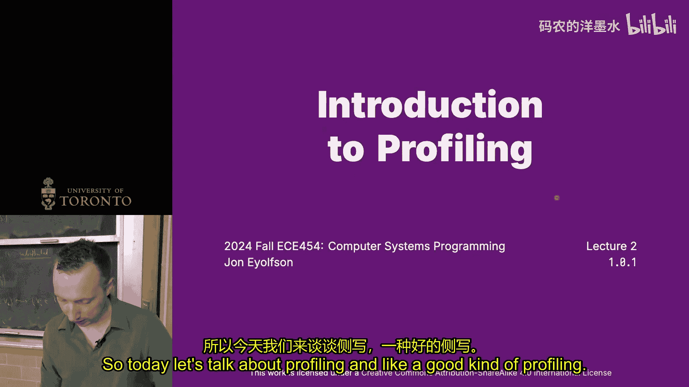

So。So since we are programming for performance， come on， everyone settle down。

 I have another lecture after this this one has to end early， so let's get going。All right。

 so since this is a performance course， we need to actually time the functions we're interested in and right now like we've just been timing our program completely。

 not diving into any details or anything like that。

 we use just the system time with a special clock that tells us exactly how much time our process actually uses in seconds。

 not like the wall time that you know the number of seconds past which you don't have control over。

So this was way， way too much manual effort to actually like see what was slow and see how long things took。

 And we don't know where to focus our efforts if we want to improve performance。

 Remember from before。 Pre optim is the root of all evil。

 So we want to make sure we're actually optimizing the correct thing。So how do we do that。

 We measure our programs using profilers， So we have to profile the program to see what's taking up the execution time in the program。

 And yes， again， that is what you are doing for lab。 One。

 we're giving you a big piece of code and then telling you to profile it。😊，So， the。

Profilrs basically have two types of output， a flat and a call graph。

 Has anyone heard of a call graph before。Alright， like it's one person， two people，3， Allright，4。

Perfect， so yeah， no， I guess no one's taking compilers。

 So we're like kind of touching on compilers in this course since we're using them。

 But we want our compilers to help us make your program go faster。

 and we'll figure out the details later。😊，So two types of output。

 and then they can either collect data from statistical sampling or instrumentation。

 Sta sampling is like， hey， I'll just poke your program see where it's executing while instrumentation is when compiling。

 I will add the compiler will add some additional code for bookkeeping to figure out like how many times a function gets called or something like that。

So the difference between the two main outputs。 So for a flat profiler that only computes the average time in a particular function does not include any more information such as who calls it or anything like that might read the call stack。

 but it doesn't really give you that much more information， Well， if you have a call graph profiler。

 that computes call times of a function。 So how long does a function take to execute frequency of function calls and then a call graph showing what called the function。

 So if you haven't heard of a call graph before， you know like you have your main function and then within main it might call fo So you would create a graph of functions with arrow saying who calls who So in that case。

Main calls foo， and then fo might call other functions。

 and then they might be recursion and all sorts of stuff like that。

 So we'll get into that and be able to see the call graph of our silly program today。

Simpling profilers。I mean。They're done by taking samples of the system state at a set rate。

 So at any particular sample time， maybe it's like every 2 milliseconds or something like that or even faster。

 You just check the system state。So it will slow down your program just like you measure anything。

 You're going to affect what you are measuring just by virtue of measuring it。

 So this will slow down our program a little bit， but not by much depending on the rate。

 We'll see today that the rate is a little bit high， but。Yeah， and we'll see what our overhead is。

So how instrumenting profilers collect data， like I said before。

It adds additional instructions at specified program points。 You can do this at compile time。

 which is nice and fast。 So everything gets compiled into your program。

 or you could do it at runtime， which is expensive。 I hope everyone's used Valgrid before。

So Valgrind would be an example of doing it at runtime so don' it doesn't need to call its own special malloc。

 it just sees whenever you call mallocc and then instruments your program AK like intercepts the call to malloc so it can go ahead。

 intercept it， keep track of how much memory you allocate it， see if you delocate it later。

 stuff like that。So this can either be done manually to or automatically kind of like conditional breakpoints。

So our basic guidelines for large software projects is right clear and concise code。 Hopefully。

 the code that's given to you is fairly clear and concise。

 not trying to do any premature optimization。 So we just try and focus on correctness first。

 Then after we make sure our program meets the minimum viable product。😊。

Then we go ahead and profile to get a baseline of our performance。

 This allows us to easily track any performance changes and redesign your program before it is too late。

 if you just have some really， really horrible architecture where you look at it and no matter what you do。

 you won't be able to speed it up。 then you probably have to rearchitect and start from scratch。

 So better to do that before it's too late。And again。

 focus your optimization on the code that actually matters。So。

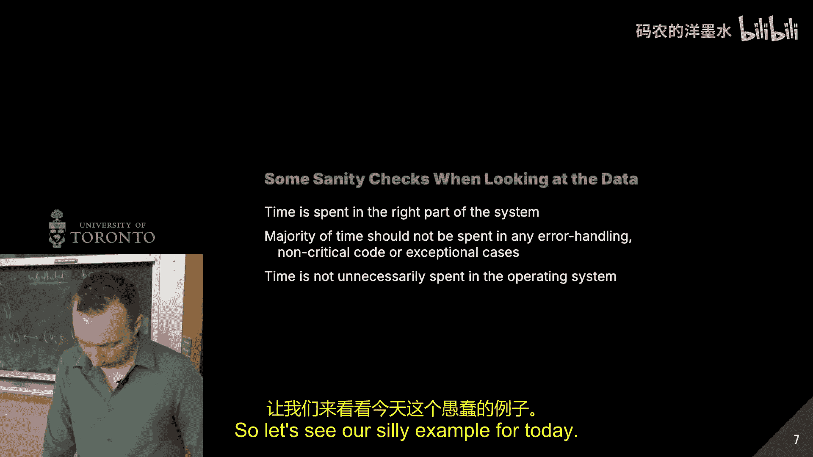

Let's see our silly example for today。 So this is going to be a very， very， very contrived example。

 but it'll give us the idea。 So we are just going to do some random math using floats and its。

 and just see。😊，What's taking the most amount of time in this program。

 So in Maine doesn't print anything or do anything。 All it does is。It loops for 100 million times。

And then just sums together the output of a function called int math， and then float math and。

If you already look at this， there's。Other way， there's already ways to see we could optimize it。

But let's just all ignore that for now。 In fact， you know。

 you could just compute this ahead of time and。Actually， there's no input or no output whatsoever。

 So the way to optimize this program is just deleting it， so。Assume this is doing useful stuff。

 And this is like a small part of a larger program。 Otherwise， yeah。

 it's kind of moot since it doesn't really output anything。

So in here let's just pay attention to the float math。 So in float math。

 it calls float power and then float math helper。 and then within those functions。

 let's see what they are， float math。Helper。Just does some division and then calls power divided by power。

 So it has two calls to power in it。 And then in power。

 it just stupidly calculates x to the power of y just using a for loop， so。

We might want to ask ourselves， well， now assuming this is correct， if I want to optimize it。

 where should I focus， where is all my runtime consumed。

 like it all stems from this but you don't know what particular function。

 especially if this is a more complicated program。So。嗯。

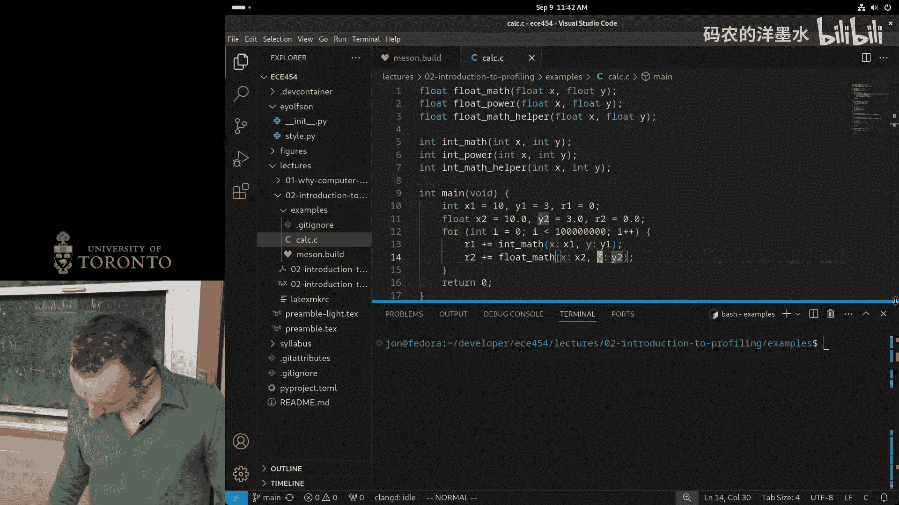

So tools we'll use in this course， at least to start off with。 We'll use two calls， two tools。

 one called G co and one called G Prof。 Again， we are horrible at naming things。

 So Gcom is short for coverage。 So you can just remember the first three letters。

 And G Prof is short for the profiler。 So G Prof again， and they're made by Ganu。

 which starts with a G。 So you get these horrible names。

 So G co is a coverage tool that instruments your program to make sure that hey。

 every line actually gets executed。 So it will go ahead。

 collect data from running your program on hopefully a bunch of different。

Bun of test cases or different custom program runs， if you want， to make sure that， hey。

 I make sure that if I write an if statement， sometimes my code actually goes into the if statement and it's not dead。

 Otherwise I might just delete it， It might be useful， so。

Tells you how many times each line of code executes， needs debugging information when we compile it。

 and it doesn't give you any performance numbers。 GProf is a profiler。

 and that uses a combination of sampling and instrumentation to tell you how long each function executes for and how many times it gets called。

So to use GComf， so you'll be using this in lab1， you use a compiler flag。

 dash dash coverage when compiling and linking， it adds those specific compiler flags or since we're using Mesans or build system and I switched over the lab1 stuff to use it too so you'll be using the same build system I'm using in the lectures you can just use that flag when compiling with it and it will go ahead and compile with all of the coverage stuff。

Then when you run your program。It will generate two files like essentially the one that ends in A is all the data that gets updated for all the runs。

 and then the one that ends in no is all the line numbers for all the files so that's generated whenever you compile your program so that it knows which line is which。

So those are the commands for doing it。 And I will run that。 So we would do。

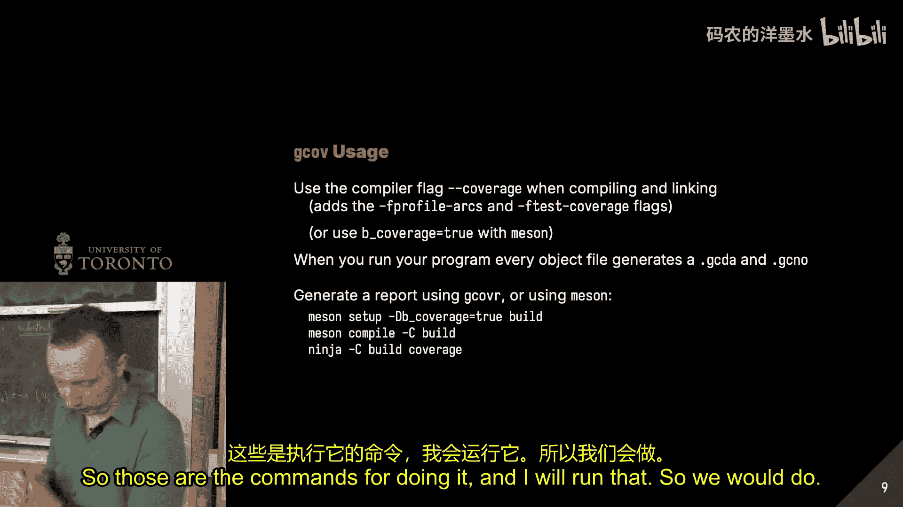

So we're in our lecture two examples， you do this in whatever place you have the misssan。

 build file and we can look at that right now by default。

 all it does is it does a plane build adds debug information so the coverage tool needs debug information plane optimization means we didnt we're not doing any optimizations。

 you'll be paying with this flag in lab1 and then we use a more up to date C standard then Pi it's not the fun pi it's position independent executable。

I don't know，We're terrible at naming stuff。We just have that for reasons we will get into later。

 much later in the course， and then strict aliasing， no one probably knows what aliasing is yet。

 we'll get to that when we talk about compilers more。Then just creates an executable call it Kc。

 So if I want to。Do run my coverage tests on it。 I would just do mecent setup， and then。Set。

This coverage flag equals to true， so in Meson， if I just do a dash D that just defines a flag for Meson and then after it it's just a string with whatever you want to be so I said coverage equal to true and then when I run it gives me all the information it gave before and that says user defined options。

The Boolean coverage is equal to true， so it will go ahead and generate all of the coverage information for me。

 So now when I compile my code。I can see in my build directory。呃。So my build directory。

 my exe is called Kelc and then in Celp dot P， that's where it throws all of the object files and anything else that gets created。

 So if we look in Celc dot P， we'll see we have our GC no， so that is。

For the coverage tool to keep track of all the line numbers and everything。

 we don't have the file that ends in A because we haven't run anything yet。

And then one way to see the output or like how much code coverage we have is you can run GCV R。

You can think of the R a short for report， and that will tell you how many times each line got executed。

 So if we run it right now。It says it went ahead and found our source file， which was Celc dot C。

 It had 29 lines and 0 of them were executed。 We have 0% coverage means that of all of our 29 lines。

 we've executed exactly zero of them。 And then this it's saying you all the line numbers that have code on it that are missing。

 So now if we go ahead and just run。Wait for it to do some math。And we run the coverage tool again。

 we see it gets updated now and then we have all the lines were executed， we have 100% coverage。

 so every line we wrote is actually used， there's nothing we could just delete or think about removing from our program。

Other things we can do with this is it can generate a whole bunch of different reports。

 maybe you don't like looking at text， so if you use this command。

 so ninja is everyone's used make files before right so make is horribly slow the newer better one is called ninja so Messon generates ninja files instead of make files so if we want to go ahead and look at generate all sorts of different coverage reports in different formats we could run this so you tell it the build directory and then you just say coverage and hopefully I can type。

So。If you look at it， it says that， oh， generate an H TM L coverage report， a text coverage report。

 and then some other ones， something， I don't know what that is， X， M， L。

Whole bunch of different things。 So if I want to look at the H TM L version， I can just go ahead and。

Look at that。 It says it's in Meesson logs coverage report。

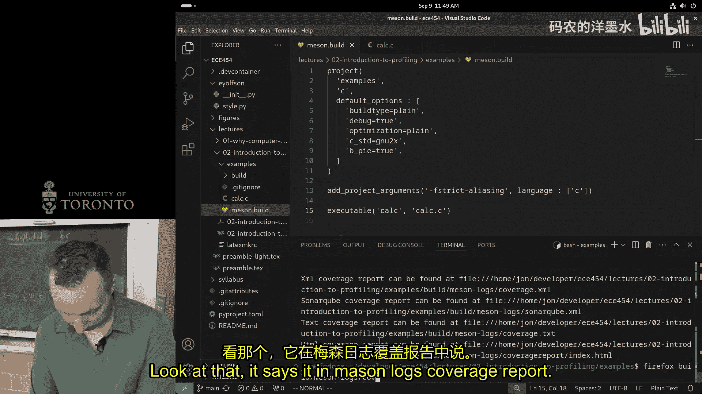

And then index dot H TM L。 So if I do that， it'll bring us to this。

 Let's see if I can make that bigger。So gives us their coverage report again I only have one C file here but it gives us the same information that we have 29 of the 29 lines and also breaks it down in terms of functions and branches you might say what do you mean branches I didn't see any if statements in that well let's go ahead and explore it so if you click on the file。

It will actually。Too big， it'll actually show you the source。And then。

This exact column here is how many times each line got executed， so main got executed once。

This line got executed once。 This got executed once。 this for loop got executed。Wu。W。

100 million and one times。 And what's the one， Because it had to check and then。Like it。

Essentially this part of the four。If you didn't think about it in first year that's basically an if statement so that is our branch and you can tell here this is the branch here so it says two of two。

 so branch0 aka the true part to go into the loop was taken100 million times and then the false part to and the branch was taken one time so it counts that as a branch for you so if you have an infinite loop you would have a branch not taken it didn't get out of the loop。

So。Inside each of these run for 100 million return， executes once， and then hear all 100 million。

 and then the only。Fun ones are like these ones。 So int power gets called。From the helper function。

 it also gets。Sorry， it gets called from the math function and then gets called twice from the helper function。

 So this is the total number of times It gets called during all the execution。 So it's 300 million。

 And then for loop gets scaled again， just depending on the value。

 So it tells us that it ran a lot of times。 What's at 1。6 billion。

 So that's probably means that that's what we have to focus on。 But we don't know for sure。

 this just gives us。Accounts of how many times a line gets executed for。

So anyone have problems with that？Yeah， I one question I was trying to follow along and when I run everything works。

 and then I run the ninja command at the bottom。Unknow。And you compiled with the coverage one， did。

So yeah， asking Discord La， I'll get back to you。So like the compiling with the coverage。Yeah。

 you can check if the files are in。That directory， or maybe it used a different maybe it used make files or something。

 I'm not sure。 but we'll check。Okay。But yeah， any other questions with this so everyone could generate this for lab one？

All right。 And I don't even think you even have to generate this and put it in your questions。

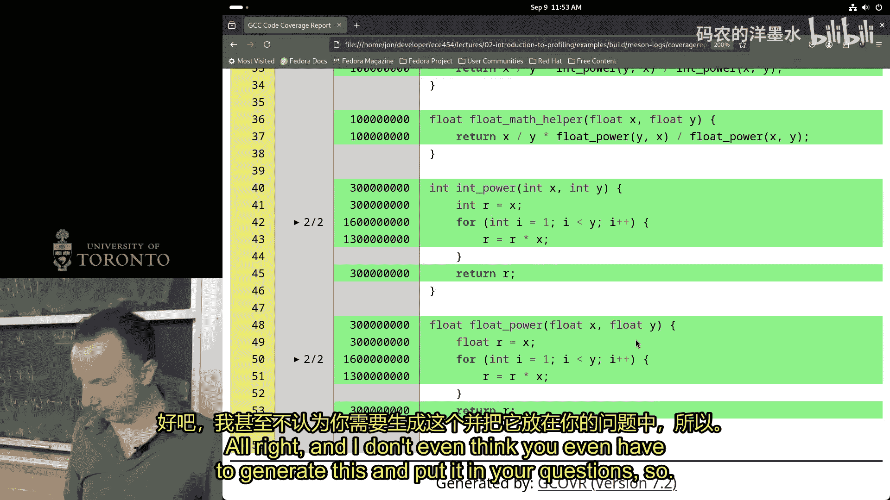

Let's go to the more interesting ones。 So G Prof。And it'll take a bit to try and read it。

 So use the dash PG flag whenever you compile and link and then it will do the right thing。

 So it will compile in any instrumentation it needs to and then link it so that when you run it。

 it will go ahead， sample your code and see where the execution is So you run your you run your program as you normally would But whatever your program finish is executing it now generates a gmon do out file。

 And again， they are terrible at naming things。 but that just has all of the profiling data in it and then you can use the Gprof executable to go ahead and interpret the results and you tell it the executable name so it can look up the debugging information and figure out the names of the functions and everything like that。

 So those are the instructions in order to add that order to add the flags to your meson build so that whenever you compile it。

 it has the right flags and then it will generate that file for us。

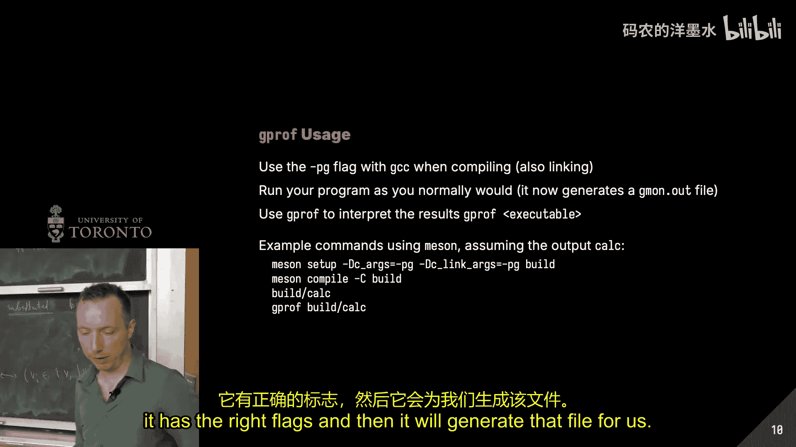

So， let us go back。So in that build directory， we already have。Like， that's the coverage version。

 The easiest thing to do with Mesa is just completely get rid of the build directory because that has all our coverage data in it。

 We're profiling now。 So we want to start from fresh。 So we'll just delete it。

So now we would do do do do this command。So we make our C Args PG so that is the profile and then C link Args PG so that it adds them for both stages。

If you miss one of these。Whenever you run your program it will not generate that file you will not get the profiling data and you will wonder why so you do need both of these so we'll go ahead and do that and it says user defined options。

 this is a good sandy check has PG on both of them so we know that whenever we build our program it's going to have all of the right things。

So now we compile it， as we normally would。Things don't really look any different。

Has all the same files as before， has are executable。 That's the only thing we really care about。

 And to make sure I'm not making up anything。 oops， I did right before。

So there's no GMman dot out anymore。 You didn't see that。 And now whenever I run the program。

 it should generate all of the profiling data for me。

And then we get to spend the rest of the lecture trying to read it， it's called Calg。So， I read it。

Takes a little bit longer。 And then whenever it's done。generateenerates that GM dot out file。

And then once， if we do G Prof。Build kelk spits out a whole bunch of data for us here。

 Let's pipe that to less。So pipes a whole bunch of data for us。 Let's make that bigger。

And it gives us the flat profile and then tries to explain what everything is doing。

 So let's go over an example and then read what this is actually doing。

 So I put some references on the slides， too。 So if you look at it， this is the first thing we see。

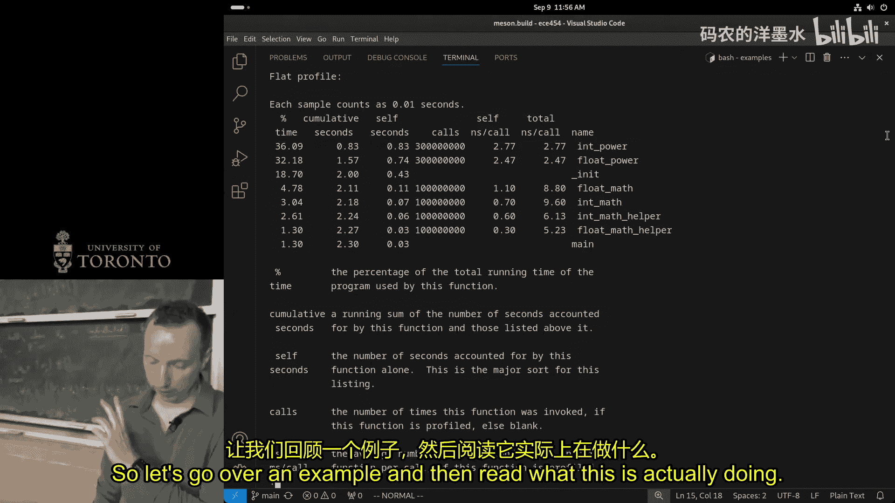

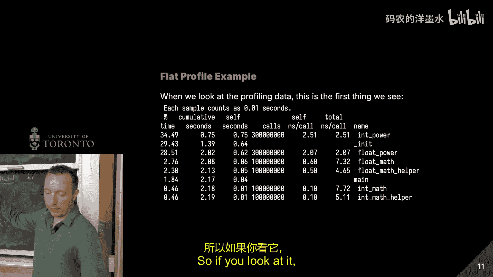

So let's go back to it。So here， some of these columns are self explanatory。

 Some are not and are kind of confusing。 So there's this percent time。

 So that's just the percentage of time when it profiled that we were actually in that function。

 executing code。And then。This column is very， very strange。

 So we'll discuss that because it's not exactly what you think it is。 And then selfseconds。

 That's the number of seconds that it's estimating that we were spent executing in this function for and which function the name all the way over to the right。

 So we were spending about 36% of our total execution time in that in power function。

 also kept track of how many times we called it。 So that matched up with our coverage tool。

 So we called it300 million times。 And then it says self nanoseconds per call。

 So that's the average time per call。 So you just take the total number of seconds divide by number of calls and then convert from seconds to nanoseconds。

 That's how you get that number。 And then we have this total nanoseconds a call which is。

That's the average time of the function execution， including any other function call it makes。

 so in power doesn't really call any other function， so itself is the same as total。Well。

 if we go to int math， it's a bit different。 So self didn't spend that much time in that function。

 but。Here，8。8 for the total nano sections of call， because it was calling other functions。

 So that is just a guess of that。 And that's about the only useful numbers here。

 So this cumulative seconds。You might think it's like added with the colorsers or anything like that。

 but it's not。 It's basically， it's literally just a sum of the self seconds all in order。

 So right now， the sum is just itself。 And then this number is just。

The previous cumulative seconds plus this number。This number is the previous plus this number。

 this number is the previous plus this number。I don't know why they organize it like that。

 It's supposed to be organized。 So you see like overall this and everything above it took that May2 of my execution。

I guess， so cumulatively， I guess you can。See that。We took about 2。

3 seconds to execute all of the code， and then。You can see that you。

 most of our time was spent in int power and float power。 and also interestingly enough。

Float seem like they are would be more complicated and probably take up more runtime。

 But we can see here by profiling them。 actually， computing ints are slower than floats。

 So that's interesting。 So we learned something already took longer to do the impart than the float part。

😊，Functions are otherwise exactly the same。 The only thing that's different is their're type。

So any questions about reading this。 So this should give you a good idea of what function takes up the most time。

 yep。So self and total between these two。So self is just the average time executing only in this function。

The total is the average time executing in this function， plus other things it calls。So。For example。

 let's go back to the code。Oh。And。So if we go and look at int， let's see， int power。

So It power doesn't call any other function， so itself and total are the same because well it doesn't call anything。

 Well if we look at， let's say， let's look at the int version。 So if we look at int mat。

We can see in math。So the self is how much time was set spent only in this function。

 So the other time spent in this function would just be calling those functions and then reassigning that value and updating it。

 So that's how much time it spent doing that。 And then selftot is how much time it spent doing that。

 plus how much time it spent in in power and in math helper。

 So it gives us like a more broad view of whatever was taking the most amount of time。

 Se is literally just this function， nothing else。All right， any other questions？So， this。

The flat profile， it's organized by runtime。 So it kind of gives you like a hit list of things you want to optimize。

 So whatever is at the top， that's where most my runtime is。 So if I can optimize that function。

 it will give me the biggest bang for my buck。 So I know what I need to do。

The next part we need to read。This gives you like a nice broad overview。 And then after that。

 you want to look at the call graph。So the calligraph data is a bit down， so。

It tries to explain all of those things that I just did， they just do it very wordy。

Then for the call graph， so。How to read the call graph is a bit。Strange。So。

One concept you need to know here is the primary line。 So you see the first。

The first column here called index。 whatever the index is。

 the index corresponds to a particular function， and it's consistent throughout the report。

 So in here， main。Main is index1。 And if that is your line for the call graph。

 that's what I call like the primary line。 This is we're looking at things we're looking at main So in this we're looking at main。

 And then it will list callers above it。 So anything that calls main is above it in here。

 nothing calls main except well spontaneous calls main So just makes up that main spontaneously started whenever you know I started executing it。

 That's how it indicates that and then below it it gives you the functions that main calls So we can see that main calls to functions int math and float math。

 which hopefully lines up with our source code。So Maine。It's in a big loop， calls two functions。

So the other parts of that is is self。 So that is the same as a flat profile。

 So that is how much time spent executing in just this function。

 not including its children and the children line is how much time spent in all calls made by the function。

 So it should equals like the sum of this altogether together and the sum of this altogether together as like a sy check。

Yeah， along with self。 No， not along with Oh， yeah， along with self， I believe。Yeah， along with self。

 So self plus everything below that。 So it's basically sum of all the numbers。

 So this is the entire time responsible for execution from Maine。Sorry，给。

We overhead her calling it that。So self yeah， self is how much time it mass spent inside of itself。

So oh I see okay Yeah， and it's a bit different than the flat profile。

 So that's the amount of time it spent in itself from main calling it。

 So if I called it from two different places， it might not match the number I had previously。

So it tells you it tries to estimate how much time was main responsible for it。

 so the numbers should change a bit when we go through different ones。So。

Everything below the primary ones are things it calls。 And then yeah， self。

 just like the flat profile time spent。嗯。In that function， one called from mainine。

And then children is time spent in the current function children call。

 So whatever that calls when called from the primary function。 So in this case， main。

 main was the only thing that called it。 So it should be the same as the flat profile。

 And then called。 That's just the number of times this function got called from main divided by how many times they get called in total。

 So you can see here that 100% of the things that called in math were from main。

So questions about that。Cool， so we can go down to a different one。

 So let's just keep track of the int。So ink math。So we can go to that。

Int math is the primary function between， you know all those dash lines。 So int math。In indexd 2。

 So it got called that many times self， how many time it spent executing itself versus how many time versus its execution time in itself and the children。

And then however many times it was called， and then above that。Is。How many time like who called it。

 So it was called from Maine， which links up from before。 So they're kind of。

You can see how we get the name call graph。 So main calls impmp math。 So you can see that， you know。

 we spent。This much time in Maine。It was the only thing that called me。

 so it was responsible for all of my execution time。 And then we can see int math。 Well。

 it called int Math helper 100 million out of its 00 million times。

 So it was the only function that called int mathth helper， but for int power。

 it only called it 100 100 million times out of the 300 million times。

 So it wasn't responsible for all of。It's time。Because we can see if we scroll up to the F profiler in powered。

Spent what。0。83 seconds， and then we can see from here。From I math that it only spent。0。

28 seconds because of calling int power from int math。So questions about that。Alright。

 so next primary function， let's look。So we have int mathth helper。

 so it only gets called from int mathth。100% of the time。

 And then it calls in power this 200 million times， which is like the other 055 seconds of it and。呃。

In power doesn't call anything。 So it only has one collar and then one callee。 And it seems to make。

 you know。Two function calls every time it gets called。So last interesting one is。Let's see where is。

Yeah， so we can see the int power one， so int power， it doesn't call anything。

 so there's nothing below its primary line。It just gets called from two places and here we can see that two places。

 so it gets called from int math and that's responsible for about a third of the execution time。

 which makes sense。 And then it's also called from int mathth helper。

 which is responsible for the other two thirds of the execution time so we can kind of see just where all of our execution time is so。

Any questions about that？Yeah。Can you。App。The percent time。So the percent time in this context is。

The total amount of time executing this function and all of the children。But mainine isn't 100%。Yeah。

 but yeah， that's our first question。 Maine's not 100%。 That's weird， right。

 I'm surprised no one asked this before， but did no one notice that。哦屎啦。So that's， well。

 that seems weird that a knit is that high。If I run Hello World。

 it doesn't take half a second to load the C standard library or anything。A guess is what that is。

 I'm surprised no one asked that before yet。Yeah， it's the profiling tool itself。

 It just gets misreported。 So the profiling tool it。

Needs to go ahead and collect samples from your program， and while it is profiling。

 it is profiling itself while it's running your program。And it just misreports it as。

Undersre a knit for some reason， I guess。In the past。

 they took that into account and didn't report it， but now they just misreport it as a ni。

 I don't know why， but that's the profiling tool itself so we can ignore it。

 and that's why it doesn't add up to 100% from Maine。 So the rest of the percent。

 this 18 is the time spent doing the profiling itself。All right， any other questions？

So that should give you a good idea of where to focus。 So if I wanted to optimize this， I might just。

 I mean， obvious thing to do。 Hey， I should probably make calculating the power better。

 Maybe I should find an instruction or something like that。

 that can do it better than just writing a for loop。 My code might be uglier， but you know。

 itll be faster， so。

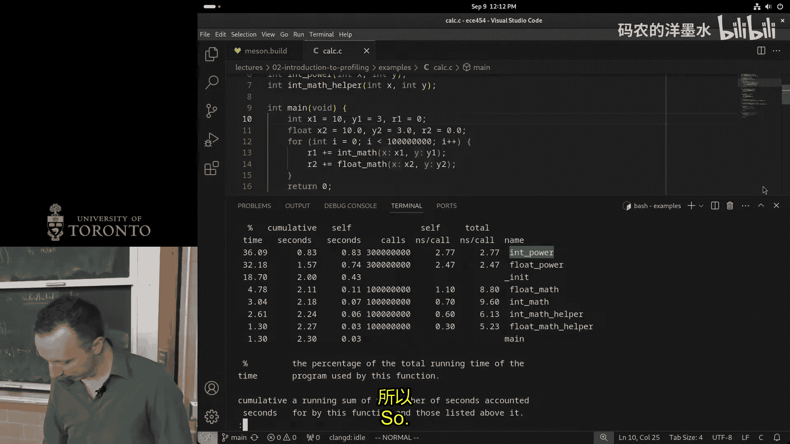

In the slides， too。I have a reference for literally everything so I gave the flat profile example and just have a slide for reference so you can reference this whenever you look at the data。

 I try and make it simpler than their explanation while still giving you all the information so in the flat profile it's time percentage of total execution time only in this function。

 selfsecond sentence function cumulative addition of this plus any above in the table it's kind of useless calls number of times it was called self is just that self nanoseconds divide by number of calls total is average time of the function execution including any other calls it makes。

And then reading the call graph I also noted here that the line with the index is the current function being looked at。

 I just call that the primary line， lines above it。

 functions that were called that called this function So they're the call lus if you're using compiler lingo as we will do and then lines below that are functions that were called by this function。

 which we just say call because saying called by gets kind of coveredsome So on the primary line of the callgraph time total percent of this time spent in the function and its children。

 So it's a bit different than the flat profile self is the same as the self flat profile children is the time spent in all calls made by this function So yeah。

 it doesn't include itself it should be self- plus children of all the functions below So I might have said that wrong earlier。

And then reading the callers in the call graph self is the time spent in the primary function when called from the current function。

Children， time spent in the primary functions， children when called from this function and that so it kind of gives you a breakdown of you know what percentage came from what in case that you know it just happened that from this function that gave me the arguments that caused execution time to go way up so you know to focus on calls stemming from there and then maybe looking at。

 oh， well， what are those arguments， what exactly is this doing then that's different than normal。

Then we have children and then called， which is just a pure raw count of the number of times it gets。

 it's called。Then reading the call these， so the call， anything below that primary line， self again。

 time spent only in this function， when called from the primary function。

 so it won't match up with the flat profile， it'll give you a proportion of it。Children， again。

 time spent in the current functions， children calls when called from the primary function and self plus children in this case。

 is just an estimate of the total number of time spent in this function when called from the primary function。

 So that's that total。 if you want to calculate yourself。 y。Curiosity does it。For example。

 if I have the pizza function， this calls。X function and pizza is called in three different places。

 does this column number represent。Number of total times called。Under。

Call from pizza or call from pizza under this specific。

So stack and like the call graph are going to be pretty related。

 like the stack is basically like your call graph when you're running， who called who。

' who's in the stack。嗯。

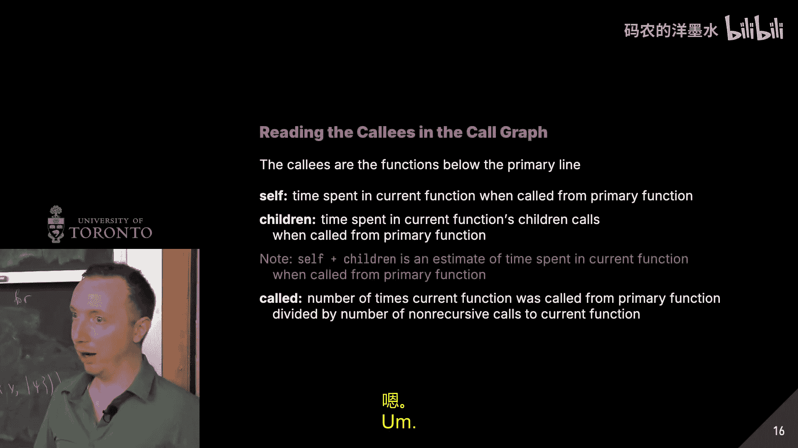

But like you're asking， let's see， go back。So， like， if I have。Would you say he's oops。

Ping of the flame graph， which is three different。Invocations of a function。

The smaller number over the total。Represent just this specific invocation of flame under your main or。

Flame under pizza under main。It it's how many times this function was called from main only from Ma the parent function Yeah。

 only from the parent function。 it doesn't go the parent function called No， this was the。 Yeah。

 only strict parent child doesn't give you the rest of the call graph。

So if you want to load the rest of the call graph， you have to put on your detective hat a bit more and go into more details。

Rong。Alright， so that is all of the references。 So if we。Any other questions with this。

 So this should give you a good leg up for lab， lab 1。 Just remember how to， you know。

 run everything。 You'll be playing with other flags。 I'll give you a little。Hint， so also in the lab。

 let's see。So one of the other things you'll be doing in the lab is messing with these flags， too。

 the debug and the optimization flag。Unsurprisingly， you just put the like， if you want to change it。

 it would be whenever you use me and setup， you use dash D， and then you could be like Dbug。Oooops。

Tbug equals false。And then if you happen to do something like that。

 then that would that would disable the debug flag so that whenever you compile it。

 you wouldn't have debug information in your program。

It's one of the things that lab 1 gets you to do。 So lab 1， you're just playing with compiler flags。

 recompiling your program。 I think they have you do it six times。

So you have six different configurations， you compile pile it under。It may or may not be interesting。

 we will see。And then aside from that， I think that's everything today。

 So because I have to run to another lecture， I'll just end today early。

 So if you have any questions， you can ask right now。

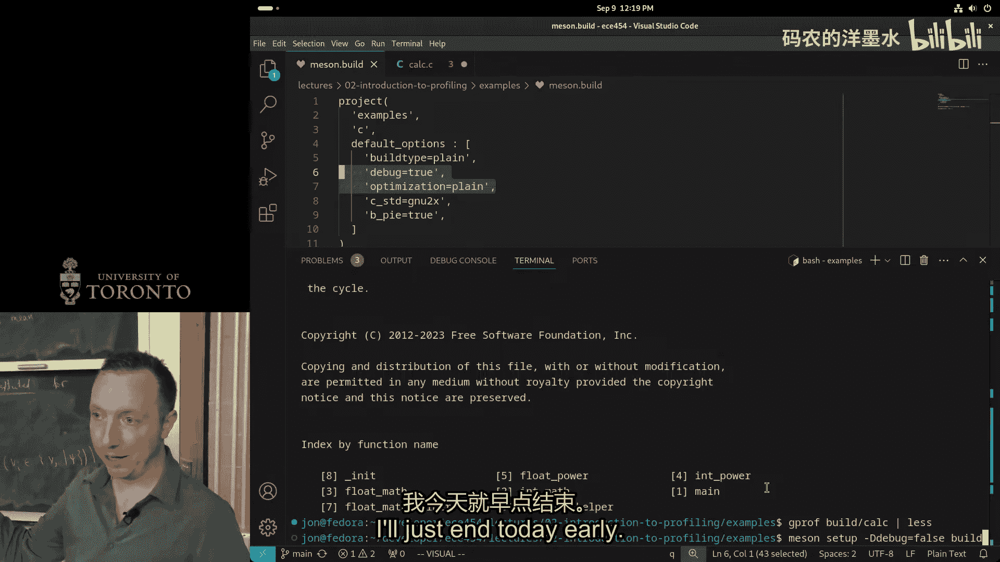