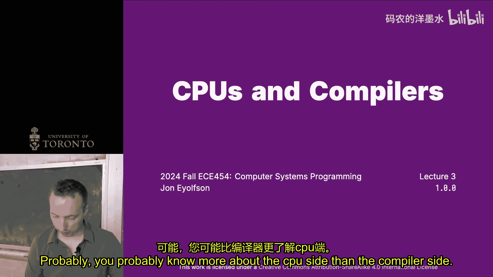
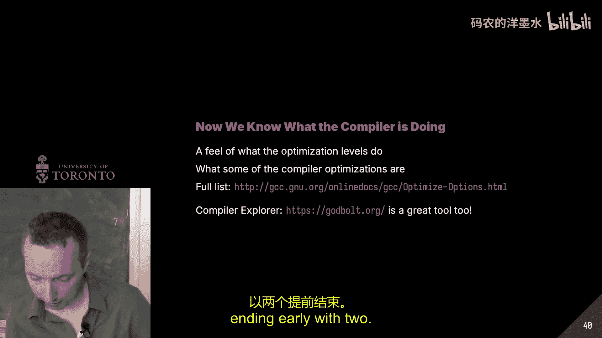

# 【全集】多伦多大学 C语言高性能系统编程实战 中英字幕 1080P p03 Lecture 3 - CPU与编译器 -BV1oDrZBZEG2_p3-

Allrighty， welcome back to 4，54， so to preempt your questions， lab one， last question。

 people seem to be confused right， says list the functions plural that's echo list the functions plural that you would optimize based off the number one hit。

So obviously you would want to optimize the number one hit。

 and then the rest of the question is supposed to mean based。

 are there any other functions you would optimize that would bring the runtime of that down？

Probably more than one it probably uses another function。 So list that。 That's all it means。

All right， any other questions， comments， concerns？Orre we all mostly good？All right， we're good。

 All right。 So we get to talk a bit of more background today。

 I skipped ahead a little bit and went straight for profiling so I could show you how to do lab1。😊。

Because like we're at the tail end of the week and the other lectures are at the beginning。 So yeah。

 that's why I skipped ahead and did profiling so you could go ahead and do lab1。

 So this is more kind of background stuff that you may or may not know。

 probably you probably know more about the CPU side than the compiler side So let's start talking about CPUsop。

So we can revisit， I will give you a quick crash course on the history of CPU architecture since we're optimizing our programs。

 we need to know a bit more about the hardware。 if any of this is interesting to you。

 I am not the guy to help you so there is the architecture course ECE 552 which is done by people who actually know what they're talking about and not me。

 So if any of this is vaguely interested to you or you want to ask more in- depth questions。

 ask them not me， I'm more of a compiler software guy。So。Anyways。

 I will bring you on this little tour。 So before we start that， well， how do we measure。

A single CPU core performance does higher frequency mean a faster core。

 and the answer to that is of course， no， there's lots of different factors to consider including IPS。

 which is instructions section per second again you can prefix it with a B for billion if you want。

 so Bps。Or tips if you want to go to Terra and then flops， floating point operations a second。

 you could have integer calculations a second depends what you actually care about and then IPC which is instructions per clock and then CPI which is cycles per instruction so CPI is just the reciprocal of IPC doesn't stand for inner process communication again。

 instructions per clock and these are all measures of throughput。

 So remember two main performance things we care about is throughput and latency this does not tell you a lick of anything about latency。

This is just throughputs or whatever the average number of things we can do per unit time is。

 we don't actually know the latency of any individual by just going off these performance metrics。

But typically computers are fast， so we don't really need to care about latency。

 doesn't really dominate our performance that much。

 especially since we have multiple cores now as a common thing。But。

If we go back in history and this was even before I was born。

 some of your other props might know this， but I don't。

So yay me so Intel's first CPU was a 4004 or something。

 I don't even know how they say it is a four bit processor。

 it didn't even run at a megahertz it was like 0。10 of a megahert， 2，300 transistors。

 no virtual memory which probably comes as a relief to some of you that hate virtual memory。

No interrupts also probably a relief didn't have pipelining。

 did anyone learn pipelineing in there like other architecture courses kind of yeah thumbs up。

 all right， good yeah， kind of all right。And this funny CPU also had three stack registers。Yeah。

 you heard that right， stack registers， it did not have a real stack。

 So if it has three stack registers， what does that mean？Well， if we even have just a call stack。

If we even just use a call stack and have addresses for return values。

 how many functions deep can I call？Three， wow， what a great program， right？Really， really。

 this was what in like the '70s or something like that。And then it continued until like。

The Intel 8086， which something there rings familiar and is still kind of true today。

 That is the beginning of the X 86 architecture。 So your assembly。

They kind of stopped innovating in 1978， so that was the first CPU。

 that instruction set is still mostly backwards compatible。

 like your X86 CPUs today will run the same programs that they could run back in 1978。

This first one was a 16 B CPU ran at 10 MHz。 And like I said， began the X 86 instruction set。

 So if any of you even have X 86 CPUs， I see Apple， Apple。 no Apple。 we got one。 we got Apple。 Oh。

 system 76。 Allright， So yeah， so we got some。So X86 processors， when they first power on。

 they first start in 16 bit mode because of this， everything's still backwards compatible。

 so that's a fun fact。😊，So back in that time。If you increased our clock speed。

 So these were 10 MHz and we're up to like。We kind of leveled off around the four。4，5。

6 gigahHz range。 So back in that day， whenever they had extra transistors， everything。

 it just made things faster。 So they had faster clocks。 that meant even if you don't have better。

Like the same amount of cycles per instruction， your CPU still got faster because the cycles got shorter and shorter and shorter and shorter so you could reliably get a speed up for your program without even doing anything。

And old CPUs without pipelining。 So， again， this should be review for most people。

They just execute instructions sequentially， so。Everyone probably knows processors are made up of different independent units。

Simpplest。Kind of stages to actually execute an instruction， have it in five stages。

 So there's like an instruction fetch。So read from memory， instruction decode。

 so figure out what the hell this instruction is， execute the instruction。

 maybe you have a memory access and then a register right back to update any values so if we had two so those are five separate stages and then if we had one instruction if we executed two instructions well the first five cycles would go to executing instruction number one。

Oops， I'm point out the wrong thing。 And then the next five cycles would go to executing instruction number two。

 So if we calculate our our cycles per instruction。

 it's equal to5 in this case because we have to execute one instruction， then execute the other。

 then execute the other so。Someone smartly looked at this and was like， wow， that's a waste of time。

 I could， even though I only have like one instruction fetched。

 I can probably start fetching the next instruction before the one that's currently fetched is done。

Is done executing。So that's when they introduced thought of like risk processors。

 So instead of having cis processors where it was。Common back in the day for people to write in assembly and compilers were this newfangled thing that people weren't exactly sure of。

 So Sisk made sense back then if you by default， wrote in assembly， but people don't do that anymore。

 it's， of course， flipped the other way around。 No one cares about。Assembly for the most part。

 and everyone just relies on their compilers to do stuff。So。The idea behind pipeline。

 every processor unit runs on each cycle。 So whenever I start instruction 1。

 there's no other instructions to execute。 I do my fetch。 and then cycle 2。

 while it's doing the decocode step， we can go ahead and start fetching instruction2。

And then keep going down the pipeline。 So instruction three comes in。

 we can fetch that while the first instruction is executing and the second one's decoding。

 then the fourth one comes up， and then the first one would still would be doing the memory operation and then for the fifth instruction the first instruction is doing the right back and then it will be done while at that point。

 our pipeline saturated。 So all of our units are actually executing different instructions just offset by one So assuming we run for long enough and we don't care about this start and this kind of end time we'll have like a fully saturated pipeline where all all the process of units are all going at once。

 So if that is true and the pipelines full ideally we have cycles per instruction equal to one。

 which is much better than before where it was equal to how many stages we had in our well how many stages we had for executing。

Instruction。So they've extended this， I won't go well I don't even know the details of what all the pipeline stages they do nowadays。

 but like for the newer AMD Zen CPUs， the pipelines are like 19 deep and they've seen to settle around that there's diminishing returns for。

Reasons。Past about 20 that don't ask me for again， architecture people。

 a lot of smart people here that work on that， I'm not one of them。

 so just know diminishing returns for reasons after about that。

 we don't really care for this because we're concentrated on software in this course。

 but that's how they did work。And yeah， back after they did risk pipelining。

 all the performance memory was also small back then。

How you optimized performance back then was just making sure that things were in memory and you didn't have any page faults where you had to load things from disk。

 so all you had to do reduce the number of page faults you have your program ran fast and you didn't really care about it past that。

So then also with that pipelining， branches cause issues and that is a lot of what modern CPUs try and make a bit better。

 So if we're decoding like a branch instruction and we need to know what is the next instruction。

 we're going to fetch。In the general case， we have no idea because it depends on the result of actually executing that branch instruction to see which branch it's going to take。

 right， Bra are just like an if else thing。So the first solution you could do if you are a CPU architect is just be like。

 well I'll stall the pipeline and what that means is I just won't put anything else in the pipeline。

 that cycle I'll just essentially do a no op， I will wait until that instruction has done finish executing and then I'll just carry on as normal so I just delay the next fetch until I actually know the result。

Turns out that for most programs， branches are about 10 to 15% of the instructions and doing that well。

It kind of sucks to just stall over and over and over again， so your effective CPI while aly。

 you know it gets to one， so again， cycles per instruction。

 so lower is better so this would get above one right because we're stalling our pipeline over and over again just due to the branches。

So。What can we do about that？ Well， one thing we can do is branch prediction。 So modern CPUs。

 I don't know why there's a T in there。So they have very good branch predictors。

 So instead of stalling， what they do is make an educated guess。

Some basic implementation of that would be like just using tables to store history of what happened at each individual branches。

Most are quite predictable， so everyone's probably had like an if statement that initializes something so it's essentially true once and then false 99% of the time。

 so using the history to figure out what branch you're going to take turns out to be fairly effective and people are really really good at that again for more details architecture course。

So code。After the branch too。They could just。Execute on most processor， it executes speculatively。

 so it makes a guess and then just keeps on executing as if that is true。

And this kind of pushes the CPI back closer to one branch predictors are pretty good but and we were stalled before anyway。

 so if we're just executing and we're right， we come out way ahead and if we specully execute something and we're wrong。

 we have to go back and rewind kind of everything we did they put in buffers and things like that so it doesn't actually affect the state of your execution。

Minus some bugs lately like Spectter and meltdown。Again， architecture course， not me。

But this pushes the CP back closer to one。 Bra predictors are usually quite good。

They're about like 95% accurate for the most part。So。Even if you could make them much， much better。

 you only have like a limited amount of transistors。 You can fit on a CPU。

 even though the number is huge。 and they have very diminishing returns after that。

 if you made your branch predictor in hardware。Use twice as many transistors as they do now。

 instead of 95% hits， you might get up to like 95。2%。

 which is just kind of a waste of time most of the transistors on normal CPUs nowadays are like 100% used for cash it's basically all cash and very little else。

So。This， our goal， if you're a CPU architect， you want to have your CPI or cycles per instruction under one。

 So that is where we go to the next step。 So that is called going superscalealar。

 So we're going above one。 We're doing more than one operation a second。

 We're scaling better than linear。 So that's superscalealar。

The first thing architects did is try to exploit instruction level parallelism。

 So they noted by looking at the instructions， well。

Multiple instructions could actually execute in the same cycle。

 You have to repeat some of the hardware。On the actual chip。

 but those for the most part are pretty small， so it doesn't really matter。

The main the main blocker here is like the two instructions have to be completely independent。

 So it makes the decocode also more complicated to fetch two instructions at once and see if you can execute them both in parallel but this is done without threads or anything This is done on the CPU itself。

 So what might happen here is in the first cycle。 if instruction one and two are independent。

 it might just execute them both in the same clock cycle。 Yeah is this still considered one CPU core。

 Yeah， this is still considered one CPU core。So this this is， yeah。

 instruction level parallelism on the CPU， you as a programmer。

 do not have to do anything that's all baked into the hardware itself。And then yeah， here， you know。

 second cycle， maybe instruction 3 is not independent of3 and4， so we can only run it by itself。

 And here I'm not showing the pipeline。 I'm just assuming a cycle whenever the instructions finish。

So cycle 3， maybe they're independent again， three and four， are independent。

 I can execute them both in parallel at the same time。So。Whenever we write our program。

 there's always the view of the sequential assembly instructions we wrote or a compiler produced and then what the CPU actually executes。

 which。Especially nowadays are two completely different things but here。

The CPU still executes our instructions in the order。 we wrote them in。

 It just might execute to in parallel if。Certain conditions are met。So。Speaking out of order well。

They figured out， hey， even using that， having this constraint of executing instructions in order。

 it's kind of a pain， and it's making us slow down。 So maybe。Back here。Maybe， you know。

Instruction 3 is not independent of instruction 4 and 5， but maybe it's independent of instruction 6。

 and maybe instruction 6 doesn't have any bearing on instruction 5 and 4。

 Well then I can just execute things out of order。 and I can just execute instruction 6 with instruction 3。

 And this is what your CPU actually does。 so。Your assembly in。

Your program is merely a suggestion and it is free to reorder instructions as it wants。

It just kind of guarantees that the net effect of running all of your instructions after all of its reordering through some magical hardware is the same effect as running them sequentially。

 so it takes care of all that for you， but under the hood。

 things are running completely out of order， completely kind of Willy nilly。

And most of that is to hide nowadays， most of our performance comes from。Not having things in cash。

 So now if you pretty much have a cash mis myth。Your performance just dies。

And that dominates performance。Another thing we might do is something called simultaneous multi threading。

After a while， everyone， everyone has multiple cores now， right， everyone's used threads before。

 Everyone loves programming with threads。Yeah， well。Some things。

 although this is less of a thing now， Anyone heard of hyperthing before。

So this is the marketing name of hyperthing， although they're kind of going away from that。

 So another technique is something。callled simultaneous multithreading。

 So if you have a normal threaded application， how it normally works is assuming all of the blue circles there are instructions from one。

 thread one and all of the green instructions are from thread2。

How it would normally work is well at each cycle。We're executing instructions from thread 1 and say we execute instructions。

1，2，3，4，5。 We have some instruction level parallelism。 Yay， then we do a context switch and。

We execute。The green instructions from the other thread， one， two， three， and four。

 all on different clock cycles， so in total we're taking six clock cycles to actually execute this program。

But the idea between SMT is， well， if you're running another thread， some of the。

 especially if the two threads are doing something completely different。

 you might have idle hardware on the CPU and you could actually run instructions from another thread while your thread is executing and waiting from some data to come back from cache or something。

So。How this works is the CPU will just run both of the threads。On the same core。

 so this is all done on a single core as well。 it just has two virtual threads。

 which is sometimes when you look at your。Physical threads versus virtual threads。

 they'll be different by a factor of two。It's because SMT presents each core as two virtual cores。

 So the instructions， they could reorder， They could reorder it like this， so。

While thread1 is executing， we just execute threads 1 instruction and then instruction 3 from thread1。

 where it couldn't do anything else in parallel。 It'll be like， oh， well。

 there's a whole other thread。 I can get some instructions from。

 So I'll execute some instructions from thread 2。 So maybe it runs it in parallel with thread 3。

 And well， because they' are two threads in the same application。

 They have the same virtual memory and all that fun stuff。 So we don't have any issues with memory。

 Yeah， These optimizations all so far are all on the CPU core。 you don't do them at all。

 It's not has nothing to do with the compiler。 Yeah， this is all just running on your hardware。

 how your hardware actually works。Yeah， so it just kind of mixes and match between two threads it can get instructions from both threads。

Turns out this doesn't help that much。 So newer ones。

People just disable this because it usually does more harm than good。 So if both of these。

Both of these threads are doing the same types of operations likely。

The resources will be in use anyway。 so you can't actually schedule them to run at the same time。

 and it can hide cash like misses and things like that， but。

If they're accessing two different parts of memory and have wildly different cache locations。

 there won't be any overlap anyways。So this also doesn't help as much as you would think either。

So most people now， like the more modern hardware， they're starting to take this out again。

 so CPUs will not have this anymore and just rely on just having just normal cores that do the rest of the things we talked about。

All right， so in summary。It's basically a journey in cycles per instruction。Back in the day。

 however many stages we our CPU did。 That was how many cycles per instruction we had。

 We just did one instruction sequentially。And that was it one instruction， then the next one。

 then the next one， then the next one。Then pipelining， which was kind of the biggest innovation。

It brought us closer to one so that was。In every cycle。

 every processor or unit acts at the same time， and we just kind of go through our instructions one stage at a time。

 most modern pipelines are about like I said， like 1920 deep。Then in order to improve our pipelining。

 our big drawback here was branch instructions。 they would call as a stall in the pipeline。

 So they came up with more sophisticated branch predictors to try and eliminate that。

 And that kind of goes hand in hand with that speculative execution。

 So it makes a prediction executes as if that would happen if it's right， great。

We didn't have to stall our pipeline if we're wrong。

 we have to go back some hardware take care of that for us。

 we don't have to worry about it but that got our cycles per instruction closer to one then we went superscalealar we tried to execute two instructions at the exact same time that got us under one and then out of order execution helped a lot in order to kind of hide any of the stalls and that's what we're doing today then there was also SMT。

Which kind of gave out of order execution some more options， turned out to not be that useful。

Was about the same level as before？没。またま。Yes so。Yeah， it goes from n to one。So we started off with n。

 So like at the beginning， we had like 5， and then we got closer to one。

 but it was still greater than one because of the stalls， right。So greater than one and then。

That's two greater thans。 And then with branch prediction， we can get closer to that theoretical one。

 so that's why there's only one instead of two。It's just supposed to be relative。

 and then ILP helped a bit out of order execution， got us under one。

 so we were doing things in parallel， and then SMT didn't help that much kind of on the same level of out of order。

All right。Any questions about our whirlwind of CPU architecture？Good。

 cause I probably can't answer it anyways。But basically， the hardware is really， really good。

 They kind of hit a wall with that。 The main thing we have to be concerned about。

iss just caches when you're programming， especially as we go through this course。

 laying out your data and reducing the number of like levels of indirect you have is going to be really。

 really important and there's some optimizations。That are worthwhile and some that are not。

 So we also have to talk about the compiler。AndI can answer more questions about this so we can see what optimization the compiler does。

No one's really taking a compiler course before right， so you just like two。We love compilers， okay。

 so this might be review for you， but for the rest of us。

Most people don't really know whenever they throw on02 and 03。

 they probably have no idea what it's doing other than like magically making our program faster。

 right， So let's unravel a bit of that magic， so。😊。

The intention behind this is to actually let you know what your compiler is doing。

 what optimizations are already done for you。 So a lot of these will if you do the same optimization。

 the compiler does。 your program will read like complete garbage and this is telling you you can write readable programs and it won't affect your runtime at all。

 So your compiler。Especially nowadays it's actually quite smart， in other ways。

 it's quite dumb and in other ways。There's ways for you to communicate with your compiler to tell it things that it has a hard time figuring out。

But the drawback there is you can lie to your compiler and then call us all sorts of messes。

 so we will get into that a little bit too。And。Yeah， so。Cliff notes。These optimizations。

 for the most part， well， they all relate to performance。

Meant to tell you which ones to avoid doing yourself。 So yeah。

 you don't waste your time and you don't make your code completely unreadable。

 They have a lot of compiler optimizations。GCC actually documents them quite good。

Much better than the rest of their code， so we can look at some for GCC。

So these are the main optimization levels。 There is01。

 which is also the same thing you get with dash O and the whole goal of that。

 so the main optimization levels are kind of，Overarching goals it tries to optimize for。

 so the first one tries to reduce code size and execution time。

 just optimizations that are a complete win with no trade off。

No optimizations that make the compiler take forever to run。Just。Nice。

 quick and easy performance that should always be done like there。

 it's pretty much free performance on the table from the point of view of the compiler。

02 verse 03 is where it gets a bit dicey because of course we are in engineering。

 not computer science， So everything's a bit of a tradeoff。

 So the biggest tradeoffs for compilers are how much space something takes versus how fast it actually goes and there's always kind of a tradeoff between the two So02 tries to do all optimizations except for any that might may or may not make your program go faster。

 so it tries to。Not bloat your execution size and also make it go slower at the same time。Oh。

3 is basically just do everything。 I don't care， just go try it。 let's see what happens。

 And then there's00 which is like the default， which is just the plane if you don't specify anything on the command line。

 that gives you the fastest compilation time and。Debugging performs as expected。

 so if you run GDPB with something compiled for this， the optimization might completely remove code。

 get rid of stuff if you debug it。Weird things are going to happen that doesn't translate to what is actually going on because well it might have done all sorts of optizations that actually change the structure of your program so you will。

 if you want to run GDPB， do not run it on 02 or 03。 I know a lot of students。

 especially when they debug things like magical things happen and things don't execute in order and just weird things happen。

 that will actually happen if you try and debug with 02 or 03。So do not do that。

And for these different optimization levels。In case you're curious what's typically the best one。

 so most Linux distributions actually compile at 02， not 03。And if you've done lab one。

 you probably might have a sense of why that is。So generally， the default。

 if you just want to have like the safeSa default is just to use O2 and then just carry on with your life。

So there's also some other fun ones， so there's O fast。

 so that disregards any standards compliance and just makes your program go faster。

So it does all everything03 does and non standard compliant optimizations。

 The main one for that is something called dash F fast mathth and。

I don't know if anyone had thisple of reading the IAEE and like ISL rules for like Bloating point operations and stuff like that。

 basically there's a lot of very， very complicated rules and want to。

 if you don't care about an accurate result that exactly follows all those rules。

 that show fast and it will go faster。Your answer might be wrong， but。

If you're not doing scientific computing。Who cares let's take the free performance So unless you actually like read the rules of the float format and like you want your answer to be exactly compliant。

 just do so fast， you'll probably be fine。Probably。You may or may not use that for this course。

 I wouldn't blame you if you tried。Alright， so the first most basic optimization compilers do that they are very good at is something called scalar optimizations。

 So they're basically just optimization done with constant values or just values in general。

 So if I write something like I equals 128 times 128。😊，Whateverever you compile your program。

 it does not do a multiply at runtime or anything like that， your compiler is not that dumb。

 give it some credit， so it will just simply compute the value at compile time and embed it directly in your application so to the compiler it would just think I is assigned to that so you're free to write out as may multiplies as you want as long as they are all constants。

Wherever you compile your program。You're just going to have one value。

 it's not going to try and recalculate all that at runtime。

 that would just be a waste of time and this one is so free that it is enabled at all optimization levels。

 there's no point not to do this， there's nothing bad that could happen here。

Next is called common sub expression elimination， so。Show individual flags。

 but they're just kind of included at all the optimization level。 This one is FG CSSE。

 so global common subion elimination， so it does this at 02 and 03。

Basically what this does is it also does any constant and like global constant and copy propagation so any constant values it will just propagate them through。

 compute them if it needs to， and the idea behind this is if you have any calculation even if it is something that needs to be computed at runtime so say you have a equals Bc times or B times C plus G and D equals B times C plus D well your compiler is smart enough to figure out that there is a common subexpression in these two expressions。

 namely they both do B times C。So your compiler is going to be smart enough to just do B times C once and then use it in both。

 So just do it once， use the result here in A， and then use the result here in B。

 So this will also be done by your compiler yeah。The answer to is。

 but do you know if it basically adds some like new hidden variable that？

Does each of them do and then does it？Yes。Yeah， so the question is。

 will it just make up a new variable for that？Subexpression， then use it。We'll kind of see later。

 but all compilers， whatever they optimize on， it's usually some simplified intermediate code that kind of looks like assembly that can only do at most two opera at a time and produce one result so internally we'll see it a bit later internally like it would。

Assign。B times C to some virtual register， and then it would just reuse that for both， yeah。So yeah。

 basically， most compiler intermediate languages kind of look like assembly。

 but they assume you have an infinite amount of registers。Basically。Have white la。That for。Slower。

I had typed out a separate。Like。Intermediate equals B type C。Oh， okay。No， so this is Grand B。

 so if I just wrote， say I had something new called I don't know x and that that was equal to B times C and then I use x in both of them。

 have the same effect as the compiler pass so I wouldn't get any speed up。And。

This may or may not be easier to read， yours might not be easier to read。

 It's kind of just a readability question， less of a compiler make this go fast question。

So don't be afraid if you have a common sub expressionpress。

 you don't have to write out a separate variable if you don't want to。

 your compiler will handle it for you。Or you can do it。 I don't know， I'm not your parents。

 You're free to do whatever you want。Although you probably don't listen to your parents anymore too。

はい。All right， another thing it could do constant propagation。

 So it moves constant values from definition to their use。

 and this is valid as long as you don't redefine a variable。 So for instance。

 if I have x equals 14 and then y equals。7 minus x divided by 2， and then I return y times 27。

 I do a whole bunch of other math。Your compiler is going to be smart enough to propagate it over and over again until it gets down to the most simplified version it can in this case if we do all the math。

 your compiler would just get to the point where it goes OK x is equal to 14， y is equal to0。

 return 0。In fact， if this was your whole function。

 your compiler would be smart enough to know like why the hell are you defying variables assigning to them。

 you never read from them anyways， so your compiler wouldn't even create。

Those values in registers or anything like that。 This whole code would just be。

Optimized just to return 0。 So your compiler also smart enough to do that type of stuff。

 Anything with constants， as long as。It knows you can't possibly change the value。 Very good at that。

 Don't have to worry about it。Other stuff it will do is copy propagation。

 so anytime I have like a direct assignment with their values。

 and it looks like another memory load operation。It will do this step because after common sub expressionpression elimination。

 we might have code that looks like this。Y equals x。

 like you just have a direct two variables are exactly equivalent。

So you probably don't write that in your code， but after doing common sub expressionpression elimination。

 you probably have a lot of things that look like this。For example。

 it sees y equals x and then Z equals3 plus y， it's going to be smart enough to know that oh okay well I don't need to create a new variable called x because it's the same or sorry I don't need to create a new variable called Y because it's the same thing as X I can just use X without creating a new variable in a register or anything like that。

 so it would just optimize this to just z equals 3 plus x instead of y and then it eliminates all the uses of y one less variable to worry about one less register it would have to allocate and all that fun stuff so。

Typically， you wouldn't write anything like that， but you wanted to。

 if you want to have the same value， have two names， which I would argue means you've made a mistake。

But sure， if you did do that， again， not any penalty for running your performance。

 although that's probably a net negative if you do that， but your compiler will save you。

 even if you write very silly things。Next one is dead code elimination。

 so that removes any code that the compiler can reason about that will not execute。

 compilers have gotten much， much better at this too as time went in。

 and this is also enabled at all optimization level。

 the silliest example would just be if I had if0 and then something in the if statement。Well。

 how many times is that going to execute never or that's the same as if false so this code will not execute so there's no use even creating assembly instructions to do this addition and to create and reassign a variable called Z that would just waste space in my executable which may result in my cache is not being used quite as well because well it's just loading more instructions into memory that I know I'm not going to use anyways。

 so why bother so your compiler will not produce any code for this so it will just completely delete it before it even makes it into your executable。

Next ones have to do with loops。 So loops are fun。 It will do a lot of things for you for loops。

 not everything， but a lot of things， sometimes。😊，For the most part， it gets some right？

So the first one is called loop unrolling。Because they start all these with dash F。

 this one looks like。Fun roll loops， which sounds a lot more fun than it actually is。

 so what unrolling loops is is if you have a function call in a loop or any other constant expression that does the exact same thing every time。

Just based off the variable， it will go ahead and get rid of that loop for you and just。Unroll it。

 so instead of having a loop， it will just do everything that loop would do if it executed。

While eliminating that loop so instead of having this four loop that goes from i to0 all the way to  three。

Well， what it would do is just get rid of the variable I。Get rid of incrementing it。

 that check everything。 It can reason about the bounds of this loop。

 So it would just go ahead and just call F with an argument 0， then  one， then 2， then 3， and then。

Completely gets rid of the loop， gets rid of a variable， gets rid of updating memory。

Most of the time this is a net win。Unless you can see how this might get out of hand if your loop went all the way to a million。

 having a million function calls all in a row probably would waste a lot of space in you're executable。

 so there's some tradeoff it has to make with how many iterations of the loop it will actually unroll。

Or not。And other things。有。It doesn't do that you might want to do for optimization is you could like imagine partially unrolling this loop right you could probably imagine instead of incrementing I by1 each time that maybe I increment it by two each time and in the body of that loop I have two calls to F so increment I by2 and then just call like I and then I plus1 each time so I like partially unroll the loop and that's something your compiler will not do that you might want to do as a performance optimization。

Other fun things are loop interchange。 So for in C， if I wrote something like for in I。

Say we just are accessing like an N by N2D array。So I go by I， then I go by J， and then I access。

Aray at index J， then I， and that's how I access my array。

 Well your compiler is going to be smart enough to know how arrays are laid out in memory。

 So each time I'm incrementing J right， the first time through the loop， I'd be accessing0，0。

 next time next iteration of the loop， I'd be accessing 10 and C is smart enough to know that hey。

 those two memory addresses are not any are not beside each other。

Computers like accessing things sequentially， so C will just go ahead and transform the loop and just swap them。

 so that's what interchanges， it'll just swap the two loops。

 so it would do J as the outer loop and I as the inner loop so your body still executes all of the same instructions just in a different order that accesses memory a lot better。

 So it would go。Once we swapped the bounds of the loop， the first time this statement runs。

 it would be executing。Aray at 00 next time it would be 01， which is of course is beside 00。

 next time would be 03。So on and so forth。 So now it would access things in order。And why well。

 C's row major， and that just means what two memory addresses in a 2D array are right next to each other。

 So two things。呃。Yeah， so just organizes it by different rows。

 everything in the same column are right beside each other in memory。

Other compilers and languages can。Flip it so that array our column major。

 I forget what crazy language does that probably like。Forran or something who knows？

But that is a possibility。 But for your most part， your compiler will do the right thing。

 even if the language does something silly， as long as the compiler is smart enough。

If you write your loops in the wrong order， it will actually write them in the correct order for you。

Another one is loop fusion， so for example， if I have these two four loops that are exactly the same。

 they have the exact same bounds and everything like that， like for an eye。

 so this loop runs 100 times。All it does is update array at I equal to 4。

 so it's updating some array called A。And I have another one updating some array called B。

 while you would think that it would run through the first for loop。

 update A and then run through the second for loop and update B。

 but your compiler would be like no that slow， I don't want to do two separate for loops that do the exact same thing。

 I can fuse these two things together， fuse the operation in the loop。

 so it would only produce one for loop。And in the for loop it would do both operations。

 of course it would have to reason about that these two operations are independent and things in this loop don't have to happen before this other loop。

So if it can reason about that it can effectively do this， it will make this transformation for you。

There's going to be some trade off here between like data locality and loop overhead。

 so sometimes this optimization is less performance。Sometimes it's more performance。

 How do you know which one， Well， you have to try， try it。

 profile and see which actually goes faster。 So there is an opposite there is an opposite。

Optimization to this called loop fission and loop fission just does the opposite。

So if it sees that loop accessing two things that may be really far apart in memory。

 it would split it into two loops。 And again， this。Introduces a trade off。Basically。

 where the data is。How big the loop is， things like that。

 So there's always going to be some type of trade off here。

 It's not just a net when fuse loops go faster， might have to do the opposite optimization。

Another one is called loop invariant code motion。It sounds very complicated， but any invariant。

All that means is something doesn't change， so。The too long day read of this optimization is even if you have something in a loop that doesn't change。

 the compiler will bring it out of the loop。 so for example。

 if I have this loop that just iterates 100 times and I have this expression。S equals x times y。

 Well， every time I。Execute the body of this loop。 I'm going to do x times y and it has no relation to the loops at the bounds of the loop so it doesn't use I。

 I'm just recalculating the exact same value every time I go through the loop。

 which is of course wasteful。 So instead the compiler would just bring that out of the loop and only compute it once。

 so it would just do S equals x times y outside the loop and then inside the loop well。

I'm updating the array， which is using the index I， and then I'm also using I to calculate the value。

 so it wouldn't be able to bring that out of the loop。

 but it would be able to bring the multiply out of the loop。And this is just a net win。

 It just reduces EM ML work we have to do in each iteration of the loop。

 So your compiler also smart enough to do this if you。Just move your code out that doesn't change。

 and it's really obvious it doesn't change， doesn't really matter。

 doesn't really matter to the compiler。Other optimizations， de virtualralization。

Like I said before with processors， like having layers of indirection is。

Bad for caches and will cause things to go very， very slow。

 Everyone's used Java like C++ classes and have polymorphism and all that fun stuff。Basically。

 how all the polymorphism works is in every single object。

 there's just like a table of functions to use and。Or at compile time， you may not know which。

I don't know， get animal sound， you're going to use our runtime， so your object would go ahead。

 look up what function it should use based off what class it is in that table。

 and then call that function。In general， that's what happens。

 but your compiler can sometimes figure out which function is going to run at compile time and just get rid of that virtual call for you。

 and of course this only applies to C+ plus not C because well。

C doesn't have classes in polymorphism and all that fun stuff。So。

That flag is called just de virtualualize， and that just attempts to get rid of any virtual calls。

 So this is enabled with 02 or 03。もちこいです。まあ法案？そ like。Sorry， what do you mean like。

Theres virtualization。Yeah virtual function。Yeah， virtual functions are basically just in every object it has a table of all the function pointers that it'll use。

But okay， yeah， but yeah， see if I use just normal。Function pointers。

 C's probably not going to figure it out。This is very specific to classes and figuring out。

 we'll see some examples。嗯。And yeah， because of that virtual functions。

 they do have some overhead like C++。Part of that information will be stored as like runtime type information。

 and then it like kind of branches to the correct function。

Whatever you C+ plus really performant stuff just completely disables that。

And then kind of does their own casting， so if anyone has ever read LVM code， probably no one has。

 probably just me。Yeah， I've had to work on so LVM just gets rid of C+ plus virtual functions completely and then kind of implements their own because they think it's too slow while it is too slow if the people writing the compiler are getting rid of something probably means it's slow and they probably know what the hell is going on so you can actually disable this in C++ if you really want。

Probably have a good reason for it， though。So how that would work。

 So in C plus plus if Id like class A and it had a virtual method M。

 and then I had a class B that extends A and then overrides。Method M。Well。If in my program。

 in my main function。Through a unique pointer， I create a new instance of B， but use it as an A。

 So without doing any optimizations。At runtime， it's going to whenever I do。T。 M at runtime。

 it's going to have to figure out， oh， okay， for this object， what type is this object， okay。

 what M should I call which one's the correct M？So this。Just eliminates that completely so it just。

Knows that T dot M is going to call。B's M and not A's M。 so it can just go ahead。

 get rid of that look up， everything like that， and just directly do a call into the B。

Without any that look up， and then it's like the same thing as just you wrote it in C。

So another fun one， scalar replacement of aggregates。

So this basically just replaces any references by value。When appropriate。

 and this is also enabled that the more serious optimization levels like 02 and 03。So。If I have。

 again， I create。Say I have a fruit that has a bunch of subclass and say I create an apple and then I print A's color。

 I have a function that takes。A fruit and then prints its color。 well。

 as long as that just accesses a constant value， so it probably just looks up in Eum or something like that。

Your compiler is just going to completely optimize that method away and just give you the result。

 So that function call。Everything it's doing is just going to be replaced by a constant。

 so if it can figure out that the end result is a constant。

 it'll just put the constant in its place so it might put something like just red there instead of a call to a function called color。

 which accesses some other data。Compose。And that's only if the compiler has access to that function color and knows what it does。

 which。If you wrote the program， it will， if you're using a library， it probably won't， right？So。

 but your compiler will do things like this， so this is some of the reasons why just writing in C++ is not completely horrible for performance because your compiler is doing a lot of the legwork for you to figure out what you're actually using most people using objects in C++ it's not as complicated as that horrible type system would have you believe。

All right， so this is an aside that kind of gets to the question before， so internally。

 most compilers use an intermediate representation。

Call that's usually in the form of some three address code or T A C。

 and that is done for any analysis of the code or any optimization steps。

So statements usually kind of correspond to assembly instructions。More importantly。

 it's like one fundamental operation。And we usually consider them all atomic。

Very useful to reason about your programs。 Compilrs will do other slightly different transformations that make it easier to reason about your program。

 But this is not the compiler course。 So I won't talk about any other representations or how it does。

Any of this analysis， again， another course that would be a lot of fun。

 but all the statements in this three address code。They're simple。

 the most complicated form of them is like some result that might be like a temporary register or something like that or just some name is equal to at most two operas using some operators。

 so if I have a very very complicated， I don't know。Formula or something like that。It would go ahead。

 do the orders of split off， do the orders of operations， do bedmass。

 and just do one operation at a time and do them in the correct order。So with GCC。

 they have a special name for their intermediate representation， it's called a Jmple。

Don't ask me why they called it that for LVM it's LVM bit code if I remember correctly I've worked on it a bit but most compilers have their own intermediate representation。

 it's usually three address code and they usually give it well in GCC's case they give it a dumb name so you can actually see the Jple from your compilation so you could just do F dump tree Jumple if you want to see all the three address code generated by your compiler you can do F dump treee all。

And you can even do this with the optimized version if you hate reading assembly so you can read the three address code instead。

It's generally kind of a。Easier to read assembly and it assumes that you have an infinite amount of register so you don't have to keep track of what register is which it will essentially just make up a new temporary name each time it needs a new register so you don't have to follow like what the hell is happening to RAX over and over again。

So。Good thing to do if you want a reason about your code without having to look at assembly。

 I prefer reading this rather than assembly， but your mileage may vary， and I prefer the LVM output。

 but again， your mileage may vary。So has anyone ever used restrictstrict before？1。1，2。So restrict。

That's a keyword in C plus plus and C that actually enables some optimizations， and it is。

Not really fun to use， but it's one of the things where if you lie to your compiler。

 weird things will happen。 So this was a new fangled feature in C 99， which is。😊，Older than you。

Question Mark， yes， God damn it。So this is a new feature of C99 that I guess has been around for a long time。

 so you should probably know what it does， so have people used cont before？So same idea。

 it's a type qualifier so I can throw it on any type to relate some more information to the compiler。

So the restrict type qualifier is written， it was only introduced to make programs go faster。

And all of our programs will use C 99， we use C 20 I。Set the compiler flag to UC C23 in this course。

If you're using the UG machines， they're not quite that up to date。

 you have to do like C18 or something like that， but you'll have this feature no matter what since it was put in place before you。

ikeAll right， so if you declare a pointer， so the restrict keyword only applies to pointers。

If I put restrict on a pointer type， I'm telling the compiler that this pointer will never alias another one。

 so if you've never heard the term alias， that means two pointers do not point to the same thing so if I put restrict on it。

 I'm saying no other pointer is ever going to point to this memory address。

 this is the only pointer that points to this memory address。我们是。Yeah。

 this is kind of like ownership。 So like more modern languages。

Take this concept and try and have the compiler automate most of it because I have to tell the compiler this。

 but if you have ownership， you have only one thing pointing to it。

 that'd be the same as having like restrict。 I'm the only one that points to it。Yeah。

 how does that make this program that？We will see。Yeah， the question， how does it make it faster？

And we will see in a slightly contrived example。I made an example that slightly contrived but not so complicated that it will make you melt。

Yeah。Seeing restrict usually uses。Yep。I apply to the point otherwise。Outside the coconut function。

 for example。I appointed thousands of times。Above the function。But within the function， restrict has。

Yeah， so the question is if I use restrict only in a function。

 where I say only one of the arguments is pointing to a unique piece of memory。

Does that have to be true outside the function as well。 And the answer to that is， no。

 it only has to be true in the side the function， because that's what your compiler is going to generate code for。

 So it only cares about what's going on in that function。For the most part。And。

If you get into compiler stuff。One of the hardest jobs of the compiler is AliaS analysis。

 so figuring out all the pointers you use and whether or not they point to the same data。

That took a good like eight years of my life。So very complicated topic。

But that's like the hardest part of compilers。 It's all。Any you like？

Most analysis depend on good alias analysis。But this is a way of you telling the compiler the result of that analysis。

If compilers have a hard time figuring it out， well。

 you probably have a hard time figuring it out too。But here is a small example。

 so if I have a bunch of pointers declared with restrict in the function。

 I'm saying all of these are essentially unique， nothing no other argument is going to point to the same value of them。

 so this is the Wikipedia example。the question to you is if I declare all these pointers with restrict instead of what they are now。

 could I generate better and faster code？Is it really guaranteeing that they're not going to put to the same value？

Not going to be。You're not going to point the same data address。

I'm going to point to two different addresses。Have five。

So I'm guaranteeing that they're not going to both point to the same memory address。

I don't care about their values， yeah。All right， so looking at this。

 if I take a whole bunch of integers by pointer。And then just update the first one。

 update the second one。Could I generate any better code if I know that？They do not alias。

 so it might be easier if we take this， although this might be debatable。

 if we look at the Jple code for it。So this is what that would do in Jmple。 So in Jumple， again。

 rare fundamental operations。 So the first one。The most general case whenever you generate code for it is。

 well， I dereence a， like this is just short for dereencing the pointer of a， reading the value。

 adding dereencing this one， adding to it， and then just writing it back out again。

This is the instruction for the memory load。 So I'm loading it in from memory。 I'm dereferencing it。

 and then I'm loading the value in from memory。😊，And then I just add those two together。

 So here's where I say show you that， hey， it just makes up kind of virtual registers。

 So it just load memory into just some unique register and。Whatever it does here。

 whatever it only assigns to each thing once。So they never get reassigned to so it makes it much easier to reason about so these two things get loaded from memory then we add them two together so they match up there。

 we get a new value that's just the result of adding them together and then we do the memory right here where we write it back out。

Then for B， we do the same thing。 We load the pointer at B。 We load the value。

Then we add them together and then write it back out。So。When I optimize。

 I'm basically getting rid of stuff。 So is there any。

Instructions here that I could get rid of if I knew all the pointers did not alias yet。

Reading the vow。Yeah， so this。I could get rid of， I could get rid of line six if I knew all the pointers did not alias。

Anyone want to tell me why that is？Yeah。Pilor it doesn't。Thank you。我司。P。Yeah， so basically here。

 if I know pointer A and v。Point to different values。 Well。

 then I know that these two things are going to be different and Val。

I can look through the code and see that I never write to Val。 So I never update its value。

 So since it's not possible for me to update its value， if。

The only memory right I do here is the pointer A。Pointer A could point to the same thing。 It Val。

 right， in which case it would update the value， and then I would have to reload it in from memory because the value change。

 But if those two pointers do not point to the same memory location。 Well。

 then I know that it was not possible that the memory right actually affected whatever vow was pointing to。

 So I don't have to do line 6 again， I don't need to load it from memory again because I know it is not possible that it changed。

Everyone okay with that？And the flip side of this is yes。😊，If。If I look at this。

And then I put restrict on all these arguments， and then I make sure that they never alias whenever I call the function。

 so they always point to unique things。Then I will get rid of a single memory load instruction。

And what happens if I lie to it and two things do alias and it got rid of that instruction？

It's going to be wrong， and you're not going to debug it， and it's going to be a pain in the ass。

 So generally， unless you get super， super serious and you know for a fact that two things do not alias and will never alias and。

Even into the future， you can use restrict and make it re of instruction。

Maybe a compiler figure went to restrict？Yeah， so the question is。

 can the compiler figure out when to restrict and the answer to that is。

Alias analysis is typically very， very， very hard。 So this is like you're telling the compiler the result of it。

For lots of different reasons， alias analysis is hard if I use any library function， especially in C。

 it can just arbitarily change any memory， so you'd have to reason about every single piece of code you ever use anything that could possibly do General compilers want source code to reason about it if you don't have source code and you just call an unknown function who knows what it could do it could break that for you you can magically change values you have no idea so you kind of have to。

Help help it along。 Yeah so here you mentioned that the only reason why we're not loading it twice is number one these of the restrict and the number two is because。

V isn't being changed at all。😡，Like what's inside of valveel did it look ahead and saw the valves not change anywhere in the function so float it twice but if vowel was changed in between pointer A and pointer B。

 then there be no optimization。Yeah， so if， say between these two lines。

I called some function and I gave it the point to the Val and to compile the reason about that could change。

 then it can't do that optimization anymore。 it would have to reload Val in Yeah， in that case。

 restrict would do nothing。But in the context of complying that function。

 because it also knows if you call any other functions， right。

That might not be true and if it might get updated。

 but if I called another function and I didn't pass it the pointer of vowel。

 it would probably reason， oh， okay， well that can't change vowel， I won't load it again。

And basically， it's complicated， but this is probably。Is this easier to read than assembly？Vaguely。I。

Somewhat， it's slightly better， not the greatest， but。Oh。At this point to asble slightly better。

Probably all right。All right， so that was restrict， and that was a fun one。 All right。

 so summary of restrict just。So be clear because it's kind of a dangerous one。

 so you only use it when you know a pointer will not alias another one。

 so you declare it as restrict， basically you're saying that this pointer is unique。The compiler。

Mike made。May be able to figure out itself Probably not。 So you have to provide this in general。

 It's generally a very hard problem。If you do， do， wow， okay， I shouldn't say do twice in a row。

If you do this optimization。And you are correct about it。

 The compiler can do a better job and give you better code， eliminate instruction。 so you run faster。

 But the big caveat to this is if you are wrong and you lie to your compiler。

 you get undefined behavior and who knows what the hell will happen。 So in general。

Do not use restrict unless you are very， very sure this will give you a performance boost and you don't lie to the compiler。

 yeah。本星啊。は学せ。So the question is would using a unique pointer have the same effect。

 and I believe the compiler？Modern compilers now should。

Figure this out for you and do the same thing and should make this optimization for you because it can better reason about it。

Yeah。So the question is can ASAN check for restrict， I don't think it checks， I don't think it cares。

Generally， people don't really use restrict because it's very， very dangerous。

I believe I'd have to double check。 but I believe if you used unique pointers。

 you'll get all the benefits without any of the。Any of the reasoning you have to do？Also。

 not the same as const as an aside。 So if you have like cont as a type qualifier for something。

That could still be changed through a different pointer， just not this one， so。If people have， yeah。

 people have used cons before。 So cons is slightly a different thing。 cons just adds in。

Compile time checks that you don't change a value。Con gets complicated too。

 people use it in a weird way。ThatIf you want to more details about that。

 that was my PhD thesis is figuring out and doing constant analysis。

I think I still kind of remember some of it。 It was slightly complicated。

 And the answer to that is people use constant in very， very weird ways and con by itself。

You don't use it in like the read only way you use it in but like a lot of different ways and。

Try and convey some meaning with it， but。That's a much， much， much longer story that。

I would slightly like to forget。But I still remember some of it。

And it's kind of relatedlayed to compiler optimizations， Ih。

So you can talk to me about that if you want。I might forget some stuff。All right。

 so more alias and pointer analysis， so we saw restrict to tell the compiler that variables do not alias。

Like I said， before pointer analysis is the thing that compilers do that tracks the variables in your program and determine whether or not they do alias called alias analysis。

 if they don't alias， right it can also do a whole bunch of other things it could like reorder them。

 do and enables like a whole bunch of other optimizations。For the most part。

 unless you have a very good reason， just let the compiler figure it out for you。

 especially nowadays， they've gotten much more sophisticated， so should do a decent job with that。

 but。Remember the golden rule at the beginning of this course。

 premature optimization is the root of all evil， if you just start slapping restrict on things。

 hoping things go faster， you will have a very bad time。All right。

 now we can talk about a call graph we saw before when we talked about programming。

But that's just a directed graph that shows the relationship between functions。 So who calls whom。

 So relatively simple in C to generate a call graph for your entire program。

Really hard if you have virtual functions。 So if you have Java or C plus plus and you see a function call like T dot M。

Which M does this refer to， You could probably restrict it to a subset of Ms。

 like everything that extends from that， but。Can't really do much better than that。 And also。

 since virtual calls。Burly heavily on pointers， it also depends on the pointer analysis that the compiler does。

So why are call graphs important to the compiler while having a call graph allows us to know what can and can't be optimized。

 So if we have like some global variable N and then a function called F that we have no idea what it does。

Well， some things you might want to reason about is like， hey。

If I'm mean I created and I initialize n equal to5。And then main calls F。

What happens to N whenever after that function call happens？So looking at this。

 there's one big optimization the compiler could do if the compiler can reason about that F does not change n at all。

 it could do constant propagation right， it could just figure out that okay。

 well ns equal to5 because I just assigned it before the function call， function call。

It wasn't possible for it to change it so I can。Actually。

 do constant propagation and just replace n with 5。 In fact。

 it would probably just go into the string， do the format string and just have five new line。

 And that's it。 So that is， as long as you know what F does。So。In the general case， though。

 if F is some library code， even if you just have like。The global variable。

 then the compiler cannot reason about。🤢，Things happening to global variables。

 It has to assume the worst case in order to be。Generate correct code， so in this case。

 if I had no idea what F did， it was some library code。

 I have to assume it may change n and in which case I couldn't do that constant propagation。Alright。

 other fun things the compiler can do tail call， tail recursion elimination。

 So that is F optimized sibling calls again， happens at02 and03。

 So if you have a recursive function like。😊，You've borrowed that calls itself。Over and over again。

 and then you have if。You know， some function A of N， then do the return B of N， so。

Compilr is smart enough to analyze recursive functions and to realize well， especially in this case。

 Barr just calls itself doesn't change the argument。

 it'll essentially optimize this into a simple loop or go to statement if that's all it needs and any recursive functions won't happen at runtime so it won't call a function it won't add stuff to the stack it won't put a frame pointer on the stack。

 none of thatll essentially just optimize this to a while loop that just goes and goes and goes until it's done and then it can unravel itself just in that loop and it's smart enough to make any of the code transformations it needs to so。

Too long to't read of that one is if you write a recursive function。

 if you write it in a particular way where it just。Where。

The recursive call doesn't have anything else。And sometimes when it does have other things。

 it can replace if it doesn't have anything else， your compile is just going to optimize that and go ahead and change that into a loop so you won't have any overhead so if you want to write a recursive function because that is how you can solve the problem easier。

If you won't have any real runtime penalty， the compiler will go ahead， transform the code for you。

 you don't have to worry about there's no like golden rule that recursion's slow， recursion's fine。

The compiler will do things to transform your code for you。All right， branch predictions。

 we saw the hardware side of them where there's some hardware keeping track of it。

 but that's actually when you're executing code that doesn't happen at compile time or anything。

 so your compiler can also help because。If。The compiler knew which branch was more likely。

 it could reorder the code a bit。So that it would help the CPU actually run it faster。So GCC。

It just whenever you write an if branch， it kind of guesses itself in order to generate code at compile time and try and have the best order。

And you know for loops， it would assume that， hey， your condition in a for loop is probably going to be true a lot more than it's false。

 it's only going to be false once， so it can do some things with that order your code a bit。

 but the more general cases，It will just take its best guess if you want to help the compiler along。

 there is a built-in function called builtin and expect so you can take that expression and then say what the expected value is so in like the Linux kernel they use this a lot in order to generate more in order to generate better code so they have these nice little defines that say likely and unlikely so likely means that hey whatever expression I give to this is going to be one it's likely to be true it's likely to happen and unlikely means it's likely to be false so they use this all the time in the Linux kernel in the if in their if statements in order to help the compiler along and kind of organize the branches a bit better so you generally use this for if statements it's one way to kind of。

Make the compiler do the right thing and give the compiler some more information。

And the nice thing about this is if you'd lie to your compiler。Well。

 your program's just going to go a bit slower。 It won't have undefined behavior。

 So you're free to lie to it and give it false information。Without having any ill effects。

Other things you can do， you can enable some architecture specific optimizations if you want。

 so those flags are usually called M arch and Mtune they enable specific instructions that not all CPU's support so if you got the latest you when 15 Gen Intel comes along you can go ahead if you have that CPU it has probably some extension set extension or some more instructions。

 hopefully that make things go faster。There's examples like A V X 5。

12 and whatever other things they put on CPUs。 So if I have a 15th gen Intel。

 I can compile with M Arch and then say Arrow Lake， which is what the 15th gen ones called。

Great to use on your local machine because you're using your processor's latest features。

 not so much for ship code， so if I compile it with that and then give it to you with a peasant 14th gen and it uses those new instructions。

 guess what your program just crashes。This is a good thing to do if you like， really。

 really care about。Speed or if you compile all of your operating system its yourself。

 So if you're like a crazy Gen2 user， I don't know how many of you are here， probably no one。

 but if you are， you can compile all your code specifically for your CPU。

After 16 hours of compiling your entire operating system。

 you'll get a nice 2% performance boost and all those executables will not be runable on any older peasant machine so you can have your superiority complex with that。

So。That's just another option。Probably won't use it for this course， but it's there。And it's fine。

 if you're in a data center or something like that， you control all the machines。

 You know what hardware they have。 You can go ahead， do this。3，2%， still32%。

 especially in the data center。Alright， so now we know a bit more what the compiler is doing。

 a feel for the optimization levels， what some of the different options are， full list is there。

 there's this great website， the Godbolt。org that's just the guy's last name you didn't try to do anything clever with it。

 but that's a good way you can put your function there and just play with different compiler flags without having to compile the rest of your program seeing the output assembly seeing what it actually generates。

 you can throw a restrict on things， see if it actually makes your code any better before you commit to restrict。

Lots of good stuff you can do with that。And hopefully， this helps you with lab1。 So with that。

 we can end a bit early。I think early with two。

