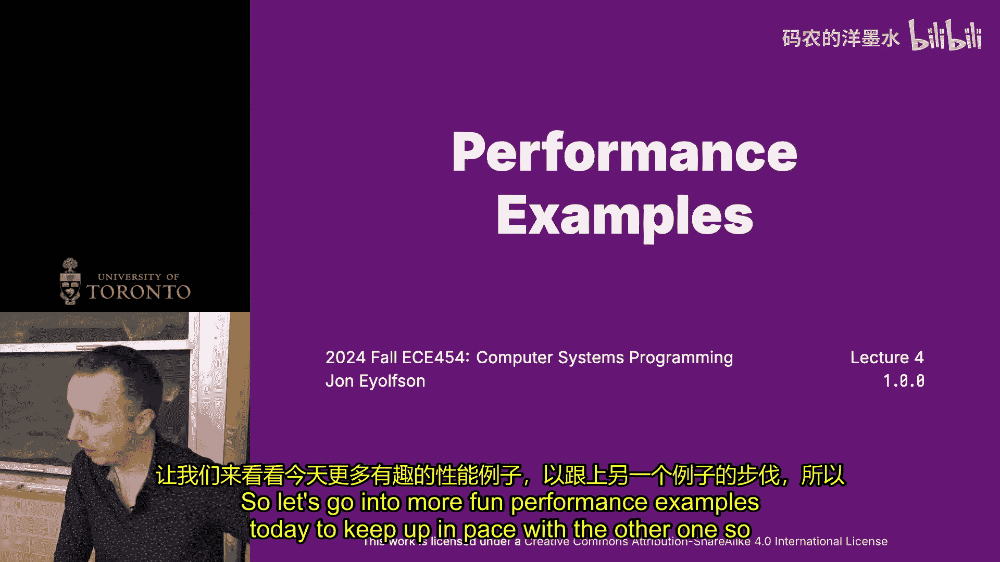
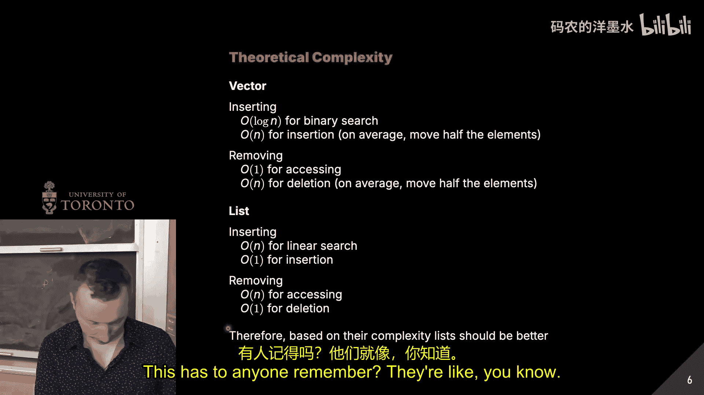
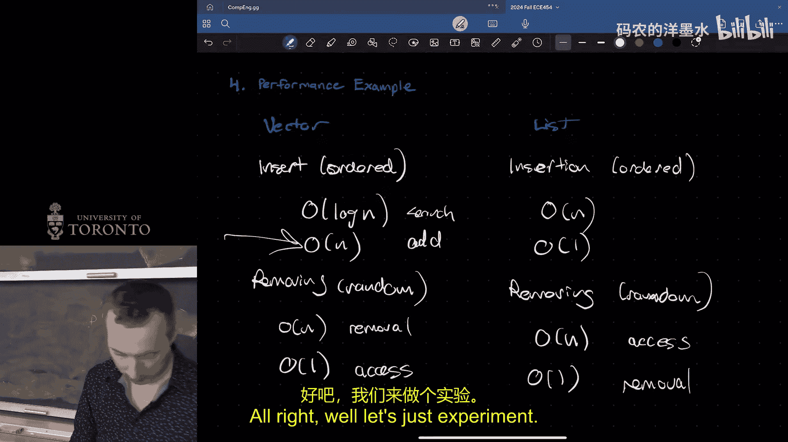
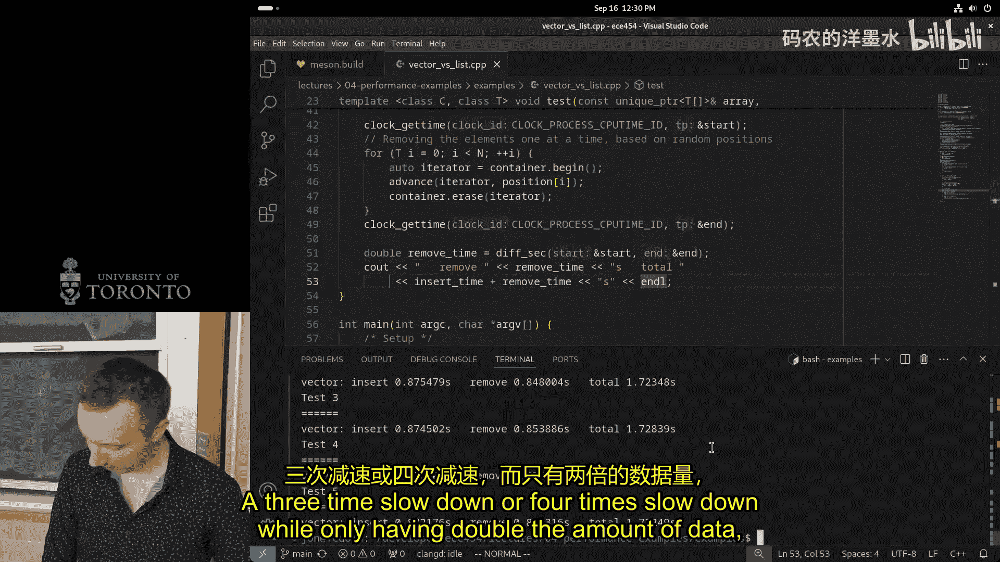
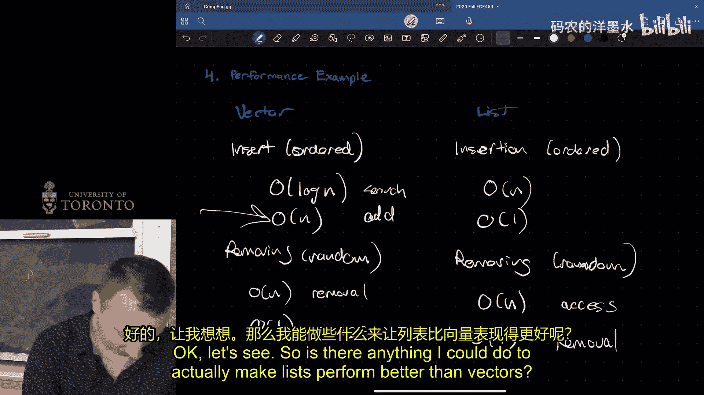
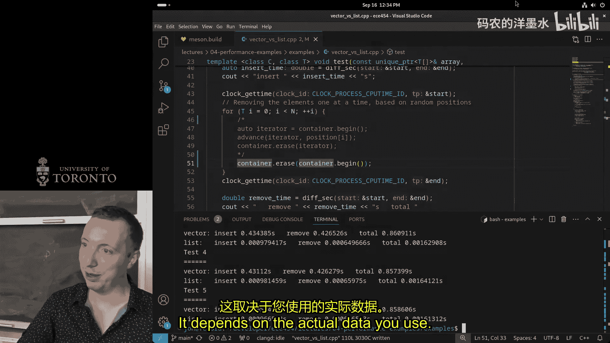
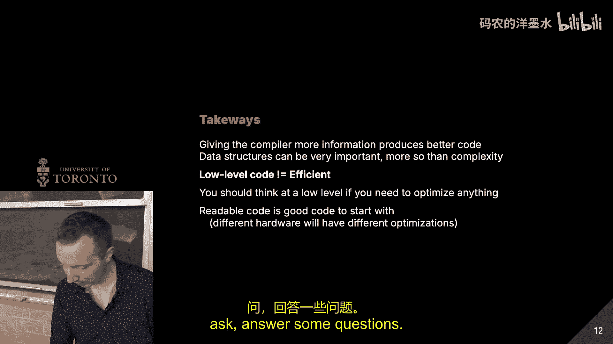

# 【全集】多伦多大学 C语言高性能系统编程实战 中英字幕 1080P p04 Lecture 4 - 性能示例 -BV1oDrZBZEG2_p4-

。まれ。最て。Allrighty， welcome back to 454 Aka， the performanceformance course。

So today we get to have a bit of fun， we get to look at some more performance examples just to keep in pace with the other class。

 and because I didn't mention something that's probably relevant to lab one。Why you guys are noisy。

Jesus， all right， so yeah， lab one should get your attention。

 so let's go into more fun performance examples today to keep up in pace with the other one so we don't get ahead too far。

So takeaways from last lecture， what did we saw， we saw an absolute laundry list of compiler optimizations。

And the two longd read of that one is you should just concentrate on making your code as readable as possible。

 the computer or sorry， the compiler likely to do a better job than you， just simple optimizations。

 moving code around， things like that。And again， remember， the optimization is the root of all evil。

 So even if you try and optimize something， you might just be completely wasting your time。

 the compiler will actually do a better job of it， so。

The goal of profiling is to focus in where you're going to make all of your performance efforts。

And the other thing we got from the last lecture was you should give your compiler as much information as possible。

The information needs to be correct。 Otherwise you will get worse performance or undefined behavior。

 which is even worse。 We saw two ways to give the compiler some more information using restrict Aka A。

 these pointers do not alias or this pointer。 Nothing else points to the same thing as this pointer and then that built in expected。

 So if you know the outcome of expression。 You can go ahead and tell the compiler what you believe it is。

 Linux kernelel uses it all the time for if statements。All right。

 the reading readable C code and performance C code kind of hard because your code is kind of tied to the implementation and what your compiler produces。

And common things you see and see， which is like terrible for trying to read it。 Like everyone。

 has anyone ever used a macro that is like 10 macros deep and。

Trying to read that is next to impossible。 Yeah， that people do that all the time。

 because C is actually a fairly simple language。And then void star all over the place。 And then just。

 you have to figure out what type it is just by guessing and type casting。

 and it's all fairly bad stuff。 But the language itself， not very large， also low level。

 whatever that means， it's supposed to be like。Kind of portable assembly， not really。But C plus plus。

 since C 11。Has like， made some good strides towards readability and efficient efficiency。

 Their goal is like actual lightweight abstractions。 And we saw that when we were trying to sort。

 You know， it beat the hell out of our sea sort。Just mostly because of one key optimization which was in lining that I didn't actually mention last lecture。

 but someone said that lecture once I just assumed everyone know what it meant but just in case here's what inlining is so this is probably one of the most impactful compiler optimizations there are so much so they even include a keyword。

 but what optimization or what inlining is is basically kind of what it sounds like it takes a function and moves it to wherever you call it from and then they get rid of the function call。

So， for instance， if you've written C or Java or C plus plus or Java before you probably have like accessor methods and things like that。

 you'd probably you know define class point public oh， here's my method called git X。

 it returns X which is one of its fields。 and then I can make it a private in X and then that way from outside I can't actually do P dot X or anything like that。

 I can't access it from anywhere except through the accessor function。

 So how you would actually get the x value is you would write code like this like ay， I have a P。

 I create it and then if I want to print X， I have to do like p dot gitx right。

 everyone's probably written something like that before。

So the compiler is actually smart enough to optimize this all the way down to this。

 So it would get rid of the function call。 It would get rid of pretty much everything。 So this would。

 if it was virtual， it would go hand in hand with de virtualualization。

 that would essentially be this by the time it gets to compiler。

The compiler doesn't really care about public and private。

 those are just to generate compile like compile time warnings for you if you're trying to use that field。

 the compiler is free to use it if it knows it can use it and if you're doing Gex while the field access anyways so it would just inline it and then produce this so now we would get rid of the function call we'd get rid of you know virtualization if it had it and we would be really。

 really fast so everyone okay with inlining。Of course。

 if we inline a method that was longer than that， well， then we have some trade offs。So。You。

 like I said， you avoid the overhead of the function call and the return。

Which would be the other part of it。 But your program size increases。

 So if I use that function in a whole bunch of places。

 since I'm inlining that huge function at maybe more than one call site。

A call site is just when you make a function call to some code。

Well then my program size might increase at run time。

 I might actually have worse performance due to the instruction cache。

 so I'm actually generating more instructions instead of just having a function。

 I can reuse those instructions over and over again。

 I'm generating new instructions for every single call site and it might be really， really big。

 so I might actually get worse performance in this one and a bigger executable。

But the nice thing about inlining is that it also works hand in hand with the rest of the compiler optimizations。

 So if it in line a function， it will run the rest of the optimizations as well。

 All of them that we saw last lecture， like the constant folding， you know， any。😊。

Common sub expressionpress， elimination， all that fun stuff。There's also an inline keyword。

 if you've ever used C+ plus as a warning。 that is merely a suggestion。

 So that is you telling the compiler。 Would you please inline this for me and the compiler more often than not if it's too big。

 the compiler will just be like nah， I'm good。 not gonna do that， I'll save you from yourself。

 So the inline key just slapping inline everywhere， does not make your program go faster。

 It might either well it might make your program go faster。 It might do nothing。

 The compiler will ignore it， or it might make your program go slower。いや。likeそ。Partially possible。

I mean， if it's a big method， they won't， but what LVM has like they' in line he is like。Yeah。

 so different compiles will have different inline heuristics， different run time。好。咩。Yeah。

 most of the time， it， it will just inline anyway。 So most of the time this does nothing。

 But this is like some people think just slapping this on makes their code go faster。

 But the idea behind this in this course is， you have to profile。

 you have to check whatever the hell it's doing， actually run it， make sure it made an improvement。

 things like that。And that was the major thing that was happeninging。

 Remember when we were sorting between C and C plus plus。

 this was the major thing that made C plus+ go faster。Also。

 if we did that sorting experiment and we added Java in the mix。

 Java would actually land faster than C， but not quite quite as fast as C plus plus。

 And that is because the Java virtual machine is full of magic。 So the Java virtual machine。

 know it will be a virtual method call it will have to look it up。 blah blah。

 blah do all that slow stuff。 but the Java virtual machine has heuristics in it where if it sees a very。

 very hot piece of code it will actually do the inlining for you generate new code and then use that one。

 So。😊，Even had a project on that where we tried to throw AI into the mix and get AI to figure out what's a good thing to inline versus not。

 because their heuristics are generally really simple。If I remember correctly， it was like。

 if the method has like less than 80 instructions， it would try and inline it if it was hot enough。

So you could do better than that。 compilers。 I mean， everything's just a trade off。

Speaking of trade offs， and。Yeah， just a performance example。Let's have a， another。Fun old。

 let's see what is good。 So here is my problem。I am given a N random integers and I'm supposed to insert them into a data structure in sorted sequence。

 So if I generate the numbers3，4，2，1， and I insert them in order and every time I insert them。

 they're ordered in that data structure first I would insert3， then4 after the three。

 and when I go to insert two， it should be at the front and then I go to insert one。

 it should be at the front2。And then after I have all of。These things in the array。

 I'm going to remove them and elements at a time。 just going to a random position。

 removing the element so。For example， if I just want to remove element 2， then it's just。0，1，2。

 I'm removing this。 Okay， now there are two elements left。 I remove it at。 These are all indices。

 So I remove it at index 0。 So I remove the one at， sorry。Okay， there's typo there。

 It should be the other way around， but I just remove them in that order。So my question for you is。

 for which n is it better to use a list or array and。This hosted anyone remember， they're like。

 you know。

Anyone remember their fun complexities。 So here， let's have two columns。 So here is my vector。

Here is my list。So， if I want to。Insert。If I want to insert something into a list。

 what are my everyone remembers are big O， right？ So what are my big O for inserted something into a into a vector if it's already sorted。

Yeah。And loggan。So， and。So that's just for the search part。What about the insertion part？N， O N。

 right？Because worst case， you can think of the worst case， right， Wors case。

 if I have just a big old vector or an array and say， I want to insert something here。

 what needs to be done。Yeah。Its to get。Yeah， everything needs to get at least shifted over me。

 The whole thing gets copied。 So I just take this。 And my new one looks like。Hey。

 here's my new element。 And then everything else gets shifted by one， right。得对对对。Sounds pretty bad。

 What do we have to do for a list。Yep。Yeah， the search is traverses of what's that oh？Y。

That's not annoying。O， N， okay， what about just adding that element to the list。Oh， one， right？

Nice and constant， if I know where it is， after I search， I just play with some pointers， boomm。

 I'm done。Sounds a lot better than the vector 1， where I potentially have to move everything。

So I should never have to move memory with the list， right， I just insert it。

 play with some pointers。 Good to go。 alright。What about removing。And it's just random removal。

 I just give you an index。Yeah。O of N。 Yeah， so O of n。For actually removing and that's。You know。

 I might have to move everything back again， right and then。Accessing the elements。

 so that is the removal part。Ohoops。Search ad。But actually。

 accessing the element is just really fast。 That's just an array access。

We're good just writing that value， nice and easy。All right， list removing。What's that。O N access。

 right。 So O N access。 So I have to find the thing to remove， right， and then just。A constant time。

 just the removal。Okay， yeah。For an array。cause I just find the slot， right's not。

The index that's given that we。Yeah， yeah， would the index that's given。Not the values。Because。No。

 we we， we get the index yeah， yeah。There。In。Well， I'm giving how many positions to move。See。

Seems fair， right。 I don't。 if I did give the lists an element。

 I would have to keep track of some extra data instead of just saying move this amount forward。

Alright。 So based off this。Which is faster。Sa sameme。Same maybe slight edge to the list because。

 you know， this one seems really bad， right。Like maybe moving the whole thing over by one。

 especially if there's a lot of elements。Might be pretty bad。Alright， well， let's just experiment。

 So this will be fun。 So here is my program。 So here I just have a testing loop that just runs。😊。

Five times。 I won't show you that， but just runs this test function either with a vector or a list。

 And we're just doing a whole bunch of integers。 And then I give it my testing arrays that I just used to populate it。

So。Let's go up to our test。 So here is our test。It's written slightly hacky。

 so it's using templates in C+ plus or if you haven't done that before they're generics。

 so I don't have to write a list version and a vector version。

 I just write one version and I pass it in either the list or the vector。Oops， so here it is。

 And I just。Create a container based off that。 So any of the template arguments is' just a class name。

 And the compiler will go ahead and just do all the replacements for us for this function。

 So C will get replaced by either a list of ints or a vector of ints。

 depending on which version I use。 And then here I。Just time inserting elements into the list。

So lower bound， that is the generic C searching algorithm from C plus plus。 So if there's multiple。

Matches， it will give you the lowest one， so that would actually be biased towards。

Making as or making vectors even worse， right， because if there's multiple copies， well。

 I have to move all the other copies I could just went to the end while for list。

 If I go the one at the front， then I'm done faster。 So this is actually better for list than is as。

 And then I just insert it。Then I just print off how long it took to do the insertion and then I just do the removal。

So for the removal， I start at the front， and then I just advanced the iterator。

 However many positions I'm told， and then I just erase。

That element from the list or the array and see how long it takes， so。Let's counter votes。

 So let's say I do this with， let's see。Let's say I do this with like  a thousand elements。

 Let's do votes for vector wins。Haish， all right， vote for list wins。

That is not the other half of the class。Okay， so a bunch of us unsure slight bias towards vectors。

Well， let's just see。 So if I run that， wow， runs really fast。 I can see that for the vector。

A lot faster。 Well， I mean， a lot faster。 It's like 10 times faster， but this is。

Running pretty quick。So let's increase that a little bit。So I increase it a little bit。

Looks like the vectors are didn't slow down that much， so I increased it by a factor of 10。

 the number of elements I have。Vectctorors seem to get about four times slower。 And yeah。

 the list is starting to struggle a little bit。Let's see。 what's a good number， 20，000。日。So。

How many times slower is that。und， yeah， at least。100 and a little bit， right。So why is that？Yeah。

 cash locality， yeah。The rest to。What you're chasing。Yeah。

 so mostly this has to do with cash performance， so。You know， vectors。

 even if they're large and I have to move a lot of stuff， Let's just see moving a lot of stuff。

 Let's see 30000。Even moving a lot of stuff。Not too bad。Bss。Struggling a little bit here。

But the vectors aren't too bad because they're all very close to each other in memory。

If you remember our page stuff， I guess we'll go into that more again this course。

Computers like sequential memory access。 So even if you're moving arrays a lot， they're all in a row。

 If you do one cache miss， you bring in the rest of the array， essentially for free。

 and then you get cache hits over and over again。 So your performance is actually quite good。

 So we can see I have put an argument just so we can see how good vectors scale to。

 So this will only run the vectors and not the list。😊，So I can do this。

 So I can see even with large values， it actually scale pretty well。 So even like。With this。

So now we increase the size from before。 and now we start。

 Ca misses seem to affect us a bit more here because we get。

Like a three time slowdown or a four time slowdown。 while only having double the amount of data。

 which also seems to go against our fun， you know。

That are fun theoretical computer science people。 So this is why you don't take computer science。

 yeah。Would a compiler optimize and array into effect？So the question。

 would a compiler optimize an array into a vector， So a vector is just a kind of a managed array。

So there's no optimization necessary。Victor is better， right？Thatsing every。Why not just？

So why not just change a list to a vector？So anytime you use a list， I should。Always use。

 I should always just use a vector for my data structure。 That's your argument。

 It like if you don't know how large。一打で。Memory。memory版其实。Then you have do suggestion。

I guess in some mostly。You don't really care。About memory usage in that case you can just use it vector there。

Yeah， well the。Okay， let's see。 So is there anything I could do。

To actually make lists perform better than vectors。Yeah。Could you make this on the nodes or？

Right next to each other under。The nodes are right next to each other in memory。

 not with the default implementation， not easily， yeah。We're generating number。

Either a senator of your decent。The been30。Even3。Other way around， right。

 If I keep inserting at the beginning， it should be better for less。Yeah， okay， so， hey， well。

 let's try that。Let's just make sure that let's see。 So this is inserting。So here。

 this like searches where it should go in， let's say screw that I don't want sorted anymore。

I just want it to be inserted。At。A container。Wow， I can type。

So let's go ahead and see that there's no one size fits all solution。

 Let's see if this makes it actually slower。 So list。Okay， that one was too first。Wops。Li still suck。

Alright， what about the other way， What about I did。IActually， no， we didn't。 We weren't fair。

 If we look at the insert for the list。It's way faster than the vector now。

So if I want to really bias this towards list， I would change this one as well。

 just to always delete from the front。Did you erase iterator dot again？Whoops。So I can do this。

Lo and behold， lists are better。Okay， yeah，What that whole demonstration was is like， okay。

There's no simple solution。 It depends just even looking at your program， you don't even know。

If you don't know how well it will perform it depends on the actual data you use。

 So it's important to profile with representative runs so you don't just optimize for the wrong thing。

嗯。And the reality， for the most part， in like the most general case。

 vectors dominate list performance， why， well mostly because cache misses。

 and I'll show you proof of that。 turns out I can't show you that well in a virtual machine。But。

Basically， that binary search。Compared the linear search dominates， yeah。So有。Yeah。

 we basically turned them into stack。They're good at that。Yeah， they seem to be good at that。

 So we can't just be hating on lists all the time。 They have their places， but。

I don't think it was this class， but there was some class that was like obsessed with lis。

That use them for every data structure， even though in general， they're the worst thing to like。

 just reach for。So64 B machines。 One thing you have to generally be concerned of is our the size of the data we're storing per element。

 so。If you have a 64 B machine， AK， your pointers are。eight bytes Well a vector。

 each element is four bytes if I'm storing ints， just takes an int， that's it。

 doesn't take any more space。A list per element。 We have 20 B， right， We have a previous pointer。

 a next pointer。 So that's 16 B by itself。 And then we have the four。Bte for the actual data。

So memory access， especially if you get to that level， is slow and indirect， it comes in blocks。

 so just because we have a list and we have two nodes。

 they might not be next to each other in memory， which is really。

 really bad if you wanted to optimize list performance there's things to do。 you can do a skip list。

 things like that you can make sure that the elements are beside each other in memory。

 little hacks like that， and that's why we talk about doing our own memory allocator in a few lectures。

嗯不。Basically， it's just a large amount of cash miss。 The cash miss rate to the vector。You know。

 whenever it misses， since it's all sequential， brings in a lot more useful data。

So another profiling tool to use， that is。Not one of the official ones to use in this course because it doesn't really work well in a virtual machine。

 but。You're free to try and use it if you want。 I like it a lot better。 So I'll show you。 So Perf is。

😊，There's a typo there is a link specific profiler that will actually let you access hardware counters。

 So some of the code in this course， at least before that I'm trying to change like just does random assembly instructions to access hardware registers so you can get better performance timing this。

The reason we have kernels is so that it can manage all the hardware force。

 and we don't have to have。Weird in line assembly。 And hopefully we can use other architectures。

 especially like arm X 86，Co人。Yeah， usually be indicative。こ。

Is it very Linux specific or is it just like？It uses links curl stuff to help you get more profiling stuff。

可さ。Yeah， all your labs in graded are all going to be graded using Linux anyways。本案。Oh。In general。

 the user mode stuff is the same， Windows might do different things with system calls。

 and then you'd have to do the Windows specific stuff， but any user mode it's indicative。

It should run pretty much the same on everything。Okay， so you can run before any command。

 You don't need to like compile with arguments or anything like that。

 I'm sure everyone's having fun doing that。 You can just run it like you would。

 Valgrind or anything like that。 You can do perf that dash B to get a better display of numbers。

 And you can ask it interesting things。 So dash E will add other things you want to keep track of。

 So it'll show you cl task clock。 So that is like。How much of the processor's been using for this process。

Number of cycles， instructions that we re visitedited last lecture。 Most importantly。

 cash references， Ca misses， branches， branch misses。

 So that's part of that branch mis predictiondiction we saw before。 And then page fault。

 So that's if it gets to memory， but。嗯。Yeah， may or may not be supported by your system。

 so you can use it in this course。 your dev container likely won't support it。

 My virtual machine doesn't support it because my underlying operating system is Mac， not Linux。

 So even though I'm showing you a Linux VM， it's a virtual machine。

 I actually don't have access to this stuff。But if I did， so。

Your testing infrastructure is kind of jank， it's a whole bunch of raspberry pies that are seeing in my basement。

呃。I don't know。You can donate other hardware if you want， but right now that's what it is。

 So I ran this on a Raspberry Pi 4。Perf works out there。

 You can get performance counters minus the branches。 So， for example， I just ran this with。

Just running the vector part。 So that's what the dash dash vector is for。

 And it gives me a whole bunch of useful information。

 So this tells me like how much time my process took。 And well here。😊。

Likely you want the little things in the comment， so 0。

999 of a CPU pretty much means it used a single core。 it went full blasty entire time。

And obviously not multi threaded or anything like that。Then cash references。

 So it'll tell you how many times you reference your cache。In total。

 and then it will also tell you cash misses。 So here it also does the math for you。

 So I had an under 1% cash miss rate。Pretty good。 and then shows the cycles and then tells you how fast it is in gigahertz。

Has a little crappy fan on it。 It's a raspberry pie，1。7， whatever。

 that says the number of instructions。Probably more what you care about is instructions per cycle。

 So it does the math for you there as well。 So I didn't get up to one。 So it wasn't superscalealar。

 but it's a fairly simple processor。 The number of branches I took was not supported。

 So that's not great。 but the misses。It showed me the number of misses and I can use it to kind of compare against another run AK against list。

 then also told me page faults， however much time elapsed in total and how much of that was user。

 how much of that was system， so system just going be system calls， things of that nature。

 user is actually time spent processing your stuff。So that's all well and good。 That is my vector。

 But to see that caches were indeed an issue。 And to get some actual data on that。

 here's that same thing using lists， so。I had 1。0 CPUs utilized。 you know。

 I had a whole bunch of cash。I had like double the amount of cash references。

 So I was using more memory addresses。 That makes sense。But compared to the other。

 I was only using like double。The amount of memory， which actually doesn't seem too bad。

 But the killer here is cash misses。 So I at one point。5 billion cash references and 1。

4 billion misses。 And luckily， it puts。Does the calculation for you。 So I missed 92% of the time。

Great， so that is why my performance absolutely tanked between them and gets worse and worse and worse and worse。

 and all the other。 And that， of course， affected my number of cycles it took to execute all of this and brought my instructions per cycle way down in the tubes to 01 instead of what 0。

6 before and then branch misses。😊，I double the amount of branch misses， but you know。

 the cache was a dominating thing here。 I had slightly more page faults。

 So I had like another 20 page faults。 that's probably just due to how much more memory lists use in vectors。

 which isn't that bad， typically now that doesn't really dominate performance。

 It is this cache misses that absolutely trounced us。 So good tool to pick up if you won。

 And this is yeah，21 seconds first 。5 seconds。Yeah。W。も什の。Yeah， so the question for a list。

 is it possible to localize the pointers， And yeah， that is something you can do。But。

It's way hackier， and it would be way more code， and it would probably look fairly atrocious and like C+ plus。

 you can add custom allocators to even the standard lists and stuff like that， but。Yeah。

 then you get into that state where like， if you do that ahead of time。

 you don't have a good reason for it， you will never read your code again and that optimized code that you did write that goes really。

 really fast。It would have like that comment we saw in the first day is like dairyie， who enter here。

 if you try to optimize this any further， just increment the counter how many hours you wasted。Sorry。

僕は。So is there a drawback to localizing them， it makes your memory allocator much more complicated。

And you have to probably have a specialized memory allocator for it。そほら。

So what actually happens when you get a cash miss and why is it slower？ So when you get a cash miss。

You have to。 that means the data isn't available in your cache。 Most processors have like an L 1， L2。

 L 3。 and generally， the layer below it is like。10 times bigger and 10 times slower so anytime there's a cache miss I have to ask the cache below it to get the data for me and then if it's not in there it has to ask the one below that and then if you're really screwed it has to go all the way to memory which is really really slow so basically for performance。

One of the main things is to keep everything as local and close together as we can。Yeah。

So the question is， would the entire vector be stored in cash， So it would be。Like a vector。

 all the memory addresses are straight in line and whenever there's a cache miss。

 it generally brings in like the rest of the addresses after it。

 So if I miss and I bring in a bunch of data， I'm going use that data in the future if it's an array because it's all in order。

 But for a list， I might not use it。Yeah。Yeah， so we have you know。

 a different trade off if we were storing something more complicated and。

If it didn't fit in cash at all anyways， then yeah。Yeah。

 then that would be an absolutely huge data type， in which case。Probably it doesn't matter， in fact。

 because it's so huge moving in a vector would probably be terrible。

 So you probably want to do a list for that。 So always be a trade off。

 especially like this one is small data， individual ints。Probably vector is a good thing。

 something more complicated， maybe it's huge enough anyways， it doesn't matter。

 and then I would go ahead and just use a list anyways，ep。不应该。为我。Yeah， I mean。

 that's a great thing about this course is anything could happen to ruin our performance and even memory access patterns might ruin our performance and then that's part of your job to identify and fix them so if you see something like that you always have to be looking at the code and being like hey。

 can I try and access data in a way that is more cache friendlyri。

 things like that and that's what we get to enjoy for the rest of the course。

But isn't it great how complicated this course is， it literally it depends on everything。

If you can justify anything， there's basically no wrong answers。 You have to justify it。

And although some of your justifications might get very， very。Unlikely。Alright。

 so some more performance tips。 And then I'll leave some time because people are chatting about lab 1。

 but。Basically。More performance tips is don't store unnecessary data in your program。

 Then that has to go with like， if I。Made each of those entries bigger。

 it would get even worse and worse and worse。Keep your data as compact as possible。

So some of your optimizations could be like， hey， I use a 64 B in for this。

 And all my values are between 0 and 100。 Was that a smart thing to do， Probably not。

 I should probably just use a byte for that。 Everything has limits anyway。 So just know your limits。

 make things。As compact as possible， generally that has to do with your data types。

 access memory in a predictable manner， use vectors instead of list by default。

 change it if you know that hey， I'm pretty sure that a list would work， profile it， try experiment。

 that's the great thing about this course and if you program abstractly you can save a lot of time so there I could easily just change whether I was using a vector or list by just changing a single type and I was done off to the races。

Otherwise， if you wrote that in C， changing a vector to a list， that becomes like a week long job。

 especially for a very， very complicated program。 So using things like C plus plus rest other。

Languages and trying to program abstractly is a good idea。So some more takeaways。

 giving the compiler more information produces better code， more information， more good。

Data structures very important more so than the complexity。 So for the most part。

Unless you're like really diving into the algorithm。

 you can throw away all that computer science knowledge， it's useless。

Cashs are where it's at and hardware， which is why you chose ECE。

 So you actually know how a computer works。Little level code does not mean it's efficient。

 so writing in C does not immediately say it's better than C++ writing in assembly does not say it's better than C or C++。

 in fact， it's probably going to write something really bad。You should think。

You can think at the low level if you need to optimize anything。 So thinking about the instructions。

 looking at cash misses， things like that。 If you need to optimize is good。

 But programming that way to start off with is very， very bad。And。

The biggest piece of advice I can give you is readable code as good code to start with。

 So if you can't read it， good luck optimizing it or figure out what the hell's supposed to do and trying to get patterns from it and figure out how it accesses memory and all that things like that and。

😊，Just because and different hardware will have different optimizations that I'm sure will make the labs in this course a complete disaster。

Yeah， especially since some of you have aren chips， some of you have X86。

 I don't think they tested with that before， so good luck for us。😊。

We'll get through it so I will and early ask or answer some questions。

