# 【全集】多伦多大学 C语言高性能系统编程实战 中英字幕 1080P p05 Lecture 5 - 程序优化 -BV1oDrZBZEG2_p5-

🎼Yeah。非常でです。あ。えか的。快表手。All alrighty， welcome back to four5，4 housekeeping items。

 we have a room for our midterm， our midterm is August 24th， so bring on the conflicts。Augus。October。

 not August， you didn't already write it， sorry， month dyslexia。So Ben the leaderboard site。

 That's my weekend project。 So that should be up by the weekend。

 depending on how good I am at programming。 We'll see how that goes。 should be mostly in place。

 different inputs。😊，Should be fun。 People already have great speed ups。

 So today we're going talk about more optimizations you could do。

 although this gets like fairly technical。😊，So let's get to it。 Let's see how today goes。 So today。

 we're creating a vector in C。 So a vector， just a。😊。

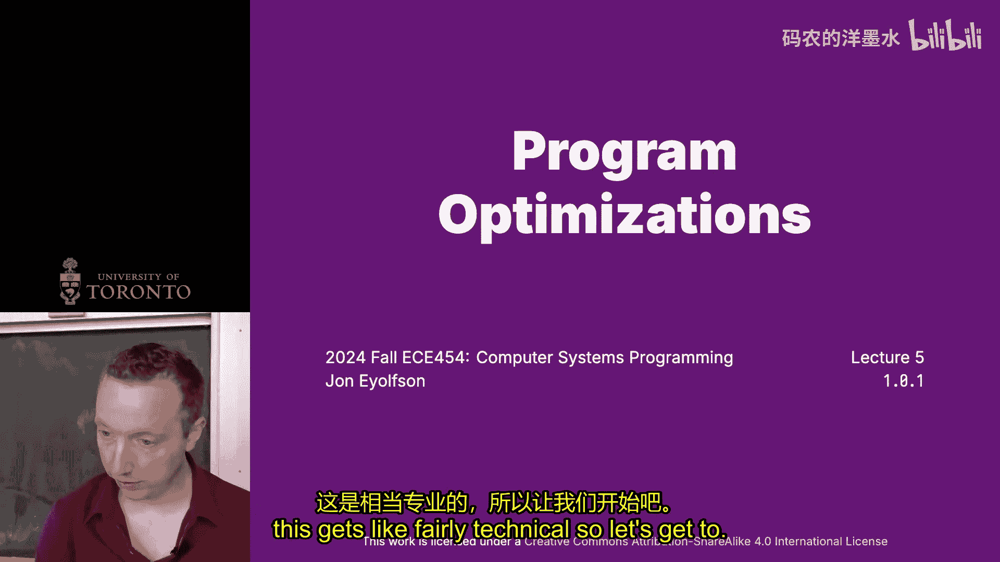

Managed dynamically allocated array。 Nothing that special about it。

 There's some functions I already give you。 So， again， for this。

 you can look at all the example code。 And I gave you a whole bunch of other things in this lecture that will will walk through。

 But these are some functions that are already written like to create a new vector just needs the length。

 The number of elements in。 And then there's like a getter to actually access an individual element。

That goes ahead and has a slightly weird API where it will just update the value of the pointer that you give it。

 Soll do all the de referencing and stuff。 And then if we want a pointer to the start of the vector。

 it looks like this。 So it just gives us back an int pointer。 if we just have it full of ins。

So what we will be optimizing is just a single function to combine data that they wrote super。

 super generic。So to combine all we do is we just do an operation over and over and over again for each element of the array。

 And it's configurable。 in this case， you know， it's configurable， so。It abuse， well。

 it doesn't really abuse C。 It kind of does because it looks pretty terrible。

 but it has an operation just called op。 And that is something you can set when you compile it。

 so that。You can change the operation， so you can set either to be plus， multiply， divide， subtract。

Whatever you want and then an identity value where。

How it's supposed to work is if you do X and then do the operation with that identity value。

 then it should be equal to that same。 or sorry， It should be the same as x， not the identity。

So like if it was plus1 plus0 equals x， if it was multiply1 or x times 1 equals x。

 so I have to fix that on the slides。Alright， so we'll be essentially doing that today。

 And funny enough， there's like a first year course here or something to see that code up on the board that is calculated as sum。

 So yeah， we're still doing that crap in fourth year， except we are going to take it to the extreme。

😊，So。We'll see how today's goes。To actually calculate our performance will go like really fine grain since we're just looking at a single function and will' measure the number of cycles per element for performance。

 So the system I will use today， just so I have better performance numbers is an AM D risezen。

 whatever 1800 x。😊，Fairly old CPU。 It's the thing that sit in my basement。 Don't blame me。

 Theyd haven't given me anything else。 So some machine sitting in my basement that's slightly old。

 I think I got it at like while I was doing my PhD。

 So I don't want how anyone want to check the year on that like。2018， I think。Anyways。

It is a X 86 processor so we can go ahead and get X 86 assembly if we want to look at that。

 even though it's a bit ugly。So our first attempt， if we want to be really， really generic。

 is we have this function called combined。Have this destination。

 So we're supposed to write the result to this memory location。 So initially。

 we said equal to Identt。 make sure that， you know， if there's nothing in there。

 we at least return some value， we at least set some value。 And then in here。

 we have a nice old four loop。 So4， I equals 0 all the way to I。I is less than the length。

 I plus plus。We go ahead， We create a variable to store the data。

 We do call that gettve element so it can actually give us that value。 And then we go ahead。

 We do the memory D references。 So we just accumulate it over and over again。So。Everyone。

 okay with this。

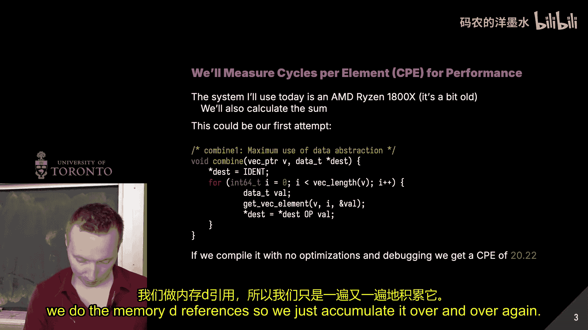

Code。First up， functional。Readable ish minus the memory pointers。Did C。

 So someone might want to do this。 So any questions about this code， hopefully not that much。

So we're going to work on just the whole time making this better。

Some things you can do may or may not apply to lab too。In order to calculate it， I'm using Perf。

 I'll show you how I use it， but I have this script in my repository。 Oh， yeah。

 also housekeeping note。 if you would like to use Perf and your machine doesn't support for some reason because I don't know you're using Apple or something。

 all the UG machines now have Perf enabled， so you can use it on the UG machines。

 if you would like to use Perf and your machine doesn't support it for whatever reason。 So。

You might want to look at this per wrapper code。 I'll walk through it a bit in。

I'll walk through it somewhat later in the lecture。

But I can use it and go ahead and just benchmark this。

 make sure I have enough elements so that it gives us an accurate readout。Okay， it's 10。

There is no shot。 it should be 10。Well， live demos are great， hu。1en again。や。Okay。

 my computer is sped up by two times from the last time I used it。All。Benchmark everything。Okay。

 now it's 20。Oh， okay， I ran the rant I ran the wrong thing。 Okay， that makes sense。Don't worry。

 the world's still O。 I'm just bad at demoing。 Allright， so first， I'm going to。Run it。

 compiling with just debugging information， no optimizations， no compiler flags。

 no nothing like that。 So when I do that， I get 20 cycles per element。Which is pretty terrible， so。

First thing we want to do if we want to speed this up faster。 What is the quickest。

 easiest thing I can do to probably get to speed up quite significantly。Or what did you do in lab2？

Yeah。Yeah， I let the compiler just do some magic for us。😊，So if I just add O2。

 that should be your good starting point。 If I just add O2， and then I run that。

 which is what I was running before。If I just simply slap on O2， boom， it gets twice as fast。Joy。

 so already two times by just knowing how to use your compiler and knowing the flags。😊，So。

Next thing we can do is。Look at it a bit more， trying and figure out what the compiler did and didn't do。

So most of the improvements we got by using are， by using just the compiler optimizations。Basically。

 we just got better register allocation and scheduling and like how it organized the code for us。

 It didn't really do anything to eliminate any function calls or anything like that。

 So for all of it。Easest thing to do or not easiest thing。

 But one thing you can do is look at the assembly。 So I also have a script that I can walk through。

 I dont like that echo。 I also have a script that I can walk through that like outputs all the assembly for you using all of the flags used to actually compile it。

 so you don't have to repeat the flags and like accidentally miss something So if I go through the code。

This is the generated assembly， so I'll show you what flags you can do to actually generate this。

 but one of the things you can do has anyone used O dump before。

 I think it told you to use that before， right？Kind of ugly。

 gives you a whole bunch of extra information that you see。

 shows you like the inIP functions and stuff like that。

 Don't have to use that so you can actually tell the compiler to generate assembly for you instead of just the compiled program without linking it and all of that other stuff and you can just go ahead and see just the output of compiling that function。

 So here is my output。 So have the file So anything that starts with a dot here is an assemblyr directive。

 So it's not actually assembly code It's actually just telling the asmbler to do something。So， here。

This is the beginning of my combined function。 So it's just a label that says where this function starts。

 And then I can read through it。 Ih。 It has a bunch of moves。 Who cares。 Then it has this label。

 Okay， well， here this label。How much do people know about compilers， If I say like。

 this is a basic block， Does anyone know what I'm talking about。Okay， like two people。Okay， so。

The way compilers organize things and reason about things is any straight shot of assembly without a label that only has like。

One place to enter and one place to leave。 That is called a basic block。

 And you can actually form a control flow graph with them to like， you know， here， let's try and。

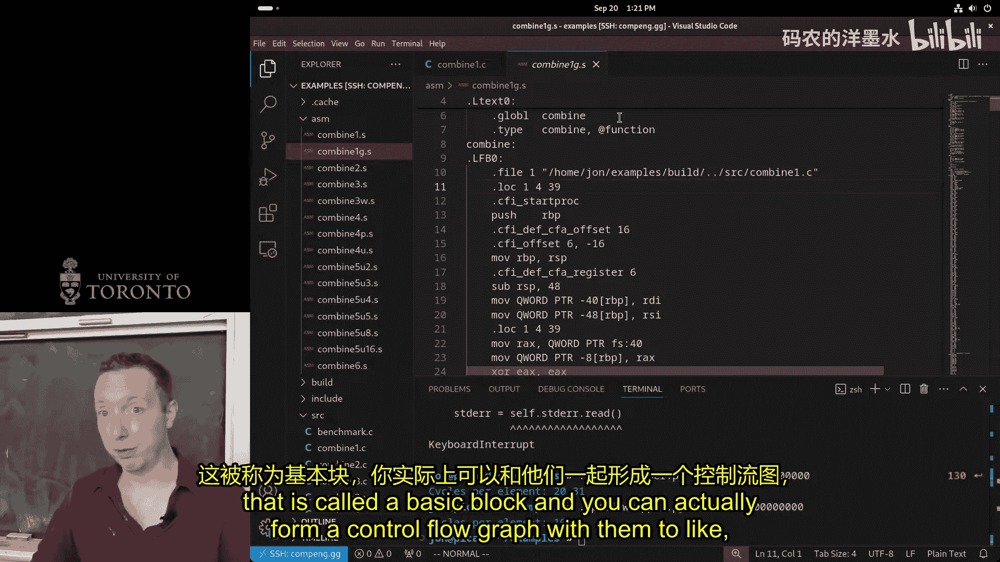

So if I just have a。Oh。Blob of assembly。 And then I have a label here。 So say this is a label。

 and this represents actually doing like my bounds check or something。Then I have like the body。

That would happen in a straight shot assembly。 Well， you can actually form a graph between these。

 So this would have like。Some type of compare at the end of that that branches。

 so there's two outcomes that can either probably go here if it's true or probably to some other code that is the rest of the function if it's false。

So。This is called a control flow graph， and anything that the arrows point out of or into is just called a basic block。

 So it's just a way to organize。All the assembly， all in a straight line。 so you know。

 if you start something， you have to go through it。Pretty much instruction after instruction。

 minus the actual processor doing out of order and stuff like that。

I might have to add something for that， but that's basically how it's represented in the compiler。

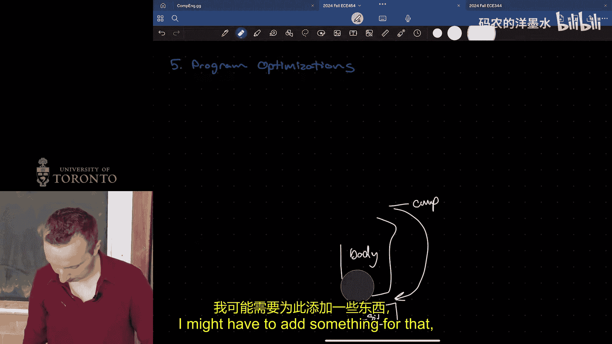

So here， just a whole bunch of crap。That that has an unconditional jump here。

 and here has two labels。 So that's probably the body of my for loop。 And inside the for loop。

 I can see oh， it has a function call。Every single time。 And if I walk through it here。

 every single time I check the bounds of the loop。 I also have another function call to vector length。

And I can check that with。Compiling with O2 just to see the difference。

So here' is combined again with O2。And I can see every time through here， it calls。Vgate element。

 it has a lot less crap in the body of the loop， so it optimizes the register usage。

It's pretty much where all the speed up came from， but other than that。

 every time we do the bounds check， it also checks the length over and over again。

 so we actually didn't get rid of our function calls or anything like that。

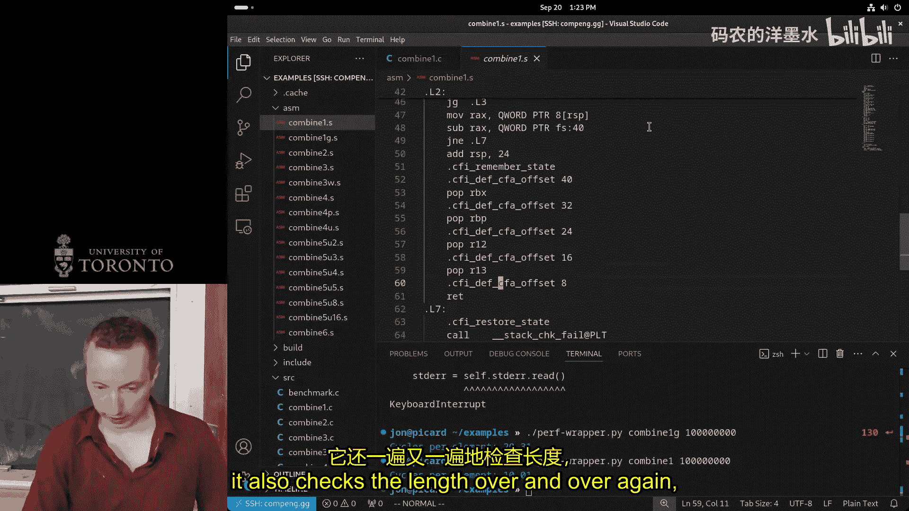

So if we look at this code， what is one compiler optimization that looking at this。

 it probably could have made， but it didn't。Yeah。Yeah。

 hoisting that called a vector length out of the loop， right。

 I don't expect the length of my vector to change every single time iterating through it on the loop。

 so I can actually。Anyone remember what that optimization is called。Yeah， yeah， loopingvari。

Lop andvariant code motion， the full name of that， so I can actually move that out because looking at it。

 I know that the length of the vector doesn't change， so I don't have to call it every single time。

You might ask why did the compiler not pick that up。

 I thought that's something the compiler was supposed to do。Well。

 turns out that that the compiler is not that clever。

 It just looks like a function call to the compiler。

 and the compiler doesn't have the actual definition of that。 If it's just compiling the C file。

 This is all the information it has。 It has to assume worst case about that function。

 So worst case about that function is it could return a new length every time。

 or it could have something called a side effect， Aka， it makes。

Some type of observable impact on our system， so we can't just get rid of it。

One example would be like if it called print F every time， then if I hoisted it outside of the loop。

 then I go from calling print F， you know， length times to calling it once， so I would it would。

It would change the behavior of my program and your compiler's number one goal is to not change the behavior of your program so just remember when your compiler does something you do not liked。

 it does not mean your compiler is dumb， it means it is actually very smart and it only does things it knows are safe。

And if you don't give it enough information so that it can figure out that is safe。

 it won't just make the leap for you and then break all your code。So here is our first aside。

 so I'll show you how to use perf bit。 So like I said， we can use it on the UG machines now。

If you just want to do a straight up profile。You can do a straight up profile just using Perf stat。

 we saw that before， if you want it to be more selective。I spent。Too much time looking into this。

 You can also send commands to Perf as is running， if you want to。

Go ahead and selectively record information about a particular function。

 which is what I'm doing here。So you can do that using name pipes。

 Everyone remember pipes and how fun they are， so you can do something called a name pipe。

 which just makes it have a name on your file system so you can go ahead and open it。So。

Feel free to go ahead and steal my code。

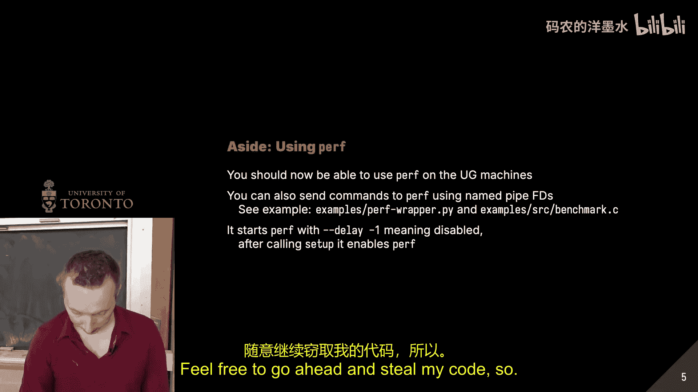

I will really quickly go through what my per wrapper does。

 So my perf wrappper goes ahead and makes these name pipes for me。

 And this un just gets rid of them if they already exist so it will go ahead and make them and then set a environment variable so that。

My program that it runs， knows the file descriptors it should use to access there's two。

 there's the Perf control file descriptor and an app if you want to actually have it acknowledge that it did your command。

 you typically don't use that in the program you're actually trying to。Measure。

 you would do it in like this script if you wanted to act that it actually did something。

And then here I just do subprocess。Just launches the prof process， of course。

If we remember operating systems， it would be forked。

 It would inherit all the file descriptors and everything like that。

 to actually tell it what the control file descriptors are。 you would like it to use。

 So I get that from actually opening the files that return me a nice file descriptor。

 and then I go ahead and I run the combined program there。 and then I close it unlike it。

 make sure everything。Lines up。Perurf outputs everything to standard out。

 So I just collect everything I ignore。It will tell you when events are disabled and enabled I just ignore that and then I only listen to one event here in this case。

 I only care about the CPU cycles if you want you can do cache misses and all that fun stuff if you want or just let it output everything I just wrote this so that it's easier for me to benchmark all of these like 10 different things I'm going to do today。

So feel free to go ahead and use that basically the only real thing it does here is sets up the file descriptors and then does this delay of minus1。

 which starts it off at disabled because I don't want to actually profile creating the array and everything like that。

 I only care about the combined function。Feel free to use this if you would like。Allright。

 So that's an aside。 So yeah， first one。

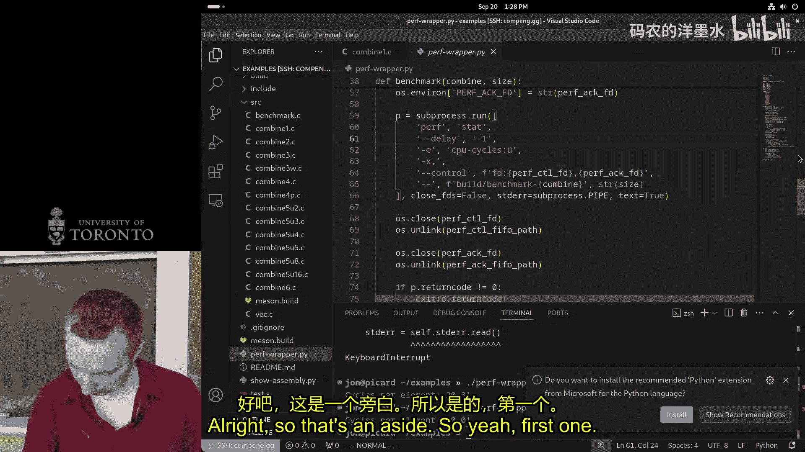

Ohoops， let's make some optimization， so the first one is， yeah。

 the compiler didn't lift that vector length out of the loop。

Because mostly it's in a different compilation unit。

 We might see how we can get the compiler to maybe do this for us in the next lecture。

 depending on time， but。Basically， it didn't do that because it might have side effects。

 That is like the bane of compilers。So， so like I said， oh， yep。 it's the reason why you're。

Optimizer won't be able to look into that blank，あせさ。Yeah， because it just got a function declaration。

 it knows nothing about the function。Yeah， we're only combiningiling just。

 just the combined function， Nothing， Nothing else。 And two， just because also。More extreme。

 just because the compiler knows of that function at compile time at length time。

 it might get replaced with something else that it could not reason about。 So has to be very。

 very sure about that。So。In this case， yeah， side effects， anything that might change global state。

 anything that might be observable， it means。If it could have side effects。

 the compiler will leave it alone。So。Sometimes you might get really frustrated if it's using a library because。

 well， if I use malloc， malloc should behave the same thing， same。Has any other malloc。Really。

 you could replace malloc with whatever the hell you want whenever you run it because you can modify the linker and have it point to a different function so the compiler can't actually make any guarantees about it。

 even if it knew it when you compile there's no guarantee it would be the same function when you actually run it。

Some things just won't happen。 It's good to actually look at the assembly or look at the Jple or look at I don' know。

 LVM bit code if you want， to see if the function call is still there or not。

So we can manually do loop andvari code motion in this case， since we know it's safe。

 So we know that the vector length isn't going change。

 We don't modify it in the body of the looper or anything。 We can just go ahead and move it up。

 So all our code changes to。 Let's go here。

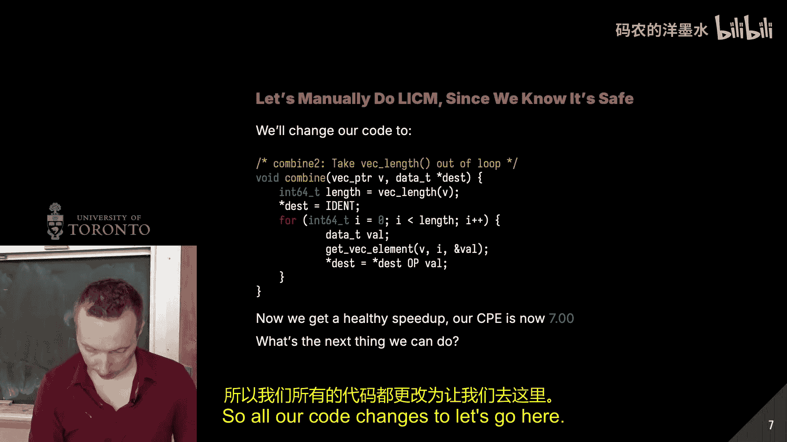

All our code changes too is this。We leave it exactly the same， but we just move the length call up。

 So we only do it once before we go into the loop。 And then we just read the length over and over and over and over again。

 So if we do this one， we can see what our speed up is this time， so。We run it now。

Takes a little bit。We got from 10 to7。Not bad。So。Helpful， helpful， healthy speed up？

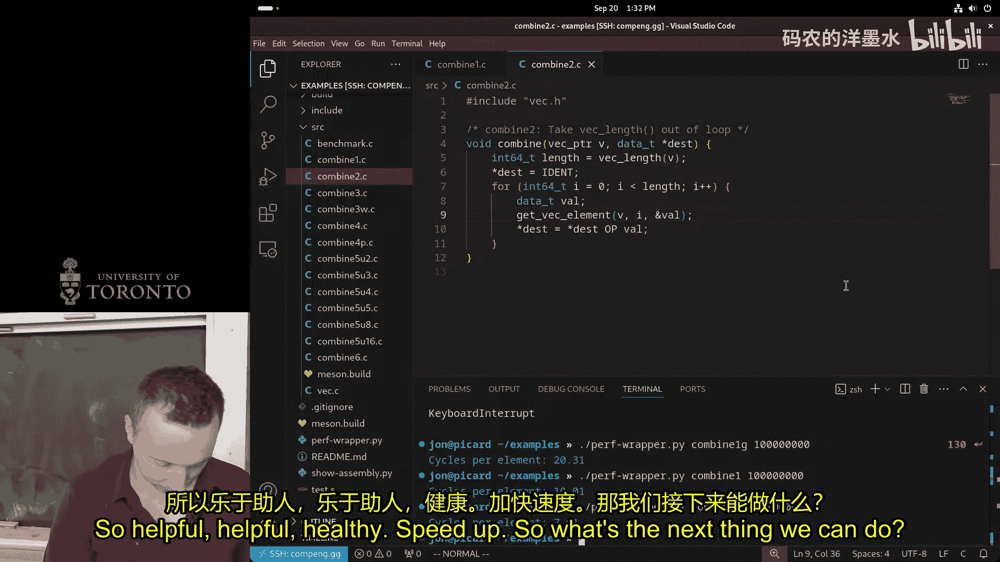

The next thing we can do。If I look at this。Yeah。Yeah， I give vectored elements kind of ugly。

 it's doing a function call every time， really that's like an array access， right？So。Ideally。

 I would like to inline that our compiler。Is not doing that at that point because it's just compiling this。

Combined file， not going to have the opportunity to inline it。 So in this case， also。

 when I checked it， it didn't inline it at all， so。

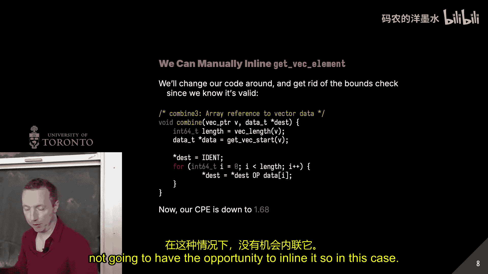

Since it's slightly complicated。

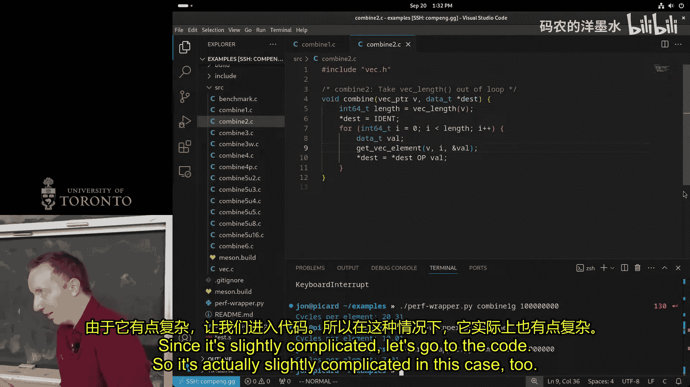

Let's go to the code， so it's actually slightly complicated in this case too。

So if we go to our V code。And if we actually look at， whoops， you can't see what I'm seeing。

 If we actually look at our giveck element code here， it actually does bounce checking and stuff。

 too。 So even if it did inline it， it might also inline that bounce check over and over and over again。

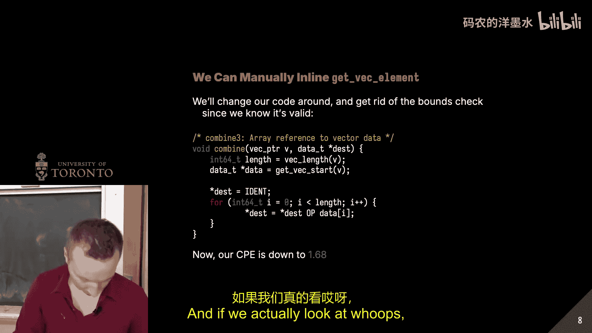

Which is。Silly in the combined example， right， in this combined example。

 is there a possibility where I go out of bounds？No， so even if the compiler inlined it。

 it still wouldn't get rid of the bounces check because。It has to be conservative。

 It can't just get rid of stuff Willy nilly， but we looking at it as smart programmers probably realize that。

 hey， every time we go through here， it is actually inbound every single time。

 so we can just manually inline it。 so this is the version that kind of manually enlightenlines it。

 so。I can just move the call to get the address of the start of the array out。

 so I'll just call it once to get the address of the start。

 and then I'll just go ahead and use an array bound。Like normally， so I'll just manually inline it。

So。When we run this， do we expect the speed up to be probably fairly good。

 since that's probably if we profiled this and like did the coverage and everything。

 that's probably the hottest part of the loop， right， So if we run that， let's see what we get at。😊。

Boom。So that was one of the major issues here。So。Pretty good。If should we just call the day。

24 minutes， pretty good。So we've already got pretty good， right， we started out like what，20。

And we got to 1。78。 So we got a speed up of like。Yeah， almost 12。Yeah，Do we pass the lab no？

So don't quite pass the lab， but you know， it's pretty good for a day's work， we can go home。

 collect our paycheck， feel pretty good at better ourselves。

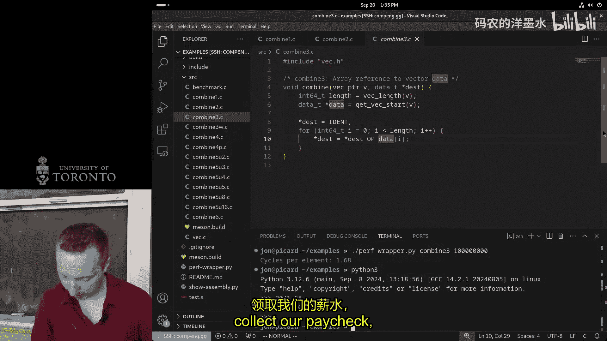

All right。Any ideas as to what we should do next。

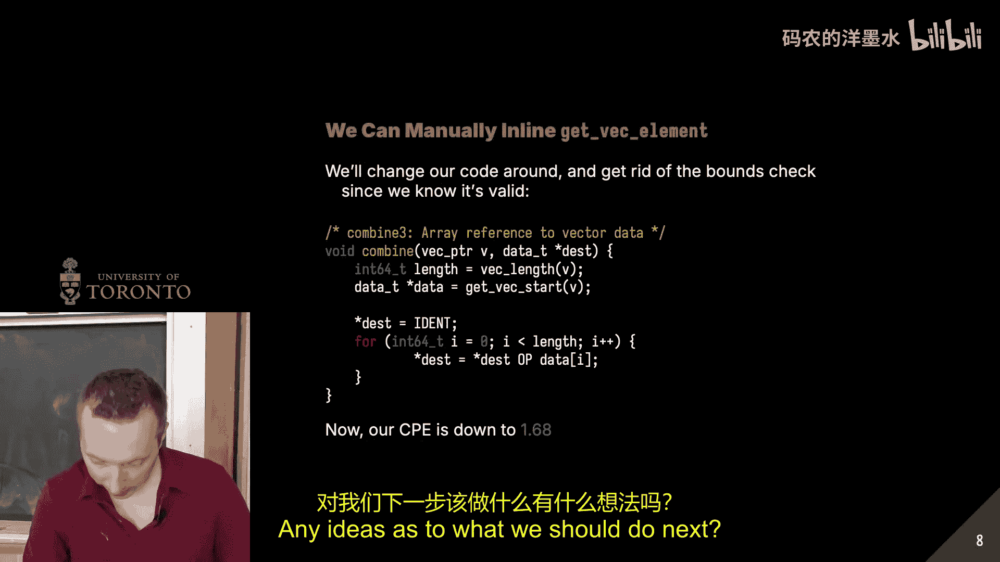

Yeah。Loop。It真系对 I。We can do like。Have more at。Do an op increments on ops。But instead。

The order doesn't really matter so we can do a few optionss together。変倒？Sorry。

 are you talking about loop unrolling then？Unrolling it。 Yeah， we could unrolling。

But before we even get into that， So here。One quick thing I notice is that， hey， this dust here。

We're updating it every time in the loop。 That's like a memory right。 That's probably slow。

 Can I get rid of that。Probably right， I can probably just create my own variable for it。So here。

I can go ahead and create a local variable instead of doing a memory rate every single time。

 local variables。Probably will actually get stored in a register at some point。

 even though they do consume memory， but the compiler more likely just to stick them in a register because。

 well， if I'm writing to a memory location， then your computer actually has to write to that memory location in case something else in your program is actually reading that address。

 but in this， I know nothing else。 I don't have any other threads and no threads for lab2。

 and we apparently have amnesia， we don't know about threads anymore。

 but the compiler knows about threads so。If it sees a memory right。

 it assumes that something else might be reading from it， so it can't just optimize it out。

 So another thing we could do is just create a local variable to store。

To store the identifier and every time we go through the loop。

 instead of doing a memory read and a memory write， we can just go ahead and optimize it。

OutSo we get rid of the reb。 We only do the right once a loop。This。Still is bad ish。

 because I'm still doing a memory write every time through the loop。

 But at least I'm not doing a read and a write every time through the loop。

 So if I just make that little change。That didn't do。 I didn't do anything。I almost werewo。

 I we're fourth you。 I can swear， right， It should be fine。

 So that change didn't actually do anything。 So that was a good idea。 didnn't actually do anything。

Can I move the right out of the memory right out of the loop completely。Yeah。

 I should be able to move it out of the loop completely， right。

 I don't actually need to update dust every single time I iterate through the loop。

 So before I start unrolling stuff。What I could do is just。Update that variable。

 update the local variable only every time through the loop， and then after I have my final result。

 then I'll do the memory update whatever it's done because while I can't change the actual like behavior of this function。

I'm slightly changing it here。Like I'm just not updating it every time through loop as long as no one was depending on that to update over and over again。

 then I'm fine I can make this optimization。 So if I run this one now， would we get 1。6。

Slightly better， but。Almost not as。Much as we would expect， right。

 we got to have a whole memory right each time we execute the loop and we only shaved off like a point。

Two cycles per element。So not quite there， but。We're getting。Deeccently close。

So another thing we could do。Is yeah， yep。Is the reason why I didn't。😔，Increasing。Yeah， yeah。

 basically it was cash the whole time。Or it could have。

Updating that memory location didn't interfere with any of the other ads and stuff we were doing。

 so pipelining is fairly effective here and caches were updating the same memory location every time。

 so actually didn't affect that much。So， yeah， someone else suggested， like， hey， you know。

 that array thing， array format。Might be a bit slow。Instead of having somewhat readable code。

 let's just make it incomprehensible。So let's just go ahead and use pointers and just do pointer arithmetic instead。

 so if I just add one to it every time AK I just take a pointer and do plus one to it。

The compiler will essentially do that plus4 you said。 so it will know the size of the type。

 Itll when it does the point arithmetic， basically， is's just adding for every time。

 because what you might think is that， hey。This pointer access or this array access。

 well it has to take the starting address and then it has to do a multiply。

 and then it has to do an ad to figure out the final address and has to do it every time through the loop if I change it to just be a pointer。

It just adds four every time D references， adds 4 D references， adds 4 D references。

 Surely adding4 is much faster than doing。Complicated math， like multiplying， right。

 So here is that version。 So we got one point。4， seven。Yeah oh no。

 it looks like our compiler is actually quite smart。 So just writing array accesses， I mean， one。

 your compiler turns out point arithmetic and if it's in a loop。

 your compiler is actually very good at that。 So this is an instance of just making our code more unreadable for no reason whatsoever。

 So we should just go back to this version。And this version is kind of where we stand now。

 So any questions about where we are right now。The four things start getting weird。Okay。

 so now we're going have to have some deep dives， so。

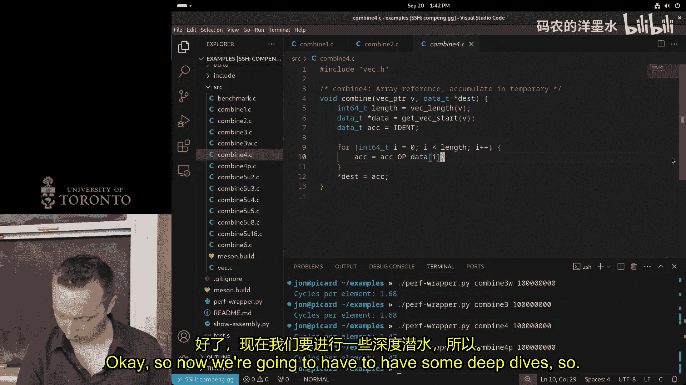

Here is our summary of results so far。 The names kind of suck。 But we started off with just。

Just our plain old code， not trying very hard， just trying to make it functional。

 compiling with a debug flag。 And we got 20 cycles per element。 Then， hey。

 it's time to start speeding it up。 Okay， well， I'll use O2。Okay， it got twice as fast。

 mainly due to better usage of my registers。Then as like， okay， well the length。

 I can hoist that out of the loop， do some loop invari code motion。That got me to 7。

 wasnn't that great。 The biggest thing was doing that inlining in the actual body of the loop。

 So getting rid of that give element， yep。Using out to。Yeah， so I think O2 right now by default。

 it compiles at O2。A。Yeah， Id。Technically， we oh no， I。

 I have to discuss it with the other instructor if we'll let you use your own compiler flags or we'll just o to it。

Id。I don't really have a preference， I don't really care。Because you can just。Yeah。

 maybe 03 works better for you， I don't know。But。So in this case， yeah。

 the inlining was the biggest improvement here。 If I just got rid of a write or an extra memory read in the body of the loop didn't affect anything。

 if I actually if I actually use a local variable instead of doing a memory write every time through the loop。

 I got a little bit of performance increase， not much。

 And then if I use pointers to iterate instead of doing array access， I got zilch， I got nothing。

So everyone okay with this。All right， pretty good， we're getting fast， we're getting speedy。More。

Kind of big takeaway from that part also is don't overuse pointers in C or C+ plus。 It's really。

 really difficult for the compile to reason about raw pointers。

That whole spiel I had before about aliasing and it being not being able to。

Create code that is completely optimized because it doesn't know if two things point to the same data or not。

Its default assumption is that pointers， especially in C and C plus plus can point literally anywhere。

 So it doesn't make any。Any assumptions about them， unless it does very expensive analysis。

 which would cause your compile times to actually just blow up。 So the basic guidelines here are。

 if you can use a local variable， Please use just use a local variable。

 The compiler can actually reason about the lifetime of local variables。

 it is in total control over them。 They only live for the life of the function， so。

It can actually reason about it and you will get much， much， much better generated code。

 So only use pointers when absolutely necessary。 I'm sure most of you probably just hate pointers anyway。

 so that's a good aversion to have so。The other part is， if you're updating any global state。

 only update it when you have to， the compiler will not get rid of any updates you make to global state。

 That is something you have to do yourself。 So if you don't have to do it。

 you have to reason about it yourself and just get rid of it yourself。

So the next thing we have is loop unrolling， so that's the compiler option。

 easiest thing to do is I can just F unroll loops and see how it goes。So。

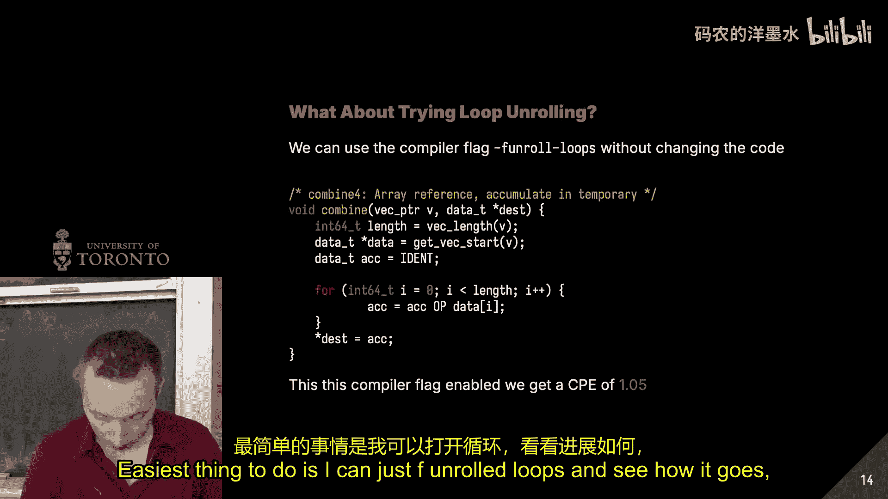

What did I call it， So all I did is I created another called。Combed for you。

And all I did is I added F unroll loops。So we can see- sorry，For you。

So I just took the code that shows here this combined four。And I just did F onroll loop。

 so I didn't change the code whatsoever， as added the compiler flag。So if I add the compiler flag。Hm。

Yeah。If we don't know the like back。Oh， that's a good question。

 So if I don't know the length that compile time， how is it able to unroll it。Well。

 we can go ahead and see what it did so we can check a little bit and see what it did。

 So let us explore。😊，So yeah， that's a good question to have slides。No， not slides VM。So here。

🎼Here is the assembly of just F unroll loops， and it doesn't know the length， right。

 It's from a function call， No way of figuring it out。 So let's see what it did。

 So here's the combined function。Bun of compiler directives。 We're pushing some registers。

 doing the calleea thing that everyone loves doing。 We're jumping if bad things happen。

 We're jumping a lot。We're doing some things here。Doing some things。

 We're just updating this over and over and over again。 So this is our unroll loop right here。

So for the most part， unless we jump into it somewhere weird， we're essentially one，2，3，4，5。6。

Then it compares， oh， and then just just a whole bunch。

So this is the main body of our loop in the case where。Nothing unusual happens。

 This is how many times it unrolled it。 So we have 1，2，3，4，5，6，7，8，8 times it unrolled it。

 And the rest of that code， the reason why it has all these labels。

Is that's essentially for like the remainder。Of the loop。 So if it wasn't divisible by 8。

 it would have jumped there and done the remainder at the very end。 So if there was， you know。

7 extra elements left， it would have done 7， there was only  five。 It would done 5。 There's four。

 It would have done 4。 So behaves the same， same way。

the main body is unrolled eight times until it has to do the remainder。

So any big questions about that。 So yeah， even if it doesn't know the bounds of the loop。

 it can actually unroll it a bit。 And by default， I guess it unrolled it eight times。All right。

 should we just take our performance and walk out？I guess we。I mean， I guess we could。

 but that'd be boring。So let's just experiment with a bit this whole course。

Even the results of doing this， I guess， has changed from year to year and from processor to processor。

 So we get just get to have fun with it。😊。

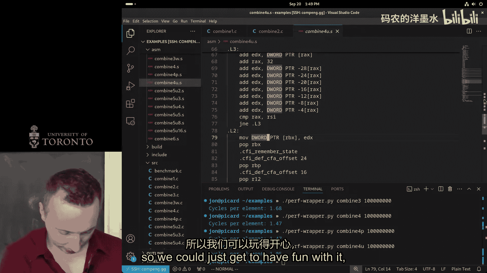

So。And this is where I'll show you what I did for the actual seeing the assembly。

CMake will do this too， but better build systems will generate this compile commands JSON file in that build directory if you haven't seen that before。

 and it will actually tell you every single compiler flag used to actually compile your programs which is very good considering you know C++ has defineds and stuff like that has anyone ever like tried to see the output their program they tried to compile it manually and they got a whole bunch of errors because things were undefined because。

They set some plugs when compiling that didn't exist when you tried to run it。Yeah。

May or may not have， depending on how much you try to monkey around with stuff。

 So I do this all the time， but I just use this。 So I actually get。

The exact compile commands from actually building it。

 So I'm guaranteed that I see the exact same thing every time。

 So I wrote the script for you that you are also free to take and use， as you wish。So， this。

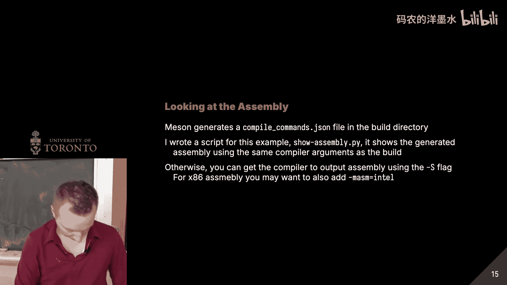

Is my fun little show assembly script。So my show assembly script will go ahead。

 open the compile commands thing for you。 This will be in my materials directory that you can go ahead and use and。

Basically， every single entry in there is every single file that gets compiled。

 And here for every single file， I want to see the assembly associated with it。 So I just。

Create an ASM。 And that's where I actually want the output。

 So I have to clean up the command a little bit。 So if I actually look at the compile command。

It actually will include like the actual dash C to generate an object file and the dash O to actually output the object file and then a whole bunch of these dash M flags which are used to generate the dependencies from the compiler that I don't need when I actually use it to generate code。

 so I have this little remove AGs helper function that just gets rid of them for me from the compiler command。

And then I can just add on。This dash S。 So if you want to see assembly output from your compile compiler。

 instead of dash C， you do dash capital S， then it will generate assembly for you if you want。

 you can do dash。There's two flavors of assembly。 There's like the unreadable A and T syntax that looks like vomit。

 And then there's the Intel syntax。 that is somewhat readable for X 86。 So if you want Intel。

 You can do this。 If you want vomit， you can leave it out。 if you want Juple， you can do that。

 if you want LVM， You can replace the compiler with clang and generate LVM。

 You can do whatever you want here。 And then it just generates it for me。 So I run this script。

 spits it， spits all the files out for me in this ASM。

 So that's how I generated all this really really easy， make sure that all the flags were consistent。

 I didn't have to use object dump。 I didn't need to use anything。 So since we're going。😊。

Fairly low level in this course and our compiler is the thing that's generating our code。

It's good to know how to use our compiler。Not half this course。

 but it feels like half this course is like just。Knowing how to be friends with your compiler so。

If anyone， yeah， if you know someone that has worked on a compiler。

 thank them for their work because yeah， hard stuff to do。 So that is that。

 So you can run it manually， I suggest you just take my script and just modify it for your own liking or doing whatever the hell you want with it。

 I don't know， I wrote it。 you can use it for whatever you want。

 I don't care or you can just feel free to ignore me and just not look at assembly and look at the object dumps all the time and。

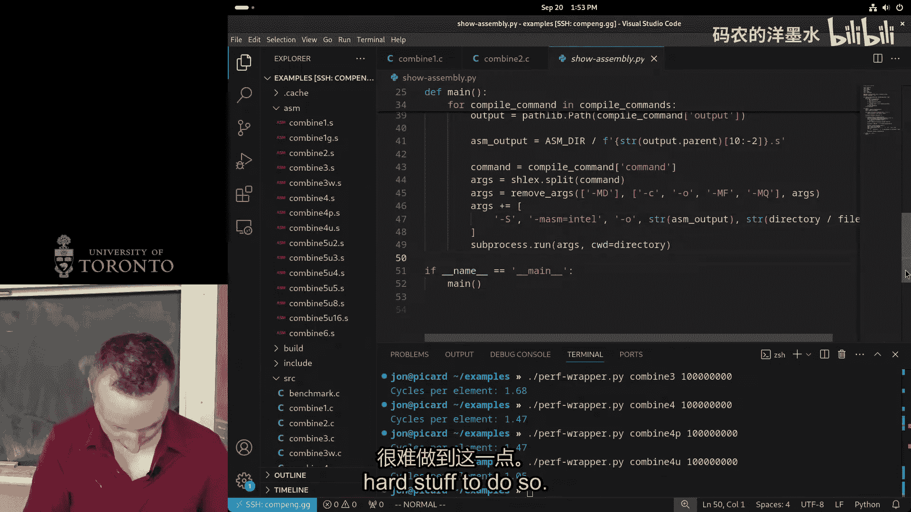

Scroll through stuff again， up to you。So that's just my recommendation for you and more stuff I wrote for you。

So yeah， here， here is my， oh， yeahep。メア mess。The object。So the question is， what。

 what's the difference between the。Object dump assembly and then this assembly。

 so this assembly will have all the directives and only give you the assembly for the functions。

 not any other crap with it。So it's a bit more surgical in that way and I can just。

If I want to modify anything， I can just modify this command and see what the difference is without having to recompile literally everything。

So just a good way to go about things。 But free to use object dump， if you'd rather use object dump。

 and then you don't see all the compiler directives or anything like that。do。Alright。

 so here was the body of the loop unrolling， it unrolled it every eight elements seemed to work all right。

 we got a decent speed up so we got what we got down to like one almost one cycle per element。

 which is pretty good。 we're not like superscalear， so we're not doing like two things a cycle yet。

 but we're down to almost one。

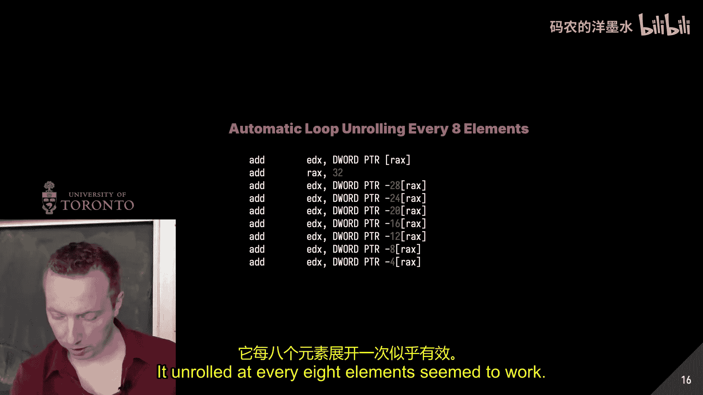

Which seems pretty good。 We're like fairly linear。

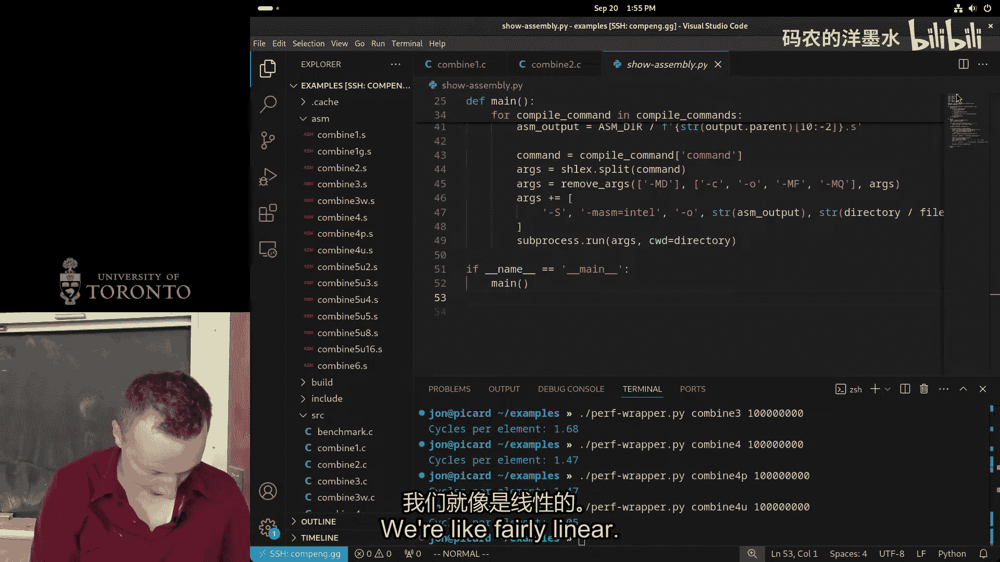

Let's see if we can do a bit better， so。Before that， we can talk about。Briefly。

 some assumed CPU capabilities， so some instructions。

Like we said when we had pipelining and a order and everything like that。

 some instructions can actually run in parallel。 like for instance。

 I might be able to do like one load， one store， and up to two integer operations。

 one in a branch and then one floating point operation， one floating point multiplication。

 all at the same time。 So if I can actually overlap them。

 then that's part of my superscalear and actually。Executing very， very quickly。So。

Most of these things remember pipelining is our friend。

 Most of these things can be pipelining so here are typical latency and cycles basically for this example we're pretty much doing loads and stores and ads the rest of the numbers are just。

Pretty much there， so you have it for your reference。

 we won't really pay attention to them that much， but we'll try and argue about it a little bit。

So first， before we start arguing about it a little bit， let me show you some more code。 So let's。

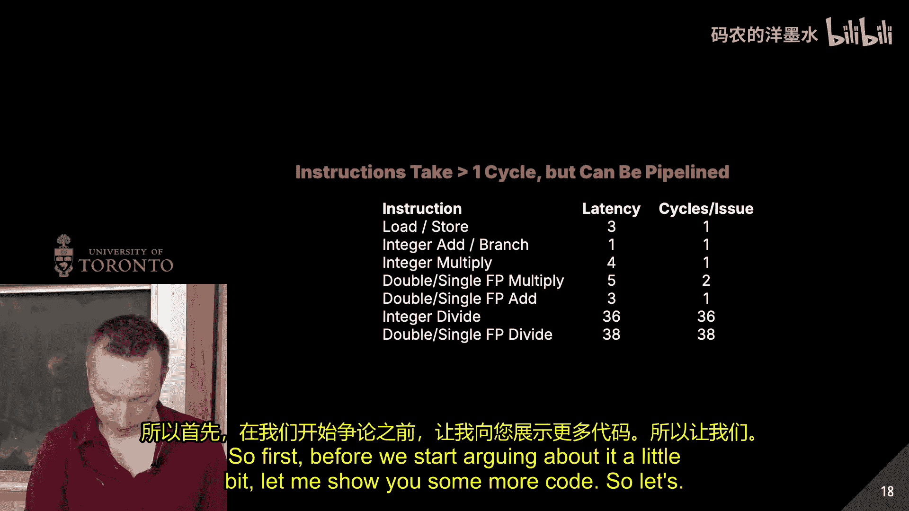

Let's try to manually have some loop unrolling。 So if we manually unroll the loop。

 it looks slightly ugly。🤢，So we have to take care of the remainder and everything like that。 So here。

I call it batch size。 I don' know， from machine learning stuff。 I don't know why I call it that。

 But this is how many things we'll just do。In the body of the loop。 so I have my batch size is2。

 and then I have to have a limit， so I make sure that hey。

 I actually go every two elements and don't go over。

 So I set my limit to length minus batch size plus1。 You can argue about。It's correct。

 You can verify yourself later。 And then here in my for loop， instead of going up。By one。

 every time I iterate， I go up by batch size。 In this case， it's 2。 So in the body of the loop。

 I should be just doing two things at once。 So these are my two operations at once。

 And then I fix up any remaining elements at the end。 So I'll just。

That's why I didn't declare I here。So I let I stay the same so that it's starting out at the remainder of the element。

 So I would just have a little fix up here that just。Fills out any of the remaining values。

So this is me unrolling my loop manually two times。嗯。So if I run that。Was that supposed to happen？

Sometimes I hate this course。Allright， was that supposed to happen， Alright， let's see。

 So let's see what happens when we unroll it three times。

So if we do the same thing and enroll three times， it does the exact same thing， fantastic。😊。

That's not supposed to happen。We're really gonna do this。 All right。

So this is supposed to be slightly slower。It was slightly slower up until what， like an hour ago。Wow。

 that ruins a lot of things。Let's assume that was slightly slower， manually unrolling it twice。

So the reason why potentially that might be。

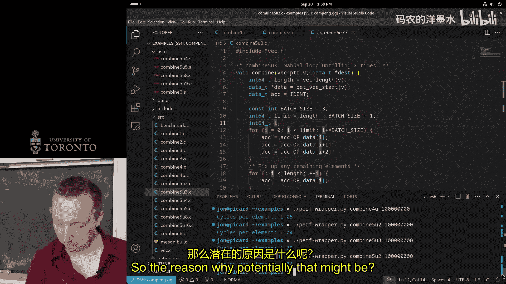

It's because of this， so every time we actually are updating a single element。

If we just care about the load in the ad， this is what it looks like。

 so this is just doing a single element， so we're loading data I and then that takes three cycles based off that chart before。

ops this takes three cycles based off the chart before and then the ad comes in and it only takes one cycle after that and because it needs the output it has to wait for the load to finish。

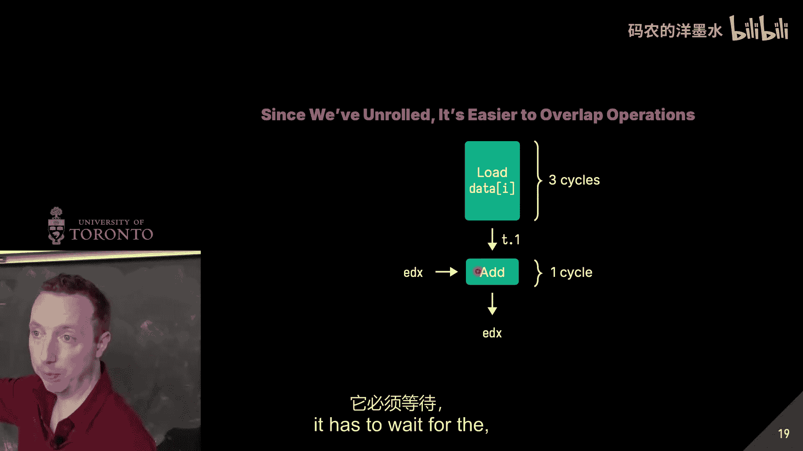

So the reason。The reason why it was not supposed to be as fast。Is because， well， if we have that。

 so say we have our load that takes three and then our add， so this is our load， this is our a。

 and because we have pipelining right in just one instruction later， we can start the next load oops。

We can start the next load that takes three cycles and then the add。Something like that。And。

That's good。 We can pipeline these because the loads are independent。

 They're different memory addresses。 so we can go ahead。Pipelining works great with them。

The reason why sometimes this should be slower is because the bounce check happens。

 so the bounce check actually has an ad here。And then it does some other things and does the compare and things like that。

 But because we only unroll two times。When we pipeline everything。

 we actually aren't using all of our hardware we can， so this has the loads， this has the ads。

 this is the next one。Load。And。Then we have that。Add the rest of the things。

So if we look at any kind of vertical slice here。Based off that。Chart。

 if I was using this processor to its full capabilities。

 I could actually do two ads at a single time， right， But if I look at this here， I'd have。

Sometimes I get lucky in this line I don't overlap the ads。

 so I'm actually kind of leaving some performance on the table， but if I look。

 I guess not that one either。I guess if I draw that， yeah， there's no overlapping here。

 So this ad doesn't overlap with anything。 This one doesn't overlap with anything。

 And I'm just kind of leaving performance on the table because my ads aren't overlapping。

 So if I do do this and I do。3， like if I manually unroll the loop  three iterations。

 then I actually get more overlapping where I can actually do two。

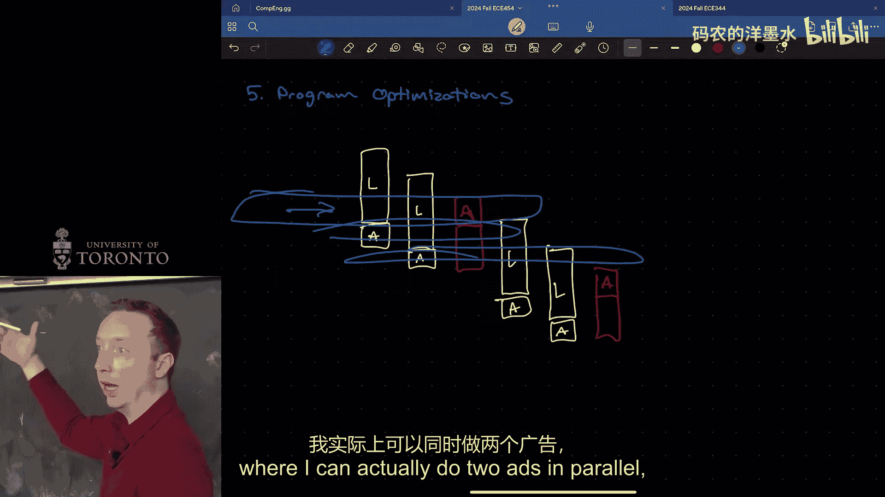

As in parallel。 And I actually use the hardware a bit better。 So that's what was supposed to happen。

 Two was actually supposed to be slightly slower than 3。So in this case。

 apparently they were the same， which isn't great。Yeah。再始我。Unrolls it twice， yep。かそです。For the twice。

 okay。Okay， I think this one。 so let's double check。

 So this is two batch sizes2 in the body of the loop。 I just have two。For three。

B size is three in the body of the loop， I have three。So should be doing the same amount of work。

In fact， I get the same cycles per element because。Yeah， doing it live， of course I do。All right。

Any other suggestions to make this go faster，系要收下。No， so I disabled the compiler flag loop onrolling。

And I'm just doing it myself now， yeah。But， you know， performance was what basically the same， right。

So what was it called forU？So compiler loop unrolling， pretty much the same as my loop unrolling。

 technically two was supposed to be a little worse than three， but did the same as three。

So any other ideas how to improve this a bit more？Yeah。Some power。Yeah。

 memory magic may some power of two so if。If3 is better than 2。Should be。

 if three is better than two， surely four is better than three。So let's look at the four version。

I did batch size 4， and I added a fourth one here。 Everything else should just be the same。

 So let's run that one。 and I'm sure it will change because I'm standing here trying to do it live。

Hey， four。Wow。I'm not actually sure that was supposed to happen。 It was that supposed to happen。 No。

 that was supposed to happen。So four， much better。Okay， well。

Maybe there's some magic with top powers of two， or maybe big number is bigger or good。

So if4 is good。What about 5。So batch size of five should five be better？

Bigger numbers are always better， right， so let's go five。Yeah。Big numbers， not better。

Any other number that would be better。Yeah。Eight。C 8。So let's unroll this。

Now we're starting to look hella ugly， but this is kind of what our compiler did for us all right。

 so batch size is eight， and I unrolled it eight times in the body of the loop。

My fix up still the same， so let's go with eight。Whoa。All right， next power of 216， right？

So here's our 16。Now we're writing code。So， so。So this is great for job security， right， if you're。

 if you're。If you're rated by number of lines of code。

You are both increasing performance and increasing lines of code here。So 16， let's see what 16 does。

SlightSlight better again but。Fairly inconsequential， but hey， it was slightly better， yeah。

We didn see。Oh yeah， that's a great question。😊，The compiler doing loop underrolling basically did eight。

 right？Wecounted， it did eight。If I want to see what the hell， why the hell was this so much faster？

What do I have to look at？The assembly。All right， so let's remind ourselves of the grossness that is their loop enrolling。

So the main part of their loop on rolling was here。 right， It was this big thing。

Looks like loop unrolling to me，8 ads， you would assume。Eight ads。Let's look at what we did 8。

 we want to look at。So here is our combined manually unrolling eight times。

So a whole bunch of crapoo。There's our main body。H。What in the。What in the hell is that？Yeah。AVx。

Kind of issue。 I that。SSE， so those are more instructions they。Yeah。

 is it like hardware that can do vectorized processes？ Yeah， so these this is special hardware。

 Let's say， where's my slide for it？

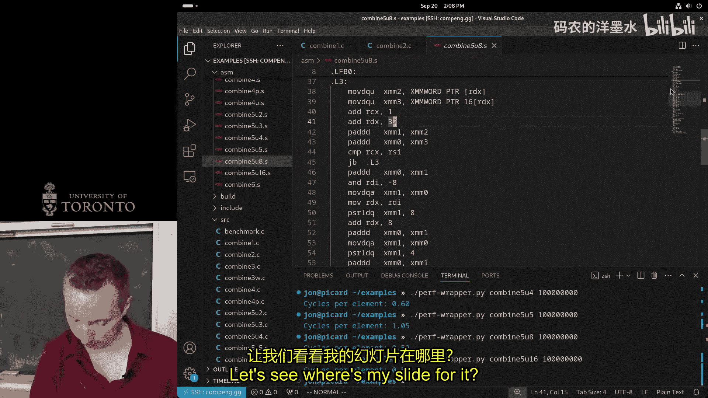

So。Four times or eight times， it's all better。 If we look at the assembly。

 we see these magical new registers come out of the woodwork。 The X M M1，0 never saw those before。

 It was just using whatever register。 What register was it using before It was using。😊，呃。Yeah。

 it was just using， go back V， It was just using。

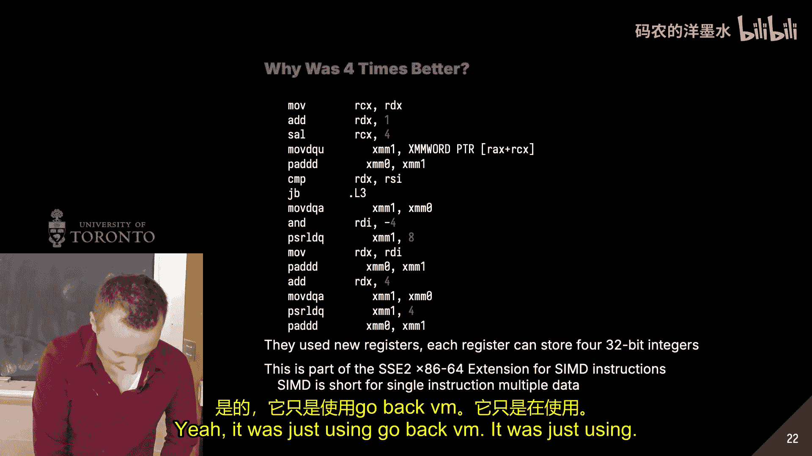

EDX over and over again， but now。

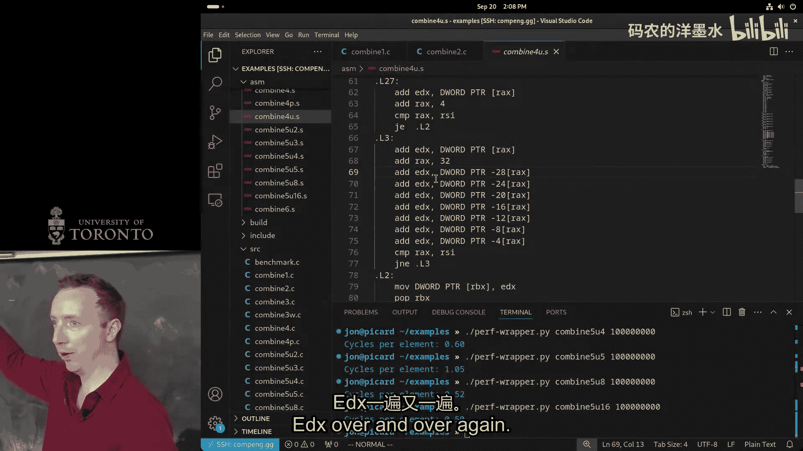

It's using these magical XMM1s， so those are a CPU extension that is actually fairly， fairly old。

There's more hardware on your machine so that one instruction can also do multiple things in parallel at once on the hardware。

They have new registers， if you actually look at the documentation for these。

 the size of each of these registers is 128 bits。That means it can fit。4，32 B ins in it or。You know。

 two。Doubles or for floats or whatever。And they have special instructions that will actually do them all in parallel that will actually do the addition of all four in parallel。

 So that's what this P oh it looks it looks so ugly though P add So they have their own instructions。

 They look super ugly。 But this is basically moving the values from all four of them at a time into those registers。

 And then eventually they go ahead and this is the main ad here。 So they move again。

 And then this isop this is the one we're concerned about here。 This is the parallel ad。

 So it does four at a time they're all in parallel。

 And that's how we get our nice superscalealar thing。 So we got below one cycle per instruction。

 which means we're doing things in parallel on our hardware without actually using threads or anything like thatep。

Why didn't the compiler do this？Ah， that's a good question。

 why the hell wasn't compiled smart enough to just do this when it manually enrolled the loop。And。

Number one， I don't have a good answer for that number two。I。

Probably because they haven't thought of it and it unrolled in a very weird way where it first accesses the first element and then the last one until the second from last。

 and this is a very unusual pattern that it could not detect and therefore it didn't know that it could actually vectorize this so it just unroll it weird。

こ just。Yeah， nope， that was just  O2。Yeah。OhThat's a good question。

 So how does the compiler know that your machine actually supports SSE。

 So that version of SE is old as hell。 So your compiler， you know， your compiler has versions of it。

 They'll assume a minimal set of hardware。 Turns out SSE has been around long enough that。

Any modern ish， even like 30 I forget what their cutoff is probably like a 30 year old processor。

 30 year old processors had that。So。It will by default， use it。

They might have to do some magic if some you could compile some optional support if the machine doesn't have that and like try and fake the instructions and things like that。

 I think that's typically what they use but。Yeah， so you can generate stuff like this。

 There's probably new instruction set。 So if we remember from before that M arch flag。

 if we want to use。Our processor to use all the extensions， use as much as possible。

 we can actually use that M flag so that matches our hardware。If there's lesson than eight。

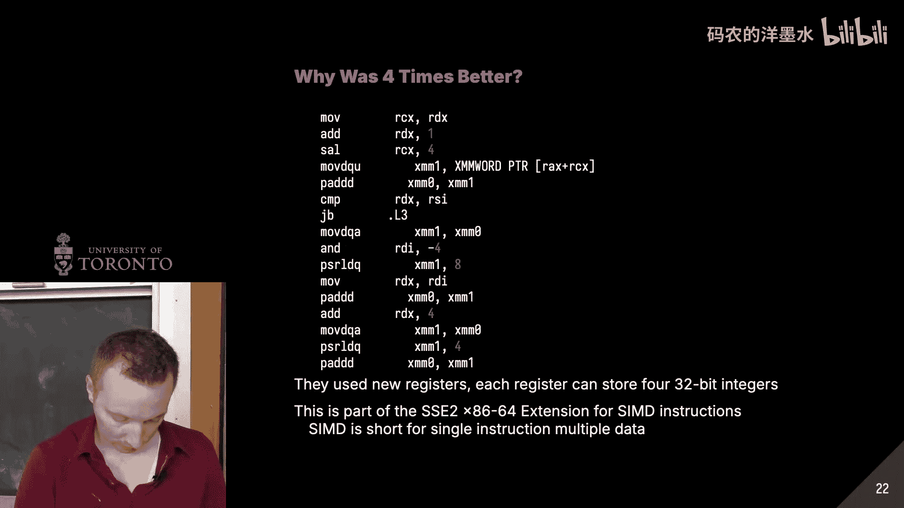

Yeah， so when we had like lesson8， that was like our fix up loop there。So if length。How bad is it？

Compilr does the same thing。 basically does it does it ugly with switch cases and stuff， though。

So it basically takes a mod at the end it well， doesn't take the mod。 It just， you know。

 does some bit mask and throws it to a label。 And that that's what all those labels were there。

 So it essentially just threw it there so that it just fell through。

But it essentially does the whole thing。 It does it as a switch case instead of a loop。

 but turns out since it's just the remaining elements。

 doesn't matter if you do a loop or a switch case or whatever， that's just slightly more readable。

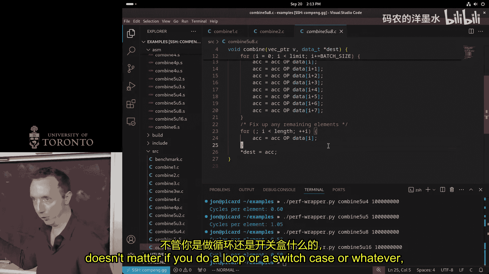

All right。That CD， great concept for performance， so that stands for single instruction。

 multiple data， so that's you we're loading multiple multiple data up into that register so that we can actually do four things at once in a single instruction so。

Pretty much all hardware has that now。 So a good thing to do is if you're doing computations and stuff。

 make sure your compiler is actually using that hardware and generating those instructions， yeah。

Is Cindy basically what youP？I a bigger。Yeah， so CMD， basically GPUs， but GPUs。

 instead of doing four things at a time， they'll do 256 things at a time。And。

There's some slight differences。 We might get into some GPU programming at the end， time pending。

But yeah， GPUs basically do this at a way larger scale。

 but this is what you can do on your actual CPUs。All right， so yeah。

 this was loop Unrolling eight times actually generated that， used more S2 registers。um。

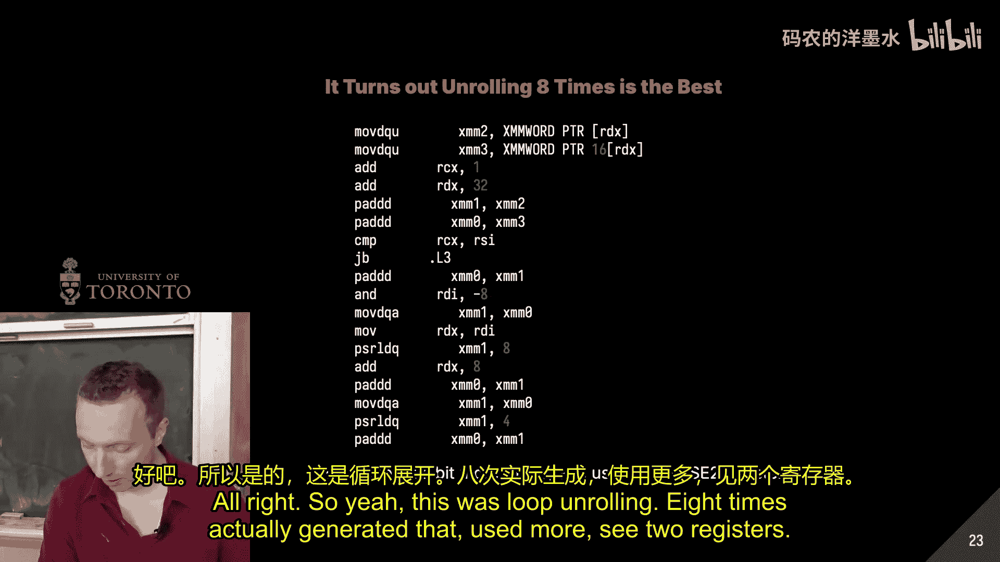

Yeah， another thing we can actually do。Is this is how you would have to do it back in Y olden times。

 so in E olden times。Back when I got these slides， the fastest thing to do is they had to argue。

 So if you actually look at the order of operations， if you do this， right。

 you have like your accumulator， whoops。And this is also。A cautionary tale of doing something clever。

 it might be clever at a time and then your compiler might get smarter than you later。

 so what you could do is notice that like hey， in order to actually calculate this。

 you know I have my accumulator， I have some number there and then I have my array element I have to add them together to get a result。

And then once I get a result， right， I do the next element and do that。And then the next element。

Add them together。And do that right， so I always have a dependency chain here where I have to wait on the result of the previous operation or in order to make progress。

But since we know math， some of us。What's the word for changing the order of operation without actually affecting the result？

Anyone remember their math terms。Algebra， nope。It's a property， yeah。Associivity， yeah。Transitive。

 I don't think it's transititive。Yeah。Comummutative， right， I think if I said that wrong。

 I probably got wrong too。 But basically， if you change the order of operations。

 you get the same result。 So here。By default， this is all left associative。

 if you actually use your compiler and you write a whole bunch of stuff the way it'll parssea is always left associative。

 but yeah。顶。Write our program。Yeah， we wrote it to be generic for operations but。Yeah。

 if we have a non commmuted， I think it's commut， but if we have a non this property where we can't change the order of operations。

 yeah， then we might be screwed， but if we just do add， so add should be okay。

 multiply should be okay， right？Although。Yeah， so if we multiply two things in different orders。

 you should get the same result， right in math。Yeah， so that is true in math。

Not true once you're dealing with floats and doubles。

 because there's only a finite space so the order of operations between floats when you multiply actually matters。

So。That's basically， remember that F fast flag and like disregard standards do whatever。

 that's basically what it'll do。 it'll just destroy the order of operations just to make things faster。

 which will actually change the results from multiplying with floats。Actually。

 adding floats also does not obey that property， buts actually inters't technically okay either because of overflow。

Isn't our life fun？Or were no way they might still be。 I think they still are， anyways。

In this problem， if we assume that we could actually do things are commutative。

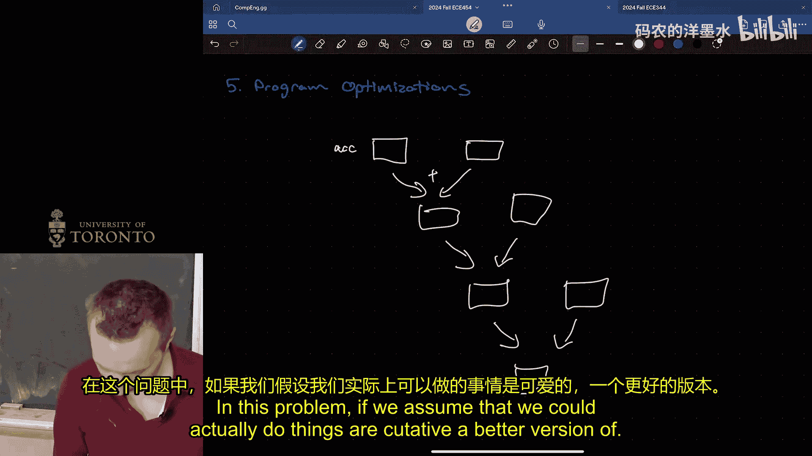

A better version of。A better version of this that could do more in parallel。

 That is not the right thing。 A better version of this that could do more in parallel is if we。

 you know。

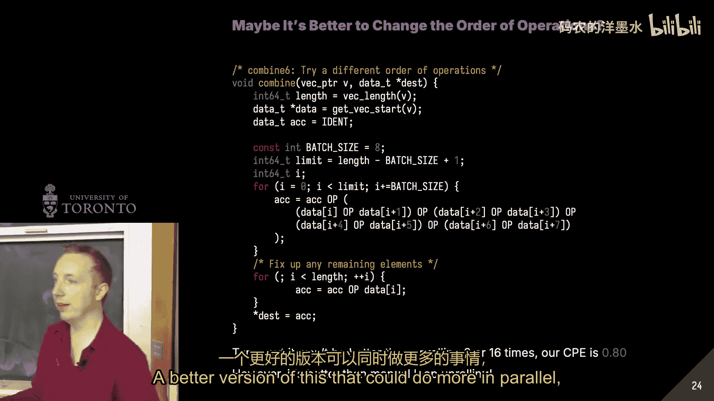

Just tick。Sa， screw the accumulator， just take。Two of the operations and just add them together。

 And since they're all independent， we can take another two at the same time and add them together。

And we could double this up if we wanted to or do whatever， and then take these numbers。

 add them together， and then we could eventually just add it together with that accumulator。

In a final step to get rid of。In this case， not one of the levels。

 So we have to probably go up to 8 so we can actually exploit some parallelism and get things faster。

 So if we actually。Wanted to try and make this faster by telling the compiler that hey。

You don't have to do left associative。 We can just do different orders of operations is we might be tempted to try something as ugly as this。

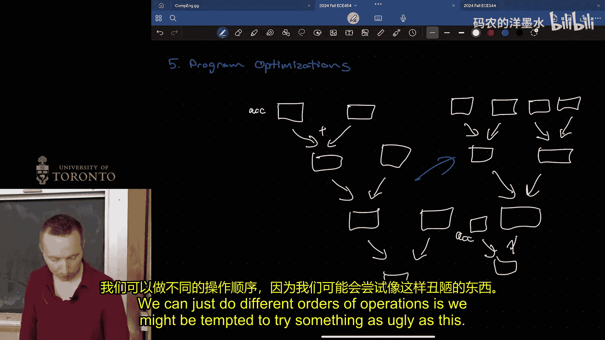

So this is me manually grouping， so I enrolled it eight times。

But instead of just doing all the operations at once， I put brackets around stuff。

 So here I was like， hey， you can do the first two just by themselves and then do that operation after doing the operation on the next two and then put brackets around here。

 so I'm forcing the precedes to change the order a little bit in order to make sure things are more independent。

So。If this reasonably might make things faster， it might not， who knows。🤢，This course。

 we always have to try things。 So let's try things。 So if we， we can see that。If we try that one。7。

Not as fast as the。Vectctor1， but it's actually faster than let's see the manual or the compiler loop unrolling。

So it's actually better than the compiler loop unrolling。 And then you might immediately think， well。

Maybe my compiler is smart enough to actually do those SSE instructions or anything like that。

So I can go ahead and I can actually look at the assembly again。

 so if I look at the assembly for this one。It becomes a bit more interesting。

So here is the assembly for this one now unrolled。Anyone spot the major differences of this one？Yeah。

で不の我。Yeah， different order of ad operations， what's a bigger thing that might stand out here？

So here let me switch back to the manual or the compiler one。So here's the compiler one。

Take special note of the registers。 How many registers is it using here？Uo。

How many res is you using here？So it's using。ED， E C， E D，E E and over。

 so it's using another register here。If I had。More in that first step it might use more registers here。

 but because of that using another register， it's actually able to better pipeline this because it's not waiting on that dependency。

 so this actually gave us a bit of a speed up changing our order of operations。

But funny thing about this is。Before vectorizing instructions。

 this is pretty much the best we could do， but your generated or your actual C code looks like this。

Which looks ugly， and then if someone goes and sees this and then touches a bracket。

 they destroy your performance and then you yell at them。And bad things happen。

 but if you just wrote it normally， normally ish， and you just wrote this easier version to read。

Then turns out。Once the compiler improved， this version was actually faster than the one you spent manual effort in。

The big takeaway here is just because you write something once and it goes really fast and it's the best option at the time doesn't mean it will be the best option of the time forever。

 compileilrs evolve。 They get smarter and generally the more straightforward code you write。

 the easier it is for the compiler to reason about it so。That's why， this course is fun。

 You're constantly fighting with your compiler and constantly evolving and trying to change and figure out what the hell is going on。

Big companies will have their own。Yes。Some standard language。Internal py。Yeah， well， some。

 some different tech companies will make sure that， you know。

 they have a very homogeneous machine and they'll only update every so often。

 then they'll just do very， very specific targeted performance improvements。 So， you know。

 runs the same on everything。 because even generation to generation performance characteristics change。

 And that's why remember that poor guy that turned into goose farmer。pretty much that， but yeah。

Companies will have their own versions of languages and things for a whole bunch of different reasons。

 this is one of them。Unroll and also。same time。I manually enroll and change the order of operations。

 that's what I did here， right？Yeah， this was also unrolled eight times。

 and then I changed the order of operations。But。Yeah， that's the fun part of this course。

 Things constantly evolve。 They don't stay the same， and they make you want to rip your hair a bit。

 especially when you do demos live， yeah。That the machine。To add operation。Yeah。ありが。

Take an advantage。Yeah， so when we talked about doing two ad operations at the time。

 that's what loop Unrolling helped us do。 So since we unrolled it。

 we were able to actually overlap and do two ads at the same time if we unrolled it more than three elements。

In this case。Although it didn't quite work。But yeah。

 that was the whole point of the loop unrolling so that we can actually use two ads at the same time and it helps with their pipeline a bit more。

So now if we run everything， we can see our how far we've come in today's journey。 So we started。

At 20 cycles an element， then we got to 10 by just adding debug or by adding optimization。

 then we hoisted some stuff out of the loop， we inlined arrays。Then， we。Got rid of our memory rights。

 And then we started doing some unrolling。 And then our rolling was。Better at4。

 because it started using those S D instructions，8 was actually better than 4 because it was able to you know。

It wasted some time actually loading those big ass registers。

 so eight was better than four just because it was easier for it to go ahead and load those and then you know eventually 16 was slightly better。

 not super better， but we got down to like half a cycle per element while back in the day。

Before we had those vectorizing instructions， combined six would have been our best one where we did a different order of operations to try and overlap the ads a bit more。

 but now we got this one。We started at 20， we got to 0。5， so we did a 40 x on first year code today。

It's pretty good， yeah。Generally。It depends like everything， this course， it depends。 General， yeah。

 powers of two are good because computers are typically powers of two。😊，But the pens。

 you could have really weird hardware or whatever。Whatever that that weird place was a PlayStation 3 that had like nine or something。

 that's like a number they used depends weird processors。

 Yeah that's also why video game consoles refresh every like。

Seven years because they optimize for that， they don't want a target that keeps changing is there a we can still take of the floating point a by？

It number。Having the process。Ty price hydrs。Changing this to a float or if I did。な。9 and。pointな。

スクレンキャストで。Yeah， but like with every answer， I get to say it depends。 and it's true。 So depends。

 And the law， the like machine learning stuff for performance。

Most of the things they do is just try and make the float smaller and smaller and smaller because it's faster。

 they can cram more things in together。There's some things that， you know， some models。

 they try and make it smaller for inferencing， they like do like an eight。

Or like a was is it like an eight bit float？And they're like， oh。

 let's see if this works because our performance will be better。Fund systems， AI stuff you can do。

 too。 But that's kind of what they do。So yeah， here's our summary of today for our loop androlling。

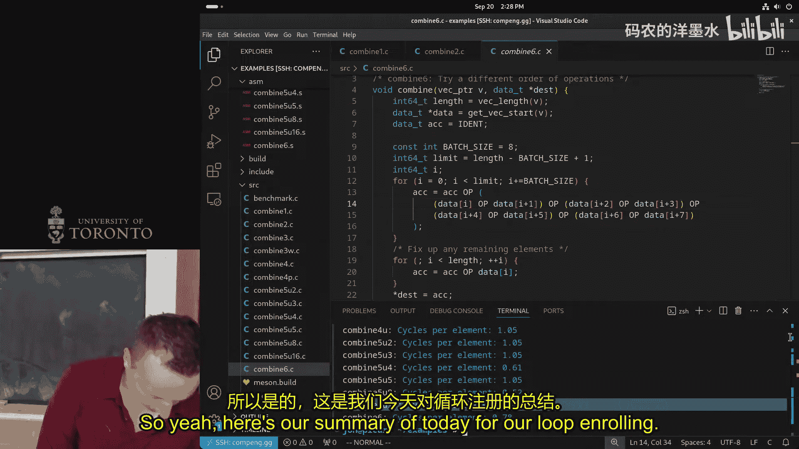

It was supposed to look like this for two was slightly worse。OfC it didn't。But。

It should have looked like this where eventually， you our best thing was here when we got to the Sim。

Unrolling 8 verse 16 didn't matter that much， it's kind of just in the noise。So。

Some of the biggest optimizations will come from domain specific knowledge。

 So this is specifically for lab 2 and in general， so your compiler doesn't understand what problem you are trying to solve。

 So knowing what problem you are trying to solve in understanding that problem is a large part of the battle。

 for example。If I was computing the product of all these elements instead， what is a very。

 very easy domain specific optimization I could use to actually skip all of the calculations if I knew certain values of the data。

 Yeah， Yeah， if there's a zero in it， the result is0。

 why bother multiplying So your compiler will never do that for you。

 you have to do that because you are applying your。😊。

Human or good AI version of the knowledge to actually。Exploit your problem and simplify it a lot。

 So like in lab 2， it's image translation stuff。 right。

 A bunch of those probably cancel each other out。Will your compiler know that， no。

 well you probably know that， hopefully。So。Like。And that's honestly like half the some of the performance stuff is like that low level look at the assembly figure it out。

 the other half of it is this higher level like understanding the problem。

 seeing if you're just wasting time doing things things that the compiler will not be able to optimize out for you so that is a lot harder to try and teach you because again it depends on your specific problem so there's。

Nothing I can say other than you have to also understand the problem you are trying to solve because that is the other half of the performance equation。

 So that is why we have labs where we get you to do things。

 So it's important to understand what it's actually trying to do here。So more takeaways。

Always profile， make sure you're optimizing the right thing， right， We made things really。

 really unreadable。First， good to get the most of your compiler before going manual。

 I'll try and show you some more tricks we can do that would have saved us a bit of time here if they work before actually going manual。

 whenever you go manual，You， you create， you inevitably create some fairly unreadable code。

 so whenever you' manually optimizing something， your code suddenly becomes a mess and then you become very protective over it because you're like well I spent。

I spent the last four weeks optimizing the stamp function。 You stupid intern。 if you touch it。

 I will。Insert words here。So do not touch this， you will ruin my code， it is like that for a reason。

 and yeah you'll become one of those people， so other takeaways limit the use of pointers。

 prefer local variables。Like using pointer based arrays and pointer arithmetic doesn't make anything faster。

 your compiler is really good at it， that's pretty much its like main purpose。

 try to avoid using function pointers and virtual functions。

 virtual functions are actually pretty bad。Despite what， you know， any Java developer might tell you。

 don't listen to them。 They are absolutely nuts。So don't listen to them， virtual functions。

 if you can avoid them in C++， avoid them。They bring point arithmetic。Function pointers。

That really hard to reason about if you have like highly performance critical code。

That's when we have to zoom in at the assembly， make sure it's the assembly you might even have to open up your processors。

Manual and see what it supports， make sure your compiler is actually using those instructions。

 you might have to play around with the compiler， you might have to play around with the code。

 you might have to play around with both， and you should look for those like instruction parallelism capabilities of your CPU if they have it。

Pretty much every single CPU in the planet， no matter if it's R X86。

 whatever will have something that supports something like that。

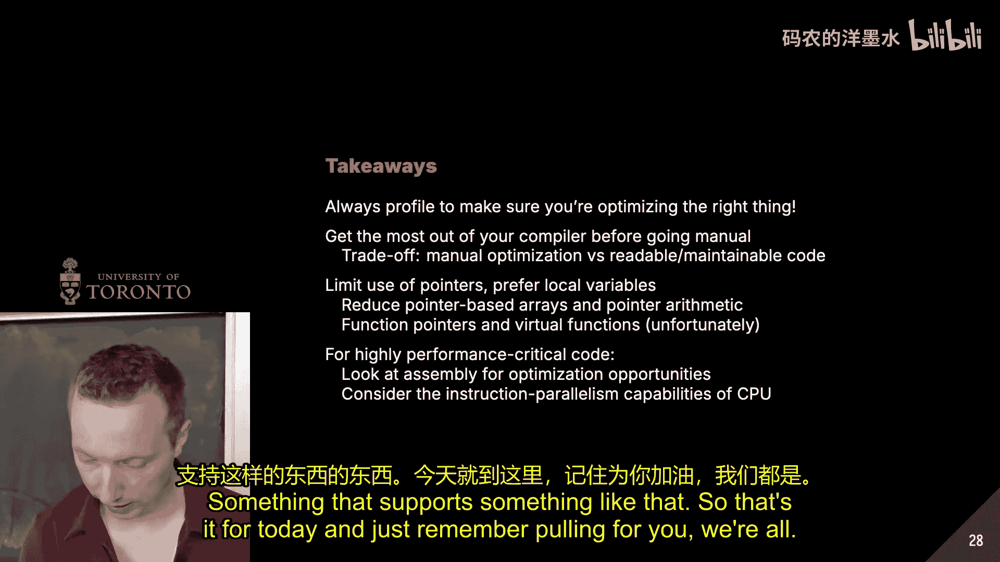

So that's it for today and just remember pulling for you。

