# 【全集】多伦多大学 C语言高性能系统编程实战 中英字幕 1080P p06 Lecture 6 - 高级编译器使用 -BV1oDrZBZEG2_p6-

我非常贴野 real life。

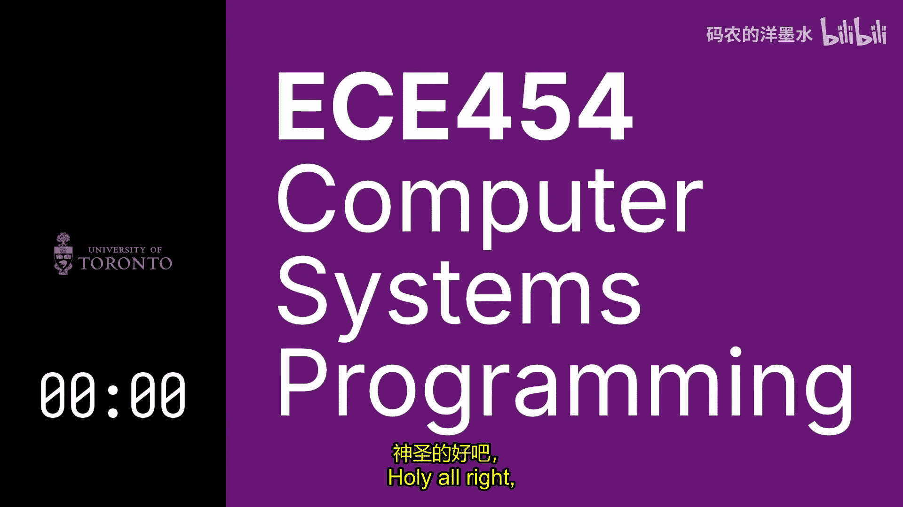

Allrighty oops， that's the wrong thing， welcome back to four， five， four。

 whatever the course code is。

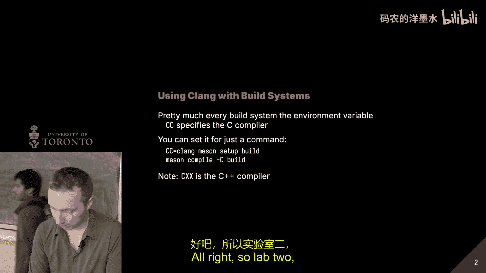

So today we are doing advanced compiler usage。ButHoly。All right， come on， let's go， all right。

 so lab two。So lab two， over the weekend， I have worked。

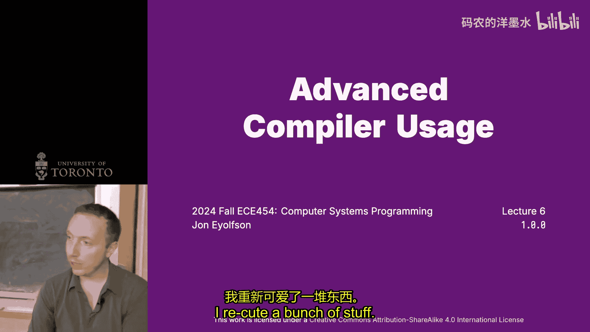

Relentlessly， the leader board now is working。 I re queueed a bunch of stuff。

 So I'm still going through some right now， but it does work。If you haven't seen it yet。

 it looks like this in all of its glory。 So let's refresh see if there's anything new。 No。

 nothing new， so。😊，Leader board works。Your timeout on those machines are five minutes。

Q currently has entries， like it's going through a backlog。 But if you push your code， now。

 if you push your code on any branch， it will work。

 It will run on this and then show you your speed up。So if I was a student。

 if I pushed it also shows at the bottom all of your pushes and then your individual speed up for every push so you can see how your changes affect anything。

 It won't delete it。 The leaderboard will now take your best result。

 instead of your most recent result。 So fix that。 Yeah， it turns out I sucket programming。

 So that's good。 So leaderboard works， go ahead， play with it。 It should be lots of fun。😊。

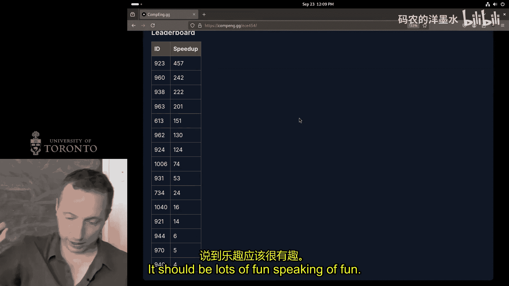

Speaking of fun， yeah， today， advanced compiler usage so。We agreed me and the。

 your other instructor agreed for this lab。 We will just do O2。

 and that will be your compiler flags for running on that。You don't get to play with compiler flags。

 the last lab you get where you get to go hog wild。Where you get to go crazy。

 you can do whatever you want， but for this one will constrain you with compiler flags because I'm going to show you insane compiler flags today。

 So last lecture was the baby course， this one is the advanced one。 So live demos went so well。

 I decided to do them again today so。

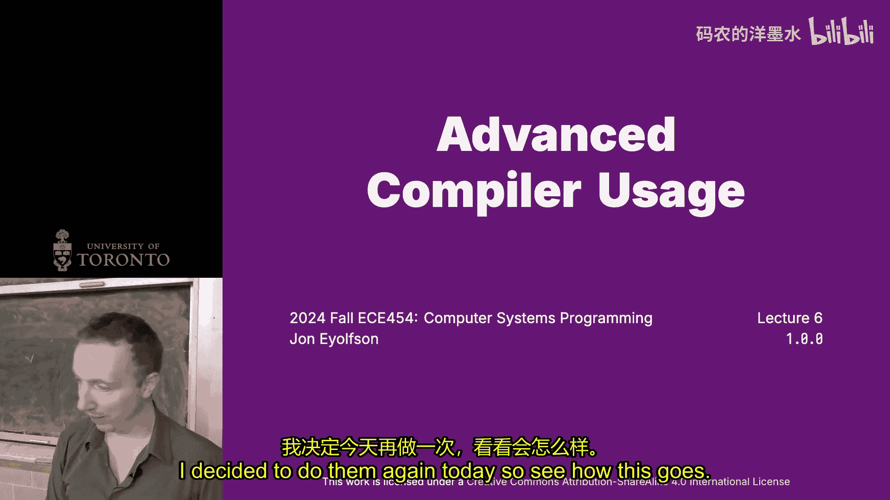

See how this goes。 Allright， so there's more than one compiler。

 So I why constantly say compilers are quite smart because I worked with Clang and LVM as part of my research and I know they're quite smart。

 but by default， we use GCC， and turns out that might not be a good idea。

 So let's explore the other compiler today。😊，So you probably heard LVM before that uses LVM as an optimizer。

 So clang， it's just a frontend for C。 all it does instead of generating machine code。

 it generates LVM IR and then the LVM goes ahead and compiles and generates all the machine code and everything like that。

 It is in a certain readable form as most internal compiler languages are called SSA。

 or single static assignment， That means they are not allowed to resign variables。

 So if you read the LVM。 It's actually pretty readable。

 you can actually follow by just going up and looking wherever something was defined。 Of course。

 it has pointers and all that。 but let's go ahead， well use we'll use yesterdays or not yesterday's last class days。

Code， and we'll just try and run it with clang instead。

So pretty much every build system on the planet lets you set an environment variable to。

Signify what compiler you want。 So the environment variable is usually called C C， short for。

C compiler。If it was CSX， that's the C plus plus compiler。

 So you can just set it for the build command。 So if I just do C equals Kang。

 that means I want to use clang as my C compiler and then。

I can set that for just the meson setup command。 and then whenever I compile。

 compile with clang instead of GCC。 So let's make sure I don't cheat and we'll just nuke this build directory。

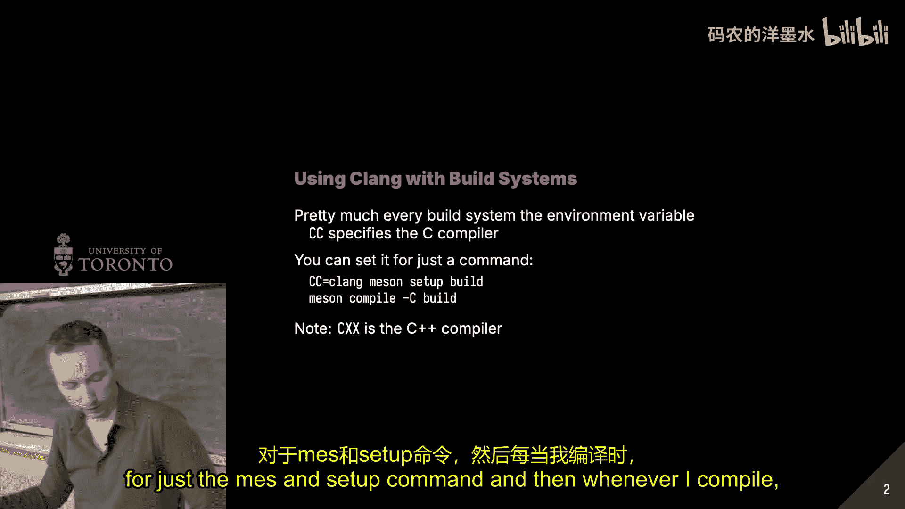

So here。So I'm going to do CC equals Kang。Reson set up。

 and then I'll just make separate build directories for each time so we can compare it。

 So I'll call this one build clang instead of just build， then goes and it shows us that， hey。

 we're going use clang， you know， it's version， whatever that is。18， something like that。

 And then if we go ahead and just compile normally。Build clay。And it goes through everything behaves。

 as you would imagine。It's the clang compiler。 So let's see how it does， so。Just as a reminder。

Here are all our performance numbers when we use just GCC， so we had several versions。

 combined one was just the silly one that used pointers， use V length and then vector element。

Combined  two， we hoisted the V length out of the four loop。 And then in three， you know， we。

Used array indexing and then hoisted the Vex start out because it is invariant。

 And then in combined  for。We you know， made a local variable， all that fun stuff。

 And then we started doing loop unrolling。So any questions about where we left off before。

 So debugging information， normal。 and then， you know。Didn't quite get the length out of there。

 And then we moved。 We got， you know。We did the array indexing instead。

 And then everything was pretty much the same until it hit this one。 And then we got vectorization。

 And then life was pretty good。 So a， question， about where were were last time。😊，All right， cool。

 so let's try and remember that， let's see if we can split screen。So。

I just put a little option on here so we can see the results with playingang。嗯。

So Kang looks about the same。Oh。😮，Wow。So at Com three。

It seemed to get the damn picture and vectorize things for us。

Unrolling three times seems to have confused it。 Man unrollings also seems to confuse it all the other times。

 And then 16， it kind of got the picture， combined 6 when we change the order of operations。

Didn't really help either， but it was slightly better than GCC。 Okay， that room in the window， cool。

So was slightly better than GCC， but you can see clang was a lot smarter。

 So it pretty much immediately vectorized as soon as we did got to combine 3。

 which is the version that just used the array indexes and just hoisted V length and V start out of the loop。

😊，And then we can be like， oh okay， well， how did it do that？ Well。

 if I want to see how it actually did this， I can actually look at the LVM IR as a change instead of just you know looking at the assembly so here。

I wrote this like show LVM script for you。 if you want to see the LVM code。

 same idea as the show assembly 1， except I just get the compiler to output LVM code instead。

 So we can see what it did for combined 3。 So this is the assembly from GCC。This is LVM。

 So if you haven't seen LVM IR before。It's slightly ugly。

 but it's probably better than Jple slightly。 I don't know。

 Maybe I just have like Stockholm syndrome because I spent a lot of time reading this。

But who knows so。Here， it kind of looks like C is syntax。 It's like define something。

 This is a function。 void void exists in it。 function called combined。

 and then has all the arguments。 It's typed， but the types are pointers。

 And then they usually have some different information that the compiler knows about arguing about lifetimes and things of that nature。

 So here it knows that this pointer is only beaten written to。

 So it does optimization based off that has a local unnamed address， doesn't really care。

 And then you can see here。This is single static assignment。

 So anything that starts with a percent sign and a number that's just a variable that would eventually go to a register probably after it generates machine code。

 But here is the result of calling V length and Vex start， and then it stores it somewhere。

 So stores how it writes memory and then I that's just you know the comparison and then SGT sign greater then。

 So it's doing greater then。The three， so the result of vector length was 0， and then the branch。

How the you read the branches are like this is， this is where you go。 If it's true。 It's a label 6。

 and then label。57， if it is not true。So 6 is here。 So pres。

 it will say how you got ways to get there。 So from this label。 and this。

 we'll just go ahead and do some comparison again。 This is the main body of the loop that。

Didn't really do。 Oh， that's not the main bio loop。 Sorry， that's the increment。

 doesnn't do anything that special。And here is the main body of the loop。

 So there's these weird five things。 It's how they combine values from different sides of branches。

 Don't worry about it。But we can see here this load， the data type here is 4 times i 32。

 so that is like reminds of that vectorized register。

 but here even if it doesn't support it when it generates the assembly， the LVM IR。

By default supports vectorization by itself， so it has a special load here for vectorized int so it can pack four integers altogether so we can see that it already vectorized itself for us。

 even though we didn't ask for unrolling， We didn't do anything like that and we can see that here you know it's doing vectorized ads。

And all that fun stuff。 And， you know， transform the code to deal with。The other parts。

 And we can see， in fact， why this happened is because we go down。 We can see that。So。

That it just vectorized it， so it unrolled it a bit so it could vectorize it。 We can go ahead。

 read everything with that。

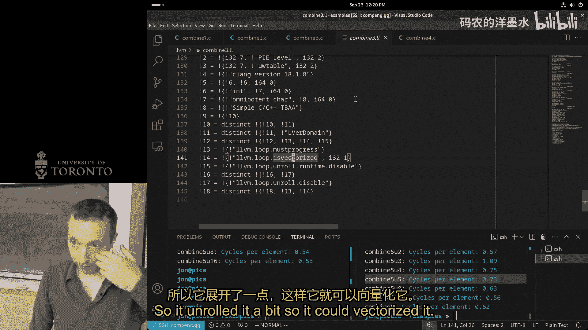

Read all that stuff。 It's cool。 You can explore it a bit Too long didn't read things better than GCC。

😊，So it kind of figured it out。All the way here。So as soon as we got to combine and it didn't quite know how to get rid of all the bound checks and everything。

 probably confused it a little bit。 So as soon as we got rid of that git be element。

 then it figured it out， it vectorized it for and it generated it。

 And even though the LVM code is vectorized， if we want to output non-veized code， then you know。

 the back end， the code generation can go ahead and handle that force。 But in the IR。

 it does know about vectorization。 So any questions about that kind of cool。All right， yeah。

 is vectorization like a difficult problem for compilers。

 I'm just wondering why GCC didn't implement it？So GCC。while GCC did implement it。

 it just figured it out like around。Here， right？So some compilers are better than others， yeah。

need the flag to detect it Nope， this was without onroller or anything like this。

 This was just straight up  O2， yeah。So。では。Is there a way to do that just within the build file or do we have？

So you just have to do it once for the setup command。 And then you're good。 O， Yeah。

 so just when you set it up and then。Every time you build， it'll use that。

 So it saves it when you do that。 So， yeah， you only need to do it for the build command。Alright。

 so yeah， this will， this whole lecture will probably sound like a GCC bashing lecture。 But yeah。😊。

So some things it can't do is because， you know the Linux kernel has a bunch of crazy stuff in it that has GCC extension。

 it cant actually， as far as I know last time it couldn't actually compile the kernel。

 but I can compile programs pretty good。Al right， first。

 good optimization we can actually do now that is much more prevalent Now。

 something called link time optimization。😊，Because when we looked at that code， we were like， hey。

 you know， you should be able to inline this， but because it was just in C file。

 it couldn't figure it out because it had to assume the worst case about the function because it didn't actually have the definition of the function。

 So link time optimization is a way to solve that issue for the compiler。

 it helps it optimize at a more global level。 So it keeps the code at an IR level for optimization。

 So instead of generating machine code for the object file。

 it keeps it in intermediate representation。 So when it does the final link step。

 it has all the code， it has everything it needs to do its analysis and it will do the analysis on your entire code base before it actually generates the final machine code。

 So。It's as late as possible。 It gives the compiler the most amount of information you can give it。

 which is good， right， We want to give the compiler。 the more information the compiler has。

 the better。Unless you lie to it and then you're screwed。 So this is a way to actually。

Give the compiler more operate more information。 and it is also the reason why I like using Messon because Messon makes this step really。

 really easy。 Otherwise， it's kind of annoying depending on the build system。

So if you want to use link time optimization with Messon。If you make files or whatever。

 it's a bit of a pain。🤢，But in Meesson， it supports it directly， so to use link time optimization。

 all you have to do in your sub command， you just set B LTO equals to true。

 and we can go ahead and see that one sec loopops。嗯Ex。

So let's make sure I'm not cheating， so build LTO， So I'm just going to use another different build directory just so I don't mess anything up。

So I'll set it up， it's just Db underscore LTO equals true。And they'll call it build dash LTO。

So I can see user defined options。 Link time optimization is now enabled。 So whenever I compile。

It'll probably take a bit longer， probably not noticeably so， but at the end， everything will be。

All optimize at the end。 And hopefully， the compiler has more information。 Hopefully。

 I didn't even have to do that manual in lining because it was quite a trivial function。

 So let's see how it did。So here's our benchmarking command。 So my option was L T O。 So I'm using。

GCC's link time optimization。 So let's see how it did with combined one。So， with combined one。

Actually did quite a good job， right？So let's go back to the previous results。

 So with combined one before without link time optimization or anything like that that just had those calls。

 They weren't in lined。 It was just doing that V， V length every time through the loop。

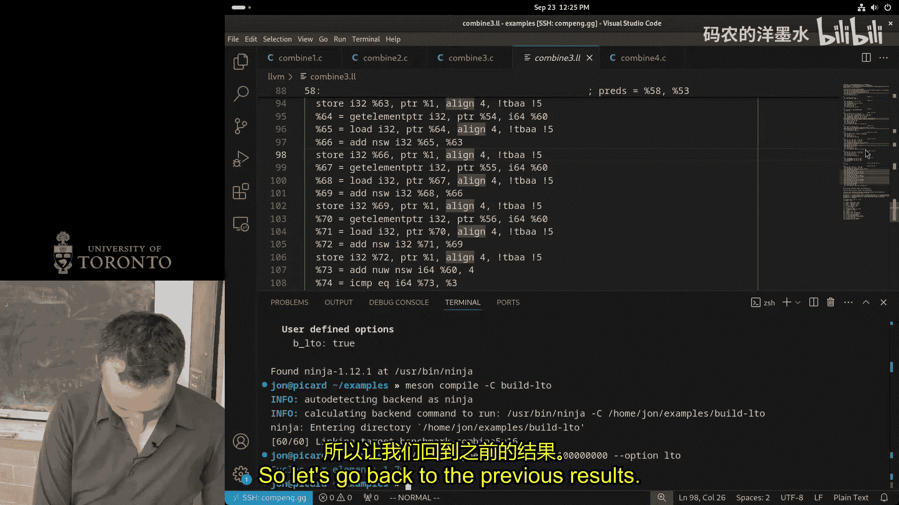

In combined one， we started off with like a 10 cycles per element， which was quite bad。

 And even moving to。Combined two， which move the length out。Still not that much better。

 It wasn't great until we actually。Moved everything out。

 right until we moved the array indexing and the length out of the loop until we got 1。7。

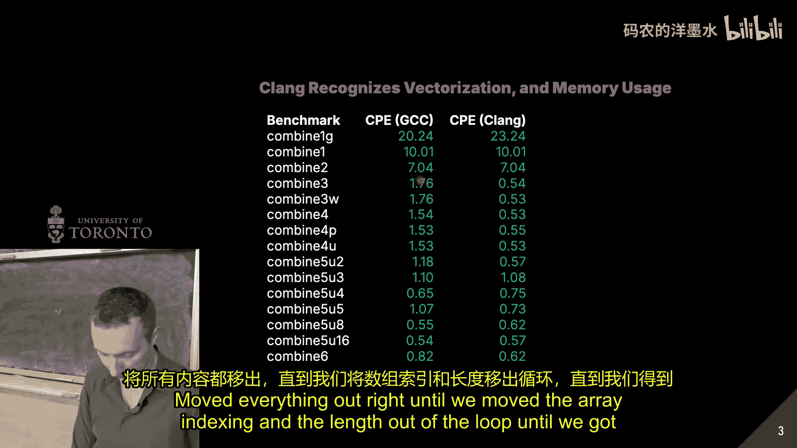

But now， with link time optimization， we get 1。7 without doing diddly squat。Pretty pretty good， eh？

Don't know why you wouldn't use this。Alright， any questions about link time optimization。

 That's cool。Wow， this lecture is going by way faster than I thought。Sorry。No， by default。

 whenever you compile your code， you don't have link time optimization because it requires a whole lot of flags that can't output just normal。

Normal dot O files has to keep it in like IR so it can actually do the analysis on it on the final link step。

 So there's going to be some trade off here。Oh， so let's just run everything and see how link time optimization does。

So we'll run everything。So。First， then help us with debugging。

 You would not expect it to help with debugging， but immediately with Com one， It helped us。

 It inline those functions。 We manually inline ourselvesse， and it didn't seem to do that much。

 So combined for。Would we have combined four。Was the same as before， 4 P was the same as before。

For you， loop unrolling， it helped with loop unrolling a tiny bit。 And then for the w rests of them。

 it didn't really help that much。 So we still got。Our best was about like still 。55 with GCC。

 so it helped us with our first two steps， didn't really help us pass that。

 didn't really help us vectorizer or anything like that。The plan is so good。GCC existed before cl。

Yeah， and most people like。GCC also has a lot of very unique extensions that if you use them。

 getting your code to work with it is very， very difficult。 It has subtle。

Different ways it treats memory， as we will see shortly so it can produce different output depending。

For the most part， I've only worked with Kang。 I've tried to work with GCC。

 and it's just a horrible mess。 So adding features to it is really。

 really hard because they actively do not want you to do that。 But yeah， another question to no。Yeah。

He is like the new world。If I using newer modules， do I need link time optimization？

C plus plus modules pro well a bunch of the C plus plus stuff just puts stuff in header files。

 which essentially does link time optimization because everything is accessible。

 So G or C plus plus kind of skirts around this because template system or the templates have to be available and concepts and modules have to be available to anything。

 so。OrC++ guy around this by shoving everything in header files and making it take forever anyways。

So， but this is a much more general approach that works even for C。Alright， any questions about that。

So that was fun。Let's have some more fun。If GCC kind of sucks。Well， hopefully。

 Kang also has time Kang also has link time optimizations。 If it's smarter。

 Let's see if what happens if we combine both of them。

So let's see I'll remove this so I can mix and match whohoops。 I'll call it build clang LTO。

So let's mix and match so we can do this setup。We can also set up DB， LTO， equal true。

And then we can call it oops。Claying LTO。Okay， so now we have。

LTO enabled and we are also using clang， so let's see how much better clang is。

Why do things look so weird， Mean compile。Was it called build clang LTO。Alright。

 so compiled didn't take that long。 Let's try and do this。 clang L T O。 Let's start off with。

Just the normal debug ones。 The normal debug one， L T ocean do anything。 It shouldn't。

Part of debugging should keep everything as you wrote it so you can actually debug it。

 and we can see it's actually a bit worse than GCC， it's like 21 instead of 20。

 but it's debugging who cares。Allright， any guesses as to what Kang will do with just combined one。

So。Also for context for combined one。Here was combined one。 if we forgot what it looks like。

 All it did was update desk， like write ident to it。 and then just。For every single element。

 it would just accumulate it， write it over and over and over again。 And for this。

 it's going to be also important to look at the main function。So the main function， what does it do。

 check some flags， and then at the end it does combine and then gives it the pointer to write the result from。

 and then it never uses the result。So。If I was a brilliant compiler， what would I do？Yeah。

Never talking。Yeah， screw it， It doesn't do anything。 who cares right。

 Let's see how then GCC can't figure that out， I mean GCC thinks it will do something。😊。

If we run this。It it does something。Wait， was that what I was expecting， Yeah I was okay。

Clayang didn't quite configure it all out。 It got。 No， it got the same as like GCC。

 So let's see what it does when we help it along a little bit。So。If we give it Com 2。

 So combined 2 was our version that we just hoisted out V length。So if we give it combine two。

Helped it a little bit。Not much。Combined 3 is when we， you know。

 we went and we changed it to just do the array indexes because that function had a whole bunch of bounce checkings and。

Things like that so we can run this one and see what it does。Bong。Po2。

 so that is the fastest we've seen thus far， and we can see how aggressive it goes。

 So if we step it up to combine four。That's so combined four is just whenever we use a local variable instead to kind of help it along。

So whenever we did combine four。It doesn't do anything anymore。You're not going to use the results。

 So why the hell am I wasting my time with this。So that's about as optimize as we can get it。

 you can't do any more optimization than throwing the entire thing out in the garbage。

So very smart of claim to do that。Yeah。Shouldn't be like a side effect。実きもできて destinationしょ。Yeah。

 so the question， isn't there a side effect when I write the accumulated value to the destination？

But since it has the entire program， right， it knows that this is my side effect updating this combined result from Maine that never gets read。

So it doesn't。 and it knows that nothing else tries to read that。

 There's actually no other pointers that point to the same type。 So even with。

It makes slightly different assumptions。It basically assumes that if you don't have pointers to a different type。

 nothing will alias it。That's one of the assumptions it has。

 So in this case it knows that nothing else can be pointing to this combined result along with the combined result itself not being used。

 so it knows nothing's going to use it so it just throws in the garbage。That's real optimization。

Which is why I was， you know， assuming I was kind of surprised by this。

 because whenever I turned LT O on with Kang or GCC， I thought it was just gonna you know。

 up and delete it。 But turns out only Kang is that smart。 So if we run all them using Kang。

Then we can see that it figures it out quite quickly， debugging slightly slower。

 Then immediately it does some of the inlining。 And then as soon as it gets to combine 3。

 it's like oh， okay， I can vectorize this。 I can make this fast。

 I don't really have to do that much and then pass that。 it can be like yeah， now I'm good。

Turns out we defeated it a little bit when we manually unrolled twice， it did a bit of work。Not。

100% sure why it decided to do some work。Mostly， I think we just confused it when we manually enrolled twice。

 but and that it did nothing at all and。That's as fast as our program can go。So that's fun。

 So questions about that before we do our final thing， yeah。😊，Yhy is that be。Like the other compiles。

That also didn't have side effects， Why did those get up。

Which like why didn't GCC optimize it to zero？Yeah。About that as 0。2。OhYeah， combine three。

So combine three。I'm not sure why it just didn't optimize the whole thing out。

Because the difference between Com 3 and Com  four was we used a local variable in Com  four and not in Com3。

 so it might have assumed that something could have seen it。

So it couldn't optimize out it completely。 That's what my guess would be。 but you know。

That would be my guess， but by default。Writing local variables doesn't really make a code less readable。

 you should always just use local variables unless you are for sure going to have to update local or global state。

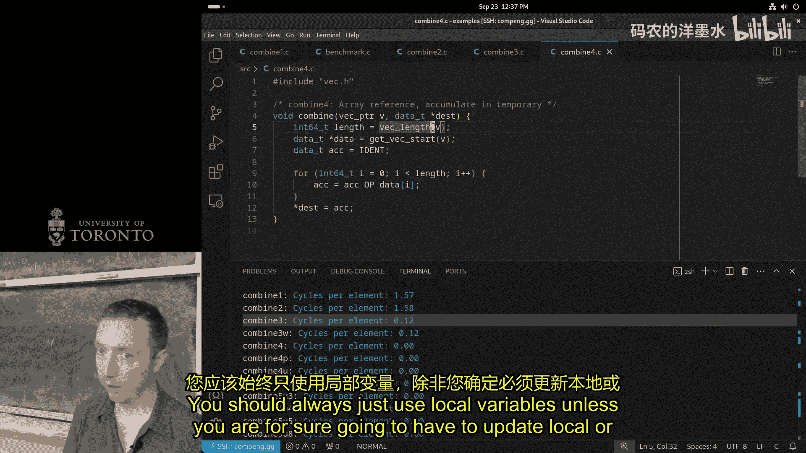

So questions about that playing。Claying with LTO， very good。So good that， yeah。

 optimize my program away。😊，All right， so too long to read。

 especially nowadays since computers have so much Ram and。Compiles are fast and everything like that。

 There's really no reason not to use it other than by default， systems probably don't use it。

 unfortunately for La 2， you still you don't get to use it， but for lab5。

 whenever you get to go wild。I would highly suggest using this。Drawbacks are takes more time。

 of course， because it's your whole program altogether and memory than traditional builds。

 especially if you have a really， really large project。

 you might not actually have enough memory to do all of this analysis if you're compiling。

 I don't know， like Firefox or something like that， it you know， unless you have several。

Hundreds or terabytes of RA probably won't fit and it'll probably take a very long time。

 LVM has this thing called thin LTO for large builds that try and optimize it a little bit more to take a bit less memory。

 so by default， you should even for large software projects you should try and use thin LTO and LVM as far as I know GCC doesn't support the same concept。

But things can go very poorly if you do your own linking or something like that or otherwise lie to the compiler。

 So if you're doing something very weird at a linking step and you're doing your own linking。

 then maybe don't use this one or be very cautious of it。

 but if you're not tining around with the linker， which I don't think any of you are or should be doing。

 then you should use this， so。Especially since it removes a lot of code for us and。Also。

 while you are developing， this also is a good segue to say。

 do not do not try and debug with an optimized build because。

It might optimize your code away and you will just never see it be called。

 and how can you debug something that doesn't exist？So for debugging。

 you should definitely use a debug build where it just doesn't get rid of stuff for you。Drawback。

 of course， is that it will be quite slow。Alright， final one is kind of combine to what we saw before with profiles。

 So you can actually。Feed a profile into the compiler。

 and it can actually help guide its decisions a bit more。

 So that is called profile guided optimization。 So instead of just using our profiling data to manuallyly do stuff。

 we can just instead feed it back to the compiler and have the compiler try and figure out stuff for us。

 So this is really useful for the compiler， especially for it laying out the code and memory and knowing what's likely。

 mostly just branches， what's likely to be taken or not。 So thankfully， Messon makes this also easy。

 So there's just。😊，Oh， sorry， Typo。 it should be B underscore PGO， not LT O。

 So PGO profile guided optimization。 the options are off， generate and use。 So first to use this。

 you need to compile your code to generate。 So generate。

 will' just essentially add all of the profiling information into your executables。

 and then you can run it。 All the paths are hard coded。

 and it will generate all of the profiling data。For you。

 you just have to have kind of a representative run。

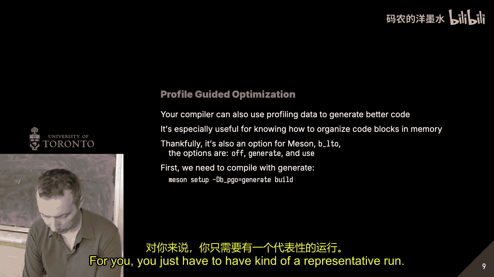

So how we would do that is。Bill PGO。Okay， let's。We can enable both things。A culture。Alright。

 so if we enable PGO first， we have to start off at generate， and then。

Whenever we now we need to run representative samples of our code in order to generate that information so we can go ahead。

 look in here， build。PGO。 So all of our normal files， everything like that。

 So I can manually compile with just ninja。Apparently not。 A， I accidentally delete O in typing。

 I accidentally deleted that。My bad。 all right， so I can just use Ninja to compile everything and then one of the things you can do is you can just define your own benchmarks。

So this code is all available to you。 you can see the meson thing。

 You basically just provide an executable in arguments that you want to use for benchmarks。

 So I can just type benchmark。 I'll go ahead， run all my code。 And then as part of that。

 it will generate all of the profiling data。 So， for example， in I't know， benchmark combined one。

We can now see it has those GC。DA files or whatever that have all the profile data inside of it。

But now to actually use that information when we compile， all we have to do is configure messon。

And do set PGO equal to U。If we set PGO close to use。

 it means well we're going to set up all the flags so that now when we compile our code again。

 the compiler will actually use that profile information to generate something better so I can do that and then recompile。

 So now recompes it uses all that profiling information and then hopefully we have something better。

So let us benchmark this here。Let's go back。Here。Let's remember what we had with。

Li time optimization with just GCC without out a profile information at all。

 it looked something like this， it was like a 20 and then it got to 1。

75 and kind of hovered around that until we did some loop unrolling and then it finally figured out vectorization when we manually unrolled the loop。

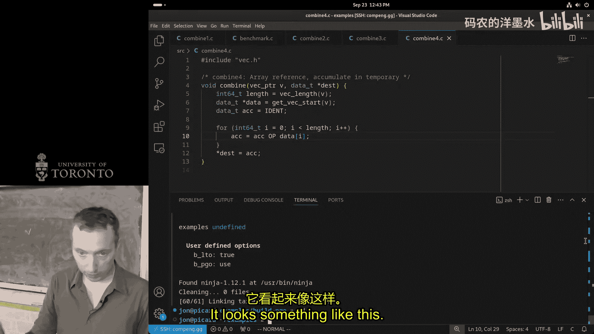

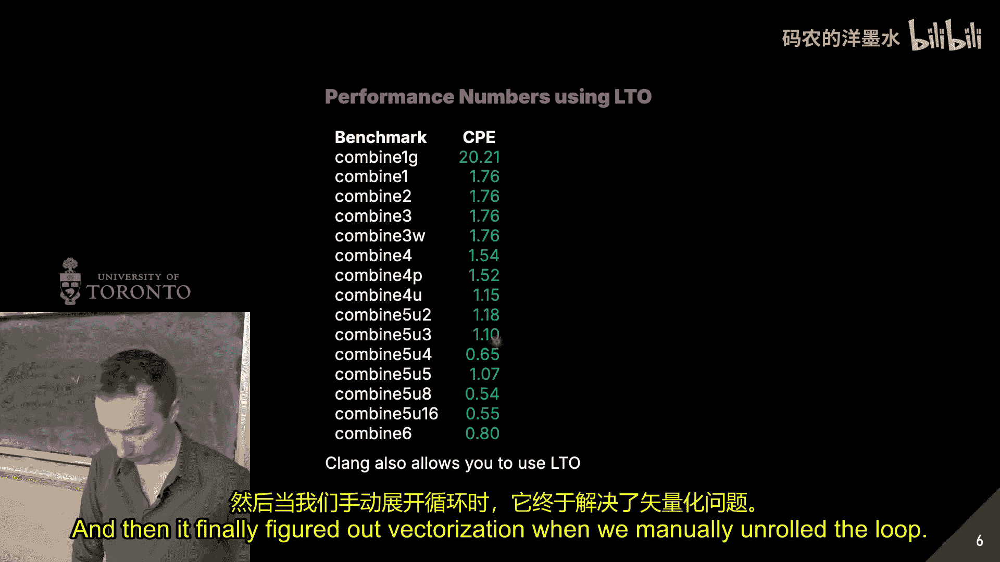

So let's see what it does now。 So if we do our。Option PGO。

 so let's run everything again and see how it benchmarks this time。

So normal 20 doesn't seem much better， doesn't seem much better。Doesn't seem much better。Oh。Oh。

 no there it goes， so combine four。Instead of。Figuring out vectorization much later。 So before。

 when we did combine 4 without any profiler information， it got like 1。5。 So now without it。

 it got down to 0。6。Other things slightly confused it。

 The best was still manually loop unrolling with GCC。 again， apparently GCC。

 not that good of vectorization， but we can see it massively improved combined for just using profile information。

So another option you have， of course。You can generate bad profiles and lie to the compiler and you can get a worse result out of this。

 but if you have a good representative run， you will have you're just giving the compiler more information so you would expect better outputs。

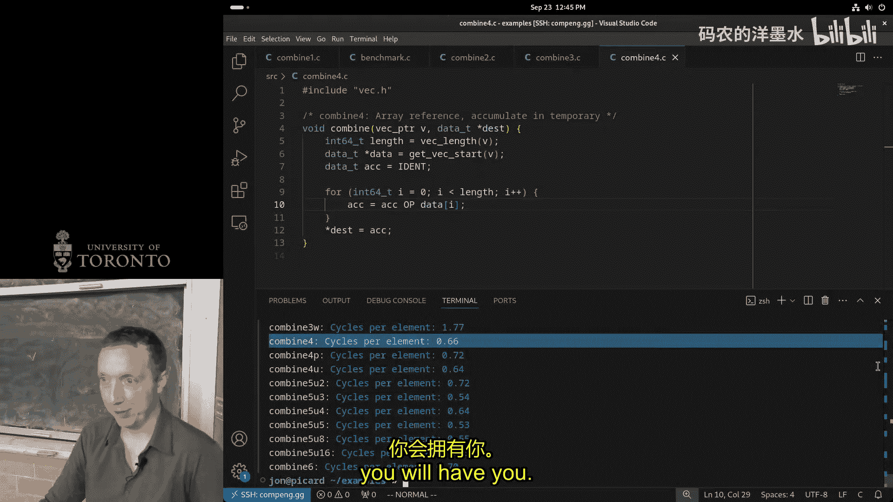

And as a useful thing， don't be like me。 So remember， premature optimization is the root of all evil。

 So I spent。What three hours debug it， because whenever I ran my program， it didn't generate G C。

 whatever G CDA files， as because in the first version of this。

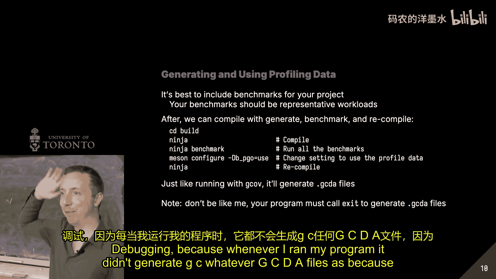

In the first version of this， I had a premature optimization because I was running perfu like， oh。

 I know。I know if I just like return from Maine that calls C exits。

 which does a whole bunch of stuff。 I don't want benchmark C doing a whole bunch of stuff。

 So originally I'd had this。 I'd underscore exit， which doesn't do any of the C cleanup or anything like that。

 it just immediately system calls exit and finishes the process。 And then when I had this。

 I didn't have G C。 I didn't it didn't generate files because they're generated as part of exiting normally。

 And I just killed the process immediately。 and it was like where the hell my files go。

 So that is my warning for you， another warning of premature optimization， Not good。

 So I got rid of this。 And then suddenly。You know what， I got profiling data。

And it was especially weird because。You know， if I ran it without arguments and got an error where it just returns an error value。

 I got profiling information。 and I was like，hu。I get profiling information when I don't have any arguments。

 and I have arguments。It doesn't work。 And I was like trying to file a bug report。 like， you know。

 I add arguments。 your it doesn't generate anything。 And yeah， turns out I'm a dumbas。

 And that's why Google was like。Yeah， this isn't it thanks。This isn't a natural problem people have。

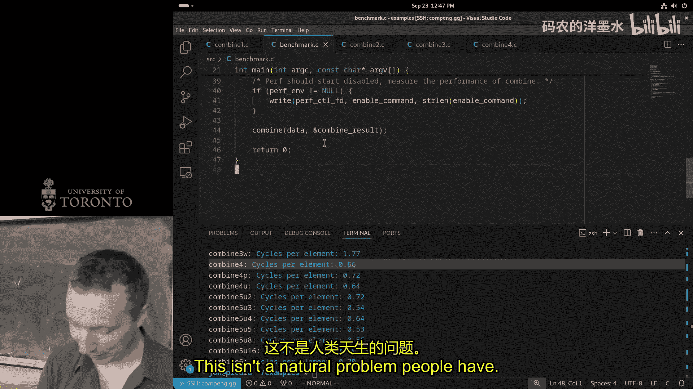

So yeah， when you can't Google a solution， then you probably screwed up oilally。

So here was GCC using link time optimization and profile guided optimization。

 turned out we didn't actually have to do that manual effort to actually get a much better speed up and probably could have saved ourselves some time。

So too long in read is especially in future ones， link time optimization and PGO might save you a lot of manual effort。

 gives the compiler a lot more information it can use。

Maybe you can use this as like you can't use it to run your lab too。

 but maybe you can inspect the assembly or expect LVM output and see what compilers do when you give them more information and unfortunately。

 try and mimic whatever they did。But。However apparently you have to use the crappy compiler for La2。

Likely， you'll have better performance gains than applying from applying domain specific knowledge。

 So most of the performance gains you get are just knowing the problem really。

 really well and knowing whenever you can skip steps， so。Always remember。

 the fastest computation is a skipped one is one you don't have to do。

So you can't do anything better than that。What you have to do and what you'll be learning through this course is what the compiler can't do for you is it cannot pick data structures for you。

 It cannot pick data types for you。 Those are things you have to pick or you have to experiment with but other than that you should give it more information through link time optimization profile guided optimization all lot of good things you should try and focus on what you can do to improve performance instead of trying to do the compiler's job So with that I'll stick around for questions and just remember boom for you on this。

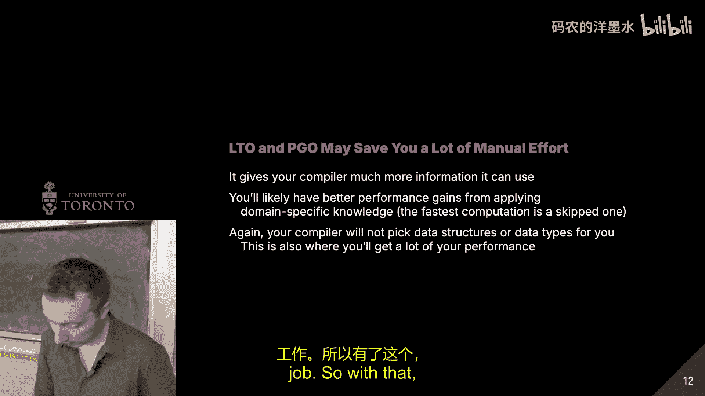