# C语言高性能系统编程实战：06：高级编译器使用 🚀

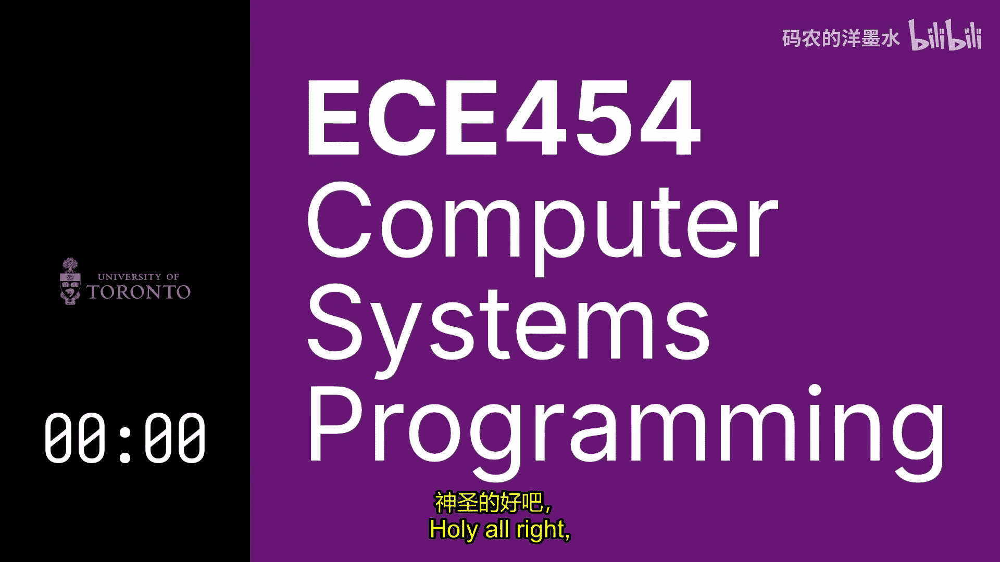

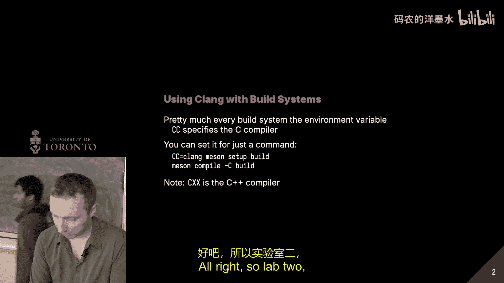

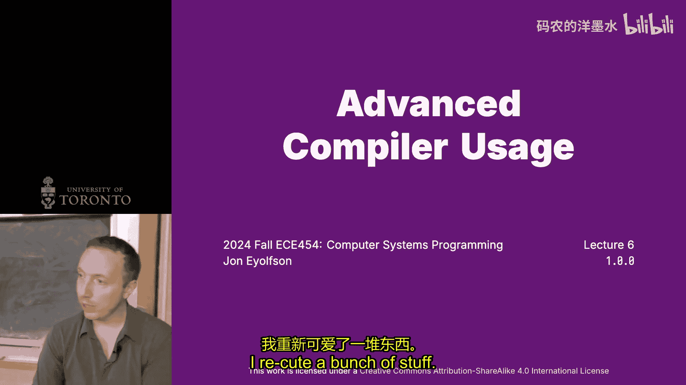

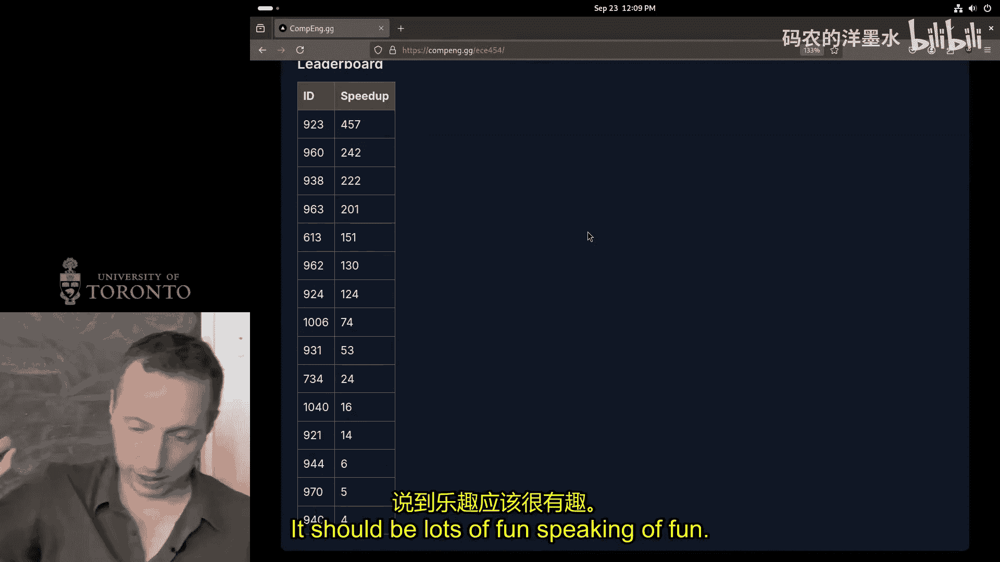

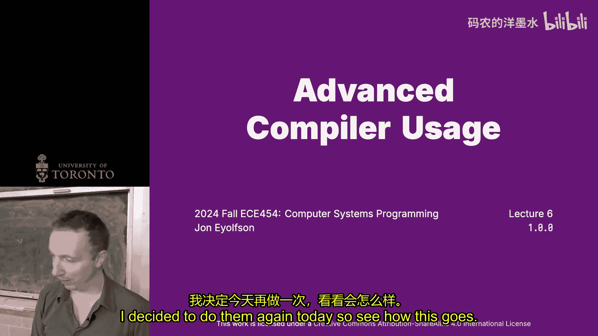

在本节课中，我们将学习如何通过使用不同的编译器、启用链接时优化和配置文件引导优化等高级技术，来帮助编译器生成性能更佳的代码。我们将通过实际演示，对比不同编译器和优化选项的效果。

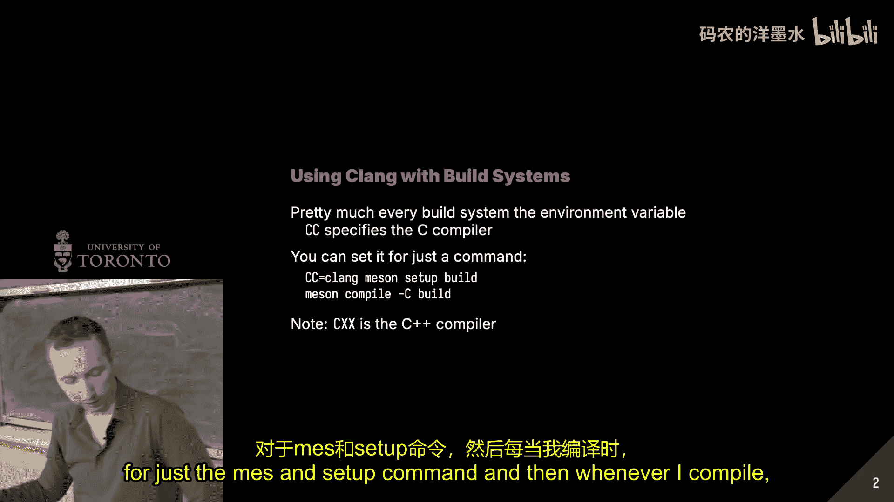

## 编译器选择：Clang vs. GCC

上一节我们介绍了基本的编译器优化。本节中，我们来看看不同的编译器如何影响代码性能。除了默认的GCC，Clang（基于LLVM）是另一个强大的选择。

Clang是一个C语言前端，它不直接生成机器码，而是生成LLVM中间表示。LLVM随后负责编译和生成最终的机器码。LLVM IR采用单静态赋值形式，使其相对可读。

以下是如何在构建系统中指定使用Clang编译器：
```bash
CC=clang meson setup build_clang
```

我们使用上节课的代码进行测试。以下是使用GCC（O2优化级别）时，不同版本`combined`函数的性能数据（周期/元素）回顾：
*   `combined 1` (使用指针和函数调用): ~10.0
*   `combined 2` (将`vec_length`移出循环): 略有改善
*   `combined 3` (改用数组索引并移出`vec_start`): ~1.7
*   `combined 4` (使用局部变量): ~1.5
*   后续手动循环展开后，GCC才实现向量化，达到约0.55。

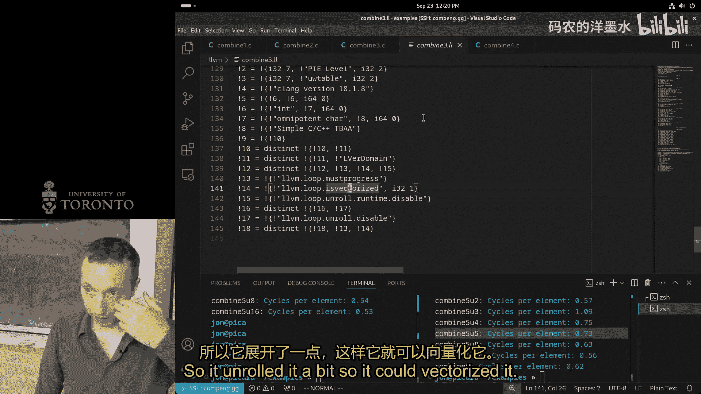

使用Clang（O2优化级别）编译相同代码，结果如下：
*   `combined 3` 版本时，Clang**自动实现了向量化**，性能达到约1.7。
*   在某些手动展开版本中，Clang的表现略优于GCC。

Clang的LLVM IR在中间表示层面就支持向量化操作。我们可以通过工具查看生成的LLVM IR，其中可以看到如 `<4 x i32>` 这样的向量化加载和运算指令。这表明Clang在某些情况下能比GCC更早、更智能地进行向量化优化。


## 链接时优化

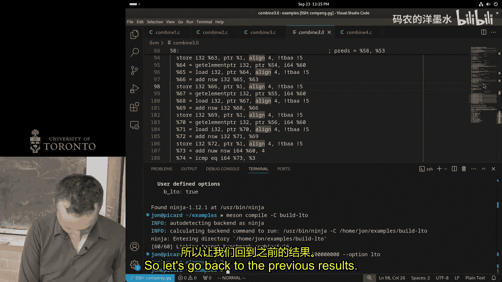

链接时优化是一种强大的全局优化技术。它允许编译器在链接阶段，看到所有模块的代码后再进行优化，从而做出更明智的决策，例如跨模块内联函数。

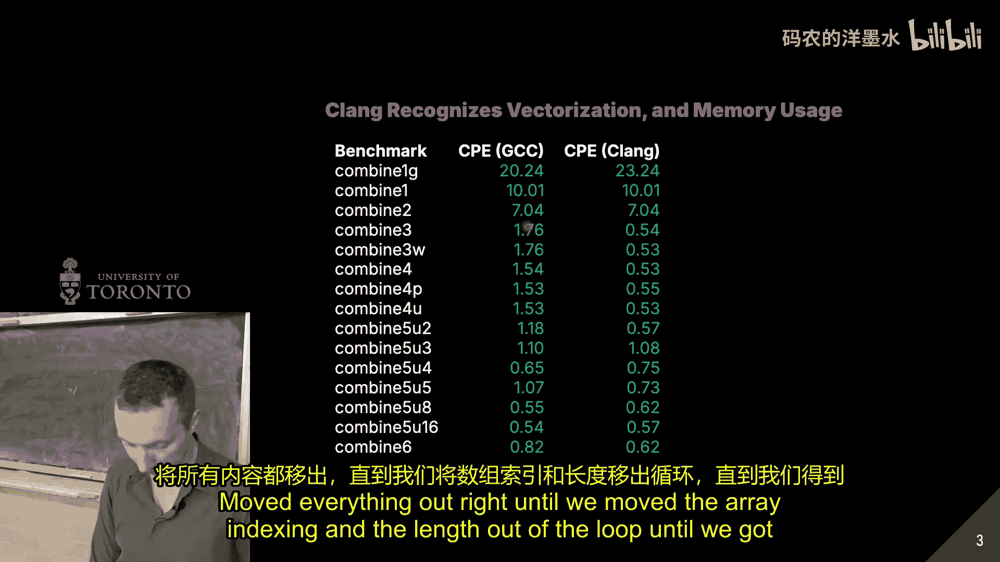

在Meson构建系统中，启用LTO非常简单：
```bash
meson setup build_lto -Db_lto=true
```

我们测试了在GCC下启用LTO的效果：
*   在 `combined 1` 版本中，性能直接从 ~10.0 提升到了 ~1.7。这是因为编译器能够内联 `vec_length` 和 `get_vec_element` 等函数，消除了函数调用开销并暴露了更多优化机会。
*   对于后续已经较优的版本，LTO带来的提升不明显。
*   **缺点**：LTO会增加编译时间和内存消耗，对于大型项目可能影响显著。LLVM提供了“ThinLTO”来缓解此问题。此外，在调试时不应使用LTO，因为它可能优化掉部分代码。

## Clang与链接时优化的组合

既然Clang本身表现不错，那么结合LTO效果如何呢？

我们同时使用Clang并启用LTO进行编译。结果令人惊讶：
*   对于 `combined 4` 及之后的版本，Clang+LTO**将整个计算循环优化掉了**，执行时间趋近于零。
*   原因在于，编译器通过全局分析发现，`main`函数中`combined`函数的结果从未被使用，且没有其他指针别名指向目标内存，因此判定整个计算是无效的，可以安全删除。

这展示了在拥有完整程序视图时，编译器所能进行的激进优化。相比之下，GCC即使启用LTO也未能做到这一点。这提醒我们：
1.  在开发调试时，务必使用非优化（`-O0`）或调试构建，否则可能无法跟踪被优化掉的代码。
2.  编写代码时，合理使用局部变量通常有助于编译器分析。

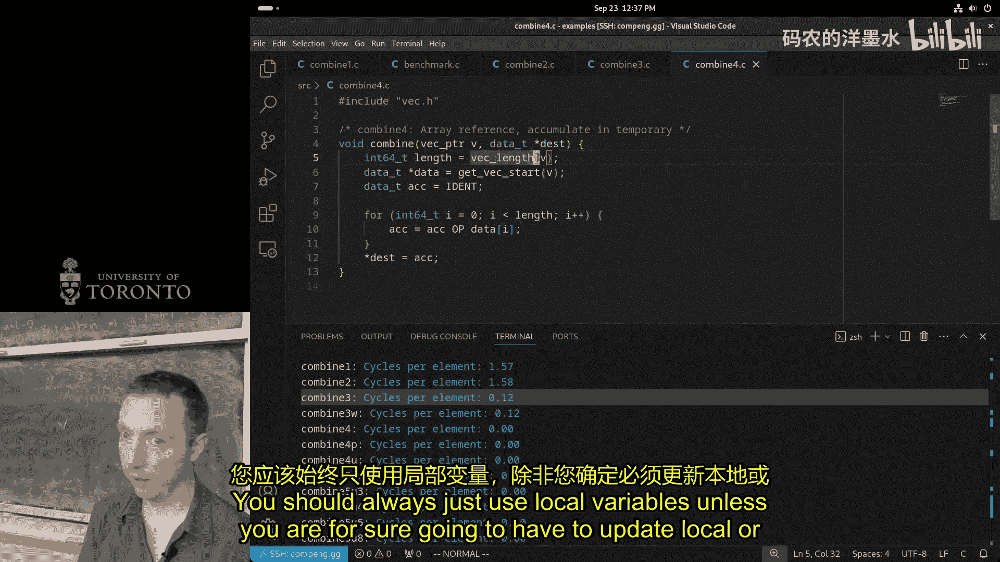

## 配置文件引导优化

PGO通过将程序实际运行时的行为数据反馈给编译器，来指导其做出更好的优化决策，例如更准确地预测分支走向、优化代码布局等。

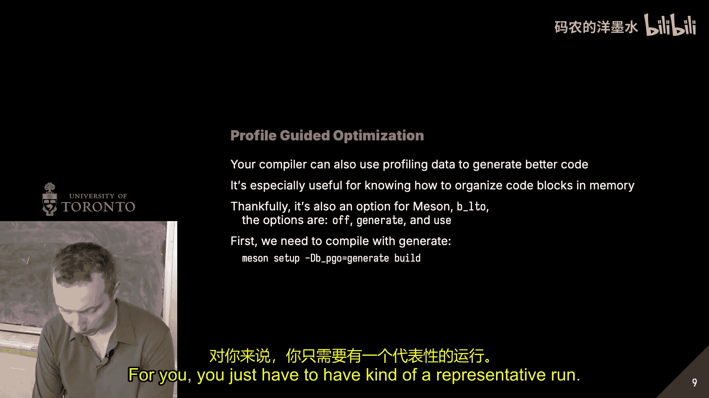

在Meson中使用PGO分为两步：
1.  **生成配置文件**：
    ```bash
    meson setup build_pgo -Db_pgo=generate
    cd build_pgo
    ninja
    # 运行代表性工作负载以生成 .gcda 文件
    ./benchmark
    ```
2.  **使用配置文件重新编译**：
    ```bash
    meson configure -Db_pgo=use
    ninja
    ```

我们在GCC上测试了PGO的效果：
*   对于 `combined 4` 版本，性能从 ~1.5 显著提升至 ~0.6。
*   编译器利用运行时信息，更早地成功应用了向量化等优化。
*   **注意**：需要提供具有代表性的工作负载来生成配置文件，否则可能误导编译器。同时，要确保程序正常退出以生成完整的性能数据文件。

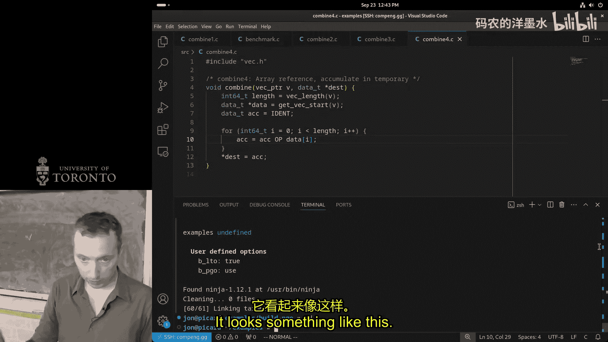

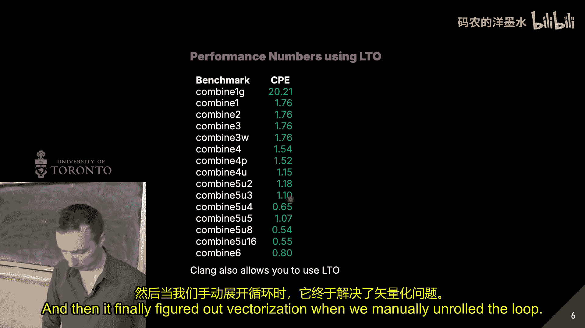

## 总结与核心建议

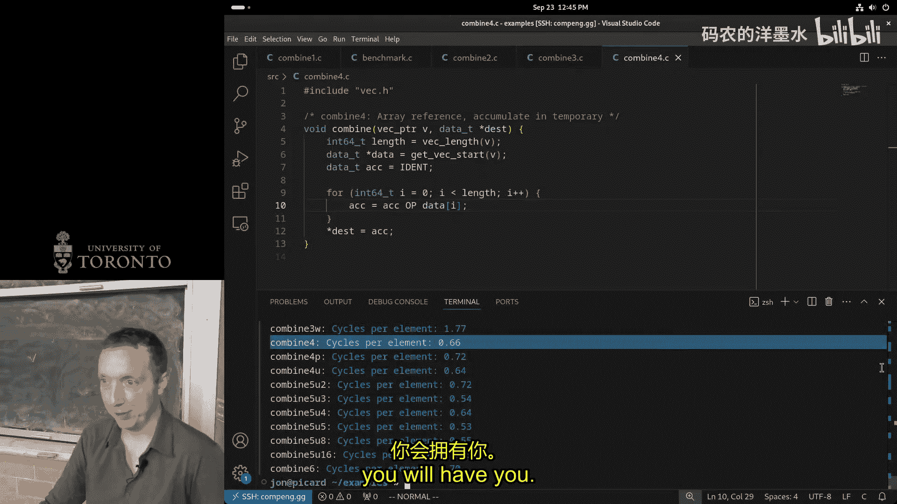


本节课中我们一起学习了多种高级编译器使用技巧：
1.  **尝试不同编译器**：Clang（LLVM）在某些场景下可能比GCC更智能，特别是自动向量化方面。
2.  **启用链接时优化**：这为编译器提供了全局视野，常能带来显著的性能提升，尤其是对于多文件项目。建议在发布构建中默认启用。
3.  **使用配置文件引导优化**：通过提供真实的运行时数据，可以进一步解锁编译器的优化潜力。

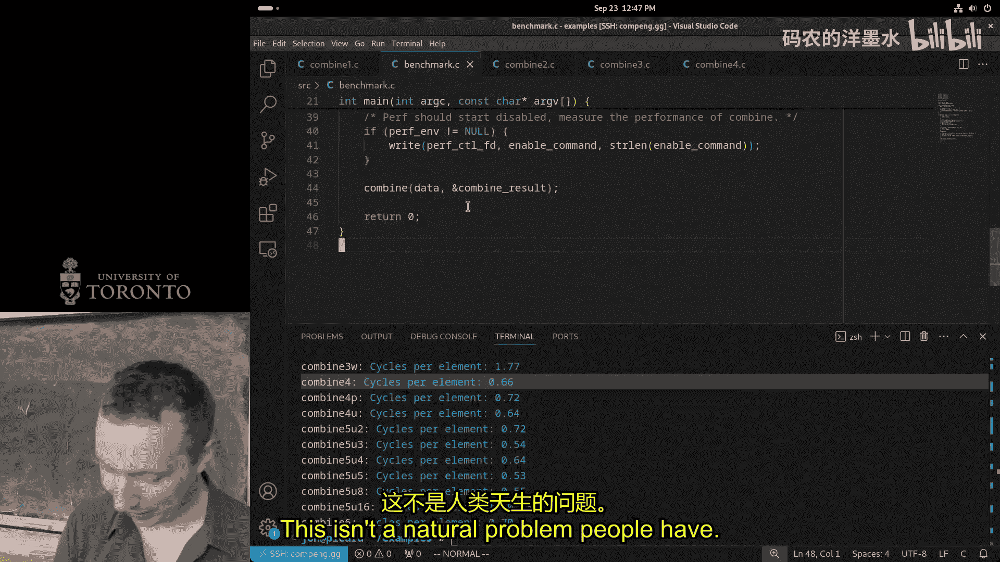

**核心建议**：
*   **避免过早优化**：首先应专注于选择正确的数据结构和算法。编译器无法替你完成这些工作。
*   **信任编译器**：你的任务是编写清晰、正确的代码，并为编译器提供尽可能多的信息（如通过LTO和PGO）。手工进行微优化（如手写汇编或复杂的循环展开）通常是最后的手段，且容易出错。
*   **基准测试**：任何优化前后都必须进行测量，以验证其实际效果。


记住：最快的计算是根本不需要执行的计算。在编译器力所能及的范围内，充分利用这些高级功能；然后将你的精力集中在编译器无法处理的、更高层次的优化上。