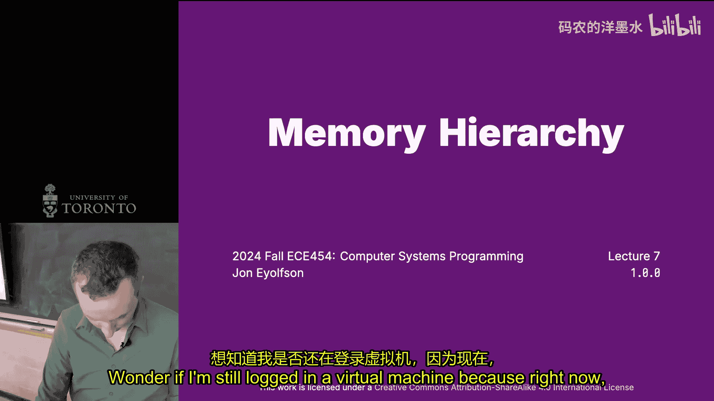
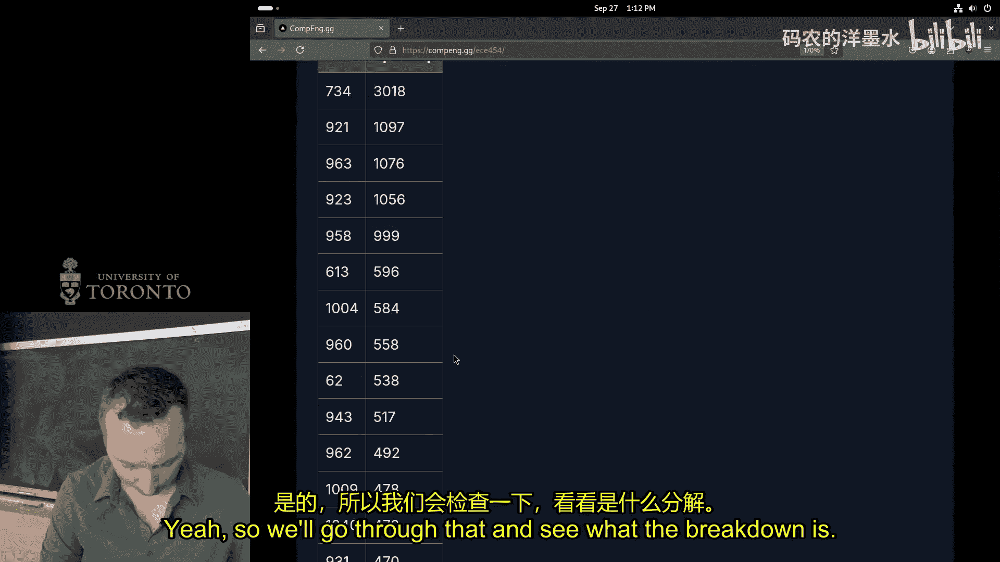
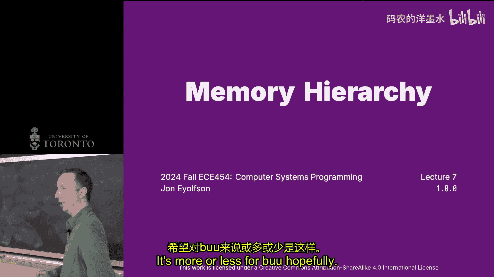
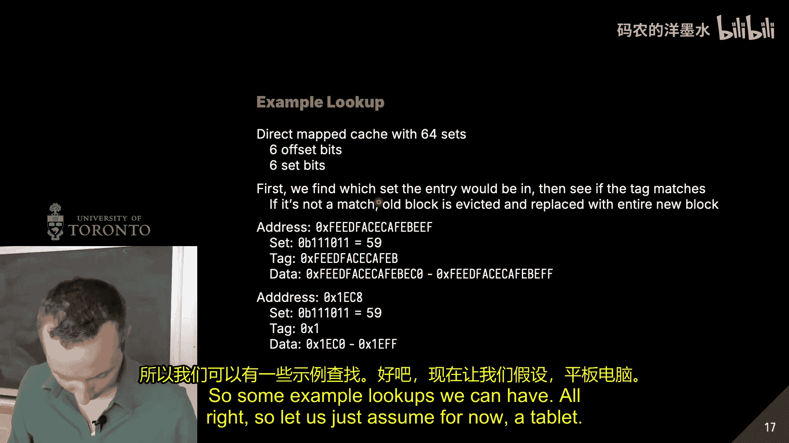
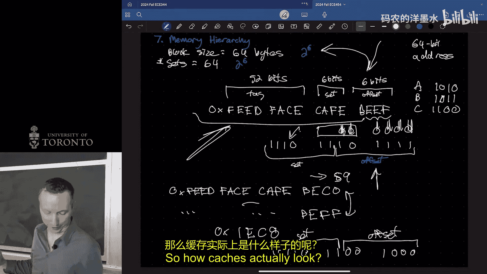
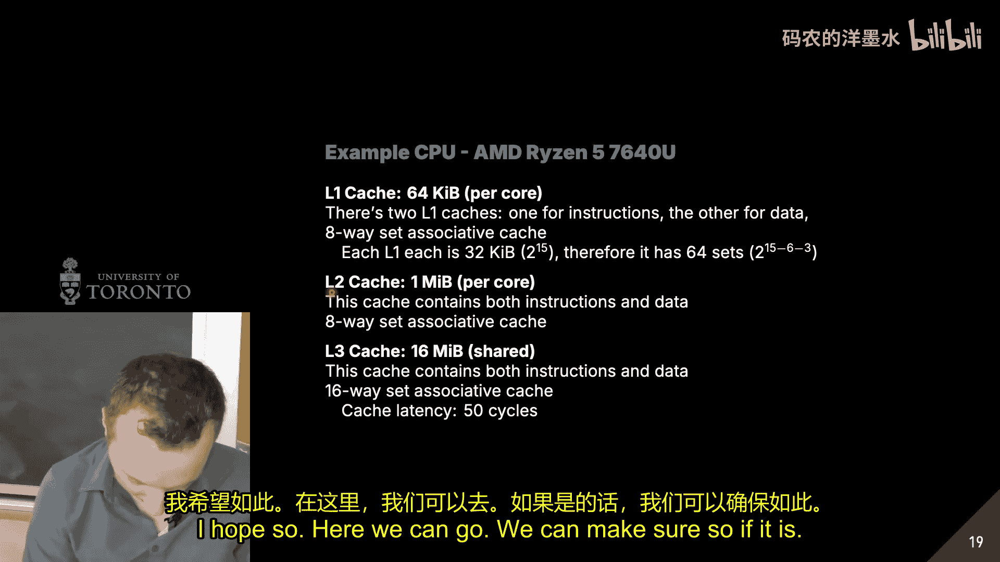
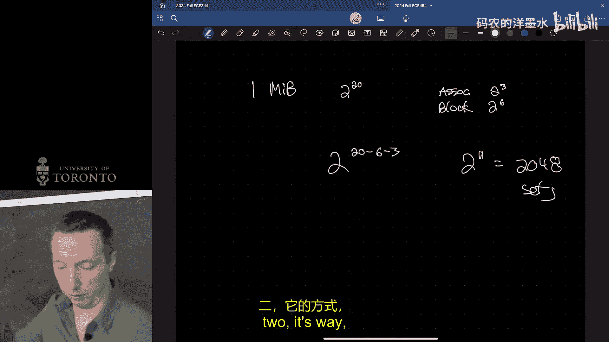
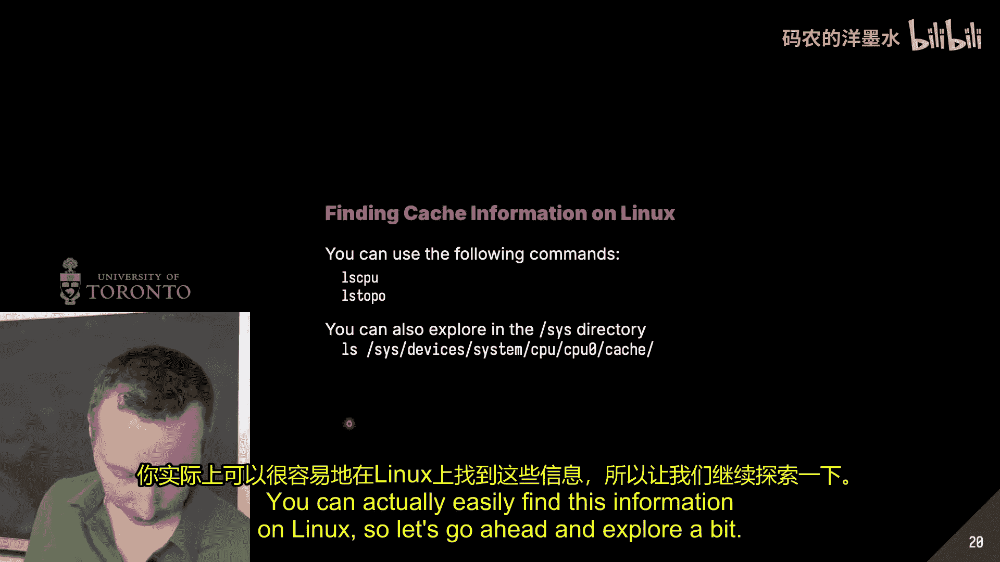
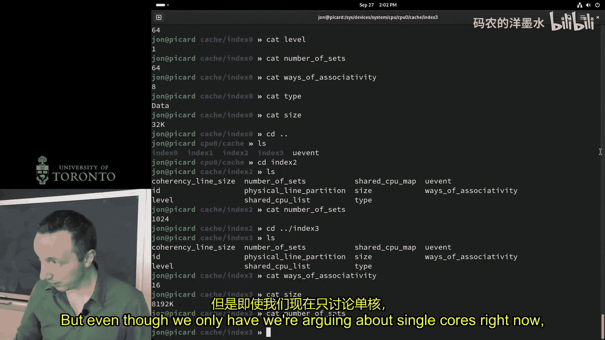
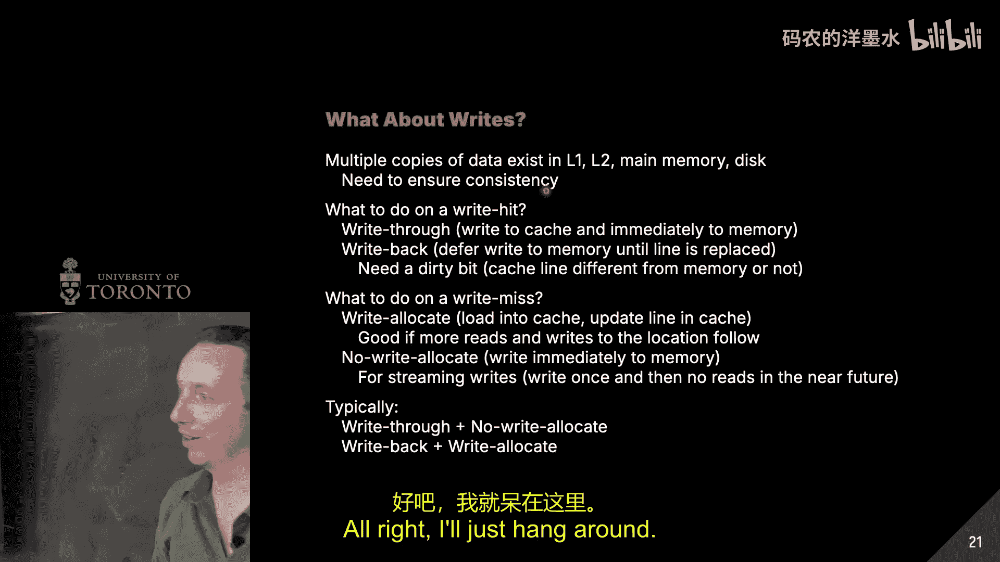

# 【全集】多伦多大学 C语言高性能系统编程实战 中英字幕 1080P p07 Lecture 7 - 存储层级 -BV1oDrZBZEG2_p7-

不け。Alrighty， welcome back two， four， five， four， so today oops echoe today will probably be a bunch of review。

 probably won't last all two hours， so we might be able to get out here early which I'm sure no one will argue with。

We end early， right？Yeah， we'll probably be all right。 So today's lecture， more or less a review and。

I'll also keep it short because I don't want to get ahead of the other section because that will cause all sorts of problems。

So oh yeah， this is going to be a little bit away from the lecture question when are we going to know the exact marking for the like competitive portion？

We can。We'll decide on， I guess， early next week is probably the easiest thing。So， yeah。

 for the competitive portion of the lab， well decide on breakdowns early next week to give you still a week。

 if you need to panic， go through it。Because right now， let's see what is。

What if I'm still logged in， virtual machine？

Because right now， what's the leaderboard look like？So yeah， someone's up at like。3000 something。

 so that's pretty good。I think record from last year was like。7100。So still a bit away， but yeah。

 bunch of good speedups here。Like a lot over。There's some at the bottom， but hey。

 we have a bunch of people on the leaderboard already， yeah。A histogram， yeah。

 someone can implement one， it's not an MVP， but I won't have time。

 but someone else might be able to or show some analytics or pretty that up so it's not just a standard old table or you could just copy paste into Google Docs。

 I guess， or Google Sheets。But。Yeah， so we'll go through that and see what the breakdown is。

But today， we will be talking about memory hierarchy， which。It's more or less for VU。 hopefully。

 So let's start it。

So matrix multiply。That is a problem that is easy， easy to screw up and make very slow or make very。

 very fast。 So it's just like a triple。 Why is it so equity， just like a triple。

Triple loop goes through to array axises。That's it。

 How much performance improvement could we get by optimizing this， Well。

 turns out we could get a lot， we could get at least 160 times speed up。

By not skipping any operations or doing anything like that。

 but properly using caches so if we have something in their L1 cache。

 so that is the cache closest to the CPU， that reference time is in like you one to4 nanoseconds。

 but this cache size is really， really small space is precious。

 typically it's under like 64 kilo kilobytes。So。We have to use main memory for some stuff if we program poorly and we use main refer main memory all the time。

 while that takes at least 100 nanoseconds， which is 100 times slower， but we， of course。

 have to use it because it has gigabs and gigabs of memory for us to use。

 So some data just so you have it， I guess，1 nanosecond a billionth of a second。 and for like。A 3。

5 GHz CPU。 That means one clock cycle is a。Po3 nanoseconds， which is very， very， very quick。

 So that's like a laptop CPU going on。 Most modern CPU will boost up to like 5 gigHz or something like that。

 up to 6 before they start melting like the newest Intel ones that kind of break themselves。

I think they kind of boost up to 6， So maybe not such a bad idea。 So maybe go around five。

So this should be review everyone's seen this before， more or less。So， you got。Computer memory。

 just a big hierarchy， trade off of capacity and speed at the top。

 the absolute fastest are registers on your CPU。 you only have， well you have a fair bit of them。

 but you only have not that much compared to memory and they're very expensive， you know。

 they're done in hardware。 It's right beside all of the computation units， all that stuff。

 you don't have enough space。Then below that， there's CPU caches。

 They like it so much that there's typically three levels of caches there。 So we。

 have we gone into details of like。People know about L1， L2， L3， all that stuff， Shaky， all right。

 so that's where we're going to concentrate on today explaining those levels。

But CPU cache is just a cache for main memory。Which we' also do some review on later。

 Everyone remember virtual memory and pages and all that fun stuff。Yay， everyone's favorite topic。

 so we'll be going into that a bit later because that matters for Florence too。

 but today we are tackling just the CPU cache over here。

And then stuff we don't really touch on this course， Maybe we should later towards the end。

 talking about， you know， nonvolile storage， actually accessing files and things like that that might be on NVME drives。

 and then below that SSDs below that spinning hard drives， which you guys are like too young for。

 which is bad and then before that tape drives， which no one has ever seen， including myself。But。

 like。Really， really high capacity storage still uses tape drives to this day， believe it or not。

 because they are dirt cheap。 you can buy like a tape。

 like it's an actual physical tape that stores terabytes and terabytes of information for like 10 bucks or something like that。

 It's just really， really slow。As anyone ever heard of like glacier storage on Amazon and stuff like that。

 that's really， really cheap but really， really slow。Uses tape drives。 So there's。

 and there's a natural machine in the data center that will actually go physically grab the tape and put it in the machine so it can read it and whole bunch of stuff like that。

 But typically， you will never see them。 But that is an option once we get to like， super。

 super high capacity that we need。😊，Which is also cheap。

 So if we need to back up the entire internet or something like that。So can use that， but again。

 we're staying at CPU cache for today。So general cache mechanics for any type of cache is we transfer blocks of memory at a time。

 we do not transfer a bite of memory at a time， that would be kind of wasteful and not use the hardware that well。

The idea here is that since you're transferring blocks of memory at a time while the smaller， faster。

 more expensive memory cache or caches have a subset of those blocks and whatever you're trying to cache holds all of those blocks so you just hold a subset of them in order for to speed up any operation so it doesn't have to go to in this case main memory so the larger slower。

 cheaper memory， it's just partitioned into blocks。

 however much many blocks we need to represent all of memory and then our CPU cache will have a subset of these blocks available in cache so that if we access that memory then we can go ahead and get it instantly without actually having to go to memory。

Oops。All right， so how that kind of looks in a diagram is if our CPU is up here making requests。

 so these would be memory requests， we'll see how to translate them in a bit。

 but at a very high level it might be like hey， I need memory that's on block 14 and this would represent ac the CPU has we'll break it down to different levels later。

 but we can just picture as just one big cache for now， so maybe it requests some data on block 14。

In this case this would be an example of a hit right so this would be called a cache hit。

 so I just have to transfer that information from the cache instead of main memory。

 so transfer it directly from the cache hit。Things go nice and fast。The downside of this is like， oh。

 what happens when let's say the CPU requests some data on block 12 well？

The data on blocklock 12 is not currently in the cache so that would be a miss there's going to be some missed penalty here because it's going to have to see like actual check if that memory is in the cache already or not in this case it is not so we have to do the naive thing we would have had to do anyways and the cache has to go ahead and request blocklock 12 from main memory which has all the blocks so in this case。

Apparently， main memory can only hold 16 blocks， so it would request block 12 and then transfer block 12 to the cache and then。

Here the cash would have to know pick something to replace so we if we remember page replacement or anything like that。

 that a bunch of different policies we could have for that same idea for this we'd have to pick a victim to evict and shove out of the cash so in this case I picked nine。

Block 12 would go in the cache。And then the CPU can get blocklock 12 from the cache。

 and this would be the four steps it needs to take as part of the miss。So everyone okay with that？

All right， cash is fun， so there's two policies the caches need。

 one is the placement policy which chooses a set of blocks so where the block actually goes into cash。

And in this case， I didn't say if they were all in the same set or not you could have。One set。

 so many entries we'll get into details later， but basically we need some placement policy where the block goes in the cache and then we need another policy to kick out a block from the cache。

 so that would be a replacement policy that's which block gets evicted。

 that would be like least recently used or whatever policy you want to make up。

 not terribly important for us。So some cache performance metrics that we need to be aware of and we can actually measure is the miss rate。

 so that is a fraction of memory references that are not in the cache。Simple math。

 so the mist rate is the number of misses divided by the number of accesses or just one minus the hit rate the mist and the hit rate should add up to one。

So typically for most programs it's like 3 to 10% for L1 and like something small under 1% for L2 cache depending on size。

 how well you programmed your program etc then we have the hit time so that's the time to deliver a line so that's one of those blocks in cache to the processor and that includes the time to determine whether the line is in the cache。

 so it has to do some work to figure out hey， is this memory you want already in cache。

So typically for L1， really， really fast， it's like one to four clock cycles for L2。2，5 to 20。

 And for L 3， it would be like 30 plus。Then we have our miss penalty。

 and that's the additional time required due to a miss。

 which means it has to go fetch that data from main memory， which will take a lot of time。

 like 50 to 400 cycles。So some numbers in context， there is a huge difference between the hit and the miss rate。

 so。Like， it's 100 times different。 whether or not the data is in cache or in memory。

 And this makes our performance。Very wildly with something that might not look too different。

 So if we have like a 90%，99% hit rate compared to 97%， that doesn't seem that much worse。

 We're only 2% worse， we still got an a plus or whatever， but performance wise。

 that is a two times difference for just a 2% miss rate here and how do you calculate that Well some numbers we could just assume。

 So say。If you have a cash hit， it's one cycle， if you have a miss where you have to go with memory。

 it's 100 cycles just to make the numbers easy。 Well。

 then your average access time for the 97% hit ratio is， well，97% of the time， you get one cycle。

 which is about almost 1。97。 And then 3% of the time， you have 100 cycle。

 which if you do the quick math on that。 that means it takes 4 cycles on average to access your memory。

 Well， if you have a 99% hit rate。Then well， for the hits， it's one cycle times 0。

99 and then plus the 1% times 100 cycles so crunch the numbers on that that means it only takes two cycles instead of four so that 2% difference really really。

 really matters So that's why we typically just only report the miss rates instead of hits because well the numbers just are easier for that So that's like the main thing you want to care about if you care about your cash performance because yeah。

 3% is way， way， way worse than just 1%。And there's different types of misses。

 so the first one we won't tackle today， but we will in the future。

 so they're called cold cash misses and that occurs whenever you first reference memory right whenever you first reference memory。

 you have to read it from memory because while you ever read it before。 It wouldn't be in the cache。

 we have to populate it some here can't do much about them。

 except for one of our next topics is prefeting。Which we will get to later。

 but that's basically without even referencing it， it will just load it into cash。

 hoping you will use it eventually so that' you can avoid this cold misrate。

The two types of major misses today are the first one would be a conflict miss。

So that is determined by the placement policy， so most hardware caches have a limit。

There's a small subset of blocks that they represent and sometimes like it only maps to a single slot。

 sometimes it might map to more than one， but if that slot is full。

 then we can't do anything about it， there is a conflict there so for example if you have block I well maybe your placement policy as it has to go into like。

One of eight different blocks， so if you just pick it to all go in the same block。

 there's nothing really you can do about it。And that mostly， while that occurs。

 if the cache is just not large enough， multiple data objects are all mapping to the same slot。

So for example， if we only had eight slots and we just picked what slot it goes into by just taking the block number and modding it by8。

 well then if we reference block0， that would go to slot zero and then if we reference。

Block 8 that also goes to slot zero， so if that is all we can fit in our cash and we only access you know these two blocks over and over again。

 they're going to get booted out of cash every single access even though。We have eight slots。

 just the same slots being used for all of our access。

 so we just go it misses every single time and we get really really slow。

 so these are less of a problem today due to how caches are organized which we will get into later today。

But the biggest- and we'll see how to avoid that。But the biggest one we have now is just capacity miss so it's full。

 so it just occurs when the set of active cash blocks so everything that is currently in cash is larger than the cache itself so we have to get rid of something or your programs working set aKA the memory it is actively using is larger than the cache size so it can't possibly fit it's like the pigeonhole principle or whatever something's got to go。

 something's got to get kicked out and this is what our significant problem is today because while caches are expensive and they don't have that much capacity。

So why do caches work well you've probably heard locality before， so that's programs。

 they tend to use data and instructions with addresses equal or near， they have used recently。

 so your program instructions for the most part they go sequentially one after the other。

 sometimes you might have a loop and it goes backwards。

And then rarely you have a function call where it jumps somewhere， but other than that。

 most of the time it's just executing instruction after instruction after instruction。So。

And you might reuse the same data over and over again so we can differentiate between them。

 so temporal locality is just saying that recently referenced items are likely to be referenced again。

 so I'm updating the same value over and over and over again。

Typically something that happens in programs quite a lot and then the other one is spatial locality so items with nearby addresses tend to be referenced close together so that would apply for instructions mostly going sequentially or like array accesses or something like that they mostly go sequentially too so since that is like the majority of our use and caches are good at holding information for us。

 caches help us immensely for these two types of accesses。So。

Some locality examples say we have that fun sum thing again so we smartened up a bit and we just used a local variable for it so here we just create sum equals0 then we just have a four loop that keeps on incrementing the sum reading every single array element over and over again and then returning the sum so we should be able to kind of argue about how our caches could help run this code and what type of locality we have so for the data in the program and aK。

In this program we only have two types of data， we have the sum variable and then we have the array so we should be able to argue about both of them。

 so this sum variable that would be an example of temporal locality。

 we just keep on reusing it over and over and over again we increment it every time we go through the loop and then we also have instances of spatial locality with the array so every time we go through the loop in the body we access the next element every single time。

You should be able to。Look at some code and realize what kind of locality you have there。

 and if you have no locality， that means you should probably have some locality and you probably reorganize your code a bit。

So you can do the same thing with the instructions， see how they would be executed。

 what the structure is of the code， so we have some temporal locality here because this will be。

 it's a for loop， so it keeps on executing the body of the for loop all every single time。

 so that would be an instance of temporal locality。

Just the body of the loop we're accessing every single time， also the bounds check and the increment。

Then we have some spatial locality that means wealth。

We reference we go through instructions one by one。

 so they're going to be essentially accessed as a big array too。

 so they're going to access it more or less in order until it loops up and goes backwards a little bit and then I'll go in order over and over and over again。

 so these are important skills to have to be able to look at a piece of code。

Look at separated out into data and instructions and try and assess the locality of your code。

For instructions， I mean you pretty much always have spatial locality unless you write some insane go to garbage in which case don't do that and be careful C++ will more or less generate that garbage for you if you use exceptions and that stuff so just be。

😊，You might need to be careful depending on the language。What's actually going on。

 what code's actually being generated。All right。So this is the general cash organization for like L1。

 L2 and L3， and you have not seen this really before， right？Okay， good。

 So this isn't complete review。 So how caches are typically organized is they are organized into like。

A 2D array if you want of blocks of memory， so horizontally here you have entries that are per set and then vertically you have the number of sets。

 so each time each block of memory is going to directly map to one set。

And then within a set you might be able to store multiple entries for that actual element and we'll see how this is organized。

 so how we define things is there's three elements here in order to determine our cache size。

 so we first have to decide what the size of a data block should be for our cache。

 so that would be we'll represent it with capital B， that would be a size in bytes。

 so it would be two to the lowercase bytes。AndThen knowing that we can calculate the size of our cache。

 so the cache size is basically how many sets there are， times， how many entries per set there are。

 times how big a block is， and that will determine our cache size。Since they're all powers of two。

 I can just， instead of doing complicated math or trying very hard。

 I can just do addition subtraction because， yeah， I forget any。I can't multiply anymore and divide。

 I can only add and subtract， so I just make my life easy。

 so the total size of the cache and powers of two is's just all the exponents added together right so instead。

Multiply， I can add them all together because they have the same base exponent。So。

How a entry in the cache is organized or how you actually figure out what set an address belongs to is from the address。

 so we remember from virtual memory， right， remember dividing up the VPN and getting the levels and all the crap。

 everyone remembers that fun stuff。So this is the exact same idea。

 but instead of having like a multile page table mercifully， it's only one level。

 so it basically just determines which set we're going into。So if you have an address。

Right same as with virtual memory， you do not need to translate which bitete on the block you want to access。

 so we would reserve， we don't have to touch B bits because that tells us which byte we're going to access。

 so we don't have to translate this。🤢，We can figure out based off our cache。

 how many bits we need for that， typically on most CPUs I've seen or most modern CPUs。

Your L1 L2 L3 caches are all the same size and they are all 64 bytes。

 so the lowercase B there is6 and again， how I remember it。

2 the 5 is 32 and then 2 the 10 is 1028 and you can figure out the rest of the powers of2 by。

Just multiplying by two a few times and figuring it out。So。To the5 is 32， multiply by2 once。

 that gives me 64， so it two the power is 6。So。The number of bits we need for a set。Well。

 it depends on how many sets we need。 We just have S bits for that。

 And then the remaining bits of the address that is used for something called a tag。

 And that is how we figure out， you know， which。Like this entry in cache。

 what memory it's actually caching， so we just use the rest of the bits as a tag to identify this particular block of memory in the set。

So。Inside of the cache， each cache entry would store。

Much like page tables would store if it's valid or not， which would take a bit。

Might store some other tags or something like that might that we can argue about later。

 but the most important thing is it would store the tag as part of the cache entry。

And then also the data itself， so the 64 bytes of data。Well。

 is what we're caching so that needs to be stored in the cache entry itself。

 so in this case it would be 64 bytes。So there's a few ways to organize our caches。

 the easiest way is just forget about multiple entries per set。

And that is something called a direct map cache， so there's only one block per set so that means that there's only one entry for each tag that can be in cache at a time。

 it's either in cache or it's not this would still have that problem we saw before of like hey。

 there's only eight sets and we access block zero and eight。

 it gets thrown out every single time because they mapped to the same set so this would also have that problem。

 it would be an example of a direct map cache。So some example lookups we can have。 All right。

 so let us just assume for now。

呃，他我。So let's assume we have a direct map cache。Our block size。Is 64 bytes。

Which would be to the power of。6ix。Bs。And then let's just say。

 I have to tell you how many sets you have。 So let's say。The number of sets we have is equal to。

Let's go 64 to。So。I can't even an asset that， so whats 64 and powers of  two I already wrote it。

 so it's to the power of six。So。If your program， let's say it accesses a fun address。

So say your program accesses address what。F。二二。啲。F A C， E。C。AFE。B。😔，E， E F， All right。

 nice valid address。 So say you access that address。 Well， what set does。This block belonged to。

So annoyingly， we have to take the address and remember。

 we have to figure out how we figure it out is we have some offset。

 we have the offset part of the address， whoops just offset。And that is， in this case。

 six bits because of the block size。And then we would have。The set， which would also take six bits。

And then the remaining is used for the tag right， So how many bits would be used for the tag on a normal system that has a 64 bit address。

Oops， address。So who can do math at， well， it's not that early in the morning， actually。

 it's not in the morning at all。So who can do some quick math？Yeah。52。

So the tag would be up to 52 Bs in this case because verify5 52 plus 6 plus 6， a and 64。

 so this is how it would be organized。Which set does this belong to。

 how would I figure out which set this address belongs to？Oh哦。Any suggestions help？Yeah。The set bits。

 Yeah， well， how do I get what are the set bits？Like。It's like 6 to 12。 I think。 Yeah，6 to 12。

 So what are they。Oh like caffine。Nope， anyone else help。Yeah， it's the left bit。Like， it's the E。

So it's the E， so E in binary is 1，1，1，0， whoops， too many ones。And then which bits？One， one。そs that。

Everyone agree with that？All right， more generally how you might want to do this is。Well。

I'm figuring out these bits at the bottom here。6 plus 6。 That is 12。

 So that is what that is three hex characters。 So I can just write out these in binary and then。

Figure out which bits belong to what。 So F is just 1，1，1，1。The e is 11，1，0， the other E is 1，1，10，6。

They belong to the offset。Then D6 belong to the set， right？And then well。

 if I want to calculate the tag， the tag is just this whole thing in Hex， right。

 it's feed face Cafe B。All right， so everyone okay with that？Yeah， okay。 So this。

 if I take the set here， it means it belongs to set 59。 How did I figure that out so fast。

 I have it written on the slide。Yeah， we're。60。63-4。 Yeah。 so if it was all ones， it' would be 64-1。

63。 and then just the four is missing。 so you can just subtract the four。

 another way to figure it out。So。This cash block， what addresses would be valid for it。

 which 64 addresses could actually be。Cched from this entry。

We're playing with memory addresses again yeah。あせ。Yeah， the range would be essentially。

All the addresses I can make by setting offset to all zeros and offsets to all ones。

 so if they were all zeros like this。That means the starting address would be what feed。

 why I make it？Okay， this is bang me in the ass because now I have to write out a giant address every time。

So the starting address， I can't change which set its in， I can only change the offset。

 so that tells me where on this block I'm trying to access。 So if they were all zeros。

 this number stays the same so it still be E and then if it was all zeros， this hex digit would be 1。

1，00， which is。Allright， so other little cheating thing we can do to remember。

 if you want to remember how to convert the hex letters to binary。

 easy thing I remember is all I do is remember a， A is how you represent 10， right？Well， in binary。

 turns out to just be 10，10。There's tens all around。

 remember that one and then you can figure out the rest from that so I can just add one。

 B would be whoops。B would be 10，11， C would be 1100， so it must be C。

So start at C0 and then go all the way to this offset being all ones。And if it was all ones。

 that would cover the addresses from here。All the way to， okay， no way I'm writing that out again。

To be。E would stay the same and then FF。And then if you looked at how many numbers that represents。

Well， should be able to double check that that that is indeed 64 bys。So everyone okay with that？Cool。

And if I did the same four address， I don't know。Address 1 EC8。

How would I figure out which set this belongs to？Same idea right。

 so I can start it out8 is 0001 C is I can look up there at my chart 1100。And then E is 0，1，1，1。

This would be my offset， this would be my set。Oh no， they mapped to the same set。

 So if I have a direct map cache， so I only have one entry per set， then this。

This entry for feedface cafe beef that gets kicked out of cash right。

 so we do not want that to happen even though these addresses look fairly unrelated。

 they map to the same set， so it would be kicked out in the case where we have a direct map cache。

So any questions about that， more fun binary？Playing with stuff。Okay。So how caches actually look？

They have more than one entry per set。And it's given a name， has anyone heard like， hey。

 I have an eight way set associative cash。No one's red CPU specs， one person's red CPU specs before。

HAm I the only one that reads like CPU specs when I buy stuff。 Okay， yeah， probably just me。 alright。

 so。If you look at the details of cash， there is something called associivity。

 and that is basically from the diagram before， how many entries you have per set so that even if you are accessing。

Two different blocks of memories that happen to the same set。Just kicking them out won't happen， so。

If you have an eight way associative cash， that basically means you can store eight different tags in a single set or you have eight entries per set that you can store。

現台？おける？Free block。Yeah， so this is a lot faster to look up， like to calculate the set。

It essentially is a bit mask， right， It just takes it immediately。

 and you can't really get much faster than that。 No calculations necessary， just。U。

Something electronics of wire。 like， it's just a pass through， right， and then。Yeah。

 it' just a pastor or a mux or whatever the hell。 I forget my electronics。 Don't look at me for that。

 I'm the one that blew up a capacitor in my lab mate's face。Which。

Someone oddly asked me electronics question， and I told them that story hadn't solved their problem。

Maybe I can do some electronics， but in general no。Alright， so anyways。

 I don't know why back told that story。 So for an access Now， what happens， Same thing happens。

 You know， it can figure out what set this address belongs to And then in order we want to make sure this is fast so we have a limit of the number of tags。

 we can fit in a particular set。 So it can do that really fast， since it's a no number。

 So in this case， what it will do is scan for a matching tag to see if it is in the cache or not。

 if it's not in the cache。 So if this。Tag is currently not in the cache。

 then it needs to pick one other block in that set。For eviction， it needs to kick it out。

 some replacement policies which we won't go into， you know it could just pick a random one to pick out。

 it's always a good policy or at least recently used。

 hopefully you know it won't get used again in the future， etc ce。

 that is your architecture course not going to go into that。

So we can actually go around so here is another CPU I have so here's a normal laptop CPU that I have in like a framework laptop。

 it's some AMD1 and if you go into their spec sheets you can actually see hey。

 what size are all their caches and they'll tell you exactly how they're laid out so it has an L1 cache and this cache is for a single core so it's not shared between cores。

So in this case that says just if you look at marketing， it will just say 64 kilobytes。

 but there's actually two L1 caches， there is one specifically for instructions and one specifically for data。

And it is an eight way set associative cash， so they could divide between instructions and data。

 however they want， some they're not equal on this CPU。

Both the instruction L1 cache and the data L1 cache are the same size。

 so they're each 32 kilobytes to the 15， so we can actually figure out how many sets there are。

 so our block size is going to be 64。So our block size is 64， so that's where we get our six。

From the number of。Our associivity is eight， so going back to this diagram。

That is how many entries there are for in a set。 so if I have an eight way associate of cache， AK。

 I have eight entries in a set was eight empower powers of two。Yeah。

 to the power of three right so I can figure out how many sets I have so my total size of my cache in this case if each of them is 32 kilobytes。

 32 kilobytes is to the power of 15 and then to figure out how many sets I need well's。

It's 15 minus6， so that's from how big my block is to the power of6 and then minus3。

 so that's how many entries I have in a set so to the power of three。

 and then that gives me what two to the6。So that means in this case， I have 64 sets。

And I can hold eight in each set， and the math all lines up。

Then slightly slower than the L1 cache is the L2 cache that is one megabyte per core。

 it's still per core。And this cache does not differentiate between instructions and data whatsoever。

 It is also eightway associative， but it is now what is that。Yeah。Yeah， it's two to 20。

So it's 32 times bigger than the other one， so how many sets would we have in our L2 cache？

A went quick at math。200。2048 or 4，000。One set。我。I know it't， 32 times bigger than now one。

And no one has。Yeah， it should be2048。I hope。So here can we can make sure。So if it is。

If it's one megabyte a， that means our total size is 2 to the 20， right？Yeah， and then we have。

From associivity。It's two the power of  three， and then our blocks。A two to the six。

 so that means 20 minus 6 minus。Whatever， what's to the 11。Which is 2000。

And that's the number of sets we have right， so we have way more sets in L2， it's way， way， way。

 way bigger。

And then you have an L3 cache， which is even bigger。 It's 16 megabytes and shared。

Betweenween all of the cores and this one， they bump it up to a 16 way associative cache and the latency for this machine。

 that laptop was just 50 cycles so they actually tell you the last level cache how quick it is so if you wanted to you could figure out how many sets are in this one。

 but it's kind of boring。So yeah， quite a bit。You can actually easily find this information on Linux。

 so let's go ahead and explore a bit。

So don't need that anymore。Ohoops， of course， so let's connect live to the course server。

 nothing going on there。So if we do LS CPUU， it will tell you lots of information about your CPU。

 So this is an old eight corere processor。Has a whole bunch of flags on it。

 but here is the caches and it's the sum of all caches， so you can see it differentiates。 So L1D。

 that is L1 cache for data。In this case they're not the same size。

 so it has a 256 kilobyte cache and eight instances of it， so that's in total。

 so if I want to figure out what it is per CPU core I have to divide it by 8。

And then for the instructions， well， it has。512 kilobytes， we could figure it out then for L2。

 which is pure core again， it's 4 megabytes and then this CPU for some reason。

 usually L3 is shared across all cores， this one has two L3s shared against different ones。

What other information。 So then there's some vulnerabilities and stuff like that。

 Don't have to worry about that。So should be more or less。

 so another command you can do to figure out you know what CPU you're running at is LS toppo。

So L S toppo is like topography or whatever that word it is。 if I English isn't my strong suit。

 but it will actually show you how things are laid out。 So here it shows me that hey。

 I have my L3 cache and it's shared between all of these L2 caches。

 So it's basically just a big tree。 So all these L2 caches are。Cashching L 3。

 And then this is my per core 1。 So this is per core。 It has， you know， it has its own L 2。

 its own L 1 for data， its own L 1 for instructions。 And then the these are the。Logical units here。

 So this is a single core。 but remember this one， we talked about SMT or symmetric multi threading。

 So this core has symmetric multi threading。 so it reports as two different logical cores。

So even though that there's only eight cores on the system。Those are four cores there。

 And then that's all that shares that L3 cache。 And then this L3 cache is shared by all these so on so forth。

 Yeah， is it normal for the instruction L1 cache to be bigger than the。So the question， yeah。

 is it normal for the L1 instruction cache to be bigger than the data and。

Usually that one has a very high hit ratio。 So if you just add more capacity to that。

 it's kind of free， usually。Yeah， if they're different。

 the instructions will be slightly bigger because it typically has more effect。

 most of the time they're the same though， so like on my laptop they're exactly the same。

And that shows you a whole bunch of other information。 So yeah， this system shows my hard drives too。

 so it has an NVMe drive and then four physical disks and some networking and stuff like that。

So those are fun things you can do to figure out the cash on your machine。

 you can also kind of explore a little bit。And you could go to like cis devices， whoops。Devices。

 system， CPU。 So this will tell you。W bunch of information about your CPU。

 so this is the way to get that information from the kernel。

 so I can see all of my logical CPU cores there and they are all present as directories。

So I can go into CPU1 and see what it has。The more fun thing might be to see information about its cash。

So we can see in here it has four caches， they're just given generic names but this would be L1 data。

 L1 instruction， L2 and L3， so these are the caches that this CPU core can access and if we want to go ahead and see some information about it。

So I can go in here and it has a bunch of files that I can read to tell me a whole bunch of information。

 so it has coherency， line size。What does that mean that's basically just the size of my cash block so it is 64 bytes so that information is reported to you。

 you can check that your CPU has the exact same one I can look at the file called level figure out hey it's level1 the number of sets so that's basically it's associivity I can check here or sorry that's not its sosociivity。

 that's what we calculated before from its associivity in the block size so this one has 64 sets。

And then。The ways of associivity is a file called Wass of Sociativity。Not the number of sets。

 so if I look at ways of faciliivity， in this case， it should be  eight。On this CPU。

 so you can go ahead， explore all of your different things。 you can see the type。

So this is my L1 for data。 I can look at size， It's 32k same information we get from the other command。

 but this is where it's pulling that information from so I can double check so this index2 that was my L2 I can see that here the number of sets for that one well okay this CPU is different than the one I showed in the slide So this one happens to have 1024 sets in its L2 cache and then in L3 you know。

The ways of sociivity is probably going to be 16。 And then it is going to be。A。8ight megabytes。

 and then the number of sets is going to be some larger number， 8，192。

 but we know how to calculate all that stuff。All right， so any questions about that stuff。

 so fun cash things。 and yeah， all the caches， they have the same block size and everything like that。

 just to make things simple。Yeah， so this is just like info about the catchs rhatomic the actual data soing。

Yeah， this is just information about how your hardware cache is sold like the CPU cache is L1 L2 L3。

 typically every CPU has that。Layout of caches。Yeah， most of the time L3 is shared between all cores。

 L1 and L2 are per core。Thankfully we don't have to argue about data races yet because we've intentionally not talked about parallelism yet。

 but you can imagine how caches can get really complicated once you have multiple threads all accessing the same data in doing things and then making sure data is consistent across threads and all that fun stuff but even though we only have we're arguing about single cores right now。

 we still have some issues， we still have to worry about what happens to our caches when arite happens so when a write happens right you might have multiple copies of the data in L1 L2 main memory and even disk if you go if it maps to something on disk and you need to make sure everything is consistent so like what happens when your CPU does a memory right well it could just it would the fastest thing would just be to update the L1 cache but now the L1 cache will be out of it will be inconsistent with L2 which of course would be。

Inconsistent with memory， so we have to argue about what happens to our caches once we do a right。

So if we have a right hit， Aka。The block we're writing to is already in our L1 cache well there's two main options we could write through so that just means write it immediately back to memory。

 just write it straight out， just bypass all the caches or the thing that is a lot faster that typically happens is just write back so it just updates the value in the cache。

Flip some bit。 So like it would need a dirty bit to indicate that this is now out of sync with memory。

 It needs to be actually physically written back to memory。

So it would need to complicate the cache a little bit。

 but we could do right back so it would not write out that information to memory until it actually gets evicted from the cache and then we would go ahead and update that information then。

Then。We'd also have to consider what to do if we're writing to an address that is currently not in the cache。

 so the two options for this is like right allocate。

 so I load it into the cache just update the line in cache and just don't update the memory value as well。

 so this is good if you're going to access that information again if you have you that spatial or sorry temporal locality if you're going to read it over and over again or update it or access it again。

 no use updating main memory， just keep it in cache。

But the other but it's not that great if you never access that memory again。

 it's just sitting in cache and eventually it's just going to be written out anyways。

 storyoried in cache is just kind of wasting a spot if you never use it again So there is another option that's just called no right allocate。

 which is streaming right。 So instead they'll just completely bypass the cache and just update main memory directory directly。

 And this is a slight bit faster if you're not going to reuse that address again in the future。

 So typically either your system， you could mix and match any of them。

 but typically there's only two options。 you either do right through and no right allocate or you do what most caches do so。

Every L1 and L2 and L3 cache that I know of does write back and right allocate。

 so it will just update that value in cache and only update memory whenever it needs to be done。So。

If we want to figure out the miss rates of your program， best thing to do is use Perf。

 so most systems， you can actually see this again enabled on the UG machines。

 X 86 usually has much better support for this so you can actually see and finer cash rates so you can actually。

Get information about L1 DC， so that is your data cache load。

 so that's the total number of load events。And you can figure out how many misses there are for reads and then stores which are write divided by how many misses there are。

 then prefetes， will'll figure out how to play with prefetches later， but that's just trying to。

Add data to the cache before you actually access it and then of course you'd have the same thing for the instruction cache but instead of DCash it's called ICash。

 so you can find the list of supported events with PEf L of course。

 and go ahead and find your own misreads and do everything till your heart's content。Yeah。Everything。

Yeah， so the question is， does Perf show？These events from system calls are just your program。

 so it differentiates them by default。 it just reports those misses from user mode。

 So just your program。 So you can get Perf to tell you system information prettyt sure you can't do it on the UG machines because that's like kind of playing with the kernel and they probably don't want and you could probably snoop in on other processes too and things like that。

 but by default， it tells you your just from user mode and mostly is will be。

Have a cool in you at the end of them to indicate user mode。Yeah， so you can do this。Vi Perf。

 all that fun stuff， yeah。We ever used。So the right through with the no right。

So the other one's faster， well except in the case， if you don't use it again。

 then the no right allocates slightly faster， but the right through， that's always slow。

 but it also takes additional hardware right， So if you have a really simple system。

 then you would probably do right through no right allocate。

 but that would probably be for like just embedded CPUs or something that's really really simple because that wouldn't need a dirty bit or anything like that just sends it through right。

Yeah。数 can。Yeah， and sometimes you can like say， hey， I know you support this right back thing。

 but trust me for this， you just want to send it。 So。

 or and there's some other tricks to get around it too。

 But this is hardware level What happens unless you。Monkey with it a little bit。Yeah二。

just like the CPU is like I want 64 bytes in this area。Like here's all six core bytes at once。

All safety4 bys。Yeah， memory I'll just do it in blocks out of time。

 so that's kind of why they pick that cache size too。Every time you want to change it。

 like we need 128 block size for the spitation。Ura memories。Yeah， they。

 they probably have to go hand in hand。 I'd have to look at because I。

I don't think they've changed it in a while， but yeah。

 it would depend on your memory system and everything like that， and it'd be better if it agrees。

 Typically memory just goes blocks at a time。い。So your whole system kind of agrees with each other and a lot of design things。

 a lot of hardware， which is art like a computer architecture course that you should take if youre interested in that。

Which is a good course， there's very good computer architects especially here。All right。

 any other questions because I have run out of slides？

I don't want to get ahead of the other section so we can enjoy our day and we can eat lunch。

All right， I'll just hang around。