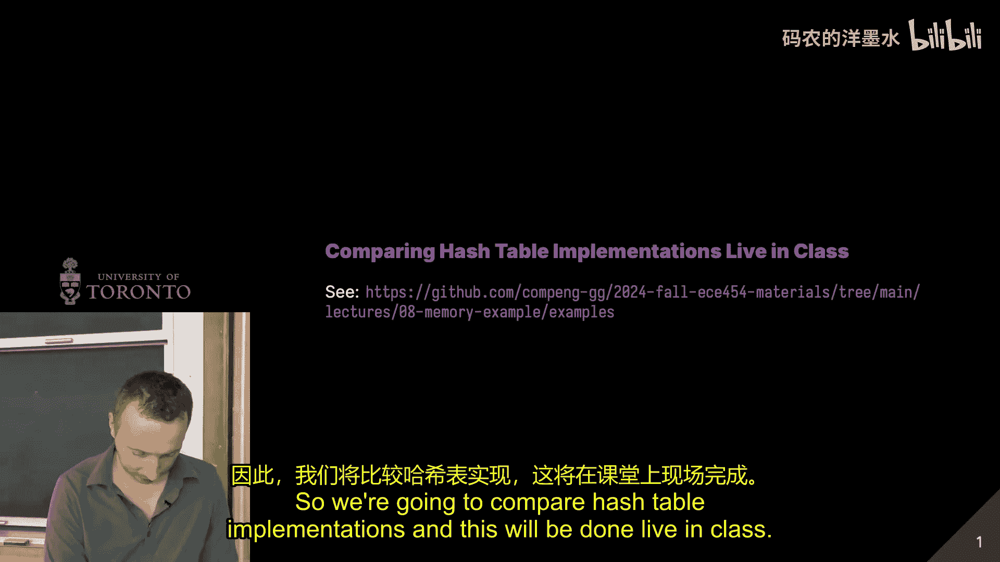
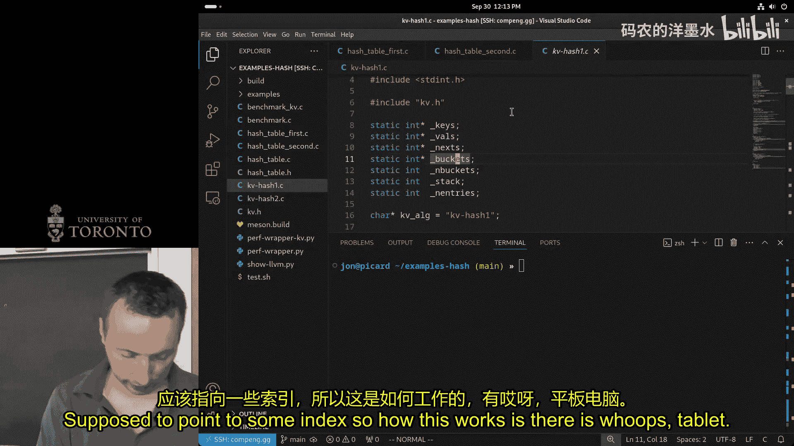
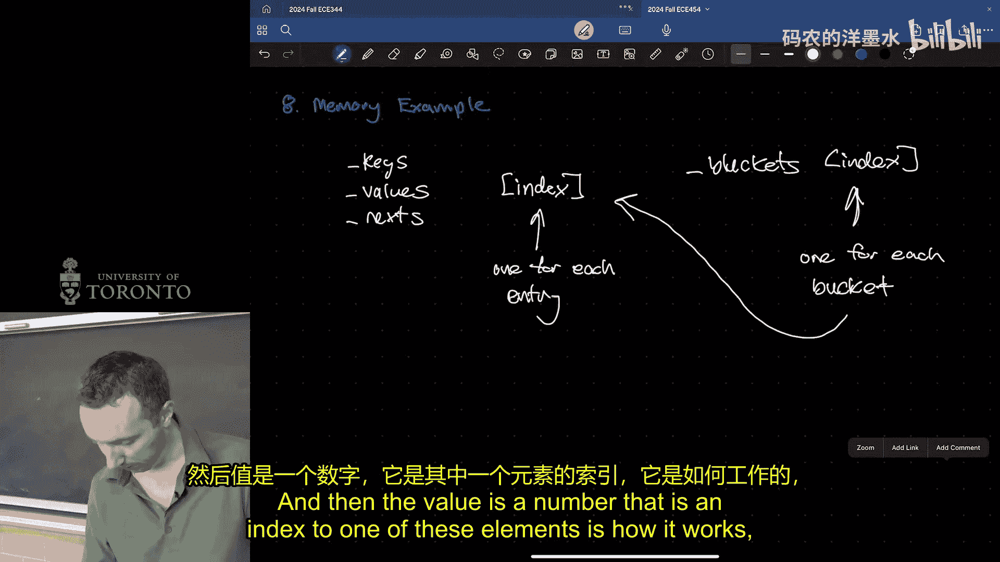
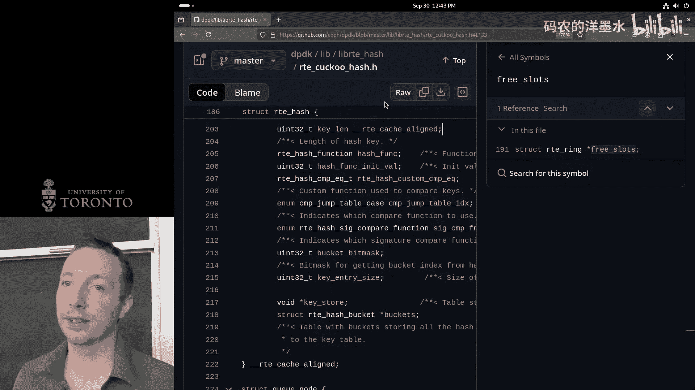
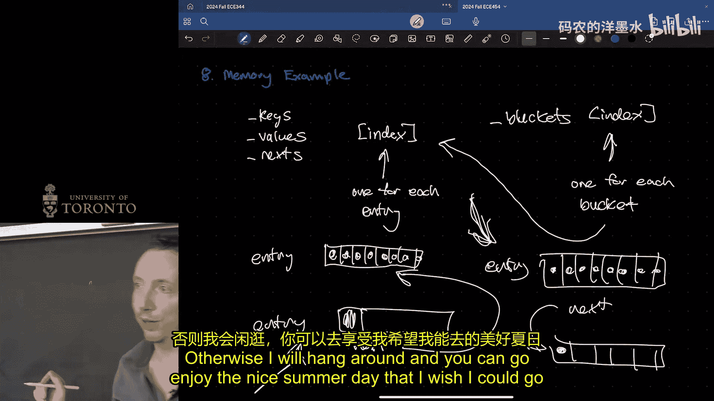

# 【全集】多伦多大学 C语言高性能系统编程实战 中英字幕 1080P p08 Lecture 8 - 内存示例 -BV1oDrZBZEG2_p8-

真的有。All Alrighty， welcome back to 454。So you guys killed one of the Raspberry Pis and La too。

So if any of you pushed code in La 2 and it just said failure and gave you no reason， yeah。

 you killed a pie。 So good job。If you see that， do a white space change and push your coat again。

 and it will go to one of the functional ones now。If your code passed when it shouldn't have passed。

 please let me know because it didn't catch verification errors the first time。

 so I have to check if the score in the Leboard is valid or not and all the other ones。

If you have an invalid one， please let me know。 Alright， aside from that today。

 in order to not get ahead of the other lecture， we'll just have a big old example today and try and。

Put what we learned last time into context。It might not work， but hey。It's a nice day out。

 So if we end early and go outside， it's probably good。 Yeah。

 just a question about the last before we。😊，You said if your things doesn't work。

Like if it should have failed the verification。Right， so what if people felt that you know？So。

I don'If people do not let me know and I rerun it， you get a zero。If I have to， yeah， or like the Ts。

 I'll check it after the fact because there's the little clause that is like。

 if you go against the try and break stuff， you get 0， right so。

Leader board remarkss to be determined after the illustration is done。Yeah。

 we need to set break pointss， so we'll set break points， hopefully this week and。Let you know。

When can we expect it？We reward。不想。As soon as I discuss it with the other instructor。So today。

 memory example。 So let's see if。

This code works another live coding example。 So we're going to compare hash table implementations。

 and this will be done live in class。 So first one。

Let's see if it works。 So this was code given to me。So， this is a。Slightly。

A hash table implementation with a bunch of global variables。So let's go through it。

 It just has a hash function， and then it has a lot of variables， so。It stores the keys。

 It stores the values， each in its own array， and。诶。

Aray of next pointers that tell you which bucket the next thing is if you have to do chain hashing。

 if there's a collision and then the number of buckets and then the buckets。

 which are actually just supposed to point to some index。

So how this works is there is whoops tablet。So there's a variable for。

Let's there's a variable for keys。Values。And then， next。And they're all essentially indexed or。

They're all essentially arrays with an index， and that is unique for each entry。1。😔，For。Each。

So three separate arrays with an index， and then there is this buckets。Aray。

 which is supposed to represent the hash table itself。And。There is an index for that。

And then there's one of these for each， but one for。Yic。😔，Bucket。

And then the value is a number that is an index to one of these elements is how it works。

So。The default code here not terribly exciting。 It has a load factor。

 so it scales the size of the number of buckets based off its size。

 cheats a little bit because it knows ahead of time how many elements will be placed in it。

And then it goes ahead， it allocates a whole bunch of arrays using malloc。

 the only one that is slightly different is this buckets one， which the number buckets。

 whoops get rid of that。The number of buckets is just determined by this load factor。

 so it's slightly less than the size so that there will be some collisions。So， other than that。

What we will benchmark is this。So this is the insert function。Kind of。

It figures out what bucket it's supposed to be in based off the hash value。

 so it's mod number buckets and then by default all the buckets point to negative1。

 which means they don't actually correspond to any entry and then here it will just take that current and see minus1 means it's currently empty and then it will just have a for loop that just keeps on going over and over again until it finds a empty space。

And then， yeah， going through the next， if it has to， and then it will check the key。

 see if it's equal to the key。 I'm trying to insert if it is， just update the value and then return。

 it's not in otherwise。It kind of cheats a little bit like I said before。

 it has a global variable that keeps track of the current index。

 so here this is the postfi version of plus plus so it's initialized at zero。

 our first index will be zero and then it adds a new entry to these three separate arrays keys。

 values next and then updates the bucket to point to this index so it will start at zero all the way up to size minus1。

So what we will benchmark are calls to this fine function。

 which essentially does the whole same thing， which is supposed to just look up a key and then as soon as it finds a key。

 it will go ahead， update right the value to the pointer location indicated by this v and then return0 if it found it and then minus1 if it didn't find it。

So if I just run， I cut off a zero。If I just run Kb hash1。Then I can see， hey。

 I get cycles per element that cycles per find call and then I have now we know a bit more about caches。

 so I show the data one and the instruction cache miss rate can't do much about the instruction one without messing with the compiler。

 but we can try and make this a little bit better， and then the cache miss rate is the lowest level cache。

The LLC and yeah， it's hovering around 50%。So any questions with this hash algorithm before we try and make it more cash friendly。

Okay， let's try and make it more cash friendly， even though I don't terribly agree with it。So。

This version。It knows， well， you can optionally set the line size。

 try to make sure the line size like each。Group of keys and values will fit on a cache line。

 So instead of just an array。It is now an array of array so that whenever I actually look at an index。

 I'll get， in this case，8。Keys all at once。 They'll be all beside each other。

 They'll all fit on a cash line。The only other difference with this， which is a bit weird。

 which makes a comparison kind of strange。 I can get rid of that。

Is that the number of entries is kind of proportional to the line size。

 so like before when we had a direct direct associivity cache and it's just the number of sets and then we increased the number of entry per set but kept the memory the same。

 so we had more entries， less sets。This one tries to use that same idea here。

 so it has less number of entries， less number of buckets。

 but it has more entries in a bucket in this case，8。

 so tries to scale the numbers a little bit so that the memory roughly stays the same。

But also because this is a hash table。It's a bit strange。

 And I don't super agree with it that this is actually comparing apples to apples with the other example。

 because， well， if we have a different number of buckets， we have different collisions， right， yeah。

So， sorry for her。The first initial example。How。Or conflict result。Yeah， so。For the first example。

 how conflicts were resolved is。You know， they would just search for the next。

Bucket it's supposed to go in。 And then they had these next。

 like every element had a next in it that told you the next free space。So it's just kind of。

A link list， but instead of using pointers it use indexes。Okay， so a link but it's not。

Find the next available。 It's not like a flat。 Yeah， it's not a flat thing。 It's like a linked list。

 You don't know like it might jump。Several。Several cache lines or something like that for a collision。

 So this one tries to make them all。Closer together。 So we are changing the number of buckets。

 but trying to keep the memory about the same。 And then other than that。Now。

Delete that now for our code。In order to find a free space。

 each of our entries now is like a cache line of keys and values。

 so we have to have two four loops now that go over the line size so it will actually check， hey。

 is there an unused entry in this in the event of collision and then try and fill out those eight entries before it goes ahead and makes a new block so that's basically what it does here and then at the bottom here？

In order to make a new entry， it has to make a whole new cache line。

 in which case it would initialize the zeroth entry to be the new key in value I'm inserting。

 and then other than that， it initializes it and。Setets a sentinel value of -1 to indicate that there is nothing in there and it's。

Kind of the same。 So if I run this and this is the example in the other class。So it't blame me。

 but if I run this one now， it is slightly faster， but my miss rate is worse。H。And my。

 my overall cash rate miss is。Kind of。The same。 But my miss rate went up a whole lot。

 but my cycles per element went down。H， that's intuitive， right？Yeah， so I don't。Super like this one。

 Like I said， it's kind of not comparing apples to oranges if I change the number of buckets。Yeah。

 if I change the number of buckets and use more memory， there's kind of a lot of things going on。

 So I'm mostly showing this to you because the other section saw this  one。 But this 1。

 I would argue。That it's。Sure you get kind of a speed up。 you're adding stuff。

 but you're kind of changing the structure of the hash table。 So a question about this weird one。

Yeah， I dont know。 Allright， Let's see another one that I wrote。So。

I wrote a different one because I didn't like that。 And I was up。Fairly late。Here。

 I tried to structure it more like a normal hash table。 So I have an entry which is a key of value。

 and then just a normal。Like a linked list， like a pointer to the next element。

 And then in the hash table itself， it is just keeping track of however main buckets we have and then an array。

Of the buckets。It's an array of pointers to entries， so it's going to be dynamically allocating。

Memory here。It uses the same function。 Just rewritten a little bit。 and it doesn't matter。All right。

 so let's see this insertion。So this insureion might be a bit more normal。 Let's see。

 So to figure out the bucket goes in。Same thing you do for all hash tables。 You get the hash。

 and then you mod it by the number of buckets you have。 And then here I actually get。

In order to save some space。I get a pointer to a pointer。

 so I'm getting the pointer to the actual bucket。And then with that， I'll check。

 hey is the entry null， that means that hey， there's nothing here。If it is nulled。

 then I need to add a new entry， so I would just callello some space， Kello again。

 that's the one that zero initializes memory。 So I call some space。

 I just get one new memory for one new entry。Update the key， update the value。

 and then update the next to whatever the bucket entry currently was。 So in this case。

 it's going to be null because doesn't have to point to anything。

 and then updates whatever it was pointing to to point to this entry。

 So it kind of adds it to the front。And then in the loop itself， it would check if the key matches。

 if the key does match， then we just update the value。 We didn't actually insert it。 Otherwise。

 we'd just go to the next element over and over again。So。And then find similar。

 So any questions about this， This one's slightly easier to read， minus the two pointers。All right。

 so let's try and make this one whoops。嗯。So if we run this one， it'll probably run for a while。

Do do do do。2。So again， it makes was this。100 million。

 So the parameters of this one is slightly different。 like the size。

 the number of elements will insert into the hash table， which is 100 million in this case。

 And then how many times we find。So in this case， we have a load miss rate of like 7%。

 like kind of what we saw was the unmodified one before。

 and then our cash miss rate was about hovering up 50%。

What would I do to try and improve this one and make it more cash friendly。

I should probably take the idea I had before or the other one used。

 but rewrite it in such a way that like， hey， if there's a collision， well I should have my node。

 store multiple keys so that it would just be cache hit after cache hit after cache hit in the event of a collision。

So that's what I did here， so。I just changed the entry instead of just using multiple weird variables like before。

 so now in my entry I have line size keys， I have line size values in this case I just put to six so that this whole entry is 64 bytes and fits in a cache line。

And then I have my pointer to the next one and then the length that says how many keys。

Key value combinations are actually valid， and then I just have another int here for padding to make sure that it actually is 64 bytes and I can actually get a line memory。

 hopefully。Other than that。My。My insert kind of looks similar to the one before。 So I just go ahead。

I get the current entry I need to modify， have my while loop that goes over and over again while it's not null。

 so while it actually points out a valid entry， I would have to go which is essentially all the collisions。

 I would have to go through this。Go through the length of this entry， make sure that hey。

 if the key actually exists， just update that value， we didn't actually insert it。Otherwise。

 after I've searched all the entries， if I still have room in this entry。

 then I should just write it to the end， so I just use the old value of I， I update that value。

 update the length and then return that I have inserted it。

 otherwise write this is a link list of entries indicating the collision。

 so I just go to the next entry。And then similar to the other one before。

I actually just callello space if I need a new one。

Make sure this index 0 is equal to this key in value。 This length is one。

 And then the next just points to the entry。 And then I update my entry。

 So I kind of just tack it on to the。Like， I make my the new one， the first one in the list。

 and that points to the other one。 So if I run this one。I do not change the number of buckets。

 It's the same between。This， the hash table and this version。 So if I run this version。

 I would expect my cash behavior to be much better， right。Hopefully instead of following a link list。

Each entry has a bunch of elements on it， so I wouldn't have to point or chase as much， hopefully。

 right？Yeah。Are you dear。だ。That why。So why can I be straddling too？In this， let's see。

 Do I hide the code。 So yeah， that is important to note is that you could be straddling to in this  one。

 I do not check。 So I have another version that actually check that。 But you're right in this case。

 I didn't make sure that you know， each entry is actually aligned to 64 B boundaries。

 So then it might be straddling a cache line Has on one， Ha on the other might not be any good。

 So this is the case of just knowing enough， probably isn't going to help。 So if we run it again。

 So let's run this version。Where we try and just tack on elements。

Into new blocks and basically just make an array。On the entry， make an entry fit in the cache line。

 We run this。My actually my laptop doesn't get hot， this is running on the server。

So we start to get worried how long it's taking。Oh， there it is。 Oh， so。Yeah， that was your question。

 So I actually do do it。 So aligned alloc， that makes sure that everything's aligned to an entry right there。

 So everything is 64 B aligned or 64 by aligned， so。Yeah， I forgot had that。 So yeah。

 there's a aligned alloc。 so you can make sure that your memory allocations are actually aligned to。

This alignment and this alignment， I have an insert there that makes sure it's 64。 So， yeah。

 actually， this one， everything's aligned to a cache line。 So we're all good。 But yeah， if we run it。

😊，We get worse performance or more cycles per element。

 but we did We did make our miss rate go down significantly。Wow。Wasn't that fun。

 isn't optimizing our program great？So misrate， not everything。

 Anyone guess what might have happened here， Why this performance is way worse。

I did bring my myth rate down significantly， right。So it went from 7 all the way to 3。3。8。Hm。

Programming is fun。So basically， what happened is I kept the number of buckets the same and the only difference between this version and this version。

So what's the size of an entry for this one？32。16 bytes， right？So it's about 16 B for this one。

 So 4 B for an int，4 B for an int like gives me up to 8。 And then it's a pointer。

 We all have 64 B machines。 Now。 That's another 8。 So this whole thing is 16 B。Well， for this one。

Well， the size of an entry in this case， I made a cache line， so it is 64 bytes。

 and if I have the same number of buckets，Assuming that I don't have any collisions， then。

This one just uses four times more memory， right？So this uses is much better for caching。

 but there's a little bit of a confounding variable where it uses a lot more memory。😊，Which is。

Of course， worse， which will be our next topic we get to talk about。 But for this one， just。

It's really hard while you're doing things to make like isolate things。 So for this。

 I tried to isolate the cache line and just make sure that my mis rate went down。

 But I also played with how much memory it uses and therefore can't really compare it either。

 even though this one is probably more representative。Alright， we having fun yet。Yeah。

 I don't know if it's obvious， but could you。Explain how a all should work。

So how a line allocate actually works。So how， how it actually works is just。

How they implement it or what the effect is。So， I mean。It would。It would just be malloc。

 make sure that it's aligned at that boundary。 So it makes sure if it's 64 bit a line， basically。

 the address as a multiple as 64。OkayOh， so I think it's a new。You can write this。 just。

 it's just something you。 Yeah， that's a standard library function。 So， so yeah。

 aligned aligned alloc， man。Do I have man pages on here。Aligned all。

 it is something we are allowed to use。So。Yeah dynamic。Resizing their。现在そ談な。

A dynamically resized array at each index。嗯。Might help。 that could be something we try。

 But then we might have more overhead of calling a memory allocator each time， so on and so forth。

 So this one didn't really work。 I'll show you a and it also had some other issues where it would just every time it added。

 It would add the new node to the front。 and the old one to the back。 So the first one。

 It would get a hit， might not have all of the entries full。 So it's a really subtle thing。

That might might cause our issues。So what that means is， hey， you know。

 it will fill a block in order。 But as soon as this block is full and it needs to grab a new one。

Then at the end here。It。The next points to the new block。 So it points to the。The whichch is sorry。

 the next points to the old block， which is now full。 And then the first thing that would be a hit。

 whenever it accesses the bucket will point to this entry， which might not be full of entries。

 which could。Actually affect our performance， just that subtle little difference there。

So I have another version。So this version。Just instead of having a double point or two。

 just has an array of buckets there。 And I do that because， well， I'm not。

I'm just going to use that memory。Straight up for my entries。

 And then I'll have them point to next somewhere else。

 I'll never change as soon as the entry gets full。I won't point。Some like something else into it。

 I'll make sure that it accesses the first full entry first。So slight little change。

 And other than that， let's go through。 You'll have all this code， too。 other than that。

 everything is exactly the same。 The only difference is。Yeah， when I need to allocate a new entry。

I allocate a new entry。 I set it's like to one。 I add the key and the value。

 and then I set the current bucket entries next， which might be the first one that existed in that array to point to this new one。

 which is not full yet。 hopefully it would check all the other values first and it's more likely that。

 hey， it's actually using that full cache line full of data， whenever we actually access an entry。So。

Any questions about this one。Just one subtle little change。Alright， so let's remind ourselves。

So this was the first one that was better than our first attempt at optimizing it that just malllocked every single time to use the link lists。

And。Ended up using a lot less memory than my other example， which was a lot slower。

So got like 250 ish。So let's see what magic I have now。

So all I did is make sure that I access the full。Entry first。

 before I access the entry that might possibly not have elements。 Otherwise。

 exactly the same number of buckets。 This one will use more memory than the first one。

 but hopefully we offset that by our misses。 So this was what 7%。3。8。And now， if I run this one。Oh。

 please work。Yay。We got a very slight speed up。So again。

 there's more factors at play here because not exactly apples to apples。

 it's a bit closer than the first two examples， but we got our miss rate down a whole hell of a lot。

 So we went from 7 to 3。8 all the way down to low2s。Cool哈。Yay。We're running out of content。

 I don't want to skip the other one。So if you are interested in reading like a real hash algorithm。

 too， if you really kind of like this stuff， there is this cuco hash that you can read。

 and it takes much better advantage of the cache line。 So it does some things I wasn't able to do。

 So it has some。😊，Sp optimizations depend if your x86 or arm。And if you go down here， there's。

 it does a few other hacks with the compiler that you can go ahead and you try and use。 So like。

 for example， they make sure that they have this。Whether they call it attribute for structures that tries to make sure that it's cash aligned。

 so they make sure everything's cash aligned and you can see you know it has its own。

Little cache here， and then it makes sure each hash key， which actually stores the key value pair。

 is also aligned based off the key alignment。And then if you go down here。

 you know the bucket itself， it's cache aligned and then it more or less uses that same idea we just did。

 but it takes it a little step further because our entry had keys and values all at once。Really。

 if you're just searching， you're just searching on keys， you don't need to。

Like the value is kind of a。诶。Exceptional case， most of the time you're just checking keys and keys and keys and keys。

 so what this does in their entry， while their version of an entry。

They actually just only store the keys there。 They don't store the values。

 and they have a few other things they store there。

 just as signatures to make sure to do some sandy checks before it goes any further。

 So it does more operations， but。It does more checks in order to skip more work and then this hash bucket entries that was essentially my line size I had before and they where they define it as so they define it as just eight for them and of course you can play with the numbers and do whatever you want。

Let's see anything else interesting here。Yeah， so they real hash table structure。

bit more involved in mine， they let it get a name， they have the number of buckets but they also have a ring buffer of free slots again you can take this as notes and other things you might want to add has a cache of local free slots。

 spin locks， anyone remember threads and all that stuff。Yay， so uses a spin lock。Thankfully。

 we won't get into threading just yet。And then other than that， you， has a whole bunch of fields。

 make sure everything is cash aligned。And this was done painfully。

 probably over years and years and years。 But luckily for you， they have code。

 you can just take some inspiration from this if you want。 allright。

 Any questions for today's weird lecture of examples that quite aren't the greatest。Yeah呀。No。

I was up too late already。So， yeah。

So basically， the second one is faster than the first one， because。Let's see。So our entry。

Essentially like held a whole bunch of elements， right， a whole bunch of keys that I was looking up。

 and it would fill them up like this。 Fi it up， fill it up， fill it up， fill it up。

And if the entry got full。It would then do like the link list thing， so it would make a new entry。

It would add a single element。And then， the next pointer。Would point to this， right？

And then if you've got a collision like you were looking at the same bucket。

 the first thing you would look at is this entry。That is not full， right。

So it would look at the entry that's not full check only a single element then。Poiner chase。

 get to the full bucket and then do that one， which was all full。 But like。

 if you just take assuming it's equally likely。How many times out of 9 accesses do I have to point or chase in this example。

Pretty much8， right， Well， the only tweak I did for the second version。

Is if the entry filled up full of values。So if the entry filled up full of values。I didn't。

 I kept the。I kept the hash table just pointing to this entry that's full。

 So the first time you access the bucket， you would get that full entry instead。

 and then I change its next so it pointed to the new thing。That only had like a single element in it。

So now likely the first entry I access， if I had nine entries。

 I'm only likely to point or chase one out of nine times instead of eight out of nine times。

 so that was literally the only difference between the first and the second。Yeah。Alright。

 any other questions， Otherwise， I will hang around and you can go enjoy the nice summer day that I wish I could go outside for。

😊。

All right， so just remember pulling for you。