# 【全集】多伦多大学 C语言高性能系统编程实战 中英字幕 1080P p09 Lecture 9 - 缓存优化 -BV1oDrZBZEG2_p9-

🎼Okay。Alrighty， welcome back to 4，5，4。 So last time we were trying to chase cash optimizations。

 and we didn't do very well， the example。😊，We changed our memory usage， and then， you know。

 we drove down our cash rate， but we didn't improve our performance that much。

Kind of a confusing example。 So today we are changing the example and just showing what you can do by just focusing on cash optimizations。

😊。

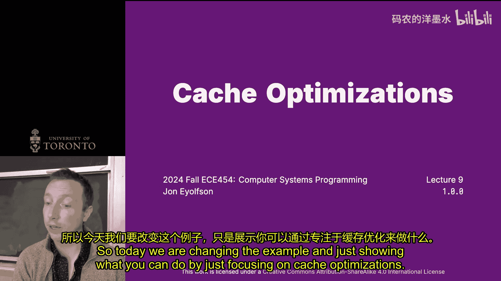

So。Big tip。 This is for any， any， any performance programming course。

 you want to write code that has locality。 We went over it before the two main types。

 temporalor locality A K， you reuse memory over and over and over again， you， if you use it。

If you use it， you'll probably recently use it again。

 And then you also want to have spatial locality。 You want to go to nearby addresses so that。

All the systems work nicely together， computers like things that are always sequential。

 And how do we achieve locality while we have to have a good algorithm。

You mightight also have to focus on loop transformations or some other techniques that we will go into today。

So first off， bit of background that everyone should know how 2D arrays are laid out in C。

It is row major， which means elements of a row are all beside each other in memory。

 So you can just think of it as a 1 D array。 I literally lifted this from A P S 1，0，5。

 So I hope this is review。😊，So if I have a 2D array， right。

 assuming I have an in array and a table and a whole bunch of elements like row column。

 if I want to convert it to a 1D array， it would just be like my row index times the number of columns I have。

 So you jump columns at a time for each row。 And then all the columns are right beside each other。

 So I would just use the column index。 That means table at row0 column 0 is the first element in the 1 D array。

Row 0。Column 1 is the next one， so on and so forth。Everyone's okay with this review， two Ds。

 how they're laid out in memory and see。If you use， was it forran or something like that。

 This is not true。 It's column major。 So it's the other way around， but。

Probably most of you will not be。Unfortunate enough to use Fortran。Or maybe it's cobal。

 one of those silly languages。 anyways。 So for this lecture， most of the time。

 we'll just be assuming a simple cache and kind of figuring out what our cash misses is。

The example we will use today is a very， very simple cache。

Where the block size or the line size or how big each cache element is is 8 by。Therefore。

 if we were using an integer rate it could hold two ins in a one specific cache line。

And we'll assume we have a twoway associative cache with a single set。

 So this is actually the same as fully associative。

 So finally have two blocks and it' two associative means any block can go anywhere in my cache。

 This one really， really small， only two blocks。 So the total size is two blocks。

 and we'll assume least recently used as a replacement policy。

 So if we need to kick something out of cash， it is the block that was used least recently。😊，So。

Some questions you should ask yourself always when you are programming。

 especially using arrays is how many elements are there for a block。

 does my data structure fit in cache， do I reuse blocks over time and what order am I accessing the blocks is because all of these things will matter for your performance。

So let's first start off with just analyzing a very， very simple array。 So say we have， It know。

 we define n equals to4。 we create an integer array of four elements just on the stack。

 and then we have our four loop that just reads elements of a。 So for our cache。

 we should be able to figure out what the mis rate is on this scenario that is assuming the array is actually cache aligned。

And then we should be able to figure out our mis rate。

 which is the number of misses divided by the number of accesses。So first element that I access。

Is that a cash hit or a myth？Mis， and then what will in this very， very simple cache scenario。

 what elements will it bring into cache。Yeah，8， a，0 and a 1， right？

 So it brings two elements into cache。 Then the next element we。Look up is one。 It's in the cache。

 So that would be a hit。 So now we're one and one。 Then next we index element2， is that in the cache。

 No， so we bring it in。 It has another block so it can be in the cache is the same time as the other entry and the whole array fits in cache。

 So our last。Final access。 We will have a hit。 So we， in this case。

 we have what two misses and four accesses， right。So。Ps it in the slide。Everyone okay with that。

All right， should be。Fairly， fairly straightforward。 So if you generalize that， right。

 in this scenario， if I can only fit two things in the cache， my generalized mist rate is like。

 I'll have n divide by two hits。No matter what the size of the arrays in this case。

 and then n accesses， so that gives me all the time， I will have a 50% miss rate。

So this is about the best we can do with a cache， this ball that can only hold two elements， right。

 So if we。Oh。If our cash could hold。Four elements in a block， our miss rate would be what？25%。

Assuming that the array is cache aligned， right， So if I was really， really unfortunate。

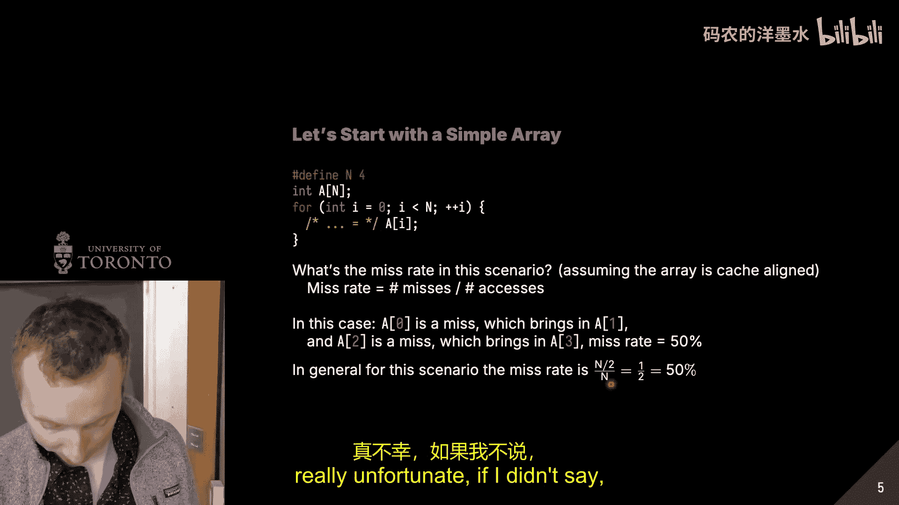

If I didn't sayops， if I didn't say assuming it's cash aligned。Let's say this is my array block。

 I could have。Had it such that if I access a 0， it's actually the last half of a cache block。

 and then。My next one would be element1。And element 2。And then my last cache block was three。

So this is what would happen if my array was not cash aligned， right， And in this case。

 I would have three misses。 I would have four accesses。

 so I would immediately have a 75% miss rate if the whole array wasn't cash aligned。

 So I would start off really， really unfortunate。

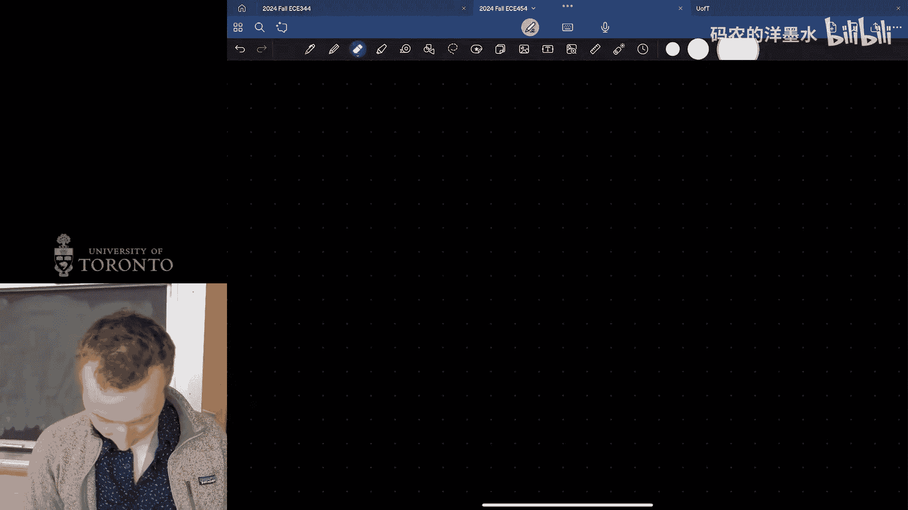

All right， so yeahep。sir。So in this case， right？My array would be4 byte aligned。

But my cache is8 by the line because that's my cache size， right？So。

The array could start at any 4 by boundary。 if it starts at the wrong one， I'm screwed。Yeah， yeah。

 So raise out of like， starts at by 4 or something and。Cashs want to start at zero or eight。Yeah。

And is large。Yeah， depending on， we'll talk about prefeing a bit in the next one。 But yeah。

 prefeing will come in a bit and slightly help us out a bit。But yeah， any questions about that。

Allright， that is our1 D array。So。Its add another loop。 One loop is fun。 Two loops is more fun。

 So what is our miss rate now。😊，So all we're doing is assuming we can just go over this entire array P times。

So we can probably figure out our total miss rate。So inner loop still the same， right。So， inner loop。

I'll get a 50% miss rate。 but eventually assuming that array is cash aligned again， then， well。

 it's a hit every single P times through the loop， right through the outer loop。 So overall。

 in this scenario。Since the whole array fits in cache。

 we only miss that n divide by two times the first time we access the array。

 then the whole array fits in cache。 So every time we iterate through this outer loop then well our whole array is in cache so they're all hits。

 So the more times we run the outer loop。The more hits we get and the better our hit ratio。

 So the number of accesses we have is just n times P。

 So our overall miss rate is now one divided by two times P。

 So this assumes the whole thing fits in cash。Now， if we had this scenario where our little array was not cash aligned。

 what would our entire miss rate be。Yeah。Yeah， same as before it be 50%， right。

 you're going to say if it's not。Two ways so when it get elected every time？Yeah。

 it'd get evicted every time。 So it's like running。

 it's like running it without it being in cash every time。 So our miss rate would be 50 or no。

 it'd be 75， sorry， yeah。Yes， yeah，75， sorry。 So every time through， right。

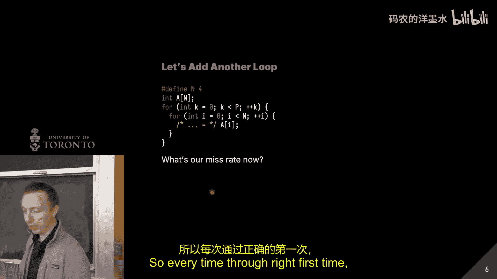

First time。First time through the re， if it was not cash aligned， we'd have a 0 in。 and then， okay。

 well， that was a miss。 Nothing we could do about it。A1， when we access that， it would bring in A2。

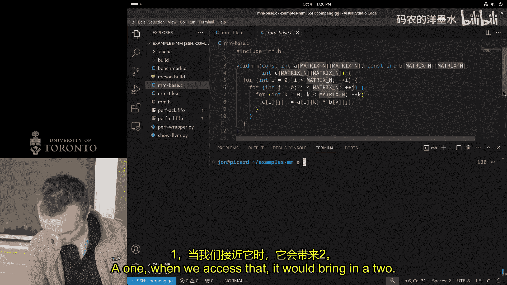

So myththon one whoops。I assume it was that。 Yeah， so miss on， we have a hit on a 0， hit on or sorry。

 miss on a 0 brings an only a 0 hit on a 1 brings on a 2。 So that would be a miss on2。

 And then since we're assuming we only have two blocks that fit in cash。

 We'd have to evict the least recently used， which is this one。 So it would get replaced by this。

And then next iteration of the outer loop， we start again。 And it's the whole thing again。

 where we would bring in the unaligned。A zero， and then our total miss rate would be 75% if the whole thing does not fit into cash。

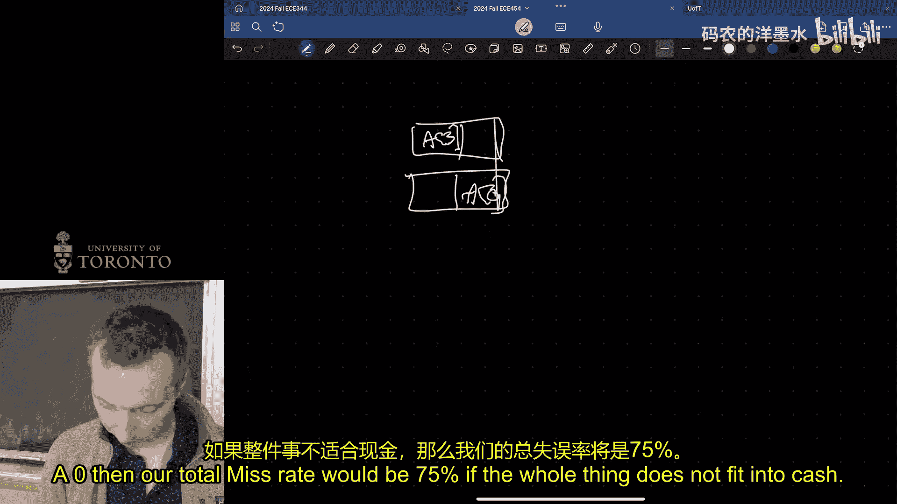

So cash alignment， even for that little example， really， really important。

So so everyone okay with that， still simple things。All right。This lecture will also go quite fast。

 probably。So。If the data does not fit in cache， so assuming our cache size was not big enough。

Then our miss rate would go back to that 50% again。 So say we， you know。

 only can hold one cache block at a time every time through the loop。

 we would miss load in another element， hit on the next one， so on and so forth。

So being able to fit in cash is very， very important for our mis rate。

 especially if we have multiple loops going on at the same time。So。Ohoops。Yeah。

 what about if we just had a 2D array instead of an outer loop going over and over and over again。

 So let's just assume that now we have n equals to 2 and we have a 2 by 2 int array now， so。

Assuming that whole array is cash aligned， what is our miss rate now？Yeah。Yeah，50% again， right？

 It's the exact same thing as before。 We're accessing it in row column。

 So we're accessing it the same order we would do in a 1 D array。 It's only four elements。

 So it's the exact same thing as before。 So missed rate。Exactly the same thing in this case。

 being 2D did not。Effect anything， right？Doesn't matter if the entire array fits in cash or not in this case。

 because。I'm accessing just every element once in this case， so it doesn't matter。Yeah。

Decoration of A。Yes， the declaration of A is definitely wrong， oops。So。Not our example。 So yeah。

 I'll fix that in the slides， but should have two ends。Alright， so if we just changed the。

Boundary or if we just change the accessing it and。This goes to the loop interchange again。

 like we saw before， again， definitions wrong。 But assuming we just flipped it around so that we access the columns and then the rows。

 So we just jump by columns at a time instead of rows。 Well， what is the miss right now。 Well。

 in this case。I screwed up the indexes， so in this case。

I I just converted it to the 1 D equivalentence。So。If you miss on 0，0 instead of just 0。

 it corresponds to array if it was a 1 D at 1。 So that would bring in a0 a1 into cache。

 And then the next access would actually bring in a 2。Which is another miss。

And then that would bring in A3， and then after that， since you're doing it in this order。

 you would access row 1 column0， which would correspond to a1。

 which is now in cash and the other one would also be in cash。

 so the mis rate is 50% if this whole array fits in cache same as sequential so。

The thing to mention here is。Even if you access it。The wrong way。

 So if I access it in column a major order instead of row major order。

 as long as the whole thing fits in cache， it doesn't matter， right。

 I can kind of skate away with it and not really notice anything。 So that is the main point here。

 But things get real bad once that is not true。 And it doesn't fit in cash， right。So。

If it doesn't fit in cash and I access it in the wrong order。So say now I have a4 by four now。

What's the miss rate now， So if we convert it to 1 D array， our accesses are going to be to a 0。

 then a 4， then a 8， then a 12， then a1。 So if we do this now， right， what's our miss rate now。

If those are array accesses， and we can only fit two blocks in cache， yeah。Otherwise way。

hundredundred。I thought I heard zero。Okay， sorry。00% miss rate in this case right so I access a0 that would bring into cache a0 and a1。

 then I access a4， that's a miss。 I would bring in a4 and a5 into cash again assuming the whole thing is cash aligned。

Then I access a 8。 I have to kick out that A 0 and a 1 and put in a 8 and a 9， E cetera， E cetera。

 etc cetera。 So our miss right now，100%。Whoops， so definitely something you want to avoid that is why loop interchange is such a good thing。

 But sometimes， you know， the compiler can't catch it or it gets a bit more complicated。So。

That is why you should double check that your compiler actually did it correctly and you're actually accessing things in row major order。

 most of the time your compiler should do it for you， but again。

 this is so important even for that tiny cash changes our miss rate from 100%。

 which is you know terrible to 50%， which is much， much better。Alright。

 well about if we have something more complicated， like matrix multiplication。

So if we have matrix multiplication。The easiest way to argue about this is what happens when I equals1 or I equals 0 whenever we're calculating a single element。

So for this。If let's just say I is constant at 0。 So I'm accessing things in the same row for matrix A。

 But because the way matrix multiplication works， I can't do the same thing for matrix B， right。

Because I have to access， you know。I mean， the way matrix multiplication works。

 it's row times column， right， each element， you multiply them together and then add them together。

 so。What is going to be our misrate for just a single iteration of that outer loop？

It should actually say when I is equal to zero。So when I is equal to0。

 what elements am I going to access in which order？Yeah。75%。 Y， so it is 75%。

 And let's go over that real quick， so。

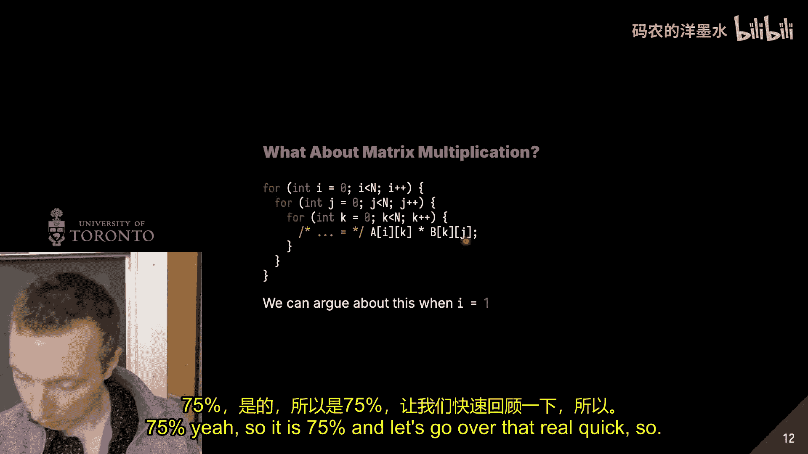

If I'm doing whoops， matrix multiplication， right， And I assume that I is equal to。

 let's just say one。What I'm doing in each iteration of， let's say，4。J。4K。And then I'm doing。

In this case， let's just assume that I is constant。I do something like this， times。第。First。呃。J。

Alright， so if I do something like this the first time through， I will access。A 0。 and then。B。😔，0。1。

😔，So first time through， that's what I'll be accessing。And then， oh， wait， no， I made a big。

 big diagram， sweet。

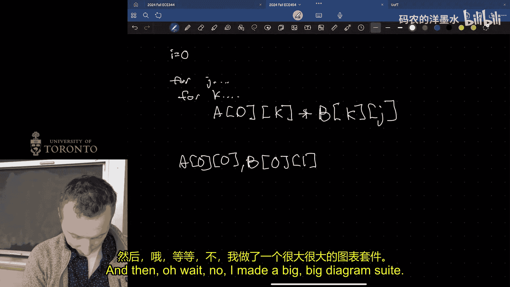

So， ohh。Why am I drying stuff， Alright， I already spent time to do this。 Allright， So the mis rate。

 when I equals what， Well， typo should be I equals 0。 So first time through the loop。

 I have the cache at the bottom right now， it's empty。 So assuming the first time through this。

First element I'm going to access is a at 0，0。 So that would be a miss。 So it would bring a 0。

0 and a 0，1 into cache。 The two things that are actually beside each other in memory。

And then it would actually access this， right， It would access B0，0。So， D，0，0。Brings that into cache。

 So it bring B 0，0 and B 0，1 into cache。 And now the next two elements it's going to access are a 1。

0 and B1，0。A0，1 and B10。So is a1。Is a01 in cache？Yes， so that would be a hit。 So put it in blue。

 And then we access B1，0。 Is that in cache。No， so what gets kicked out。 Well。

 this would get kicked out， right， It was least recently used。 I did not use it。

 I used the A 1 instead。 So this would get kicked out and replaced by B1，0 and B2，0。Not the greatest。

Next element I access is a0，2。 Is that in cache。No， I would have a myth， and I would bring in a 0。

2 and a 0，3。Then I access B2，0。 Well， that's not in cache either。 That is another myth。

 So I would bring in B2，0 and B21。Then now I access a0，3。Well， now it's in cash。

 so that would be another cash hit。 And now the next element I'm going to access is B 3，0。

 which is not in cash， So it would be a miss and it would be brought into cash。

 So our miss rate in this scenario was what 75%， right。

So should be able to analyze the misrate for this。Clearlyrely straightforward so far。Okay， so。

If we were to generalize this， assuming that a row does not fit in cache。

 the arrays or cache a line and we have can fit D elements in our cache。

 Well then our overall miss rate will be one out of D。 So every one element out of the cache line。

 I'm going to miss times however are my elements are in a row。

 So I'll be able to take advantage of my cache for a row and then。

Then for every column I'm going to have n misses every single time it's going to be a miss out of my n accesses across a the A array and my n accesses down D B array。

 so therefore the total miss rate is if you play with the numbers is one divide by 2 d plus1 half so I can never get better than。

A mis rate of 50%， no matter how big my cash is。Right， so I'm kind of capped by that。

 which kind of makes sense。 This half comes from every single miss happening when I access the array by columns。

So to improve cash reuse， right， misses are very expensive L1 cache references， right。

 it's like just one nanosecond or maybe four cash sizes are 32 kB， pretty small。

 pretty big or pretty small， but big enough。And main memory references， right。

 They're like 100 nanoseconds and you have gigabytes。 So matrix multiplication。

 If you actually look at it， it has a lot of data reuse， right。

 I use the same row multiple times in a row。 same column multiple times in a row。 So the key idea。

 if we really want to speed up multiple matrix multiplication is to try to cache an entire block once we load it。

 So we need to work with both rows and columns。😊，Kind of easy to， you know， cache the row。

 We can have our mist rate very， very low。 But for the columns。

 we might have to do a little bit of magic。 So some solution which might apply to some of your labs is you can operate in little sub squares of matrices。

 So have one。😊，The idea here is just to have one subquare per matrix that fit in cache simultaneously。

And then you're actually heavily reusing all the sub squares before loading new ones。

 And this is called piling or blocking however you want to refer to it。Oops。

So I'll draw out the idea first， so。

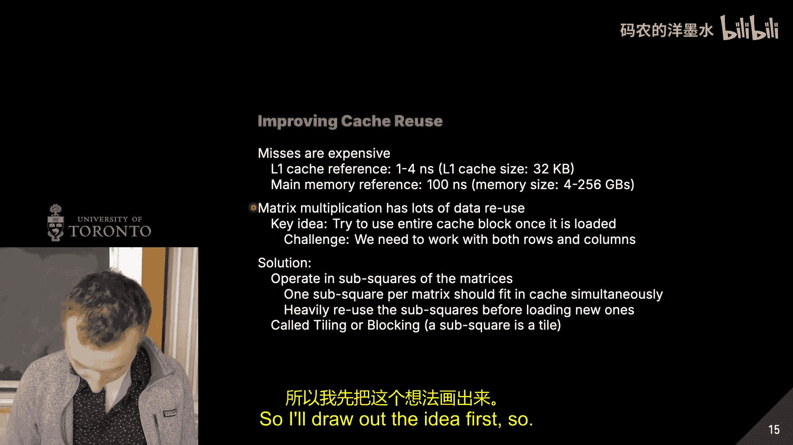

The idea before was， hey。Right， if I want to calculate this element of my。Of my matrix。 Well。

 I have to access this from matrixtri。 Let's give them names。So I have to access this element。

 Actually， I'll change the colors。So to calculate this one， which would not be in cash。In matrix C。

Right， I would need this element in matrix a and then。If I access that element in matrix A。

 it would bring in the entire cache line， right？And then。If I access this element in B。

 it would bring in this cache line。And then next iteration， well， this one would be a hit。

But this one in whoops。

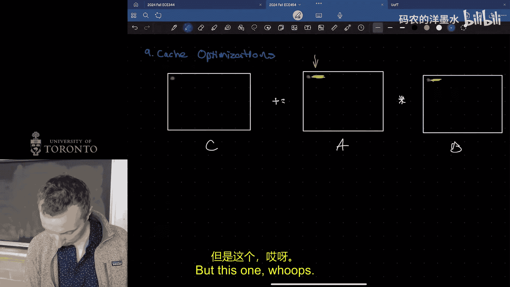

Oh哦。

But this one in matrixtri B， like before， would be a miss。

 and we'd have a miss every single time we access the column。 So essentially。

 we would have something that looks like this。And then this one would be， you know。Mis。Then， hit。

miss。Then hits。So on and so forth，We can't fit in a cache line。 Thus is just really bad。

 We want to try and reuse that column as much as possible。

 because we would have brought in all this data every time we brought in a cache line， right。

 We didn't actually use it。So to use it， that's where the tiling idea comes in。

 so since I brought this in and I assume that I can't fit an entire columns worth of blocks into cache out a single time。

 like by the time I wrap around and come for the next iteration I assume that my cache isn't big enough to still have those entries in it。

If I want to make sure that it has those entries in it， that's where the tiling comes in。

 So instead of。Doing this。Accessing every column and having it wasted by the time I get back and having it kicked out of cash。

The idea of blocking is I instead。Let it get to maybe here， whatever I can fit in the cache line。

 And I just stopped there。 and then for。My rows， I can just actually do the same thing and just stop。

With a certain block of rows and calculate that subsection of matrix C。

So this little block of matrix C， I can just divide it into blocks。

So I assume that I can fit all these blocks from all the matrices into cache。

And then I just calculate all the elements that use。All of these rows。

 let's assume that we just have one and then a hit。And then we just have one。

And then a hit for all the rest of them。 So I will calculate all of the elements of this matrix。

From the row and column row and column of all of these two little boxes inside the other matrices。

 And that way， my miss rate for this one will be， well， depending on my block size。

 I'll have one miss。It would have however many elements I can fit in a cache line。

So over my D axises， I'll only have one miss。For both of them， right。

 and I reuse them over and over and over again。 So does that kind of make sense yet？关于。Sub。真啊。

I assume yellow some thats right。No。Looks yellow， greens a hit。It's supposed to be green。

It's green on this。 I guess the color calibration， yellow， whatever it's supposed to be。 So theyre。

 they're all hits， yeah。Red do。Where。Yeah， they should all be like the sequential ones， right。

 all the other ones。So we're not going all the way in the row， we're just calculating that box。

And then to calculate the rest of this box right， we would go ahead and move this square。

 so we'd move this square over here and then this square down and then we'd have the same cache behavior they all fill up assuming that we can fit these three blocks in cache all at once and then to complete it right。

 we can go here， go here， do the next subqua then do the next subqua and do something like that so we would。

To， to do。So for this。Basically， we would have squares going this way， then squares going this way。

 and everything fits in cache all at once， so we just divide it into smaller chunks that actually fit into cache。

So that OK ish。Yeah。我没法儿啊。plication was instead of reading for the if we were just writing to the。

Yeah。と？Yeah， so if we were just writing to be。Depends how we're writing， in this case，Yeah。

 if you're writing column order since you have right。Back， it would probably speed it up a bit。

 so it would help writing as well as reading。 Okay So you're saying by tiling you minimizeizing amount of right back。

Yeah， so I'm， I'm updating that like whole cache line before it gets written back。

 which is gonna be a lot faster And only updating one element， it gets written back。

 And then I have to do it like  eight times or 12 times or。1416 times there are powers of two。

All right。So let's go into fun demo。 So here's normal matrix multiplication， right。

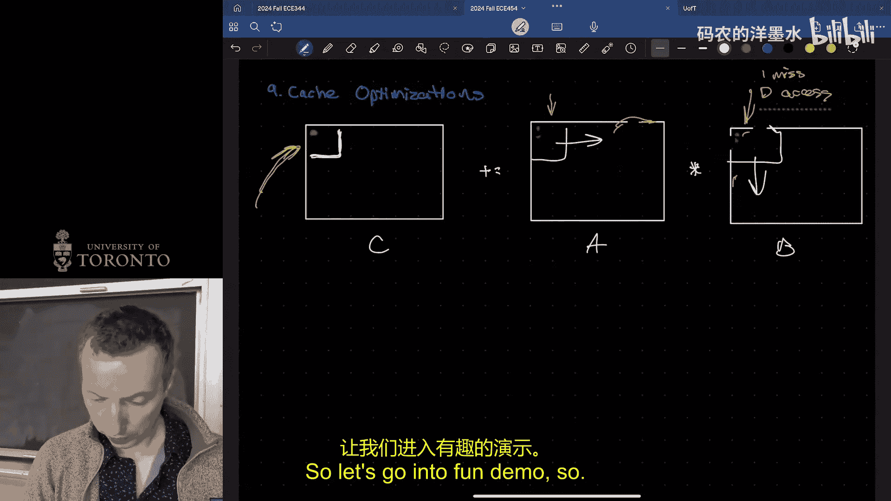

Nothing。Nothing to。Bad about that。So。Just gets the constant。

 This matrix n is just something I can set。And then。I just。From I to J to K， I J equals I K。KJ， blah。

 blah， blah that。Everyone agree with that as matrix multiplication。All right， so。Let's try it out。

 So if I do something like。呃，他。Not that interesting by itself， so。Let's just run it。

 We're going to compare it to tiling， so tiling， the tiling version。Looks like this。 So first off。

 if my cache size is 64 bys and these are arrays of ints。What should my tile size be？

How many or how many elements can I actually fit into cash at once。16， exactly。 So 64 divide 4。

 I can fit 16 in at once。 So if I was to convert this and pile it， this code looks fantastic， so。😊，A。

Instead here。I tile every 16 because that is my cache size and then I change all of my outer loops instead of going up by one it goes up by a tile at a time so that's why it's plus equals T and then now I just have a four loop and these three。

 four loops are for a single tile。So I need an I 1。 So that goes for everything in the tile。 Then J1。

 everything in the tile， K1， everything in the tile。 And then I just。

Keep on adding elements to the resulting matrix by just building it up based off this tile。

So any disagreements with that beautiful code。It looks like it's supposed to be a lot slower， right。

 It just looks like。I mean， it's6 loops verse 3。 Wow， that seems horrible。But。If I run it， let's see。

So if I run it and both of my matrices are 16 by 16。

Should I see any difference between using this and using the。Boring。

 boring old matrix multiply that I don't do anything for。Probably not， right。 So if I do this。

I run it。I get essentially the exact same thing。 My miss rate is essentially 0。

 So the parameters I use here， This is the dimension of the matrix。 So it's a。

In this case 16 by 16 and this is how many times to repeat it so if I repeat it1 thousand times and the whole arrays fit into cache。

 yeah I expect my L1 miss rate to be pretty much zero especially if I do it a bunch of times if I do it only one time right I'll have a larger miss rate which gets closer to that one over 16 there's some things going on with prefeting and things but that's why it gets to something like this but。

And the difference here is essentially just noise。 doesn't really matter at this point because it's so。

It's doing so little work。All right， so if I bump it up to 32。

 likely my cache is big enough that this is still mostly okay， oh no， even with that。

 even with 32 bumpy enough to like a tile 4 by 4。Since the cache is so small。It。

 I still get some sort of benefit， even though my miss rate is abysmal。 Actually。

 this should be the same。Maybe it just got noise again。Alright， Tling's even better for 32 by 32。

 learningring things on the fly， so。Even though my miss rate is essentially0 for both of them。

 But as soon as I grow my array a little bit， the effect becomes more and more pronounced。

 So say if I had a 64 by 64 again， here， it still kind of fits in cash。 So maybe not。

If I bump it up to a 128 by 128， then suddenly my effect becomes way bigger。Right， so now。

I've created an array big enough that if I just do the naive approach of just having。

This type of loop。Every time I access any element in the B array。

 it's a miss every single time right， even though my L1 mis rate is 100， which tells me that hey。

 actually my array kind of fits into L2 cache， so this is primarily just the effect from the L1 cache。

Just by accessing， you know， tiles and actually reusing the columns I bring into memory。

 I get my mis rate from。82% all the way down to less than。 Well， not less than 1%， but around 1%。

 right。Cool， so。Should get more pronounced the bigger and bigger I make my array。Wops， yeah。

 should still work。So if I make it。If I make it 256。You know， I。Lose some effect here。

 but still like two times better。 And again， if I bump it up， let's say to 512。No。

 I have to wait a very long time because now likely my row doesn't even fit into cache by the time I reuse that row again。

 since it's not in cache， I have to reffe the entire row。

 I don't get the advantage of having hits all across a row and yeah， that is a 10 x increase there。

 So very， very， very important if you can just constrain your caches to actually just make sure that you fit in cache。

Make sure you reuse your data， even if you have to do something as nuts as writing six，4 loops。

 the six4 loops， even though it looks maybe at first glance that the person writing it is actually insane。

It's actually a lot faster because it accesses memory in a way that is much， much more cash friendly。

 so。Any questions about that。Cool， right， tiling， very， very， very， very， very good， yeah。

Any compiler analyses？あな。Are there any compiler analysis that will do this automatically。

 not that I know of？Especially once it gets into like this is really hard for a compiler to like even matrix multiplication。

 kind of hard for a compiler to argue about like three different。

 three different arrays all using different indexes。 So yeah， compilers， not that great at this and。

GCC， I did use clang for these examples because GCC completely screwed this one up to。

 It did not vectorize。 I couldn't actually compare things。So another。

Another plug for clang being much， much， much better。Alright， any questions about this fun stuff。

I mean， that was pretty much the lesson of the day。

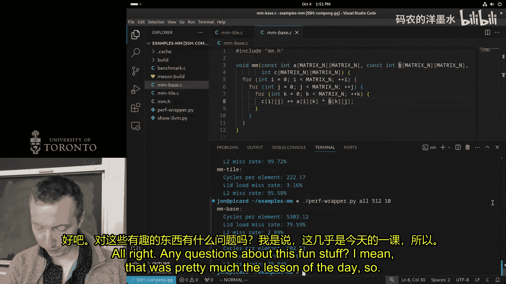

So。The mis analysis for the tiled one in general， if we can assume we fit each tile into cache so that means your cache size in this case has to be bigger than three times T squared sorry。

 not t to the three So your miss rate for the tiled a matrix and the tiled B matrix would just be one or two divided by T misses out of the two n accesses。

 So for each array right you would have depending on your block size。

 the first one would be a miss and then the other in this case。

15 werere all hits So we made our tile size match and then。

We would have that for both the B array and the A array。

 and in total we would have two n accesses giving us a misrate of just sequentially accessing an array。

 even though in one， we're going in column order now。But because we're tiling。

 we get our nice sequential missrate of1 over t， which is a massive difference from before。

We even did a little bit better because what one divide by 16 is what like。

I want divided divide by 16。It's like a 6% mist rate， but we saw when we actually ran it。

 we got like a 1%。Has to do with a little bit of prefeing a little bit of like tiles in the corners can kind of overlap once it gets kind of to the side so we can actually take advantage of some things。

 But massive， massive difference from before， right， Tling is big， good。嗯。I out slides。

So we're slightly， if you can believe it， we're slightly ahead of the other class。I'm not sure。Yeah。

 I read a slide， so yeah。W loads is source。Sa like if you're a st。😔，First。Yeah， so so sorry。

 what's your question。呃。The loads and stores， the way most things are set up， generally not really。

 you'll have more of an effect if you can cash a bunch of rights altogether。

 but it also kind of depends on your program， whether or not and your hardware。

 whether or not it can kind of hide that。Just based off， you know。

How much you actually use memory in your program。 So it kind of depends。 Hardware is complicated。

 That's the great thing about this course is we can just say it depends for literally everything。

All right， any other questions holy hell that went way faster than I。Yeah， I literally have not yeah。

How does the material that we're learning？How。あてら。How would that be tested on midterm or exam。

 I have to look at the previous midterms， I assume it would be like something like， hey。

 you should be able to argue about how a piece of code would you know。

 interact with a cache of a certain size and blah， blah， blah。I assume。

 just to make sure I understand about the。Yeah。对。The mis rate for just the D block becomes the same as the this block for the A block yeah。

 so we're doing it in a way that if we bring in a whole cache line， if we're tiling。

 we actually use that whole cache line right so we take yeah。So we should like calculate。再 get。あほしい。

Yeah， so basically everything I bring into cash， or you're saying for matrix C。

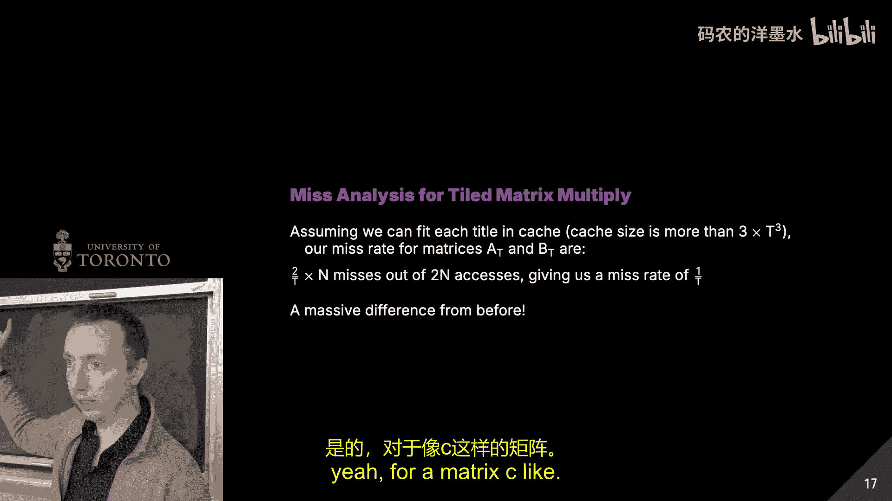

Yeah。For matrix C， it doesn't matter if we're doing like if we're doing this tiling approach。

If we're doing this tiling approach， it doesn't matter。 If we're doing the other one。

 depends how big the cache is， but we access。We calculate the rows of。We access。

The C matrix in row major order，Didn't really help us。

 Tling is just making sure it all stays in cash and doesn't really matter that much for matrix C。

 That's why we mostly argued about， well， matrixtri B was the bad one。All right。

I will stick around for about an hour。

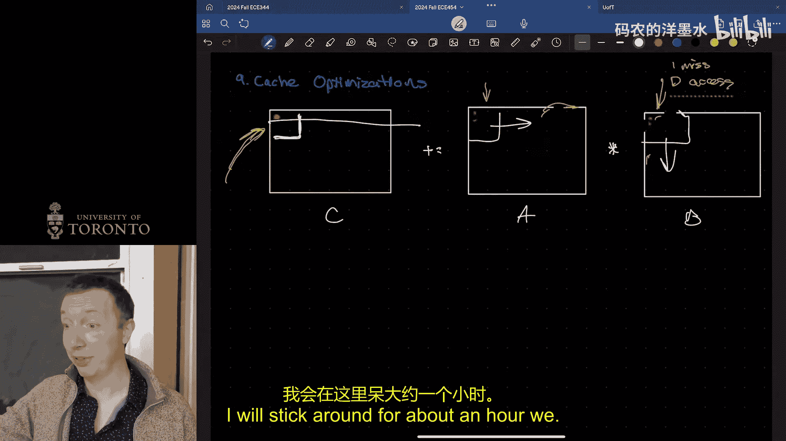