# 【全集】多伦多大学 C语言高性能系统编程实战 中英字幕 1080P p10 Lecture 10 - 虚拟内存与预取 -BV1oDrZBZEG2_p10-

What's about then？Yeah。中。材了。やらか of。Alrighty， welcome back to 454， so today。

 virtual memory and pre prefeting。Everyone remember good old virtual memory from 34，4。Ih。

So virtual memory， fun， important for performance。

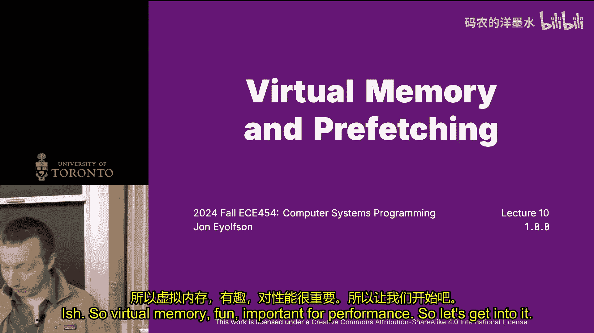

So let's get into it。So。First bit is review。 So ask me any questions you need since I just went over this in 3。

4，4， so。Should。Be mostly review， so each process uses virtual memory， not physical memory。

They believe they have access to the entire range of memory right。

 no matter the amount of actual physical memory on your machine。

 kernel divides physical memory into pages， typical page size is four kilobytes。

 and then the kernel maps virtual pages to physical pages everyone kind of ring a bell。

 how all this stuff works。

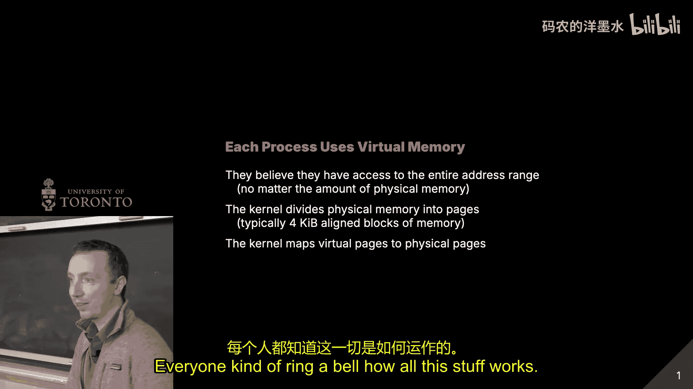

All right， so to induce some trauma， remember that？Oh， no。So。

Everyone remember exactly all the steps to translate virtual memory。Great， let's continue。😊。

You know it vaguely does something like this。 All you really know for this is that。Hey。

 even with three levels of page tables， again， everyone's favorite topic。It's slowed。

 So instead of one memory access， if I want to use virtual memory， I might have to do， you know。

 one memory access to get an entry here， one memory access to get a memory an entry here。

 one memory access to get an entry here。 And then I can finally look it up and actually access the physical memory for that virtual address。

 So this essentially makes things four times slower than actually using memory， right， And。

 remember what we did to make this performance much， much， much better。😊，Yeah。The T LB， A K。

 just another cache。 So we mostly hid this little。

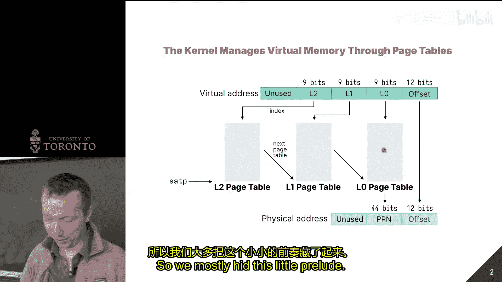

Prelude， so some benefits of virtual memory， really nice thing to have decouples memory from a process from using physical memory。

 the kernel can do things that will improve performance。

 It can actually share memory implicitly through copy on write， things of that nature or explicitly。

 you can share memory between processes and use that for new process communication。It's also lazy。

 so you can ask for like a whole gigabyte of memory or something like that。

 and it won't actually waste a gigabyte of physical memory on your machine。 It's lazy。

 So as soon as you first use that memory， it will only allocate a page whenever you first use it。

And then another nice thing about it is if you run out of physical memory。

 the kernel can actually use your disk as kind of use memory as a cache for disk and allocate some swap space and actually swap some pages to disk if it runs out physical memory。

 so it's much slower， but you can actually use more memory with your processes。

 then you actually have physically on your machine。Just going to be really slow。

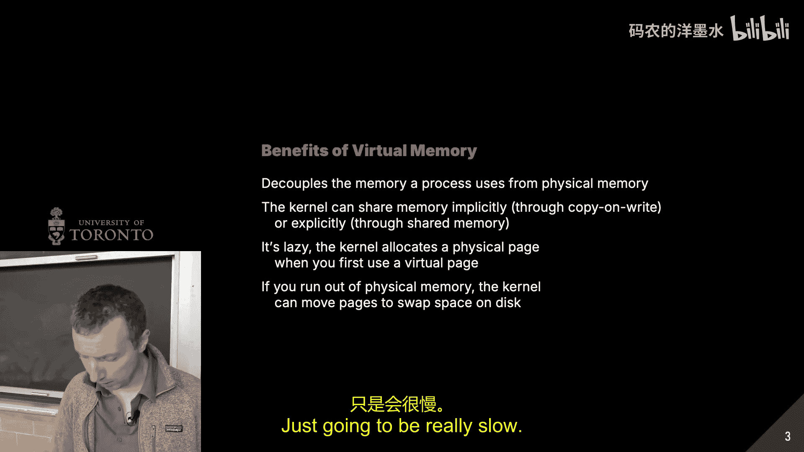

So TLB， that was the cache for all of the virtual address lookups。

 So for even a 39 bit virtual address。How it would normally work is okay。

 well we want to cache these translations。 We don't want to go through every level of page table。

 So the TLB is basically just a cache that cachees the virtual page number to a page table entry that we can just use directly for our translation so it doesn't have to hop across the three levels of page tables。

 So there's gonna to be some penalty for， you know looking it up in the cache。 But if it's a hit。

 we can just access physical memory directly。And if it's a miss。

 all we really need to know is that it will be very。

 very slow because it has to walk through all of the page tables in order to get the translation。

 it would add the entry to the TLB。And then。Do the translation。 So it's just another cache。

 And for the most part， Ih， we don't really have to worry about it。

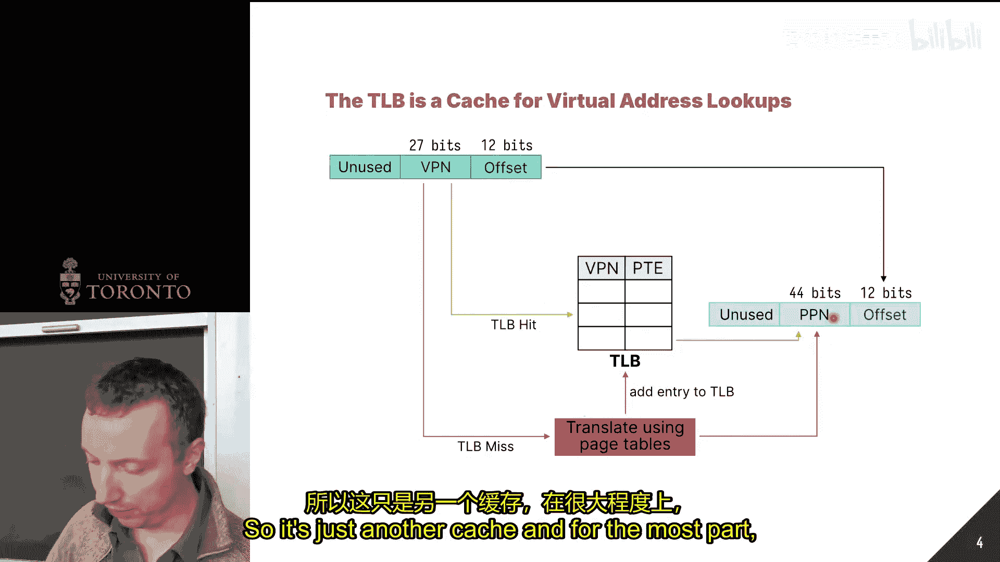

So it's typically integrated with the L1 and L2 cache。

TLB significantly speeds up virtual memory access， typically the TLB stores enough entries to translate everything in the cache。

 so you have a very very， very bad performance issue if every access is to a new page because it would need a new translation and the caches aren't that big so for instance for your L1 cache。

 sometimes it's hard to actually find this information but something around like 64 entries in your L1 cache and like 2000 48 in your L2 cache。

So the amount of memory you can reach using your TLB entries is called TLB reach。

 so if each page is4 kilobytes in size and we have 64 entries。

 then we can reach up to four times or 64 times 4 kilobytes of memory so that would be our TLB reach for that cache so we would have what like 256 kilobytes of reach and our L1 cache can typically hold like 32 or 64 kilobytes of memory so。

We have enough reach that it shouldn't be a problem。

As long as your memory usage is only on a reasonable number of pages。So fun fact。

Apple silicon devices， they do not have a 4 kilobyte page table。

 they have a 16 kilobyte or sorry page size， they do not have a 4 kilobyte page size。

 they have a 16 kilobyte page size， what does that mean about Apple silicon devices and their TLB reach for the same number of entries？

Yeah， it's four times larger， right， yay， Apple， It know。So fun fact， maybe not that fun。So。

Sometimes you do have to program with virtual memory in mind。

 So your working set is the number of pages your your program needs to execute a portion of instructions。

 So like in a set amount of time。 if your working set is greater than your T LB reach。

 That means you will start having T L B misses， that means you'll go have to go through that virtual memory address translation。

 and things will be really， really slow and it will cause memory more。

Many more memory accesses because it will have to access the page tables。If， however。

 your working set is greater than the total amount of memory on your machine。

That's when pages have to swap the disk in and out constantly。 And then that is called thrashing。

 Your performance will be absolute。Crap， and you just best want to avoid this again。

 I think I mentioned this in 3，4，4。 Most systems now。

 memory is cheap enough that people just disable swap space。

 And then they'd rather just know they ran out of memory as opposed to things just going slower。

 So slight less of an issue nowadays， this is， and this issue of your working set beating greater than your T LB reach。

 If you find this， you should probably fix it。 you will find your program going way， way， way slower。

So here is a typical process layout， right， so your process address space is divided up into pages。

Page 0 will of course， be invalid so that you know if you dereence null or anything like that。

 you get a seg fault instead of just accessing random memory。

 and then you know as part of loading a program into memory。

 Some of the space will be mapped to instructions some will be mapped to data。

 which is where all your global variables live then there'll be a stack set stack space allocated somewhere probably with a guard page so that you we can actually detect stack overflows if we actually overfill your stack and then your heap area that you can go ahead and expand and it is a big contiguous block of memory。

 and then there'll be some addresses， we don't really care about the trampoline or the trap frame for this。

Course。Basically， the operating system will go ahead。

 reserve some other space and virtual memory that you cannot access in order to store some other information about your process。

So again， a questions so far， virtualr memory kind of ringing a bell。

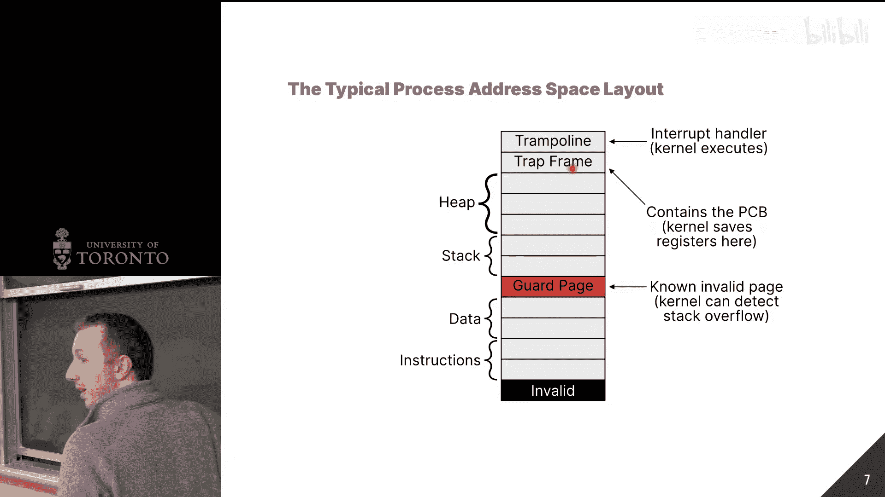

Fun， all right， so。That the way to mofi heap we might have seen it before too is that SBRK system call that modifies the heap。

 you get to use this for lab3 yay， so lab 3 you will be implementing mallOoc， a fast malloc。

 a good malloc， a better mallocc。U。So you'll be using a simulated version of this for lab 3。

 the system called basically just increments the heap by a specified number of bytes。

 and this heap space is what malloc and friends use ish。Not super true anymore。

 I'll show you what happens and have an example where I actually。Brke something today。So。Have yeah。

 La 3 should be entertaining。So you can also map memory yourself。

 which is probably more useful for this course。 So there's a more flexible system call called Mmap。

 anyone used M map before， I think I showed in 3，5，3，4，4。So a little bit more flexible。

 you can actually initialize virtual memory with the contents of a file。

 makes it a lot easier to read and write data from a file instead of doing constant read and write system calls。

 it's nice and lazy and you know it will only load。

Information from the file into memory whenever you first access a page。

And you can also share memory across processes using endMap and changing what happens when it forks and all that good stuff。

Kind of ring a bell to。344。So。Another fun thing that wasn't in the content before。

 but that you should probably know about is something called huge pages。

 So 4 kB page size that was selected。😊，I don't know， Way older than you older than me。 I will No。

 probably not。 Oh， that's sad。 So probably older than you， not older than me， so。

If you have a 39 bit virtual address space that requires three levels of page tables。

 if you actually check your processors， most of you。

 probably and the servers and everything like that， they use 48 bits of virtual address space。

 so they have four levels of page tables， which is even slower than three levels of page tables。

So one approach that they have taken is。You know， instead of。L3 pointing to L2， pointing to L1。

 pointing to L0， they just mix L0 and say hey in the L1 page table。

 instead of pointing to a single page or to a L0 page table， I will point to 512 contiguous。Pages。

 and in this case， that means it would point to a single。2 MBby page。 So for one translation。

 you get 512 mappings for free instead of just one。

 So we'll have a bit more fragmentation if we don't use that much memory， so。

So there's a little bit of tradeoff， but if you're doing really， really big allocations。

 you probably want， especially if you traverse it a lot。

 you probably want to try and allocate a huge page so that you have a lot less pressure with translating virtual addresses over and over again。

There's this M advised system call you can use to give hints for memory usage。 so for instance。

 if you map in like a gigabyte file or something like that and you only read it once best thing to do is emmap the whole thing and then Em advisedvis you can sequential and that will allow the kernel to know it can actually free the pages after you're done using it after you go on to the next page。

 it can free the previous page so you can read a whole 10 gig file。One page at a time。

 only using one page of memory。 So that is really， really good。 You don't have to worry about。

Inefficiently using memory or anything like that。There's also。

 you can also say give it advice and say， hey， make this allocation a huge page， which。

Gets me into trouble during this demo because I tried to do it， and I broke everything。Ha。

 this course sometimes。Al right， so any questions about virtual memory before we move on to prefeing。

A lot of it， you'll just have to you can run per also tell you how many TLB hits you have and so on and so forth。

It should be relatively low if you notice that having a problem。

 you might want to make sure you have more locality， you're using locality like the other advice。

 or you might want to resort to huge pages。All right。So prefeing the other topic today。

So gives hints on individuals memory loads and stores， as opposed to just how I use virtual memory。

 That's what Em advised does。 So on the right or sorry， on the left。

 let's assume we have a program that just has， you know， instruction 1，2，3，4， and then loads。😊。

Some memory location X。Normally， if that's the first load to X， it'll be a miss， right。

 so I'll have to bring it into cache， maybe all the way from memory， that will be slow and then。

Only after that is finally in cache if I have a dependency。

 then I can actually execute instruction 5 Well if Im prefeting。

 well what I can do is after the first instruction。

 if I somehow know I'm going to use X in the future。

 I can issue a special instruction that is called just pre-fetch X so go populate it in the cache for me so that by the time I get to that instruction。

 that load its already in there so。The cache miss would all happen and this is assuming any of these instructions do not also have cash misses。

 So assuming the other instructions don't have cash misses。

 I kind of hide that latency so I prefetch it。 that generates the cache miss and it populates while I'm executing instruction 2。

3 and 4。 and then by the time I do the load instruction。 The idea is that now it is a hit。

 It's already in cache so。If it's effective， it will help you a lot tolerate all your latency to memory。

So the bad part of it is that it is very， very difficult。 So this is。

Only effective if all of the following is true and this all is five points。

It's only going to be effective if there's spare memory bandwidth。 Otherwise。

 your prefeting can cause contention and actually interfere and actually cause a bottleneck in your bandwidth and just interfere with it。

 It also， well， of course， has to be accurate。 So if your data is not actually used。Soon。

 that's just wasted memory accesses。 So you will make things slower。

 You have to have it make it timely， so it has to prefetch the right data。

 but not too far in advance。 So there's a bit of a Goldilocks number because if you prefetch the right data。

 but you don't use it by the time it gets kicked out of cash。

 then you're also probably going to pay a penalty。You also don't want it to displace other data that's in the cache。

 you don't want to kick out anything else that is important。

 especially if that data is about to be used， you will actually trounce your performance and the latency you hide is outweighing it like its cost so if you are wrong the useless prefetes again can be really really significant so if you just throw this into like the matrix multiply before I made it go three times slower by trying to prefetch because。

Well， it turns out that there's hardware prefeting and it's actually good for most use cases。

So a simple hardware prefetcher could just prefetch the next adjacent block。

 that's the easiest thing you could do， makes it behave like cache blocks are twice as big。

 so if I grab one， I immediately grab the next one， also helps with unaligned instructions。

 if I have really， really big instructions， if I have， you know if I already filled my cache。

 not a big deal。More complex prefessors can recognize stride。

 so stride is just I'm accessing every X number of bytes， so for example。

 if I'm using an array or some other memory and I'm accessing you know offset zero then one or。128。

 then 2，56， then whatever then the stride would be 1，28。 I'm accessing every 128 bys。

 so the prefecher could just go ahead and。Just prefetch all the addresses of multiple 128。

Real prarifeers are magical beasts， they are proprietary， you don't know exactly what they're doing。

 and in general they seem to do a fairly good job。However。

 if you think you are smarter than Intel or just have more information。

 you can try prefeting yourself， so there is this built in prefetch。All it takes is an address。

 and then it will。If the architecture supports it， so R X 86 will support this。

 it will go ahead and prefetch that address and it has some optional arguments。

 readwrite and locality so readwrite you can whoops zero is the default here so you can say what you're going to use is for reading or writing the default is just reading and then you can say locality and there are four options here。

 there's none so I'm never going to use this again， don't worry about it。呃。One。

 which is just leave it in L3 cache， I probably won't use it for a while，2 medium leave it in L2。

 I probably won't use it for a decent amount of time and3 is high， leave it in sorry Typo is L1。

 so just leave it in L1， I'm about to use it again， just keep it in cache。All right。

 and now we get to go into the example。I tried it on many， many， many， many things。

 The hardware prefetcher is very， very good。 The only thing it is really bad at is accesses that look more or less random。

 So the only thing I could think of off the top of my head over the weekend is binary search。

 So binary search to the will really， really confuse a prefecher because， you know。

 we're starting in the middle。 We're going half either way。

 really hard to predict which way we're going， especially if we' just searching for random values。

 right， So prefeting is something you can do for binary search。😊。

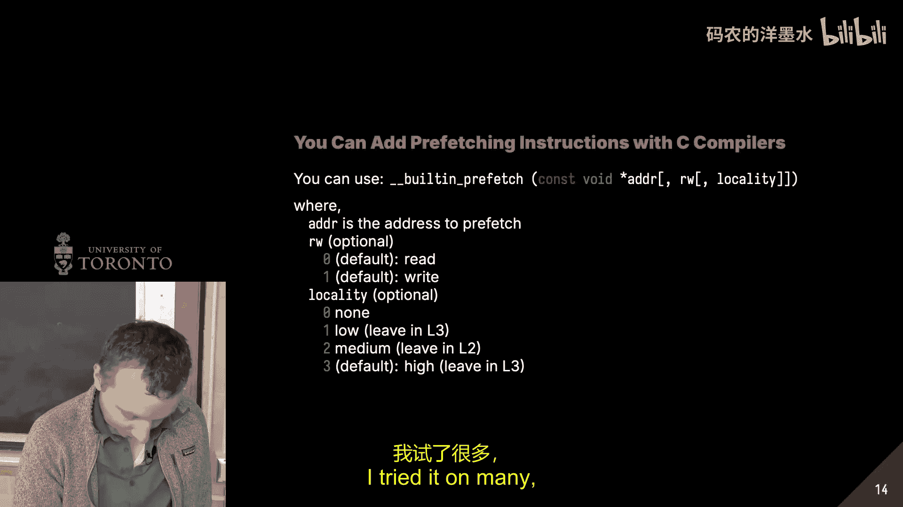

So just to make sure。Everyone liked my binary search。It looks very searchy。Sorry， yeah。

 very searchingy。 Allright， so I am going to make this faster by prefeing。

 So what I'm going to do is。😊，Well， as soon as I know the midpoint， right。

 I know I will actually soon in the future access one of two addresses。

 what are the one of two addresses I'm going to access after I know my midpoint。Yeah。

 I'm either going to access， you know， the first half or the second half， right？

 So what I can do is I can just prefetch。So as soon as I calculate the mid。

 I know I'm going to access。Depending on my if， I don't know which one it's going to be。

 but I know it's one of two， which is better than。Depending on how many numbers I have one of a lot。

 So I just prefetch， I'll prefetch， you know， one mid point and then or I'll prefetch the or and I'll prefetch the other point。

 And I'm pretty much like 50，50。 I'm gonna get this right， right。

 which is probably a lot better than the other prefeter。So any questions at this before I run it。さ。

So should make it go much， much， much faster？No。Let's see。So。Gs。Quite a bit faster。So 2000。Yeah， but。

So this example broke， so。I actually sped this up by two times。

Remember that M advised and the huge pages and stuff。 So I had this working all damn weekend。

And then right before the lecture I was trying to be like， you know what， I'll use huge pages。

 I used huge pages， it got twice as fast。😊，But now I have this weird cashist thing。

So I swear to you on all that is holy that these are the numbers I had literally 20 minutes before class。

 I scrolled up and I copy pasted them in the slide。

 So this is what actually happened before I started playing with huge pages。

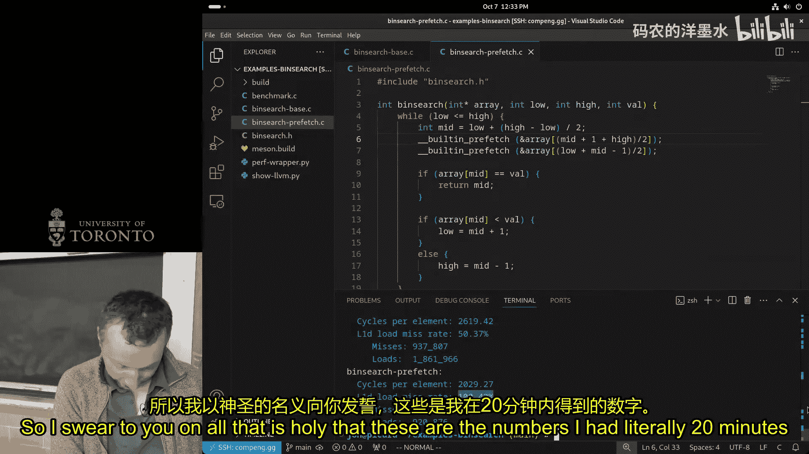

So its prefeting was still faster in this example oop。And this is why this course is fun。

 So prefeing was a lot。Faster and why it was。 Well。

 so my miss rate was a lot lower before when I didn't use prefeing。

Which is why you can't just use the miss rate by itself。 And when I use prefeing。

 my miss rate was around 50%， which kind of makes sense。But then you might be like， way。

 shouldn't that performance be way， way worse， Well it turned out because of the hardware prefeter getting really confused。

 it just loaded a whole bunch of other crap into memory。

 So you should need to keep track of the denominator in these cases， just the misrate by itself。

 Of course， does not tell you everything by itself。 So here I had like 2 million different loads。

 while in the case where I was prefeting， sure I was wrong half the time。

 but I loaded significantly less elements。And I had a lot less loads than I had， what only like 1。

4 million instead of 2。3 million。And then yeah， take a note of those numbers。 So what？

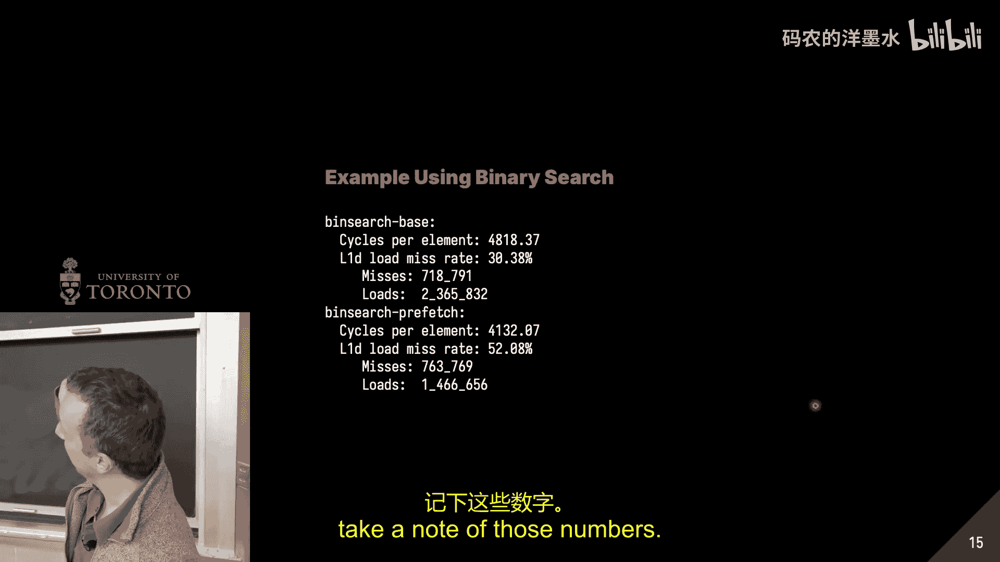

4800 and 4100。And then look at the numbers。 Now， I have no idea what I did， so。

All I did is I changed。I changed the memory allocation to use M map。 like I showed you。 I changed it。

 I advised it to use a huge page because I thought it would make it much better。 I got that。😊。

And then I was like， great。 look at that performance go。 And then I tried to reset it back。

 and it kept doing this。 So I think I accidentally enabled huge pages for that process or just in general。

 I have no idea。 I have to go back and see what the hell happened。

 But I think I just accidentally enabled huge pages。😊，And you can。

I can also kind of reason about it that if you。Oh， what was it？So some benchmarking。

 so if you S trace and actually see what the hell it's doing， you would think that cowello。

 it just allocates using Ka， you'd think that just uses the heap space or anything like that。

Turns out they cheat too。 So if you actually look at it， they M map。So。

Maalocc and friends will cheat a bit for really， really， really large allocations。

 They'll use Mm directly。 So I assume since they use Mm directly and I kind of trained it to use huge pages for this that it just now uses huge pages because Caloc essentially does the whole。

Same thing that I was doing。 So again， I don't know， but turned out for this。

Since it's a giant array and I'm doing binary search。The two longgged in read is huge pages。

 had a huge effect and they were really great。So great that I can't undo it。All right。

 Anyy questions about today's whirlwind， yeah。If it takes。Sential number cycle。Main memory。

And this binary。That shouldn't take。Oh， it's okay， never' mind it's because。

It prefetches while it's fetching a ray of。Yeah。Sptching。That's why Yeah。

 because I only use a few different values so as soon as I know the midpoint。

 I'm about to use a ray of mid， I don't really need to prefetch that， but while using the future。

 like very close to the future is the other two midpoints one if I'm right and one if I'm wrong。

A ray of myth was。Yeah， array of mid， aside from the first access， which is cold， A ray of mid will。

 no matter which direction I go will be prefetched。 So it'll already be there。 already be in memory。

 I'm good。And I get a slight， a slight speed up。Well， decent amount of speed up so。Like 25% for free。

 But if you mess up。Yeah， if you try and do it in the matrix multiply and like just pre fetchtch right before you access something or here。

 let's say。Yeah， we can try it out。 So let's just try and prefech straight away。

 So I don't need to calculate。Whoops。Sometimes you have delete everything。Oh， okay。

Vim key bindings don not like me。Whatever。So， let's see。Oops。Prefit。All right， so now if I run it。

No didn't do anything。Yeahay， oh。So like best cases， it won't do anything。

 but I tried it for the matrix multiply and like try and get everything in the column。

Prefe all of that。 And yeah， I went like three times slower。

 So really easy to make things slower with this。 this one， the hardware prefeers are really。

 really good unless your。😊，You get in a situation where。

Your accesses more or less look random and you know more information in your program than。

The engineers at Intel could possibly have from just guessing。Alright。

 any other fun questions that is。F， the。Oh， in this case， why is there more misses and loads？

W it's at over 100%， I assume I'm not sure because thiss literally just happened before class is something to do with having more entries and like loading TLB stuff that isn't related to actually accessing memory。

 I don't know yeah。questions。そ以 like。Yeah， it doesn't wait， yeah。Yeah， so prefeing just，ll just。

Let the pipeline continue and just kind of add a load into the pipeline。Yeah， but yeah， weird thing。

 our mystery rate got above 100%， which should be sounds impossible。But。

because it's doing other things with the T LB。 I briefly looked up some manual thing and they're like。

 yeah， it's like really hard to get a miss rate over 100， but we have done it with huge pages。

 But other than that， again， I swear to you that this is what should have happened。

 This is what happened for days and days and days and days。

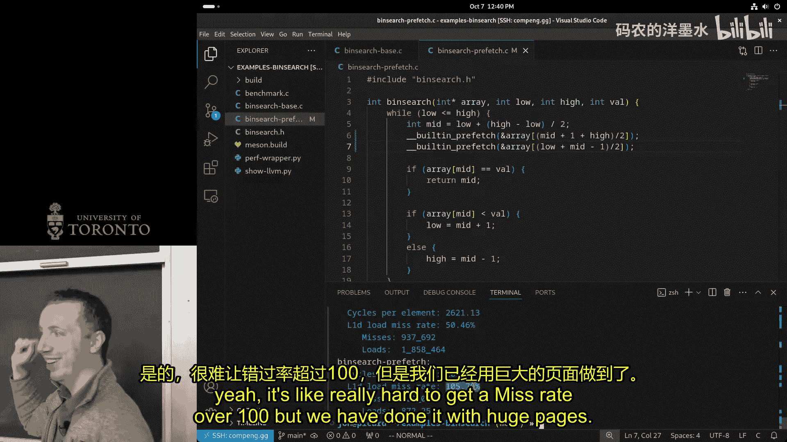

And then， of course， 20 minutes before， because it's a performance course， it guy go bad。Alrighty。

 so any other questions， fun stuff。 Alright， so if not， we'll get into some fun takeaways。

So fun takeaways for caches。Focus on L1 or L2， depending on your working set size。

 So if you're not using a lot of data， focus on your L1 cache， you can start with your mis rate。

 but you should also keep in mind the number of loads like just as a total。 And if you have a very。

 very large data set， you probably want to pay more attention to your L2 cache as being the more important thing。

And if you can， that's also after trying to make sure that your program fits into cash as much as possible。

For virtual memory concerns， usually。If you're doing the first thing for caches。

 you'll be okay because it'll all be located on the same page anyways。But in certain circumstances。

 maybe your data is just really spread out and you cannot do anything about it。

 So you want to try and keep your working set on as few pages as possible。

 TL B misses will significantly slow down your program。 Like， for instance。

 here we can try the T L B。

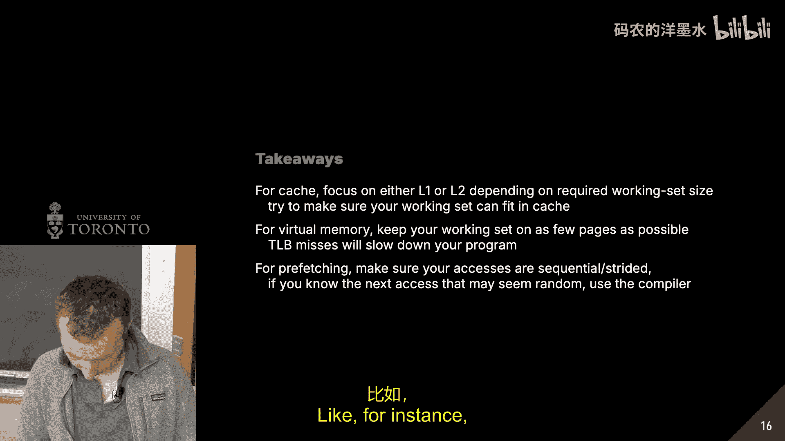

So another example we have is this test TL B program。

 so this will go ahead and access every few number of bytes so it will look a lot like the prefecher。

So this test ELB program takes two arguments。 This is like the allocation size。

 so how many bytes to actually allocate and then the next parameter whoops is the stride。

 So the stride is I will access every 4096 bytes。 So if I access every 4096 bytes it will all be on different pages and if I run that。

I get something like。Some super low number， oh， 81， okay。So if I access every page。

 it goes and it's like 31 nanoseconds for each memory access， which is really， really slow。

If I go ahead and access， I don't know every。Cash element， every new cache element。

 it's going to be a hell of a lot faster， almost 10 times faster than having to deal with TLB misses。

So。Other than that， if I use 32， probably it should be a bunch。Like the prefecher will do a very。

 very good job of this。 And we get back down to like 2。5 nanoseconds。 If I access， I don't know。

 like every 8 B， like it's just a bunch of doubles then。I probably get down till yeah。

 like one nanosecond。Prefecher， generally pretty good。 But if you get into different pages。

 every single access， you're going be into a world of her。

 So these are kind of the main numbers you should see， so。Not two big elements， like one nanosecond。

22 cash。Two cache hits per entry， you think it would be really bad， but because of prefeing。

 actually pretty good， it's not that much slower。And then every new cash line， Yeah， sure it's。

Two times slower， but it's not that bad。 And then， yeah， once you get to every page。

 it's like 10 times slower than that。 So it gets really， really， really bad。

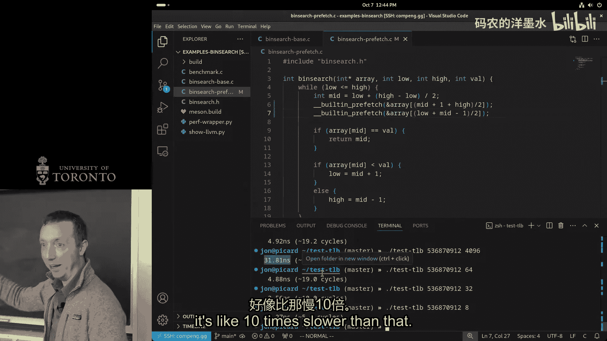

嗯。And then， yeah， for prefeing， yep。

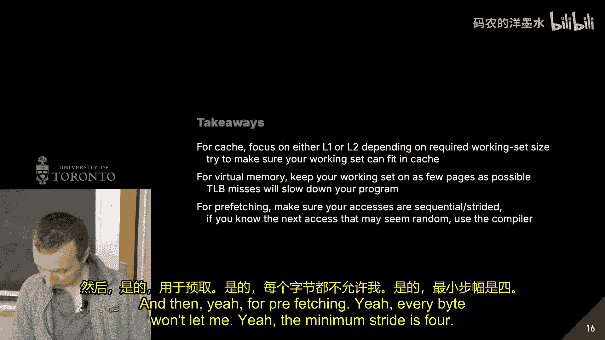

Every bite won't let me。Yeah， the minimum stride is four。So I can do four。

 but four should be a bit the same as eight and take a bit。Dtu。Since， you。

 most array elements will either be 4 B or 8 by， so。Yeah， it's， slightly faster， but not that much。

 but for twice as much data。 Yeah， about the binary search。Yep。M up。Should what。Why was MAP used？

isn't that used for mapping a file to a virtual memory？So that Mmap call。You can map it to a file。

 but you could also say do not map it to a file and just give me a big chunk of virtual memory。So。

Like here I deleted it。But all I have is Kaello， right， I just have a big Calello。

 but they use that M map call。 So what I did in order to break this demo is I did my own M map call。

 and then I did an M advise on it to use huge pages。

 And then I guess I enabled huge page support for every single process from then on。 I don't know。

But yeah， if you need a whole chunk of memory， you can just use Mmap yourself。はい。

Guess it might break things by make things going twice as fast， but you can emm a file。

 You can em map like an anonymous thing。 You won't have to map it to file。

 You can use it to share memory cross processes。 Mmap is really fun。

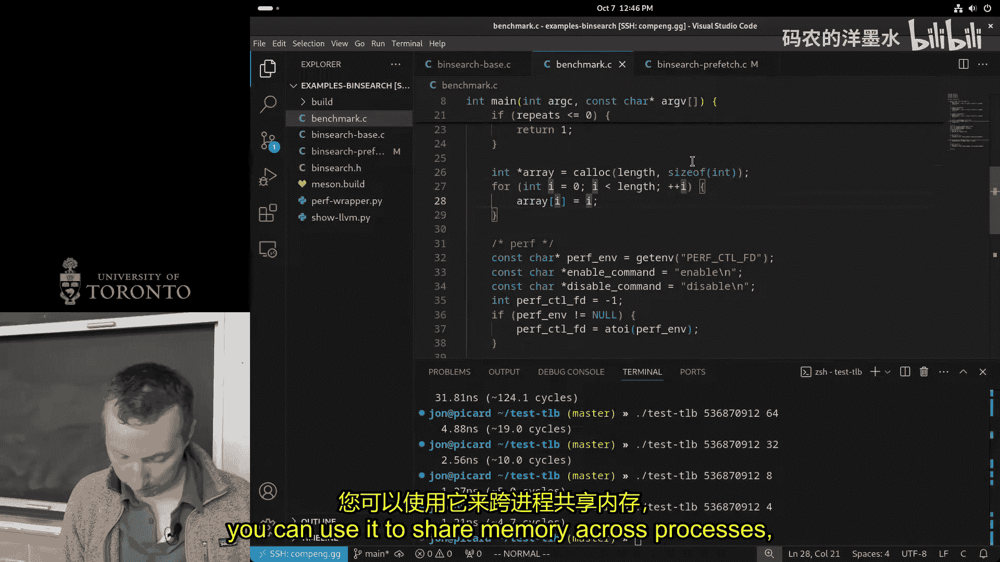

And then yeah， for the last part for prefeting， basically if your accesses are sequential or strideed or otherwise predictable。

 then your hardware prefetcher will probably kick into effect and do a really good job。

 you just have to really know it was there。If the next accesses seem otherwise random to you or it might seem hard to predict for something that doesn't know anything about your program。

 then use the compiler， use that built in prefetch。

 and then you actually might get some performance out of it if you place it in the right spot。

 So it might take a little bit of trial and error to actually find the correct spot for it， but。

It will give you some performance if you fit like those five categories of things。So with that。

 just remember。

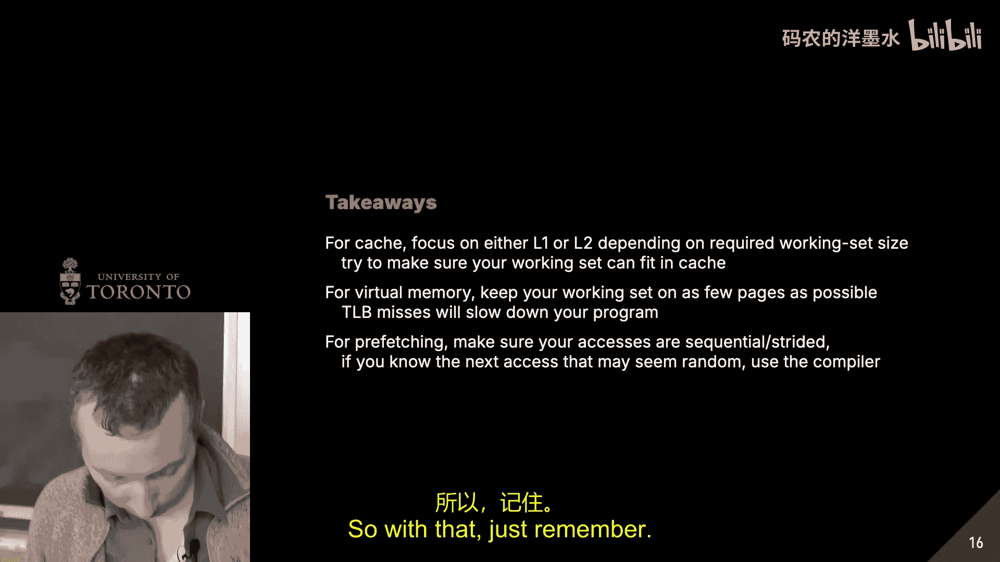