# C语言高性能系统编程实战：10：虚拟内存与预取 🧠

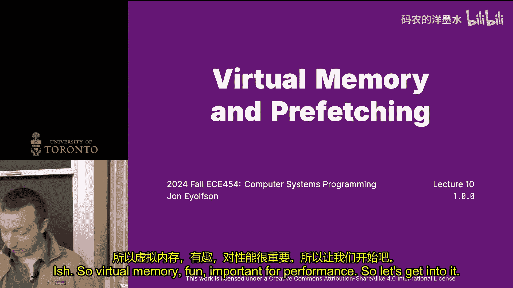


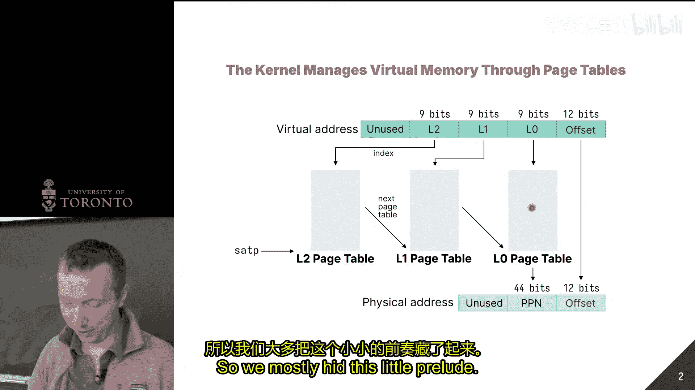

在本节课中，我们将学习虚拟内存系统的工作原理及其对程序性能的影响，并探讨如何通过预取技术来隐藏内存访问延迟，从而提升程序运行速度。


## 虚拟内存回顾

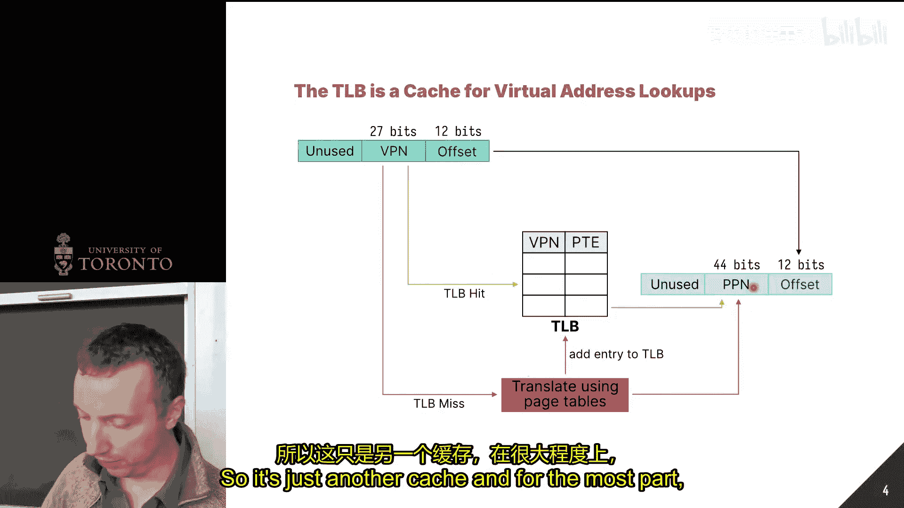

上一节我们介绍了缓存层次结构，本节中我们来看看操作系统如何通过虚拟内存管理物理内存。每个进程都使用虚拟内存，而非直接使用物理内存。这使得进程认为自己可以访问整个内存地址空间，无论机器上实际的物理内存有多少。

内核将物理内存划分为**页**，典型的页大小是 **4 KB**。然后，内核将虚拟页映射到物理页。

虚拟地址到物理地址的转换过程涉及多级页表查询。对于一个39位的虚拟地址空间，通常需要三级页表查询。这意味着一次内存访问可能需要四次内存操作：三次用于查询页表，最后一次才是实际的数据访问。这会使内存访问速度显著变慢。


为了加速这一过程，CPU引入了**TLB**。TLB是一个专门用于缓存虚拟页号到页表条目映射关系的高速缓存。如果TLB命中，CPU可以直接使用缓存的映射来访问物理内存，从而避免了耗时的页表遍历。

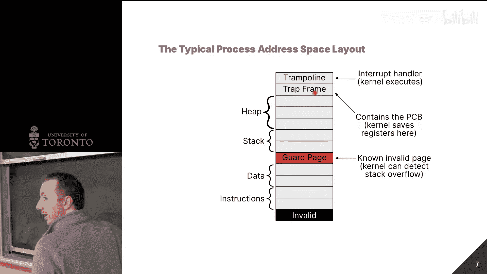

以下是虚拟内存的一些核心优势：
*   **解耦**：将进程使用的内存与物理内存解耦。
*   **内存共享**：内核可以通过写时复制或显式映射，在进程间共享内存，用于进程间通信。
*   **惰性分配**：进程可以请求大量内存，但内核只在首次访问对应页面时才实际分配物理页。
*   **交换空间**：当物理内存不足时，内核可以将不活跃的页面换出到磁盘的交换空间，从而允许进程使用比物理内存更大的地址空间（尽管速度会变慢）。

## TLB与工作集

TLB通常与L1和L2缓存集成。TLB显著加快了虚拟内存访问速度。TLB能够覆盖的内存范围称为**TLB覆盖范围**。例如，如果页大小为4KB，TLB有64个条目，那么其覆盖范围就是 `64 * 4 KB = 256 KB`。

你的程序的**工作集**是指在执行一段指令期间所需访问的页面数量。如果工作集大于TLB的覆盖范围，就会发生TLB未命中，导致程序性能急剧下降。如果工作集甚至大于机器的总物理内存，就会发生**颠簸**，即页面需要频繁地在内存和磁盘之间交换，性能会变得极差。

## 进程内存布局

一个典型的进程地址空间布局如下，它被划分为多个页：
*   **页0**：通常无效，用于捕获空指针解引用等错误（引发段错误）。
*   **代码段**：存放程序指令。
*   **数据段**：存放全局变量。
*   **栈**：用于函数调用，通常包含保护页以检测栈溢出。
*   **堆**：用于动态内存分配，是一大块连续的内存区域。
*   **其他区域**：操作系统保留的用于存储进程信息的空间（如蹦床、陷阱帧）。

## 内存管理接口

在C语言中，我们通常使用 `malloc` 和 `free` 来管理堆内存。在底层，`malloc` 可能会使用 `sbrk` 系统调用来调整堆的大小。然而，对于大块内存，`malloc` 的实现通常会转而使用更灵活的系统调用：`mmap`。

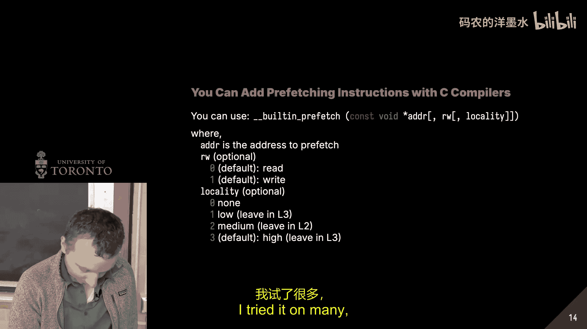

`mmap` 允许你将文件内容映射到虚拟内存中，或者创建匿名的内存映射。这使得文件I/O操作更高效，并且支持进程间共享内存。另一个有用的系统调用是 `madvise`，它可以向内核提供关于内存使用模式的提示，例如：
*   `MADV_SEQUENTIAL`：提示内核你将要顺序访问内存，内核可以提前释放已访问过的页面。
*   `MADV_HUGEPAGE`：建议内核使用**大页**（例如2MB或1GB的页）来映射该区域，以减少TLB压力。

## 预取技术

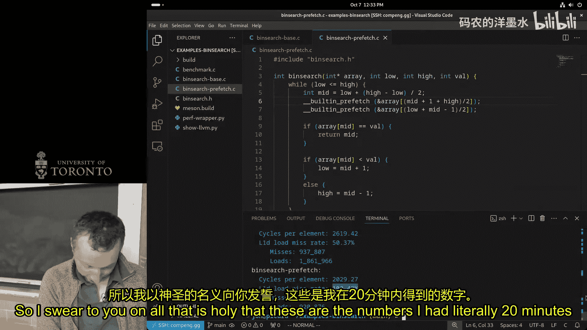

了解了内存管理的基础后，我们来看看如何通过预取来优化性能。预取是指在数据被实际使用之前，就提前将其加载到缓存中，从而隐藏内存访问的延迟。

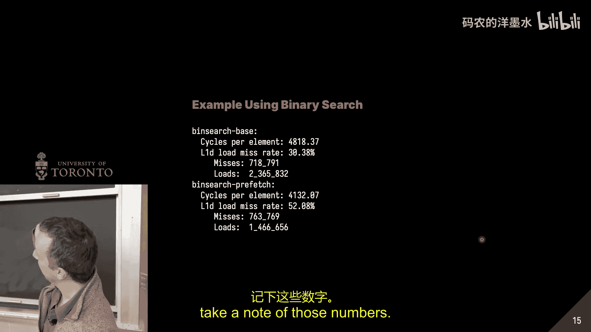

考虑以下代码序列：
```c
instruction1;
instruction2;
instruction3;
instruction4;
load_from_memory(x); // 如果x不在缓存中，这里会发生缓存未命中
instruction5;
```
如果我们在 `instruction1` 之后就知道将来会使用 `x`，可以插入一个预取指令：
```c
instruction1;
prefetch(x); // 提示CPU开始将x加载到缓存
instruction2;
instruction3;
instruction4;
load_from_memory(x); // 希望此时x已在缓存中，成为命中
instruction5;
```
这样，`x` 的加载延迟就被 `instruction2`、`instruction3` 和 `instruction4` 的执行时间所隐藏。

然而，预取要有效，必须满足以下几个条件：
1.  **有空闲的内存带宽**：否则预取会加剧带宽竞争。
2.  **预取必须准确**：预取了不用的数据是浪费。
3.  **预取必须及时**：不能太早（数据可能在被使用前被换出缓存），也不能太晚。
4.  **不能驱逐有用的缓存数据**：预取不应踢出即将被使用的数据。
5.  **收益大于开销**：错误的预取可能使程序更慢。

现代CPU通常内置了**硬件预取器**，它们能自动检测访问模式（如顺序访问、固定步长访问）并进行预取，对于大多数规整的访问模式效果很好。

但是，对于看似“随机”的访问模式，硬件预取器可能失效。例如，在**二分查找**中，每次访问的地址跳跃很大且方向难以预测。这时，我们可以使用编译器内置的预取指令来提供帮助。在GCC/Clang中，可以使用 `__builtin_prefetch` 函数：
```c
__builtin_prefetch(address, rw, locality);
```
*   `address`：要预取的数据地址。
*   `rw`：0表示预取用于读（默认），1表示用于写。
*   `locality`：数据的时间局部性提示。0（无）、1（L3）、2（L2）、3（L1）。

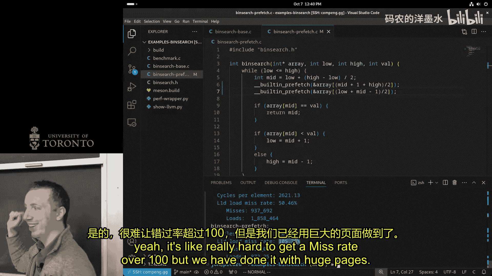

在二分查找的例子中，当我们计算中点 `mid` 后，下一步要么访问左半部分的中点，要么访问右半部分的中点。虽然我们不知道具体是哪一个，但我们可以同时预取这两个可能的地址，这样就有50%的命中率，远好于硬件预取器的盲目猜测，从而带来性能提升。

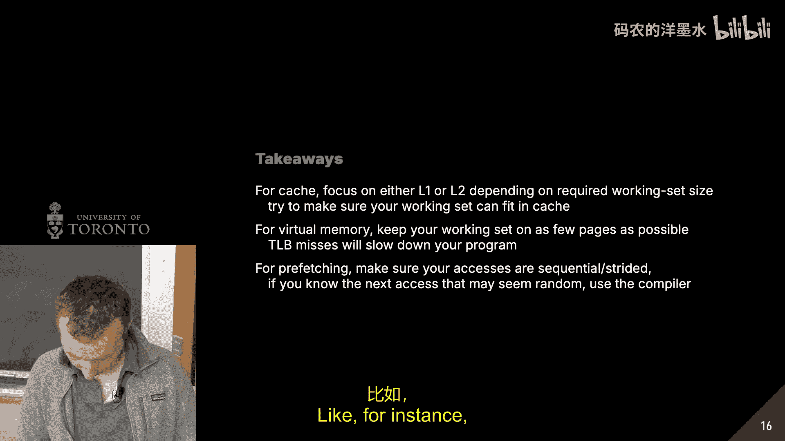

## 性能分析要点

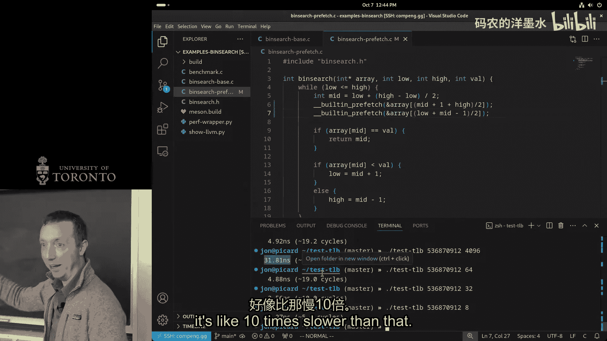

在进行性能优化时，请记住以下要点：
*   **关注适当的缓存层级**：根据工作集大小，重点优化L1或L2缓存命中率。同时，不仅要看未命中率，还要关注总的负载次数。
*   **警惕TLB未命中**：尽量让工作集集中在尽可能少的页面上。如果数据访问导致频繁的TLB未命中，性能会严重下降。可以使用大页来缓解。
*   **善用硬件预取**：对于顺序或固定步长的访问，硬件预取器通常做得很好。
*   **谨慎使用软件预取**：仅在访问模式难以预测、且你拥有比硬件更多信息时（如二分查找），才考虑使用 `__builtin_prefetch`。错误的使用很容易导致性能倒退。

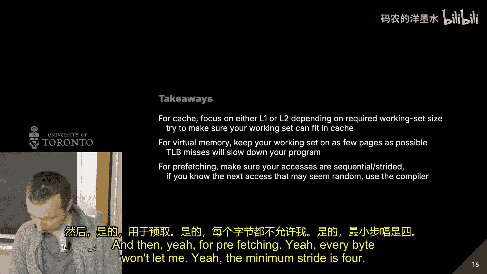

## 总结

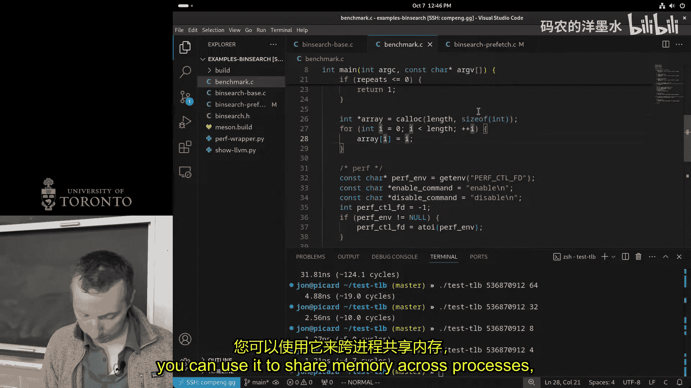

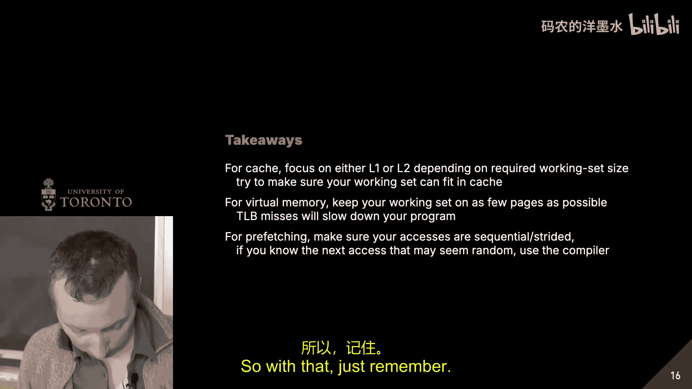

本节课中我们一起学习了虚拟内存系统和预取技术。我们回顾了虚拟内存如何通过页表和TLB工作，探讨了工作集与TLB性能的关系。接着，我们介绍了 `mmap` 和 `madvise` 等内存管理接口。最后，我们深入研究了预取技术，了解了其工作原理、适用条件，并通过二分查找的例子演示了如何正确使用软件预取来提升性能。记住，性能优化需要仔细测量和分析，盲目应用技术可能会适得其反。