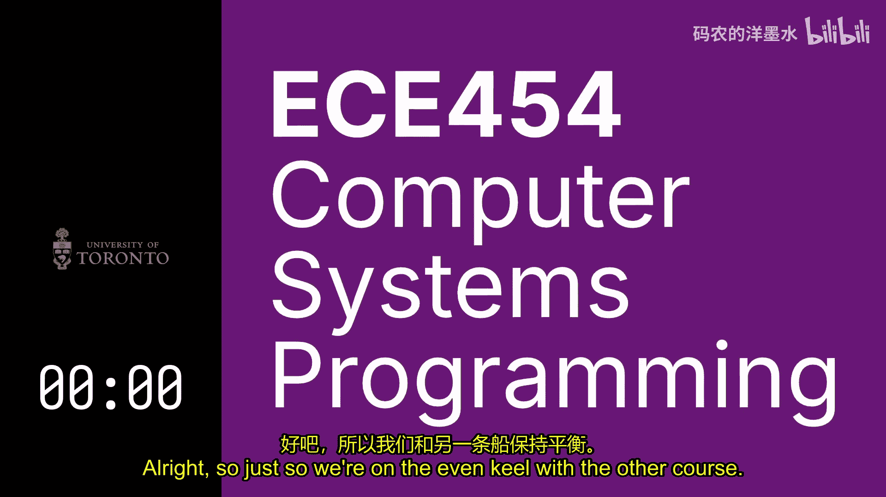
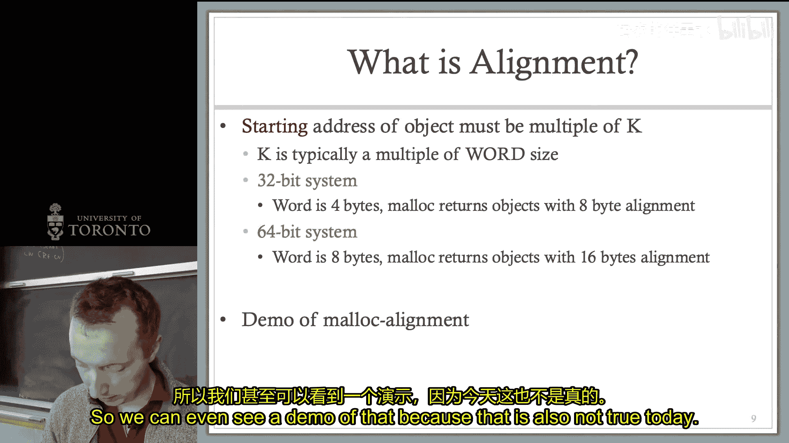
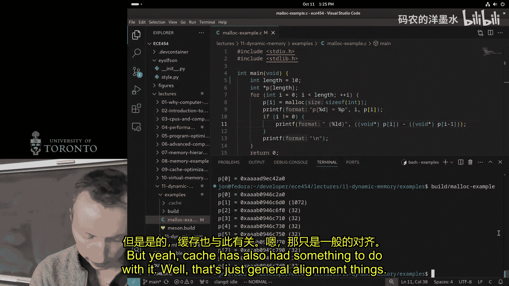
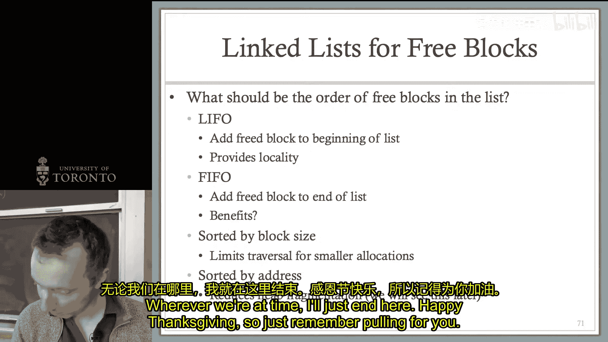

# 【全集】多伦多大学 C语言高性能系统编程实战 中英字幕 1080P p11 Lecture 11 - 动态内存 -BV1oDrZBZEG2_p11-

🎼Yeah。難。あはが。🎼放好了。

Allrighty， welcome back to 454。 wow， that's that，oe， let's turn that off。All right。

 so just so we're on the even keel with the other course。

 I'll use Ashpin's slides that he provided me because there's a lot of diagrams well Ill make sure I cover everything since this is what you will need for was it labb3 stuff so dynamic this is dynamic memory most of it will probably be review if I go too fast。

 stop me if I need to go and explain anything again stop me basically this is like talking about malloc everyone's used malloc before and link lists pretty much。

So。Content， yeah， so we'll do bit of a background， alignment， memory management API。

 mostly malloc free， some constraints goals we have fragmentation everyone remembers that。

 hopefully that is just wasted space and then some basic dynamic。Allocation we can do， so labb three。

 you're given a very basic memory allocator and you're supposed to make it better and we'll go over some different techniques you might want to use。

Mostly using free lists， different versions of free lists。

 and then buddy allocation you might have remembered， we talked about buddy allocation a bit in 344。

 but again， we'll revisit it here and then other things we might want to consider。

So why do we want dynamic memory allocation Well might not know the size of the memory you need at compile time。

 might get user input， might read from a file， something like that。

 and main memory apparently is precious so you don't want to actually waste all of it。

 otherwise you'll be out of memory generally。Not that big of a concern unless you are chromroe。So。

Here is an aside， so this I've already showed before we should know exactly what variables are on the stack。

 local variables， parameters， function argument return values even though that one's not quite true and the other ones also aren't super true either。

 they're usually passed in registers to be very， very fast。But。

You can actually address them as if they were on the stack and then they'll allocate stack space for you only if they're needed。

 then the heap that's used for dynamic。Memory allocations used for mallocc and well。

First question we should answer， why can't we always use the stack to allocate memory？

What would be bad with that yeah。アる scope。Yeah， when you go out of scope， all it's gone， right。

 nothing's going to live longer than a function， so if our lifetimes are all the same。

 if the lifetimes are of all variables just exist for a function。That's great。

 they'll get all delocated at once， things will be nice and fast。

 but we don't always know we might not even necessarily know the lifetime of our memory usage and if it outlasts a function。

 well we have to dynamically allocate it。All right， why would we learn about this。

 well it has to do with performance too， so the performance of doing all the mallocs can actually affect your program。

 where it allocates memory， how smart it is about do it。

You know you could just say don't even use Maoc， just manage memory yourself。

 but there's a a lot of different mallO implementations we'll go over some of them in a later lecture。

 but like Firefox， Chrome， they won't use the standard C Maoc。

 they'll use something like JE Maoc that will get into later or I mean you could of course just grab a bunch of memory yourself。

 you could endmap， you could just ask the kernel for a lot of memory and do your own memory or handle your own memory allocations if you want。

嗯。Challenging， interesting， right？Actually， doing this is quite involved and making it scalable。

Making it work well on multiple cores。Is interesting。

Which you will get into in lab four so we won't start threads now labb3 again just single threaded you'll get a good understanding of what happens under the hood and yeah apparently this is supposed to be so you learn more about pointers everyone loves pointers right everyone's favorite topic of all time I know it's mine so apparently this is to force you to learn more about pointers and have fun with them。

So。Memory allocators， they just assume memory is like a set of blocks。

 a block can be some variable size， contiguous。🤢，At least in virtual memory and you can provide these blocks to the application。

 you can actually allocate explicitly as we know with malloc and free。

In C++ you use new and deletete， they do the same thing new eventually just calls malloc。

 the only differences in C++， it can actually figure out the size of types for you， which is much。

 much nicer than just malloc in using size of all the time， but under the hood。

 new just calls malloc eventually delete just calls free eventually。

So you can also have implicit memory management。That you allocate memory and you don't free it explicitly。

 something like a garbage collector， figure it out。You can use it in Java。ML， Ocal。

 whatever languages that you probably won't use or lisp。

 but the thing about this is even if you use a garbage collector in Java。

 people think you just get the allocationlocs for free， which is not true。

 you can easily leak memory in Java if it's still reachable and you don't actually null a pointer。

 your garbage collector probably will think you might use it in the future and that's why Java applications typically leak memory like a damn Siv。

 yeah。Does something like。Those kind of implicitr。So shared pointers would be explicit so it's just。

It explicitly doesn't new and free， but it knows it's a bit smarter about when to free。

So it pretty much does reference counting for the pointer， and it's just a managed pointer。

Which should probably be in this course， but is currently not。

We'll go into some different memory allocation stuff that's more of like。Managing the lifetimes。So。

 most。We had this before slightly different diagrams。

 so the typical process memory layout looks like this， you know， the kernel。

Alloccate some virtual address space for its own use that you can't touch。

 you usually have the stack at the top that is a set size grows down。

 usually have some memory map region that you know that's where all the dynamic libraries get loaded to whenever you emm。

 something like that it'll generally pick a virtual address somewhere between the heap and the stack and then the heap might be here。

 that is just one big region of memory and things like malloc are actually supposed to use just the heap for the allocations although most general。

Allocators nowadays also do memory mapping。To get bigger blocks of memory and hopefully free it a bit easier than just one giant region of memory that's all kind of contiguous。

 but for lab，Was it lab3， you're just dealing with the heap。

 you don't get to memory map anything or do anything like that。

And then like this is your uninitialized global variables in this section。

Initialize global variables in the data section， this will all be zeroed and then the program text。

 that's just where your instructions live on memory that will just be loaded for you whenever your program starts executing。

All right， alignment， who knows all the C plus plus or C alignment rules？Probably no one。

 so let's go over them quickly。So。What is alignment， Basically。

 things start at a multiple of some address。 So it'll start at the address just needs to beisible by some number K。

 So if things are 8 by the line， it means the address is either。0，8，16。

 It is always divisible by that address。 A K， all of those bits are just 0。 So if I have。

Some object of size K。Where it's a multiple of word size。

 so word size is typically just the size of a pointer machine on your machine。

These slides are slightly old because 32 B systems have any of you even used a 32 B system？One， two。

Yeah， so they were， I use them as a kid that doesn't age me at all， but yeah， so back then 32 bits。

Word was 4 bytes， 32 Bs， there's8 bits to a byte and Maloc had would always return things aligned to 8 byte boundaries。

 so double word size and 64 B systems well 8 bytes so Maloc actually return double word so everything is 16 byte aligned so we can even see a demo of that because that is also not true today。

So。Here is just a little example， I just malloc space for 10 integers。You would assume that hey。Well。

 if I'm mallocing space for 10 integers。They could all just be in a row right every four bytes away from each other。

 so in here I print off aside from the first allocation how far away or how many bytes in memory it is away from the previous allocation so we can go ahead and run this to see what the alignment is so。

If I run this， let's。So the first allocation really far away from the first chunk of memory I got。

 it's like 1000。72 bys， and then all the other ones are 32 bys away。Anyone guess why？I'moring。

 you know， I'm storing just four bytes， I'm asking for four bytes。

 but all the addresses I get are 32 bytes away from each other。Yeah。Just a heistic。Heuristic。

 so if I have spaced for realoc。Not quite， that's a good guess， though yeah。size。

Mimum size of allocation。Why would there be a minimum size？Blocks。Or me。Deoc。Not quite。

It's getting warmer， though。Any other guesses yet？Better alignment。Better alignment for the cash。

Somewhere else。Maoc's own internal tracking。 That is also part of the reason。 So yeah。

 Maloc might have some bookkeeping information associated with the entries。 It stuffs in there。

 So that could very well be one thing。 The major thing is that。

Malock has no idea what I'm actually going to use the memory for so if I have ins they should be4 byte aligned。

 if I have doubles or something like that that are eight bys those need to be eight byte aligned and turns out the largest data type on your。

😊，System is just 32 bys， so it has to assume the worst case and everything has to be 32 byte aligned line that gives back to you because Maloc has no idea what you're going to use that address for。

So that's one of the reasons and back in the day， this was 16 bytes away because we didn't have those giant instructions that tried to do a lot of things in parallel。

 but AVX actually requires 32 bytes aligned， so it's the largest alignment that your CPU actually needs if I ran this directly on my Mac。

Their 16 byte aligned is the lowest I got， not 32， but if you run this on NAX86 machine nowadays。

 you'll get 32 if you run it on the UG machines， it'll be 32。It doesnn't have the same instructions。

 so completely different instruction set we only use。

The 32 byte values to load like special AVX instructions。

 which Mac CPUs don't have their different architecture。That。Yeah。

 but they have different alignment requirements。哦。Yeah。

 so it's just the alignment requirements of the CPU are slightly different。Yeah。

 so the really big jump at the beginning。It's just whatever they decided to do。

Depends on the Maloc implementation， I think。This is just the standard C1。

It probably has a space allocated for very， very short allocations。

 especially and just jumped over some general space。🤢。

So you can kind of see how it works if I run it directly on my Mac。

 it jumps backwards and forwards a bit and shifts a little bit。

 but it kind of just depends on your system， interesting to run this test and see what happens。

But yeah， cash has also had something to do with it， while that's just general alignment things。

So， yeah， why alignment。 So if you don't have any alignment。

 data structures can start at any address。Especially bad for caches， but CPUs as well。

 so if an integer just started at some weird address that was some odd address。

And our cache block was 64 bytes well then how many cache blocks do we need for this integer it could straddle the boundary。

 which I mentioned before when we started talking about caches we want to make sure things fit on the cache。

 they're cache aligned so if it's not even aligned to an even number of bytes could easily be the case where you straddle the cache。

 so one byte is on one cache block and the other three bytes are on another cache block。

 so that's really， really really bad so you should again like we reviewed before。

Try to fit everything on a cache as much as possible。So。Also。The cache accesses at like 64 bytes。

 CPUs generally like things aligned to the word size， when it's not aligned to the word size。

 just reading a simple data structure can take actually two reads on the CPU itself。

Your caches will help with this， but if you have unaligned accesses。

 you'll notice most of the time your performance be really will be worse even if it's on the same cache line。

 so 32 bit machines don't have to worry about that but they were4 by aligned so the lower two bits had to be always zero。

 so to make sure that they're aligned to a word。So how do we align them。

 while luckily our compilers do it for you， there are lots and lots of rules。

 especially with strs that will go over。To actually do most of the alignment for you。

 you can also suggest alignments to the compiler if you want to align the cache lines that it might not know about。

And then libraries like Maloc， they'll return aligned addresses for you。

 So if you want one way to do that is if you have a struct that has，Three shorts。

 an array of three shorts in it， each short is two bys。

 so this whole struct will be six bys large and if you want to make sure and the whole alignment of the struct it could start at any two byte boundary。

So it would only be two byte aligned if you want to make sure it's8 byte aligned。

 then you could just do this attribute， it's like underscore underscore attribute。

 it's a built in thing for clang and GCC and you could say I want this struct aligned to the8 byte boundary so that。

If you declare one of these。We' always be aligned to eight bytes if you try and have two of them next to each other。

 there'll be a gap of two bytes。Size of would be。I think size of would stay six。

 not 100% sure on that， I should check。Yeah， that's just if I allocate it。

I think it might add padding to it， so I think size up might change to eight。

I'd have to double check， though。All right， so specific cases of alignment。

 basically they have to be aligned on the same。Pight boundary as the size of the type。

 So if I just have a char。Doesn't have to be any special alignment， anything like that， it's aligned。

 it can go in any single by， otherwise there'd be weird things if you had a raises of chas。

 if I have a short which is two bytes， it's aligned at the two byte boundary。

 so the least significant bit is always zero。For the for， for。Types that are four bys long。

 it's four byte aligned， so the last two bits are0，8 by aligned。

 the last three bits are0 and for the pointers depends on the size nowadays we're all 64 bits。

 so they'll all be 8 bytes， so they'll all be 8 byte aligned。So。You can。Also。

 if you use a structure within a structure， the offsets of the elements。

 so like where a field is in memory actually will satisfy the elements alignment requirement itself and for the overall structure。

C will the rules are， C will look through every single field and then the total alignment of that structure will match the largest field in the structure。

 so the starting address would always match that so we'll have a few examples。So。

If we have this struct S1， it has a RC。That will have one bite and then。Aray of two ints。

 so each int is four bytes。 we got two of them。In total。

 the amount of memory we're using is 9 bys and the largest element is an int， which is4。

 So how it will be laid out in memory is the rules of C。Are also that。

All of the fields will come in the order that you declared them in。

 so the first thing that will be stored in memory is this cha C and then the next two things will be well the next thing will be the array of integers。

In this entire structure， the largest thing is an int。

 so the entire structure needs to be aligned at a4 byte boundary。

 So whatever pointer it starts at will be a multiple of four it will be4 by aligned。

 then the char doesn't have any alignment requirements。

 it will just start at the first byte and then since the next field is the array it has to start at a four byte boundary。

 So C will put in three bys of padding here。 So three bys of padding that won't be used for anything only used to make sure we have good alignment for the array。

 So the array would start off at a。4 byte alignment and then have two elements。

 so the total size of the structure is 12 bytes。Everyone all right with that？Fun。All right。

 so if we had something like this。So we just stuck a double at the end of it。Well。

 now the double is the largest element， it is eight bytes。So in total， right。

 our structureer still has that one by char， the array of two ins and the one double so we have like just raw 17 bytes in total。

 but we also have to make sure everything's aligned and laid out in memory in the same order。

 so our largest element is eight so our pointer that goes to the structure will be8 by aligned like before the char will started off it's the first thing it would be at the beginning。

 we'd have three bytes of padding， then we would have our two ins。

Like before it would end at byte 12 and now while we need to have a alignment of8 for the double。

 so we need four bytes of padding to get us to the next multiple of8 and then that's where our double would go at the very end so in total our structure would be 24 bytes yeah。

What's the purpose of？If we know every single value，Like before we had padding。

They know what to type is。We knew the types here too。For。Okay。the demo， right。Yeah， 32 bits。

For Maloc。Like before we we malled， we had to do the largest。Like type that we can store。But here。

 since we know every type of our strongs like why did we still need the power？

So we need the padding so that。Like。The malloc， everything。

 it returns you a 32 bit or 32 byte aligned align pointer right which fits everything here the alignment is largest the alignments the largest element here right。

 so it does fit。So it will use the smallest one it can here。

 while Maloc has to assume the worst case。Donと line。

Some process that you refuse to read like eight byte objects that aren't aligned by eight。AndExs。

Yeah， some will definitely do that Yeah， you have to align these anyway， right？Yeah。

 you just have to make sure they're aligned correctly yet。Block。あいぱの。で最ぱ。でした？In that。Yeah。

 so this is just laying out the struct by itself and malocves gives you memory and it has no idea what you're going to do with it。

 right， but this is。一不开。Yeah， yeah， Maloc has to give you the worst case alignment otherwise。

If it doesn't give you aligned things， things might just refuse to work depending on the instructions or whatever data you feed it。

 but this is just。What memory I need for thestruct by itself？So yeah。

 in this case what we needed 24 bytes in total， so we lost。

Some to alignment that means the most efficient use of memory using。这说边呢。So it's。诶。Okay， yeah，我哋。

The fields， yeah。のプ性も。Yeah， they don't necessarily have to be an increasing order。

 but otherwise you want to reduce the padding。关闭第至系。

A seven by a double Yeah so I mean you could waste a lot of space if you did cha， double， Char。

 double cha， double Char， double cha double right so every time you do that you're putting you're wasting seven bytes worth of padding between everyone while if I was smart and I knew these rules I could just do chart cha cha。

 double double， double double double。Sounds like I'm going to Tim Hortons or something。Yeah。

 so I don't know if I missed something， why just it like the compiler？For you。

Why doesn't the compiler arrange it for you， so that would make things。A lot more complicated。

Like calling conventions have to agree with each other？These have to agree with each other， right。

 the compiler has to agree with possibly other compilers。

So they have to be a single set of rules for how to layout out astruct in memory that every single compiler agrees with。

 so they just made it very， very simple because back in the day they assumed that you as a programmer will figure all this stuff out for you。

Yes， C++ falls the same rules， classes are juststructs but。They write a bit。

 they use pointers for you。But yeah， so how you declare fields actually matters。

 So I think that's some。I think that that will come up next too so yeah also if you have a arrays of structure well you just they're just as so they'll just take the total size of the structure and lay it out so if I have the structure S3 that has a short int and another short。

Well， within one of the structures， my largest thing is an int， so itops my largest thing is an int。

 so the entire structure will be aligned to a4 byte boundary， but since I have this well。

It starts with a short that would be two bytes， then I'd have two bytes of padding。

 then four bytes for the int， then two bys of padding or sorry then two bytes for the short。

 then two bytes of padding， so each of my S3structs here are 12 bys and four bytes are lost two padding and then each of thestructs well since they're all aligned and everything like that and array of them would just go every 12 so every 12 bytes that would be how often thestructs are if you just did a big array of them。

And yes， of course the elements， the order of elements matter， so the other one。

 if I didn't do short short。Well， I could actually save in total four bytes， so if I just did short。

 short。Int then C rules， it will apply， it will store everything in the exact same order as you declare it in。

So。In this case， I would have two bytes for I， two bytes for J that satisfies all of the alignment requirements。

 and then I would have four bytes for the int。The whole structure would be aligned to a4 byte boundary so I can actually save all that padding。

 the structure is now8 bytes instead of 12 so way more cachef。

 everything like that things are way packed more packed together generally you want to reduce padding as much as possible so it's good to know these rules if you have not seen them before。

So that's howstructs are laid out in memory if you do use a struct。

The order you declare them definitely matters， and they're always the same laid out in memory in the same order you declare them in。

So you might also want to put。Along with keeping track of the alignment。

 you might also want to make sure that， hey， if mystruct is absolutely humongous。

 two fields that are used together are declared close together because that means they'll be stored close together。

 which means they'll likely be in the same cache line， which means your life will be great。So。

Memory management， everyone loves using Maloc， so Maloc。Tell us the size。If it's successful。

 it returns a pointer to that new block of memory at least size bytes。Size of 0， returns null。

 If it's unsuccessful， it returns null， sets ano and。If you have written your program well。

 you check for Maloc， everyone's checked for MalOoc errors。

 just like everyone checks for errors from print F， correct？Yeah， that's what I thought。

If Maloc starts returning null， you're probably in trouble anyway。

 so your program's probably going to crash anyway， so don't worry about it， I guess。

Should probably still check and crash it yourself， but probably more useful than checking for print F。

Typically， Maloc returns double word align addresses。So。A 32 bit machine word is4 bytes。

 so it returns eight byte align things。64 bit machine， 16 byte。

 that's just the worst alignment you could have。That's generally the reason for that we'll see。

Once we get into the algorithm a little bit， why we might also want double word align if we're only keeping track of blocks of word sizes at a time。

So the other things we have to do that you'll be doing for La three。

 implementing free so that it should return。Shouldn't return anything。

 so it should just free the memory pointed to by P back to the pool of available memory so it can be reused hopefully P has to come from a successful call of the malloc or real realc right you give it a pointer and a new size it will either shrink it and grow or grow it and leave the first。

Few elements， the exact same， even if it grabs a new block of memory and it physically moves it。

 it has to do the copy， so we've probably all used that before whenever we were resizing an array or something like that。

 although you could use reallic array to make it a bit。More obvious。So。This is a malloc example。

 I assume you don't actually need this。Just mall some space。Additionalizes it。Realox it。

 so it grows it。Initializes the new elements， prints them off， freeze it。I don't have to show this。

 right， everyone's fine。Not。Again， not too sure why this is here， but if you want me to slow down。

 let me know。All right， we're all right。Some assumptions we will make。Memory is word addressable。

 so each word can hold exactly a pointer so we'll just assume eight bytes and then Maloc returns at least word align addresses in practice。

没。Maalock returned at least double word line addresses and well now with X86 CPUs。

We'll do the worst alignment， which is Quad word aligned。

 but we'll just assume word aligned for this。So each of these little blocks here。

 they represent a word or eight bytes， and those are the blocks we will use for our allocations。

So you might think it looks something like this， you either have an allocated block or free block and malloc is essentially managing all these blocks of memories。

 so the shaded ones are all allocated words， so this would just be four words altogether。

 eight bytes each， so this is an allocation of 32 bytes。And then maybe there's two free bytes here。

 you know， we have some allocated for another malloc allocation， some more free blocks。

 so on so forth。So。Some examples could look like this。

 assuming we're just allocating words at a time。 So the size of。

A pointer or void star is just the size of a word， so if that's just one box in this diagram so if we do malloc of four words。

 then maybe our malloc algorithm will say， hey， let's pick these four blocks of memory for this allocation。

Then maybe you come along， you say， hey， I want five more words。

 so we pick the next five bytes to return， that are all contiguous， then they malllo six， so okay。

 you pick the next six。Then we free P2 whoops。Then we free P2， which is this red allocation here。

 so we free it， these five bytes are now available to use somewhere else。

 and now we have another allocation of two bytes。We get to decide where we put it。

 we could put it here， split up the five blocks into two and a three。

 so we use two for the allocation three or three。And we still have this two block at the end。

 or we could have used the two block at the end。Up to you， that's what you'll be doing for La three。

So some other constraints you have if you are malloc。You。Have to assume that the programmer。

 whoever is using MaO。Is insane， basically， they can do whatever they want。

 they can issue arbitrary sequence of allocation and free request。

And free requests must correspond to an allocated block aside from that， there are no other rules。

 so if you're an allocator。If you are the one implementing Maoc。

 you must respond immediately to an allocation request， you must give them memory as long as you can。

 you can't reorder anything， you can't do anything special。

You have to allocate from blocks of free memory， shouldn'。Try to overlap your request。

 otherwise you will cause every application on the face of the planet to break。

 that is the minimum requirement is that it gets back memory that is not used by anything else。

And they have to align blocks so they satisfy all the memory requirements。

 typically why they're at least double word aligned。You can only manipulate and modify free memory。

 you won't play with the user's memory or screw up their data under any circumstances and because this is a C。

 as soon as you give them back a pointer， you can't move the allocation once they're allocated。

 you can' your decision is essentially permanent， you can't redo。

 you can't move the memory around unless they reloc themselves。

 but the default cases you can't compact anything。They have a pointer， they get to use that pointer。

 it's valid until they call free on it。If you are Java and everything's a reference， you can do this。

 You can compact things。We'll talk about the garbage collector a bit later in another lecture。

 but if you're C or C++， all your Maloc decisions are permanent until they actually free them。

So if we're writing a good malloc and free。Well， we want good runtime performance whenever we call malloc。

 it shouldn't sit there。Just decide for 10 seconds。

 otherwise you probably won't use it even if it picks the smartest dishes is possible。

 so ideally it should take constant time， not always possible but it should of course be as quick as possible so hopefully it doesn't scale linearly with the amount of blocks like the amount of blocks you're actually using otherwise your performance will probably be really bad and the other conflicting goal is that you should have good space utilization so you shouldn't waste a whole bunch of memory you should be smart about where you put where you fulfill the request in memory because you want to minimize fragmentation which is just another fancy word for wasted space so usually you have a tradeoff between the two。

The smarter you make it， the better you'll be at space utilization。

 but it might take longer to make a good decision。 So you'll have worse performance。

 So there is a bit in a give and take。 And in lab 3， it's slightly。

Slightly prefers you to have better space management than pure performance。

 So I think the split for La 3 is like 60% space utilization。40% performance。

So one extreme example of an allocator that is very， very， very quick is malloc。

Could just find the next available N free blocks。And return that memory and then whenever someone does free。

 you go， sure。And you don't do anything。Is that valid， does that satisfy all the constraints？Yeah。

 sure。Great time performance， really poor space utilization because nothing will be reused ever。

 it kind of looks like what happens with the stack， right？So unlike a stack。

 we can't free everything because we don't know the lifetime。

 so we can't just free everything all at once but。Perfectly valid thing to do that actually has a name。

 don't know why it's not on the slide， the name for that allocator is called a bump allocator so it just bumps up memory every single time bump bump bump bump bump。

 only bumps， no bumps I don't know I don't know where I'm going with that。So。Some performance goals。

 throughput。Probably want good throughput。So you'll have some sequence of maloc and free requests。

For lab3， especially you're given traces from real programs of their allocation requests and those are what's used to judge your implementation of mallOC。

 so given some request R which would be either mallocc， a realaloc or free。

 you want to maximize both throughput and peak memory utilization which like I said before。

 often conflict。So throughput is simply just the number of requests per unit time so if I have。

50000 Mals or 5000 mallocs and 5000 frees all in 10 seconds， that means I have a total of 10。

000 operations over 10 seconds， so if I just divide them that is 1000 operations a second in throughput。

If I want to actually evaluate peak memory utilization， well I need a few numbers。

 the first one is aggregate payload， that's denoted by P。

 which is basically at any given time how much memory has the user requested so it takes into account freeing。

 it's the amount of memory actually requested through malloc at any one given time， so if you free。

 that would reduce it because you're not using that pointer anymore。

 this is what the programmer actually requested at every time instant。

The total heap size denoted by HK at different times because you will grow your heap probably will never shrink it and then peak memory utilization is just after some number of requests。

 you just find out whatever the worst case was so whatever the maximum amount of memory they wanted to use is divided by the amount of heap space you use and why high water marks well because it wants to keep or keep track of the worst case scenario。

 make sure that you're actually reusing your memory if they go ahead and free a whole bunch of memory to make sure you don't have that fragmentation issue。

So speaking of fragmentation。Why do you not want fragmentation， well。

 it's basically just wasted space， so comes in two forms， again， kind of review for from 344。

Internal fragmentation is unutilized space like within an allocation within the blocks。

 which would be padding， it's just wasted space within the structure。

 can't do anything about it really if you're the memory allocator， and then external fragmentation。

 which is the memory allocator concerned， which is basically。

Space in the heatap that I cannot use anymore， so I can't fit an allocation in。

Like I have too many holes in memory， too many blocks。

 too many gaps that I can't actually use for an allocation。

 so they are effectively wasted space if I can't actually use those bytes for allocations。

So internal fragmentation， again， if I have， in this case， a 32 bit CPU for some reason。

If I have a4 byte word size and I mall 13 bytes， well the payload is 13 bytes。

 that's how many bytes you requested， but your return allocation is going to be 16 bytes because it would be four word side requests and this would count as just padding so that padding would just be deemed as internal fragmentation so。

That only depends on just previous request， really easy to measure and internal fragmentation it's just there's a minimum size for our allocator if we assume we only deal with word size blocks at a time and we have alignment requirements then any data we use that's wasted to fulfill。

Alignment requirements is lost to internal fragmentation， or if our size of a block is different。

So if we use some space to keep track of our allocations。

 that will actually affect the heap size and peak memory utilization， but not internal fragmentation。

 internal fragmentation is just。Has to do with the size of the request by itself。

So external fragmentation is wasted space between the blocks so I just don't have enough like I have enough memory to do it but not a single contiguous block。

 large enough to fulfill the request so if I just allocate things in order so four blocks。

 four word sizeized blocks， okay I allocate them at the beginning。

 then five wordside blocks allocate them at the next five elements。

 then I have an allocation for six come up。And then while I put that at the end。 now。

 if I free P2 again， I have。fi blocks free here， two blocks free here。

 but now if someone tries to allocate six blocks， now I have no room for it assuming this is the total size of my heap I have what seven blocks in total available but I can't fulfill a single allocation for six bytes because It or six blocks because I don't have six blocks contiguous all at once。

The external fragmentation depends on future requests， if I can't fulfill any future requests。

 then that is external fragmentation， so it's a bit harder to measure because in this case P。

The user requested， I don't know， even five bys or two bytes or something like that。

 I could satisfy the request and be all good。All right， so how to actually implement Maloc stuff。

So basically。Well， few things we need to keep track of， we need to keep track of。

Which region memory of our heap is free？So。Also， when we're。Asked to free an address。

 we also need to know how many bytes to free。Part of the API free just gives us a pointer。

 so we need to actually have that information stored somewhere。

 so we need to keep track of how many blocks to actually free and we also need to keep track of well how do we even keep track of which blocks are free？

And then for allocations， well， we have to figure out which blocks are we going to use for an allocation because we might have lots of possible scenarios。

 so if we mall space for only a single block， well which one do I use， do I use one of these three。

 one of these two or one of these two， so I have lots and lots of different options。

 some are better than others。So if we want to know how much to free。

 the easiest thing to do is to just keep the size of the block in just the word preceding the block so this is often called a header so if you just back up a little bit of information you can actually use that to actually store some information about the allocation so it's right next to the allocation whatever they need to free it's right there in memory if we take care of the caches and everything like that and we and we're all good so this has a bit of space overhead so for every allocation we need an extra word。

So in this case。If we just have an allocation， so if we malllocked space for four words。

 four blocks of memory， well， then we would return a pointer to the beginning of those four blocks of memory and then the block right before it we might store the size so we would have to store。

The total size so the size of the allocation which is four plus one that keeps track of how big this header is so in total we would keep track of hey five bys or sorry five bytes for this allocation four for it and then one for the header so that's what it would look like and now if we free oh well we could just back up one and say okay well the next。

Including this block， this header block， the next five blocks are all free。

 I can reuse them for another allocation。Good。Yeah。All one word blocks would become unusable。🤢，Oh。

 sorry， if they're sandwiched， if they're sandwich。Like， right after。The second。Yeah。

 so if I have a header file， right。I assume that I can only allocate one block at a time。

 they'll be at least two words away from each other now right。

 so this could also be a reason why it's at least 16 bytes requirement because they'll have one block for a header anyways。

All right， so how do keep track of the free blocks while it's lists， everyone loves lists， right？

So there's a few different ways you could just do implicit。So implicit。

If you're keeping track of the size field well that's basically a list right。

 if you keep track of like the size of each allocated and freed sequence of blocks well that's like a list so if I know this is free well then my next allocation would be at five blocks away so it would be here I could check we'll see how we actually keep track of what's allocated what's not but if this is allocate I can be like okay well what's my next big block of memory skip four blocks and be like oh okay well now this is six I have six blocks free if I want to see what's next I can skip six ahead。

Then I have two， so on and so forth。Another way of doing this is while I still have to keep track of the sizes。

 but maybe。Maybe I don't want to leap over every single allocated or unallocated block because generally if I'm mallocing somewhere I need to find some free space for it。

 I don't really want to jump over a bunch of allocated space that's just a waste of time so the other method is to use an explicit list so in the free block itself。

That's basically free real estate。So since that's free real estate， the free block itself。

 I only really need to keep track of the size， so I can just use that memory to instead point to the next size for the next free block instead of just the next possible allocation so free real estate boom。

 I can just hop over to the next free block at six。

 then the first word there would just be a pointer to the next free block。

 and now I just have an explicit list of all of my free block。

And then method 3 is just segregated free lists so I could take that idea and take it to the extreme。

 So if I really wanted to， I could have different free list for different size allocations if I really wanted to optimize things。

And that might be a good idea to do for the lab。So。First method is yet implicit list。

 so we need to keep track of whether or not a block is free or allocated。

 so I can be a little bit clever about this and then use a single bit。

That is part of that size field because well， I know that。The size will always be a multiple of two。

 so if it's a multiple of two all the time， then I don't have to bought that means the lower bit will always be zero。

 which means it's also free real estate。So I can use that bit to keep track of whether or not that block is or that。

Sequence of blocks is allocated or not。So what I can do is just mask it out so I can use the least significant bit to store one allocated two or zero free。

And then whenever I get the size， I just have to make sure to mask out that bit if it's actually。

If it's actually set， so it doesn't mess with my sides。 and I always get even sidess。

 So we could do just an and with。The knotted just one so that would flip every single bit so that would just do an and with all ones and the lowest bit as0 so that'll essentially just make the lowest bit always zero and then keep the rest of them as they are so we write the size so now the format looks like this we have our size which takes up the remaining in this case 63 bits and then our allocation that's just one single bit there that will keep track of again is this sequence of blocks。

Of size， size， allocated or not。And then the payload that is actually memory used for the request that we should ever。

 ever， ever， ever。Ever touch。So questions about that clever thing to do， right。

 we just mashed stuff in， reuse some bits。Lots of fun。So。

If we have this implicit list and an allocation comes in where we have to find a free block。

 well we have to figure out which one to actually use for the allocation well part of your。

Maoc implementation since you have an implicit list。

 you know where your heap starts so you know where to start looking for free blocks。

 so there might be multiple blocks that can fulfill an allocation， so we have to have。

A way to pick from them so the first thing to do is first fit， so search from the beginning。

 choose the first free block that fits the allocation。Works。

 so it takes linear time in the number of blocks， both allocated and free。

 which should be setting off alarm bells already， and in practice even if you do this as fast as possible for the space utilization。

 it causes a bunch of splinters or some fragmentation at the beginning of the list。And especially。

If it restarts at the beginning of the list again and it has a bunch of free spaces。

You could do some easy optimization here where you， since you。When。Pretty far and found a free block。

 you could just save where you found the last free block if you wanted to try and speed it up a bit。

 but practice generally a fairly bad idea。But that's what next fit is。 So like first fit。

 just search the list from the end of the previous search。

 don't bother searching from the beginning again。But if you simulate this， again。

 no one really uses it， but fragmentation is generally worse if you do next fit as well。

Best fit is that strategy where you search the list and instead of just finding the first thing that fits it。

 you try to find the closest size that fits， so you're a bit more selective。

 you're spending more time to actually find hopefully a better allocation so this will if you simulate this。

 keep fragments pretty small， usually helps with fragmentation。

 but of course we have to scan every single thing， every allocation which is going to be way， way。

 way slower than first fit or next fit it has no end early condition。So。

If we are doing some allocation from a free block。Right。

 let's say we're just getting some block of memory。Then。Say if we're doing next fit， you know。

 we're here。🤢，This doesn't quite fit。This is all allocated now。

 so we have an allocation come in of four words， so the next free block we would look at。

 wed take this， jump the size， and then here。Here we would find a eight。

E word block size of free space， so our allocation does not need。All of that space。

 So we would split this huge free block into the five blocks we need for this allocation。

 So one word， the store the size and allocated or freed。 of course。

 say it's allocated the four blocks for the allocation itself。

 And now we have to make sure that while we split that 8 into the five and the three。

 So now this is a smaller free block。 So it has three blocks， It's free。Yda， yada， yada， everyone。

 all right with that。Makes sense。If we need to free a block。

It's real easy in the simplest sense if we don't want to do anything clever。

So if we have this allocation P here。RightIf we say free P。

 all we have to do in our implementation is look backwards a block that gets us our header。

 and then we can just flip that bit from allocated to not allocated。And then we're done。

So if we did this。Looks。I mean it works， but we could be a bit smarter about this because now if someone asks for a five block allocation。

 now we can't fulfill it even though there are six blocks in a row there because the naive algorithm would just search oh。

 well， if they request five， I actually need six， one for the size，5 for this， so can't fit it here。

 can't fit it here， can't fit it here。Not that clever。 but since these are2。

2 free blocks beside each other， I should just consider that as one big free block， right？

 So that is the method or。Algothm we call coalescing。

 so I should merge any two free blocks that are beside each other。So。

Coaleescing is basically just joining two free blocks together， so in that case before， if I free。

 what should happen is， well， I'll look up my allocation。

Look at the size of my allocation by going back， saying that it's free now。

 and now I should look ahead。One and look behind one and see if I have to coalesce or merge two blocks together。

 so there might be different options here， so the one after me，While that allocation could be free。

 could be allocated， the one before me， could be free， could be allocated。

 and also if this is my link list going backwards is a bit hard， right？

So I have to probably do something about going backwards if I have to handle coalescing because it's not always guaranteed I only need to coalesce with whatever is my next block。

🤢，So。第二。Previous block is for in Dub。Yeah， so that's the next thing。

 basically we need a DoubE link list。So they call it a bit different thing so this was in like the 70s。

 so they call it bidirectional coalescing， basic ideas the same thing， we have a WE link list。

 so what they do is since it's an implicit list where they just use the size to jump forward。

 what they do is just replicate that size at the bottom of the free blocks。

OrSo I just replicate the size at the end， and then that tells us how many blocks to go backwards。So。

Now we can like a doub link list traverse the list backwards so we put the size at the beginning and at the end。

 so now if we want to go backwards， so from the header file you would just read back one unit or one block that will tell you how many it's replicated so it tells you how many blocks to go back to get to the next previous and we can actually jump the list backwards so now we can go forwards and we can also go backwards otherwise it's exactly the same。

Thing again， we just replicate that size block and now we can go backwards。

 so we have a W link list now， fun。So yeah。But does that。the actual。Yeah。Yeah。

 so now we have a bit worse space utilization because now we're using two blocks or two words for every single allocation no matter what。

This。Also before where it said like things were always multiples of two。

 Well now they're definitely multiples of two because we have a word。We have a word before。

 a word after， and then Maloc has to return。Everything aligned to a double word。

 so these are definitely always going to be even numbers。Is there any way to escape that？

Any way to escape that at all？Are you sure。Yeah， we could escape it if we stored the list somewhere else。

 right， we could store the list somewhere else。 We need to store the information somewhere。

 We could probably do slightly better than this， but。This。I mean， most things are a trade off， right。

 is we're trading off more space so we can actually go backwards a lot faster。Like with everything。

 there's a trade off。size。Sicient big。Yeah， so for data sizes like。今日の場合？Yeah。Saegments。Yeah。

 if the allocations are big， doesn't matter， right。

 this might be really bad if people just request a single byte at a time。Like I want bite。

 I want bite， I want bite with alignment requirements， and then this， what？Good的。

So that's 32 bytes each allocation， and you use one of those。

 so 31 bit bytes wasted every single time， so generally with most algorithms。

You do something special for small allocations because you don't want this to happen。

And we'll go over some。Some of the options we have， but you can think sky's a limit of this。

 you can think of whatever you want。But this is just one example， if we have an implicit list。

 how to actually coalesce blocks is what we're doing right now。

 so we have a few different situations。If we consider the block being freed and then the previous and the next block。

 there's four situations， either were sandwiched by allocated blocks。And in this case。

 if we're sandwiched by allocated blocks， do we have to coalesce a damn thing？Hopefully not。

If we're sandwiched by an allocated block previously and a free one next， then we have to coalesce。

Same thing if the previous is free and the next one is allocated， we have to coalesce with this。

 and then if both allocations on either side are free。

 we have to coalesce with either with both of them。So this is case1， this is assuming。

The allocations， so here each。Bolded box is a single allocation。

 so we have one word here for our size with allocated yes or no。 so here the size would be。

2 or M1 sorry and it would be allocated so we have a one here and then since it's the bidirectional one。

 it has a header at or sorry it also has， I guess a footer so that's replicated so the size is M1 and it's allocated and then this middle allocation that's what we're assuming we're freeing So we have an n size allocation here。

 it's allocated since we're freeing it， we need to flip those bits from a1 to a0 and then the next allocation here size M2 and it's allocated so if we coalesce this one what should our final thing look like well this block should stay the samere not it's allocated it's being in use of something we shouldn't change anything same with this block M2 it's in use we shouldn't change anything so all we have to simply do is just flip our bits both the header and the footer to just be unallocated。

And now those n blocks。N minus2， I guess， blocks can be used for another allocation。That all right。

 and we can do this in constant time， we only have to look previous and next。All right。

 the other case slightly boring， so we're freeing this。M1 is allocated。M2 is free。

 so this case we have to coales， right， so what will our final result look like？Yeah。And。

Plus M2 free and then same thing at the bottom Yeah， so here we can't touch M1， so this will be M1，1。

 M11， and then since we're coalescing these blocks are since the size is including the header files including or including the header blocks。

 including everything，Our new free one， we are coalescing with this M2。

 so our new size that is free is n plus M2 and that whole thing is free。

 so it's just going to look like this， so we have n plus M2 all free so that bit is zero and we have all that free space。

Yeah since we lose two headers the。So this n and M2 include the header space， yeah。So。

If we're using two headers， this space in between， we can use n minus-2 for the allocation。All right。

So the next case。This should be boring right so， the one previous is free now。

 what does it look like now， Well， hopefully this is not that exciting。The new coales block。

 it's of size M1 plus n， and it's freed before and we don't touch M2。Magic。Now，ooh， the tricky case。

 what above it looks like this where either side of you is free？What should it look like？At the end。

 well， if both things are freed。The entire thing will be free now。 So now we have n plus M1 plus M2。

 and the whole thing is free。 So we have a big block of memory。So。

The way this works and the way it's constant time too is it always merges whenever you free。

 so we're guaranteed to always get a sequence of allocated free， allocated free， allocated free。

 allocated free， and the freezes are as big as possible， so this is a good thing to do。

 help us keep track of however big our entire free region of memory is otherwise we could get confused。

So。Some summary， so the placement policy how to find the free block。We could do first fit， next fit。

 best fit， or pick your poison， random fit。Sure why not you have the coalescing policy so how to insert a block during a free or how to keep track of all the free blocks immediate coalescing。

 you just coalesce adjacent blocks whenever a free is called you could defer it if you wanted because hey。

Maybe I'm merging two things together and then immediately splitting， merge split， merge split。

 merge split。Maybe that wastes a lot of time， maybe for performance。

 you would prefer not to do that and just hopefully reuse that without having to split again。

 so maybe you try to defer it as late as possible。I'll just leave it in some state and then whenever I'm actually allocating space。

 I can't find enough space， maybe I start coalescing then， or maybe if I reach a threshold。

 then I start coalescing so。I already spoiled it， Why might it be beneficial， again。

 don't want to split。Split， coalesce， split， coalesce， split， coalesce， it just wasted time。

All right。Implicit list， oh yeahep。Going back to your。placement policy。

Do there exist any placement policies that we'll try to predict？Next block'。

You could try and predict the next block that's going to be free generally that。Yeah yeah。

 for most memory allocators。It typicallyypically doesn't really help。 You can do other things。

 I guess I'm wondering is like if I know for fact that some block is。啊。Given some time。

 then I might not want to place my new blog right next to it because if I can place it somewhere else。

 then my place that's free。😔，Bigger。able to be utilized by something。Yeah， generallyally。

 if you get in the case where you actually know the lifetimes and stuff。

 there are some mes you can hint lifetimes。And generally， if you know it as a programmer。

 you start managing your own memory or you do some other technique that will show in the next lecture。

So there are different things to do generally if you know your own lifetimes。

 you can do much better General memory allocators， it has no idea what the lifetime's going to be。

There are some heuristics you could probably come up with， but they might be wrong。

Answer the question。Yep。Yeah， help， what's the answer to the question at the bottom。

 why might I want to not coalesce immediately？Wellow， no one's helpful here， what？

Because if you wait a bit， you can basically do all your coalescing at once and save time。Yeah。

So what about if， let's say。Let's say we do this right。

 let's say these are all't know four blocks or something right。

 so I coalesceed them together to have a giant 12 and then I get an allocation for four to come in again。

 like the same size of all those。Then what do I have to do， I have to split this again， right， well。

 if I didn't split it。They're already the right size。

 I would just flip the bit and then just carry on my way。 So if I just defer coalescing。

I'm less likely to have to split it again， maybe yeah。You're not allowed to defer any mallocs。

So yeah the not deferring is mal so if someone calls Maloc， you have to give them memory。

 but however you want to manage memory， make your decisions。

 you can do whatever you want as long as whenever they ask for memory， you give them memory。

And like the bump allocator， I mean， you could make poor decisions。Not free。

 you could do whatever you want。Alright， so for implicit lists， the implementation is simple。

 Everyone loves lists。 So they're not that bad。 So allocation kind of slow。

 linear in time of free and allocated blocks， which is really bad。 You don't really。

 you shouldn't really care about allocated blocks， free is constant time， even with coalescing。

 And as long as you don't defer it。 And then memory usage that depends on the placement policy again。

 for mostly for this one， you do first fit， next fit or best fit。In practice， yeah。

 you're not going to use it because linear time allocations and it also depends on the number of allocated blocks。

 which is really bad and splitting and splitting and coalescing。That's used by other allocators。

 it's a good thing to know。🤢，But this implicit list generally， I mean， it works。

 but it's not going to be the greatest thing on the planet。So。The second method is the explicit list。

 So this is the idea where if theres a free block。What we do is we actually。

 instead of having an implicit list that keeps track of allocated and free blocks。We just have。

We just use the free blocks to store the next and the previous pointers on the blocks themselves。

 on the free blocks themselves， so that way we have just pointers， we have a free list。

 all the elements are free so were not actually we don't actually have to scan any of the allocated memory。

 we don't touch it。We just skip over it so it's a lot faster。

Especially if someone's been using the allocator for a long time and they allocated a lot of space。

So typically this is doubly linked。For coalescing reasons。

 so they just called next a successor and previous a predecessor， links can point anywhere。

 it doesn't have to necessarily be to the adjacent block right after some time。

It might get slightly messy， but as long as you keep track of all your pointers and you don't do anything wrong with pointers。

 you're all good。So。Here， again， they still have those boundary tags for coalescing purposes。

But they don't use them for anything aside from coalescing to actually do an allocation。

 I would actually just。Go through the explicit free list that's also stored on the blocks。

So if I have to allocate from the free list， well， if initially I just have a block where I just have one single giant block of memory when I start my malloc right。

 so I'll probably have some global variable or something like that。

 that would be the state of your allocator that has the predecessor or whatever is at the head and then whatever the final successor is or whatever is at the tail and initially they both point to the heap which is just all free。

And then after you allocate it while you need to split that。

 so this space would be used for the allocation， you just get the allocation black and then now your predecessor and successor or your next and previous。

 however you want to call them， now just point at that smaller block of free space and da and in this case allocation time will be linear in the number of free blocks instead of total blocks。

 you just have more pointers， which is always more fun。Everyone loves pointers。All right， so。

If you free from like just an explicit free list。Then you get to decide， hey， well。

 since I have an explicit list of free， where does this free block get inserted in the free list。

 so you can do whatever you want， you could do last in first out so you put the free block at the beginning of the free list。

 that means whatever you freed latest is probably going to get reused again maybe and that simple constant time。

 if you actually simulate this with real programs then fragmentation gets worse than if they were just in address order。

 but of course that's going to take more time。If you have address order policy。

 you could insert the free blocks so that they're always an address order if you want that will require a search or require you to go。

Maybe if you pick wrong up to the length of the list。

 but you might get better fragmentation with this， so it's just something to try and see and La3 you're graded on traces。

 the traces will always be the same and you have all of them。

So if I'm freeing with last in first out， so my free list initially points to some free blocks X and Y then here I'll assume that this is just my memory。

 whatever is contiguous because I'm trying to coalesce in this example so self is the allocation that we are trying to free and then well if there's allocated blocks on either side that means no coalescing or anything like that so if I'm freeing this。

 if I have last in first out， all I want to do is make sure that my free list now points to this free block that I just freed and then its successor would point to X so it's just normal add to the front of the list as you should be familiar with so we take the next pointer for this block that we are freeing。

Pointed to whatever the free list pointed to before。

 then I would set the free list previous to the new free block since this is last in first out and then make the free list now point to the block I just freed and then I have no predecessors I at the beginning of the list。

Now， how do I coalesce？It's basically the same thing as before， right。Same thing as before。

 I'll still have the header。I'll still have， like the size。At the header and the footer。

 So it's the same thing as before I just have to make sure that。My link list is proper。

 so here I have to take in consideration the link list because my next element， right。

 whatever is contiguous to me in memory。Would be in the free list。

 so it would have pointers to like a Y and a Z， so I have to make sure that when I coalesce。

 I don't screw up my free list。So in this scenario， right。

 I need to coalesce self with this free block。But。Since I'm coalescing that block。

Then it should no longer be in the list anymore。 So what I have to do is splic out this free。

Element from the list， so it previous would have been y， y is next would have been to it。

 itss next would have been Z， Z's previous would have been it。

 so I need to fix it up so that just y points to Z so I'm essentially removing this free block from the list and then I coalesce it and then at that point then I add it to the beginning of the free list。

So does that make sense with everyone？Same ideas before same coalescing rules。

 I just have to make sure that I don't screw up that free list。So。Has the other cases here where。

 hey， the previous one is free？Well same thing again it will point to some x and a Y。

 it will have a previous and a next， so basically I splice out this free block。

 so I set it so that X and y are now linked to each other and to do not reference this F at all。

 then I coalesce that free block with whatever was beside me。

 which was the allocation or the Dalloc I'm just doing right now。

 and then since it's last in first out I now point to this block。So same idea as before。

Now if both things are free， that's a lot more pointer operations but it's just more fun right。

 so I have to splice out the block before me that I'm trying to coalesce and I have to splice out the block after me that I'm trying to coalesce so I have to essentially remove both these entries from the free list so in this case I completely remove them so that X points to y Y points to Z and then the reverse is also true and then this giant block of memory is now all coalesced and it goes at the beginning of my free list。

A problems with that other than implementing it and then having an error and then trying to dobu it。

Yeah， conceptually not too bad， but that's a lot of pointers。So。

Sumary of this comparison with an implicit list， allocation is going to be a lot better。

Especially if the memory is really close to full or you're close to using all of your he space and more complicated since you have to splice them in and out。

 you're keeping track of that free list and dealing with a hell of a lot more pointers。

Other than that， other than making your life more complicated， overall。

 it is a much better strategy and。The other thing we could do is have segregated free lists。

 which means we have different free list for different sizes of allocations。

 So maybe you have a different free list for small allocations， maybe different types of objects。

 And that's in the next lecture。So。What it basically looks like is if you have a segregated free list。

 maybe you have。Just one list for each different size of allocation。

 So maybe you have a list for small allocations of one or two blocks， maybe a list for threes。

 maybe a list for fours， and then you don't ever bother coalescing or doing anything like that。

 you keep them split for the same reasons as before and then once you get to five and eight right you can assume that people will mostly use powers of two and。

Special case， the other ones round up， so typically they'll use size classes for typically every power of two。

 some of them might make it for three or four or maybe five but three。

 generally kind of unusual but maybe people use memory weird。

 you might have malllocked three bytes in 105， I don't know what you did， who knows what people do。

They're allowed to do that。 so if you have larger sizes。

 but typically you just do powers of two in general。So if you did very simple segregated storage。

 you could have all blocks had the same size。So whenever some allocation comes in。

 you could round it up or you just make sure it fits in a range。

Then if you need to allocate a block of that size， if the free list is not empty。

 you just allocate the first block on the list， you don't have to split， you know the sizes of it。

 it fits exactly， and if the free list is empty， so at that point you grow the heap and then you create new free block of size N based off how much you expanded the heap。

Add the blocks to the free list and then allocate the first block and the free list so the idea behind this again is kind of like that deferred coalescing。

 but in this case you don't even defer coalescing you just never coalesce。

 you just have different sizes that way don't have to bother to coalesce ever and whatever you free a block。

 easy again， no coalescing， just add it back to the free list， nothing else you get got to do。Yeah。

Co lesson you really also need to make。Can call us two block therapist beside Jody， might to。Yeah。

 but for this one， we wouldn't bother coalescing， but you're right。

 if we wanted to coales this and yeah， we might have to move it to different class size and。

Generally with this， we just， this is the simplest thing we could do。 We just don't bother。

 We just never coalesce， just have different lists of different sizes and always keep them the same。

Don't want to bother coalescing。 Sccrew that。Remember。Like I said before。

 the best optimization is what。Do nothing。The best optimization is to not do anything。

 So if we cannot do anything， that's the best one。Probably shouldn't quote me on that one though because it could get in trouble。

So。Some advantages。You get nice constant time allocation and freeze。So。They're all the same size。

 you don't have to bother splitting or coalescing generally per block memory overhead。

 the block size， you don't even need to maintain the block size and the header since everything's the same size。

 why would you store the same thing？10000 times if they're all the same and you already know they're all the same。

 Why the hell are you even bother， So that would actually save space for the smaller allocations。

 You can fit them in blocks right next to each other。

 but some disadvantages of they can lead to internal fragmentation。

A lot since you generally round it up to the next size so you don't have a billion list because that would also count against your space utilization and also can lead to very high external fragmentation because we're not doing anything clever here right we're not shifting any sizes or whatever so if some program use 10。

000 four byte allocations and then was like screw that I'm done with four bytes and then used everything as eighttes while all that memory we used for all the four byte allocations and the simplest strategy will never be reused we don't move blocks up and down size classes or anything like that。

No coalescing， no nothing。So。In this case， all the blocks in the list。

 they lie within the same size range， even though they could have different block sizes， again。

 fragmentation。If I do。Best fit and try and do a bit better if I allocate a block of size n。

Then maybe I try to search the appropriate free list for some block without making a different category or something like that。

 so if I find some space where it will fit maybe I split it and then move that split one to the appropriate free list for that allocation size。

 if I don't find a block maybe instead of asking for more heat memory where I try to have better space utilization。

 maybe I go the next size up and see if there's anything free there and then block and then split that and then move it in allocation sizes and then if I still can't find anything then as a last resort。

 I grow the heat。And then to free a block， maybe it's the idea you had before coalesce。

 I might have to move it to a different size。So some advantages of this is fragmentation might be a lot better than the simple case since things can move around。

 mostly due to being able to move it around through splitting and coalescing。Fragmentation。

 similar to best fit for just the free list， it's going to be faster than not having segregation at all doesnn't require an exhaustive search。

 I at least know what classes to search。 I'm not bothering。

To search any allocations I know won't fit， but some tradeoffs are doing the allocation is going to be slower。

 has more things to go over more different lists and splitting an allocation can really increase the search time。

Especially right if we reuse that gain， but like before we could use the idea of deferred coalescing。

But the best thing we can do is anyone remember me talking about buddy allocator。So buddy allocators。

 yeah。So close。No。Yeah， slab's a bit different， I think it comes up to， but they're two different。

Two different。Thanks。So buddy allocator， it's basically segregated best fit。

 but it uses powers of two to actually make the coalescing。Happen in log and time in a bit。Faster。

 so。Everything has fixed sizeized blocks， but now all our fixed sizeized blocks are powers of two。

 so if an allocation request comes in， we round up to the next power of two and what we do is if the free block of that size is not available we find the next power of two up and then we can recursively split it in two until we exactly fit。

A rounded up allocation size。 and then if we free， the idea is since we're splitting in twos。

 every time we split in two， we have what we split and then the other one the other one is called your buddy。

 So you always check with your buddy to see if you're free or not So that's why it's called the buddy allocator So you can easily figure out who your buddy is by just flipping a bit so if you know the size and the buddy at size at that size。

 you know what bit to select and then if you're a bit1， your buddy's bit 0， if you' bit0。

 your buddy's bit1。 So uses power of two easy to figure out who your buddy is。

You might not know your budd'ies buddy， but you know your buddy。Just by flipping a single bit。So。

How that works is assuming we just have this giant region of memory and each column here is a 64K might be a little bit hard to read。

So。Initially， we have。What's that two to the？8ight different 64 k blocks and if we allocate a 32 k。

 well we round that up to the next power of  two， which would be 64K and that would only use a single block so we would take。

All of these blocks and then just recursively split it in two， so we take this two to the four。

 split it off into two powers of two， then take that one power of two since we're doing it recursively。

 we only do it on one side whoops。Split it off into two。2。Powers of two to the two。Which is four。

 then split that off that one，4 into two2s， then split that two into two ones。

 and now we have enough for that one allocation。 Again。

 you might just have to look at the slide and download it because that does not look great。

But otherwise。If a B allocation came in for 60。Six that's supposed to be also that's very neon。

 then we round up it's 128 so we would scan and see that hey， we have exactly a block that's 128。

 so we would use that for the allocation。Then if we allocate 35， that 6 round that up to 64。

 So one of our blocks already fit。 So we would put it there， then you know， we allocate 60。

Seven have to round that up to 128， so we would have to actually split this block here， split it。

 it fits， and then whenever we free this block， well it's just free。

 its buddy is not free on either side of it。There's nothing free， so we wouldn't coalesce it。

And then whenever we free D here， well。Say the address of D， it lives at。呃。It's。256 k。

 which is this address。 and if we know the size of the allocation， the power of two was 128。

 that means it's this bit。Indicates who your buddy is。 So oops， this bit indicates who my buddy is。

 So if my address is。One a whole bunch of zero it means my buddy is at this zero just gets flipped to a1 which means my buddy is this address so I immediately know who my buddy is。

 I can check hey buddy are you free if my buddy is free I coalesce with him and then I now have a bigger block that is a free block of 256k then I can actually look at this bit I can know that this one's buddy is the same as is just flip that bit from a1 to a zero in this case the buddy is not free because the buddy is starting at the beginning it would be all zeros so if my buddy is not free so I would stop after one coalescing but I would do log n in the worst case。

All right， other considerations， allocation patterns kind of discuss that brought up。

 if you know allocation patterns， you might be able to do a better job。

You might have different structures。 You could do。 lists are definitely one。 People like that。

 but there's other structures。Generally， block lifetime's not random。They can ramp up。

 they can plateau， they can have peaks where there's a lot of shortlived objects。

 so people have studied this even 1992 and they found that most of the allocations are only for things over half up to 93% we're just for request of the top two sizes so if you optimize those cases well that's the most frequent case you can do pretty good。

And an allocator， you're going to try and attempt to exploit patterns。

 but you have to be general because。You know， you might。

 some program might not exhibit the same patterns， but generally when people allocate generally。

The allocations might have similar lifetimes that they're allocated together。

 so you might want to allocate them somewhere close in memory together so that you can coalesce together more easily。

We saw a linked list， links， the list can be stored within the space or。🤢。

Not we might have poor cache locality， like with fat tables。

 whenever we talked about file systems in 344， maybe in order to get better cache locality。

 maybe use some separate space to keep track of all the pointers altogether so that traversing them is a lot faster again that's up to you we discuss that a bit later。

And then。Wever we're at time， I'll just end here。 happyapp Thanksgiving。

So just remember pulling for you。

