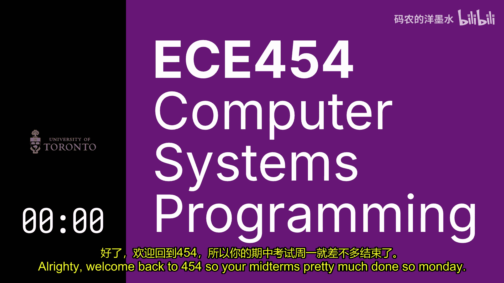
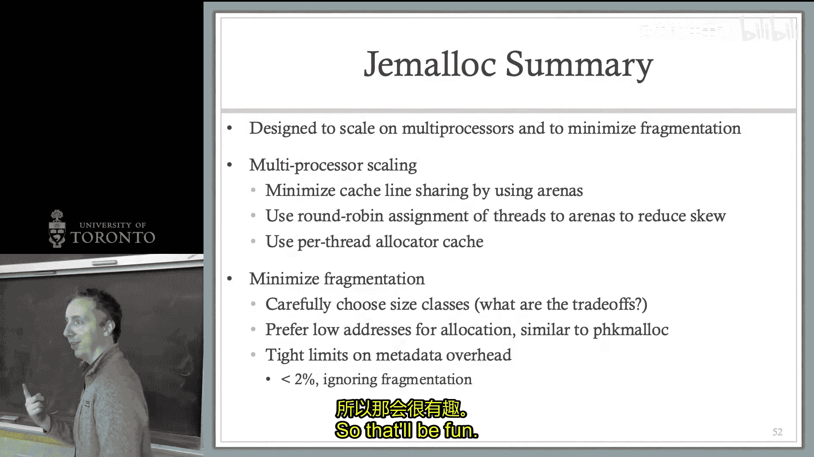

# 【全集】多伦多大学 C语言高性能系统编程实战 中英字幕 1080P p12 Lecture 12 - 现代分配器 -BV1oDrZBZEG2_p12-

Alrighty， welcome back to 4，5，4。 So your midterms pretty much done。 So Monday。There， whoops。

 oh Jesus。All right， there， now we can hear me， my bad， I muted myself in my pocket。All right。So。

Everyone okay with this so far， yeah， just so I clear。

Is this a PHK malloc just keeping track of the free list or is it also keeping track of this？

at the top left isSo right here this would be space at malloc so part of its metadata is the page directory and then part of the header file would have a pointer to the free list and the nodes of the free list would be stored。

By itself， too。So the nodes on the free list would probably be like on this block here or this page here。

Wait， so sorry， is that thing the top left， is that just like another representation of？No。

 so this thing in the top left would be like its own and mapped area for its metadata。

 and its metadata would be a header that we'll get into in a bit and the page directory which is just keeping track of what each page in the heap is used for。

All right。So yeah， it would have a free list as part of the metadata and the nodes。

 it would malloc itself。So what it looks like， so if you have a malloc call or you need to allocate。

A number of pages so it mostly deals with pages it would look up the free list。

 find the first run of pages that's greater than the request or equal to it then it would just update the free list with all the flags you know it would do the start if it was a multi-page allocation it would do however may follow flags and if it did not find n contiguous pages in a row it would either grow the heap or just endmap a bunch of space for it。

 easiest thing to do is just to grow the heap a few more pages and then in order to free。

If you need to free a page you just look it up in the page directory in constant time。

 so because we know pages start， they're all page aligned and everything like that。

 and you know where your heap starts， you can directly figure out which entry it should correspond to it's basically like I mean it is an array access so you can do an array access in constant time so you would look up。

To see， hey， use all the flags to determine the size of the page run， update the page directory。

 free all of those pages it should be pointing to a start page。

 and you just keep freeing them while you have a bunch of follow pages。

Then you add that run to the free list and it tries to keep all of the free list in address order and coalesce them all together。

It。Can actually reuse memory a little bit smarter， so why does it have two pages of page directory and the free list while most light ury？

It has two of these structures because while the page directory is just for constant lookups it just wants to be really really fast and the free list。

 we want that to be really fast， we want to store them separately， we don't know the size of it。

 so we have to dynamically allocate it and here they would all be on hopefully the same page so it's nice and fast kind of like a file allocation table。

So。How the subp allocator works is if you have an allocation less than a page， again。

 normal page sizes are 4096 bytes， so if you have some allocation， let's say 32 bytes。

What it does is it takes that page and breaks it into a whole bunch of 32 size chunks。

 so all of the chunks on that page are the same size and it would keep track of what is on this page in thestruct called page info so page info would keep track of the size of the chunks in this page and whether or not they are allocated or not and to keep track of whether or not they're allocated or not。

 it would just be a bitm so it has a fixed number of slots。

 they're all the same size so one's as good as any other it just needs a single bit to keep track of whether or not it's allocated or not。

 so it just be zero unallocd one for allocated。And。What is actually in this header file？

the header section is it will have an entry for each specific chunk size。

 so for instance it would have an entry for size 32 indicated by this whatever this color is10 and that would point to the first page that's divided into size 32 chunks and then the other part of this page info is it would have a link list of all other pages with the same size chunk。

If。In this case， if we have two subpages for 32 byte allocations。

 part of the page info for the first page would point to the second page。

 so we know all of our pages that we could actually use for 32 byte allocations。Sorry。

This could just be singly oh。Like I go one， two， I want to see more， I go back to。

So I just see two arrows。U whichhi two arrows？I'll talking about those two over there。

You have a size 32 bit now right， this is for 32。Size 32。Yeah。If I want to see more。

 I can go to the next。そです。A doesn't point to the next one。This page doesn't point to the next one。

On this page here， which is for 32 byte allocations。

 it just points to the next page that has 32 byte allocations。あも。Yeah。The list of。

I won't be a boss噶嘛。Yeah， it would just be。Just be pointers to pages with the same size allocations。

And then that's it。 So if I need to allocate you know the size 32， all I do is I。Look at my header。

 see what page has size 32 allocation， see if I can fit on one of those if this one's full。

 then I would just follow it to the next one， so on and so forth。All right。So yeah， so here it is。

 the allocation comes in for 32 bits， check that link list if this link list is empty so there's no pages that can fulfill any request of that size。

 I just grab a new page， set the page info。And then actually make it。

Divided up into 32 bit chunks with space for this page info and then use a bitmap to just figure out if I need an allocation or not or if there's a free slot。

Iultating a new page。Some subage size one is that？That treated from the。The bigger。

allocator as give me one page， or is it some special like how does it choose which page？

It would just allocate itself one page from before， yeah， from the page allocator。

 it would just grab a page from that。Yeah， and then here like can just use the bitmap。

 find the free chunk and the page info。Return a pointer to that memory， update the bitmap。

 flip the bit from a 0 to01， and then if all the chunks are allocated。

 then it would remove that page info from the link list in the header。

 indicate it's full so it doesn't try to check any block that is not free and then as soon as you deallocate one of them。

 it would have to add itself back into the linked list in the header for that size。

So how to allocate from a bit vector。 So you might not be able to see this。

 but it's kind of annoying to check which bit， which index of a bit is0 or one。

 So you can't really see it here。 but there is some functions like FFS。 Again。

 Don't ask me why they name these things like that。

 that's just a function you can use that will tell you the index of the first bit that。

The first bit that is set to the work， the first bit that's set to one。 so you can check what the。

First allocated one is。And you can figure out if the whole thing is full or not。

 or if there's a free space and then flip that bit using fun C bit arithmetic。

 so that is just a function you can use。So when you need to free something on one of the sub pagesages。

 while I'm freeing a 32 byte entry， all I have to do is find the page info associated with that chunk。

 just update that bit mapap so I flip it from a zero or a1 to a zero and if this is the first free chunk in the page。

So it was full before and now it is not full， then I add it onto this link list here。

 and then if all the chunks are free， so if I free everything on the page。

 so now that page shouldn't be used for an allocation。

 I can go back to that page allocator and now this whole page is free right so that just means。

I freed all the chunks on this page， the page is free， I can use it for something else now。And。

 of course。Since there's different sizes， your header file would also keep track of any power of two allocation。

So we could have you know size 64 byte allocations and then we'd have subpages that are used for 64 byte allocations。

 and then at some point our allocations could look like this where we have two pages used for 64 byte allocations and they're half full。

So。And the link list here that are always kept track in sorted address order。

 hopefully in order to make things as close together in memory as possible and also when you free。

 it's more likely that you'll have a whole free chunk at the end and because this is a heap。

 the only way to shrink it is basically by shrinking it at the end。

Pages at a time because you can't just free a page in the middle the heap， right。

 you can only make it smaller from the end， so I can only make it smaller from the end。

 so I tried to allocate as much as I can on the lower addresses yeah。Choose some set sizes。Yeah。Yeah。

 yeah， so the header file would have。For each size， a link list。

 each power of two sides of linked list up to whatever。

 and then if you're doing this in La3 or whatever， you have all of the traces so you know you can go through them all and see what your biggest allocation is。

And then you know your biggest power of two。is the main benefit of this？Of page size。

Allegations will span。おベル。Yeah。Are there other？Yeah， main benefits are yeah。

 none of the subp allocations will ever span two pages。

 that's one of the big benefits and then two all of our allocations of the same size are also likely to be used together and then they're all more likely to be on the same page and also get some benefits from that too typically use things of the same size altogether。

And this just。Helps us a lot more with pages and then also gives us some freedom and since we store things in address order。

 it's more likely we can actually actually shrink our heap to。Makes things a bit easier。All right。

 so in summary it's got two level design， one for the pages and then one for subp。

 subpage one basically is like a slab allocator if you remember that it's really really fast every allocation on a subp is the same size so I don't need to bother with a free list or a link list which are slow。

 it's just a bitmap so it's just array of bits， really really fast really really easy to check and。

It will only use the link list for multi page allocations and。

Does that well because it's simple in its work， large allocations aren't that frequent anyways。

 most people actually just allocate a struct， most of your strs unless you are crazy are probably less than 200 bytes。

 256 bytes， and it also does power of two segregated storage。Because it essentially。

Does the majority of the work on the sub pagesages， it's almost constant time allocation。

 checking a bitmap is free， there'll only be a few slots it's actually pretty fast to figure out what page you need to do the allocation on so it's almost constant time。

It's got pretty low space overhead， it just has that page header right which just contains a simple Eum for every single page it's keeping track of and a linked list to each size doesn't have to bother splitting coalescing。

 it's really really easy， all your pages are stored in address order so it's really easy to coalesce to and in comparison with that simple segregated storage。

 it's internal fragmentation similar because it also does the rounding to the power of two but it helps reduce external fragmentation。

By just returning empty chunk pages back， it's more likely that you can actually free those pages again and because it prefers the lower address for allocation。

 you're actually more likely to actually shrink your heap。So other ways， the Java one。

 garbage collectors， so you can probably hear my bias coming through on this one。

 so I'll try and be unbiased。So。Drawback of malloc and free。 You have to explicitly manage memory。

 You need to keep track of your allocated memory， free it whenever they're no longer needed。

 You could argue that some programmer burden， we have better。Tools now in C++ and rust。Before this。

 it's kind of a burden like if I need to know whether or not something is free or not。

 and I know all of my pointers， I have to walk the entire graph of my data structures to see if something I can actually free。

🤢，We've all done it， we've all made errors， especially。

 apparently Ashpen did not think too highly of you guys。

 especially when considering the quality of most programmers， so most of you are bad， I guess。

I didn't say that these I'm just simply using these so some problems you can have。

 you're right dangling pointers， so some pointer that is actually just sitting there not being used anymore。

 double free so if you call free boom undefined behavior， good luck， and then memory leaks， aK。

 the entire Java ecosystem， but you know。Chrome can leak and all the other things。

 Lots of programs leak eventually。And yeah， it kind of depends on the quality of the programmer two。

 but that's why garbage collection came along Oh yeah。And we sort of avoid double。Hesn't undefined。

Yeah， so the question is， can I avoid double free buns by making a？Make sure it's not undefined。

We're implementing ourselves in the lab。Yeah。be careful。

Imagine you allocate that space that used to be a pagecheter for actual data。So the user can just。

 oh， I'm going to settle all those lightss to allocate them。Thanks。It definitely depends。

But you have to be really careful。Yeah， basically the reason why they made free undefined is because。

 well， if you make a malloc that。Can catch and detect those bugs。

 Your malloc is now going to be slow， so they don't want that。 They want to be as quick as possible。

 They want to give you the most treat them。 You can implement it so it is defined。One。

 it's really hard to do and two。It's slow。Yeah， at that point。

 you can just throw a garbage collector on it and then use Java and then。Do whatever。

Do a whole bunch of other ones， probably RE has a better model for this too。

Yeah so with garbage collection the idea behind that is I want some system to automatically free memory for me。

 I just want to Willy nilly hit new on every single thing and just have it callfr for me so idea behind that is it should be able to figure it out so if do if I have a function call this is a really simplified example if I malloc like 128 bytes and then I returned well now P is out of scope so I now have no way to access that pointer I got back from malloc unless I do some really funky pointer arithmetic so I can't use it anymore。

This would be an example of a memory leak if you look at this you might be like well just figure it out you know it's garbage you should just freed it。

 I can't use it anymore so some functional languages。

 scripting modern object oriented languages will do garbage collection the list will do it Java will do it Pearl will do it。

 Python will do it， Matlab， I don't know about modern language but MatTlab will do it other variants you can just shoehorn a garbage collector on C or C+ plus if you want but again it's not going to collect all garbage you'd have to。

Kind of implement it together with malloc。They're。Generally， no one does this。

You kind of want the whole language to be garbage collected or not。

 I think you can is go garbage collected， I forget。Or you can throw a garbage collector on go。

I think it's one。Yeah， you can turn it on or off， I think， so go。

 you can just throw it on if you want， probably a better option if you want garbage collection。

So if you are implementing a garbage collector， how does it know when memory should be free unless you know the future。

 so even if you have。You know， if someone has a reference to memory， well。

 you don't know whether or not they're going to use it in the future unless you can predict what they're actually going to do。

One thing you can easily do is to weed out something so if you can tell a memory block is not reachable or it's not possible to access it。

 you call it garbage because not possible to access to it so I can go ahead and free it so there's no way to follow pointers such that you can actually access that memory anymore so some of these needs to make certain assumptions about pointers so the memory managers should be able to distinguish you know pointers from nonpointers。

 all the pointers have to be to the start of a block as soon as you start doing funky pointer arithmetic it will fool most garbage collectors that's why Java strongly strongly discourages it Java actually does have undefined behavior if you know what you're doing or。

Don't know what you're doing， I guess， so you can trick it a little bit。

It also needs to know what the size of the allocations are in order to free them or collect garbage and you cannot hide pointers so if you just。

Make a pointer into an int and then。Type cast it back again。 Obviously。

 it won't be able to determine what the hell you're doing。 so it would have to。

In order to actually free something， it would have to make some assumptions that you don't do things like that in order to say that。

 hey， now it's no longer reachable。And you can't do that。

 so you can have programming languages that are try to prevent you from doing these things like Java。

If you know what you're doing， generally it tends to be a giant pain。

So some garbage collection algorithms you have。The garbage collector algorithms。

 when they describe it， are actually pretty hilarious because。

The thing you care about is probably your application， right。

 that's doing all the memory allocations in the literature， they call your application the mutator。

 It's that pesky。Program that does memory allocations that I have to clean up after。

 So it's like a very。Very weird way to look at， it's very garbage collector centric and they think they're the most important things。

I don't know， just a weird weird tibit of information， so some garbage collectors。

 the old ones don't move memory around， they don't move any blocks whileer newer ones。

 1963 that's way older than me， that can move blocks complex blocks。

 the modern Java the Java garbage collector will move and come back stuff and try and move your allocations around。

So how garbage collectors work is they look at memory as a directed graph。

 so each block in the node is a directed graph， each pointer is an edge。

 so they figure out what is reachable for what by just following the edges in the graph so the locations that。

Are not in the heap， right all your local variables will contain point that contain some pointers in the heap are called root nodes。

 so they'd be registers， local variables， global variables， things like that。

 so they would point to locations in the heap， and then your locations in the heap would point to other locations in the heap。

So。Your root nodes， they would point to some， I mean， if it's Java， it would be some local variable。

 some reference， some static， something like that。 So your root nodes would point to some。

References I got nude。 So all the nodes， again， remember are blocks and all of the edges。Ourre。

Showing that theyre fields or something like that。 So they point to other blocks of memory。

 So in this case， we would have， I don't know， maybe this is like。

Some local variable pointing to a point structure and the point structure because it's Java。

 the x and the y are also objects， so maybe that's representing a point this just points to an object and this points to something that points to something else and then if these were all of your root nodes you would see that hey。

 theses，Four nodes here that are circled in red are not reachable。No harm。

 no foul will come to me if I go ahead and I just remove them。

 so they're just called garbage because， well， they're garbage， you can't access them。

So the easiest garbage collection algorithm is called Mark and sweep。

 so it can be built on top of Maoc and free if you want。

 so you can allocate using Maoc until you run out of space and then when you're out of space。

You can keep an extra mark bit at the head of each block and then starting at all the roots。

 you can just mark all everything that is still reachable in memory and then after you mark everything。

 you sweep it， you scan all of the blocks and you free anything that's not mark。

 so anything that does not reachable， immediately gets collected。

So this assumes that some pointers in memory are known to point to the start of some block。

 so you'd have some root nodes pointing to other blocks of memory。

 this assumes that again you're pointing to the start of the block。

 you know the size and everything like that， so starting at the root node。

It would start marking anything that's reachable， so it would mark this block， the next block。

 mark this block， so it looks a bit funky because the arrows point to the middle。

 but this is a three span allocation and this is a two span one and then there's other two span ones here or a two and a three so it looks a little bit funky。

🤢，They would all get marked and then after everything is marked， then it would do a sweep。

 go ahead and free any blocks that are not reachable。

 so it would free these two blocks and then these four blocks here。So if this was Java。

When Java did this。Typically this was really bad for performance and you didn't want your application to still be running while this was going on so what Java would do is something called pause the world so it would stop your application from running while it did this whole process so your application stops because the important part the garbage collector is going to run it would mark it would do this mark and sweep thing and then you would notice things get slow or you might see that it's called a GC pause or garbage collection pause so sometimes old Java that's why sometimes your performance went to hell because the garbage collector was running and had to clean up all the garbage you created。

And especially I know that because I think in grade 10。

 I started with Java so I created lots of garbage， so that was fun。So。

Some details for Mark and sweepep。You can change how you mark， you can do depth first。

 you can do breadth first， you also need to deal with cycles， so during the search。

If you see something that's already marked， the easiest thing to do is just don't visit it again so you don't have any recursion。

 you don't do any cycles， so that's the easiest way to deal with cycles。

 you just don't try and repeat it。So that basic mark and sweep algorithm takes a lot of time。

 it's proportional to the heap size because it has to visit every single block to determine and then that sweep determines every single block to see if they're marked or not so what the bakers's algorithm does to try and improve this a little bit just to keep a list of all the allocated chunks of memory in addition to the free list and then during the sweep similar to having that explicit list it only looks at allocated chunks of memory it doesn't bother looking at free ones because they won't be marked I don't have to do anything with them they're already freed so then instead of being proportional to the entire size of memory。

 it's only proportional to the allocated memory so slightly better but still not great but same idea as that explicit list so we don't have to scan every block we only scan the free blocks so this is the same thing but the opposite way。

So if you have it in C， you have to check every word to see if it points to a block in the heap。

 if it does， you can mark that block。This is really really error prone and you might get some false positives right a word that isn't a pointer might get treated as just one causing garbage to be treated as reachable memory leading to a bunch of external fragmentation if it thinks you can't actually free it and of course C is completely unsafe。

 a pointer can point to the middle of the block you might just。

Be doing array array access or something like that or keeping track of a substring or whatever。

 so you might need to keep track of the start and end of each block using a binary search tree key by the start address and then you can actually figure out if this address is actually belonging to an allocation or not so there is a garbage allocator for C and C++ I highly suggest you do not use it。

So some other issues， you have to identify all the references and the pointers。

 you have to jump all over memory， it's going to be really， really， really， really。

 really bad for performance， not take advantage of our caches。

 not take advantage of the paging system and the search time proportional to the amount of no garbage so might require lots of work for little reward。

 so if Im if it's not even going to free anything if it's going to free a grand total of eight bys or something like that。

 stopping my entire program and scanning everything just to do that is not very good and yet it has to stop the program while doing garbage collection。

Although modern garbage collection now it will do partial garbage collection。

 it will try and do it on the fly and try and fix it up if it sees you're actually trying to modify it when it's scanning it。

 so nowadays Java might have good performances because of people that write the JBM。Basically。

 magicians， they do a bunch of evil magic in order to have it running as the same time as your application without causing any issues。

Yeah。In there。Teachers like art collection。Not only。But they could。Like cash。Yeah so。significant。上嘅。

Yeah， so the question is。Does the garbage collector just add extra cash pressure basically， and yeah。

 so it'll add some extra cash pressure typically。The JVM developers try to be very careful about things like that。

 if it knows you're in a particularly hot section of code。

 it won't try to mess with your memory or do anything like that。

 but yeah it will do some interference， they try and minimize it， they do some dark magic。And。

So the better thing to do was brought up way before， basically reference counting。

 this is basically C+ pluss unique pointer， any reference counted thing and rest。

 the basic idea here is in the allocation itself， we keep track of the number of references to this block。

 when a new reference is made， we just increment the counter。

 however many copies of that pointer we have when you stop using a pointer。

RightThat's one last reference。 you decrement the counter。 If the counter goes to zero。

 that means I have no more references to that memory so I can free it。

 so requires some compiler support or。You just use smart pointers and C++ so that's a unique pointer or a shared pointer or not unique pointer sorry a shared pointer so shared pointer and C++ will do that basic reference counting so what that will basically do is whenever you knew keeps account of how many references to it so here there would be two independent ones if I free it。

Free or stop using P reference count goes down by1， if it's zero， it would free it。

 so on and so forth。あかって。Itた。I feel like almost as smart as supers bus with。

So if you have a garbage collector with reference counting， so if you have reference counting。

 you don't really need a garbage collector， right？So you pretty much use one or the other。

So I'm not sure what if you can opt to reference counting in Java or not yeah in this example on the bottom right。

 they're supposed to be like a free。In between like right after Hugh count plus bus。

Im just wondering why we decor。Oh so here the reason why we're decm the count from P is we're updating P right so p was pointing to this block of memory for this object and if we assign p to Q that means whatever P was pointing to we're not pointing to it anymore so everything in red here would be done by the compiler I guess or basically that's what C++ would implement so if I'm reassigning P whatever it was pointing to before I'm now not pointing to it so I would decrement the counter and then if it's count with zero it would go ahead free that memory in this case it was the only thing pointing to this new object here it'd be two different memory locations here and then since P is now point to the same thing as Q now there's two things pointing to that Q object。

All right， so some reference counting problems， Maoc of course may return null。

 so if the compile is just adding a whole bunch of information then it might also need to check that if it's adding that to itself。

 don't have to worry about it for Share pointers or anything like that。

 it would just give you null from the SharePoer and kind of integrate in the reference counting by itself。

And if you have garbage collected blocks， they also might include pointers。

 so you have to recursively follow and decrement cant the count appointed to blocks so if you have。

A shared pointer and that also points to a bunch of shared pointers， then you have to rely on。

 well in C++ you just rely on the deor to do all of that stuff for you。

You might also inadvertently create a cycle。 So even in Java， this is an issue。

 So if you have a cycle and it's。Reachable。Then， well it can't collect anything if you have created a cycle and one of those nodes in the cycle is reachable because it would not be able to detect that it is garbage so there's something in Java called a weak reference。

 so a weak reference basically will not be followed for garbage collection purposes so it won't count as a reference so it could actually clean it up。

So some the counter two。If you have a multi threaded system， which we all do now。

 it also need to be atomic。Doing atomic increment and decrement has a bit more overhead than just doing a normal increment and decrement that don't really care about multithreaded issues。

 so for a modern system you'd also have to take that into account。So your。

The other option is to have application aware allocators。Typically you as the application developers。

 you know your patterns better than any generic memory allocator。

 so you should leverage that a bunch of systems programming。

 all the research papers basically all use the same idea so you look。

What the program's doing and try to exploit。The unique thing about that program or some unique property it has。

You've taken this course， you know how to profile， you know how to think about memory。

 then you should be able to leverage it， you should know kind of how your allocations altogether。

 if data structures are being used together， they should probably be stored together。

 so some other allocation data structures you could have。

 you could have list other structures will go into some different patterns you have so。

Often the most important thing to a memory allocator and making it really really fast is the lifetime of your allocations。

 usually there are not random if you're implementing malloc。

tThen they look random to you because you have no idea what the memory is actually going to be used for。

 but typically the lifetimes go into one of four categories， so either it kind of ramps up over time。

 so allocations throughout the program lifetime。Increases and it never gets released。

 so it just keeps on getting reused and reused， maybe at different times。Other times it can plateau。

 you can have a bunch of allocations and then they get used for a lot and then they're no longer used。

 so it's just doing some computation， needs a bunch of memory and then doesn't need to use them all at all。

 and there might be a bunch of allocations that are all related to each other。

You also might have peaks， so you most things are fairly short lived， so you allocate something。

 do something， delocate， they usually don't last that long。So。

 and that's one of the optimizations Java will do， it will try and optimize really。

 really short lifetime objects and do something different for。Basically。

 any objects that survive the garbage collector a few times at nose live for a while。

You mightight also have phases with your program， so they're associated with some other things。

 some task you're doing， and maybe it runs in different phases。🤢，I don't know。

And then the block sizes are also not random even。1992 study。

Most of the allocation requests we saw the slide before were for the top two sizes。

 so most of the time you're using the exact same size of object because well。

You're typically dealing with one type of data structure or maybe two types of data structure and like the most common thing in the Linux kernel is like iOs。

 iOs are all the same type， it deals with lots of files all the time， iOs are all over the place。

 a lot of the requests are just for iNots。So some strategies， if you are implementing。

 trying to exploit some memory management patterns in your own program。First。

 you should probably see if there's some dominant pattern。

 likely there's only a few dominant data structures that impact the performance of your application。

 only focus on those。Make sure the cash aligned all of that stuff and then leave the rest to general purpose allocators which are already pretty good。

 so do your own memory allocation for only the most important things and just let everything else just deal with mallOoc。

 who really cares if it's slow if it only represents like 2% of your entire runtime。

Other strategy is something called an ata pattern， so it allocates blocks of similar lifetime。

 they die continuouslytiguous or continuously， so this is kind of using that same idea of the stack so four stack all of the freeze are basically free because the lifetime of all your local variables。

 all are the same they last as long as the function last so in order to free everything。

 all your local variables all it has to do is reset one stack pointer which is a really really fast operation because everything has the same lifetime so you can massage your application so that if things have close enough lifetime treat them all as having the same lifetime and try and deallocate them all in one big chunk。

And then the last one is that slab pattern so if you have。

A whole bunch of allocations of the same size， just allocate a whole bunch of blocks with similar size all contiguously。

 make sure all of your allocations are right by each other， it's basically just an array。So。

What an arena allocator is basically the only data structures it needs are a stack of pages and some watermark pointer what page you're currently at。

 so if you need to allocate，You just return the current watermark。

 increment it if you need a new page and you just have to take care of some alignment or anything like that and the whole thing with the arena is it just keeps track of the stack of pages and then once you're done with that arena。

To free it， you just free the entire arena you free all the pages with it so the nice thing about this is to allocate just oh one just grab you a new page and free is constant time too it just frees all the pages in once and the programmer burden while you have to keep track of your allocation so you have to make sure to use the same arena for every single allocation that has a similar lifetime and make sure you free it whenever you stop using all of them and usually it's used in compilers a lot yeah。

track。How do you track which pages are free， so the arena basically would just grab a whole stack of pointers or a whole bunch of pages that are all contiguous enough for the allocation。

And it just does。All the allocations and freeze them all at once。Yeah。

 so generally used in compilers a lot because compilers， some of you are taking compiler course。

Compiles have different stages。So it would have a new arena for each stage。

 it would all grab memory from the arena for that stage and then as soon as that stage is done it can just delocate it all at once so it doesn't have to walk a graph doesn't need to try and do garbage collection。

 everything all dies together， I don't have to do anything， I just free the entire arena。

For a slab allocator， same idea， I just have a stack of pages that I'm using for the allocation I could get from MMap it could be from my Heap and then I just have a list of free chunks so this is that idea where everything is the exact same size so to allocate I just grab a free chunk if available。

 I just check in the bitmap whether or not I have a free chunk。If I don't。

 I add a new page and to free， I just add it to the front of the free list if I have stopped using that page now and here allocation freeing。

 also constant time really easy to check a bitmap in the kernel。

 anything of the same size will be allocated basically with this slab allocator， network packets。

 inots， things like that and also used in MECashD， slab allocators is basically the fastest thing you can do。

 but again everything has to be the same size。So other concerns we might have for the metadatas where we store it。

 so we've seen linked lists of variable size free blocks。When we had stored them implicitly。

 so the link was stored in the free blocks himself， this is not used because well。

Not only was memory spread out。We had to walk all the allocated blocks and all the free blocks every single time。

 so if you do do that it is always better to use the explicit list so link list of free blocks and then while to find the next free block you just。

Iterate over the linked list of free blocks instead of every single block。

 so that's more commonly used and then where that list is stored。Those were the two options， again。

 were integrated， used the space into free blocks。Nice because you don't have to manage your own space。

 it's much easier but。Not that good for performance since it has really poorer locality。

 they're all spread out。There's a lot of space that is unused。

 they might be on different pages and everything like that。

 while if you store the link list externally， so they're all right next to each other。

 you'll have much better locality when traversing it。

 but you do need to manage the space and how it's grown and that's what we saw in the first example today of that PHK malloc。

So the order of the free blocks in the list， if you just have last in first out。

 you have better locality， it's more likely if you free stuff， you're going to use it again。

 it would already maybe be in cash， already have a TLB entry while if we have FIFO and add the free blocks to the back of the list。

 it probably won't actually have any real benefits。If we do have it sorted by block size。

 hopefully it limits traversal for smaller allocations， everything's at the front。

 and it's also more likely we can actually free some pages in our heap。

If we actually sort by address， so if we sort by address， then we reduce some heat fragmentation。

So what we saw at the beginning， we can only make the heap smaller from the end due to the way the heap works。

So。For the data structures itself， easiest thing to do is that slab allocator。

 which is a bitmap for fixed size， contiguous blocks so they're just。

The idea from PRK Mack have a subp that has all of the same sized allocations on it。

 so this is what's used for segregated storage。In that scheme we just had a list for each size of the same block。

 which page they were all stored on and blocks of the same size must be allocated contiguously。

 so this's basically just an array and you're figuring out which elements of the array you're going to use for the allocation。

You can also add some leading zeros or leading ones。🤢，Not sure what that means。ling子。Sorry。

 I miss that one when I prepped， I have no idea what that means。

 but another thing you could do is instead of linked list。

 you could use trees right if you have to search the heap or search a free list or something like that。

While you're searching， it's a linear time thing， you have to search for the proper size allocation。

 if you had an ordered tree， you had a balanced binary search tree or red black tree or something like that。

 well you can actually do your searching and log N time instead you have to have a much more complicated algorithm instead of a link list。

 but it might be actually worth it。So some other performance considerations。

While most of them are oblivious to cash， so the allocator could assign addresses。

 maybe it doesn't actually use cash effectively， so somehow right you want to take advantage of the prefecher and everything because typically。

If you visit everything in address order， then you'll make the prefetcher happy。

 hopefully it will be able to guess what memory you're going to access， cache it。

 and all of those fun things。So you basically always want to make your accesses sequential as much as you can because while we know memory likes that。

 both the TLB likes that， the cache lines like that， prefeshing likes that， everything likes that。

So another。Version of Maloc， you can use something called JE Maloc。

 it's used in Firefox and other things like that， Facebook also used it and made their own modifications to it。

 so there's a whole bunch of links you can see but it might give you some other ideas what to use。

Although this is mostly。Mostly for multi processing systems， as soon as we get to our next topic。

Threads again， this will probably be more relevant for Lab4 where you're actually going to use threads。

 but the main purpose behind JE Maoc was to make a malloc that was more friendly to having systems with multiple cores on them。

So。Most allocators want to and what you're doing in lab3。

 optimize for space utilization and performance on a single core or throughput。

They have two main issues when you try to use it on multiple cores。Data packing。

 trying to shove as much information as we can in and the locking scheme。

 it doesn't really take that into consideration。So for data packing。

 most mallocs try to pack as much data as efficiently as possible。

 arrange the structure so they're as small as possible， pack some bits together。🤢。

So they're as close as possible。Hopefully to improve caching because well。

 that's one of the recipes for good performance we have。Hopefully caching CPUs really much， much。

 much faster than main memory， so we try and utilize them as much as possible。

 but this packing and making things as close together as possible can actually lead to really。

 really poor performance on multiple cores。So why that would be is basically。

 if you have multiple cores， they will actually share a cache line。

So even if the objects themselves aren't shared if they're on the same cache line。

 they might be the same cache line might have two objects， one's used on one core。

 the otherss used on the other core and your hardware is going to try to keep this cache line in sync between both of these cores。

 even though one core is using the first half and the other core is using the second half。

 so they're actually not interfering with each other。

 but because these two CPUUs are using an object on the same cache line。

 then your CPUU is trying to going to make that cache line consistent between both of the cores。

 even though they're not actually going to need to be consistent so even if you this thread updates object one。

 the cache in CPU1 is going to be updated to reflect that in hardware and there's nothing really you can do about it。

So you really do not want to share cache lines if between two different threads。

 you'll have a whole host of issues where it tries to make it consistent。

 we'll get into this more whenever we actually get into multiprogram。

 but this is one of the big things that affects。Specifically malloc in this case。So。

We want to avoid cache lines sharing between cores as much as possible。

 so if Maloc just packs things together as much as possible。

 it might be the case that two different cores are both using Maoc at the same time and they're both inadvertently sharing cache lines。

If we just add some padding， we'll have some internal fragmentation making it really cache unfriendly。

Just sticking them on two separate cache lines， it may help in that scenario。

 but overall it will make things a whole lot worse。And。Well。

 maybe the memory they get back from Maloc。Also has the same issue。

 so that memory you get back might have issues with multico scaling as well。Hopefully。

You can get around this， but it will cause some internal fragmentation only for some objects。

 but it requires programmers to actually align their data structures themselves。🤢，嗯。

Could cause some contention。 Again， we'll get into this more when we talk about having multiple threads。

Analyzing these performance thing， you have to profile really， really。

 really closely to determine whether or not you know we have some。Some contention。

We have some sharing of data that we don't really want to be sharing。

 neither of these is a good thing to do。So。We've seen in other courses locking again we'll get into locking a bit。

 so traditionally what MalOC did is it just used some simple locks。

 so it locked all the data structures， so it basically serialized calls to MaOoc and free。🤢。

Fine if you don't have that many cores or you're not using an application that uses Maoc that heavily。

 but doesn't scale that well today， especially since we have cores or machines with lots and lots and lots and cores。

Seerializing something makes it really， really bad， even in。

344 using a single lock can make things easily， much。

 much slower than just running it on a single core。So。

What they did is use that idea for arenas again， but they split the heat memory into arenas or contiguous blocks of memory and then made sure that each thread only allocated from a single arena。

 so memory，That's allocated from the arena， it's also freed in that same arena so it basically creates different segments of heap space for each individual thread and the whole reason to do that is well if you get all of your memory from your arena that only your core or maybe another you share with another core can access。

 then while you don't have as much problem with locks you'd have multiple locks for however many arenas you have so you can scale a bit better and also you would be much。

 much less likely to have any false cache sharing or anything like that because you know the memory you're getting is completely independent from memory another thread would get。

So typically used a lot for threaded applications typically。The arenas are like， I don't know。

Four to eight times the number of cores， so you have some type of limit on the arena and then you have to do some mapping of threads to arenas you could just do simple ground robin。

 so accounting for threads at exits， thread locking，Maybe that's not a good thing to do。

 you might do some hashing mechanism， but if you hash it improp。

 you could have some imbalance or you could during mapping。

 switch to another arena if malloc sees that the arena is already locked so if we had P threads you might try the lock if you don't get it just instead of。

Blocking and waiting to actually acquire the lock， just go ahead and move to the next arena if that you see that one is actually full of contention。

So。They do this because it scale very well for multiple cores。

 so each thread just allocates from its own arena。Idea behind that again reduces locking overhead since only a few threads access each arena。

 the arena themselves require synchronization， but it's better than just having one giant global heap of memory that you essentially have to serialize。

Allocation， you would still have to lock， but you lock your arena and that's it and then you would have a per thread allocator cache。

 each thread maintains its own cache of small objects up to， in most cases 32 kilobytes。That way。

 most of your allocations actually hit the cache required no locking and you're all good。

 and the number of cash objects per size class。Would essentially be capped so that you'd have less synchronization。

The more caching you can do。The more。Fragmentation you might have， you want to reduce fragmentation。

 have better data locality。Rather than doing that。So。The performance。

 so it might be a little hard to read。So going from left to right， this is just standard。

GlibC back in 2。5 and the X or sorry the Y axis here is normalized throughput so higher number is better so this is the standard malloc this is PT malloc so it's a little bit worse that's ho not that good concur TC malloc and you can see the best performing one is JE malloc so some that perform has like twice the throughput as the normal GCC malloc so a lot of the times too if you want to just try and improve your performance a good thing to do is just try JEaloc and see if it makes your performance better yeah why is J not just。

Yeah， question， why not just use J Malck instead？So there might be some。

 some applications where it performs worse on。 It does some other trade offs。

 Everything's a trade off。 I think it might have。Slightly worse space utilization。

But for most modern systems， it would be better， but all allocators are some type of trade off。

 right， it's just most of the time it seems to be better。いや。Maybe。Seems to be in。

Rand is still getting better。你你两万。あ世解。Yes is。A better idea these days。Less space efficient。How work。

Yeah， it's definitely changed too with the hardware。 So now memory issue。Not， not that。

Especially size is not that much of an issue anymore。 So trends change over time， whatever。

Performance characteristics change over time。You have to take the whole thing into account and most of this is like it depends in this whole course right so it depends profile。

 get a whole bunch of measurements and see what you're doing。

 there's no true right answer for everything there's all sorts of tradeoffs but typically now you don't really care that much about space efficiency that much and sometimes it correlates。

 sometimes it doesn't。Kind of depends。All right， so for JE Maloc。

 so the whole design of that is to scale the multiprocessors， minimize fragmentation。

You'll get to multithread malloc and La4 don't worry you get to work with a partner in La4 I believe so it will be slightly better so that's what this is to give you some ideas for that before we actually talk about threads in the next lectures idea here multiprocessor scaling try to minimize that cache line sharing using arenas so each thread allocates from a separate pool of memory could use round Robin to assign what threads go to what pools of memory and then you would have a per thread allator cache to actually speed up all the allocations hopefully you also minimize some fragmentation here so you want to choose some class sizes so you want to。

Generally， if you want to be fast， you just choose some different fixed size allocations。

Hopefully you'd have some trade off with some internal fragmentation。

 so you have to balance your space utilization and hopefully your。

Cash usage and all of that hopefully you also need to prefer lower addresses for allocation similar to PK mallOc for the same reasons and you'll have some like really tight limits on metadata overhead you typically want to be under 2% for these types of applications and that is it we got through modern allocator so I'll stick around if you want to chat about anything or questions about the midterm or whatever so。

Yeah， we have what， the midterm Thursday， so that'll be fun。 The midterm's not too bad。

 It's already more or less written as have to print it。

