# 【全集】多伦多大学 C语言高性能系统编程实战 中英字幕 1080P p13 Lecture 13 - 期中复习 -BV1oDrZBZEG2_p13-

脱つ。对。Alrighty， welcome back to 4，5，4 midterm review。 So your midterm is done currently printing。

 It is not terribly bad， so I will be here。To answer any questions you have， we can do it。

Office hour style or we can just go through what you need to know So main things you need to know。

 Yeah，'s talk to it's the Thursday， 730 in PB basement， we're in the basement， of course we are。

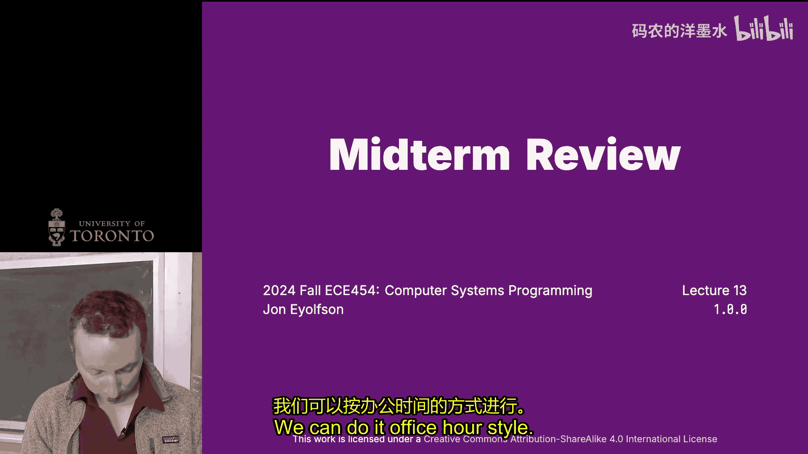

It's divided into six parts。So 15 marks， a short answer， there are all true false。

They're relatively straightforward again this is closed book you don't have any aid sheet or anything like that。

 The only aid sheet you have is what I just posted on Discord and it's fairly lame。

 it is just a list of the Ganu like whoops the Ganew GCC compiler options just shows you a whole bunch of flags hopefully to jar your memory a little bit in case you forget names but other than that closed book。

Not too bad， so short answer， true false， 15 of them。Then eight marks for compiler optimizations。

 so we'll go over that quickly， you should be able to name them and explain them what they do。

 the basic compiler optimizations that should automatically run and then we will do program optimization So remember lecture5。

Lecture five where we had that combined thing and we kept on optimizing it over and over again。

Something similar like that will be on your midterm， then there is catch hierarchy。

I'll go over an example today because that's probably the hardest question if there is a hardest question on this exam and then。

Actually no， probably not that one and then virtual memory。Virtual memory won't be too bad again。

 we'll cover it here and then dynamic memory， which will be not so bad at all。

 So here let's go over the topics。So。The first few lectures you should just know like the true false thing won't be anything terribly big。

 Then for compiler optimization， you should be able to know and possibly name the following。

 So constant folding， So that's just combining constants doing the operations， doing the multiply。

 that's just called constant folding， common sub expressionpress elimination。

 So if there's a common sub expressionpress between two giant expressions， you can pull it out。

 that's common sub expressionpression elimination， only do the subexpression once。

Copy propagation or constant propagation， so if you know a variable is a constant。

 just propagate it forward。Then copy propagation if you have。Y equals x， then in place of y。

 you can just use x in any subsequent thing。 So that's just copy propagation。

 I don't actually need the other variable。Then dead code delimination should be selfexplanatory if any code is not reachable。

 it is dead， the compiler can just go ahead and delete it。

 doesn't have to take up any instructions or anything like that， loop interchange。

 so that is just changing the orders of the loops， maybe it does that while it should do that so that it utilizes your cache is better。

 who knows whether or not it does a good job of that， loop fusion。

 so taking two loops and combining it together into a single loop。Loop invariant code motion。

 that's any constant in a loop， you pull it out of the loop so it doesn't recalculate it you know up team times。

 and then the file one is in lining so we take a function call and we take the body of the function just replace it with the function call so we don't actually have to do a function call anymore。

So any question about all these compiler optimizations， good to name them。

More or less how they're applied is loop on rolling considered any of those loop things？

Loop unrolling， it'd be too annoying， so in the exam it just says。

 assume none of them are loop unrolling as a spoiler loop， otherwise your hand might just hurt。

 right？Yeah。愛さてた。Copy propagation is just like if you have x or y equals x。

 then you can replace any instance of x with y or other way around， so you just get rid of it。

All right， any other question about the compiler optimizations should be fairly straightforward if I give you a piece of code。

 you should be able to apply a few of them and name them， right？Perfect， great。All right。

 program optimizations。 Sometimes the compiler won't perform these things because it's conservative with memory。

 right， if you write to some memory location， maybe it can't optimize that away。

 maybe you have to use your brain a little bit， reorder some things。

 maybe it won't apply things because they're indifferent， I don't know。Different C files。

 or it has to make the worst case assumption about a function。 But maybe， you know a bit better。

 So you should be able to apply them。 This is exactly like lecture 5。

So before we've got into loop unrolling， should be able to apply those same things as a large hint if you follow the first like four steps of lecture 5 and be able to apply that to a different piece of code。

 you should be okay。Questions about that。I'm probably giving away too much here。

 but whatever your labs are slightly hard， so your' midterm slightly nice。So。Cash hierarchy。

 So this is the one where you should be able to determine like how many bits are in a tag index and offset。

 Basically how the lookups work。 You should know if I say something is a size， a set associivity。

 You should be able to give me the tag index and offset bits。 How many are in there。

 You should also be able to find like the hit and miss rate。

 if I give you a cache and give you some simple array accesses， something like that。

 You should be able to tell me more or less what the。Hit rate is or missrate is。Probably miss rate。

 no， hit rate， hit rate。So questions about that。Should be fun， right， yeah。An example。😊。

We'll have another so I'll leave that to the end。 I'll show another example quick of this type of question。

 and then we'll do an example of that。Allright， so yeah。

 here's an example cache question I already had ahead of time。

 so given a 32 B machine with a 2 kilobyte4 way associative cache with a line size of 8 bys。

 how many bits are there for the tag， the index and the offset so。

I'll leave you with this for a little bit and you can try it yourself and see if you can figure it out and we'll take it up and I will write out the same question so we can take it out up。

So I'll leave you with that for like what， like I'll give you two minutes。さ。ますごませ。哦，这块。而且组是。ど太。last。

問在までで。I。It takes a public。the higher。今しゃ。是。お。For we。あてれば。呃有四个。这这也没有异议。直播是。ベドロ。All right。

 your two men is up， what's the answer？Oh oh。All right， simple one。 How many whoops。

 How many bits do I need for an offset？R row。Yeah。Two， why two， oh I see some threes， yeah。I think。

Three， three。3，3，3。 Yeah， it's 3。 So our line size is 8 B if in powers of2， that's 2 to the three。

 So I need three Bs to determine which of those Bs I need to access。 So my offset is 3 B。All right。

 what about the number of bits I need for an index？Six， nope。Two nope。5 nope。Oh， geeez。Yeah。な。9ine。

 yay。All right， why is it nine， okay， so maybe we needed this review session more than I thought。

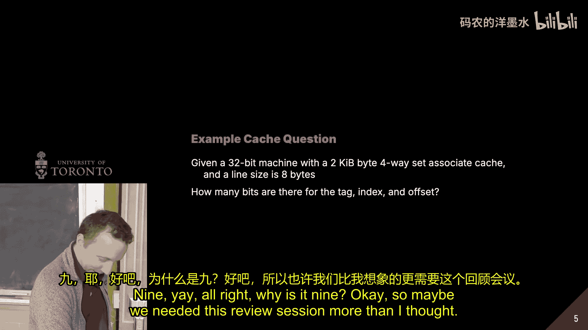

嗯。So here is all the things we need to know， right， we need We have a 3D di bit machine。

We have a two kilobyte cache size that means it is just always right。Powers of two。

 So 2 kilobyte is2 to the 11， right？Then if we have four ways set of sociivity。

 that means that's2 to the two。 and we have an8 by line size。 that's 2 to the three。

 So we got the number of index bits from log2 of that。 So if we take our whole address， whoops。

So if we take our whole address and we divide it up into。Offset。

And we would always divide our address up like this， right， offset index， and then tag。

So we know that there is。Three bits here。And then this is what our cache looks like， right。

 there are S number of sets。And then we have some number of entries per set。

 which should be our associivity， and our total size of the cache here is the number of sets times how many entries per set we have。

Right so which of those numbers do I know。Yeah， it doesnt get divided by the size of the as well So the cache line is accounted for in the offset。

 right， But the does that not account for the cache line size like the number of blocks is depending on the number of lines storage also gets divided by。

Whoops， yep， okay。Yes， it is six， my bad。Yeah， all divided by the line size。Wops。Okay。Yes。Okay。

 for the future question， assume that。Assume that。So assume I said what's to the 14， That is 16。

So for the future question， assume that I was a bit smarter。So 16 kB。 So we actually have， you know。

22。To the nine here。So we are right， it should be。6 bits。

 But I just modified the question so that my future one's in line， because。Yeah， I screwed it up。

 I did this right before I came to class just so you had an example because spoiler alert。

 your midterms printing right now， so this is probably super relevant if I made it up this morning  so。

If we have a 32 bit address that means we divide up our the rest of the bits are used for tag right。

 so 9 plus 3 that's 12， so I have 20 remaining so any questions about that。Looks cool， right？

All right， so something weird that we might not have seen before。

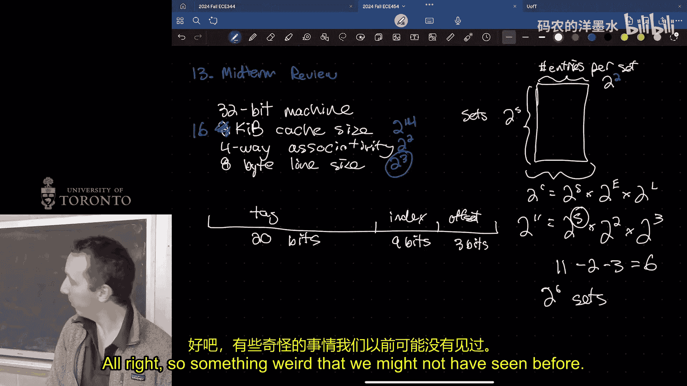

Is。If I give say， hey， given the previous question， I ask you what's in the cache。Right。

 your cache looks like this。 There's an index， and then there's a tag。

 and then there's the actual data that's in there。 So I could ask you， is some address like one。3，7。

 in the cache， if so， what's its value？So。How would I go about even starting this？As。Yeah。Would you。

Yeah， I could just convert it into binary， figure out which part is which， right？

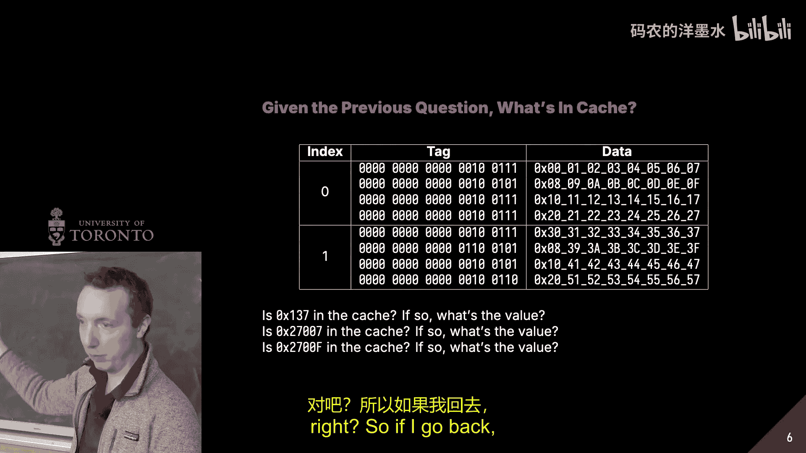

So if I go back， where is it here？So say I had address。1。1，3，7。 So in binary， that would just be。00。

0，1，0，011。0。One， one， one， right？So should does that mean I just， you know， this is my offset？

This is my tag。So I should look for an entry that's like。End in 0，1，1，0，0，1，0，0。

 So if I go back here。

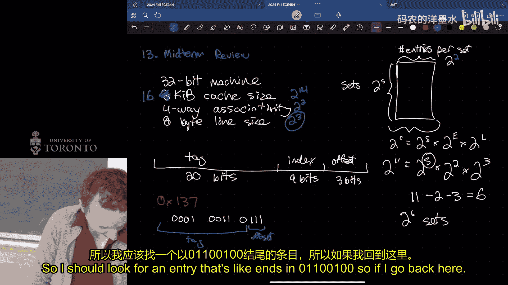

Does that mean I should just， you know， look at。呃对对 the。Look at one of these entries。

HmThe answer to that is。No。Absolutely not because tablet。

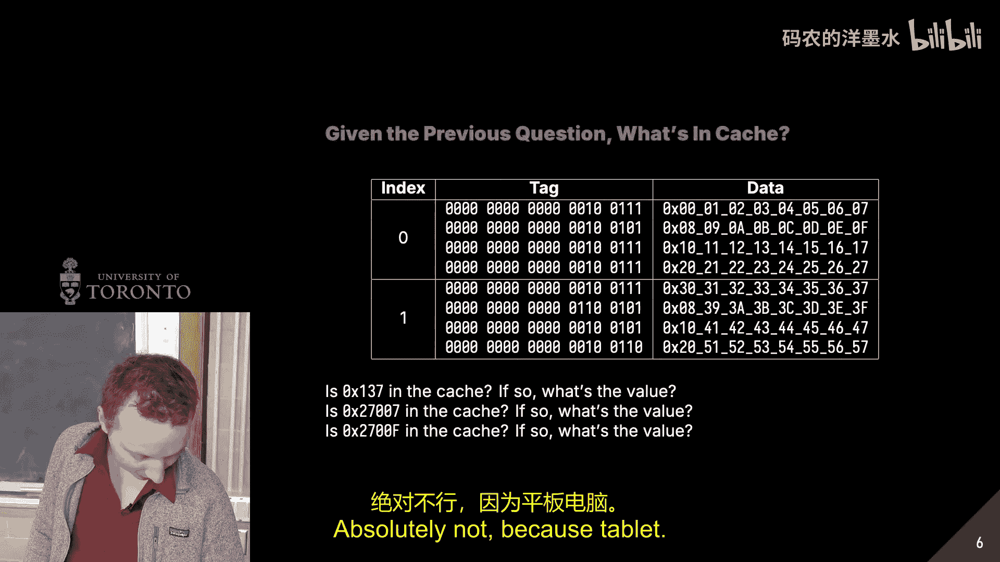

Because is that how I should divide up my address？No， because there's an index， right？

So these the next nine bits， one two。3，4， five。Six， sorry。😔，1，2，3，1，2，3，1，2，3。

 So these would all be my index bits， right？And then the rest of them would be my tag， which。

 of course， have leading zeros and that's。Just0。 So in this case， my index would be。

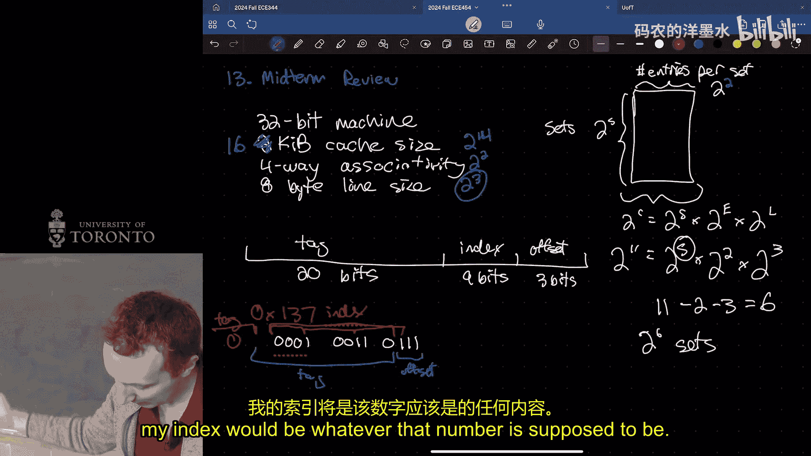

Whatever that number is supposed to be。 And if I look here， I don't have index。

 whatever that's supposed to be in this table。 So you just don't know。

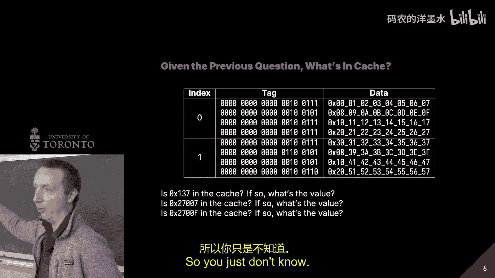

So that is my word of caution there。 If you get something like that。

 make sure you divide it up properly and you actually follow your tag index and offset。

 So if we look at， I don't know what the next address is something like。呃。2，7，0，0，7。

 So if we have an address like that。We can convert it to binary， so two is just 0，0，1，07，0111。

0 is just four zeros， another four zeros， and then 0，1，1，1。So same thing like before。

The three bits here， they are my offset， so that's offset seven。The next nine bits。 so that is 3，3，3。

This is my index， right？So my index would be0， and then the remaining。

 which would be zero is all up here。Would be my tag。

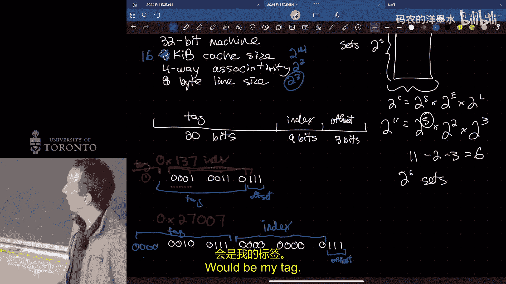

So in that circumstance。If I look at it。I would be looking at index0。

which is here and then looking for the tag that matches that spoiler alert。

 it is the first one it's there， yay， it's in cash wow。

 so the offset is7 so we're looking at the seventh byte that should be the value 07。Yay。Yeah。

 how do we know。We would tell you。For most significant， least significant， we'd tell you。

 or I just jammed them all in here just because I ran out space。So I just jammed them all in here。U。

Nothing terribly special about them。Yeah。bunch of the entries in index。Why do they have the same tag？

Good question。 They shouldn't。Because again， I made it up this morning。So yeah。

 they should all have different tags in order to be valid。Yeah。

 that that would be bonus points if you， if we actually wrote that and you said that。

 So bonus points。But the mechanics of doing that， everyone okay with the mechanics of doing that。

Yeah。The tags have to be different because the tag actually like uniquely identifies a block of memory。

 right？So if they have the same tag， that means it's the same block of memory。

 so the same address can't have two values at once。There's no。We're not quantum。

 That's no like weird superposition thing just yet。People the like。Yeah。

 we could have ones that are invalid or something like that。 We had different tags or something。

 so maybe they are the same tag， but some are invalid。 We won't go into that yeah。

20 bits of tag is for the tag block， obviously。ないんです。The， the index， no， the index itself was 3 B。

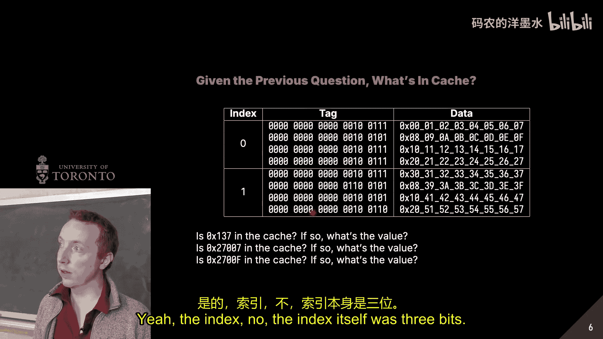

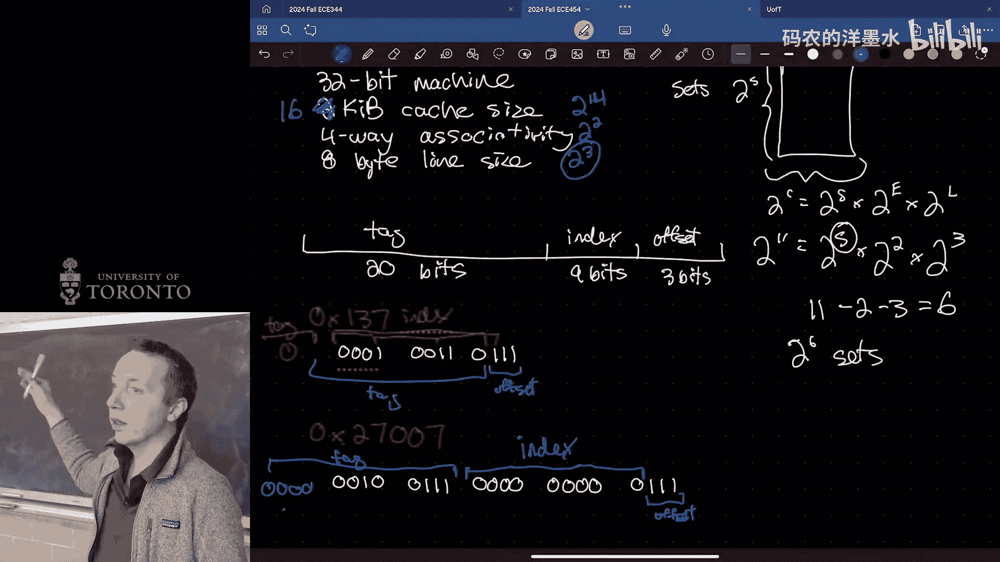

Oh， the index， sorry，9 bits。 Yeah， whats the 9 bits used for。

So the nine bits are used for here picking out what index or what set they are in the cache。実る生活す。

Yeah， yeah。Yeah， which bite？Which by in the data block to actually access since its memory？All right。

Cool about that， that's probably your。I guess I shouldn't super spoil your midterm， but。

So on that virtual memory main focus of that was like TLB wide speeds of memory accesses。

We don't have to go through all the different levels of page tables。

 You should be able to vaguely explain why that's slow。

 It's basically that whole T LB just is another cache for translating a VPN to a PPN。

 So given a virtual address。 You should know similar to dividing up the cache line。

 you should know which part of it is the VPN， which part of it is the offset。

And the TLB is just another cache， but the data is stored， it's not just blocks of data。

 it's a page table entry， which will give you a frame number of PPN plus like a valid bit or something like that。

So。Same idea， same cash， pretty much all your cash things line up。

 we might make it tricky and make the cache TLB， but TLB is just like any other cash。

 has associivity， all of that fun stuff。So the next thing， yeah， dynamic memory， we didn't。

Only important things to know know the struct layout and alignment rules。

 so if I give youstruct with a bunch of data， you should be able to tell me exactly how it's laid out in memory。

You don't have to draw a bite for bite， you'll probably be given a handy little boxes you can fill in。

Wow， so you get some boxes you can fill in， and then you might be asked。I don't know。 make it better。

 What's a better way to organize things and destruct such that everything fits。

 And then for dynamic memory allocation。You should be able to generally have a high level understanding of implicit list。

 explicit list， segregated list and what the kind of benefits of each of them are quick A went off your top of your head。

 which what kind of，What's the allocation strategy for？Implicit lists， how slow is it。

 what's it got to do？Yeah。1 year。Yeah， when we allocate linear in terms of allocated and free blocks。

 so it has to jump over both for freeing。W freezes quite fast。For explicit list， for allocation。

 what was our improvement。We made it linear in terms of free blocks。And then for segregated list。

 for allocation， we tried to more or less make it。Constant， right？

More or less constant kind of it could worst case， but worst case， it gets a little linear。

 but not in terms of number allocated in three blocks。So。We had those three different ones。

 you should be able to name them all。And then， yeah， some other question for。

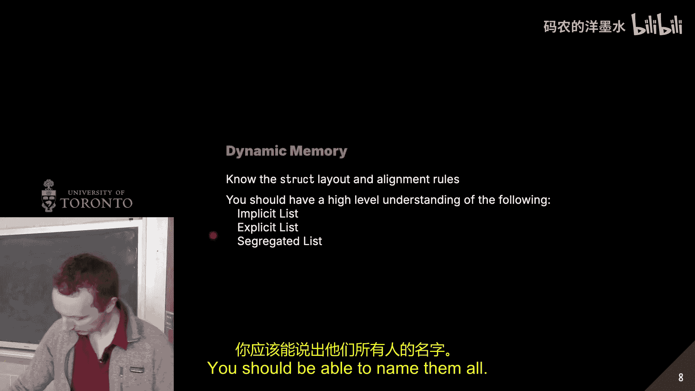

We can just make it up。If I have a cache， I don't know some type of cash。Andd my block size。Is。

 I don't know。嗯。Oh，We block size if it's 16 bytes。And then I have， I don't know。A big inray。

 And then I have four。And I。Equals  zero to i is less than， I don't know。1，44， who knows。Here。

 let's just assume we。No， whatever。So it does something and it assigns it to array at index I。So。

Going through this whole array， what would my miss rate be？Yeah。My would be one over4。 Yeah。

 pretty much one over4 in this case， right， So if I access。A 0。 Well， that's going to be a miss。

 nothing I can do about it。 And then I can figure out， assuming that， you know。

 my array starts cache aligned and everything like that， which we would tell you。

 then if I miss on a 0， it's going to bring in 16 contiguous bytes。

 that's going to hold four elements of this array because in our  four Bs。 So that will be a miss。

It will bring in As1， A2， A3。And then they'll go ahead and hit， hit。Hit。

 and this will just go ahead and repeat over and over and over again。

 so we'll get a miss rate of what 25%。So other than that， we might tell you， you know。

Maybe the cache size is too small where some of these get kicked out。

Willll probably tell you the cash policy used like last in or at least recently used or something like that。

 So the only thing that can make this harder is like some things might get kicked out by the time。

 right， So if I said， well， in this case， doesn't matter because I'm iterating the array once。

 it doesn't matter。 but if I。If did columns or I loop back on it or something like that。

 or I just had two instances of the loop， then you could imagine something different happening。

So questions about that should be。Not too bad。And then other than that， so。Oh， yeah， oops。

If it's 145。Yeah， if it was 145， then the miss rate would be slightly higher， right。

 because the last element would be it， that'd just be。Is 16 by 16，1，44。No。WWs， 256。 Oh right。256。

Yeah， so if you did 256 or what if I did 257， well。

 then I would essentially have 16 misses or 16 misses for the first。256。Then whatevers。

Then 255-16 hits and then plus one miss right for the。For element。256。Yeah。

 it's a little more than that， right？Because be size is 1256 then one is extra。64。Oh，64。

They have 64 and then plus  around to 65。Yeah， 16 should be 64， my bed。Like that。So one more。

 sorry I numbered dyslexia power of two。Shouldn't make up things。

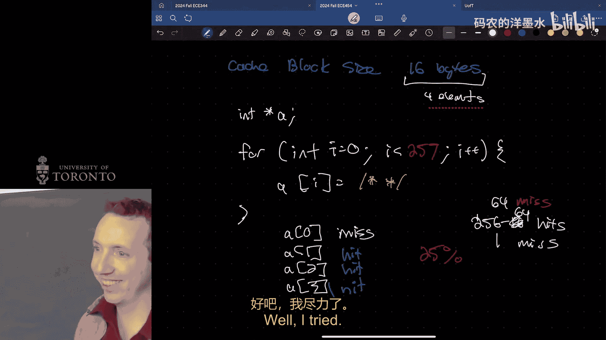

Oh， I tried。 Allright。 So other than that。 yeah， any other questions， let me know。

 I will also be at my office。 I stay during midterms。 I just stay overnight in Toronto。

 so I will be my office the whole time if you have any last minute questions。😊。

I will be there in and out so you can come ask me there's tables outside my office if you want to study there。

So you have no excuse not to ask me stuff， there's desks outside my office， feel free to use them。

 I'll be around for last minute questions because of course。

 other than this most of you won't study until probably Thursday。Yeah。

I had a question about like tiling， so in your matrix multiification lecture。

 you've had like some number about the minimum size of the cash for all of。Tiled to be stored in。

 we had the V one received。I correct it as three times t of power2。Yeah， yeah。

 it should be corrected double check my lecture notes。

But I should have corrected that because that was bad。 all right。

 any other last minute questions or anything like that again？

Most of my office hours get just shoved right there because that's probably when you're going to show up anyways。

So anything else for today before we can， you have what like three more days of studying。

ThisThis midterm， again， should not be terribly bad if you can do everything we just did with。

Slightly harder with different cash sizes， different things。You can do lecture five。You'll be fine。

All right。Other than that， I will hang out here then for the rest of it。 I will let you。

 you can use this other time。

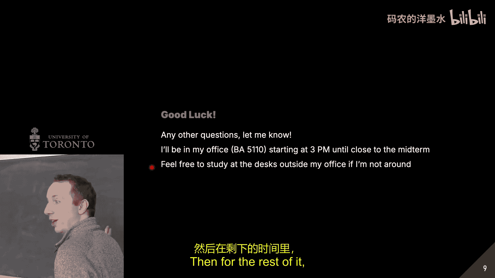