# C语言高性能系统编程实战：13：期中复习 📚

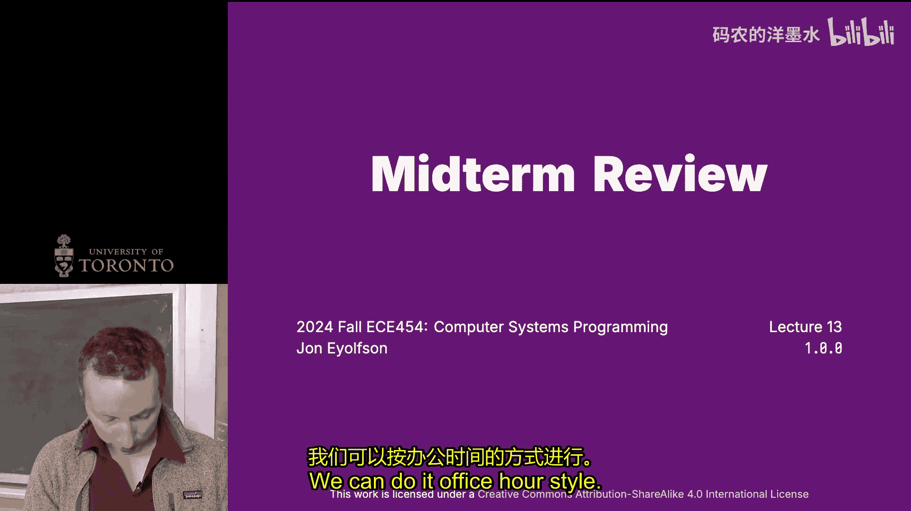

在本节课中，我们将对期中考试涉及的核心知识点进行系统性的回顾。考试内容分为六个主要部分：简答题/判断题、编译器优化、程序优化、缓存层次结构、虚拟内存和动态内存管理。我们将逐一梳理这些主题，确保大家能够清晰地理解每个概念。

## 考试概述 📝

期中考试为闭卷考试，总分为15分。考试包含简答题和判断题，内容相对直接。考试地点在PB楼地下室，时间为周四晚上7:30。考试期间，除了一份列有GCC编译器选项的简单提示外，不允许使用任何辅助材料。

## 编译器优化 🔧

上一节我们介绍了考试的整体结构，本节中我们来看看编译器优化部分。你需要能够识别并解释几种基本的编译器优化技术。

以下是需要掌握的核心编译器优化技术列表：
*   **常量折叠**：在编译时计算常量表达式的结果，例如将 `3 * 5` 直接替换为 `15`。
*   **公共子表达式消除**：识别并提取多个表达式中重复计算的子表达式，只计算一次。
*   **常量传播与复制传播**：如果一个变量的值是已知常量，则用该常量替换后续对该变量的引用。如果执行了 `y = x`，则后续代码中的 `y` 可以用 `x` 替代。
*   **死代码消除**：移除程序中永远不会被执行到的代码。
*   **循环交换**：改变嵌套循环的顺序，以更好地利用缓存局部性。
*   **循环融合**：将两个独立的循环合并为一个循环。
*   **循环不变量外提**：将循环内值不变的表达式移到循环外部，避免重复计算。
*   **内联展开**：将函数调用处直接替换为函数体，消除函数调用的开销。

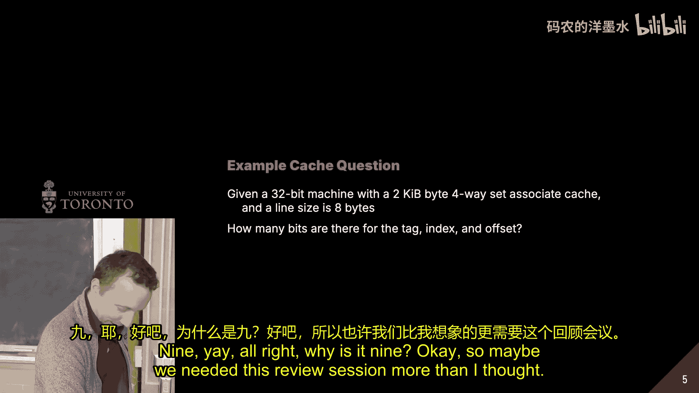

## 程序优化 💻

编译器有时会因保守的内存假设而无法进行某些优化。这时，程序员需要手动进行程序优化。这部分内容与第5讲中的优化过程类似。

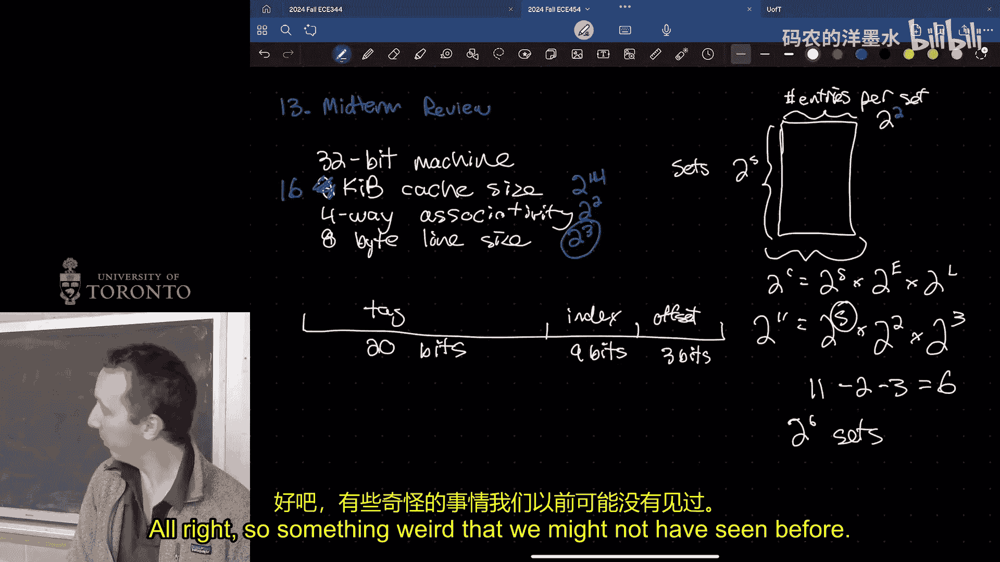

你需要能够应用诸如**循环展开**等技术来提升程序性能。核心思路是减少循环开销，增加指令级并行性。一个典型的优化步骤是：首先识别性能瓶颈（如内层循环），然后通过展开循环来减少分支判断和递增操作。

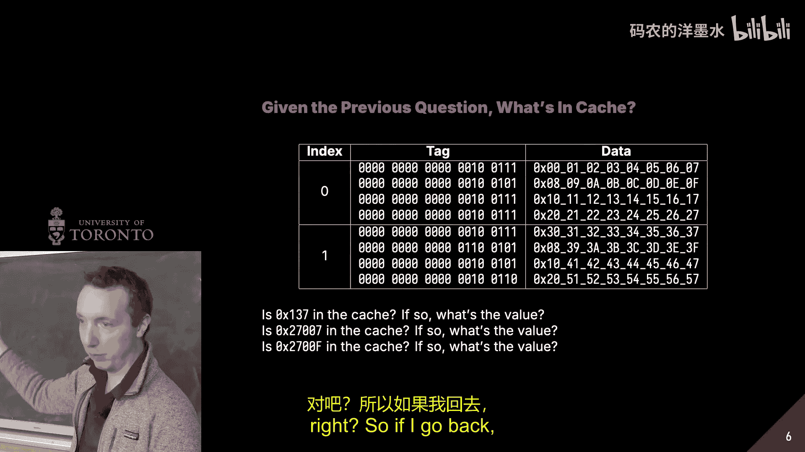

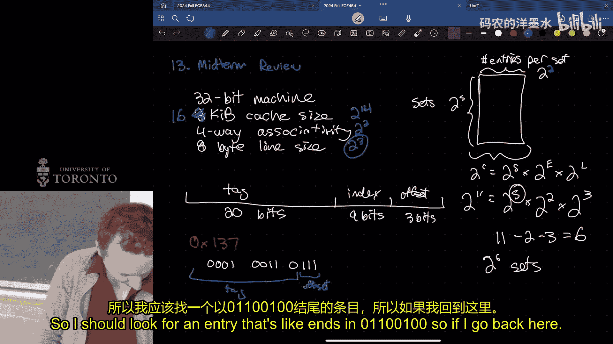

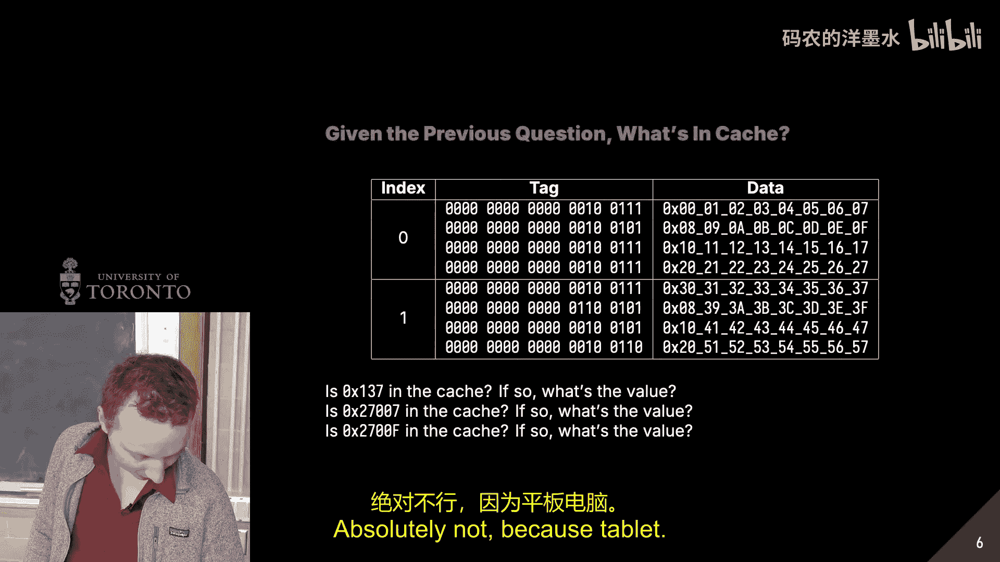

## 缓存层次结构 🧠

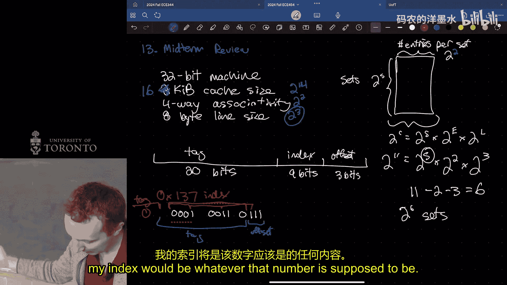

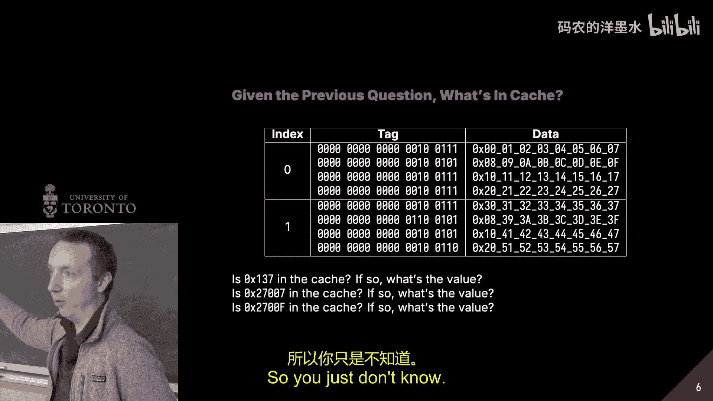

缓存是提升程序性能的关键。你需要理解缓存的基本工作原理，并能够进行计算。

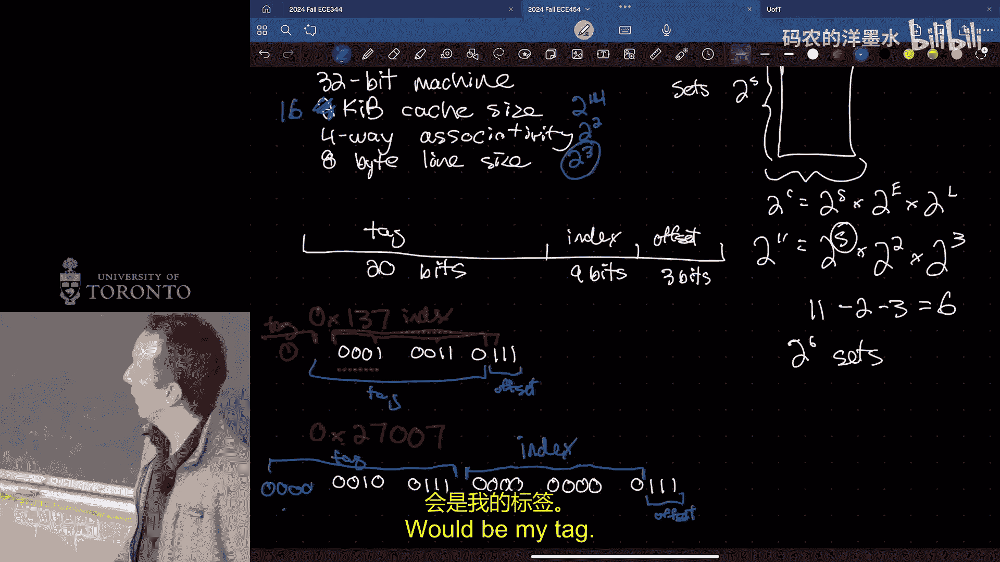

给定一个缓存配置，例如：**32位地址空间，2KB大小，4路组相联，缓存行大小为8字节**，你需要能够计算出**标记位、索引位和偏移位**的位数。

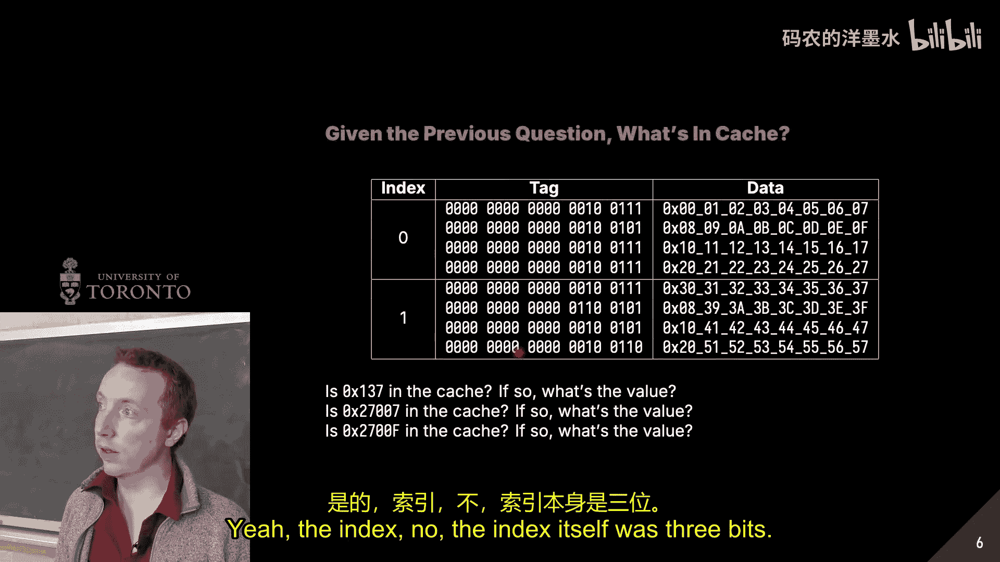

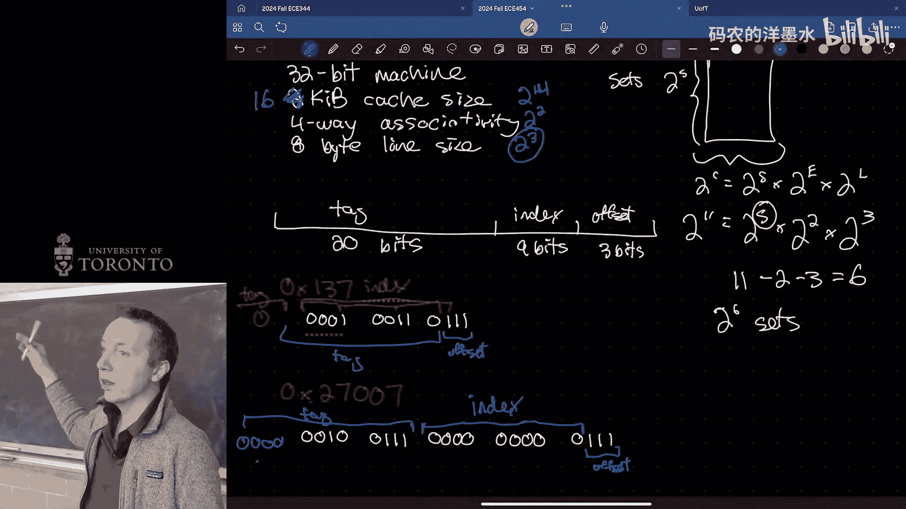

**计算步骤如下：**
1.  **偏移位**：由缓存行大小决定。8字节 = 2^3，所以偏移位为 **3** 位。
2.  **索引位**：由缓存总大小、相联度和行大小共同决定。
    *   缓存总大小 = 2KB = 2^11 字节。
    *   总缓存行数 = 缓存总大小 / 行大小 = 2^11 / 2^3 = 2^8 行。
    *   组数 = 总行数 / 相联度 = 2^8 / 4 = 2^8 / 2^2 = 2^6 组。
    *   因此，索引位为 **6** 位。
3.  **标记位**：剩余的地址位。32位地址 - 索引位(6) - 偏移位(3) = **23** 位。

此外，你还需要能够分析简单的数组访问模式，并估算其缓存命中率或未命中率。

## 虚拟内存与动态内存 💾

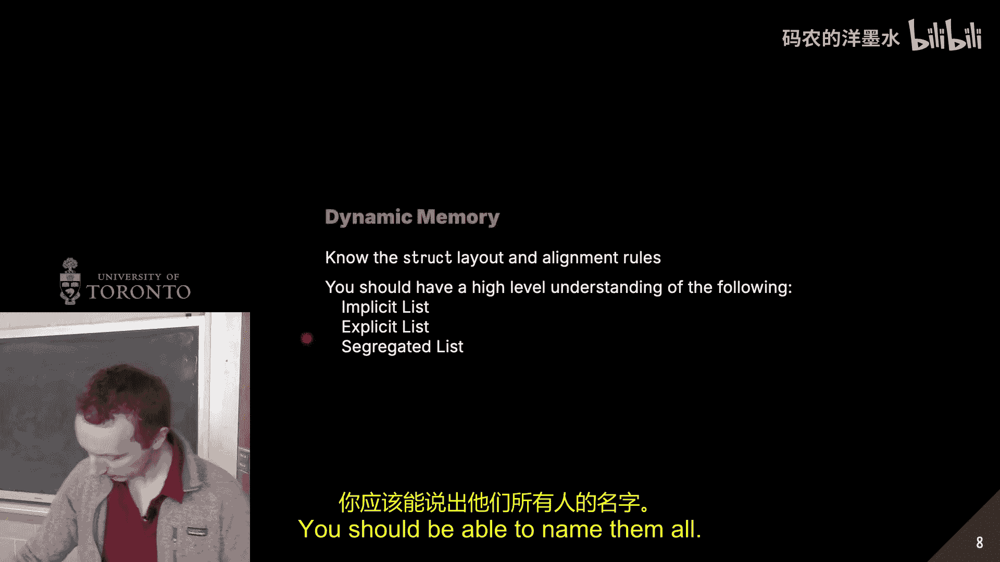

虚拟内存部分，重点在于理解**地址转换**和**TLB**的作用。给定一个虚拟地址，你需要能划分出虚拟页号和页内偏移。TLB本质上是一个用于加速地址转换的专用缓存。

动态内存部分，需要掌握：
1.  **结构体内存布局与对齐规则**：能够计算一个结构体在内存中的实际大小和布局，并能通过调整成员顺序来优化空间。
2.  **动态内存分配器**：理解隐式空闲链表、显式空闲链表和分离空闲链表这三种分配策略的基本思想及其在分配/释放操作上的时间复杂度差异。

## 总结 🎯

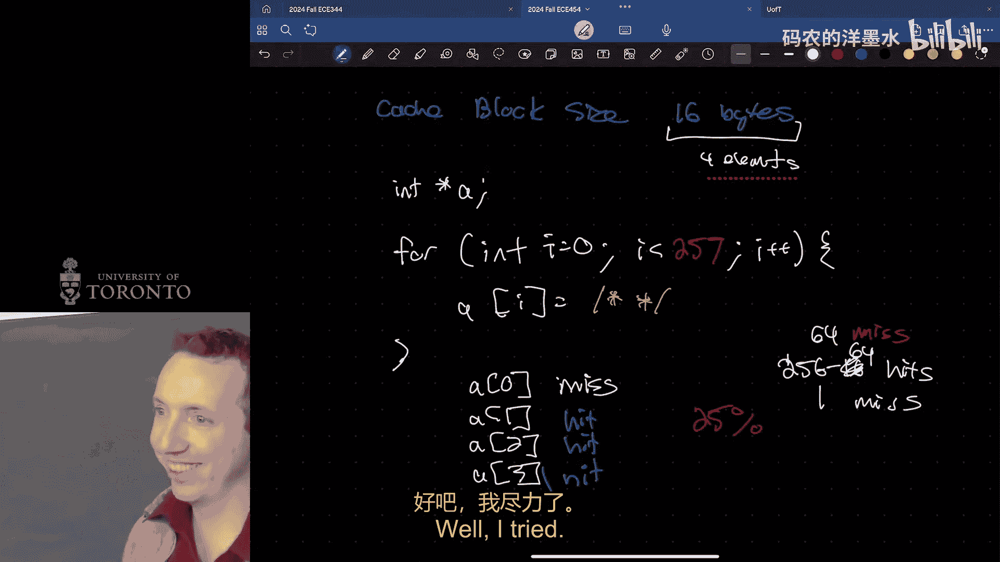

本节课我们一起回顾了期中考试的核心内容。我们涵盖了从编译器自动优化到程序员手动优化的技巧，深入探讨了缓存的工作原理和计算方法，并简要回顾了虚拟内存与动态内存管理的关键概念。请务必理解这些基础原理，并通过练习巩固。祝大家考试顺利！

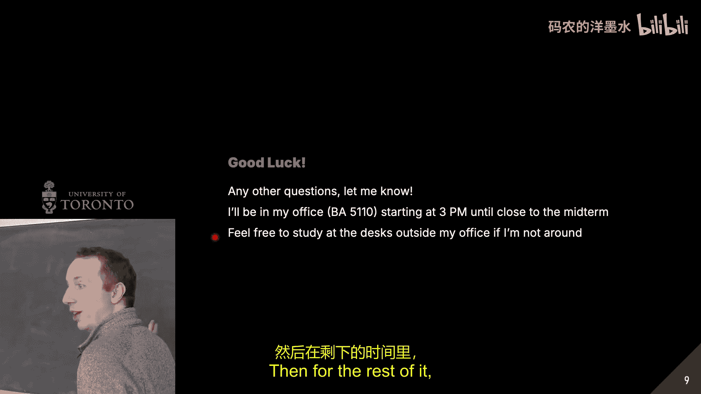

> 如有任何最后时刻的疑问，欢迎在办公时间前来咨询。