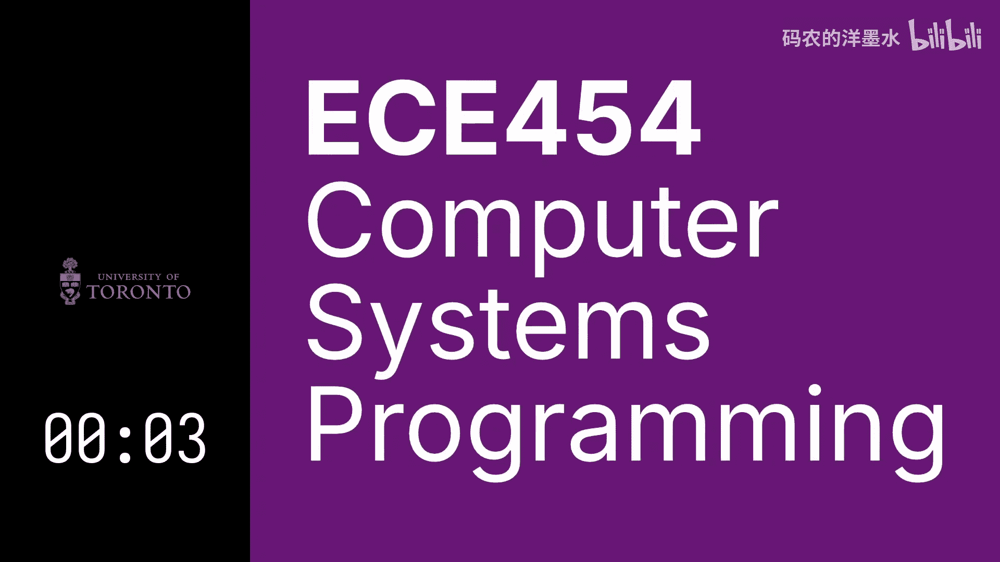
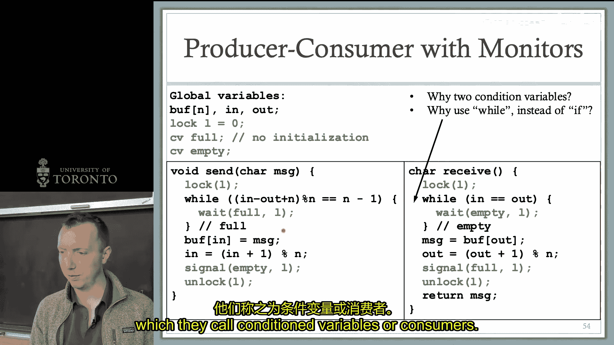
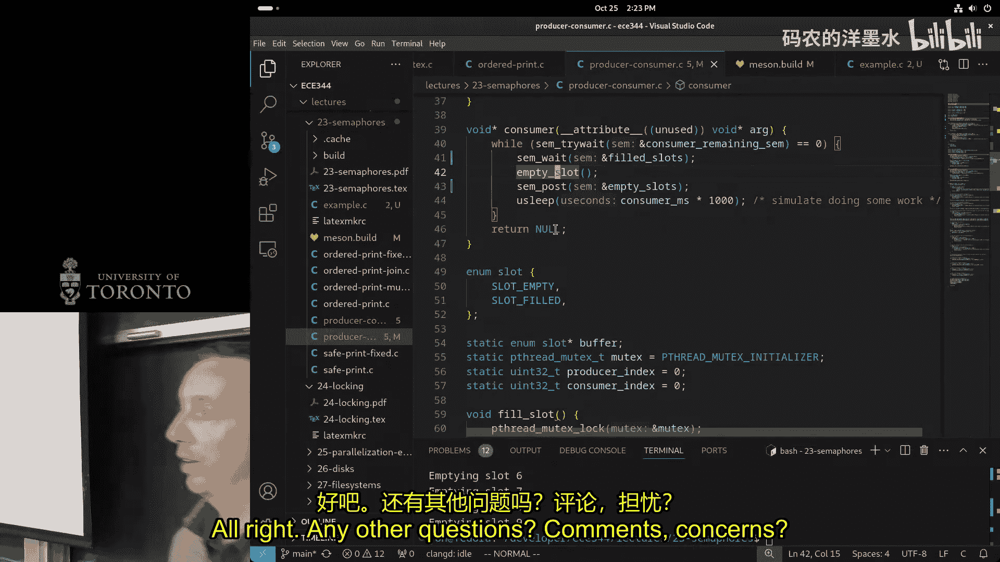

# 【全集】多伦多大学 C语言高性能系统编程实战 中英字幕 1080P p14 Lecture 14 - 线程与同步 -BV1oDrZBZEG2_p14-

Alrighty， welcome back to 4，5，4。 We survived the midterm more or less。 so they're grading it。

 I told them to grade it nicely。 they it should be pretty quick。 It's meant to be graded quickly。

 So yay， all right， so today's lecture it's I know it's right before reading week。

 this is mostly review。 So if you want me to stop and do any of this in more detail。

 just let me know I'm currently doing this in 3，4，4，2。 So I know this is all review。 So。😊。

This should be familiar。Should be able to get through it pretty quick。

 There's one new thing that's not in 34，4 and then some other things that are in 344 that aren't here for some reason。

 so we'll just go through these slides， make sure we understand them all again。

Let me know if you have any questions， we can come up with any examples you want。

 we I have my virtual machine ready to go for you。So for this course， I guess where this is。

 so we are now done arguing about purely sequential programs， so so far single core。Argued about。

 did a little bit architecture， did a bit compiler optimization， Go a flavor of those two things。

 did some optimizations， taking caches in mind， did some optimizations。

 taking virtual memory in line， dynamic memory performance， all of that。

 So next is all about parallellyization， which is what you have to do nowadays， since。😊。

Every machine has multiple cores right now， so single machine parallellyization that uses threads and processes on a single machine。

If we get there， I don't think we really have all the hardware to do it。

 but you can have multiple parallelism going on between machines using some more distributed computing like I don' know。

 Google's Ma Red or any other of the big distributed computing frameworks。

 so hopefully we can get to that。So this again， should be review。 So threads and processes。

 poss threads in particular， mutual exclusion and synchronization， everyone's favorite topics so。

Threads and processes。 So everyone remember what a thread versus process is。So process。

Each process has its own virtual memory， open file descriptors， all that stuff。

 it by default runs a single thread， a thread is basically virtual registers plus a stack and then all the threads live within a process so a process can have multiple threads if the process dies。

 then all the threads within it die as well。So。Some parallel processing you can do with processes。

 so a web server or any other thing can do that because using one process is problematic。

 client request comes in。This is mostly for everyone。 remember user threads and kernel threads。

 So I guess this is referring to current or user threads。 So if you have to block in a user thread。

 it will block that whole process， any other thread from running。

 So if you have a bunch of blocking system calls， then the entire process gets blocked。

 nothing else gets to run。 so。Back if you only have user threads。

 you'd have to use processes so you can actually run multiple things at the same time。

 you can run other processes while you are blocked。

So for this they use multiple processes for service requests， the main reason you do that is because。

 well if any thread crashes the process， then the whole process is dead， it kills any other thread。

Things like Firefox and Chrome， they use processes for each individual tab。 So if your tab crashes。

 the whole browser doesn't go down， only that window goes down。

 So you get some nice processes are isolated from each other。 So they're nice in that respect。

 But you have to do inter process communication between them， which is a bit slower。

 You have to do system calls unless you do shared memory and all that stuff。 so。

This lets us have some concurrency so again that's just switching between processes and ideally we want parallelism。

 we want multiple things happening at the exact same time。

 if we have four cores we all want them doing what we want some useful work。So some server。A very。

 very naive server could just。Fork itself over and over again。

 remember that's the only way to create a new process you fork。

 you create an exact copy of yourself and then pass that there to independent processes so the server could be blocking on connection request whenever it accepts a connection it can fork then one of the new processes just deals with that connection and that's it。

So we should all remember forking and all of that good stuff， everyone remember forking。Yes。

 it's forking fun ha ha God， I'm terrible process so a sample server could look like this。

 so I also have， you know this uses sockets。But same idea。

 every web server basically looks like this， a wall true。Exccept a new connection。

 so that gives you a new file descriptor that represents a connection between you and a client and then you can fork fork return I don't know why it's a capital F here that's wrong。

 it's lowercase F and then。If it returned zero， that means you are the newly created process。

 so if you're the new created process， it closes the listen file descriptor so that's waiting for incoming connections and then because we only want the main process that is in this well loop to be accepting connections on that listen file descriptor。

Again， I can give you examples if you want and then。Here it would read and process the request。

 So just that file descriptor， then it closes the file descriptor when it's done that exits the process。

 So this process is no more。 It's also missing a bunch of stuff。 Everyone really remember 3，44。

What is the state of the child process？Right after it exits。This is going back， huh？

Is this a great program？Yeah。They're a zombie。 Yeah， exactly。 we zombieed it。

So the trial process here would be a zombie because it has terminated and we have not acknowledged it right remember we have to be good parents so you have to do that weight system call to acknowledge it and then you clean it up so that it does not become a zombie anymore and waste a process ID and some other space can the LOOS can actually clean it up。

Yeah， you can tell。I'm criticizing this little block of code because we should be good parents。

 every one of us。So。Inter processcess communication。

 so above we don't have to communicate between the processes。The thing。

 every process in that scenario just deals with one。Independent file descriptor。

 So if we need to do some communication， some types of communication we can do between the processes。

 we can send signals to them， which are basically like user level interrupts。

 That's also what happens if you hit control C and all of that fun stuff or kill9。

 Everyone remember how to violently kill stuff。Violently kill your orphan zombie children。Yep。

 those Google searches may come back。Pips， so that's basically a shared region of memory。

 you get file descriptors so you can write to one end of the pipe and then read data from another and then through inheritance and forking。

 you can actually share file descriptors between related processes。You can also。

 which some of you probably haven't seen before， just share memory directly using the Mm system call so that basically lets you modify your own virtual memory。

 You can request some virtual pages。And set it so that whenever you fork a process。

 then it's actually pointing to the same physical page point if you change one of the memory or values in one process。

 it appears in the other process so they are now no longer independent because they are sharing some regions of memory and。

This says how， again， they through M map， you set up virtual pages so that they point to the same physical page and。

The way you tell it， like part of the M system call。

 one of the arguments is whether you want it private or shared， if it's shared。

 then whenever you fork it will not create an independent copy for that page it will have both processes point to the same physical page。

 therefore you are sharing memory。Everyone's still good on board， still review。So processes。

 so processes， you can think of it， they're made up of a whole bunch of different things。

 so a process context， CPU state， AKA， the value of the registers， and then an address page。

 which would be code data and stack and then some other kernel state that the kernel keeps track of in a process。

 things like the file descriptor table and some state of its virtual memory and what it can access。

So the process contents it'll be like data registers， stack pointer program counter。

 also just registers， condition codes， things that are set on the hardware level and then the kernel state keeping track of its virtual memory It's filed descriptor table of the two main ones and then here's a view of the memory so your stack point is going to point somewhere to the stack by default your process will have a single stack and then it'll map some region you know some shared memory and then BK will point to the top of the heap and the heap will start at some address that it just determines and then before that that's where your program gets loaded so any read writeite data like global variables things like that the compiler just makes up a virtual address and then the OS has to figure out how to place it memory and map everything and then there'd also be some the code would be loaded read only and execute so you can't modify your own code and it can share all。

when you fork a new process through the magic of copy on right if everyone remembers that。So。

Still good processes， still a review。Allright， so some overhead。

 so creating a new process pretty costly because you have to copy everything。

 it's not as copy or as costly as you might think because it doesn't actually have to copy all of the memory it can do again copy on right。

 but still has to do a system call， still has to make a new process control block。

 still has to create a new process ID for it and then it carries on its me weight and then。

You have some overhead with actually doing IPC between the two processes because they require a system call。

 although if you just do a system call to set up a bunch of shared memory and then use shared memory。

 it's actually pretty fast so。There's some overhead but again。

 you can actually go ahead and make that quicker and also switching between processes is fairly expensive。

 mostly due to flushing the TLB and flushing cache entries and having another process with a different address space come in。

 execute for a while and ruin your perfectly nice and filled cache and ruin everything for you。

 while if you had a thread which lives within the same process。

 it uses the same virtual memory so all your TLB entries are still valid so。

A bit more expensive to context switch between them as well。

So this is where I guess we rethought processes a long time ago。

 So you want them mostly to always share code and data。

 You want them to share some privileges like what file descriptors are open and then maybe。

For the general case where you want to share most things。

 you want to make sure that they absolutely do not share like any of the registers。

 so wherever the program counter is， wherever the stack pointer is。

 all of its registers and then each thing should also have its own stack base too so。

That is basically what a thread is。 you separate out the part that's important for execution from the other part that has to do with memory and all of its other state。

 So the execution state basically just how to execute it is just called a thread。

 So it's just registers and then each thread needs its own stack because it needs to essentially run C code and use the stack and all of that。

So。From this， what it looks like is， well， in kernel space is the kernel and then in user space you have processes which are all controlled by the kernel。

 by default， each process in a circle here has a single thread in it。

 but if you go ahead and separated it out， you could have one process with three individual threads in it。

 they would all access the same memory， they all share most things by default。

 the only things they don't share is anything directly related to only execution state。

So good like that。Still good。 All right， perfect。 So process a process with two threads。

 while the thread context again， they'd have their own independent stack and then their own set of registers。

 and then everything else will be shared。All of the heat variables， all of the global variables。

 everything like that。 There's only one of them。 So they're all shared between all the threads。

 The only thing that would not be shared is the stack。

 So the stacks are visible to each process or sorry to each thread。

 But if you give away an address to your stack。 you're probably screwed。

 So you have no idea what that。How that other thread is going to execute。

 You shouldn't depend on its stack。 You can actually access its stack if you have screwed up。

 but it should be the case that their stacks are independent。

 So if you start giving away addresses to threads to other threads。

 you are there's no one to blame but yourself for your now。21 day debugging journey at minimum。

So processes， a reverse thread。All have their own execution， they all run independently。

 concurrently， or in parallel with others if they're kernel threads。

The only differences is by default， threads share everything within a process and processes are completely independent of each other unless you essentially opt in to not be independent。

 Treads are the other way around。 They are。All sharing all resources unless you opt into not sharing。

 So that is the major difference between them。So。If you have a thread based designed。

 really easy to share structure。Any caches， anything like that， they're more efficient。

 they're easier to set up。 you only need something to keep track of the registers and the stack so they can be in this case。

 on some server can be like up to 10 times faster to create。But sharing by default。

That has to do with data races and all of those really fun to debug things。 So each thread。

 since they're shared， it's really， really easy to mess things up。

 get in the situation where you have data races。 and then you have。😊，Really， really， really。

 really hard to debug things because things are not no longer deterministic if you have multiple threads running and you don't know what order they're going to run in。

So pasic spreads are what we use and what everyone uses on planets。

Everyone should more or less remember the interface so to create them。Basically。

 you create this P thread underscore T。 You can think of it as a thread Id。

 It's really basically just an int。You pass it by pointer to thread create function。

 so it will assign a value to it， so it'll dereference it and then assign you a value to it。

 then there's some attributes here。You can just say null if you want the default ones。

And then a function to run， which。H。Prototype is gone from here。

 but it's a function that takes a pointer and returns a pointer。

 and then this arg is the value of the pointer you want to pass to this function whenever it first runs。

And then by default， threads are joinable， which means。When a thread exits。

 it becomes like a zombie thread right， so it keeps its thread ID around and in order for the OS to clean it up。

 you have to join it。To join a thread， you join using its IDd。

 and then you get a pointer to a pointer thread return。

 so that will just write to that memory location， the value that this function return。

 So it'll return a pointer。 Itll write it to that location。

 So that's why it's a pointer to a pointer because it'll dereference it and write a pointer value there。

So anyone remember if you don't。Almost swore。 If you don't care about the return value of the thread and you don't want to join it or anything。

 Anyone， remember what you can do to a thread to say， I don't care。 clean yourself up， yet。Yeah。

 you can detach it right， You can have detached threads if you don't care about the return value。

 if you don't care about joining them， you just want them to go ahead and。

Clean up all their resources when they exit。 you can just detach them， which I don't think is here。

 can also determine your own thread I D。 P thread itself will just return the I of the current executing thread。

So for terminating threads， you can essentially cancel it。

 which basically is like the process equivalent of sending a signal to it。

 So it will immediately terminate and stop running。 Usually you don't have to do that。

 And then you can exit prematurely。 So you can just do P thread exit。

 that will exit from the current running thread。It。

Exiting from that run function will implicitly call P thread exit。

 which I guess is what that was supposed to say。 And then that exit system call， well。

 that's by default， what happens when you return from main， The return value gets past to exit。

 But if you just call exit yourself， that's exiting the process and that will terminate every single thread running。

 the process is now dead， you can't do anything about that。And then we'll also see。

 I don't know why this says later。 We'll see it probably today because we are zooming through this。

 So everyone's still good。 Everyone's still remember。Alright， so thread creation。

 So we'll have a main thread initially running the main function。 Then if you have P thread create。

 well now two things are executing。 you don't know what order they're going to execute it in。

 One thing is going to continue running main。 The other thing is going to run the function that you gave it。

 You don't know what order it is going to run in。 It is up to the。

Colonel Schr to figure it out for you。So if we want to join threads。This is what it will look like。

 so we have a function to run， we create a thread。Here。Oh no， oh no。

 we give the address to our stack location， but this one's okay because we know that this variable lives longer than the thread because we join it after。

 So this is one of those rare cases where it is okay。 So it gives it the address of X。

 It does something with it and then the main thread joins it and join is essentially like。

For processes， it's the same as weight。 it will wait for that thread to terminate before it actually returns and then continues on its merry way。

 So we'll know that the thread specified by I D has been terminated now。 It is not a zombie thread。

 It has been cleaned up and all that good stuff。So。This is how the join looks like。

 so we create two things， the main function keeps on executing。

The other function running in the thread can run， you don't know what order they're going to run in。

If the main thread runs first。And it hits joined before it terminates， it would block。

 it can't run until that thread actually terminates。

 and it will terminate whenever it returns from its run function。

 so it would have a return nulllan there， and then the main thread would finally unblock and then continuance merry way。

Could be the case where function runs first， the thread dies。

 it terminates before main even starts executing， and then whenever main makes it to join。

 it would immediately return from join because that thread's already done。

Ororder doesn't really matter in that case。 it will only pass join whenever the other thread is terminated。

So this is a P thread hollow world。Everyone okay with this。So。Again。Not sure why this is here。

 This should be completely review。 So if I run this。What happened？Goodbye， or。So。

Should print Hello world how many times？Once。That's it。I don't know what else to do with that。

 So just print world wants anything I need to explain here， or is it all right。

 So the only other thing is for join， if I don't care about the return value I can just give it null and that says I don't care。

 don't try write anything there。 I don't need the return value。So。How to properly program with it。

 Well， I need to first， the most important things and for this course is I have to decide， whoops。

 what I can actually run in parallel。 And then while I have to create some threads so I can actually run the thing in parallel and then have to argue about data races。

 prevent data races and add some synchronization code to make sure that。Data races do not happen。

 I also might require some synchronization if there's any happens before relations like I need a whole set of operations to finish before another set of operations。

So this is something you'll get some practice in in this course。

 hopefully if not I'll add some more stuff， so we should know some things。

 data races we usually use Mutes and then for ordering we can use things like centenophos。

 condition variables and something new， we'll go over again and then something new called barriers。

But there's some problems where you don't have to worry about it。

 So if I have a matrix multiply again， So something like this。Well。

 this is something called an embarrassingly parallel problem because I can easily separate it out to。

As many independent calculations as I want。 So if I have four cores。

 I can just have each core do a fourth of the work。

 And here the work would just be assigning to this C value or this。Yeah， see。Index in this 2D array。

 so I can have just one core calculate a whole like a fourth of the values。

 And that is okay because each thread would be writing to its own independent location。

 I don't have any。Problems with a data race because。ADa race。

2 two concurrent actions to the same location with at least one being a right。 So if I divide it up。

 have each thread do a fourth of the work， then each thread is writing to its own unique memory location。

 I don't have a data race。 and then all the other threads would have some overlapping information with accessing the A and B matrix。

 but it's okay。 they only read from them， they never modify it。 So I'm free to share it。

 So this is the easiest way to parallel something and you get basically a perfect speed up if you have four cores。

 it goes four times as fast。 each core just does a fourth of the work。 you have 16 cores。

 each does a 16th of the work， it goes 16 times faster。

 That is something we call embarrassingly parallel。

 and there's some research to do this automatically。Has anyone in this class used OpenM before。Nope。

 okay。So openmp is just。A way to use threads a bit easier， it uses pragmas everywhere。

 so if you want to make a for loop。Divide into four。

 you can just do like pragma openmp parallel4 and then it will just run that for loop in parallel divide it up for you so you don't have to bother doing it for you。

 So just a nice way to well， an easy way to do some embarrassingly parallel things。

 which we might see later， I don't know if it's currently in the course， but。

It doesn't take that long。Yeah， it's a library。Thanks，' just going to spin off。So yeah。

 it's basically just going and manage P threads for you。Yeah， yeah， so that's called open MP。

It's just a compiler flag， most compilers support it。So。If we have parallel matrix multiply。

 well we already saw how we divide it up and what we would do， we just create a thread。

 give each thread an index in this case。Yeah， this case is bad。 This case is really bad。Also。

 it's missing the declarationation of I。Hmm。I don't think someone。 no one actually ran this code。

 So this is missing the declaration of I， and we're giving the address I to a thread。

 I think this one should show the error， but this is a bad thing because it's going to change the loop variable every time there's。

No guarantee that when the thread actually runs， it is the same value of when it's created because the main thread is constantly changing it all the time。

 so if you write something like this， I will be very disappointed in you。

So what they should have done is like just malloc some space for it。

Write the value there and then pass it by pointer to the heap。

 And then each one has its own independent pointer to some memory location on the heap。So。

The matrix multiply。If you successfully give it the ID， which this will not work。

This definitely has a bug in it。 But assuming youve got a correct I D。

 which is 0 up to the number of threads， then you just calculate your slice。

 So this is just the bounds of the loop to get your。One over and part of the loop。

 so that is just the calculation you do， and then you have each thread do its own independent part of that calculation。

So some other things you can do， you can have a manager worker so the manager performs setup up。

Partitions the work。 There's a whole bunch of libraries for this。

 like thread pools and things like that。So the manager just manages a whole bunch of tasks and then makes some threads。

That will actually perform the task。 and its job is to say which thread runs which function。

 So this might be a bit easier than using threads yourself。 you just define a function as normal。

 throw it in there， but you have some shared state。

 You can't really argue about what's running at any given time or what gets scheduled on any thread。

 So it's easy easier like the workers run some stateless function or something like that。

 so you don't actually have any data dependence on it。 So it's a lot。

 you don't have any dependency so you can just run them in parallel。 It doesn't matter。Because yeah。

 it's typically， if you have to enforce job ordering。

 then you're in for a world of hurt where you probably should just spin up your own threads and synchronize them yourself。

So other things you can do is you can have some pipeline execution。

 This is basically creating pipes between two processes。 so a pipe is basically a buffer。

 One process writes to it， the other process reads from it。

 so this is a cheap way to do inter process communication。

 and the processes could also run and parallel depending on。The data， so。It could send a line。

 These programs could be running at the same time。 So whenever this writes a line， this reads it。

 it could be done in parallel if you have multiple cores。

 so the processes don't don't share any state， they only communicate by just。

Feeding information to each other。Each individual process is single threaded。They can。

Deal with its own state， doesn't have any data races， only has a single thread。Everything's ordered。

 so it has the information has to go from process one to process two to process3。Simplify some jobs。

 some things。 I mean， it's easier if you just have a set dependency order just to do this。

 but code is written in some callback style。 It's hard to debug。 I can't send messages back up。

 they only go one way。 They don't go like I can't send a message easily from P2 to P1。

 I can only send messages from P1 to P2。 And if anything goes wrong。 its。

Hard to tell which process actually had an issue。All right， mutual exclusion。

 so this should be Mutexes， so mutual exclusion。For some reason not matching data races。

 so if we want to prevent data races， two concurrent accesses with at least one being a right。

 so if we want to prevent data races， well we can get rid of the two concurrent accesses part and make sure only one thing rights at a single time。

 so if we want only one thing to write at a single time。

 we can put that code in something called a critical section and the critical section only runs one thread at a time。

 only one thread can be in that critical section at any given time and you would do it with a mutex so you lock it after you lock it。

 there's only one thread that can pass lock at a given time so only one thread is in this critical section until it unlocks。

 give up the lock and then another thread can actually go ahead and execute that critical section。

This does not give any guarantees on ordering。 This is only to prevent data races。

 So ordering would have to be something like a centaphore。So。For mutual exclusion。It works。

Independently of the speed of the threads。Like anything outside of the critical session can run in parallel。

 so hopefully your critical session is small。And then other threads trying to enter the critical section will eventually get into it。

 so hopefully like I said， the smaller your critical section。

 the better you'll be because essentially the critical section just runs in serial。

 so only one thread can run it at a time， if you are old school Python that has a global interpreter lock or anything like that。

 all the Python interpreter is basically runs in serial。

 so that's why Python threads historically don't do anything because they're all blocked on the global interpreter lock although I believe in Python 3。

12 it's now gone or greatly reduced。So Python threads。

 I believe slightly work now and you can get some good performance， but before that， in Python。

 if you want things to go faster， you can just create a new process。

 you can just fork it and carry on。So。For mutual exclusion。 So the more， like I said。

 there's only one thread that can run the critical section in this case， the red part at a time。

 the other threads block if they make it to it while some other thread is in it。

 So the critical section itself， only one thread at a time。

 and the time other threads are spent waiting on it， they just get blocked。

 they're not actually doing anything useful and it will hurt your performance and in fact。

 locks aren't free。 So there's some overhead of calling lock and things like that。

 So if you do this really， really poorly， you will make your program slower。

 then if you just didn't use threads at all。 So。That's called Cose grain locking， global lock。

 So global Python， the global interpreter lock。 that just means basically you just have one big lock around everything。

 Only one thing can run at a time。 So why did you bother using threads in the first place。

Everything will be slower than if you didn't do this。 It's an easy thing to do to prevent data races。

 But again， your performance will probably be worse than if you just didn't bother to try at all。😔。

So。Really slow。 so fine grain locking， hopefully you make your critical sections really small。

To prevent overlap of locks， you can use different locks。

 So if you had two different locks in A and a B， then well， slightly better。

Because threads could run A in parallel with any critical sections of B。

 so both could run at the same time， but again you have to make sure that there's now no data races between critical section A and B。

 since they can now run in parallel。So。Ma thing you want。

To consider with locks is contention that's basically when a lock is held by another thread。

 basically how many threads are fighting for a lock at any given time。

 ideally the number is zero or close to zero or one you just want it for the rear case where it is unsafe to run in parallel and hopefully you make it as small as possible because while scalability that has to deal with how you scale with multiple threads so the ideal scaling is four thread four times faster you get linear scaling so the more locks you have that's more serial。

 that's more section that's serial you want to reduce that as much as possible so。

The only problem is， well， yeah， the coarse grain locks you have， you'll have more contention。

 It's a bigger space and。Also， you'll have some unnecessary cash misses。

 We will probably get in to how caches are consistent when we have multiple。

Threads running at the same time， modifying values， making sure that things happen atomically。

 So we have to keep all you might imagine from the architecture point of view。

 it has to keep all the caches of multiple threads in sync， which is easier said than done。

 but we might see some of those fun caching protocols， although again。

 they should probably be in your architecture course。 And because of this， all the cache。诶。

Trying to synchronize all the caches and all of that as well。

 that can also put strain on your caches and make your performance even worse from single core from another fact。

 not just the overhead of the lock， but essentially destroying your caches again。

So for the Linux kernel， OSDI。2010， so the kernel back in the day， I guess。Kind of similar to Python。

 just had a big old global lock。 They called them big kernel locks， and they finally， finally。

 finally， finally got rid of it in 2010 because， well， multiple core machines were not that common。

 So they didn't care。 It was just to。Go ahead and prevent any data races in rare occasions。

 So whenever they took it up， the report core throughput shot up through the roof from just that one change。

 So like Apache， which is mostly embarrassingly parallel。 Well before when there's a big kernel lock。

 any system call would essentially be serialized and it mostly does system calls。

 think of a web server， all it does is communicate to a client。

 So pretty much only does system calls。 So of course， when they remove that big performance increase。

 But again， you guys don't have to worry about that because we live in the year 2024。

 So this has been removed for quite a long while since we're on。What kernel version are we on now。

 Like 5。12 or something like that。I forget something like that。So there's also other big caches。

 so Facebook MemCash D， basically it's a web server cache that cachees any like API requests and things like that。

 how it works is they had a big lock to protect shared straight data structures it's basically。嗯。

More or less like a hash map of a whole bunch of different data。

 So they had one big lock to protect all the data and then fine grain locking for each individual nodes。

U。You guys didn't have a lab like this， but one of the labs I have is like paralyzing a hash table。

You can have a big locker around the whole thing， make it safe， but it goes slower。

 so you can essentially just have an individual lock for each of these like linked lists。

 and then you reduce the contention， have more fine grain locking。So oh the hey。

 we finally got to races here。 so data race when certain thread interleavings leave to incorrect program behavior。

 but I like saying it as data to concurrent accesses the same memory location with at least one being a right which means you have to protect the read as well。

 otherwise you might get inconsistent data， so that is again。

 what a data race is that is the primary concern to make sure your application actually behaves as you expect it to。

 you want to eliminate data races at all possible there are some tools like thread sanitizer。

 things like that， that will help you catch data races but past that you have to just program carefully。

So here is a database example， Funnily enough， it is the previous example as well that just now defines I gives each thread。

 the address of I and then changes it again through this loop so now when you don't know when the threads going to execute it's just going to read whatever I points to the main thread keeps on changing the value of I over and over and over again。

 and it's still alive when the other threads are alive because it joins all of them。

 so it's going to read some value between zero and。Lesson and n minus-1。

 but we don't know exactly what they're going to be， right， So if I ran this。

I have no idea what will happen。 One thing that could happen。Is this 1，2，3，4，5，6，7，8，9，10。 Yeah。

 so if I create 10 threads， that means I will go from 0 to 9。

 but each individual thread may not read。The value that I was when it was created。 So in this case。

 I guess it'd assumed that the。Two other threads。Read the last like didn't execute for a long time。

 even though they printed before the other ones， I guess they just didn't read that variable first。

So they didn't read the variable。The main thread actually came here and blocked and set and I was equal to9 and then the other ones read it。

 although one of these threads should read 9， right the only thing that was wrong is one of these should be 8 instead of 9。

This is one of the outputs you could get， you could technically get any numbers here because you have no idea what the hell is going to go on。

And again。Alarm bells should always be going off if you give one of the addresses to your stack away to another thread。

You should immediately start screaming。 You have permission to scream at whoever did that。

 If you ever have to do a code review a company and you see someone that does that。嗯。

See if there's like a companying bat to hit them with or something like that should not happen。So。

For synchronization。So that means we want some type of ordering to preserve some dependencies。

 mostly it happens before dependency。 So one thing that you may have not seen before is a barrier So a barrier。

 they're really common for GPU programming。 That's really the only synchronization you really use that make sure all threads wait at the same point in the program。

 basically it's like doing a join for all threads， but with a barrier you can set how many threads you want to arrive at this barrier before you continue。

 And then we could have a producer consumer example where thread A is waiting for stream examples。

 threadbs reading them。 So one's writing， one's reading could have multiple readers。

 multiple writers。It doesn't matter you could also use condition variables to wait for an event to occur。

Condition variables， basically they're just like a Q， cue that you can manage yourself。

So this is what a barrier looks like。It will block a process from the time you arrive at the barrier until you leave and you can only leave a barrier when all threads have arrived at it。

 and as part of creating a barrier。 you say how many threads have to arrive of it to be considered everyone has arrived and you can continue So in this case we can create a barrier that waits for three threads to arrive。

 let's say thread 3 arrives there first。 So it will get blocked。 then thread2 did some useful work。

 it hit the barrier。 it gets blocked。 and then thread1 hits a barrier。

 and then it takes a little bit of time to wake up all the other threads。

 And then they have now all arrived at that same point that would be your synchronization point。

 you know they're all there。 So if there's some dependency where。

All these threads have to do something that happens before they do something else。

 maybe some calculation or something like that。 That's your synchronization point。 You know。

 they have all arrived at the bearer。 They have all finished what they are going to do。 more。

 more common if you do GPU programming， which hopefully we will see。So how you use a barrier， Well。

 it's this called B thread or B thread barrier T and。You can just set the attributes to null。

 so it's just the address of the barrier to initialize in the in， and then the unsigned count。

 that's how many threads you want to actually call。

 wait this barrier wait until they actually continue so it will wait for that number of threads to actually arrive there。

So you can set that to whatever you want。So condition variables， so they require a lock。

The way I like to think about is a condition variable is basically a queue。

 and it needs some type of mutex so that it makes sure that there's no data races with the queue and it has to do some fudging so that whenever you it can like add itself to the queue and give up the lock before it actually goes to sleep and blocks。

So how to create a new condition variable， P thread cond， there's a typo here。 This should be cond。

 not。Not saying that， so this should be conned。嗯。You knit it default attributes and to destroy it。

 If you in something， it's like mallocing， you should free it。 So the P threadway is to destroy it。

So how the condition variable works is。To actually put yourself in the queue and wait on something you have to have acquired the Mutex so you've had to successfully return from locking the mutex。

 So you have to hold the muttex and then you can do con weight so that will put you again I like thinking of this as just a queue it will put this thread in the queue and block it and also unlock the muttex as part of that and then whenever it wakes up it's going to reacquire the muttex before returning from weight So before the call you have the lock and after the call you also have that lock。

 so。If you want to unblock a thread which is currently in the queue。

 you use signal that will unblock the first thread that is ahead of the queue。

 if no threads waiting it does nothing and then if you want to wake up every single thread that is in the queue and have them all fight over that lock you can do broadcast so that will wake up everything in this queue and for signal and broadcast。

 you do not need to have the muttex acquired to call these functions you can just call them。

Don't have to have the Mutex acquired。So。To paraze this code。

 if you had something that wasn't embarrassingly parallel。 So you have a right to index I。

 and then you have some long code that actually reads from a previous value later。

 So what it looks like is， hey， I'm writing to 3。 but。In the future I'll be reading from it。

 so I want to make sure that this happens like this happens before this happens。

 assuming that I want the most up to date version of it。

 if I don't have any synchronization I won't have any ordering between the threads so I don't know if I have the most up to date。

Value or not。It's complete chaos if I just try to parallellyze this code thinking it's some embarrassingly parallel thing because there is dependencies between loop iterations which would cause dependencies between threads and cause data races。

One way to try and solve this is to use a condition variable。

 so if all the rights have to happen before the reads。

 well I might just signal like create a condition variable for each iteration that will go ahead and make sure that the right has happened before the read so I could signal that would wake up anything that while typically place the weight first so I place a weight here that if I make it here I put myself to sleep and then waiting for this value to get updated so this would be using that same index so I would have another thread signal whenever it's done updating that value so that I hopefully wake up and then I can go ahead and use the most up-todate value。

But the problem with this is， well， since I don't know the order of the threads。

 it might be possible like I only call signal for every element exactly once right and I only wait exactly once。

 So it might be the case where I signal something and that Q is currently empty in which case it wont wake up a thread。

 and then if that thread。Then executes and makes it to weight and it blocks itself。

 nothing's ever going to wake it up， it is now essentially in a coma。

 and then it's never going to wake back up again。 so this is not precisely what we want Also you could consider that form of deadlock it's not going to wake up。

So one thing you can do is try to remember a signal so we can。

Make this more complicated and than for every index we can see if a thread has arrived there now so we might since we're sharing indexes。

 we're writing to the same location between threads we need to prevent a data race so we need a mutex for that number or I could just make a atomic but in this case I guess I just assume that I only have a mutex。

 so I have a mutex to protect that array index， I create a new array that indicates whether or not I have arrived there yet。

If I have arrived there， I can go ahead and signal that thread。

 unlock it so I don't have any data race。Otherwise。For my weight， I can just make sure that， hey。

I'll only wait if the signal hasn't happened yet。If someone's already been there， then well。

 I don't even have to bother waiting。 I can just go ahead， continue don't I can skip over the weight。

 and then I can just reset it for the next time， although this time I probably don't need to reset it。

 but in general， you could reset it。 if you have to iterate over the array a few times。

 so that is one way you can fix it。Another way you could do that is just with center4s， so a center4。

 basically it is an unsigned integer and it has two atomic operations。

 it has a post which will atomically increment that value and then a weight。

Wwhich will atomically decrement the value and the only catch is the value will never go negative。

 so if the current value is0， it will not decrement it。

 it will wait for another thread to atomically increment it before it decrement it and it can go ahead and continue。

So。Kind of works。 Well， there's an equivalence between condition variables and center4s。

 you can implement one with the other， but some things might be easier to read with center4s。

 as opposed to。Condition variables and here post， that's the equivalent of up。

 that's incrementing it and weights the equivalent of down， that's know decrementing it。

 and if it's zero， you weight。So producer consumer problems so you can use threads。

 communicate with each other using a shared buffer of strict size like a bounded buffer or a circular buffer that just writes over itself over over again。

 your producers fill the buffer， your consumers empty the buffer and then you essentially have two synchronization conditions。

So producers should wait if the buffer is full。 So those are the things writing values there。

 If it's already full， they should just wait for a consumer to empty out one of the slots。

 so consumers should wait if that buffer is empty。So。This is how it could look like。

Don't know why you have seven usable slots that should be eight， it's sub sized8。Not sure。

 And then you have all of the these are all shared variables。 so you have all of the。

Produ or the producers sharing a index， where to write all of the consumers， sharing an index。

 where to read and how it works。 This is basically just a circular buffer。

 So you have to make sure there's no data races with this index between all of the producers and no data race between this index between all the consumers。

 So the consumers will just write at an int or write at in increment。Go clockwise。

It's a circular buffer and consumers will also read from the same thing。 So if there's a filled slot。

 should read from it， if there's no filled slot， it should just stop and wait for data to come in。

 So the number of elements in the buffer。 Well you can just count how many are used like the difference between the in and the out。

 So in this case， how it's shown then there would be three U slots that have data in it。

So the buffer is full when you can actually have it full if it's completely full of all individual elements。

 you don't have to do an off by one and it's empty if there's absolutely nothing in the buffer。So。

How it would work with condition variables。Is something like this？

Do you want me to go over this in painstaking detail？Yes。Yes， all right actually。So。

There two there's with monitors， which they call condition variables or consumers。

Funnily enough， I'm actually doing this today in 344。 So I can just use my same virtual machine。

 So here's our producer consumer。 so we can warm， We can warm me up for later today。😊。

So here is the producer consumer。So。I have written a program I can share it with you if you really want that。

So it uses the serofore to keep track of like。Just internally。

 how many things I want to produce or not because it's atomic， don't worry about it。

Just assuming in a real thing this would just be wall true。

 the consumer would empty a slot and then simulate it doing some work on that element and the producer。

 well， it would be an infinite loop， it would simulate some work to generate that number and then to finally fill that slot。

I basically have two instances of a data race here and assume that this fill slot and empty slot。

 they all share that index。 I protected it with a Mu text。

 So there's no data races or anything like that， so。If I run this right now。

 the two really bad things that happen to this buffer is I could fill an already filled slot。

 So I overwrite a slot that was never read from， which is bad。 That means I have destroyed some data。

 And the other bad thing that could happen is I could try to read data from a slot。

 empty a slot that's already empty， right， two bad things that could happen。 So if I run this。

So I have it set up that I can specify the number of producers and consumer threads and then the number of elements to produce currently it's just 15。

 and then the size of the buffer currently it's just 10。

 so it's a bit smaller and then I can adjust how long it takes to produce an element and consume an element if I really want to mess with them。

But initially， I can do something like， let's say I have。10 producers and five consumers。

 So if I have something like this， I have no ordering whatsoever。 If I run it。

 I have it printing off what happens and then printing in red， if anything bad happens， so。

When they start。If I don't have any ordering whatsoever， my producers will be producing work。

 So they're working， hopefully doing something useful。 So if I don't have any ordering。

 my consumers immediately run， right， which would empty a slot that's already empty。

 So since I have five of them， they would all run in parallel。

 So I empty out five slots that are already empty。 And then they're doing some work。

 then eventually the producers are done。 So those 10 producer sled threads fill every single slot。

 right， oops。So they fill all 10 slots。 They fill up the buffer。 and then well， my five。

Consumer threads。They now get a bit lucky because they run again and they go to the next five slots。

 And there's actually data there for now。 So Yippi， my program read something correctly。

 So that's great。 Then my。😊，呃。Producers run again and then these are the last five data slots。

 but they overwrite slots 0，1，2，3，4， and that's bad。

 And then finally my consumers finish up finishing the last few elements they think which would get correctly slot 0。

1，2， and 3， which just got overrote。 So everyone good that that's bad。All right。

So to fix this using center4s。嗯。p help。So there's some type of ordering between that I should do。

We got。We got 40 minutes。So。For me the。Thing I like to think about first。

Is if we haven't reviewed this before， so center4s。Usually， you have to place the weight。

 You have to place the post or the increment， and you have to set some initial value， so。

I always find it easier to think about， okay， the easiest thing to place first is the weight。 Like。

 what do I have to wait on。So in this， there's two things I have to wait on。

 what's the first thing we want to wait on？Slots to be filled。 So we want to。

 or which error message do we want to get rid of first。 So slot is already filled。And slide。Oh， okay。

 so we're gonna make sure that when we empty a slot， it's been filled， right， Okay。

 so that's probably the easiest weight。 So I should put place my weight right before that empty slot here。

 right， I want to wait until there is some filled slot before I try to empty it。So。

I should probably do some weight。 And then， oh， okay， I need a center for。

 So let's create a center for。 It's called some T。 can give it a name， Let's。In this case。

 we only want to empty a filled slot， right， So I should probably call it。 I dont know。

 Let's call it filled slots。So if I call it filled slots， then。I am now waiting on it here。

So I'm waiting on the address of filled slots。All right。

 so next thing I need to do is initialize it with some value。For that， we do S。And knit。

Give it the address of filled slots。 That's my center for。 Next argument is P shared。

That's what happens to center 4 when I fork。 If I set it to 0， it's not shared between processes。

 If I set it to one， it's shared between processes。

 so you can use it to do some synchronization between processes if you really want。 But of course。

 you'd have to fork and all that。 So I'll just give it a big fat0。

 And then the next one is the initial value。 So the initial value the way I like to think of it is the initial value is how many threads can pass that weight initially。

 So how many threads should pass this weight initially。0， right。

 I initially don't want anything to write， so I should just set it to0。

So now the next thing I want to do is essentially place the post， which is basically saying， hey。

 what is the action that will let one thread pass or one thread wake up and actually get through its weight。

 so where should I place the post yeah。After the fill slot， right， after I fill up a slope。

I can actually do the post here， so that will increment it in this case if it's the first slot。

 increment it from a0 to a1， and then that would allow one consumer thread and exactly one consumer thread to actually unblock from this weight。

 it would actually emptied that one filled slot， right。So filled slots。Oops。Sme post。All right。

Everyone in agreement with that， that looks good。All right。So。If I run this now。

 let's check our work。So I should all see， Ive run it now and I'm done right， so I get no red marks。

Am I done？Am I God's gift to programming？No， right， because what's the condition？

What should I do so that I see some errors happening。

 How many consumer and producer threads do I need to see something bad happen。Run more cycles。

Like just have more， so this this and just more numbers， like 100。Yeah， that worked。So。That'll do it。

 maybe if I have。The other way around， oh know， the other way around doesn't work。1。Oh no。

 there's way too many， right？There we go。So if I have way too many， was this？

If I have way two main producers and only one consumer。Well， my producers just all go and overlap。

 and then eventually I'm emptying a slot that's already empty because。

Essentially my producers overwrote themselves eventually first， right？So。

I filled a slot that was already filled。 So for these， you should look at the first error you have。

 And that's the thing you need to fix。 So I did empty a slot that was already empty。

 But my first error that caused the whole thing was filling a slot that's already filled。So。

In this case。I probably need a new center for before I think of a name for it。

 let's place the weight。 So what am I waiting on。Or where should I place my weight？Yeah。

After the empty。So。Here， oops。Some weight。Before the fill。Yeah， so probably before the fill， right。

 because I don't want to fill a slot that's already filled。

 So I want to put my weight before the fill slot because I'm trying to make sure I don't fill a slot that's already filled。

So if I'm trying to。Wait for。Like only- oh sorry。If I don't want to fill a slot that is already filled。

 I only actually want to be filling empty slots， right。

 So that probably gives me a good name for this new center for。 So I'll call it empty slots。

So I want to make sure that I wait essentially for an empty slot。All right。

 so then we come to our init so we now the next thing I like to do is think of the initial value for it since we have now placed it。

So what should the initial value be or how many producer threads should be able to go past that weight initially。

Buffffer size， right， because。After that， I start reusing the buffer。 It's a circular buffer。

 so I can fill it。 But as soon as it's filled， I need something to empty a slot before I continue filling it。

 right， So luckily， I have the buffer size as a variable。

 So I can just initialize it to the buffer size。 Alright， So I'm missing one more thing。

 What am I missing。😊，Yeah。Yeah， the post right after empty， so if I empty a slot。

 that means I should post up empty slots。Oops。Right。So if I run this now。It should work flawlessly。

 So that was the first one that was really bad。 So if I run this now， boom， no red。If I run it with。

 I don't know。100 different slots。 should just keep on going over and over again。 I have way， way。

 way， way too many producers， so。And only one consumer。 So that's why it's immediately filling。

 If I even it out a bit so。Hello， terminal。 thank you。

 I even it out a bit where I at least have five。 I'll probably be running more or less in parallel5 at a time。

Depends on the number of consumers and producers I have， but it all works。Everyone good with that。

We have solved the producer consumer problem。哦。Yeah。Yeah so。Yeah， it's basically an atomic well。

Post is an atomic increment。The weight is like， yeah， it's an atomic decrement。

 but it will also do that thing where if its zero it just blocks， so there's some other logic there。

SomeQ has key tracks this。Yeah。Yeah。Yeah， so you can rewrite center four in terms of condition variables and condition variables in terms of center fours。

It's just whatever is clear for the application。Yeah。

 let's see do I have the other example producer consumer？I guess I don't have it。

 so you can also do this producer consumer with condition variables。

I believe I have an example in my three， four， four slides。But it'd be the same thing， but instead。

We'd have to if we use condition variables like we would just keep have like an int keeping track of the number of filled slots and then here we would check if all the slots are already filled。

 then we would put ourselves to sleep， we would wait and then in the consumer。

 if the number of filled slots is zero， then we go ahead。

 we put ourselves to sleep and then you would like the post。

 youd just put a signal after you have emptyied the slot to wake up some thread waiting for a filled slot。

So a， questions， comments， concerns or we can end early in reading week， yeah。Today say74 is。

DifferentDifferent applications so typically use center4s and conditioned variables to ensure ordering and Mutex is only to prevent data races。

 so typically it's a little of boast so like this fill slot this I didn't show it to you。

 but fill slot uses a muttex because all the threads share that common index so that is a data race。

Unless I use a Center4 as a muttex， I need mutual exclusion， so I don't have data races。

 so usually just using the right tool for the job， preventing data races， boom Mutex。

 having some type of ordering， center4 condition variable。One's equivalent of the other。

 It's just whatever looks clear for you。So usually if it's just keeping track of the number of things that should happen。

 centnophores are easier if the condition is way more complicated than while they named it condition variables for a reason。

All right。So when you close you increase the animalre value and it decreases when you wait。Yeah。Yeah。

 weight atomically decrements it and if the current value is0。

 it will wait for it to go positive before it and unblock something。

 so you're guaranteed and it's an unsign int so it can't go negative。All right， any other questions。

 comments， concerns？

Happy。