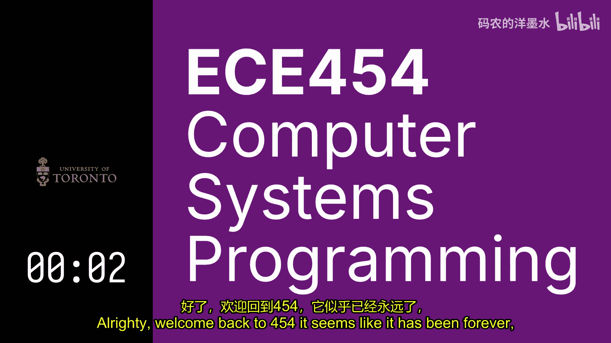

# 【全集】多伦多大学 C语言高性能系统编程实战 中英字幕 1080P p15 Lecture 15 - 并行架构 -BV1oDrZBZEG2_p15-

Alrighty， welcome back to 454， it seems like it has been forever。

 even though feels like it's been longer than two weeks， I guess it's been about two weeks。So。

Today we get to talk about more parallel implications and some more about parallel architectures and how these things are actually implemented and what they mean to you because。

Spoiler alert you as the programmer。 You're the one that has to deal with all this。So big picture。

 We went through the review of all parallelization before。

 and now we get to talk about actually applying it， so。What you would hopefully have is like， hey。

 if I have multiple CPUs， hopefully I have a linear speed up and， you know。I。That is the ideal case。

 I have linear speed up， four cores goes four times as fast， but you know。

 we might have data races and things we need to prevent contention， locks and all that。 so maybe。

It doesn't scale quite that well， ideally you think it would just kind of cap out at some point and then just stay consistent。

 but turns out if you throw more cores at it， you can actually degrade performance so we get to study a bit about why adding more cores and things like that will actually cause less performance and if we just had fewer cores which seems counterintuitive so topics we get to talk about that are hopefully new now is cache coherence。

Performance of memory operations， implications for you as the person writing the software and memory consistency models。

 which is where we meet hardware and things get a bit ugly and kind of confusing。

So first thing we need to talk about is cash coherence， which is。Basically。

 how do we ensure if we have multiple cores that have their own different caches。

 how do we ensure everything is actually all consistent in some manner？Cash coherence。

 if we have a modern system where we have multiple physical cores。

 then each of our cores are going to have their own private cache。

 at least at like L1 and L2 typically， and then they're going to have some shared memory either memory itself or L3 cache。

 something that something like that， so if you have shared memory。

 any processor that can directly reference any memory location and communication。

 sometimes you just implicitly have it by changing values， changing values in memory。

 communication something to a different core。But。Since Cos have their own private caches。

 it is actually much harder to actually communicate between different threads than it might seem。

 so a lot of the magic has been hidden from you to this point。

 so we get to dispel a bit of that today。So if I have multiple cores and data as cache in multiple locations。

 how do I ensure some type of consistency， so coherence is ensuring some consistency to the same memory location。

 so if I am updating a variable called X in multiple threads that's a global variable or something like that。

 how do I ensure that the cores actually see consistent values。So。Imagine we have two simple threads。

 One thread stores X like they're both accessing some global variable called X。

 One thread is writing the value 3 to that location and the other thread is just reading that location？

 So the question here is， well， what will X be in thread B。 So you your processor。

 assume it has its own private cache， at least at the L1 and L2 levels。

We won't dissect the whole tag， so assume it's whatever the tagline is for x and the data well。

The value of x， it's an integer， let's say that's just part of the cache line right。

 we discussed the cache line before therere like usually 64 bytes and while this would only be part of the cache。

Let's say it's2。 and let's say it's in threadread A's cache while in thread B。

It's not in its cache at all， and in memory it currently has the value of two。

Thread A is the one with its actual value in the cache。So what might happen is， well。

 if thread A or B loads first and。So threadb loads first that will cause a read from memory again we're just assuming it starts from scratch so that would cause a read from memory so that would read that value in and then in thread B it would read the value2 and now in thread A when it stores actually writes the value of 3 to X。

 Well it would just write it to its cache it wouldn't bother writing out to shared memory。

 it wouldn't do right through or anything like that that would be slow but now we have some inconsistency between the caches so if threadB was to go ahead and。

Modify x further or read X again。 Now it thinks it's 2， although the true value is 3。

How do we actually ensure some consistency between them and the answer is going to be unsurprisingly。

 more hardware？So。For cache or memory coherence， you hopefully want the behavior of the system to be equivalent if only like a single copy of the data was present。

The only thing you care about is like hopefully let the hardware people figure out the details where we only see a performance benefit of the cache。

 We don't have any ill faded side effects from just not having a cache at all。

 so it should behave the same way and someone said that back in 83， which is even before I was born。

 so look at that， so。If you have cache coherence that ensures all processors have a view like a single view of memory。

 they are all consistent。 they all agree about the value of a certain memory address So maybe you don't know the order of the loads in the stores between the different processors but if you actually took them all in order。

 they are now consistent So if p0 actually writes the value X or writes 5 to the value X and then P1 reads it。

 it should read 5 and then if it does another read while another thread might come in。

 update that value to 10， and then while you know it might further update that value to 20。

 but when P1 reads again， it should read the most upto dateate value whenever it gets scheduled to read。

 it shouldn't read an old still value， whenever the read does happen。

 it should read whatever the most up to- date thing is at that。Time， so。

Why do we even care about this， well， if you don't have cache coherency， like don' know。

 some of Intels systems， some machines。Turns out that that's a slow thing to do to make sure everything's consistent。

 So for performance reasons， you might be like， hey， I don't care。

 let's not have them synchronized at all。 And if you don't have that， well。

You essentially have the version of hardware version of databases all over the place。

 so loads might read old data and if you store maybe something else that loads it won't actually read the most up- todate value。

 the stores are not going to be sequenced， they might be visible in different orders。

 it might actually reorder the different stores and if you need to argue about this in terms of your program and your program being correct。

You will have a awful time and we'll have some examples today， but you essentially as a programmer。

 get to deal with it。So。At a hardware level， the protocol to ensure consistency to a single the same memory location。

 something called MSI that basically representing the different states of a block of cache that it could be in。

 so they add a state to the cache block。For each core and it has one of three states so it can either be invalid so the data is not in the cache。

 it can be modified， which means this core has updated the value in the cache it's inconsistent with main memory because we're assuming just right back and then if it's modified you also know that it's not shared with other cores so if it is shared between cores。

 then。If it's in this state， you know it's consistent。

 so the cache line might be shared with other cores， and it's also consistent with main memory。

 so those are the three valid states we have。So now if we go through that whole example again。

 where one thread writes to location X and the other one reads from location X。

Now in the cache we have that state as another field in the cache， so now if threadreadB loads X。

 that will cause a read to happen to main memory and then it will update the state to simply shared so it has read that value from main memory。

 it is consistent with main memory because it's a memory read and it would go ahead。

 populate its cache with the value to， so。Now if thread A stores write to x， the value 3。

 while it's currently invalid， it would put an invalidation signal to main memory and as part of that it would check all of the other course caches and then it would also invalidate TreadB's cache。

You are modifying that value if it's in another course cache， you just immediately invalidate it。

 so if gets invalidated， then it would just go ahead and it could just write it to its local cache and then。

Protocol now knows that， hey， in shared memory， I won't just write through。I wait for a write back。

 so now I know that since I have one core has the modified state。

 it is an old value that's in shared memory， so if something else tried to actually read。

 I would have to force that right to happen then so everything is consistent。

So some problem with this is even if a core like reads a value that's not cash on any core and then writes to that value。

 then it's still going to cause a whole bunch of coherency request so it has to read that value as before and then it also has to request to write that value and then it will immediately invalidate all the other cores and actually have to go through and check every single course cache to see if it needs to invalidate something because while the protocol is just not that smart as doesn't have。

Even if you are the only core with that data， it is not smart enough to know that， hey。

 you're the only one with it， it has to assume worst case scenario that you have it shared with other cores。

 so it just has to go through， check and invalidate every other core。

 so simple solution is to just add a new state so we add a new state called exclusive。

So have the other states before， but now in shared。If it's shared。

 it's consistent with primary storage and it might be shared with other cores。

 but if it's in this exclusive state， so it's read from the cache line。

 it's consistent with main memory and it is not shared by other cores and the reason to add this other state is if you write to a cache line that is exclusively held by your core。

 you don't have to invalidate anything else or look at any other cores。

 you know that you are the only one that has a copy of this data， so when you write to it。

 you don't have to look at any other cores。You will get much better performance because， well。

 you're modifying your one value。Yeah。Is there a difference in saying that a particular cash line is invalid versus saying that the dirty bid is set to one？

Yeah， so the question is， you know， is there a difference between invalid and the dirty bit being set。

 Di bit， Yeah， dirty means it's。Basically， it's like a subset of it。

 It's like invalid and also not consistent。 Well， invalids just like。

Just invalid might not even be there。So and we'll see an example， I believe。With this。For writing。

 So if you actually attempt to write back a block， that's in an invalid state。 that's a right miss。

 So in order to successfully write something back， that block has to be in the exclusive state。

 and that would generate like you， a read exclusive or read ownership so I can read in a value if I'm the only one updating it。

 I can request a read。Like an exclusive read。 So that is what you would generate if you're reading that value and you're intending to write to it later。

 So you just don't read it。 And it's。Has to be。Classified as share。

 you can actually try to read something exclusively so if other caches have a copy of the data。

 they send it invalid their copy so everything is nice and consistent and it completes whenever there's nothing else valid。

 everything is consistent and then you can perform a right。

 entered that modified state and because you are the only one with the most up-to-date value。

 you don't have to invalidate everything else， it already flushed its cache and it was already consistent before you actually did the memory right。

So。We'll go through some examples on the first example we'll load on one core followed by load on another one。

 and then a load followed by a store and then a store followed by a load just to see what this protocol will do。

So。First one， again， we have thread A and thread B。Initially nothing is valid in their caches。

 they're both invalid and in shared memory or just in memory， x is equal to 2。

So if thread A loads X first， well， then what happens well it's not in its cache。

 it will just read that value from main memory， populate its cache。

 and set the state to exclusive because it is the first one that read that value so it would fill its cache read that value set its state to exclusive and then now if thread B loads X well then it would have to generate a read because it's not valid。

 then it would have to go ahead check every other cache and in this case it would have to notify that hey。

 you had to exclusive， you didn't modify it or anything like that。

 so you need to change exclusive to shared because now the other core has loaded it as well and everything is consistent。

 it didn't have to write back， it didn't have a modified version of it。

So that's the case that now it knows it shared， it just took a bit longer to get there。

So the exclusive， like the。That exclusive bit。Willll be on that course cache so it represents that course。

Like yeah， so you don't need to keep track of which core because you're already on that core right。

 so yeah you don't need to keep track of it。So。In the second example， well。

 what happens if threadreadb loads X， same thing， it will load from main memory， read that value to。

 it was the first thing to read it， so it will be in that exclusive state and now well， oops。Now。

 if we try to actually store X， well it will generate a read exclusive because it needs to check。

 hey， is this the most up to date value， invalidate anyone else's one。

 so in this case it would just straight up invalidate anyone that had it open for exclusive that did not modify yet。

 so its just。Doesn't have to do any write back or anything like that。 Just straight up。

 invalidate it。 and then it would go ahead， fill it。

 And then in this case it would set the dirty bit。 And sorry I misspoke before。

 but the dirty bit is a subset of exclusive， not invalid。

 So dirty means I exclusively had it and I modified it。

 So I have to do a right back to it eventually。So exclusive could just mean I'm the only core with it。

And I have the most up to date value， Di means I' modified it as well。So in this case， state 30。

 x is equal to3。 and if someone if core。B tried to load it again。

That would force a right back to happen， and then it would go ahead and load the most up to date value。

So。In this。Example 3， same idea。 but now we'll have thread A store the value first。Well。

 it would generate a read exclusive because it's the first thread going to read it。

 So it would generate read exclusive。 In this case， everything else is invalid。

 It's not in any other。Not in any other cores cache。 so it doesn't have to do anything。

 then it would fill it。 It would be exclusive， and then it modifies it so we can assume that it's dirty。

 That dirty bit just has to do with whether or not it has to write back to memory or not。

 it would always have to be exclusive。And then in this case。

IfThreadB tried to load X now while shared memories out of date。

 so now we're going to have to force a write to it so it would issue a read request。

It would know that hey， that memory address is currently out of date。

 so it would generate a read request from the other core like hey。

 I need to get your most up-todate value from the cache and force a write back to happen so as soon as the write back happens。

 then main memory gets updated and you would change that state to shared because another core is going to read that value that you just wrote back to memory and then the other core would go ahead。

Update its state to fair and actually read that value of x into its cache。So。

This is fun for everyone。Very， very fun。 So this all happens in hardware。 This is all done for you。

 all done for you。 But as you might imagine。😊，If you have that same value。

 ping ping and back and forth between。Different cores。 And this is all happening。

 It's going to be much， much， much slower。So here are all the different state transitions you can have between different cores。

 so it considers an event on a core， so if your event's like a read miss and initially that state is invalid that means you're either going to transition to a shared state or an exclusive state。

 if you're the first one to read from it it will be exclusive。

 if it's already on a different core then it will be shared and then the message you give to the pro call is a read and then remote here is any of the other core。

 so if the other cores had it already open for shared it would just transition to shared。

 nothing happens if it had to exclusively open before then it would just go to share and if it was modified before it would transition to shared and actually a force a write back to update main memory so everything is consistent。

Otherwise， if you do a read and it's a read hit， so in your cache。

 the state's either shared exclusive or modified， then nothing happens to any other core doesn't actually affect anything。

 things are nice and fast。If you are writing two situations， either a miss or a hit。

If you have a miss， you are in the invalid state， so you're going to have to update it to modified。

 so you're going to have the only copy of this that going be that's going to be only on your core。

 you're going to have the only up to- date value of it in your cache。To the protocol。

 it will issue that read exclusive to every other core on that machine。

 so that would invalidate it if it had it open for if it was shared before or if it had it open exclusively before。

 but those states， they didn't have any modifications so they don't have to write back to memory or anything like that。

 so it just invalidate it， but if another core had it modified。

 then it would invalidate it plus forceesec core to actually write that value back to memory。

If there was a right hit， so your core had it in the shared state， exclusive or modified it before。

 Well， if it was in shared state， it would go to modified。

 So you are the only one now with the most up to date value of it and then exclusive would transition to modified because now you have modified that value。

 So the message it sends to all the other cores is just invalidate。

 So if it was open for sharing before， it is now invalid because well。

Only one core has the most up to date value now。So。Performance。

 what we care about of memory operations。 So local caches and so。

The cost of accessing memory base case， what you hope it is is like the data is cached locally。

 it's in L1 and hopefully it's like around 10 cycles and then worst case， if the data is in Ram。

 then I have。Like 30 times slower to access memory than it is cash， so it's going to take much， much。

 much， much longer and those are some numbers that we should have in mind as well。So。

For some machines， which we do not really have yet， you might have different。

 even if you have different cores， they might be physically located on different dies。

 so some server machines have like two sockets or four sockets and then。

Doing this protocol across CPU sockets is much， much more expensive than if it was on the same actual dye of silicon。

 so some cores might be located closer to each other and some of them might be located further away and it might have weird topologies。

 especially if you get into really， really high。High performance computing where you have lots and lots of different chords going on。

Even with the new like A and D chipt designed to， even if it's on the same court could be on or yeah。

 the same CPU might be on a different chipt。 So like there's different overheads depending on which。

Core is talking to which other core on the same machine because they might be located on different triplets and then that goes into the whole hardware design and all that。

 so communicating between different cores or different different cores really depends on the topology on the system unless you have a like simple desktop CPU where they're more or less located on the same die。

So。If they're on the same die， it's really fast if you have to take two hops。Well。

 it might take double the amount of time to do a single hop and then worst case on some architectures I might have to take two separate hops。

 which is even slower again， this will depend on the specific architecture and system layout。

In both cases， right the local cache line it's going to be invalid。

 the state is going to be part of that protocol we just went over before and all that communication would might happen across sockets has to happen across different cores and it's going to take a long time so you might just get unlucky if your program is running。

On different cores that are on different sockets。 Suddenly， your performance gets way。

 way worse if you have a machine like this， which unfortunately， we do not have access to yet。

 So luckily for us， we don't have to worry about this。But same thing rates's going to be much。

 much slower on this， depending on our topology of the actual CPU itself。

So what do you have to worry about， This is where it gets fun。

So some other things you have to worry about， first thing is something called false sharing。

Remember our cache， it is like。64。Btes， so it could hold multiple pieces of data。

And if it holds multiple pieces of data， even if。Some threads are exclusively updating a variable that is not being updated by a different thread。

 You can have some very， very bad interactions between their caches。

 So let's assume we have thread A， all it does is modify some variable。

 let's say it's a global variable called X and thread B that only updates a global variable called Y。

 and it just so happens that they're on the same cache line。

 So even if they exclusively update their values， if they're on the same cache line。

 bad things happen so。If we go through the protocol again， what would happen is well。Thread A。

 it's storing or writing the value 5 to x。 So it would generate that read exclusive fill in its cache。

 It would be modified and the tag， while it would be the tag for what wherever X and y is because they're on the same cache line and the data would be like 5 n0。

 assume the other values are 0。 So now because thread A has modified that value。 then。Guess what。

 main memory is out of sync。So now， if thread B actually stores to Y， well。

 that is the same cache line。 So it will send that read exclusive。

 which would cause this to invalidate its cache and also cause it to update main memory because it has to do the right back again。

 And now it can actually load in from main memory。 get that value 5，0。 and then update y equals to2。

 And now main memory is out of date again。 So in this case。

 it would cause it to be it would invalidate thread A。

 And then we would go ping pong essentially back and forth back and forth back and forth between them right。

 if it was like wall true store X on one core Y on another core now。😊。

Because they're on the same cache line， the protocol doesn't know that， hey。

 it's only modifying this one value and this is modifying another value。

 So if we have a layout like this， things will go super。

 super slow because it is constantly forcing rights to main memory every single time invalidating the caches basically your cache。

Just get bypassed here。You're using main memory with extra steps。

 which is even worse than using main memory。 So everyone understand why this bad thing。So。Yeah。

 very bad thing。 So how would。You as a programmer， what would you do to fix this？です？Yeah。

 put some space between and put some padding， make sure they're on different cache lines。

 and then you're good， y。就发了就。The compiler will not do it for you。 So this is all on you。 Yeah。

 because the compiler。Compfe is the compiler。Won't know that， hey。

 two different threads are reading this exclusively。 compilers no idea。They' were like， hey。

 don't put this on the same account。嗯。So yeah， there's like some built ins to like force。

 you can force alignment。You can add your own padding。Things like that。

T aside the cash line on compile times time is there a way to tell it？

have to wait at runtime to figure out what your cash line size is。No。

 typically that doesn't happen like its not doesn't find your cashline sites at runtime and change your even that out even Oh。

 you can ask but。It's on you， the compiler won't care if you ask and do different things。

 but it's all。When AMD releases。10 kilo cash line size。Yeah。

 so that's what keeps you employed because well now 64 bytes is you know， good enough。

 you put enough padding that they're on different cache lines， AMD comes out， you know next year。

 five years， who knows， hey， guess what， the cache line size is 128 now and they're 64 away from each other？

Now they're on the same cash line now。You get to fix it again and hopefully you remembered that's why you did that weird thing。

So。关。If they share the same cache line， so whenever you try to write to it。

It always generates a read exclusive just because it needs to have the most like it needs to invalidate everyone else's cash because you're about to modify it。

So it's just a signal that the protocol sends。ラトアック。So， yeah， read exclusive。

 if you're about to write to it， it'll send that read exclusive signal to invalidate everyone else's cash。

So this will happen again。 This is stuff you get to contend with。 and yeah。

If they change the hardware， guess what your performance might tank again。

 So that's what keeps this course interesting and why。It's never quite the same Every years。

 The labs change。 Their performance is different， especially since we don't have a super consistent machine that you have access to。

 So your machines different than any other machine。 So hopefully there will eventually be， well。

 there will eventually be a server for this course。 But unfortunately， you guys do not get， get it。

 So。Work in progress。So summary of this false sharing different threads on different cores。

Accessing unrelated objects。 It could update its own thing exclusively。

 But if it's on the same cache line， then it gets invalidated across cores。

 All the cores have to communicate with each other right back to main memory。 Really， really slow。

 The only way to do it is you have to do it yourself。 So you can ensure that， hey。

 there's just enough space between them。 You can insert padding。Just add some different ints。

Thats aren't used， especially if it's like。In global variables， you'll have a fun time doing that。

 there are some compiler built ins to force alignment of different things。

maybe Ih modify the linker probably don't want to go that far。

 but you can set out different layouts and this is also why that hey。

 if I partition allocations from different threads like what the idea between hi JE Maloc。

 why it did that is to eliminate this false sharing thing so that hopefully all of。You know。

 all of the memory requests from the same thread。They can all share cash lines that's fine because it will be on the same threat。

So you as a programmer cash coherency is something you might not have thought of before and it's really expensive。

 so that does not come for free， so you want to avoid any unnecessary sharing that false sharing is probably the biggest thing and also you might actually care about scheduling a bit so crossing especially on a very。

 very very high performance system， so crossing processors。

 sockets is really going to kill performance if you actually have multiple core or sockets on your machines like multiple CPUs。

 so even now like if you have a lot of。Cos on even AMDs newest architectures。

 then you have different communications because they're laid out in chipts。

 so like some cores are physically located on a little die and then there's interconnects between the chipts so。

Things can be slower just based off know what your luck is as to what core you're actually running on。

 So yep。that cash code unitss is really expensive。 Do you have any idea for comparison how expensive it would be if you had like a single L1 cash。

If I can imagine why that would be more expensive。A single L1 cash for all the courts avoid the cash coherence。

 but now like all the different courts have to interact with the same。Yeah。

 so interacting with the same cache。Usually it's also really small and to be fast has to be located like right next to the core。

Yeah， I don't think that would work that well， but again， not a hardware person。Yeah。

An L1 cash ship between two。So yeah， in some machines。

 it looks like there's an L1 cache shared between different cores， but that's that SMT thing。

 so that's this simultaneous multithreading where there's actually one core。

 but there's two virtual threads that runs on that core and that's just when schedules instructions it can take it from anyone。

So it's。Hardware wise， there's only one。Physical core。

 but there's like two virtual threads of execution where it pulls instructions from。

But it's just one physical core， one cache， but yeah， on the machine because of SMT， it looks like。

 hey， two cores are sharing the same cache， but there's only one physical core there。Yeah。应该是为。SMT。

 do I have to worry about locking？Yeah， SMT， youd still have to worry about。What you。Yeah。

 you would still have to worry about data races because。Even with SMT。

 you have no idea what the scheduling is between the two different threads。 so it could be。

 and you know， out of order。It could have each thread out of order too。

 and you still have data races and all that fun stuff。But yeah， so if you have P threads。

Maybe you can set an infinity mask， which is basically saying， hey， P thread。

 please stay on this core and you can actually say， hey， please， please。🤢，Linux kernelel。

 please keep this thread on this core for scheduling purposes and that would also make sure that when it gets scheduled and the same court doesn't invalidate its cache and all that other thing。

 so later we see some more implications of modern architectures on software design。

And another peculiarity of modern parallel architecture。 So memory ordering， which is a really。

 really， really， really fun subject。😊，There is a difference between cache coherency versus consistency so so far we've only talked about coherence and that means that all processors have a consistent view of a single memory location or a single memory address so like X so if you have coherency you can put all loads and stores on a timeline that's ordered and it will respect program order and of the loads and stores of that processor so the order you wrote them in is the order that they actually happen in and this actually defines a memory behavior in the present of all the caches while consistency that defines a behavior of reads and writes。

By a processor to different memory locations as observed by another one， so whether or not。

Memory accesses or memory modifications are actually observable on another processor in the same order。

 which is a slightly different problem that really complicates things。

 so if you write when does it propagate to the other processors。

 what values it reads or cannot return。Is it in the cash？Intuitively。

 read should return the last value of the last right， but what's last defined as is it which core？🤢。

Which one's more important， Which one you know should be how it was written or how it was executed。

 So we'll have some examples of that so。The first one。Is a system called sequential consistency。

 and that states the system is going to be sequentially consistent if the result of any execution is the same。

As if all the memory operations were executed in some sequential order。

 So as if they were executed on a single core， you don't have to worry about cash or anything like that。

 Everything is consistent for some order。 So you might not know the order between the threads， but。

Every thread will execute itself in order and the total order between the threads will be consistent。

 so this is what you think is happening when you write your programs。

 but as we see this is not true and this is not what you know compilers or hardware enforces。

 so if I have one thread that writes to location A and reads from location B and one that writes to location B and reads from A。

 well。You would imagine that if I was to read a one。

 then I should read a one from the other variable because it had to have happened。In this case。

 if thread1 executed first or sorry， P0 executed first and it updated the value of a。

 then a would be equal to 1， then if P1 executed wrote the value of1 to B。

 so B should be updated to1， so now if P0 reads B， it should get 1 and now if P1 reads A。

 it should be1， so we'll see that this is not true。So you would like this to be true。

 but this is absolutely not true because it's way too slow。So。If you have sequential consistency。

 one question is in this case， if initially A and B are both zero。

Is there any case where both of these reads return zero？Well。

 if we want to prove that this doesn't happen， we can do some Mahy proof by contradiction。If this。呃。

Like in P0， if we read a0 from B， that would mean we had to have read before it updated B if everything was sequentially consistent。

 and similarly， if we wrote or read from a， a value0， we would have to read it before it updated。呃。

Before it updated a equal to1。 so the reads would have had to happen in each thread before the write。

 and if we have sequential consistency， then within thread1。

 it will actually execute the right and then the read and same with this。

 it would execute the right and the read so。Literally cannot happen if we have sequential consistency。

 If we read a0 here， then。Well， we can't because it would have to happen here， which means that。

 you know， it would have to read a zero here， which means it would have to read here。

 just impossible， cannot happen， we can't really go back in time。

 so we would have to have a weird time war happen for both reads to return zero。

 but on real processors， as we will find out，Could happen。So。This， again。Is really intuitive。

 sequential consistency makes sense to you as a programmer。

They execute in the order I wrote them down and they are always consistent， but if you do this。

 programs are going to be really， really， really， really slow。

 so each memory operation has to complete like the results are visible before proceeding with the next memory operation in the program order so it can't actually reorder things that much。

Well， it can't reorder things at all， it has to happen in the same program order and out of order execution is one of the things modern CPUs have to do in order to get good performance and here we also need rights to be visible in the same order as other processes or other cores。

 so that would require right to main memory in order for them to see it and in which case that is also going to be slow so this is just really really bad for performance makes intuitive sense。

 much easier to argue about this than what we will see actually happens。But yeah， like I said， slow。

So。Let's say。We actually did do this。 So let's say we did a right on CPU and it's a right miss。

 so it has to invalidate everything else。 So the cache coherence protocol that we talked about that would invalidate all the other CPUs cache lines if they have a cache copy of a So if we do that we would have to invalidate the other ones and in order to be sequentially consistent it would have to take some time to invalidate its cache line it would have to see hey。

 if it's in the cache。Oh， make sure we invalidate it， make sure it happens。

 and then it would have to tell that CPU core。 okay， I'm done。 it is now properly invalidd。

 Now you can actually do the right and update that value because now it is consistent。

 So the problem with this is yeah， the right can only complete after it gets acknowledged that the other one has invalidated its cache。

 Otherwise if we didn't do that， one CPU could receive rights out of order。

 Perform still reads all of that stuff， but the result of this is writing becomes hella slow。So。

One optimization you might have is like， hey， let's not wait for the right to complete at all。

 I don't really care about that， let's have a store buffer on part of our CPU。

Just write that value to the buffer and let the CPU proceed immediately and figure out that cache stuff you know in the background。

 So send that invalidate after complete the store when the invalidate message is actually acknowledged and then you can go ahead。

 flush the store， write it and write that value to the cache。

 So now this store buffer is like a cash for our cash。 We love cashs so。Here。

If we have a single CPU core， this causes no issues because well only one core can make progress at any given time。

 but on multiple processors， or if we have multiple cores like we do have now。

 we have some issues with this。So。Let's say now we have p0。

 it's just all it's doing is writing so it just updates the value of a to1 value of B to1 and then in the reader well we'll just have while B is equal to0。

 just continue just infinitely loop while B is equal to0 and once we break out of that loop we'll just assert that a is equal to1 so can the assert fail。

 if we have sequential consistency。Where the rights happen in program order。

 this assert should never fail， right， because we always write to a first and then to B。

 So if B is one that。Implies， well that actually guarantees that a is also one if we have sequential consistency right。

 so that would make sense if I wrote this and I wrote that assert statement there。

 you might look at me funny and be like， well， a will always be equal to one。

 what are you talking about but。With。Multiple cores now， that assert can fail and we will see why。

For that assert to fill， what may happen is you may be in the state where A is in P1's cache。

 it is invalid， and then B is like not modified。But it is in this exclusive state。

 so the current value of B is 0， and then initially in P1， a is shared， so it was shared previously。

 it has the value of0， and then B is invalid。If P1， even if it respects program order。

If it actually updates that value of a to1。It would just save that new value in its buffer and then send that invalidate request and here it doesn't wait for a response for that invalidate request to come back so it just merrily continues around and in this case。

Since that invalidate request has not been acknowledged or P1 hasn't even got it yet。

 what might happen is P1 executes， it would read B， oh B' is invalid， so it would go ahead。

 receive a read B， B would just go to that shared state， it would read。🤢，Actually， no， sorry。

 So here， let's rewind a bit。 So here we updated that value of a。 It's in the buffer。

 We send that invalidate signal out and。Then p 0 executes again。 So it would update that value of B。

 So B would be in that exclusive state。 It's invalid in the other cache。 So just loads as exclusive。

 And then it would update it and。Update it。And then whenever the other thread tries to read。

 then it would read B， it would force it to write it out to shared memory。

 and then it would go in the shared state。 and then we would go ahead and read that value of one so。

Thread P1 would read that value of1。And then we would exit the while loop。 And then， well。

 because we didn't acknowledge that invalid of a yet， we actually read。

The shared value we thought was shared and all up to date before because we didn't receive the invalidate signal yet。

 we didn't acknowledge it or handle it now， so a will be in our cache。

 it will be zero and we'll be like yeah， that's good and now we think a is equal to zero yeah。

Don't get CPU of manufacturing。Like some。Was my that。おあめでて。だけ。I understand they have that heard。Yeah。

 so branch prediction， like will rewind and do stuff。This will not rewind， so yeah。

 just way too slow， way too other stuff。That's basically what transactional memory is。

 is it will do the rewind if you know， there's false sharing。

 So I think they try and get you to play with that in the next lab in lab4。 But yeah。

 that basically rewinds something。 that's something called transactional memory where you figure it out if something bad goes happen。

 just rewind。So that is a thing。They they experimented with that， it sounded like a good idea。

I guess when the labs were made， it still sounded like a good idea。

 but Intel has since dropped that idea and it doesn't exist really anymore。Transactional memory。

 branch prediction does exist。 And also， this problem gets way worse with branch prediction， too。So。

 so yeah， branch prediction makes us even worse。So。So here， if we want to fix this problem。Well。

 if we wanted to fix this problem， what happened is， well。

 the other core didn't actually acknowledge the invalidation。The store buffer didn't get， you know。

 written back out。 And it read an old still value because we wanted things to go fast。

 So this is what。Processors will actually do。 And it's up to us as programmers to fix this。

So what happened here is like， hey， I don't want to update the cache until the store store buffer gets written out to the cache。

 My cash is actually。You know， written out all of the cash coherence protocol actually goes into effect and everything is nice and consistent。

 So in order to stop that from happening。We can do something called a memory right barrier。

 So in this case。One built in function's called S andT write memory barrier。

 and that will force the CPU to flush its entire store buffer before applying any other stores。

 So if you and this is something you write in your program。 So if you write this in your program。

 it will make sure that all the stores above that line happen before any of stores below that line happen。

 So if you're the CPU， it can either stall until that store buffer is empty before proceeding or just use that store buffer to hold more subsequent stores until everything else gets applied。

 So。If we actually did this now and wrote a memory right barrier， now our assert will not fail。

For the most part， so why would that happen。Well， same case as before A is in this invalid state。

 B is in exclusive， and on the other processor， A is shared and B is invalid。

 So now if P0 executes first。It would go ahead， just save that update to a and its store buffer。

 send that invalidate to the other core。 And then well， if we have that right barrier。

 that will mark that store buffer， it has to actually be。

Be written out before we modify anything else。So。It would update that value B。

 well B is OK because it happened after A， so it can actually stay in that store buffer。

 but we would have to write back out the value for a first。

So now if we try to read be in the other thread， well， it would just go。To shared here。

 and the other thread would read the value is equal to0 now because。In order to actually。

Nor did actually you know。Read the value of one for B。

A would have to be written out because of the right barrier。

 So we would have to actually perform and be done with the right to A before the other thread could actually read the value1 from B。

 So in this case， if it tries to read， it will get a0 back from B。 And then it would go in this loop。

 and then it will never ever read the value of one for B until a has actually been acknowledged by the other cache。

 So it would send that invalidate signal to A。 and then you know it would go ahead update that value to A。

Do that invalid validate stuff。 It would have。 it would be in that exclusive modified state。

 and then it could actually flush that store buffer then。 So now when it actually。

 the other thread reads the value for B， then it would read the value for B， get the value one。

 So now it can exit the while loop。 And now when it reads a。

Because it was already flushed out to cash， all that coherent stuff happened。

 A will now successfully read one because we have put a right barrier here so that we make sure that those rights are actually ordered。

So we have now fixed the problem。Joy， there's still more problems。So。

Turns out CPUs do not work like that。😡，If we invalidate their message and their response。

 like in that case， we had to write it out， you know， invalidate it， apply that invalidate。

 and then acknowledge it。 So it turns out that applying that invalidate might be slow。

And what we would do is， well， instead of waiting for that invalid and the acknowledgements。

Let's just you know have CP1 just kind of buffer it and just be like hey。

 I know that I need to invalidate this， I'll acknowledge I need to do that even though I haven't done it yet。

 so what might happen is yeah it just doesn't wait to invalidate the cash so on the receive side it just gets that invalidate request in a queue and then says。

 yeah， I got it， don't worry about it and it hasn't actually applied that invalidate yet to its cache。

So。This is how CPUs actually work， and it will actually cause bad behavior for that example as well。

In that case， what we would like to happen is's like， yeah。

 if we have right that invalidates something， it invalidates that cache line。

 that other core applies that gets acknowledged but what actually happens is something like this because don't we want to reduce this stall as much as possible。

 stalls are slow， stalls are bad， we do not like that so now instead if we write to a1。

 we send the invalidate to the other core， it doesn't actually apply it， it just goes yeah sure。

 no problem， got it， it acknowledges it and now we reduce our store and then hopefully before we actually use that value then we actually imply the invalid later so this is what CPUs actually do and you get to worry about it。

So。Now if we wanted to actually。Argue about what happens now。Aert can now be wrong again。

 so again same situation， A is invalid， B is in exclusive， and on the other core。

 A is shared and B is invalid。If we update the value to a， it's in that buffer。

 we would send that invalidate signal to the other thread。 it would be like yeah， no problem。

 I will invalidate a， I'll just cue it and I'll just send the acknowledgement to the other core so it's actually acknowledged that it has you updated a so my right barrier would happen here and then I would receive that acknowledged that it's already updated A so I'd know that my cache is consistent with the other one if we just go buy the cache consistency protocol even though。

Core1 or P1 in this case hasn't actually applied the invalidate yet。Fluush the store buffer。

 no problem， update its own cache， it is consistent and then here。

 well if it updates B equal to1 now， well that's in that exclusive state。

 it could update B in its cache and then whenever it reads B well it's invalid before so it would read the most consistent value。

 it would have to write it out to main memory and it would read that value read B is equal to1 so it would break out of that loop and then here because it had the old value of a and it didn't actually apply that invalidate yet now A is equal to0 again because while we didn't actually apply that invalidate yet。

We use our cash， our cash。1 P1 thinks we have the most up to date value because。

 while we just haven't got around to invalid it。 We were about to， but we haven't got around to it。

 So how are we going to fix this problem。So， yeah。啊。就三块钱已经可。

Like how easier would do you have this thing that tells that？AndP to tell。

Make sure the cash is better is there something we can call in P1 to make it guarantee that it does the a validate thing。

Yeah， basic， yeah。Like for certain。你啊。Objects。Make sure that every order doesn't。

So for certain data objects， can we actually ensure out of order doesn't occur for it。

 the answer to that is no。So CPUs， the hardware will run things out of order。

 even if your compiler doesn't even reorder stuff。你啲嘢查。Andix specify by。So yeah。

 the atomic library will let you set like memory consistency models and stuff and force things to happen。

 but by default， you do not have that model， yeah。If you want to make sure。Yeah， so well。

 if this right barrier made sure that， you know， this right was visible before this right， Well。

 might be the same thing。 maybe I need a read barrier to make sure a read happens before another read happens and you've actually cleared your Q and stuff。

 So to fix this problem，ops we need to have， yeah， we need to make sure we before we read that value。

 we have to make sure that we've actually applied all of our invalidates before we progress further。

 So that's what a memory read barrier is。 it will make sure all the reads have completed above it。

 before any of the ones below the barrier happens。 So that forces， again。

 subsequent loads to happen until all mark entries have been applied to the cache。

 So it will slow things down。 So this is something you may have to add。 So if you do do。😊，That， like。

S in C++ if you do like。Sequentialally consistent memory。

 it will essentially apply all the barriers for you。So if you don't want to write this。

 C++ has some nicer ways of doing it， but if you just use the default C memory model。

 it is not sequentially consistent and you have to add your own right barriers and stuff so C++ again will make it a bit easier。

 but you kind of have to know what you're doing and under the hood， this is what's happening。So。

If we。Fix this。 We could just have a write barrier here to make sure that this right is visible before this right and then a read barrier to make sure that。

 hey， if this read happens， make sure that。It's。Any changes on any other core。

 I've actually applied them before I read anything after the line。

 so I have to get the most up to date value of a。 and then now the ct will not fail and。

In any weird memory mall， like C's memory model that just says， hey， yeah。

 whatever things can happen in any state。If you want it to have some type of ordering。

 this is what you would need to do to ensure that things actually happen in the order that you have written them in。

So questions about that fun。 Yeah， So the only reason Q is able to know that it has。update地诶。

P0 said that it modified it。Sorry， what was that So the only reason that P1 is able to know that has。

What's it called like update A is that it's because P0 tells people1 essentially that it updated it。

 right？So in this P0 didn't really like。In the cache coherence thing。

 it will make sure that it gets updated from the other core。

 but you as a programmer need to put that barrier in。

Because you know that there's some relationship between the different threads executing and you want to see rights happen in a specified order。

I guess my question is。We hit in P1。Yeah。At a point where our A value isn't actually the a value。

And that's why we give it this write or this read blocker。Yeah， so before。

We were reading like an old still value because we should have invalidd something。

 We just said we would。 and we'd get around to it later， but。We then loaded that value and read it。

 and we didn't apply the invalidate yet， so we read an old still value。

And that's just because things。Like we have store caches and all that stuff to make the other thread go faster。

So if we just had that normal cash coherency protocol without store buffers and trying to make things go faster。

Then we wouldn't have this issue at all。But because we've added stored buffers and we're trying to make things go faster。

Basically consistency is slow so we want to skirt around it as much as possible。

 so if you want things to be consistent， you basically have to opt in to it because 99% of the time。

 things do not have to be consistent right if they were updating different memory locations or things that are unrelated。

 doesn't matter they could be out of order， they could be not consistent， you don't care。

 you get all that speed benefit， there's only some cases where it actually matters because yeah。

 this thread you want them to be visible in the same order as the other thread。

But this situation doesn't happen that often， so they don't optimize for it and。

Sequential consistency is just really slow，Well， here you would。In order to argue about this program。

 right， you would want a to always be one。Like。Like this could be like some program， let's say。

You initialize something that's like more complicated。

 and then you set a flag to say you're done like I've initialized it。 And then in the other thread。

 like you check， hey， it's initialized， if it's initialized， then read it。Right。

So if you didn't have any consistency， you might read uninitialized data。

 even if you read the flag as true， right， it's initialized。 and then you read some garbage。

 and then， well。Now your program's worthless。So that's generally the case you care about。 it's like。

 hey， I initialized something I set a flag that's supposed to protect the other thread。

 but if you don't have any sequential consistency， then you might just read garbage。

 even though by looking at the code and arguing about it， our minds kind of。

Assume that we have sequential consistency， but that's not true。All right， any other fun things。Yeah。

 memory consistency models are。F。Yeah。Can you avoid this by writing your program differently？

Initializing on。ItYeah， the question Kate。Fitddle around with things and reorganize it such that I don't need these reads and writes。

Fun answer is it depends。As always， yeah， it depends on your program。

 I'd have to see like a solid example for that， which we might make up because we have some other time。

But yeah， I'd have to think about that and come up with a good， good one， but。Generally。

 do you want things to go fast。 All right， everyone else， good。Fun stuff。I'm not， yeah。

 if you use C++ and Lab foreign stuff， you'll probably be fine。U。Just if things go really weird。

 Just remember this stuff。 I don't think in the labs， you actually have to use this， which is a bit。

It's probably good for you。So some conclusions here。

 sequential consistency makes it a lot easier to write parallel programs since it matches like your actual mental model。

 so like the lines you write， are actually executed in that order and everything's consistent。

 but that's really really slow to implement and no CPU on the planet that is performant。

 actually does that， so processors play games， they try to reduce the number of stalls。

They actually buffer stores， they delay cash and validations to get good performance。

 they do all sorts of nasty tricks， and that's just the way it works， it works well， 99% of the time。

 but sometimes depending on what you write in your program。

You actually write it ensuring or like you actually write it assuming sequential consistency。

 which is not the case at all， so。If you want rights to appear in order and reads to be also in order。

Consistency。Like consistent across different threads。

 then you actually need you as a programmer need to use memory barriers there to ensure any correct order between different CPU authorizations。

 so that's where you need to be a fun programming wizard， I guess。I did not write that word。

So we'll see that next and other things we can actually play with in the next lectures。

 So otherwise if you want some more background on memory consistency models。

 you can check out that first link， it's lots of fun。

 the C memory consistency model is kind of a pain， which is why some people don't use it for super high performance computing。

 there's some tutorials that should probably be turned into a lab instead of this and then there's an online book and if you want to read。

Like the kernel has to deal with this all the time if you want to read about its usage of memory barriers。

 you can use that they've written it and document in the kernel。So that's it。

 I will hang around for the rest of the time。

