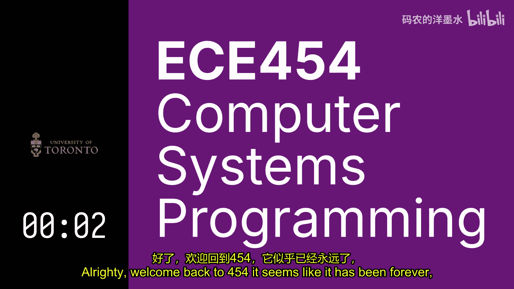

# C语言高性能系统编程实战：15：并行架构



在本节课中，我们将深入探讨并行架构的实际应用，特别是缓存一致性、内存操作性能以及内存一致性模型。这些概念对于编写高效、正确的并行程序至关重要。

## 缓存一致性

上一节我们回顾了并行化的基本概念，本节中我们来看看如何在实际系统中实现数据一致性。当多个核心拥有各自的私有缓存时，如何确保它们看到的内存值是一致的？这就是缓存一致性要解决的问题。

缓存一致性确保所有处理器对同一内存地址有一致的视图。其目标是使系统的行为表现得像只存在一份数据副本，同时保留缓存带来的性能优势。

为了在硬件层面实现一致性，通常使用一种称为MSI（修改、共享、无效）的协议。缓存中的每个块都有一个状态标记：

*   **无效**：数据不在该核心的缓存中，或已过期。
*   **共享**：数据在该核心缓存中，与主内存一致，且可能与其他核心共享。
*   **修改**：数据在该核心缓存中，已被修改，与主内存不一致，且是唯一的最新副本。

后来为了优化性能，又增加了**独占**状态。当数据以独占状态被一个核心读取时，意味着它是唯一拥有该数据副本的核心，且数据与主内存一致。当这个核心后续写入该数据时，无需与其他核心通信，可以直接修改，性能更高。

以下是不同操作下状态转换的例子：

*   **核心A读取X，然后核心B读取X**：核心A将X读入缓存，状态设为**独占**。核心B读取时，发现核心A有副本，于是核心A的状态变为**共享**，核心B也将X读入缓存，状态设为**共享**。
*   **核心B读取X，然后核心A写入X**：核心B将X读入缓存，状态设为**独占**。核心A要写入时，发送“读独占”请求，使核心B的缓存**无效**，然后核心A将X读入并修改，状态设为**修改**。
*   **核心A写入X，然后核心B读取X**：核心A发送“读独占”请求，将X读入并修改，状态设为**修改**。核心B读取时，会触发核心A将数据**写回**主内存，然后核心A和核心B的状态都变为**共享**，核心B读取更新后的值。

所有这些状态转换和通信都由硬件自动完成，但对程序员来说，理解其开销非常重要。

## 内存操作性能与伪共享

访问内存的成本差异巨大。最佳情况是数据在本地L1缓存中，大约需要10个CPU周期。最坏情况是数据在RAM中，速度可能慢30倍以上。在多核多插槽的系统中，核心间通信的成本还取决于它们之间的物理距离和拓扑结构。

程序员需要特别关注一个由缓存一致性引发的问题：**伪共享**。

现代CPU的缓存行通常是64字节，可以容纳多个变量。如果两个线程各自频繁修改两个不同的变量，但这两个变量恰好位于同一个缓存行上，就会发生伪共享。

即使线程操作的是完全独立的数据，缓存一致性协议也无法区分。当一个核心修改了缓存行上的任何一个字节，它都会导致其他核心中整个缓存行失效。这会导致缓存行在不同核心的缓存之间频繁“乒乓”移动，性能急剧下降，甚至比直接访问主内存还要慢。

**如何解决伪共享？**
解决方案是确保被不同线程频繁访问的变量位于不同的缓存行上。这可以通过在变量之间插入填充字节来实现。例如：

```c
struct Data {
    int thread_a_var;
    char padding[60]; // 假设缓存行大小为64字节
    int thread_b_var;
};
```

编译器通常不会自动处理这个问题，需要程序员根据目标平台的缓存行大小手动调整。一些内存分配器（如`tcmalloc`、`jemalloc`）会为不同线程分配不同内存池，也有助于缓解伪共享。

## 内存一致性模型

缓存一致性保证了**单个**内存地址的读写顺序。内存一致性模型则定义了**不同**内存地址的读写操作，在其他处理器看来应该以何种顺序生效。这是更复杂的问题。

最直观的模型是**顺序一致性**。它要求任何执行结果都等同于所有内存操作按某种全局顺序依次执行，且每个处理器的操作顺序与其程序顺序一致。这对程序员来说最容易理解，但会严重限制硬件优化（如乱序执行、写缓冲），导致性能低下，因此没有现代高性能CPU采用严格的顺序一致性。

现实中的CPU为了性能会进行各种优化，这可能导致反直觉的结果。考虑以下代码：

```c
// 初始值: a = 0, b = 0
// 线程 1 (P0)         // 线程 2 (P1)
a = 1;                 while (b == 0);
b = 1;                 assert(a == 1);
```

在顺序一致性模型下，断言永远不会失败。因为如果`P1`看到`b == 1`，那么`P0`必然已经执行了`a = 1`。然而，在实际的硬件上，由于**写缓冲区**和**延迟的缓存失效**等优化，断言有可能失败。

*   **写缓冲区**：核心写入数据时，可能先放入一个本地的写缓冲区，然后立即继续执行，而不等待该写入操作传播到其他核心的缓存。这可能导致写操作对其他核心“不可见”。
*   **延迟的缓存失效**：核心收到使某个缓存行失效的请求时，可能先发送确认回复，然后再实际执行失效操作，以减少发送方的等待时间。

为了确保关键操作的顺序，程序员需要使用**内存屏障**。

*   **写屏障**：确保在该屏障之前的所有写操作的结果，在该屏障之后的任何写操作开始之前，对其他核心可见。
*   **读屏障**：确保在该屏障之前的所有读操作完成后，才执行该屏障之后的任何读操作。

在高阶语言如C++中，可以使用原子操作并指定内存顺序（如`std::memory_order_seq_cst`）来获得顺序一致性语义，编译器会插入必要的屏障。但在底层C代码中，可能需要显式使用内置函数（如`__sync_synchronize()`）来插入内存屏障。

## 总结

本节课中我们一起学习了并行架构中几个关键且相互关联的概念。

1.  **缓存一致性**是硬件机制，用于维护多核系统中缓存数据的一致性，但其通信开销不容忽视。
2.  **伪共享**是缓存一致性带来的一个典型性能陷阱，需要通过数据布局优化（如填充）来避免。
3.  **内存一致性模型**定义了多线程程序中内存操作的可见性规则。现代CPU为了性能，并不提供严格的顺序一致性，这可能导致程序出现违反直觉的行为。
4.  **内存屏障**是程序员用来在关键位置强制内存操作顺序的工具，是编写正确高性能并发代码的重要手段。


理解这些底层原理，有助于我们写出既能利用硬件并行能力，又能保证正确性的高效程序。在接下来的课程中，我们将继续探索更多并行编程的实践技巧。