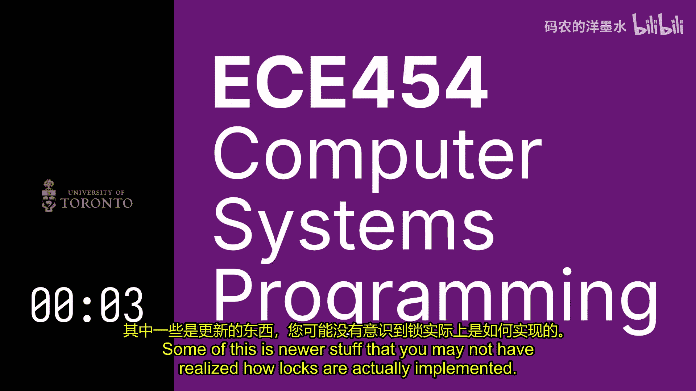
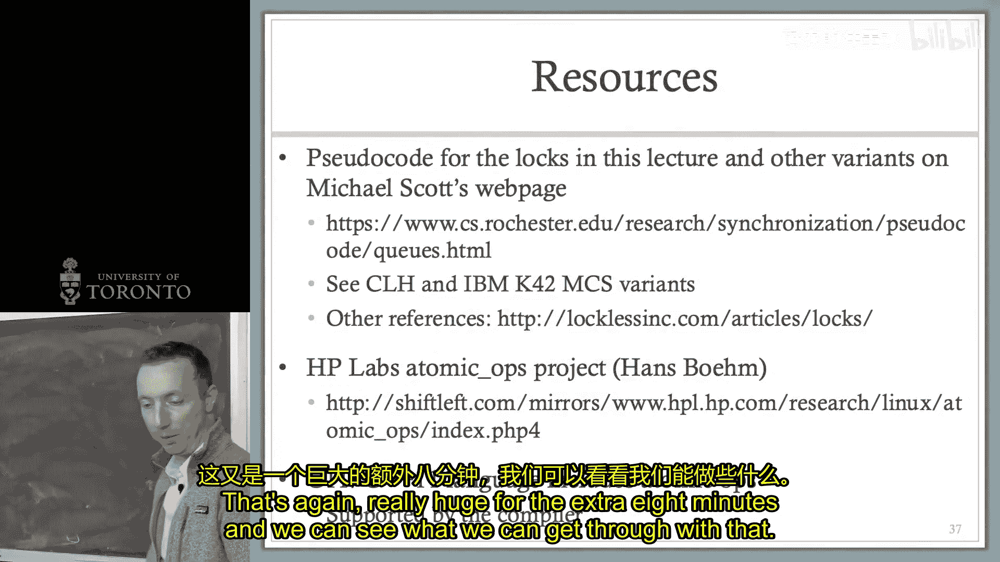

# 【全集】多伦多大学 C语言高性能系统编程实战 中英字幕 1080P p16 Lecture 16 - 锁 -BV1oDrZBZEG2_p16-

Alrighty， welcome back to34，4， so better locks， like the previous lectures， some of this is review。

 some of this is newer stuff that you may not have realized how locks are actually implemented。So。

Again， kind of review Ih， so we'll have some overview of locking implementations。

 I know some of this is 344 because I just did it。Go over what spin locks are。

 hopefully you can implement a spin lock， the cost of locking now that we can analyze our performance a bit。

Go over ticket locks， queuing locks， MCS locks， and some parallel programming techniques。

 which will be fun。So。More review， so。Processes， communicate IPC， different types of IPC。Pipes。

 sockets， signals， shared memory。Things of that nature， name pipes， all of those fun。

 different things that are just essentially using a file descriptor and read and write bytes。

 So the main thing that threads used to communicate is just shared memory。

 everything's in the same address space， they all use the same virtual addresses。

 they all map to the same physical memory so since we have multiple threads all in our process。

 we need to ensure we don't have data races and if you need to review data races two or more concurrent accesses to the same location。

 at least one is a right。 So if we have that we might have data races and in which case we need to prevent data races using mute textes and things of that nature and if we need to ensure ordering between threads。

 we can use barriers， conditioned variables， center fors to ensure ordering use locks to ensure mutual exclusion。

So how our locks implemented， what's the cost of locking and how can we develop more efficient locks。

 that's our topic for today。So on unitprocessor systems， AK you just have a single core。

 well within the kernel， if you have data shared between multiple threads。

 the only source of concurrency is context switching so you simply do not do it。

That is a very easy way to ensure that we don't have two concurrent accesses if we disable concurrency。

Unfortunately for you， everything has multiple CPUs now。 So that is something you could have done。

What in like the 2000s and below， but you can't do that anymore。So。You might know be like， hey， okay。

 even with that what about if we have an interrupt handler that we don't want data races in， well。

 then in the interrupt handler， you can just disable interrupts dis context。

 which is an end you know it's just something else you have to disable。

At a user level you could just use blocking locks implement by the kernel using those mechanisms above because while you can't disable hardware interrupts by yourself。

 that's the whole point of a kernel。 So you have to ask the kernel to disable them for you and this works because while nothing can happen in parallel everything we only have concurrency if we only have a single core but who cares about this because this is not the world we live in So we have multi processor and well we have true concurrency aka parallelism so code can actually happen simultaneously across CPUs at the same time if you disable interrupts that only affects the core you are running on and it doesn't really disallowing context switching doesn't help if you have multiple threads either that are just executing so that doesn't help you anywhere So we need some help from the hardware which should also be slightly reviewed from three。

44 so there are some hardware atomic instructions that we use to implement all of our locks so the main ones are something like test and set I can atomically test a value and set it equal to one or compare and swap so I can try look at given some memory location I can try to compare that value and swap it if it has a certain value so those happen atomically which means they either happen all at once or not at all no data races with atomic operations so。

Some other atomic operations we have set increment decrement。

 we can do that atomically and well if we want to have mutual exclusion that requires some locking and we need to use these instructions to implement spin locks。

So here is some pseudocode for all the atomic instructions。Again。

 you just assume either this function runs。Or not so it can't halfway complete so test and set what that will do is it will always return you the original value it red and it will try and set that memory location to true and then tell you whether or not it was true before or false before and again does that atomically fetch an increment same idea except it just increments of value instead of setting it to true and then compare and swap。

Compar and swap will only set the value from old to new if the current value is old。

 so you could say most of the time it's used in spin locks， where old is0 and new is one。

 so only swap the value to a1 if it is currently a zero otherwise do not swap it and if it was already one while you'd get the original value or some implementations just tell you whether or not it was able to swap it。

 yes or no。And then we have fetch and store that will just give you the old value back and write a new value to that location。

 so those are all our fun atomic instructions。So spin locks。

 the easiest implementation for a spin lock that actually works to ensure mutual exclusion is in the acquire while you just have test and set so while test and set so while the current value is true that means someone else has the lock and I keep on trying to set it to true over and over again from false if I was able to set it from false to true then test and set or sorry yeah test and set would return false。

 that means I was the one that atomically changed it from false to true。

 so I have acquired that lock and then in the release while I'm the only one that has access。

Like I'm the only one that has made it equal to true。

 so I'm the only one that can pass this lock call or this acquire call。

 so I don't need to worry about data races for the release， I just said it equal to false。

 indicating that Ive now unlocked it and won't do anything。

So this is a perfectly good implementation and well we might actually use it in some conditions versus blocking lock。

 so if you know I have nothing else to do，😊，Sure， go ahead and use it if the expected weight is really short so some other things I could do that should be reviewed from operating system courses if I don't acquire that lock。

 maybe I put myself to sleep for a little bit of time maybe I've run something else or yeah just context switch to something else hopefully it can go ahead finish whatever it needs to do and finish the lock so that will take some time so if the amount of time you the expected wait time is lower than that just try it again and hopefully nothing will happen or in some cases you aren't allowed to block like if you're writing an interrupt handle or something like that so。

This is an implementation of spinlocks everyone okay with this。

 because rest of the time we're just going to talk about how to make this better。All right。

 so spin locks pretty easy。That， that test and set operates on memory atomically。 You know。

 it has to， the hardware implementation。Relating it back to the caching coherency stuff I have to do like a read exclusive and validate。

 modify something and then some memory barrier to ensure that things are actually ordered。

 that I actually observe the rightss or the reads before other ones。

 so if I have multiple threads all fighting for this mut textex all doing that test and set over and over again。

That's the same memory location I am actually going to trounce my performance because it's going to ping pong between all them。

 it's going to invalidate all the other cores cache line and they're just going to all invalidate all the other cores cache line and it's going to be really。

 really terrible for performance。So we're going to have significant like cash traffic。

 contention on the memory bus， things are going to slow down because well all of them are spinning。

 they all have their own local cache at some level and they all have to be consistent with the value main memory every time they try and do test and set。

 they would invalidate everything else and it would be really really bad for performance。So。

Test and set it's like essentially a store plus a memory barrier。

 so that's just going to make performance really， really， really， really bad for our caches。

 so the more contention we have aK， the more threads all fighting for this lock simultaneously。

 the worse and worse and worse it's going to get so。

That's why we have this graph and now we know that while contention would severely degrade our performance over if we have more threads。

 we have more contention possibly depending on our application and if we have a lot of contention and while we're trauncing our caches we're going to make it even slower than if we had fewer threads because it's less likely that our caches would get decimated as badly。

 so we can actually trampnce our performance which is having more threads over and over and over again。

So now we can build some better spin locks fusing some things we know in this course。

 so some ideas we might have is like spin lock with backup or back off。

 so if the lock is held just wait before probing again， so best performance。

 you could like exponentially back off。Can cause fairness issues， because， well。

You're not guaranteed any ordering。 You're still kind of fighting over that same spinlock。

 There's no set order as to what you。Get the acquire the lock in order so we'd have fairness。

 potentially you could get unlucky and even have starvation in the very， very worst case。

 But here it would pause for like， I don't know， maybe a few microseconds， like one microsecond。

 and then it would just double the time it waits as it's more and more unlikely that it has to wait longer。

 And this is essentially what。What networks do all the time， exponential back off is like a very。

 very common thing in networking。That's a strategy that's used a lot of the time。

 So that's one thing we have， but。Has a lot of fairness issues。 And well， we might get really。

 really unlucky with this as well。 Also， it doesn't。 it helps our cache line。

 but if they all are contending， it's still kind of bad。 So one thing I can do is well。

 instead of that， let's just have a spin in the cache and then only access that memory when it's likely to be available。

 So this is stupid， well not stupidly name， but it's silly name test and test and set。

 So the idea behind this is I'm just going to only read that memory location over and over and over again until it is false。

 and then once I know it's false， I will try to change it to true and then only have the bad in cash and validation。

 then caused by trying to actually do the store and do the update。 So here。

I have a spin within the spin so I spin while that value is true and this oops this here is only a read so it won't have as bad of consequences for my caches if I'm only reading over and over and over again。

 so likely I will not invalidate the cache until it goes from true to false and then atomically they all kind of fight over who can set it from false to true to acquire that lock。

 but the idea here is we only try to do that test and set operation when it's possible we might have that lock。

 So we reduce contention a little bit but we can still do a bit better than this。So。

First issue you might want to resolve is the fairness issue because things aren't in in order。

 something can you know but ahead of you in line， there's no set order to anything。

 so if we want to resolve fairness well we can ensure like FIFF order if you try and acquire them in FIF order and you're first in line。

 something else will not pass you in line so。The lock could actually have two counters。

 So it's like a ticketing system。 So the next ticket， which would be incremented atomically。

 And then now serving。 So， you know， think of it as you're in line at。

 Do people go to bakeries anymore。Ih， there's one place in Waterloo， I know that uses this。

Was it Service Ontario still uses this thing。 So think of this as Service Ontario。 You get a ticket。

 and then it serves you in order more or less。 whoops， I didn't mean to draw that。 So here。Inquire。

You would atomically do the fetch and increment so you atomically pick a ticket。

 there's only one ticket machine， it's atomic， you take your number and then you just loop over the now serving thing so you spin you only read over and over again until while you're up and then you know now you have that lock and then to release it all you do is just pick the next one in line and again this doesn't have to be atomic because well。

It's a mutt， only one thread can pass by the acquire at once。

 and you assume that you have it paired where each acquire ends with a release in order for something to get the lock。

 so we don't need an atomic here because there's only one thread that can execute this release at any given time it has mutual exclusion so no data races。

So this reduces the number of atomic operations compared to the test and test and swap or test and set locks。

But has some problems where that we can mitigate。Again。

 this will return the at old value and now there's like some weird things we're still spinning a bunch of the time and there's still some contention to that same memory location。

So。What we might want is that， hey。Let's just get rid of this whole cache thing altogether。

 have something called a queuing lock where each CPU essentially spins on a different location。

 So release just unblocks the next waiter only because well， for this one。

All of them are spinning over and over and over again。

 even though they're far back in line and we want to guarantee。

 like I said before FiIFO ordering similar to ticket locks。

 we want to reduce the cache coherency and memory contention so we have different locations hopefully on different cache blocks so we don't have any of the problem and what we would do is just have like a lock that points to a tail of a list and then in the lock acquire we can add a node for the processor so each processor has its own node。

 its own memory location。So there would just be one global lock pointer and then you know to acquire。

 you can be held or you can set that pointer to your own data structure where you're holding the lock and。

Then you would add it to the tail and set up like。Just a sequence of CPUs that try and acquire that lock in whatever order。

 So in the lock release， it would just unblock the next node in the list。

 So there's no point waking up something that's like。

 you know third in list or something like that if it's not the next one to acquire that lock。

 why would I even bother trying to wake it up And here the lock is oops。

The lock here is just that next pointer that points to whatever it's currently running。

 and then running is the CPU that currently has that lock。

 and then these are other CPUs that are spinning but they would all be to different memory locations。

So one of the big implementations for this one is something called MC S locks。 Those are someones。

 I mean， a group of people's last names doesn't stand for anything other than their last names。

 So in this scenario， each thread has its own node， and that tail is shared by all threads， so。

There is a global tail that essentially points to whatever the last CPU is on that list。

AndIn this case， let's say our Q was set up that thread1 has that lock。

Each node would have its own lock and then a next pointer。

 so threadread1 has that lock and points to the next node which is CPU2。That lock would be。

 it would be locked for them。 They would be spinning on that value。

 and its next pointer would be CPU 3， which would have a lock that is currently locked。

 So it's spinning on that value。 And then its next node points to nothing。

 And tail points to the last lock in the list。So now if we have。it's called threads。 Now。

 if we have thread 4 trying to acquire that lock， well。

 it needs to atomically add itself to the tail and then atomically change threes pointer to point to it instead。

 So how that will work is。When process fork or thread4 comes in。

 it will automaticallyically try to swap the tail pointer to its own node。

 so it changes this atically to its own node and then well it's going to have a pointer to pointer to CPU or sorry thread3。

From swap and then in here it would have to change three's next node to itself immediately。

 So right now node 3 can't like leave immediately because tail no longer points to3。

 so otherwise we would break our list because well if three points to nothing and then a tail doesn't point to it。

 we have now broken our link list 3 has to point to node 4 in order for our list to be correct。So。

Notode4 would have to link behind three， and it would have to do that atomically。

 change that value and we'll go over the implementation a little bit and what happens。

So in that case where node4 has added itself to threes next。

 then it would have its own lock and it would spin and over again by setting the lock in its own node itself。

So。Now， when we release the lock， So here。Thread one has that lock and tries to release it。

 The steps we need to go to to actually release the lock is， well， here all I have to do is。

Look at my next， if my next does not equal null， that means someone else is waiting for that lock and it's all in order so CP or thread2 should be the next one to get that lock so all I have to do read my next field it's thread2 and then I would signal that directly aka I would change its block value from a1 to a0 so I would unlock it so it can actually acquire that mutex or sorry acquire that lock by doing the normal test and set thing。

So now thread2， when it runs， it now holds that lock。

 it is the only thing that tries to do the test and set。

Because we change only its local value of that lock， we didn't change a global value， in fact。

 the global tail that shared between all of them doesn't even need a value of that lock just has a pointer to next。

So now thread2 has that lock holds that lock and whenever it releases its lock。

 it's going to unlock thread3。No other process is going to try and see that it changed or anything like that。

 they're all spinning on their local own local variable or not yeah， local lock。

So some other things that can happen when it releases that lock and it's the only process in the queue。

 so when it leaves， well all it does， it' set tails next equal to null to indicate that hey。

 nothing else is in the queue anymore。So some problems that it could have that we need to。

Consider is， let's say process three has a lock and it's leaving as process4 arrives。Well。

 what Pro 4 is going to do is try and set tail to itself。So but process3's pointer is still null。

 so it null to or sorry， it sets tail to itself。So when node 3 tries to actually set tail to null。

 it will do it using an atomic operation。 So because well。

The tail is shared between all of the threads。 It's global。

 So it will do a compare swap trying to set the tail to null。 and it will figure out that， hey。

 I was not able to swap it to null because someone else changed that value。 It is not currently null。

 so。It is not not pointing to myself， it is pointing to some other node now so I can detect that and be like。

 oh okay， well it's no longer pointing to me， so instead of setting the tilt to null。

 I should wait for my next to get set and then when my next gets set。

 you know I can go ahead and unlock Tread4 is lock。So。

3 will now wait until that6 that next pointer is valid。 And then whenever it's valid。

 then it will signal process or thread 4， unlock it， and then it will be done with the spin。

 So that is the kind of。Case we need to consider for correctness。

 that's kind of the worst case scenario in terms of data races and all of that stuff。So。

This is kind of what the pseudocode looks like for it。

 so that shared variable tail it's a pointer to the last- they call them Q nodes and tail just stores the address of the last Q node so there is some global tail that lives at some memory address。

 oops wrong pointer。That lives at some memory address here and then we have choir and then that's my node which would be local on that CPU so first it would set know My nodes next to null。

 then try to atomically get the old tail， make the tail point to My node。

 normal link list implementation records and it would do that with a fetch in store。

which would be the predecessor node that we should be changing and then it would check， hey。

 if it's not equal to null， that means the queue' is not empty。

 well then I should initialize to lock， I have that lock。

 I was the first one to get it and then I would just append my node to the queue and then go ahead and spin over and over again until the predecessor sets it locked to false so that's that case we just went over before。

So。Some example here， if two threads both try to simultaneously acquire that lock。

 So say initially that the tail is equal to null， and then we have。Thread zero and thread1 here。

Both their code would do the same thing， so it sets my nodes next to null and then tries to fetch and set the tail to be equal to my node and then that would be the predecessor so we don't know what thread is going to execute first。

But since fetch and swap is atomic， then we know that well one of them is going to finish first。

 So if thread1 or thread 0 finishes first。Then while the old value the tail is null since it was the first one to actually run and try to set it。

 so it would get a null back， so its predecessor is equal to null so its tail can just can set the tail to point to。

Thread 0。 It was the first one to acquire that lock。 So it now has that lock。

 And then after thread1 executes it， it gets the old value of tail。

 which is a pointer to P or to thread 0 and then it's just going to spin on its own locked value and then it would be up to thread 0 when it's done when it does the release to go ahead and set its locked value from a1 to a0 so that it can proceed。

 So under the scenario， no additions are lost。 the Q might not be fully linked together until all threads actually complete updating the its predecessors next one。

 So changing the old value to update its next pointer。 So we would have to be very。

 very careful with that to ensure we are correct。So。

In the release what that would look like is it would need to check， hey。

 the next is my nodes next equal to null， well if it's equal to null。

 then I have no known successor so I need to go ahead and check if the tail still points to me so that's the case where something else might get added after I check and we do a context switch right here。

 so I do the compare and swap。tryinging to change the tail to point to from my node to null。

 So I know the tails pointing to me。 So I want to change it to null。 If it returns true， that means。

 well， I've updated that tail to null and I don't have to do anything。 if it fails， then well。

 someone else added itself to the list， I have to wait for them to finish。 So I have to wait for my。

I have to wait for my node。Next to not be equal to null so I have to spin over and over and over again。

 so this release again might happen after that new thread adds itself to the tail and then I have to wait for it to update my next node。

 so that is the scenario we have to consider here。So。Some things here。

 we have to argue about simultaneously releasing and acquiring。 So acquire。

If a choir has complete that fashion store and knows pre but has not updated it yet and release sees no waiters or waiters and next is equal to null。

 but knows acquires in progress since the tail is not pointing to its own node。

 well are any memory ordering instructions needed and the answer is essentially yes so？

If I am here and I know that the queue is not empty and I need to update something else。Well。

 in here， when I release it I have to wait until it actually goes ahead and updates it。

 updates my next， so this is the thing I need to be worried about in terms of memory ordering so I need to absolutely make sure that this is complete because the next thing I'm going to do is set use that value。

 set it next and locked equal to false and update it so。

The memory ordering I need is in this well I want to make sure there is a read barrier here essentially。

 so I need to make sure there's a read barrier as part of this well to make sure that I actually have the most up to date read here and you know。

Here， when I read it again， it is actually up to date。

 it doesn't have any coherency issues or anything like that。 I don't want to read a sta next here。

 so I would need a read barrier as well normally you put it as part of this wall so like wall and then a memory read and then have it spin over and over again。

Who。So everyone， good， that was fun。Yeah。I'm a bit confused。The queuing lock thing that we saw。

 that solves the cash performance issue。 Yeah， so the queuing thing is basically。

 this is like a good implementation。 The queuing thing。

 So it solves that because we're not repeatedly test and setting this like global variable。 Yeah。

 yeah， so everyone is essentially test and setting their own lock value。

OkaySo so each thread has its own own locked value。

 which would just be an int like 0 over one and its own next value。I see。 So we don't need to。

 when we're doing that， we don't need to do that atally。

 We just need to do the initial tail acquire thing atically。 we do。

We still need to do it atomically because another thread will be setting it like our lock value whenever it's done from a1 to 0。

 So， so we still need to do it atomically。 But the idea here is like。

Here every thread is spinning on their own value。opThis tail is global。

 so that's like our next pointer， and then on each of these threads。

 it has a next pointer and then its own lock value like its own ant。So sorry。

 could you go to the code， the choir code？Yeah， when you do the wild my long， that's not a comic。

Yeah， so that part's not atomic， but it only gets updated once， so it's okay。

So it only up up gets updated by the thread that actually。Changes it from true to false。

 and only one other thread will do that。 And that means you have acquired that lock。

 so you don't have to worry about a data race in that case。Yeah， me explain on the latest slide here。

What about this summer？か。Can you explain the re barrier？The read barrier here。Yeah， so。Basically。

 like you don't do not want it to like， especially。It gets really weird with。Good like。

Branch prediction and stuff。 So if it predicts it's not equal to null and then， you know。

 tries to use that value and uses this。 it'll just do something really weird。 But here。We。

I think think you do need to read Barrry here。 I might have to go over it。

And show a better example than that that's better thought out than this。

But I'm pretty sure that there does need to be a read barrier there。

 I'll try and go over it and see a better example of it too， yeah。

So the read barrier would essentially make sure that between these reads。This operation。

 this read completely happens before this one， so I know that it's for sure， not equal to null。

 it is the most up to dateate value before I actually use it on this line here that's essentially looking at it generally what you need to have for the read barriers there。

So some ordering between them， we don't want some old still value or anything like that。All right。

That type of lock in conclusion， it needs a bit more space and normal muttexes。

 so the space it needs in terms of words， it's 2 p plus n so this n is for each lock it needs that next pointer。

 that global next pointer so that's one word word is just the size of a pointer and then each process has its own copy so it needs a pointer。

 so its own next and then the lock itself which would be also a word so each thread instead of P we could call them thread so each thread needs two words pointer and the lock value and then each lock just has one global next and this requires like that has a local Qn that's passed as a parameter。

You could also or dynamically allocate them if you really want and look them up in a table that has to do with the implementation。

 but for all this we need atomic primitives like the fetch and store and compare and swap and the main idea here is we only want to spin on local location so we don't want to thrash the cache or anything like that。

 only spin each thread spins on its own value， its own memory location。

 so we don't have any contention issue and memory traffic issue so these are used all the time monitors in Java。

 their variants of MCS， the Linuxx kernel uses them all over the place and their implementation is quite readable too。

All right， what about P threads？P threads。 the basic lock there is P thread Mut T probably have used it all the time。

 So how is it actually implemented， It's kind of like a mixedmsh of techniques because it does some more complicated stuff So first。

 it does like that adaptive number spin using test and test and set if that's not successful。

 it adds itself to a link list and suspend itself so it yields and it's a bit similar structure to MCS locks。

 but it's a bit more complicated because it also adds other things like weights。

 you can set it time out on it if you want it to stop trying to acquire that lock and you can set priorities if you want you know some threads to acquire the mut text before any other threads and that unlock what it will do is ensure that priority actually is obeyed so it would wake up that weighting thread with the highest priority if there is one so that would have to were contain。

And with the operating system because we need thread sleeps and wakeups and all that stuff。

So some parallel programming techniques， if we have a counter used by a whole bunch of threads。

 so we have like counter plus plus， well this is actually a load followed by a store。

Simplest case is it would need its own critical section， so we lock a mut text。

 we do counter plus plus unlock， that is straight out of you the operating system example but。

That's only if the exact value is critical and you don't want any data races for it if you want a cash fundlayer approach。

 like if the number of increments is way， way greater than the number of reads。

Then while you essentially do like a mapre type thing so you give each counter a local variable per thread properly padded so we don't have any cacheline issues or anything like that。

 have them all increment their own local counter so I don't have any locks needed。

 I don't have any data races if I'm only updating my own copy of the variable if there's only one copy of it and then。

To I don't even need to approximate the number of reads。

 If I sum up all the counters in a non dataraccy way， I could use a lock here。

 It probably wouldn't be that long。 then I could just sum it up， get that final value。

 Or if I want to approximate it， I don't even bother with the locking at all。

 I let data races happen。 And if I miss one。😔，Oh， well， that's like a whole。

 There's actually a whole funny line of research called approximate computing where to speed up some things that just like skips operations。

 I believe if I read one paper that was pretty good where like。😊，To speed up a for loop。

 you just don't do half of it。And surprisingly， programs still work。

So is it really that necessary who knows？And then yeah。

 and then you can also have barriers so you could have end threads， get to that barrier。And then。

Do that。To actually synchronize all the values between them， that's more or less what GPUs do。

 hopefully if we have time in the course we can go over some GPU programming at the end of it。

 which is more parallel programming stuff。But who knows if we have time。

 hopefully that's what I want to put in this course because it seems weird that it doesn't have it。

So。Some other things， so structuring data for cache is well。Any read。Like mostly red data。

 like you want to separate out what's mostly read and what's frequently modified。 So， you know。

 if the link list payloads or if something gets modified often。

 then hopefully I want to have separate pointers and things like that。

 exact opposite of what I want to do on a single unit processor system because again。

 caches are our enemy here in terms of performance。

So I want to segregate anything independently accessed from each other in different threads。

 I want to make sure it's on different cache lines so I don't have that false sharing problem。

I should also use poor core data wherever possible。

 like one ReadyQ per core on Linux and like JE Maoc。

 that's one of the techniques it did too just to ensure that there's no false sharing or anything like that and if I have right mostly data I want it to be private。

 I want to try to only write to my own local copy of it and then everything will be nice and fast。

 I don't have to worry about data races or anything like that。And if I'm locking data。

 well I probably want like per core reader writer locks for like read mostly critical sections。

 so for read access I can acquire a local lock for write access， acquire all locks。

 write would be expensive， I don't know why it's not in the slides there is a Mu text read write lock that you can lock for reading and lock for writing and that will allow multiple readers all at once or only a single writer so if your data is like that I would say use a read write lock and then we might also want to like move any contented locks from its associated data so that you know I don't have any cache interferences where me modifying the lock also modifies the cache line that the data is on or anything like that。

And there's more resources in case you are interested in this， Michael Scott， not the office one。

 has a whole bunch of implementations of it。You can actually read if you just Google， whoa。

 that's a huge bread pointer， wow。I don't know how that happened。

 but if you if you just Google like Linux MTS lock， you can see the Linux implementation of it。

I guess this is fairly old。 Probably needs to be updated。 There's an atomic operations product。

 but like C plus plus 11。And friends have atomic operations on like integers and stuff that will atomically allow you to increment it and decreement it and all of that fun stuff so you don't have to worry about data races for that and that's usually four simple like primitive values so with that I will stick around that's again really huge for the extra eight minutes and we can see what we can get through with that so just remember poem for you。

