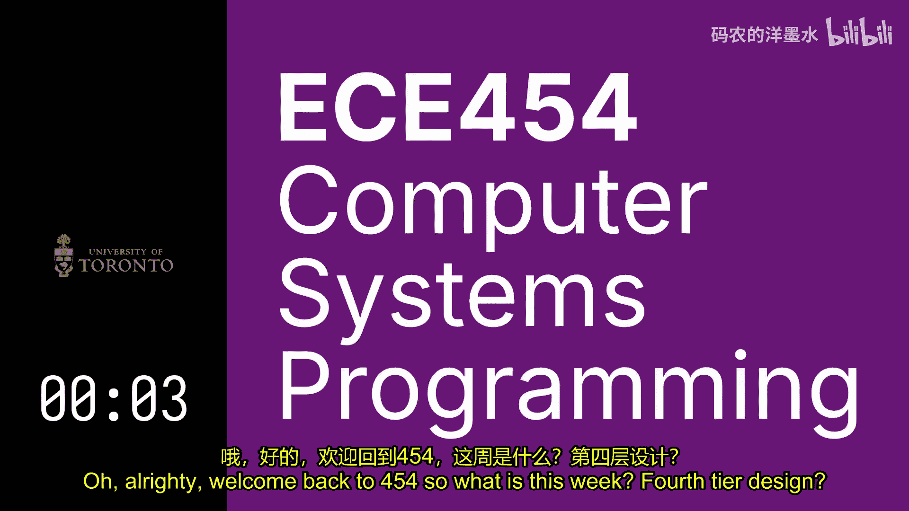
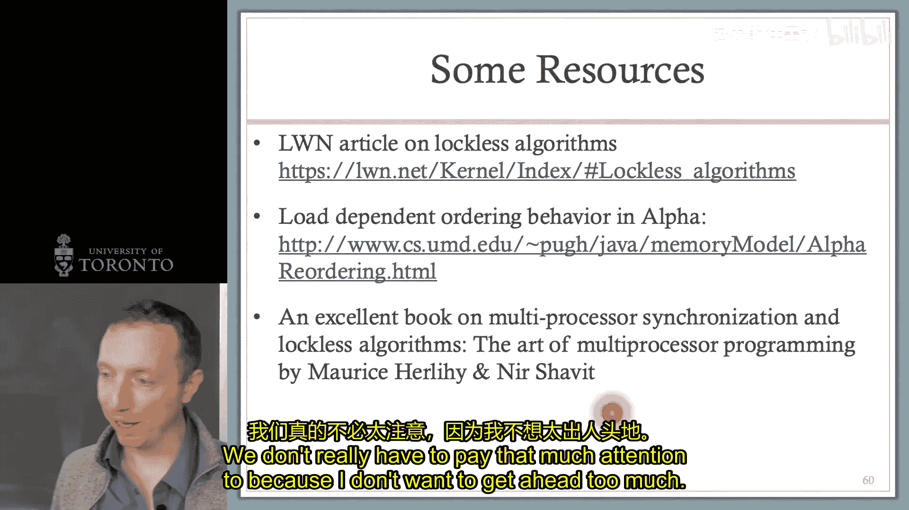

# 【全集】多伦多大学 C语言高性能系统编程实战 中英字幕 1080P p17 Lecture 17 - 无锁化 -BV1oDrZBZEG2_p17-

Alrighty， welcome back to 4，5，4。 So what is this week， fourth year design。Projects。

Where'd everyone go？Oh， well， we're closing in on the end of the course。

IhSo next topic is avoiding locks altogether。 let's see if we can get rid of them in some situations because while they have overhead and there might be cases where instead of using a muex I can skirt around the issue and not use a lock which will hopefully get me better performance so that is our next topic unfortunately I don't think you get to try it in a labs unless less lab5 where you get to do whatever you want。

Maybe use this idea for that， but other than that。You may or may not use this so little overview。

 some more challenges with locking， again， kind of review， and then non blocking synchronization。

 so being able to do synchronization without things like Mutes or Center4s。

 just trying to do them atically。😊，And then we will look over one of the heavier weight options。

Called Read copypy updatedate that's used all of the time in the Lax kernel。

 and it is quite performant。So some challenges with locking， which is kind of like review。So locks。

 if I need to make sure I don't have a data， easy thing to do。

 put any Ray code in a critical section， which is the section of code between a mutex lock and an unlock。

 then I don't have any problem with data races because only one thread can execute that at any given time。

Maybe I just don't want to read a still value， maybe I'm updating multiple things at once。

 I don't want to get some inconsistent view of memory or get interrupted halfway through doing some operations。

Locks work， but they have a lot of problems， especially if we have multiple of them。

 So first being deadlock， second， priority inversion， they're not fault tolerant convoying。

 and they're expensive even when they're。Contenended and we'll get into what each of these mean。

 So first one is a deadlock so there's always this funny picture where no one can make any progress。

 everyone's halfway into the intersection and then no one can move again and I have no idea what country this is from。

 but that is unfortunate。So textbook definition is a set of threads blocking。

 waiting for event that can only be caused with another thread in the same set。

There's really four conditions for deadlocking， two of which you can actually do something about。

 so there's circular weight。So if I have， you know I have lock A trying to get log B and then I have lock B。

 trying to get log A。 that is a circular weight。 and I also need hold and weight。

 so I need to hold on to a lock while I'm waiting to acquire another log。

 So if I have this code where I have two thread thread1 and thread2 and they do lock A。

 then B and thread1， then lock B， then a and thread2。 Well。

 it might deadlock because this thread could execute this lock acquire lock A。

 and then we could switch to thread2。 it acquires lock B， and now neither can make progress。

 So lock or thread2 tries to get lock A， which is held by thread1 and in order to make progress thread1 tries to get lock B。

 which is held by thread2， they're both stuck So deadlock is just another word for no thread can make any progress anymore So some solutions exist but add complexity I mean。

 not that much complexity。Alway acquire locks in the same order。

 so easiest thing to do even if you don't have a unique identifier。

 just acquire them by the lowest memory address first as long as you have a complete order。

 you're fine， you won't deadlock or you could add a trilock after this so you could lock A。

 do a try lock B， if you don't get it， you give up lock A， you yield。

 you wait for something and then you try and get lock。

 then you get lock A again and then you try for lock B and you can do that over and over again。

 if you want， the problem is well， well， it's slightly slow。Next one is priority inversion。

 so that means a lower priority thread gets a spin lock or something like that。

 so a higher priority thread becomes runnable preempted low priority thread it needs a lock so it spinning but the lock holder can't run and release that lock because well if I always schedule a higher priority thread instead of a lower priority thread。

 then that lower priority thread that already has a lock won't be able to run and it's blocking that high priority one so in order to fix this。

I would need to do something like priority inheritance where if it has a lock。

 and if the high priority thread depends on the low priority thread。

 I temporarily make that low priority thread a high priority thread so I can resolve that bottleneck。

I could also just disable preemption while holding a spin lock。

Mostly you would implement something like priority inheritance。Or something like that。

 Or hopefully just have a fairer solution where the low priority thread can actually run。

Other one is， it's not fault tolerant。 So if the lock holder crashes while it or gets delayed。

No one else can make progress， especially if it crashes， so if it crashes while it has the lock。

 then nothing else will be able to go ahead and get that lock or it might get delayed due to other reasons。

 so maybe it accesses new memory， which would generate a page fault or it gets preempted。

 moves on a different CPU core。Maybe it's running on an efficiency core which is way way slower who knows right so you might disable some ways you can disable some delays。

 you can pin pages in memory which is basically hinting to it that hey。

 this code is going to use it so make sure before I get into that critical section。

 everything is already in memory and I don't have to resolve any page faults or that。

Or I just make sure my critical section doesn't really have any delays and if I crash while I'm holding a lock well。

 then I just have to restart that whole process again because I cannot recover at this point。

Other one is convoying。 So threads started additional time。

Maybe they just occasionally access shared data。 I don't really need a lock。 So most of the time。

 it's uncontended， so。Most of the time it's spread out， but maybe if I delay one of them。

 well if I delay one of them， it will affect all the other ones。

 so I delay it the other one start piling up and as soon as they pile up in the line。

 then I kind of like synchronized everything together and then it's more likely they contend with each other at the end of that so likely they come up and contend yeah。

won't that just happen？Have one market。I'll pile up one time， and then they'll be spread out。

So this is don't you get this anyway。Yeah， you might sort of get the anyway this idea is more kind of contrived where it's like。

 hey they all start， you know， they're like offset by like a quarter of a second。

 they all do the thing for like a tenth of a second and then oh， you know， they're all spaced out。

 they don't contend and then one takes forever and they all pile up and now they all contend with each other again。

Kind of happens naturally， which is slightly a problem， and it's slightly a contrived example。

 but you might see this happening and this is a phenomenon that might happen。Next one。

 they're expensive， even when they're not contented。

 so even calling lock and unlock when you don't really need to most of the time。

 well there's some numbers for you， it has to do even if it's a spin lock。

 it has to do that compare and exchange and while that you needs to make sure it validates the caches and all that stuff and worst case。

 you know if it has to synchronize between different cores and things like that， it might be way。

 way， way， way， way slower than just a few handfuls of instructions。So。

That critical section efficiency too is assuming you have like no contention and no caching effects and we ignore all of that well it's going to take some amount of time to acquire the lock that critical section takes some amount of time to run and then it's going to take hopefully less time to release that lock so the efficiency is like well how much added overhead do we have。

For this critical session， when we actually take into account。Locking and unlocking as well。

 So acquiring and releasing a lock can take like 100 plus cycles， even with no contention。

 So even if if your critical section is really small， it only takes like。You know。

 even if it takes 100 cycles， well then half of your time is spent just with the lock and the unlocked。

 which might be really undesirable。So。Causes for this。 Well。

 deeper memory hierarchy is one of the problems。 So， you know， as you might imagine。

 memory is a lot slower than CPU speeds back in。1984， so before I was born。

They didn't have a cache because everything was kind of slow enough。

 instructions were slower than memory， so it didn't really matter we didn't need a cache。Since 2005。

 we've had three or four， they' played with both them， they kind of settled on three。

 but they have like three levels of cash since instructions are way， way。

 way faster than memory accesses。Most of the hardware optimizations is just trying to hide all of that and run it as quickly as possible。

 so synchronization authorizations， especially if I have to you communicate with other chords。

 execute at memory speed or whatever the last level caches that's shared between all of them。

 which would be typically L3。So we also have way deeper pipelines now。

 remember back from the other lectures so back in the day it was just fetch execute retire。

 just one instruction out a time， now we have pipelines where a whole all those operations are happening at once for different instructions。

And the whole reason we get that is to get many instructions per cycle hopefully we can get it if we have superscalear right less than one。

 ideally one， if we don't try and do anything in parallel at all so now we have like 20 I think yeah 19 stages of pipelines and in order to keep things nice and fast the CPU will execute instructions out of order to keep the pipeline full and now we know there's like store buffers and other things that come into it too which make things even more complicated。

And ideally， right anything a instructions we use for synchronization。

 we do not want them to be reordered， that's when we can put in like write barriers and read barriers and all that。

 but that's going to stall the pipeline and make things a bit slower。

 but hopefully we actually observe our instructions in the same order we have written them。

So for performance issues， most of the lock performance used to be contention。

 so techniques were developed to reduce overheads in the contented case。

 like the MCS locks we saw before that basically made it so that we all spun like every thread would spin on its own spin lock。

 so we didn't have any problems with caches between CPU cores。

 but today one of the main issues is way lessper， even when locks are always available and together with the other concerns we have about locks with deadlocking and all of that other stuff。

So。The idea here is like all performance things is the fastest thing to do is just not do it at all。

 so the idea behind has a whole bunch of different names avoiding locks， lockfr programming。

 whatever you want to call it is don't lock if we don't need to so we have some lockless synchronization。

 we can design data structures so that locks are not required using those atomic instructions to do other things or if it's really simple we can just use an atomic value itself。

So another word for this is non blocking synchronization that are used in these slide。

 So we'll keep that in mind。 But it's all the same idea， lock free programming。

So non blocking synchronization， the basics of it is do not use Mutex at all， so with locking。

Threads access a shared object or some shared resource under mutual exclusions so only one at a time with nonblocking synchronization threads all can access that object concurrently so the idea here is well maybe I just make the change hoping everything works and if there's a conflict detected I roll back so that's kind of what we saw with the MCS locks if I tried to reset it to null and some other thread came and was waiting well then I had to redo the operation and roll back and give it to the new thread。

So。For example， if I wanted to implement an atomic counter for an integer。

 well I could put you know a lock and unlock around plus plus counter。

 but another thing I could do is I can just use that that atomic compare and swap instruction we saw before so I take I save the current value of it so I do a memory read here and then I tried to swap it from that value to the next value。

 and this is assuming compare and swap will return you whether or not it swapped it yes or no， so。

If I didn't swap it。 so I wasn't able to increase it from like， I don't know，2 to a3， then I failed。

 I try and read it again。 Some other thread beat me to it。 So I'll read it again。

 Some other thread moved it from 2 to 3。 So I just do a read again。 and maybe I read it3 this time。

 and then I try to increase it from 3 to 4。 If some other thread beat me to that。

 I just retry again eventually， I will actually increment it and it will be atomic because I'm using compare and swap。

So one way you could implement it， so this is for a very simple atomic increment。

 if you have something way more complicated， like modifying multiple values in a structure，嗯嗯。

They can kind of be hidden behind a single commit point using atomic instructions so you can like we'll see that idea in a second。

 you can basically set up the structure locally， like just with the local variable or some memory that only you can access and then you do the final change in just one atomic instruction you try and swap it in kind of like again。

 like we saw with the MCS lock。So。Some example is， well， we can just have a stack。

 So our stack can be represented as like a link list with just a， just a pointer to a node。 Wait。

 Where's my mouse cursor to do。So just a pointer to a node。

 link our stack will just hold int and in order for this to work， one solution we might have is okay。

 well we'll have this。We'll represent it by just calling it a pointer to the head。

 so that is representing our stack。 and if we're using Mut。

 we'll just create a lock and then for our push where we push something on while we set the if we push the node on while we just set。

The current node we're pushing ons next to the current head and then set the head equal to the node and if we wanted to make sure we don't have eight data races。

 we could do a lock and unlock so that can't happen at the same time as a pop。So for the pop。

 we could just set the current equal to null。That should not be an int。

 That should be a node pointer， but here。It would lock。If。The head's currently pointing to something。

 then well。Then the current's equal to the head， I'm popping this element off。

 I'm removing it from the head， so current is what I want to return and I want to remove it from the list。

 so I need to point the head to the element I'm taking off next pointer， simple linkless stuff。

 and then I return the one that I have just removed。So that should work， right。

 This is a perfectly valid implementation of a stack。 Let's see how we can do it without using locks。

So without using locks， the first thing we might try is like， okay， well。

 in the push instead of locking。I will instead just try to swap the head。嗯。Swap the heads pointer。

 So the pointer of the head is what the current。呃。Current head of the list is。

 and I try and swap it to the old head of the list。And then I try and make it point to my node。

 so I do that in a compare swap， so if I fail I just retry it again if something else has beat me to it and then in the pop。

 well same thing I would first set the current equal to the head and then in a wall loop I will try and set the current change the head from current to currents next and if I have succeeded in that then I know I have removed this element so I can return the current then I change current equal to head and then I am now done so anything wrong with this。

Well， turns out there's plenty wrong with it。This is the major problem that comes up when we do try and do lock free things。

🤢，So in this scenario， P reads the head twice， so if the value of head hasn't been changed。

 the head hasn't been updated。But。Since this doesn't have a lock or anything like that。

 I can get interrupted between these two lines and。I set it up that， okay， well。

 I should be able to tell if something changes if I get interrupted between these two lines and some other thread update something。

 but the problem here is some thread might update something in such a way that I don't recognize it。

So。What that means is like， hey， if I was trying to remove， I don't know， node A。

And then I got interrupted before。Before I remove node A and then some other thread came around。

Put a whole bunch of things on the stack and then left off with node a。

 and it made a whole lot of changes。 Well， I don't know like I didn't know it made all those changes。

 I assumed it all stayed the same and we'll have an example of that。

 But that's basically the problem with this。So。Here is that example of the ABA problem。

 unfortunately not short for ABA， so let's say we have two threads， thread I and thread J。

 and they're both doing the P and the push with our lock free code， so if thread I starts pop。

Let's say our stack set up with this where the head points to a node A， A is next points to B。

 B points to C。 so from thread one's point of view， the head is currently a。

 current is also A and currents next is B and that would be saved in a register。

 let's just assume for the sake of this Now if this thread gets interrupted before it tries to swap head from current。

 which is A to B。So if it gets interrupted here， what's going to happen is。

 let's say thread J pops out A， so it is now removed from that list。Well。

 from that stack and then let's say it pops again。 So now B is removed from that list。

 and then let's say it pushes on node n。 So it's added to that stack。 and then it pushes node A。

 So now a， which is the same node as before， gets thrown back on the stack。

 So now the consistent version of our stack looks like a， then n， then C。

 but now if we switch back to thread I， Well， thread I， its head is currently a。

 from its point of view right。The head is still A2。But it it's current next to B。

 So this compare swap is going to succeed because the head is currently a again。

The other thread fish finished it off at a。 So it's a， again， It thinks nothing has changed。

 but the whole stack has changed under its nose and current next that it saved。Now shouldn't be B。

 right， it should be N， not B， but it still thinks it's B。But the compare swap is going to succeed。

 it will set the head to B， and now we are screwed because B doesn't point to anything。

It's going to set A's next to null， and then our stack is now B。

 and we've essentially lost nodes n in C。 so everyone see that。Bad problem。

 So that is one thing you have to be weary of if you try and do any lock free stuff。

So one solution to this is well with the pointer update。

 maybe I include a version number with every pointer， so instead of updating just the pointer。

 I version it with something that atomically increases all the time so anytime I modify that  point。

2 data I update that value so that when I do this atomic compare and swap then I'm doing it with a version so I can actually detect if someone else has changed if it's an old a as opposed to a new a at the top of the list。

 so in this one and pseudocode。Let's say。We could skirt around the issue if we had A at version 1。

 and then after the head was updated by the other thread， it would make a version 2。

 and then that version would make sure that when we switch back to thread I。

 it would fail because while the current value isn't A1， it's A2。So。

Some issues with that is some CPU architectures don't have- this would essentially require two words。

 a version number and a pointer number unless you pack them together somehow。

Not every architecture provides that and well， old version of the pointers also need to be free。

Maybe you can use garbage collection， some language。But if you're doing C or C++。

 it is all up to you。So。Using non blocking synchronization or lock free programming generally use it for simple like just update heavy structures。

 like a link list。 So there's actually a solution for that that you can check out on Wikipedia that you may or may not use in your lab。

 I assume you probably won't use it， but hey it's there but。The thing here is it's hard to do that。

 you probably just look up someone else's solution for that or use some other good language。

So when do we need the non blocking synchronization guarantees， Well， when we need some。

To linearize our code， so everyone agrees on all intermediate states。

We want the updates to appear instantaneous， occur in total order。

 we have like sequential order and we want reads to return the value of the last completed right。

 so if you have this， you have some dependency between operations which limits parallellyization。

So some people are like， well， do we need things to be linearizable like。

For that top program that lists all the existing process。

 do we need to know everything is actually correct all instantaneously it all happens at the same instant most of the time the answer is no。

 you don't really care if you have a stale value as long as it's consistent， you don't really care。

So this is where something comes in called read， copy updateate， and it is that whole idea that okay。

 a still value is okay as long as it is consistent。So。Details are going to get some may。

 maybe somewhat glossed over here because this was some guy's PhD thesis。

 So took them about four years to do it or longer， so。

This whole idea and this whole scheme is a key part of Linux and getting it to perform even better。

So you might have seen before like reader writer synchronizations read write locks。

 so that supports some concurrency between multiple readers and a single update。

 So readers in this case， if you have a read write lock right a whole bunch of readers can have that lock or one writer in this scenario。

 we try to be a bit more performant and we want readers to use no locks whatsoever。

 and then instead of acquiring a lock to do the write。

 our writer is just going to create a new version atomically either using atomic instructions or locking out other writers or doing it to memory that only it can access。

 and then readers。Essentially， just read old values that are still consistent。

 but they're old values。 And then hopefully as soon as we update。

 it will eventually see the new update and。This whole idea is the idea behind most scalability things it applies to。

Databases， if you heard of like no SQL or things that don't obey acid things。

 the whole point is that if you don't need things to be the most up to date value。

Then you can make things go faster。So。Let's consider， I guess this is La 4 concurrent hash table。

 so the hash function selects which entry in which index in the array to go to。

Cllliions are handled by chaining。 So a link list per bucket。 And then well。

 if we want to increase concurrency， you can use a per bucket lock or a list lock and then。Here。

 well， if most of the time they're unconttened， then。

Maybe you don't want to do this because every time you access an element。

 even if there's no contention， you have to do a lock and an unlock。

 so maybe you do not want to do that。So if we try to have a lock free version of this。嗯。

It's possible but still expensive， even if you have Read only operations。

 so if we consider some concurrent lookup and remove operations， well in this case。

 if thread1 and thread2 is trying to readN and thread2 is trying to remove n。

 well it has to go through， obtain a pointer to node n。

And then it still needs to ensure n continues to exist until T1 is done using it。

T2 must detect that n is in use and not delete it while that thread1 is using it otherwise。

 you know if it just freed that node or something like that， boom。

 that's undefined behavior and that is no good。 so you would need to go ahead and actually program against this and then things are going to be a lot slower。

So。You can do reference counting so like thread1 can increment a reference count on this。

 this is basically like C plus plus smart pointers that basically that do reference counting so that would do an atomic update for each node and then that node knows how many references there are to it and then T2 would have to defer deletion if the reference count is greater than one so if fls there's a reference to it it can no longer delete it so it might just have to go in a busy loop and just wait for the reference count to hit zero before it can delete it。

So if I have read write locks， I could also do that。 So let's say I have， in this case。

 four CPU cores。They all acquired the lock for reading， they're just all reading。

 they're all reading， and then thread。Three wants to actually write to that。Location。

 then it would this is when it tries to acquire the right lock。

 Well it would have to spin until the last reader is done as long as it's fair。

 So it has to wait until CPU1's done， then it can acquire that lock for writing such that it is the only thread running。

 But while it has that lock， all of the other CPUs or threads are blocked until that right operations done and then all the reads happen。

 So there's a lot of dead time。 I essentially made this。Well。

 I made this part essentially serial whenever I'm writing。 So ideally。

 I want a situation like this where。I don't care if I read an old value as long as it's consistent。

 so even if some CPU is doing an update or a write to it。

 I want to still be able to read on all of the other core so I don't have that deadline time。

I'm not waiting for the lock， so we'll see how this can be implemented。

So key idea here is you have kind of a use like a published subscribe ordering mechanism so that you。

The readers see consistent operations and you have atomic updates and while you might have to also maintain multiple versions of recently updated objects so that readers that are concurrent with writers will read consistent。

 although maybe old state，again as long as it's consistent。

 it's okay if it's stale and then while before I delete old versions I have to wait for all the readers to complete so if I have all those three things together then reads can perform correctly without using locks and there is a whole LWN article which if you don't know what that website is。

 post a whole bunch of Linux news all the time， sometimes good performance articles and stuff like that and it's relatively cheap and the free articles are pretty good to。

So。To understand the need for publishing and subscribing， let's just say we have something like this。

 So we have some global pointer。 It has some very more complicated structure。 And we have a writer。

 So in the writer， it mallocs some space for that structure。 And then let's say it updates。

It's field A to be equal to1。It would be able to do that by itself。 There's no data races with that。

 It's the only one that has that memory because it was just malllocked it and then it updates that global pointer to point to that new value。

 then in the reader。While the reader just reads that global pointer into a local variable and then would check。

 hey， did I read a null if I read a null， well then I have to retry。

 wait for some validated to go in there。Then if I actually， if P is not equal to nu。

 then hopefully I can actually like use that integer value。 So in this case。

 no locks are being used by the reader at all。 And well， whens it safe to dereence that G P pointer。

 A K， A  when is this safe。Guaranteed to return one， so how I have written it。Is it possible that？

PAA returns some value that is not one。Well哦。So。Turns out。There is a scenario with that。

 so let's go over it quickly， well not quickly。In this。Remember。

 we don't have right barriers or anything like that。

 So the compiler can go ahead and reorder things as much as it wants。 So if the writer reorders。

Like these two rights。Oh， oops， that's really bad。 If it updates like global pointer first before updating the field well then。

It's quite obvious that this reader。Would then be able to get the pointer。

As soon as right after the malloc and then P would not be equal to null。

 and then it would go ahead use a， which is now uninitialized。 so remember。

For most concurrently for concurrency issues between threads， you have two enemies， right。

 your compiler may reorder things and your CPU may reorder things。So， in this scenario。

Without anything else， this is where we would need like a right barrier so that we ensure that a right happened。

 all the rights happened before another one， but with this。

We can also have an issue if the reads get reordered in the reader。

 so it might try and guess the global variable and then just kind of use it and then like specively use it and then maybe it gets some old value and then well if it compares the current pointer to the one it guess。

 well， it's not equal to each other might retry。 So we would need a read barrier here as well in the reader。

 So in order to。Make it a bit easier for you to use without having to no one really likes using read barriers or write barriers。

What this does is instead of updating that and then having to have a read barrier on it。

 this is essentially the operation where I am updating that pointer to point to my newly initialized data so they define this function that's RCU assign sign pointer and that will go ahead and take care of all the memory barriers and everything for us and then for reading。

 well we don't want to really use a read barrier。All the time might。Might not be obvious。

 especially if you have to like review your code or read it again。

 you might forget what you're doing or what data refers to which。 So instead of just， you know。

Doing a straight up read of that global pointer， you just do RCUD reference GP。

It just lets you update through a pointer， you're supposed to assign pointer that will take care of all the right barriers and then dereference that pointer to actually read from it。

 that will take care of all the read barriers for you。Using it。

 it will ensure the ordering between these two things again。

It's supposed to be easier for you to use， it does all that stuff for you。

 there are some libraries that use this too this code specifically is from the Linux kernel itself。

Yourself。It's just more convenient， Yeah， it's just more convenient and someone else took care of their barriers and stuff。

 yeah。No， okay。So use all the time in the Linuxcur。

 So how this works if I want to maintain multiple versions， So like some examples using linked lists。

 I want to update it and delete nodes。Well， in this case， T1 traversing that linked list。

 T2 is trying to update an element so like we had before， so T1 is trying to read this node。

 T2 is trying to update this node so while we don't want to stall either one of them So what well do in this case is T2 would read and then make a copy of n so it would make n prime and then after that。

This would all be done locally。 so only thread2 has access to T or N prime right now。

 it can point to the next node in the list and then。Whenever we do the update， right。

 T 2 would actually read and make a copy of N。 Then for the update in thread 2。

 that would update the previous to。Point to the new node atomically。

 And it makes a copy of n because， well， now this node doesn't have any problems。

 This is the old node that was in the list， not the new node， but that's okay。 It was at least a。

 It would at least a consistent view。Before and it's okay to delete this node and and reuse that memory for something else as soon as thread1 is done with it and we'll see how to actually do that。

So。In this case， if we're trying to delete an element of the list in thread2。Well。Thread2。

 it would update that previous pointer to next and do that atomically， and now thread1。

 well that's the only thing pointing to this node N and it can delete it whenever it's done using it。

How this works。IWell， you have to wait for all the previous readers of the old stale value to finish。

 so it needs to wait for all the old readers to finish to reclaim or delete any old versions。

It uses something slightly complicated。 It's quiescent statebased reclamation。

 to handle read reclaim races。 Basically， what that means is there's some state for each thread in which that thread has no references to any shared data at all old or new and。

Also has a definition that there's some grace period。

 that's an interval that which every thread has passed through at least one of those states。

 So it doesn't It's guaranteed to not hold on to any old value， so。

It is usually just a timeout if you can kind of time these operations。

 you know that after a certain amount of time， you're guaranteed that no thread will hold an old state anymore。

 So the idea here is that those old elements are going to get removed from that data structure and reclaimed after that grace period when you're certain that no other thread holds onto any of those references anymore。

So some illustration of that is， well maybe the writer thread removes an element at this point。

 and then we have some grace period。 So these are all。Ones that are。Finish with the old value。

 so if all of them finish with the old value and are guaranteed to finish with the old value by the end of the grace period。

 which is just some timeout period， then we can actually delete that element after that point because we're sure that no other thread has read that old data。

Oh， yeah。公这个。这个。Yeah， it's kind of just like time reference count， yeah。As far as I can tell。

 maybe I'm just not no good。 but as far as I can tell， that's essentially what it is。

So how to define these states， Well it's application dependent for O kernels。

 some natural ones exist。 so you can assume that references to that data structure are whole held within like the read to write critical sections。

 So the read critical section is one like some thread is attempting to update。

That data structure that is written with this RCU paradigm and then the right critical section。

 same idea as someone would be trying to update that data structure so here you would have to assume that the read critical sessions do not block so that you're certain by the end of your time period。

 nothing is going to read oldt data and hopefully no context whiches occur within that critical section so that again you're sure that it has actually use all that stored data and does not need to use it anymore so then whenever your context switch。

 you're sure that you're done using that value you don't need to use the old value anymore。So。

In this case。2。So you don't actually have to deal with it。You can do this read lock and this unlock。

 It's not a lock variable or anything like that。 It basically in the kernel。

 how they use it is it just disables context switching within this critical section so that it actually finishes this operation can't get preempted during it and then the right。

We'll ignore it a little bit， but the right can basically detect that a read is in progress。

And then it doesn't actually delete that data that's being accessed by a writer and。

We have to do a little bit of magic to figure out when it's actually okay to free P。So。

To figure out when it's okay to delete it， we can do a writer side you have a primitive here that's called synchronize that waits until all of the read side critical operations complete so what that will do is basically for each CPU that's currently running。

 it's going to run the current thread on the CPU so that they are all doing their reads and they can actually all finish it so it runs a current thread on all the CPUs。

Forces context switching on each of them， and then it waits for that grace period。

 So it's sure they're all done reading now。So this is basically what it looks like to communicate between the reader and the writer。

 that's where you just do it through pointer， the writer assigns the pointer， the reader dereence it。

 and then to make sure that all the states agree， the readers all have to do a lock and unlock。

 which has to protect thereads， and then if the writer wants to go ahead and wait for all of those readers to finish。

 guaranteed to finish using that old data， then it does synchronize RCU and then afterward it can delete that pointer。

So this is how the code would work。In the reader， we do the readlock。Here。Then the next line。

 they have a big macro for this that hides a D reference， but this H list for each entry RCU。

Big name， basically， that will just you know iterate over the link list and do the RCUD reference for all of the next pointers。

 and then it's going to do something with that value。

Be consistent and then it would do an unlock that's when I'm done using this data structure。

And then the writer。That goes ahead and updates it while it would search the search for an element here again。

 all lock free， then K Malc is just the kernelel's version of Maloc。 It's just creating a new node。

 copy it in。Update that value to point to whatever， and then Q is my new one。

 I'm going to try and autoomically replace P with Q。That would be。

This will function we'll use that RCU assigned pointer since it's doing the writing。

 so it's just starting to try and autoomically change the list pointer。

 and then it's going to need to wait for that grace period。

 The writer is going to be slightly slower， but we're sure we can actually remove that old version of that list so。

After the synchronized， we're sure all the other reader threads are actually done using that old value that we're removing if it still has a reference to it then and only then we can free the previous version where guaranteed every thread is done with that。

H。So。To do a hash table with it， we can see that scales quite well。 So ideal scaling is。Well。

With one CPU， our speed up is one， with two CPUs， we get a linear speedup， so our speed up is2。

3 CPUs 3。 ideally， we have linear speed up with these things。

 So might be hard distinguish between which line is which， but they're all in order。

 So this one that sucks at the bottom。 that's that global read write lock。

 that's not very good because well has all of those issues。

 the BR lock and the spin BR lock slightly better。 They scale I mean， slightly better。

The best ones here are some technique that is really， really crazy。 We won't get into。

 But the best most performant one is this R C U idea， and it gets really close to the ideal speed up。

 So for performance。😊，LikeOur writers are a bit slower。

All of our readers can whole happen in parallel and well if we don't care about slightly sta data。

 we are all good。So。In the Linux kernel。Someone I check this， the graph looks pretty much the same。

 There's been a big effort to move to using RCU instead of Mutexes。

 so they started it like 2002 and you can see it's been steadily increasing for that as they change more performance coat or they try and get more performance out of it so it's still small in comparison so like mutes and spin locks and things and center4s still dominate the kernel so this is again a linear scale so there's way more but it's creep it's slowly creeping up on it。

Do。Eal code need to where。About。Cont switch lay byrate code。Yeah。Yeah。

 I'm writing the Linux kernelel。Do I not need to worry that that's？So if you're writing the  links。

 kernelel。それと。即。You still have to worry about this stuff because you have multiple things happening at once if you have multiple cores so you can't get away from it。

 you have to deal with system calls， you don't know when that's going to happen that's basically a context switch and you don't get to control that either so kernelel definitely still has to worry about these things and。

For performing ideas， I mean， the best thing to do is。If you have to write really performant code。

 just go into the length Chro and see what they did and steal their ideas yeah。

Remember the embedded coat。If you're writing embedded code and there's no OS。

 and you are writing the OS。Yeah， then just see what they're doing。Yous that part。 But yeah。

 I always say two types of software。There's software that uses E O， and there's the O。

 You are writing one of the two， yeah。Not sure if you really went over this。

Are there situations that？わ。CU， I'm just wondering like， is this gap in usage？

Because like one's easier to use or。Yeah， I mean， locking is way easier to use。

 way easier to understand and also everything's consistent。

 you won't have still values and things like that。 So some things they couldn't move to this if they need like the most consistent most up to date value you can't use this。

 right。Can't use RCU right because you get a consistent state。

 but it might not be the most up to date state。We also do something called like。

So message passing is mostly just like a form of inter processcess communication。Slightly different。

But， like。嗯。For big messages， it would essentially have the same idea where I could just point to a message and then move a pointer and do that in a lock free you way。

So same idea， yeah。code where reallying。い systems？发速ible。Yeah， they hardware。It doesn't。

Any sort of reorder？Yeah， so quit。Yeah， so the question is， hey。

 can I just like make hardware that you know， ensures like。Huge sequential。

 essentially sequential ordering。 And the answer to that is。

Probably no because no one will buy it because it's way too slow。Just way slower。 Yeah。

 it's way slower。 And then when you program， if you really need that， you can ensure it。

 you can tell it so。Like。Even if something's not sequentially consistent。

You can specify to your compiler。Make this sequentially consistent， it'll go a bit slower。

 but if you need that， you can opt into it。おさでした。Does。Yeah， that will make things way slower。Yeah。

 it's just way slower。 Yeah， so unfortunately， this is a necessary evil nowadays。All right。

 any other questions， I think that's more or less it。So when to use which tool again。

 read only situations， if the algorithm can handle concurrent reads a single update and you don't care about solid data。

 you can use RCU， this whole concept applies to everything else again， like databases。

 you might think， hey， they need to be consistent。Or I don't know。

Anyone notice like on YouTube and stuff like， you have the same video open as your friend。

 and you have two different。View counts that are wildly different。Same idea。 They don't。

 YouTube does not care that you and your friends。Has the same consistent view of a video as long as it had that many views at some point。

 they don't care， they'll just return you some old value。

So same idea can be used no matter what databases， websites， whatever。If you have some update。

 heavy situations going back to this。If you're implementing a data structure most of the time。

 you just use someone else's data structure。 but if you have simple data structures。

 you can just use straight up。Just implement with Comp and swap using lock free programming。

 if you have something way more complicated that you don't really want to argue about。

 then just do locking， use a mut textex， it's going to work。

 at least working code is better than code that doesn't work。When you only have a hammer。

 everything looks like a nail。 So just make sure you're using the right tool for the job。

 You have lots and lots and lots of different options and you can even make up your own option if you want。

 but that's more researcher stuff。 So some other resources in case you are。

Curious whole section of lockless algorithms there if you want to see other ideas for it on some。

Machines， so some architectures， they have load dependent ordering。

 so you can actually specify some reordering。 And there's lots and lots and lots of different books that you can go over to。

 and then。Yeah， and that's it for today， I to we're already really ahead of the other section。

Is everyone's Monday super busy？Yeah， if we'll make it a more or less fun lecture than that we don't really have to pay that much attention to。

 because I don't want to get ahead too much。

Oh， that pointer got huge again。