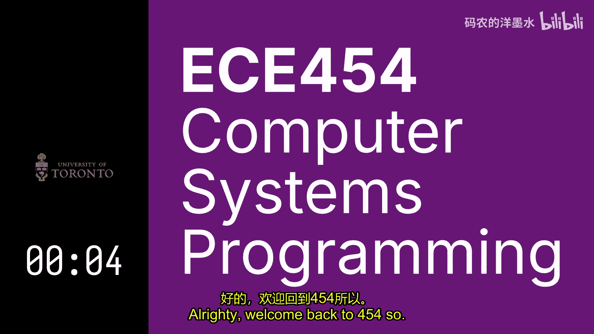
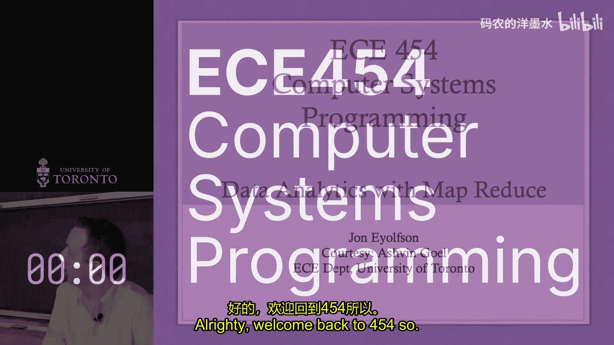
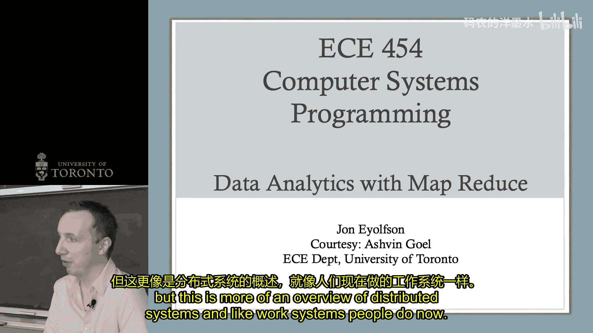
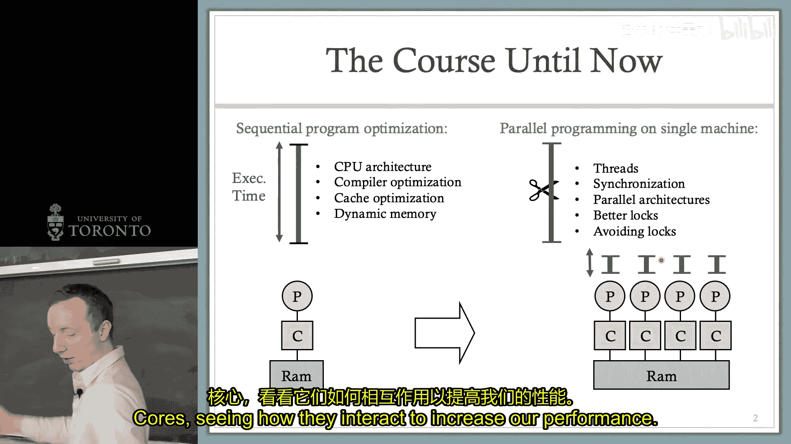
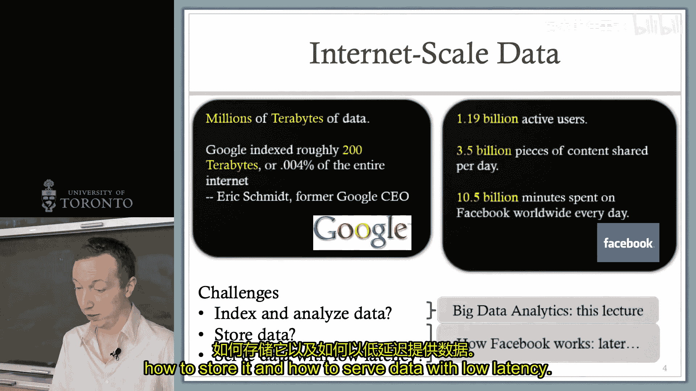
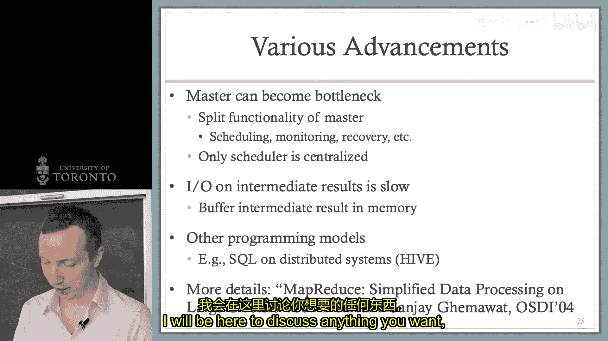

# 【全集】多伦多大学 C语言高性能系统编程实战 中英字幕 1080P p18 Lecture 18 - Map Reduce -BV1oDrZBZEG2_p18-

Alrighty， welcome back to4，5，4， so。Getting that busy time of the year。

 So I have a quick proposal for you。Friday， I propose we just cancel Friday since we're ahead of the other one。

 And then instead， I can do a two hour review session。Closer to our final。

Since our file is on the 21st or something。I propose cancel Friday。

 I'll be here for and collect feedback or anything you want to see on like one of the last lectures or anything you want to discuss to make the course better or working time for the lab or whatever you want。

How much。So today's map produce， we won't really use it distributed。

 and then there's like another bo is。Lecture on MeMCash D。Which。

Isn't super relevant because we haven't been doing web stuff。

 It previously a guest lecturer came in and gave it。So I doubt its's usefulness。

 but I can talk about it on the next Monday。 It shouldn't take me that long。

 but than that I'll get feedback and everything。 Yeah。

 what is La5 about Lab 5 is just gonna be go fast。 Here's a program go fast。 It's conways。

Conway is game of life。That now。但系点话位。It's literally Conways game of life。

Yeah and you just make it go as fast as possible， but I'll stick around。Yeah。

 I've been playing with rustt more and more。 Rus seems much， much， much better now so I can。

Talk about that more and how it will save you hassle if you actually have to do parallel programming。

 probably of course should focus more about that earlier and how not to screw it up。Anyways。

 that's a discussion for later。 let's see how quick we get through map Red today。

 so something you may or may not。Get into， but this is more of an overview of distributed systems and like work systems people do now well the idea of systems work you might get into。

So some overview of course until now， we started off talking about CPU architecture。

 compiler optimization， cache optimization， dynamic memory， all using a single thread。

 then we talked about having thread synchronization， parallel architectures。

 better locks and avoiding locks， most of it was actually exploiting these things on multiple cores。

 seeing how they interact to increase our performance。

But that's where we are， so our next step is running something in a more distributed manner which again is kind of another course。

 but some systems people are actually involved in doing this and designing these types of systems。

So Internet scale， if you're Google or Facebook or whatever。

 there's millions and terabytes and penabytes worth of data， even back when these slides were done。

 Google indexing like 200 terabytes， which is not that much of the Internet。Facebook。

 billions of users， right， we need to actually process all that data。

 so that is all called big data analytics。SoWe have to figure out how to index， analyze our data。

 how to store it， and how to serve data with low latency。

 Google searches while they've been getting worse lately， but they're at least fast。

For big data analytics。 So how do we perform simple computations on internet scale data。

 You might think of simple operations like griping， sorting。

 doing a word count of something like that。 So if I wanted to figure out。

 I don't know how many times the word potato appears on the Internet。 That might be a question。

 you might want to ask and you have to go through big data in order to find that because there is。

lot of web pages out you might also need to index pages。

 figure out who references what web pages that is partly how Google gets search results through something called PageRnk and then maybe log analysis if you know I need to analyze what's happening across multiple machines and figure out where my faults are。

So how do I figure how do I build Google easy question so how Google basically works is while Google searches you send a query to some web server。

 then some web server sends that query to a whole fleet of index servers the content inside the index servers it's similar to the index at like the back of the book just it's a giant lookup table basically tells you which page is contain what word if they match any particular search terms or keywords and then we'll be focusing on these index servers and how to actually populate them with data。

 but then the query is going to travel to the document servers which actually have all the information。

 the description of the websites， the little blurb that appears so after it figures out which one to use it'll go get that from the doc server and then serve you that as the search results so we'll just worry about indexing and actually how to actually look this。

Stuff up and figure out what website results to return。So。The two main challenges is like hey。

 if I want to search with web stages contain the word MBA or something like that。

 that is web page indexing， basically I need to crawl and analyze all web pages on the internet which you might imagine is a lot of data and basically what I want as my output is like the word that I'm searching or the keyword and then a list of URLs that contain that keyword then I might be able to figure out which web pages for a given keyword are important so after I have all my list I should probably figure out which is the most important ones so that's something called web page ranking or just page rank is what they call it so they need to find the first pages that link to the page so here is your target page and then all the pages that link to it and then I order them based off how popular it is。

 how many things link to it and how many things link away to it or。

It also links to so pay drink still kind of used， I think it's weighted a lot less now。

 but if you want to improve your search，Results on Google just link to some authoritative source and link back to your website as well。

 and then boom， you have some better pay rank。So。The indexing。

 basically how it works if you're given a list of web pages which you'll see probably probably won't fit on a single computer。

 then you figure out you create a hashmap where your key is a word and then your list is a string of URLs and then basically your algorithm might look like this so for every page and for every word on the page if I don't have a key for that word yet。

 create a new empty list and then otherwise just push that URL onto that list and this would be a list of unique URLs but。

Will just assume that the push works how we expect it to。 So if we have billions of web pages。

 we can't just write that， run it， and then it works， so。We need to paralyze it on multiple machines。

 this is more distributed， but this is what systems programmers have to deal with。

 the intricacies of this。So we have our list of web pages you would assign web pagess to different nodes or different nodes might hold the data for different web pages。

 so on one server it pars all of like the content on ESPN。com and MB。

com and then the other one pars the data from like new sites or something like that and then at the end we can merge all the results together from the different machines so here we merge our results from the blue machine in the red machine in order to get our final results and we can do this across lots and lots and lots of machines。

So this is all easier said than done， where did my mouse cursor go？So。

What I might want to do is well instead of just having a single merger that is also a bottleneck。

 so I don't want just one machine that will just merge all the results。

 so maybe I have multiple machines and they all merge results for the same keyword so I have this server merging MB and Trump and then the other one is just merging all the NFL results。

So then I get my final list by doing a final merge step or just going through all of my merge servers and that has all of my results。

 just each server has its own。Full results for its given keys。So。

The actual algorithm might look something like this so to index all the web pages。

 same ideas before I want to figure out what words are on the web pages。

 so for each web or for each page in the web pages that are on this machine I figure out each word on the web page do that list locally so all those key value pairs locally and then I have to partition the data to send it out to that merge servers。

 so I have to figure out all of my words that I have or list for in on this server and then figure it out which server to send it to for merging so an easy way to do that is while I can just。

Split it off alphabetically and send some keys to this server。

 send some keys to this server and sort it out that way or maybe have 26 servers。

 each does a different letter or something like that。And then on the merge servers。

 what they could do is just， you know， while something is sending it data。

 I receive that data and then I just merge all the results together。

 but this might have some problem where that final output， it stores results for all words。

 what about if that also doesn't fit on a single machine？Well， if it doesn't fit on a single machine。

 then I might have to， you know， group the output by word。 So I'll sort it out。

Maybe I have the same duplicate word on multiple machines and then I sort it out and then for each key that I'm computing it for。

 I'll merge it for that key and then write out the final output somewhere so I'm not holding all the data in memory at once I just have to have enough room to merge one key at a time as opposed to all of them and then I figure out I write the final output whenever I'm done with this key so are we done yet this works but it is grossly well it's not terribly fair and you know I'm not dealing with a whole bunch of implementation details that would cause performance to go down so like what if one merge server gets a lot of keys and another one doesn't get as many。

Well， the whole operation is slowed down by。Basically the weakest link in the chain so I have to also handle failures as well because multiple machines。

 they go down quite a lot or maybe their heterogeneous machines and some are slower than others and some are faster than others。

 so if a indexer is slow or fails， maybe I need to restart it that's the mapper and have all the mergers wait if a merger fails。

 well then I need to restart that merger and wait for all the mergers to finish before I'm done my operation I also have to ensure all my operations are impotent which is just a fancy word for saying same input gets the same output。

 you don't have any weird side effects or anything like that So that's also one of the nice mathhy conditions we use if we're going to paralyze something。

So that means run the operation multiple times， get the same result every single time。

 there's no weird side effects or anything like that。And then the other one， like I said before。

 if our partition is skewed， so our frequency of words is not the same then while some merge servers are going to have way more work to do than others so I will have some load imbalance and I'll have to wait for the slowest one or whatever ones loaded the most so if I wanted to this to perform better。

 I might have to repartition the output if some machines are idle maybe I give them some work to do and hopefully get some better performance but as you might imagine that is more complicated to do in practice。

 especially if machines can fail。So。The whole idea behind Google's mapre is like， okay， well。

Figuring out what。啊。Figuring out which machine should run rich operations and how to partition all the data and do all the communication。

 the failover stuff。 Well， that's the same， no matter what operations you're actually doing。

 So their whole idea behind that was well。The application programmer。

 they only really care about the map operation and the reduce operation and all the other details we can handle。

 we can create a system for that and their system is called map reduce。

 So the only burden on the programmer is to write the map operation and the reduce operation and then the system。

Figures out the rest and does all the reppartitioning， the failover and all of that。

 So you as a system programmer， you get to actually do the write the map reduce code。

 You don't actually write the map operation or the reduce operation。 You are tasked with or。

Making it easier for other people to use a very complicated system。

So this is the programming model for lots of big data analytics。

 so the programmer writes two functions， map and reduce and map， well given a key and a value。

 you actually just come out with an output key and then some intermediate value and then for reduce well you have an output key and a list of intermediate values and then you're supposed to combine all those intermediate values together to get some final output value。

 so at the end of the day。Your。All your keys and values get reduced to one out key with some value。

 so program lots of problems can be written in this way so if I wanted a word count of every single word on the internet well my map is going to be okay well I actually want to output a list where my key is a word and then my intermediate value is just the number of times that word appears on a single website and then reducing I can get that those counts from all my different websites。

And then reduce them to a final count and my reduced step would just be summing all of the counts from all the individual websites。

 And then I can figure out how many times the word potato appears on the Internet。

 So this is widely used at a whole bunch of things mostly for data analytics。 So Google， of course。

 uses it internally。 Hadoop is the open source version of it。 It's used by a lot of companies。

 and they have to analyze， you know， petabytes and petabytes worth of data a day。 And。

The kind of big breakthrough for map Red2 is。The whole idea is not to send data to a machine。

 to actually do the processing because there's way too much data。

 The whole other idea behind this is just send the map and reduce operation。

To all the servers that already have the data on them so the data itself doesn't have to move。

 I don't really want to move petabytes and petabytes worth of data just to do some simple calculation on it。

So this is what it would look like so the programmer writes the map and reduce functions and then the map reduce framework or Hadoop or whatever you want to use。

 takes care of the rest of the detail partitioning it， balancing it。

 doing failover and all that stuff so you just take your data。

 does the map operation that you specify to get a key and a value， then partitioning。Will happen。

 it will basically shuffle all of them around and figure out which servers do all of the reduce operations where all the keys get sent to dealing with all that communication and then on each reducer it just does that reduce operation for all of the keys it's responsible for。

 so I don't have to worry about that I just let the map reduce framework。

 take care of the rest of the details。So if I wanted to do something like page rank， well my map。

 I take a URL and then I have the web page content as my value and then for each word I can figure out how many times that word appears in that URL then for my reduced step I take a word I get a list of URLs so the list from each individual machine and then I can figure out how many times that word appears or which URLs that word appears on so。

With this， the mapper that， again， partitions the data to that intermediate output sends the same keys to the same reduced servers。

 and then the reducer receives all the data sorts。And groups data by key。

 and then there's some master server that's performing all the error handling。

 kind of mode this whole thing， seeing if any servers fail or anything like that。So。In this example。

 again， what we saw before， the input would be you know。

Initially URLs with all of their contents and then the macroper stage is going to find all of the words on the page and then give the URL so this machine has。

The data for ESPN。com MB。 the other machine has all of the news sites and then it figures out all of the words on those individual pages and then the reduce step here。

 the shuffler will figure out that hey， this server should send reducer one to the keys NBAA and Trump and same with Ma or two so they all those keys go to Redr1 and it will send the。

Send all of the NFL keys to reducer2。 So in this case。

 reducer one would have a lot more work to do than reducer2 but。Fairly contrived example。

 It would do some rebalancing if it needs to， if there were many， many， many keys。

 So maybe if this one。Finish really quick， maybe it sends a keys MBA to reducer two or something like that。

We can also， oh， yeahep。On the market。Why do we。对。So why do we have two separate MB ones。

 Because these inputs， they could be done on different machines。 So the map stage just。

Just dumbly does the map operation， even if you could technically merge it on the same machine because it has that data。

I could do this ESPN and MBA on two different servers as well， right？So it shouldn't matter。好。他要短去。

Yeah， so this one would be sending more data， but in terms of operation， this is correct。 but yeah。

 you're right。In this case， it could like do partially reduce it before sending it out。

 But that's an implementation thing。 That's what the system would have to do。

 But the system would probably actually do that and do like。

Some partial meing on the same machine if it has the same keys。And just send that out。

So other things we could do reverse Web links with map produce。 So in this case。

Again we just define our map and our reduce operation so for our mapping our input is a URL the webp page content as before and if we want to reverse web links we could admit you figure out all the links from this website and then output all the links on this website and then the current URL so we're just reversing the order and then our reduced step what our key would be the same target URL now we would get a list of URLs and we have to decide how to reduce them all to a single value and then in this case my single output value is just going to be a simple list of all of them I'm just going to merge them all together and merge all my unique entries so at the end of the day I have for a target URL everything that links to it so I can kind of figure out how important it is and how authoritative it is because it means that people are probably citing this。

As a source of truth， more or less。So。This is。Here what it does， take the input， split it。

 maybe it's a whole bunch of files， maybe it's data already on the server， split it off。

 maybe onto separate workers， and then here I can do all the map operations on my workers and all I have to do is run my user program up here that communicates to some master server that basically coordinates the whole thing it'll periodically check if any of the map servers have failed or any of the reduced servers have failed and resend the output。

Then， you know， after it figures out what to split， sends it all the data to the worker。

 maybe like you said， if there's。Some data for the same keys already on that machine。

 maybe I optimize it a bit that I combine the keys locally。

 then send them all off to the reducer stage and then I would write the final output across different files to get my final result。

So。To handle failures， it's really common in distributed systems。 If you're running a data center。

 So like one node crashes per day。 And if I have。100 or sorry 10。

000 node cluster then that's relatively small nowadays and here if I have a worker failure。

 how this works is well there's a single point failure。

 there's that master server that detects worker failure by periodic heartbeats。

If you've heard of Kubernetes or anything like that。

 basically the same thing Kubernetes does it'll just poke servers over and over again and say， hey。

 are you dead， are you dead， oh， you're dead， okay。

 I should probably relaunch a container on a different server that's alive。

And so basically they'll do the same thing I'll re executeecute map and reduce tasks if some results are not available here I do have a single point of failure with that master server。

 it's going to have some periodic checkpoints it writes out and then basically。

All I do is recover from a checkpoint， I hope that it doesn't fail， if it does fail， I just rewind。

 go back in time a little bit and redo some calculations。

 hopefully the master server does not go down。So they've。Tried this out。

 They have lots Google has lots of machines。 So doing a single calculation。

 they lost like most of the machines，1600 of 1800， but it's still finished。

 just had to redo a whole bunch of operations。So some refinement they could do is like。

If you have any really slow workers， they lengthen the entire completion time called Stragglers might be caused by a few different regions。

 other jobs or consuming resources on the machine， maybe they're running some other virtual machines or something like that。

 maybe I have bad disc with software errors， transferring data。

 maybe they're in a raid configuration， some drive is dead。

 so it's kind of in degraded performance mode， maybe I have some software bugs， who knows。

So the solution as part of the mapprod framework， if it's near the end of a phase。

 it will have like backup copies of a task and whichever one finish is first win。

 so if there's any servers are otherwise idle， it will send the same task to those otherwise idle servers and if they beat the stragglers。

 then whatever they win and my whole operation goes faster， if。If。

The original one finishes first anyways， well I didn't make it slower。

 I just wasted a bit of power doing a bit of redundant work。So。

Some refinement I could have is exactly like you said before。

 so if I have you know multiple MBA keys on Mapper one， then maybe I save some network bandwidth。

 I combined the keys all on the machine before I send them out， that is also something we could do。

Other advancements we could do that master server can become a bottleneck so I could split the functionality of it。

 I can figure out different scheduling， monitor， recovering， etc cea。

 and then only have one centralized scheduler instead of having one server doing monitoring and recovering and everything I just have。

My point of failure much， much smaller， and then maybe the IO on intermediate results is slow so we can do what we've done before and just buffer things in memory。

I might have other programming models like SQL on distributed systems。

 so I get all my data straight from an SQL database and there's lots of details。

 there's a white paper on it。It's actually a fairly small read that is pretty interesting if you want to see what systems papers kind of look like。

That's it。Friday， we are well ahead of the other one。 So Friday。

 I will still be here if you want to come and discuss future labs or things we want to do Friday or the thought of。

😊，Moving stuff to rust， which I think is a good idea。 I will be here to discuss anything you want。

 but no content or anything we will play catch。

