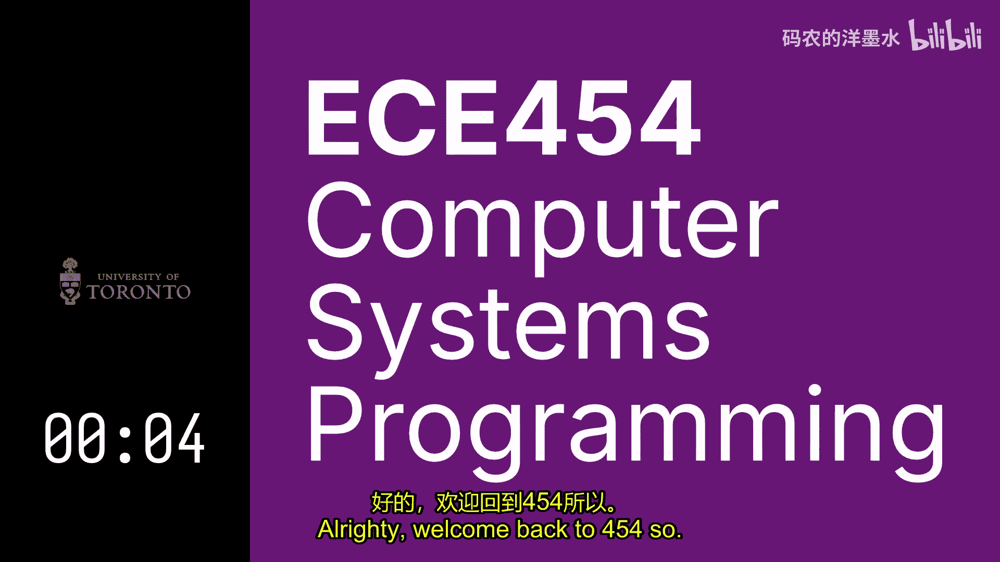
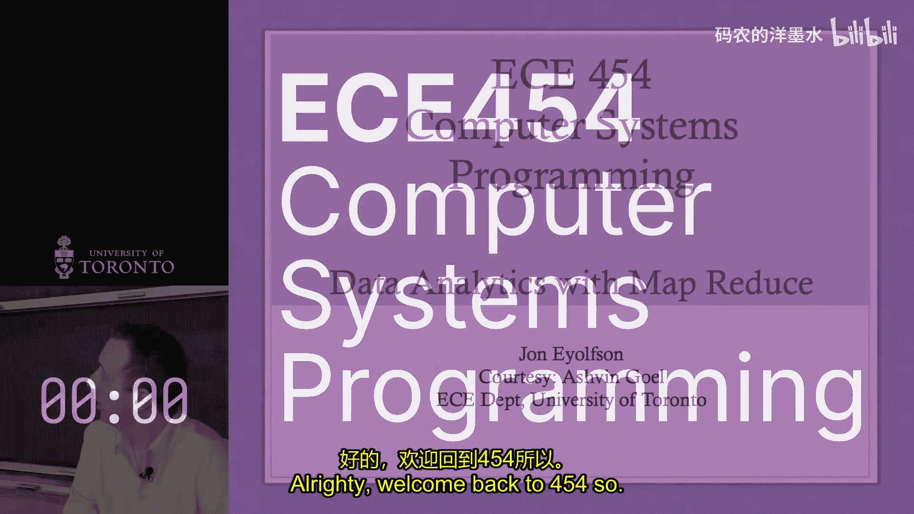
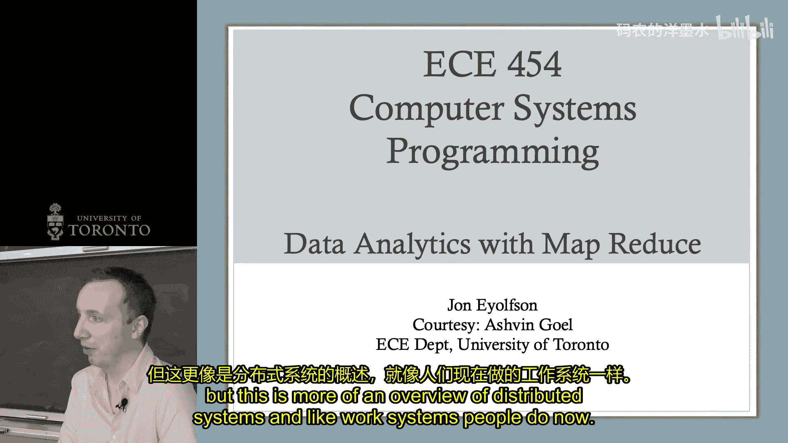
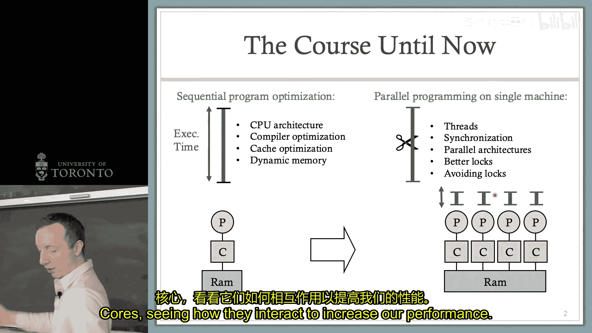
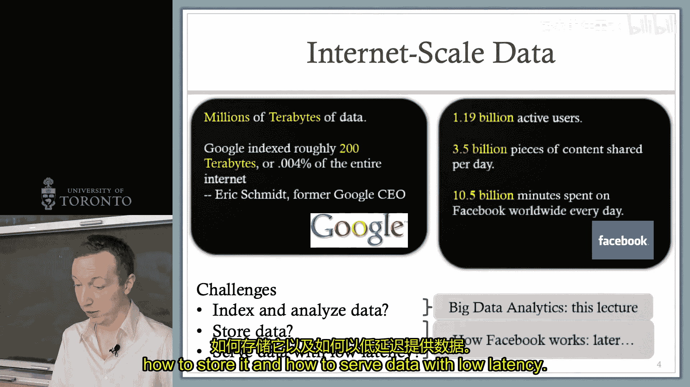
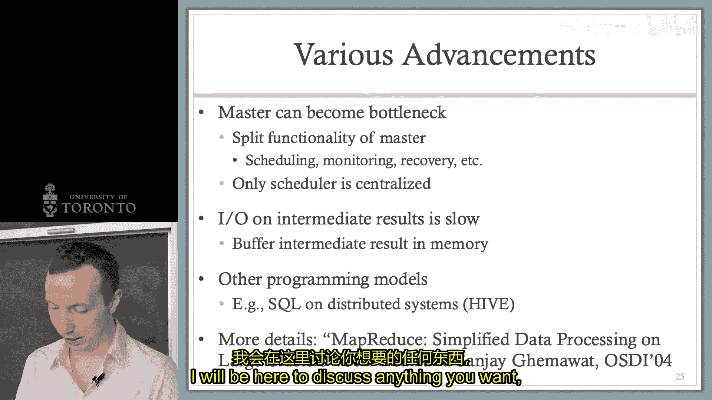

# 高性能系统编程实战：18：Map Reduce





## 概述
在本节课中，我们将学习Map Reduce编程模型。这是一种用于处理海量数据的分布式计算框架，由Google提出并广泛应用。我们将了解其核心思想、工作原理以及如何通过定义简单的`map`和`reduce`函数来处理复杂的大数据任务。



---



## 课程背景与当前进展
到目前为止，我们的课程涵盖了CPU架构、编译器优化、缓存优化、动态内存管理等单线程性能主题。随后，我们探讨了线程同步、并行架构、更好的锁机制以及如何避免锁，主要关注如何在多核系统上利用这些技术来提升性能。



现在，我们将进入分布式计算领域。虽然这本身是一门更深入的课程，但系统程序员常常需要参与设计和构建这类系统。

---

## 大数据分析的挑战
在互联网规模下，像Google或Facebook这样的公司需要处理数百万TB甚至PB级别的数据。这被称为大数据分析。我们需要解决如何索引、分析、存储数据，并以低延迟提供服务的问题。

例如，Google搜索虽然可能变慢，但至少是快速的。那么，我们如何在互联网规模的数据上执行简单的计算呢？比如`grep`、排序或单词计数。如果你想统计“potato”这个词在互联网上出现了多少次，就需要处理海量数据。

---

## Google搜索的工作原理
当用户进行Google搜索时，查询被发送到Web服务器，然后Web服务器将查询转发给一组索引服务器。索引服务器内部类似于一本书的索引，它是一个巨大的查找表，告诉你哪些页面包含哪些单词。之后，查询会转到文档服务器，获取网站的描述信息，最终呈现为搜索结果。

我们将重点关注索引服务器，以及如何用数据填充它们。

---

## 构建索引的挑战
构建索引主要有两个挑战：
1.  **网页索引**：需要爬取和分析互联网上的所有网页，这是一个巨大的数据量。最终输出是关键词及其对应的URL列表。
2.  **网页排名（PageRank）**：在获得URL列表后，需要确定哪些页面最重要。PageRank算法通过分析指向目标页面的链接数量和质量来进行排序。

一个简单的索引算法可能如下所示：
```python
for page in all_pages:
    for word in page:
        if word not in hashmap:
            hashmap[word] = []
        hashmap[word].append(page.url)
```
然而，面对数十亿网页，我们无法在一台机器上运行这个程序。我们需要在多台机器上并行处理。

---

## 分布式索引的思路
我们可以将网页列表分配给不同的节点（服务器）进行处理。例如，一台服务器处理ESPN.com和NBA.com的内容，另一台处理新闻网站的内容。最后，我们将来自不同机器的结果合并。

但这里存在一个问题：如果只有一个合并节点，它会成为瓶颈。因此，我们可能需要多个合并服务器，每个负责合并特定关键词的结果。例如，一个服务器合并“NBA”和“Trump”的结果，另一个合并“NFL”的结果。最后再进行一次最终合并。

然而，这种方法存在几个问题：
*   **负载不均衡**：如果某个合并服务器分配到的关键词特别多，它会拖慢整个流程。
*   **故障处理**：在多机环境中，机器故障很常见。如果索引器（mapper）或合并器（reducer）失败，需要重启并等待。
*   **幂等性**：操作需要是幂等的，即相同的输入总是产生相同的输出，没有奇怪的副作用。
*   **数据倾斜**：如果单词频率分布不均，会导致某些服务器负载过重。

---

## Map Reduce 的核心理念
Google的MapReduce框架的核心思想是：**将数据处理逻辑与复杂的分布式系统细节分离**。

应用程序员只需要关心两个操作：
1.  **Map操作**：处理输入键值对，生成一组中间键值对。
2.  **Reduce操作**：将所有具有相同中间键的值合并起来，产生最终输出。

而系统框架（如Hadoop）则负责处理数据分区、负载均衡、故障恢复、机器间通信等所有复杂细节。这样，系统程序员的任务是构建和维护这个强大的框架，让其他开发者能轻松使用。

---

## Map Reduce 编程模型
程序员编写两个函数：
*   **Map函数**：输入是 `(key, value)`，输出是一系列 `(intermediate_key, intermediate_value)`。
*   **Reduce函数**：输入是 `(intermediate_key, [list of intermediate_values])`，输出是合并后的最终值 `(intermediate_key, final_value)`。

许多问题都可以用这个模型表达。例如，统计互联网上每个单词的出现次数：
*   **Map**：对于每个网页，输出 `(word, 1)` 对（表示该单词在此页出现一次）。
*   **Reduce**：对于每个单词，将其所有的 `1` 累加，得到 `(word, total_count)`。

MapReduce的一个重大突破是 **“将计算移动到数据附近”**。与其在网络上移动PB级的数据，不如将`map`和`reduce`操作发送到已经存储数据的服务器上执行。

---

## Map Reduce 工作流程
1.  **输入分片**：框架将输入数据分割成多个片段。
2.  **Map阶段**：多个工作节点并行处理各自的数据分片，执行用户定义的Map函数，生成中间键值对。
3.  **Shuffle与分区**：框架根据中间键将所有数据重新分区和排序，确保相同键的数据被发送到同一个Reduce节点。
4.  **Reduce阶段**：Reduce节点接收属于自己负责的键的所有值，执行用户定义的Reduce函数，生成最终输出。
5.  **输出**：最终结果被写入文件系统。

整个流程由一个主节点（Master）协调，它监控工作节点的状态，处理节点故障。

---

## 示例：反向网络链接
我们可以用MapReduce找出指向某个特定URL的所有链接（反向链接）。
*   **Map**：输入 `(source_url, page_content)`。找出该页面中的所有出站链接（`target_url`）。对于每个 `target_url`，输出 `(target_url, source_url)`。
*   **Reduce**：输入 `(target_url, [list of source_urls])`。输出 `(target_url, merged_list_of_source_urls)`。这样我们就得到了每个目标URL的所有来源链接列表，可用于计算其权威性。

---

## 容错与优化
*   **工作节点故障**：主节点通过定期心跳检测节点故障。一旦发现，会在其他可用节点上重新执行失败的任务。
*   **主节点故障**：主节点会定期将状态检查点保存到可靠存储。如果主节点失败，可以从检查点恢复。主节点是单点故障，但实践中其故障率远低于工作节点。
*   **处理“慢节点”**：在任务阶段接近结束时，框架可能会将剩余任务复制一份发送给空闲节点执行。哪个先完成就采用哪个的结果，这可以防止个别慢节点拖慢整体进度。
*   **Combiner优化**：在Map阶段，如果同一个节点上生成了多个相同的中间键，可以先在本地进行部分合并（Combiner），减少需要网络传输的数据量。

---



## 总结
本节课我们一起学习了MapReduce分布式计算框架。我们了解了其产生的背景——处理互联网级别的海量数据，以及其核心设计思想：通过让程序员仅定义`map`和`reduce`两个函数，由系统框架自动处理分布式环境下的数据分区、任务调度、故障恢复等复杂问题。我们还通过单词计数和反向链接的示例，理解了MapReduce的编程模型和工作流程。最后，我们探讨了框架为实现高效可靠运行所采用的一些关键容错和优化机制，如节点故障处理、慢任务备份执行等。MapReduce是理解现代大规模数据处理系统的重要基石。